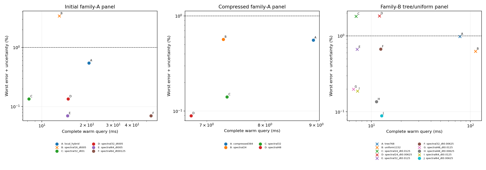
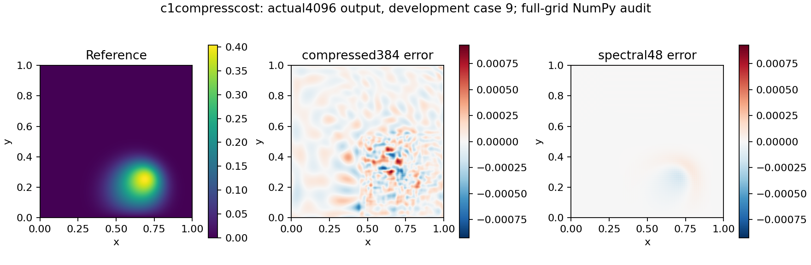
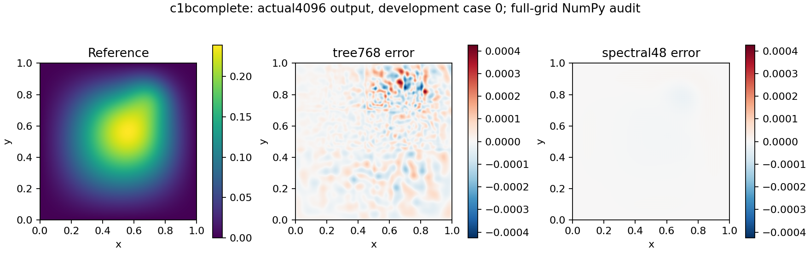

# Burgers continuation: physical accuracy and complete query cost

Measured development evidence from the authorized continuation beyond A0. Completed numerical results are retained; active cells and unfinished qualifications are identified below. The required accuracy and speed objective has not been declared achieved.

## Contract and scope

Each physics query receives the same resident initial-field array and viscosity and returns one final field on exactly4096×4096 nodes. Errors are evaluated at all five prescribed evolved times against qualified independent references, normalized by the initial reference norm. The target is1% per trajectory including reference uncertainty. Projection diagnostics use known future fields only for assessment; PDE queries do not. Final unseen tests remain closed.

C1 replaces the biased coarse upwind operator with a separately qualified continuous sine weak Galerkin formulation and ETDRK4 time integration. FamilyA uses the registered TRAIN128/DEV32 prefixes; familyB initially uses its own TRAIN32/DEV8. This expands training coverage independently from the operator change. A0 checkpoints remain preserved and their selector branch remains closed.

## Matched complete-output timing

All times below include input restriction, initialization, input-dependent selection, PDE advancement, final dense decoding and synchronization. Timing uses two randomized blocks of five repetitions per case. Reusable full-policy cache setup and cold calls are reported separately; offline training is not hidden inside a warm-time speed claim. Different panels are separate allocations, so compare paired methods within a panel.

### Initial family-A panel

|Method|Worst physical error|With reference uncertainty|Median warm time (ms)|All accuracy controls pass|
|---|---|---|---|---|
|local_hybrid|0.5271%|0.5460%|20.627|True|
|spectral16_dt005|3.3864%|3.4053%|13.077|False|
|spectral32_dt01|0.1158%|0.1348%|8.197|True|
|spectral32_dt005|0.1156%|0.1346%|14.963|True|
|spectral64_dt005|0.0508%|0.0698%|14.858|True|
|spectral64_dt00125|0.0510%|0.0699%|53.581|True|

local_hybrid / spectral32_dt01 median time ratios by block: 2.529, 2.524. Paired case-bootstrap95% intervals: [2.487, 2.549], [2.504, 2.546]. Useful-speed gate: **False**; substantial-speed gate: **False**.

Reusable cache preparation: 7.606s. A warm method that is already slower has no positive break-even query count after adding nonnegative setup/training cost.

### Compressed family-A panel

|Method|Worst physical error|With reference uncertainty|Median warm time (ms)|All accuracy controls pass|
|---|---|---|---|---|
|compressed384|0.5380%|0.5569%|8.935|True|
|spectral24|0.5473%|0.5663%|7.271|True|
|spectral32|0.1219%|0.1409%|7.334|True|
|spectral48|0.0703%|0.0892%|6.755|True|

compressed384 / spectral48 median time ratios by block: 1.353, 1.342. Paired case-bootstrap95% intervals: [1.291, 1.389], [1.294, 1.368]. Useful-speed gate: **False**; substantial-speed gate: **False**.

|Method|First-case cold query (s), excluding reusable cache|
|---|---|
|compressed384|20.490|
|spectral24|4.326|
|spectral32|4.354|
|spectral48|4.319|

Reusable cache preparation: 6.653s. A warm method that is already slower has no positive break-even query count after adding nonnegative setup/training cost.

### Family-B tree/uniform panel

|Method|Worst physical error|With reference uncertainty|Median warm time (ms)|All accuracy controls pass|
|---|---|---|---|---|
|tree768|0.9532%|0.9807%|78.188|False|
|uniform1152|0.6112%|0.6261%|112.506|False|
|spectral24_dt0.0125|1.7866%|1.8141%|7.007|False|
|spectral24_dt0.00625|1.8024%|1.8298%|12.055|False|
|spectral32_dt0.0125|0.6447%|0.6643%|7.189|False|
|spectral32_dt0.00625|0.6458%|0.6707%|12.432|True|
|spectral48_dt0.0125|0.1714%|0.1989%|6.577|False|
|spectral48_dt0.00625|0.1146%|0.1362%|11.235|True|
|spectral64_dt0.0125|0.1607%|0.1882%|7.249|False|
|spectral64_dt0.00625|0.0611%|0.0886%|12.695|True|

tree768 / spectral48_dt0.00625 median time ratios by block: 6.994, 6.928. Paired case-bootstrap95% intervals: [6.924, 7.059], [6.765, 7.151]. Useful-speed gate: **False**; substantial-speed gate: **False**.

uniform1152 / spectral48_dt0.00625 median time ratios by block: 10.072, 9.990. Paired case-bootstrap95% intervals: [10.009, 10.189], [9.688, 10.296]. Useful-speed gate: **False**; substantial-speed gate: **False**.

|Method|First-case cold query (s), excluding reusable cache|
|---|---|
|tree768|21.119|
|uniform1152|18.738|
|spectral24_dt0.0125|4.175|
|spectral24_dt0.00625|4.004|
|spectral32_dt0.0125|4.202|
|spectral32_dt0.00625|4.205|
|spectral48_dt0.0125|4.364|
|spectral48_dt0.00625|4.244|
|spectral64_dt0.0125|4.367|
|spectral64_dt0.00625|4.296|

Reusable cache preparation: 40.835s. A warm method that is already slower has no positive break-even query count after adding nonnegative setup/training cost.

The dashed line is the1% target. Crosses indicate a failed or incomplete numerical qualification, not eligible matched-accuracy speed competitors.

Independent NumPy audit uses every4096×4096 value; plotting alone is subsampled. The deliberately incorrect final-field normalization is rejected: True.

Independent NumPy audit uses every4096×4096 value; plotting alone is subsampled. The deliberately incorrect final-field normalization is rejected: True.

## Capacity, integration and conditional-frame studies

|Compressed coordinates|Quadrature order|Time step|Worst error + uncertainty|Quadrature change|Half-step change|
|---|---|---|---|---|---|
|384|128|0.0125|0.5559%|0.0019%|0.0398%|

Only passing compression settings are shown here; every failed setting remains in the evidence snapshot. Compression changes the trial space. Smaller quadrature for the unchanged bank and the first positive empirical quadrature rules failed; DECISION-C1-INTEGRATION.md closes those recipes. Increasing training alone is not treated as an operator repair.

|Frame recipe|Global + local coordinates|Worst projection|Evolved finer-grid score change|
|---|---|---|---|
|diffusive_transferred|64 + 64|7.2153%|0.0088%|
|initial_aligned|64 + 128|6.8914%|0.0044%|
|initial_transferred|64 + 64|5.4090%|0.0058%|

The first conditional frame, geometry-only repair and newly aligned neural teacher all fail representation before rollout. The aligned teacher uses only training data. Its decreasing training objective does not establish development generalization. These checkpoints are preserved and this recipe is closed; no PDE or speed claim is inferred.

## Neural and non-neural controls

These local ablations hold global rank, selected patches and nominal coefficient count fixed. They are prepared-input PDE diagnostics, not complete-query timing winners. The local-POD teacher uses bilinear interpolation and is not claimed to be an optimal smooth basis.

|Local feature family|Worst projection|Worst PDE error|
|---|---|---|
|local_pod|0.4891%|0.7122%|
|neural|0.6744%|0.9331%|
|poly|0.6998%|0.8794%|

|Comparator|Training provenance|Worst PDE error|Scope|
|---|---|---|---|
|Historical direct bank rank128|frozen historical training|6.5718%|all development cases|
|Historical direct bank rank384|frozen historical training|2.1953%|all development cases|
|Historical direct bank rank512|frozen historical training|1.6411%|all development cases|
|POD rank128|matched training|18.6052%|all development cases; span-limited|
|POD rank256|matched training|8.5678%|all development cases; span-limited|
|POD rank384|matched training|4.8824%|all development cases; span-limited|
|POD rank512|matched training|2.6164%|all development cases; span-limited|

The historical latent head has worst finite-start optimized projection 5.6723%. It was first reproduced with its inherited algorithm in A0; the C1 continuous-operator variant is explicitly a different online algorithm, not a reproduction or matched-data retraining.

|Nonlinear manifold|POD truncation|Encoder error|Optimized projection|Max gradient residual|
|---|---|---|---|---|
|POD autoencoder|0.4638%|16.8440%|16.8396%|5.92e-10|
|Whitened wider repair|0.4638%|16.7492%|16.7167%|1.26e-07|

Finite-start latent optimization is not a proof of globally optimal manifold distance. Encoder reconstruction, optimized projection and actual PDE solves are distinct measurements.

|Autoencoder PDE diagnostic case|Worst evolved error|
|---|---|
|0|2.9652%|
|9|18.7507%|

Matched-data global coordinate-neural banks have their own TRAIN-only POD teachers. Exact POD controls use the same data. Projection failures receive only the prospectively specified diagnostic PDE cases; their PDE column is not an all-case score.

|Family|Global bank|Worst projection|Worst diagnostic/PDE error|PDE cases|
|---|---|---|---|---|
|A|neural|0.5632%|0.6951%|32|
|A|POD|0.4638%|0.5098%|32|
|B|neural|6.3316%|2.3483%|2|
|B|POD|12.3389%|2.2686%|2|

## Allocation, limitations and reproducibility

Completed allocation: **3.03000 GPU-hours** across 41 terminal jobs. The registered finite cumulative ceiling is 8.35583 GPU-hours; it is an accounting limit for this batch, not a user-imposed total cap. Failed numerical recipes are included. Active/pending ledger entries: c1bcontrols (7347300), c3globalcompress (7347331).

All owned jobs use isolated paths, A10080GB preflight, float64 and highest matrix precision. At most two owned GPU jobs run concurrently. The branch is `exp/2026-11-17-burgers-quadtree`, backed up through `codeonly/exp/2026-11-17-burgers-quadtree`; no implementation merge occurred. Raw outputs, trained weights, checksums, source commits and failures are retained. Large derived arrays remain explicitly remote-only where indicated by retention manifests.

No final-test, wider-seed, output-size scaling, five-dense-output or host-transfer superiority claim follows from these development panels. Those confirmation panels remain gated by a feasible accuracy/cost candidate. The bounded quadtree replaces refined parents and selects a fixed tree from initial data; it does not demonstrate online temporal refinement or state transfer. Failure of these finite recipes does not exclude other neural architectures, adaptive solvers or PDE regimes.

Reproduce report tables with the implementation lane’s `reports/build_report.py --publish`; numerical drivers, prospective amendments and `cluster/ledger.json` identify the inputs and jobs. The evidence snapshot beside this report and its SHA manifest make the reported values auditable.

## Glossary

- **Projection:** best fitted coefficients for a known reference field; a representation diagnostic, not a forecast.
- **PDE solve / rollout:** advance the prescribed initial field using the governing differential equation.
- **ROM / NM-ROM:** reduced-order model / nonlinear-manifold reduced-order model.
- **POD:** a linear basis fitted to training snapshots.
- **Encoder:** network that maps a field to latent coordinates; optimized projection additionally adjusts those coordinates.
- **Quadrature / integration order:** numerical sampling used to evaluate the weak PDE operator.
- **Half-step / finer-grid change:** change after refining time or spatial evaluation; separate from reference error.
- **Reference uncertainty:** conditional error estimate from independent convergent space/time ladders.
- **Worst error:** maximum across the prescribed evolved times and cases, normalized by each initial reference norm.
- **Warm query:** repeated solve after reusable compilation/cache preparation. Cold and setup costs remain separate.
- **Time ratio:** ROM time divided by eligible classical time; below one is faster.
- **Case bootstrap:** resampling whole trajectories to estimate uncertainty in the median paired ratio.
- **Coordinates / rank:** number of active reduced coefficients.
- **FamilyA / familyB:** the registered Gaussian and more localized boundary-compatible Burgers populations.
- **Development / final test:** data used for architecture selection / untouched data reserved for frozen confirmation.
- **Quadtree:** a square partition whose cells can be divided into four children.
- **GPU-hour:** one allocated GPU for one hour, including setup and failed recipes.
