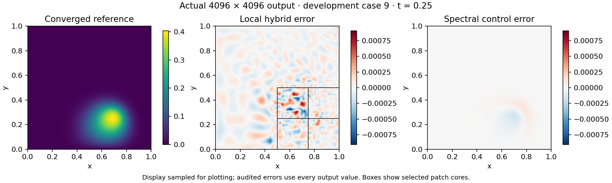

# Burgers continuation C1: measured progress and remaining cost problem

The campaign remains active. These are development results, not final-test confirmation. A0's failed checkpoints remain closed and preserved. C1 fixed the identified operator bias, expanded familyA to train128/dev32, and implemented separate familyB train32/dev8 studies. New trial-space compression and input-conditioned local-frame studies are active; no merge or unseen-test access has occurred.

## Physical accuracy and actual output

The selected initial-field four-patch hybrid uses coarse256 plus32 polynomial and32 trained neural features per patch:512 online coordinates. Its continuous weak equations use projected diffusion and ETDRK4. It reaches **0.5271% worst error on all32 development trajectories at actual4096 output**, or **0.5460% including conditional reference uncertainty**. The metric is the largest error at t=.05,.10,.15,.20,.25, normalized by the reference initial-field norm. Initial representation errors are reported separately.

Independent FD space/time ladders and spectral checks pass on the expanded panel, including scoring at actual4096 nodes. Rebuilding the physical local features atN256 instead ofN128 changes evolved fields by at most0.010913%; worst PDE error remains0.5255%. Quadrature and half-step changes are recorded separately. An independent NumPy audit reproduces the saved4096 final witness and rejects an intentionally incorrect final-field normalization.

The figure shows the final state, not the worst-time error. For case9, final errors are0.07487% for the local hybrid and0.01549% for the displayed spectral64 control. Metrics use all16,777,216 output values; only the plot is sampled.

## Complete-query timing: accurate but slower

The same-allocation panel gives every method the same resident4096 initial array and viscosity, and returns an actual resident4096 final field. Local timing includes initial-array selection, restriction, coefficient initialization, PDE evolution and reconstruction. Every method uses a separately checked boundary-aligned bilinear output policy. Saving diagnostic files is outside this resident-output contract; allocation accounting includes that work.

| Method | Worst physical error | Median complete warm query |
|---|---:|---:|
| Four-patch hybrid512, Gauss128, dt=.005 |0.5271%|20.63ms|
| Spectral16, dt=.005 |3.3864% — fails|13.08ms|
| Spectral32, dt=.01 |0.1158%|8.20ms|
| Spectral32, dt=.005 |0.1156%|14.96ms|
| Spectral64, dt=.005 |0.05084%|14.86ms|
| Spectral64, dt=.00125 |0.05099%|53.58ms|

Two independent blocks each contain five randomized-order repetitions per case. Against the fastest eligible setting in this panel, the primary median **local/classical time ratios are2.529 and2.524**, with paired case-bootstrap95% intervals[2.487,2.549] and[2.504,2.546]. Zero of32 cases are faster in either block. This fails both useful and substantial speed criteria. Reusable local table preparation takes another7.61s; cold query timings and all raw repetitions are retained. The data/POD and original local-training/screen allocations took106s and138s respectively; these inclusive job totals are not isolated optimizer timings. Failed variants are also included in the campaign ledger. No amortized speed advantage is supported for this recipe.

Later classical mode/time tuning is a separate accuracy screen, not a cross-allocation speed comparison. N24/32/48 atdt=.0125 pass the physical, half-step and nonlinear-integration checks. Theirdt=.025 settings fail the half-step criterion despite some acceptable raw physical errors. A final paired comparison must include the fastest eligible updated control.

## What failed in attempts to reduce work

Smaller quadrature for the frozen512-coordinate hybrid does not preserve its operator accuracy. Atdt=.0125, orders48/64/80/96 produce worst errors plus uncertainty46.37%/32.28%/12.72%/4.61%. Order128 passes at0.5494%. Only the full-coarse256 policy passes all registered accuracy/integration/time gates; reducing coarse rank under the three initial-width policies does not. Increasing the step to.0125 is admissible, but its~8ms prepared-coefficient solve is not a complete-query speed win.

The first TRAIN-only positive empirical rules, with128/256 points, give worst PDE errors61.35%/59.81%, zero qualifying cases, and large unsketched training-flux errors. They remain finite and are retained as numerical failures. `DECISION-C1-INTEGRATION.md` closes these two sampling-reduction hypotheses for the unchanged space. New constrained trial spaces are explicitly different architectural hypotheses.

## Comparators and feature ablations

All local rows below use the same coarse256, same four selected patches and512 nominal coefficients. These are prepared-input continuous PDE diagnostics at refined quadrature/time settings; only the mixed-bank row has the full4096 timing qualification above.

| Local feature family | Worst projection error | Worst PDE error |
|---|---:|---:|
|64 polynomial per patch|0.6998%|0.8794%|
|64 trained neural per patch|0.6744%|0.9331%|
|64 local-POD teacher columns per patch|0.4891%|0.7122%|
|32 polynomial +32 trained neural per patch|0.4084%|0.5255%|

The local-POD control uses the explicitly approximate bilinear33x33 canonical teacher table; it is not claimed optimal orC2. These comparisons separate feature-family benefit from spatial allocation and capacity. Further feature-resolution/output checks are required before admitting the other rows to a speed claim.

The unchanged historical decoder was first reproduced with its historical algorithm in A0. In a separately labelled continuous-operator comparison on current development data, its direct rotated banks at128/384/512 have worst PDE errors6.572%/2.195%/1.641%. Its latent16 nonlinear head has worst finite-start optimized projection5.672%; actual continuous weak solves on the two diagnostic cases0/9 remain inaccurate (about2.17%/6.02% at the finer step). No claim of matched-data retraining or historical-solver equivalence is made.

The matched-data nonlinear POD-autoencoder separates encoder reconstruction, optimized latent projection and actual PDE evolution. Lift1024 truncation alone is0.4638%, but the first latent128 model's encoder/optimized worst errors are16.844%/16.840%; actual weak PDE diagnostics reach2.965%/18.751% on cases0/9. A wider TRAIN-whitened conditioning repair gives16.749%/16.717%, with19/32 cases below0.5% after latent optimization. Finite-start stationarity is reported; none of these is a claim of globally optimal manifold distance. This training recipe is closed as a negative comparator, not a proof that all nonlinear manifolds fail.

## Family B and genuine quadtree policies

FamilyB has independent reference ladders, its own matched-data trained network and frozen initial-only allocation rules. Selecting8/12/all16 depth2 patches gives worst refined PDE errors0.8138%/0.6706%/0.6176%. These pass the1% physical screen, but are not complete-output speed results. The arbitrary top8 policy cannot assume precomputed caches only for the observed development subsets.

Complete quadtree leaf partitions provide a bounded alternative: split two of the four depth1 parents, retain the other two coarse leaves, and fit coarse128 plus32 polynomial/32 neural features per leaf (768 coordinates). The same initial-only rule gives worst PDE errors1.0383% in familyA and0.9527% in familyB; the uniform1152 control gives0.4220% and0.6176%. FamilyA fails; familyB has little margin and still needs doubled-feature and4096-output/cost qualification. These trees replace refined parents rather than retaining additive parent columns; no nested transfer or time-adaptive refinement claim is made.

## Current work and reproducibility

Projected-diffusion trial-space compression is being tested separately from quadrature reduction. C2 also prospectively tests a conditional local frame inferred only from the supplied initial field and viscosity, with64–128 total coordinates, original TRAIN-frozen features and independentN256 rescoring. This is an architectural departure under the user's explicit freedom, not a relabelled quadtree success. Geometry-dependent setup must be charged online.

The finite cumulative allocation ceiling remains30081 GPU-seconds, with at most two owned jobs. Exact actual usage and active reservations are in `cluster/ledger.json` and `cluster/BATCHES.json`; the campaign has not exhausted this batch. Source/parameter hashes, raw fields, coefficients, failures and trained checkpoints remain in the owned namespace. Selective local copies are checksum-verified; large derived arrays and most dense output witnesses are explicitly remote-only in the retention manifests. Critical trained weights, normalization and learned quadrature weights have versioned backups. The final tests remain closed until a qualifying policy is frozen.
