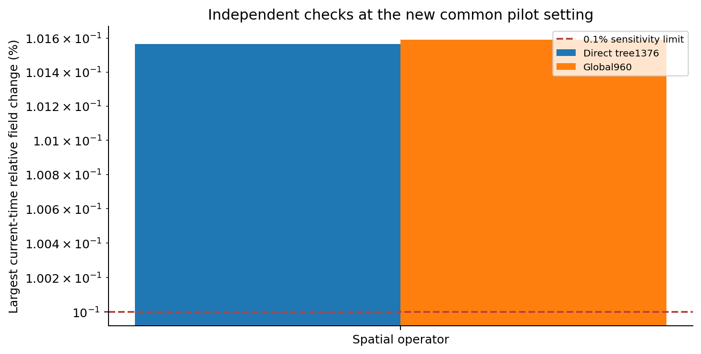

# Burgers tree embeddings: common fixed-tree numerical qualification

Pilot qualification is incomplete. Outstanding checks: b2rtight.

The original L8192 setting failed spatial sensitivity: its doubling changed fields by 0.101589%, above0.1%. Both methods remained physically accurate and converged. The unchanged b2space arrays are reused as the finer L16384 baseline on physical and solver checks only; the failed coarse comparison remains in [the retained original setting report](B2-original-setting-retained.md). One further spatial check at L32768 is allowed, with no automatic higher-resolution ladder. Original unsubmitted b2tests/b2time/b2tight are superseded by the registered finer-setting checks. The old L8192 integration run is retained separately and is not transferred to the new baseline. The5400-second B2 allowance is unchanged.

The direct tree has1376 adjustable coefficients and the stable global POD-plus-Fourier control has960. The common baseline is L16384, Crank–Nicolson dt0.00125, Q512 and22016 weak tests. The spatial check uses L32768, integration Q1024, tests44032, time step0.000625, and the precision check tightens all registered initial/inner/outer tolerances100 times. Each changes only its named numerical control. This new baseline is not a one-factor comparison with the older global768 pilots.

All solves use the shared initial-field callable and the original fine-grid sign-upwind weak formulation. References enter only subsequent scoring. Physical errors use the current-time reference norm; the per-case empirical reference allowance is included in each accuracy decision. Every run returns an actual4096-by4096 final device field. The table combines the largest of five evolved physical errors and the actual-grid final error, and separately audits the complete returned stopping rule. Reported changes include the initial fit as well as all evolved output times.

| Run | Case | Method | Worst physical error | Steps failing complete convergence | Largest field change | Run gate passes |
|---|---|---|---:|---:|---:|---|
| b2space | dev000 | tree_direct24 | 0.259661% | 0/200 | baseline | True |
| b2space | dev000 | global_stable960 | 0.100987% | 0/200 | baseline | True |
| b2space | dev003 | tree_direct24 | 0.011627% | 0/200 | baseline | True |
| b2space | dev003 | global_stable960 | 0.010283% | 0/200 | baseline | True |
| b2space | align002 | tree_direct24 | 0.293380% | 0/200 | baseline | True |
| b2space | align002 | global_stable960 | 0.348890% | 0/200 | baseline | True |
| b2rspace | dev000 | tree_direct24 | 0.253658% | 0/200 | 0.051045% | True |
| b2rspace | dev000 | global_stable960 | 0.073161% | 0/200 | 0.051059% | True |
| b2rspace | dev003 | tree_direct24 | 0.007476% | 0/200 | 0.005129% | True |
| b2rspace | dev003 | global_stable960 | 0.005155% | 0/200 | 0.005129% | True |
| b2rspace | align002 | tree_direct24 | 0.287555% | 0/200 | 0.041541% | True |
| b2rspace | align002 | global_stable960 | 0.346736% | 0/200 | 0.041573% | True |
| b2rquad | dev000 | tree_direct24 | 0.259698% | 0/200 | 0.000349% | True |
| b2rquad | dev000 | global_stable960 | 0.100987% | 0/200 | 0.000000% | True |
| b2rquad | dev003 | tree_direct24 | 0.011627% | 0/200 | 0.000004% | True |
| b2rquad | dev003 | global_stable960 | 0.010283% | 0/200 | 0.000001% | True |
| b2rquad | align002 | tree_direct24 | 0.293442% | 0/200 | 0.000360% | True |
| b2rquad | align002 | global_stable960 | 0.348890% | 0/200 | 0.000000% | True |
| b2rtests | dev000 | tree_direct24 | 0.261855% | 0/200 | 0.012298% | True |
| b2rtests | dev000 | global_stable960 | 0.100987% | 0/200 | 0.000000% | True |
| b2rtests | dev003 | tree_direct24 | 0.011632% | 0/200 | 0.000060% | True |
| b2rtests | dev003 | global_stable960 | 0.010283% | 0/200 | 0.000000% | True |
| b2rtests | align002 | tree_direct24 | 0.295485% | 0/200 | 0.014335% | True |
| b2rtests | align002 | global_stable960 | 0.348890% | 0/200 | 0.000000% | True |
| b2rtime | dev000 | tree_direct24 | 0.265841% | 0/400 | 0.013350% | True |
| b2rtime | dev000 | global_stable960 | 0.101965% | 0/400 | 0.007735% | True |
| b2rtime | dev003 | tree_direct24 | 0.011654% | 0/400 | 0.000228% | True |
| b2rtime | dev003 | global_stable960 | 0.010265% | 0/400 | 0.000106% | True |
| b2rtime | align002 | tree_direct24 | 0.302276% | 0/400 | 0.015938% | True |
| b2rtime | align002 | global_stable960 | 0.351372% | 0/400 | 0.009263% | True |

A passing small pilot is not the all44-development-trajectory gate. No deployable adaptation, method freeze, native NM-ROM confirmation, paired runtime win or final-test result is claimed. The nonlinear child16 checkpoint remains stopped after two unsuccessful online solver repairs; its representation result is retained. The original16.5% failure and the improved representation plots remain in [the representation report](2026-11-18-tree-embedding-representation.md).

Pilot clocks charge joint comparison setup to each method and cannot serve as method-specific speed ratios. Initialization, assembly, solving, rejected trials, fallback and requested output remain mandatory components of later complete-query timing. The equivalent packed field implementation has only CPU fixture evidence and is not used in this batch.

Generated 2026-11-19T02:54:51.704238+00:00. The latest scheduler ledger records26527 elapsed GPU-seconds (7.368611h); this is a snapshot when jobs are active. The reservation guard charges27727 seconds, including full reservations for active jobs. Active owned jobs: b2rtight. B2 is capped at5400 additional GPU-seconds from22744, for a cumulative ceiling28144 seconds. Source/configurations, scheduler records and verified retention manifests are in the owned lane. The old campaign remains paused; final-test fields remain unopened.

## Glossary

- **Case:** one complete initial-condition trajectory. The three named cases are a pilot, not the entire development panel.
- **Physical error:** the field difference divided by the reference field's norm at that same time. The reported worst value covers the five evolved times and actual4096 final output.
- **Reference allowance:** the independently measured uncertainty in the reference solution, added to the error for admission.
- **Variables:** coefficients adjusted by the online solve; decoder weights remain frozen. POD is a linear basis learned from training snapshots; the global control also uses a prescribed Fourier completion.
- **L:** the fine spatial operator's interval count per axis. **Q:** the integration interval count per axis; the sampled advection stencil retains the fine spacing1/L.
- **Weak tests:** smooth functions used to measure the PDE residual. Doubling their number checks that omitted residual directions do not materially change the trajectory.
- **CN:** Crank–Nicolson time integration. The time-step check halves the interval between successive solves.
- **Complete convergence:** finite returned diagnostics, small stationarity and either a small field update or a substantially smaller stationarity value. A small update alone does not pass.
- **Largest field change:** the largest difference from the registered baseline at any evaluated time, normalized by the current reference norm. Its sensitivity limit is0.1%.
- **Run gate:** physical accuracy, complete convergence, registered configuration/provenance and, for a refinement, the sensitivity check all pass.
- **Allocated GPU time:** scheduler allocation duration, including setup, compilation, idle portions and failures; it differs from online query runtime.
