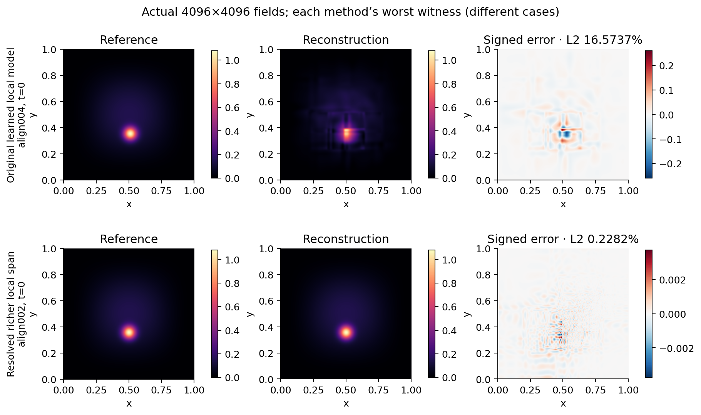

# Burgers tree embeddings: representation diagnosis and continuation

This generated report covers the original bounded failure and the user-authorized continuation. Representation results are development evidence; nonlinear compression, dense audits and fixed-tree physics are still being investigated. No complete PDE-runtime win or final-test result is established.

## Why the original best error was still high

The original best tree had 16.5299% worst projection error at 128 adjustable variables. Its actual-grid witness remains 16.5737%; that failure is real, not the subsequently retracted quadrature result.

The evidence supports several contributing limitations. The original parent alone has 40.8695% worst development error. Better-scaled training with a richer frozen feature span reduces selected training error from 28.5599% to 4.5584%, but development error remains 31.7719%. Thus optimization and generalization are both relevant; changing scaling and the feature bank together does not isolate one cause. The old head’s relative departure from its best affine map is 7.9823%, so describing it as exactly linear would be wrong.

Attribution on the old fixed trees provisionally improves when parent and local coefficient restrictions are relaxed. Those sampled-integration diagnostics also increase variable counts and are not an additive causal decomposition. Stronger evidence is the resolved richer local span: its worst original-panel error is 0.2282% with 2000 coefficients, confirmed by actual output at 0.2282%. This rules out a universal error floor at the original value for the broader local representation. It does not yet establish efficient nonlinear compression.

## Expanded matched-data comparison

Training uses the registered prefix expansion to 128 trajectories. Development has 32 random trajectories and the same 12 alignment cases; every one of the 11 snapshot times is scored in the current-time physical norm. Final-test solution fields remain unopened. Shared local POD uses training coefficients only, fixed windows and retained parents. Its allocations use the known initial field and a sampled speed estimate, not evolved reference fields or a certified propagation bound.

| Representation | Total variables | Original random panel | Added random panel | Alignment panel | Worst all |
|---|---:|---:|---:|---:|---:|
| Direct local 4 | 336 | 2.0593% | 1.2189% | 3.8250% | 3.8250% |
| Direct local 8 | 544 | 1.1658% | 0.7486% | 2.3990% | 2.3990% |
| Direct local 16 | 960 | 0.5889% | 0.3635% | 0.8908% | 0.8908% |
| Direct local 24 | 1376 | 0.3792% | 0.2173% | 0.4229% | 0.4229% |
| Direct local 36 | 2000 | 0.2150% | 0.1327% | 0.2156% | 0.2156% |
| Global nonlinear 64 | 64 | 7.1775% | 10.3528% | 16.7303% | 16.7303% |
| Global nonlinear 128 | 128 | 2.9436% | 6.2896% | 7.8825% | 7.8825% |
| Child nonlinear 8 | 544 | 0.8083% | 0.5119% | 1.5059% | 1.5059% |

The direct local entries use resolved physical Gram integration; actual-grid audits are separate. Spectral-feature nonlinear controls are architecture-inspired NM-ROMs, not faithful native coordinate-MLP Tunable reproductions.

The extended global control reaches 0.3227% with 1280 variables, better than the admitted direct tree at its larger variable count. Retain that result, with an essential qualification: its trailing training singular value is only 3.01e-18 of the largest. These are valid saved orthonormal spaces extended into numerically null training directions, not reliably learned variance directions. Their stability under retraining is unqualified. The complete data-independent sine space provides a separate control without this ambiguity. Neither variable counts nor projection errors establish PDE cost.

| Global span control | Variables | Worst all | Relative trailing training singular value |
|---|---:|---:|---:|
| Global saved POD prefix 768 | 768 | 1.6145% | 4.79e-07 |
| Global saved POD prefix 960 | 960 | 1.2726% | 2.6e-08 |
| Global saved POD prefix 1024 | 1024 | 1.1579% | 6.67e-09 |
| Global saved POD prefix 1280 | 1280 | 0.3227% | 3.01e-18 |
| Global saved POD prefix 1376 | 1376 | 0.2958% | 9.25e-19 |
| Global saved POD prefix 1408 | 1408 | 0.2882% | 2.07e-20 |
| Complete sine 24 per axis | 576 | 4.1987% | Not trained |
| Complete sine 32 per axis | 1024 | 1.9606% | Not trained |
| Complete sine 36 per axis | 1296 | 1.3369% | Not trained |
| Complete sine 40 per axis | 1600 | 0.9292% | Not trained |
| Complete sine 48 per axis | 2304 | 0.4543% | Not trained |
| Complete sine 64 per axis | 4096 | 0.1139% | Not trained |

The image display is subsampled for readability from saved actual-grid arrays. Errors use the complete arrays. The two rows are different worst cases and are not a matched-case attribution test.

Independent fixed-code scoring confirms local POD24 on every snapshot at the denser grid: worst 0.4229%, with largest change from the resolved physical metric 1.3e-09. The actual-output witness is 0.4229%. All 1248 of 1248 child directions remain numerically independent after removing the parent; their squared singular-value ratio is 1.38e-07.

The following allocation controls use exactly the same local checkpoint and coefficient dimension per node. Uniform and prescribed entries at each matched node count isolate an allocation/depth-distribution effect. The random allocation is a diagnostic control, not the deployed policy.

| Allocation and retained nodes | Total variables | Worst projection |
|---|---:|---:|
| uniform20 | 608 | 2.2911% |
| prescribed20 | 608 | 1.9276% |
| uniform84 | 2144 | 0.9271% |
| prescribed84 | 2144 | 0.2763% |
| random52 | 1376 | 2.3032% |

## Retraction and numerical controls

The preliminary rich-span score 0.0925% was invalid as a gate result: unchanged coefficients gave 296.5150% on denser scoring. Too few integration points per small patch missed oscillatory directions. This apparent pass is retracted; its outputs are retained. The repaired metric resolves every cell-core and halo boundary using tensor integration. The independent integration-rule difference is 7.45e-12, with actual-grid agreement recorded above. A first repair implementation failed before scientific output due to the reference’s interval/mode indexing convention; its allocation and logs are retained.

The historical attribution JSON accidentally calls a selected update number `old_dev_worst`. It is not an error metric; this report reads the actual global error from its source run. The source label is corrected for future reruns, and the original raw file remains unchanged.

## Advancement and remaining work

The direct local POD24 model passes representation and its independent dense audit, so fixed-tree physics has begun. Frozen-weight, longer dense fitting of child8 reduces its worst error to 1.4861%; maximum stationarity remains 0.000136. The small change weakens the explanation that its entire remaining error is a short code fit, but it is not a proof of a global minimum. Shared nonlinear children train against the assembled physical metric, with jointly refitted parent and child variables at multiple depths.

## Fixed-tree PDE diagnosis

These pilots solve complete trajectories from the shared initial callable with the frozen prescribed tree and global POD768 control. Both use the same exact fine-grid upwind weak operator, backward Euler, common test set and dense integration. Reference fields are opened for scoring only after both methods finish each case. The table reports all requested evolved times, not only the final output.

| Case | Method | Spatial intervals | Time step | Worst evolved error | Every step stationary | Physical accuracy pass |
|---|---|---:|---:|---:|---|---|
| dev000 | tree_direct24 | 1024 | 0.0025 | 2.5373% | True | False |
| dev000 | global_POD768 | 1024 | 0.0025 | 2.4895% | True | False |
| dev003 | tree_direct24 | 1024 | 0.0025 | 0.2945% | True | True |
| dev003 | global_POD768 | 1024 | 0.0025 | 0.2944% | True | True |
| align002 | tree_direct24 | 1024 | 0.0025 | 2.2570% | True | False |
| align002 | global_POD768 | 1024 | 0.0025 | 2.0991% | True | False |

Pulse errors remain above the physical gate in the initial pilot for both methods despite tightly converged weak solves. Spatial, temporal, test and integration refinements must distinguish numerical error from reduced dynamics. The initial pilot omitted explicit burn-in immediately before timing: those original wall times are retained as unqualified diagnostics and support no speed comparison. Follow-ups include burn-in. The small pilot is not all-development qualification, deployable adaptation, or a complete-runtime benchmark.

The focused continuation changes the training allocation mixture for its nonlinear compression pilot; it is explicitly documented in B1-SHARED-CHILD.md. Same-checkpoint uniform/prescribed controls remain required before an allocation-policy claim. No truth-assisted online refinement is allowed. The verified fine-upwind weak operator remains the primary PDE formulation. Initialization, assembly, failed trials, solving, fallback and requested output must all enter later complete-query timing.

Original recipes, unsuccessful repairs and the original decision remain in [the retained B0 report](B0-retained-representation.md). CROM, SNF-ROM, hyper-reduced masked autoencoders and conditional equation-driven CoLoRA have not yet been reproduced in confirmation; they are not counted as defeated. The older burgers-quadtree campaign remains paused and untouched. No merge or three-dimensional work.

## Accounting and provenance

Generated 2026-11-18T23:16:58.195719+00:00. Terminal allocations recorded in the current ledger total 7760 GPU-seconds (2.155556 GPU-hours); nonterminal or not-yet-reconciled names: b1child16, b1weakL2048. Outstanding reservations are enforced by the submission helper, not omitted from its admission calculation. The finite B1 ceiling, recipe definitions, source commits, GPU preflights, raw arrays, checkpoint histories and checksum-verified retention records remain in this lane. This report and all figures are generated from saved data; their source hashes are recorded beside them.

## Glossary

- Representation/projection error: best reconstruction found while the reference field is available; this is not a PDE solve.
- Parent: global field retained when local corrections are added.
- Child variables: independently adjustable numbers controlling one local correction.
- POD: a basis learned by singular-value decomposition of training fields or coefficients.
- Numerical-null directions: basis directions with training variation at rounding scale; their orientation is not reliably determined by the data.
- Complete sine space: every tensor-product sine mode up to the stated axis count, independent of training.
- Stationarity: the fitted weak residual's gradient is small; this alone does not guarantee physical accuracy.
- Gram metric: field inner products that retain overlapping-patch interactions.
- Current-time relative L2: physical root-mean-square error divided by the reference norm at that same time.
- Worst all: largest error across every snapshot and trajectory in all development panels.
- Alignment panel: prescribed cases near tree cell edges/corners, reported separately from random cases.
- Aliasing: integration samples miss variation between sample locations and report an incorrect fit error.
- Zero-child transfer: adding zero-valued correction codes leaves the existing field unchanged.
- Allocated GPU-hours: reserved hardware time actually elapsed, including setup and failures.
- Complete query: initialization, adaptation, assembly, solving, fallback and requested reconstruction together.
