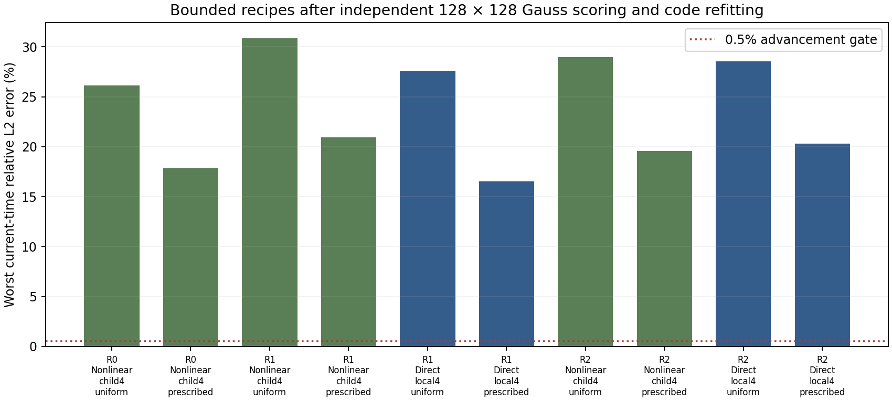
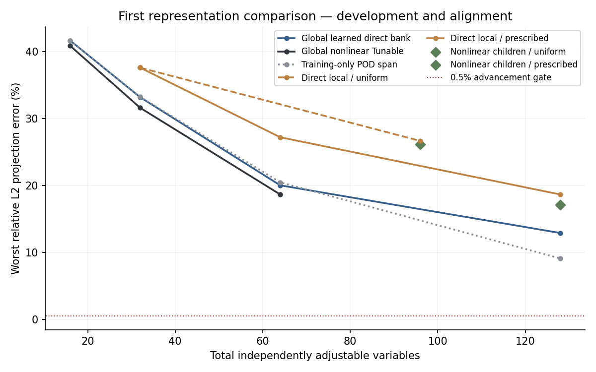
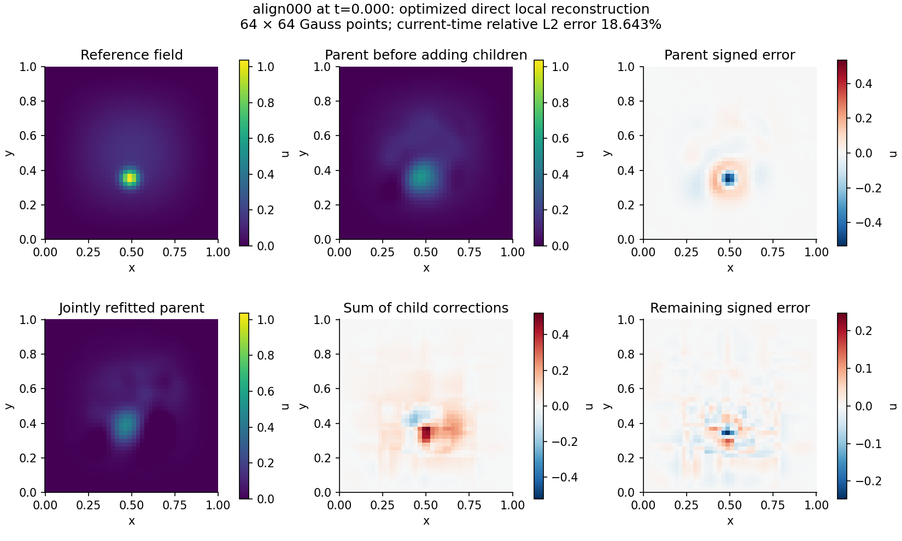
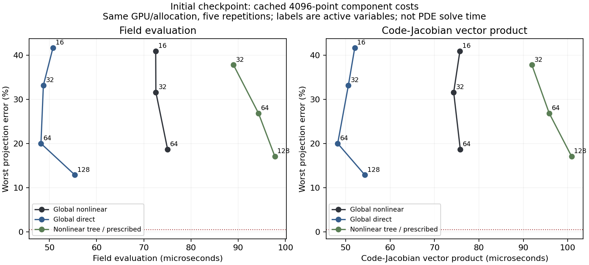
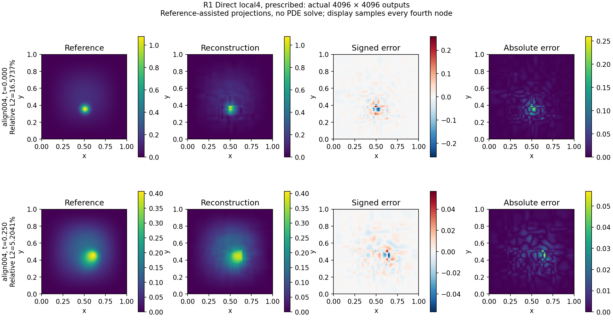

# Burgers tree embeddings: bounded representation study

The new study is implemented, trained and tested through reference qualification, the first decoder comparison and two registered repairs. **The tested recipe family does not pass the representation gate, so it does not advance to PDE solves or performance claims.** This is a scoped negative result for these checkpoints, not a rejection of hierarchical decoders.

The best independently rescored candidate is R1 direct local4 with prescribed allocation: worst 16.5299% at 128 active variables, versus the registered 0.5% gate. The requested lower complete PDE-solve time at 1% physical accuracy has not been established. Final-test solution fields remain unopened; the earlier campaign remains paused; no merge occurred.

## What ran

Fresh 64 training and 16 development trajectories plus 12 alignment cases and two visible fixtures received the full independent space/time spectral ladders. Every trajectory contains 11 snapshots. Maximum empirical spectral allowance is 0.0001235%; the independent second-order reference checks all 18 required cases, with worst disagreement 0.05719%, below 0.1%. These are empirical convergence checks, not rigorous error certificates.

The initial comparison trained a 128-feature global bank, global nonlinear heads 16/32/64, shared 16-channel local features with direct prefixes 4/8/16, and a four-variable nonlinear child head. Uniform and prescribed allocations use the same checkpoint. Parents remain active and are refitted jointly with independent children. Prescribed allocation sees the initial-field callable only. Training uses a balanced set of uniform, connected-random and training-reference-guided configurations and their shallower truncations.

R0 trained codes with Adam alongside weights. A saved-checkpoint audit exposed a substantial training-code fitting gap, so its early stop is not a feature-learning plateau. R1 explicitly refits codes with up to 25 damped GN/LM iterations before every assembled weight update. R2 retains that repair and widens only the local hidden layers from 64 to 128. Update ceilings, early stops, seed, data, feature width, child dimension, depth, windows and gates remain fixed. Every failed recipe and best/final checkpoint is retained.

## Fine scoring and advancement decision

All entries below refit codes on 128-by-128 Gauss integration with up to 125 LM iterations and multiple cold/temporal-warm starts. Random and alignment panels stay separate; every snapshot counts. These are best-found fits, not certified global minima.

| Recipe | Decoder | Allocation | Variables | Worst random | Worst alignment | Median snapshot | 90th percentile | Failing trajectories |
|---|---|---|---:|---:|---:|---:|---:|---:|
| R0 | Nonlinear child4 | uniform | 96 | 21.1426% | 26.1554% | 7.6900% | 14.3291% | 28/28 |
| R0 | Nonlinear child4 | prescribed | 128 | 13.2852% | 17.8291% | 5.7200% | 9.5605% | 28/28 |
| R1 | Nonlinear child4 | uniform | 96 | 23.6120% | 30.8698% | 8.2025% | 15.6413% | 28/28 |
| R1 | Nonlinear child4 | prescribed | 128 | 17.0401% | 20.9200% | 6.2964% | 11.7184% | 28/28 |
| R1 | Direct local4 | uniform | 96 | 22.4809% | 27.5996% | 7.9640% | 14.6433% | 28/28 |
| R1 | Direct local4 | prescribed | 128 | 12.7345% | 16.5299% | 6.0442% | 10.3191% | 28/28 |
| R2 | Nonlinear child4 | uniform | 96 | 21.2103% | 28.9572% | 8.0535% | 15.4244% | 28/28 |
| R2 | Nonlinear child4 | prescribed | 128 | 15.8851% | 19.5530% | 6.0949% | 11.2788% | 28/28 |
| R2 | Direct local4 | uniform | 96 | 22.5449% | 28.5506% | 8.0169% | 15.5054% | 28/28 |
| R2 | Direct local4 | prescribed | 128 | 16.2456% | 20.3020% | 6.0281% | 11.3975% | 28/28 |

No row passes the all-case 0.5% screen. Stop this bounded recipe family after R1/R2. Larger feature banks, eight-dimensional children, depth 4, different halos, unrestricted-bias global heads and expanded trajectory coverage were not tested; this study does not rule them out. Remaining fitting/conditioning limitations are recorded alongside the errors, rather than relabelled as a proof of an impossible manifold fit.

## Representation benefit versus cost

The initial capacity plot uses 64-by-64 Gauss screening and is preserved as provisional history. It shows the root/global alternatives and actual variable counts; uniform trees can fall below a nominal cap. At the cap of 128, the uniform four-variable trees use 96 actual variables while prescribed trees use 128; their difference is not a pure placement comparison at matched dimension. The fine table above governs the decision. Training-only global POD and optimistic local polynomial/linear spans distinguish data/span limits from learned-head limits. On R0, even the relaxed 576-coefficient neural/polynomial controls failed the 0.5% screen; they are diagnostics, not eligible 128-variable methods.

The child correction adds to the jointly refitted parent shown separately. The visible error maps are reconstruction errors, not PDE rollout errors or refinement certificates.

These are synchronized cached-feature field and Jacobian-vector-product calls at 4096 integration points, with five saved repetitions in one GPU allocation. They include call/dispatch overhead and exclude compilation and feature-cache construction. They are **not** timings for 4096-by4096 output or complete PDE queries. No cross-job wall-clock comparison is used. The central PDE-cost question remains unanswered because accuracy failed first.

The following separate R1 component memory measurements use 128-by-128 integration in fresh GPU processes. They include feature construction, common checkpoint loading and cached field/Jacobian calls. All ancestor contributions are included; inference has no inactive padding. These process peaks exclude code fitting, PDE evolution and dense output, and cannot establish production memory requirements. Cache size is the stored matrix, distinct from allocator peak; fixed global transform entries are recorded separately in the raw audit.

| Arm | Active variables | Network parameters used | Stored channels | Feature cache MiB | Peak device bytes in use, MiB |
|---|---:|---:|---:|---:|---:|
| global_direct128 | 128 | 51968 | 128 | 16.0 | 102.2 |
| global_head16 | 16 | 67584 | 128 | 16.0 | 102.2 |
| global_head32 | 32 | 70656 | 128 | 16.0 | 102.2 |
| global_head64 | 64 | 76800 | 128 | 16.0 | 102.2 |
| direct_uniform | 96 | 73040 | 208 | 26.0 | 102.3 |
| direct_prescribed | 128 | 73040 | 240 | 30.0 | 108.4 |
| nonlinear_uniform | 96 | 74848 | 448 | 56.0 | 176.9 |
| nonlinear_prescribed | 128 | 74848 | 576 | 72.0 | 224.9 |

## Actual dense outputs and implementation checks

Direct spectral evaluation and neural decoding produced actual 4096-by-4096 arrays at coordinates $j/4095$. They are reference-assisted projections; none was obtained by evolving a ROM. The final-time witness exercises the output shape at $t=0.25$ without calling it a PDE solution.

| Recipe | Decoder | Case | Time | Actual 4096 relative L2 error |
|---|---|---|---:|---:|
| R0 | nonlinear_child | align000 | 0.000 | 17.83317% |
| R1 | direct_local4 | align004 | 0.000 | 16.57367% |
| R1 | direct_local4 | align004 | 0.250 | 5.20413% |
| R2 | nonlinear_child | align004 | 0.000 | 19.56762% |
| R2 | nonlinear_child | align004 | 0.250 | 5.37880% |

Maximum pointwise errors, their locations, 2048/4096 scoring changes, returned arrays needed to recompute signed/absolute errors are retained in each audit. Pointwise diagnostics are not a 1% pointwise guarantee. An independent NumPy audit reproduces every saved 4096 error, checks boundaries and peak locations, and rejects deliberate use of the old initial-field denominator.

| Recipe | Zero-child field change | Child Jacobian rank | Rank after removing parent directions |
|---|---:|---:|---:|
| R0 | 1.11e-16 | 112/112 | 112 |
| R1 | 2.22e-16 | 112/112 | 112 |
| R2 | 2.22e-16 | 112/112 | 112 |

These Jacobian records audit the specified representative prescribed tree in the physical metric. Singular values and parent redundancy are saved. Geometry, physical weights, boundary behavior, AD/finite-difference derivatives and independent QR/SVD fitting fixtures pass. The common tested weak residual agrees with the exact inherited fine-upwind arithmetic on its dense fixture; this is not a production PDE accuracy qualification.

The trained R1 zero-child check preserves values, gradients and Hessians to a maximum absolute difference of 2.78e-17. Its trained-feature weak arithmetic fixture has maximum absolute discrepancy 1.29e-14. Neither check establishes a small physical operator error: the reconstructed gradients themselves remain inaccurate, as shown below. Fine-grid tested-operator convergence and dynamics were not qualified after the projection failure.

| Recipe | Dense-output witness case | Time | Relative gradient L2 error |
|---|---|---:|---:|
| R1 | align004 | 0.000 | 85.2824% |
| R2 | align004 | 0.000 | 75.6639% |

## Scope, failures and reproducibility

The global neural controls implement the planned matched-data Tunable form, using the first interface's zero-anchored linear-skip head. Unrestricted-bias native heads were not reproduced; the unrestricted direct-bank control is separate. These controls do not qualify a strong complete NM-ROM baseline by themselves. CROM, SNF-ROM and hyper-reduced masked-autoencoder confirmation, plus the conditional equation-driven CoLoRA extension, remain unattempted because the preceding gate failed. They are not counted as defeated. No coarse-physics or truth-assisted online method was substituted.

Nonlinear fitting is finite-start and can retain nonzero stationarity residuals. Initial code-training failures, unsuccessful repairs and this reproduction limitation remain explicit. One local CUDA smoke attempt failed before numerical work because the shared local GPU was out of memory; its algebra check then passed on explicitly labelled CPU. Cluster numerical jobs all passed GPU preflight in float64/highest precision.

Resource accounting: 15 owned allocations, 4031 allocated GPU-seconds (1.119722 GPU-hours) and 8.957778 allocated CPU-hours. Scheduler start/end records independently confirm peak owned concurrency of 2; all job limits were at most four hours. The initial 8-GPU-hour reservation was not expanded. Local GPU smoke durations were not instrumented; four attempts were each capped at 55 seconds (conservative upper bound 220 seconds, separate from measured cluster allocation). No local timing is used as a performance result.

Source, protocols, selected model checkpoints and figures are committed on `exp/2026-11-18-burgers-tree-embeddings` and backed up through its code-only mirror. Raw arrays/logs have checksum-verified local and designated owned-cluster copies. Job invocations, source commits, precision, GPUs, full fitting records and retention manifests remain in the lane. `REPRODUCE.md`, `DECISION-B0.json`, `configs/RECIPES.json` and `cluster/ledger.json` provide the exact replay and decision record.

## Glossary

- Active variables: independently adjustable global and retained-parent/child code entries.
- Projection: a reconstruction fitted with the reference field available; it does not solve the PDE.
- Current-time norm: the reference norm at the same time as the error being measured.
- Worst random/alignment: maximum over every snapshot in the respective panel.
- Failing trajectory: at least one snapshot exceeds the 0.5% representation gate.
- Uniform/prescribed: complete-level allocation versus a connected tree selected from the initial field.
- Jacobian rank: number of independently changing field directions detected at zero child codes.
- Component cost: a timed portion of computation, insufficient for a complete-query speed claim.
- Reference allowance: an empirical numerical-convergence allowance, not a rigorous bound.
- Scoped negative: these registered models failed; untested variants and the broader idea remain open.
- Feature cache MiB: stored coordinate-feature matrix size in units of $2^{20}$ bytes.
- Peak device bytes in use: maximum live allocation reported by JAX for the stated component workload, distinct from its reserved allocator pool.
- Network parameters used: frozen neural weights and biases needed by that arm; the separately recorded linear coordinate transform is additional storage.
- Relative gradient error: spatial-gradient discrepancy divided by the reference gradient norm at the same time.
