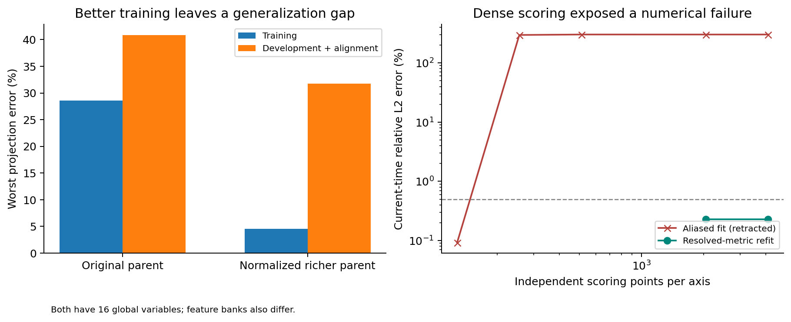
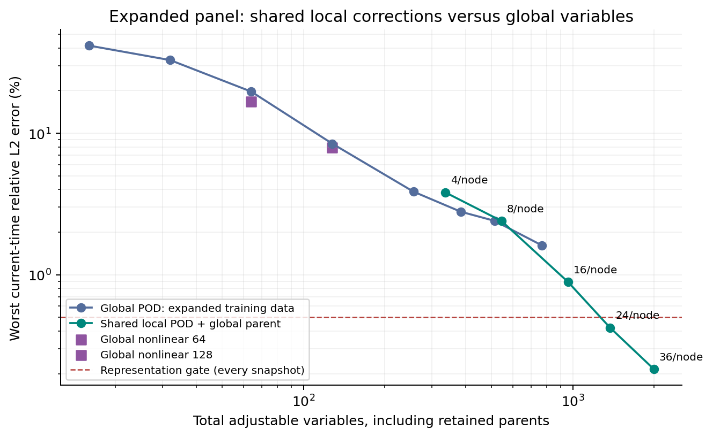

# Burgers tree embeddings: representation diagnosis and continuation

This generated report covers the original bounded failure and the user-authorized continuation. Representation results are development evidence; nonlinear compression, dense audits and fixed-tree physics are still being investigated. No complete PDE-runtime win or final-test result is established.

## Why the original best error was still high

The original best tree had 16.5299% worst projection error at 128 adjustable variables. Its actual-grid witness remains 16.5737%; that failure is real, not the subsequently retracted quadrature result.

The evidence supports several contributing limitations. The original parent alone has 40.8695% worst development error. Better-scaled training with a richer frozen feature span reduces selected training error from 28.5599% to 4.5584%, but development error remains 31.7719%. Thus optimization and generalization are both relevant; changing scaling and the feature bank together does not isolate one cause. The old head’s relative departure from its best affine map is 7.9823%, so describing it as exactly linear would be wrong.

Attribution on the old fixed trees provisionally improves when parent and local coefficient restrictions are relaxed. Those sampled-integration diagnostics also increase variable counts and are not an additive causal decomposition. Stronger evidence is the resolved richer local span: its worst original-panel error is 0.2282% with 2000 coefficients, confirmed by actual output at 0.2282%. This rules out a universal error floor at the original value for the broader local representation. It does not yet establish efficient nonlinear compression.

## Expanded matched-data comparison

Training uses the registered prefix expansion to 128 trajectories. Development has 32 random trajectories and the same 12 alignment cases; every one of the 11 snapshot times is scored in the current-time physical norm. Final-test solution fields remain unopened. Shared local POD uses training coefficients only, fixed windows and retained parents. Its allocations use the known initial field and a swept-speed bound, not evolved reference fields.

| Representation | Total variables | Original random panel | Added random panel | Alignment panel | Worst all |
|---|---:|---:|---:|---:|---:|
| Direct local 4 | 336 | 2.0593% | 1.2189% | 3.8250% | 3.8250% |
| Direct local 8 | 544 | 1.1658% | 0.7486% | 2.3990% | 2.3990% |
| Direct local 16 | 960 | 0.5889% | 0.3635% | 0.8908% | 0.8908% |
| Direct local 24 | 1376 | 0.3792% | 0.2173% | 0.4229% | 0.4229% |
| Direct local 36 | 2000 | 0.2150% | 0.1327% | 0.2156% | 0.2156% |
| Global nonlinear 64 | 64 | 7.1775% | 10.3528% | 16.7303% | 16.7303% |
| Global nonlinear 128 | 128 | 2.9436% | 6.2896% | 7.8825% | 7.8825% |

The direct local entries use resolved physical Gram integration; actual-grid audits are separate. The strongest listed expanded global POD control has 768 coefficients and 1.6145% worst error. Spectral-feature nonlinear controls are architecture-inspired NM-ROMs, not faithful native coordinate-MLP Tunable reproductions. Larger spans and the planned independent NM-ROM competitors remain relevant.

The image display is subsampled for readability from saved actual-grid arrays. Errors use the complete arrays. The two rows are different worst cases and are not a matched-case attribution test.

## Retraction and numerical controls

The preliminary rich-span score 0.0925% was invalid as a gate result: unchanged coefficients gave 296.5150% on denser scoring. Too few integration points per small patch missed oscillatory directions. This apparent pass is retracted; its outputs are retained. The repaired metric resolves every cell-core and halo boundary using tensor integration. The independent integration-rule difference is 7.45e-12, with actual-grid agreement recorded above. A first repair implementation failed before scientific output due to the reference’s interval/mode indexing convention; its allocation and logs are retained.

The historical attribution JSON accidentally calls a selected update number `old_dev_worst`. It is not an error metric; this report reads the actual global error from its source run. The source label is corrected for future reruns, and the original raw file remains unchanged.

## Advancement and remaining work

The richer direct local space passes the representation screen and warrants dense audits and a separately labelled fixed-tree physics study. Shared nonlinear children are now trained against the full assembled physical metric, with jointly refitted parent and child variables at multiple depths. A small fixture verifies the overlap-aware fitting algebra and exact zero-child transfer. Trained zero-child directions and fixed-code actual output require separate qualification.

The focused continuation changes the training allocation mixture for its nonlinear compression pilot; it is explicitly documented in B1-SHARED-CHILD.md. Same-checkpoint uniform/prescribed controls remain required before an allocation-policy claim. No truth-assisted online refinement is allowed. The verified fine-upwind weak operator remains the primary PDE formulation. Initialization, assembly, failed trials, solving, fallback and requested output must all enter later complete-query timing.

Original recipes, unsuccessful repairs and the original decision remain in [the retained B0 report](B0-retained-representation.md). CROM, SNF-ROM, hyper-reduced masked autoencoders and conditional equation-driven CoLoRA have not yet been reproduced in confirmation; they are not counted as defeated. The older burgers-quadtree campaign remains paused and untouched. No merge or three-dimensional work.

## Accounting and provenance

Generated 2026-11-18T22:25:43.479274+00:00. Terminal allocations recorded in the current ledger total 5765 GPU-seconds (1.601389 GPU-hours); nonterminal or not-yet-reconciled names: b1child8. Outstanding reservations are enforced by the submission helper, not omitted from its admission calculation. The finite B1 ceiling, recipe definitions, source commits, GPU preflights, raw arrays, checkpoint histories and checksum-verified retention records remain in this lane. This report and all figures are generated from saved data; their source hashes are recorded beside them.

## Glossary

- Representation/projection error: best reconstruction found while the reference field is available; this is not a PDE solve.
- Parent: global field retained when local corrections are added.
- Child variables: independently adjustable numbers controlling one local correction.
- POD: a basis learned by singular-value decomposition of training fields or coefficients.
- Gram metric: field inner products that retain overlapping-patch interactions.
- Current-time relative L2: physical root-mean-square error divided by the reference norm at that same time.
- Worst all: largest error across every snapshot and trajectory in all development panels.
- Alignment panel: prescribed cases near tree cell edges/corners, reported separately from random cases.
- Aliasing: integration samples miss variation between sample locations and report an incorrect fit error.
- Zero-child transfer: adding zero-valued correction codes leaves the existing field unchanged.
- Allocated GPU-hours: reserved hardware time actually elapsed, including setup and failures.
- Complete query: initialization, adaptation, assembly, solving, fallback and requested reconstruction together.
