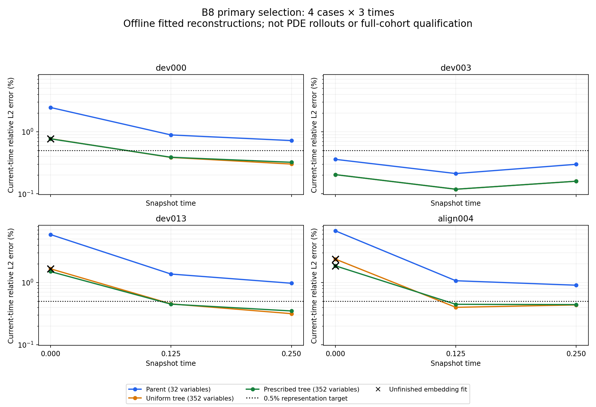

# Nonlinear child training: preliminary selection-panel results

The first B8 child model improves reconstruction on the retained primary selection panel, but does not meet the unchanged 0.5% representation target. These are offline, field-assisted fits on 4 development cases at 3 times (12 fields per layout), not all-case qualification, PDE predictions, or complete-solve timings. No actual4096 output has yet been qualified for this child checkpoint.

The frozen parent has 32 variables. Each tree adds 20 retained nodes with 16 independently adjustable nonlinear child variables per node, for 352 total variables. Each child maps its embedding into 64 newly learned local features. Uniform and prescribed layouts use the same selected checkpoint at update 30000; prescribed allocation uses the initial field, while these offline embedding fits use the reference snapshot.

| Model on exactly the same selection fields | Worst error | Median error | Above representation target | Unfinished fits |
|---|---:|---:|---:|---:|
|Parent (32 variables)|6.785522%|0.938222%|9/12|0/12|
|Uniform tree (352 variables)|2.379798%|0.392173%|3/12|3/12|
|Prescribed tree (352 variables)|1.855425%|0.414324%|3/12|1/12|

The better tree's worst selection error is 3.657 times smaller than the paired parent's worst selection error. This comparison adds variables and does not establish an advantage over a larger global neural decoder, nor a speed advantage. The parent values above are restricted to these same 12 fields; the separately retained full-parent evaluation contains 484 fields and has worst error 6.785522%.

Each marker is an independently fitted snapshot. Lines connect the sampled times for readability; they do not show a PDE trajectory. Black crosses identify fits that missed the unchanged stopping test, even if their reconstruction error is small.

The final training-code refresh at update 30000 evaluated all 1408 training snapshots: worst fitted training error 0.926320%, with 1 unfinished fit(s). Earlier refreshes evaluated one rotating time per training trajectory; their worst errors are not a monotone or directly comparable all-training learning curve. The selected checkpoint's prescribed selection panel has 1 unfinished fit(s). Full held-out scoring, trained-child tangent checks, actual4096 output, and PDE evolution remain necessary before admission.

## Expanded families

Separate reference-generation records contain 32 new training trajectories and 8 held-out development trajectories, balanced between ridges and two-pulse fields. Their registered spectral space/time ladders pass. The separate independent finite-difference check covers 40 cases and passed: True. Its largest finest-grid discrepancy is 0.076060%; retained proof: results/b8expandedfd/output/result.json. The completed child model above was trained on the original cohort only, so these figures do not measure learned performance on the expanded families. No final-test solution fields were opened.

## Evidence

- Child allocation comparison: `results/b8childprimary/output/allocation_comparison.pkl`; SHA256 `4e5210d593080a7676f66789e678c25ed2c72833033c784bd7428b7d25311b7c`.
- Child result: `results/b8childprimary/output/result.json`; SHA256 `c77ada6aeb921c0190b7c115f750ebb145ad12bdae92bf47932001c48060078e`.
- Parent result: `results/b7parentrepair/output/result.json`; SHA256 `1d43c7906044690071854ba6100ab1aee31b2c1b8d3eba66b721249e709e74fe`.
- Expanded train/dev references: `results/b8trainrefs/output/result.json` and `results/b8devrefs/output/result.json`.
- Generated by `reports/build_B8_progress.py` from retained arrays and JSON; no field reconstruction was rerun for this report.

## Glossary

**Parent:** the global nonlinear neural decoder. **Child embedding:** independently adjustable local correction variables. **Variables:** all adjustable parent and child coordinates, not neural-network weights. **Uniform/prescribed:** different retained-node layouts using the same trained child network. **Selection panel:** development snapshots used to choose a checkpoint; not a final test. **Current-time relative L2 error:** physical reconstruction error divided by the reference field norm at that same time. **Worst/median:** maximum/middle error among the paired selection fields. **Above target:** fields exceeding the assembled representation threshold. **Unfinished fit:** an embedding optimization that missed its stopping test. **Reference ladder:** comparisons across spatial resolution and time step. **PDE rollout:** advancing embeddings with the PDE without future reference snapshots; not performed by the fits shown here.
