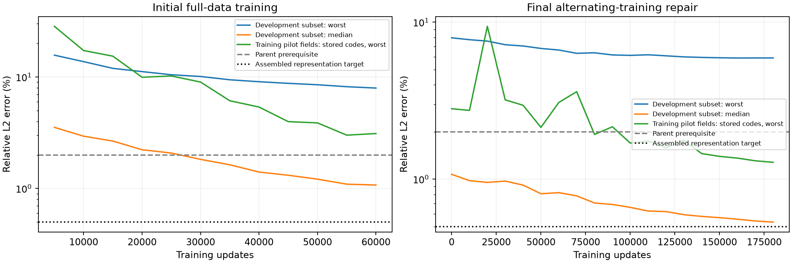
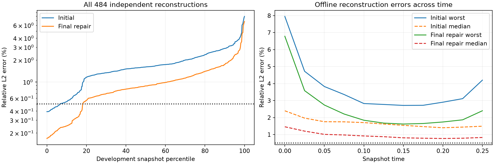
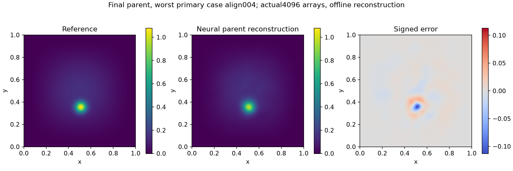
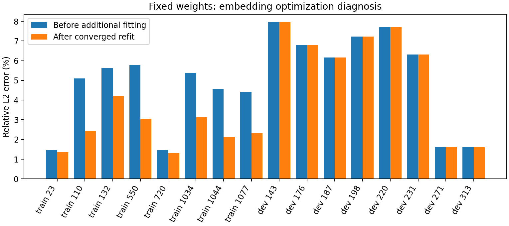
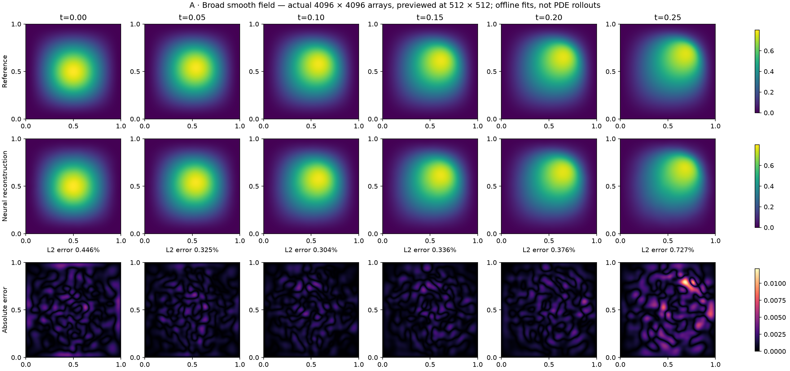
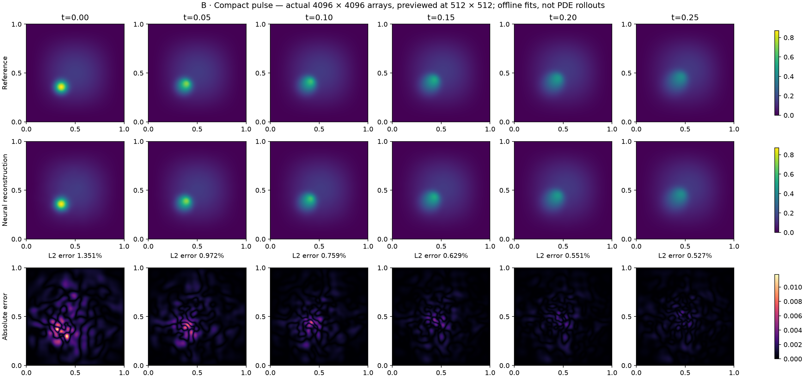
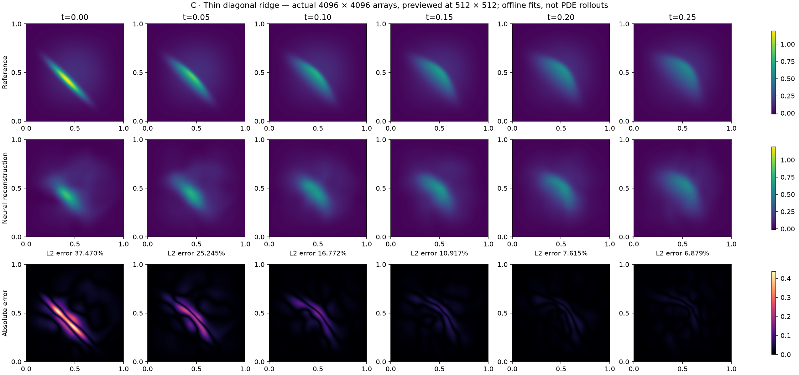

# Neural parent training, full-resolution reconstructions and advancement

Completed B7 parent-training evidence and named-family reconstruction diagnostics. These fields are independently fitted offline reconstructions; they are not neural PDE rollouts. Final-test solution fields remain sealed.

| Measurement | Initial full parent | Final training repair |
|---|---:|---:|
|Worst development error, independent256²|7.952585%|6.785522%|
|Worst stored-code training error|5.766173%|1.770356%|
|Maximum scoring change|0.000070%|0.000088%|
|Actual 4096 × 4096 worst witness|7.952585%|6.785522%|
|Unfinished development fits|28|0|

The final actual 4096 witness is align004 at time 0.

Parent prerequisite passed: **False**. Parent-alone 0.5% representation gate passed: **False**. The original assembled 0.5% representation and 1% PDE thresholds are unchanged.

The two permitted parent/training repairs are exhausted. Stop parent development in this round; do not train children on this unqualified parent or claim an embedding-space PDE result. This is a scoped failure of the tested parent/training recipes, not proof that nonlinear local children cannot work.

The fixed-weight diagnosis showed that training-code optimization was incomplete, but finishing development embeddings did not remove the large error. Additional network training tests that remaining learned-decoder bottleneck. A small training-only pilot passing 0.5% was not evidence of held-out-family accuracy.

| Named development family | Viscosity | Worst reconstruction error | Unfinished fits |
|---|---:|---:|---:|
|A · Broad smooth field|0.02|1.772432%|0/11|
|A · Broad smooth field|0.01|0.971518%|0/11|
|A · Broad smooth field|0.005|0.727229%|0/11|
|B · Compact pulse|0.02|4.011927%|0/11|
|B · Compact pulse|0.01|1.435181%|0/11|
|B · Compact pulse|0.005|1.350525%|0/11|
|C · Thin diagonal ridge|0.02|37.469856%|0/11|
|C · Thin diagonal ridge|0.01|37.469856%|0/11|
|C · Thin diagonal ridge|0.005|37.469856%|0/11|
|D · Two unequal pulses|0.02|26.891942%|0/11|
|D · Two unequal pulses|0.01|26.891942%|0/11|
|D · Two unequal pulses|0.005|26.891942%|0/11|

Named-family solutions were not added to training. Ridge and two-pulse cases test transfer beyond the original pulse/smooth training distribution. Viscosities 0.01 and 0.02 are also outside the training viscosity of 0.005. All 24 primary-viscosity previews below come from actual 4096-by-4096 reference and reconstruction arrays; the saved errors use the full arrays and current-time reference norm.

| Time | Full-resolution reference | Full-resolution neural reconstruction | Full-resolution error |
|---:|---|---|---|
|0.00|[reference](2026-11-19-neural-parent-assets/full-resolution/named0_nu0.005_t0.00_reference.png)|[reconstruction](2026-11-19-neural-parent-assets/full-resolution/named0_nu0.005_t0.00_reconstruction.png)|[error](2026-11-19-neural-parent-assets/full-resolution/named0_nu0.005_t0.00_error.png)|
|0.05|[reference](2026-11-19-neural-parent-assets/full-resolution/named0_nu0.005_t0.05_reference.png)|[reconstruction](2026-11-19-neural-parent-assets/full-resolution/named0_nu0.005_t0.05_reconstruction.png)|[error](2026-11-19-neural-parent-assets/full-resolution/named0_nu0.005_t0.05_error.png)|
|0.10|[reference](2026-11-19-neural-parent-assets/full-resolution/named0_nu0.005_t0.10_reference.png)|[reconstruction](2026-11-19-neural-parent-assets/full-resolution/named0_nu0.005_t0.10_reconstruction.png)|[error](2026-11-19-neural-parent-assets/full-resolution/named0_nu0.005_t0.10_error.png)|
|0.15|[reference](2026-11-19-neural-parent-assets/full-resolution/named0_nu0.005_t0.15_reference.png)|[reconstruction](2026-11-19-neural-parent-assets/full-resolution/named0_nu0.005_t0.15_reconstruction.png)|[error](2026-11-19-neural-parent-assets/full-resolution/named0_nu0.005_t0.15_error.png)|
|0.20|[reference](2026-11-19-neural-parent-assets/full-resolution/named0_nu0.005_t0.20_reference.png)|[reconstruction](2026-11-19-neural-parent-assets/full-resolution/named0_nu0.005_t0.20_reconstruction.png)|[error](2026-11-19-neural-parent-assets/full-resolution/named0_nu0.005_t0.20_error.png)|
|0.25|[reference](2026-11-19-neural-parent-assets/full-resolution/named0_nu0.005_t0.25_reference.png)|[reconstruction](2026-11-19-neural-parent-assets/full-resolution/named0_nu0.005_t0.25_reconstruction.png)|[error](2026-11-19-neural-parent-assets/full-resolution/named0_nu0.005_t0.25_error.png)|

| Time | Full-resolution reference | Full-resolution neural reconstruction | Full-resolution error |
|---:|---|---|---|
|0.00|[reference](2026-11-19-neural-parent-assets/full-resolution/named1_nu0.005_t0.00_reference.png)|[reconstruction](2026-11-19-neural-parent-assets/full-resolution/named1_nu0.005_t0.00_reconstruction.png)|[error](2026-11-19-neural-parent-assets/full-resolution/named1_nu0.005_t0.00_error.png)|
|0.05|[reference](2026-11-19-neural-parent-assets/full-resolution/named1_nu0.005_t0.05_reference.png)|[reconstruction](2026-11-19-neural-parent-assets/full-resolution/named1_nu0.005_t0.05_reconstruction.png)|[error](2026-11-19-neural-parent-assets/full-resolution/named1_nu0.005_t0.05_error.png)|
|0.10|[reference](2026-11-19-neural-parent-assets/full-resolution/named1_nu0.005_t0.10_reference.png)|[reconstruction](2026-11-19-neural-parent-assets/full-resolution/named1_nu0.005_t0.10_reconstruction.png)|[error](2026-11-19-neural-parent-assets/full-resolution/named1_nu0.005_t0.10_error.png)|
|0.15|[reference](2026-11-19-neural-parent-assets/full-resolution/named1_nu0.005_t0.15_reference.png)|[reconstruction](2026-11-19-neural-parent-assets/full-resolution/named1_nu0.005_t0.15_reconstruction.png)|[error](2026-11-19-neural-parent-assets/full-resolution/named1_nu0.005_t0.15_error.png)|
|0.20|[reference](2026-11-19-neural-parent-assets/full-resolution/named1_nu0.005_t0.20_reference.png)|[reconstruction](2026-11-19-neural-parent-assets/full-resolution/named1_nu0.005_t0.20_reconstruction.png)|[error](2026-11-19-neural-parent-assets/full-resolution/named1_nu0.005_t0.20_error.png)|
|0.25|[reference](2026-11-19-neural-parent-assets/full-resolution/named1_nu0.005_t0.25_reference.png)|[reconstruction](2026-11-19-neural-parent-assets/full-resolution/named1_nu0.005_t0.25_reconstruction.png)|[error](2026-11-19-neural-parent-assets/full-resolution/named1_nu0.005_t0.25_error.png)|

| Time | Full-resolution reference | Full-resolution neural reconstruction | Full-resolution error |
|---:|---|---|---|
|0.00|[reference](2026-11-19-neural-parent-assets/full-resolution/named2_nu0.005_t0.00_reference.png)|[reconstruction](2026-11-19-neural-parent-assets/full-resolution/named2_nu0.005_t0.00_reconstruction.png)|[error](2026-11-19-neural-parent-assets/full-resolution/named2_nu0.005_t0.00_error.png)|
|0.05|[reference](2026-11-19-neural-parent-assets/full-resolution/named2_nu0.005_t0.05_reference.png)|[reconstruction](2026-11-19-neural-parent-assets/full-resolution/named2_nu0.005_t0.05_reconstruction.png)|[error](2026-11-19-neural-parent-assets/full-resolution/named2_nu0.005_t0.05_error.png)|
|0.10|[reference](2026-11-19-neural-parent-assets/full-resolution/named2_nu0.005_t0.10_reference.png)|[reconstruction](2026-11-19-neural-parent-assets/full-resolution/named2_nu0.005_t0.10_reconstruction.png)|[error](2026-11-19-neural-parent-assets/full-resolution/named2_nu0.005_t0.10_error.png)|
|0.15|[reference](2026-11-19-neural-parent-assets/full-resolution/named2_nu0.005_t0.15_reference.png)|[reconstruction](2026-11-19-neural-parent-assets/full-resolution/named2_nu0.005_t0.15_reconstruction.png)|[error](2026-11-19-neural-parent-assets/full-resolution/named2_nu0.005_t0.15_error.png)|
|0.20|[reference](2026-11-19-neural-parent-assets/full-resolution/named2_nu0.005_t0.20_reference.png)|[reconstruction](2026-11-19-neural-parent-assets/full-resolution/named2_nu0.005_t0.20_reconstruction.png)|[error](2026-11-19-neural-parent-assets/full-resolution/named2_nu0.005_t0.20_error.png)|
|0.25|[reference](2026-11-19-neural-parent-assets/full-resolution/named2_nu0.005_t0.25_reference.png)|[reconstruction](2026-11-19-neural-parent-assets/full-resolution/named2_nu0.005_t0.25_reconstruction.png)|[error](2026-11-19-neural-parent-assets/full-resolution/named2_nu0.005_t0.25_error.png)|

| Time | Full-resolution reference | Full-resolution neural reconstruction | Full-resolution error |
|---:|---|---|---|
|0.00|[reference](2026-11-19-neural-parent-assets/full-resolution/named3_nu0.005_t0.00_reference.png)|[reconstruction](2026-11-19-neural-parent-assets/full-resolution/named3_nu0.005_t0.00_reconstruction.png)|[error](2026-11-19-neural-parent-assets/full-resolution/named3_nu0.005_t0.00_error.png)|
|0.05|[reference](2026-11-19-neural-parent-assets/full-resolution/named3_nu0.005_t0.05_reference.png)|[reconstruction](2026-11-19-neural-parent-assets/full-resolution/named3_nu0.005_t0.05_reconstruction.png)|[error](2026-11-19-neural-parent-assets/full-resolution/named3_nu0.005_t0.05_error.png)|
|0.10|[reference](2026-11-19-neural-parent-assets/full-resolution/named3_nu0.005_t0.10_reference.png)|[reconstruction](2026-11-19-neural-parent-assets/full-resolution/named3_nu0.005_t0.10_reconstruction.png)|[error](2026-11-19-neural-parent-assets/full-resolution/named3_nu0.005_t0.10_error.png)|
|0.15|[reference](2026-11-19-neural-parent-assets/full-resolution/named3_nu0.005_t0.15_reference.png)|[reconstruction](2026-11-19-neural-parent-assets/full-resolution/named3_nu0.005_t0.15_reconstruction.png)|[error](2026-11-19-neural-parent-assets/full-resolution/named3_nu0.005_t0.15_error.png)|
|0.20|[reference](2026-11-19-neural-parent-assets/full-resolution/named3_nu0.005_t0.20_reference.png)|[reconstruction](2026-11-19-neural-parent-assets/full-resolution/named3_nu0.005_t0.20_reconstruction.png)|[error](2026-11-19-neural-parent-assets/full-resolution/named3_nu0.005_t0.20_error.png)|
|0.25|[reference](2026-11-19-neural-parent-assets/full-resolution/named3_nu0.005_t0.25_reference.png)|[reconstruction](2026-11-19-neural-parent-assets/full-resolution/named3_nu0.005_t0.25_reconstruction.png)|[error](2026-11-19-neural-parent-assets/full-resolution/named3_nu0.005_t0.25_error.png)|

Closing fixed-weight starting-point diagnosis (six selected worst snapshots only; no revised all-case qualification):

| Snapshot | Registered-fit error | Best diagnostic-start error | Converged |
|---|---:|---:|---|
|220|6.785522%|6.785522%|True|
|198|6.527417%|6.527417%|True|
|176|6.234219%|6.234219%|True|
|143|5.912089%|5.912089%|True|
|231|4.750451%|4.750451%|True|
|187|4.715913%|4.715913%|True|

The trained parent retains 32–32 independent code directions out of 32 at these fits (relative singular-value cutoff $10^{-6}$). The minimum-to-maximum column-normalized singular-value ratio ranges from 0.011266 to 0.018436. These checks do not indicate code-direction collapse at the tested fits.

Starts include the retained solution, a training-PCA-projected code and field-nearest codes from 12 distinct training trajectories, selected by full physical field distance. Persisting error is evidence against these straightforward starting-point fixes, not a proof of global optimality or an intrinsic architecture limit.

The embedding-space weak PDE stepper also received an arithmetic correction to avoid cancellation when deciding whether a step improves the residual. Dense operator/residual/Jacobian checks and a 100× tighter stopping check pass. This preserves the PDE and acceptance tolerances; it is a numerical fixture, not an admitted neural PDE trajectory.

Native SNF patched-environment qualification passed: **True**. The fixture verifies float64 GPU weights and gradients and a scalar-equivalent native Burgers RHS. It is not a trained SNF model. Earlier missing-adapter and precision-port failures are retained. CROM remains an unqualified reproduction with recorded training limitations. No fair complete-PDE-solve timing comparison against CROM or SNF-ROM is available.

Glossary: parent means the global nonlinear coordinate neural decoder; embedding means its independently fitted field code; reconstruction means fitting a known field offline; PDE rollout means advancing codes using the PDE without future solution fields; unfinished means the original stopping test failed; independent scoring uses 256² quadrature instead of 128² training quadrature; actual 4096 means all 4096² field values were produced and scored. The parent prerequisite allows residual-child development but does not replace the stricter assembled representation or PDE requirements.
