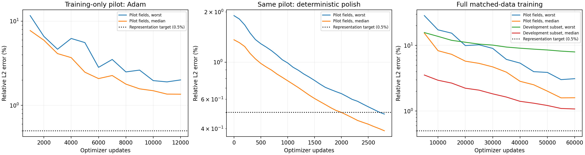
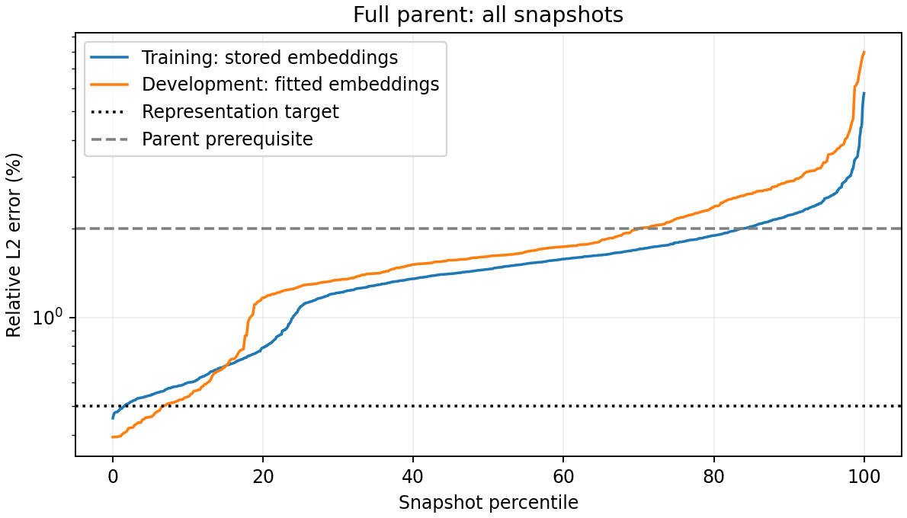
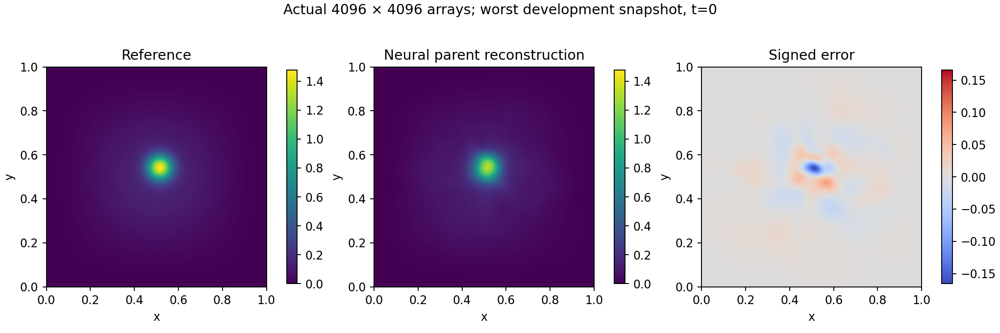

# Neural parent training and advancement

B7 parent-first round: retained pilot and initial full-data results. These are offline field reconstructions, not PDE trajectories. Further registered diagnosis/repair may supersede the full parent checkpoint.

The training-only pilot improved from 1.901289% worst error to 0.488916% with deterministic polishing. This establishes fit ability on those selected training fields only.

Across all full-data snapshots, worst stored-code training error is 5.766173%; worst independently scored development error is 7.952585%. There are 28 unfinished development fits. The maximum independent scoring change is 0.00007011 percentage points. Parent prerequisite passed: False.

The actual4096 witness error is 7.952585%. The displayed image is a preview of the actual full-resolution arrays.

No child or PDE advancement follows from these initial full-data results. CROM and SNF-ROM remain unqualified for a fair complete-solve speed comparison. No final-test fields are opened.

Glossary: parent is the global nonlinear coordinate neural decoder; embedding is its adjustable field code; stored-code training error uses codes learned with the network; fitted development error separately optimizes codes against held-out known fields; independent scoring uses256² quadrature points rather than the128² training rule; unfinished means the original convergence criterion was not satisfied. All relative errors use the current-time reference norm.
