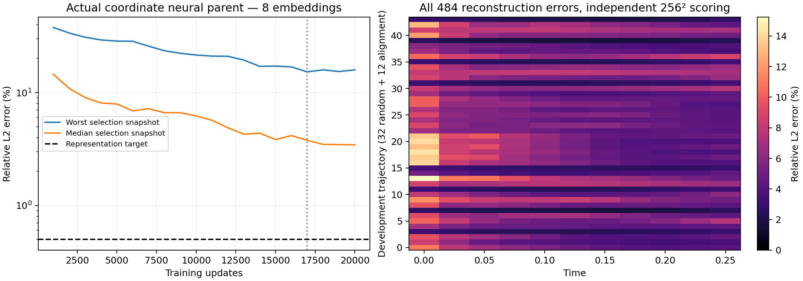
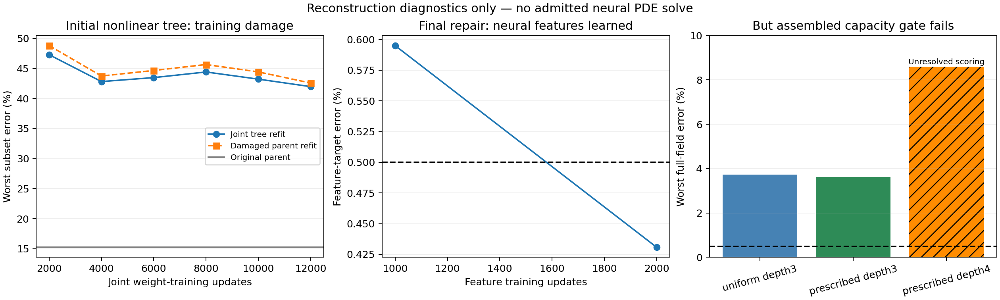
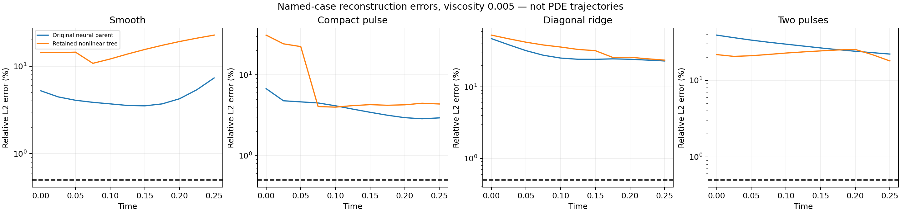
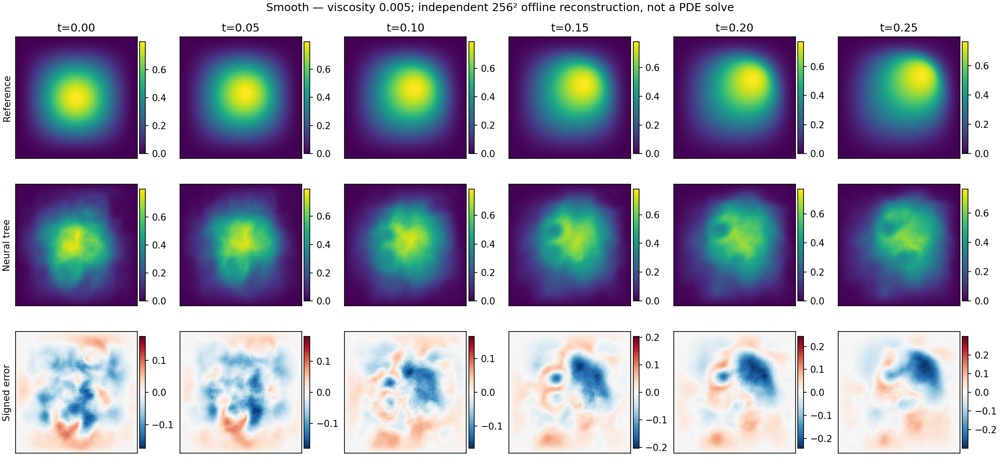
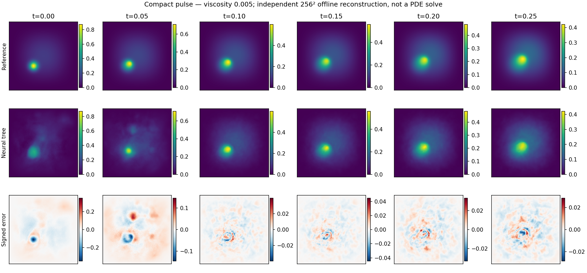
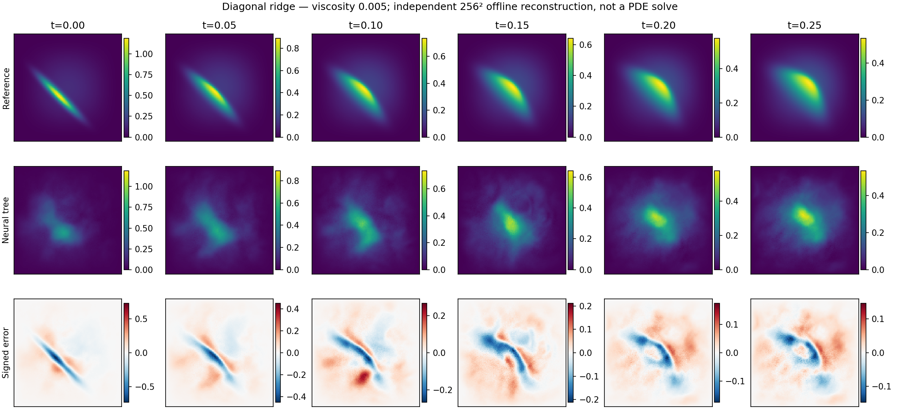
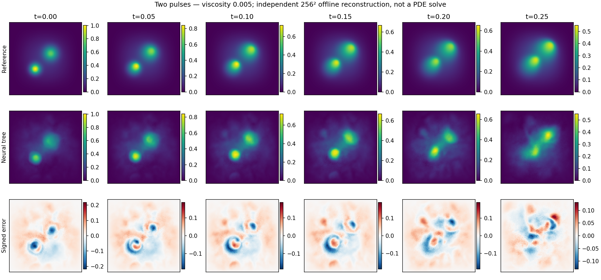

# Actual nonlinear neural tree: development evidence

These are provisional reconstruction and reference diagnostics for the new coordinate neural model. No trained neural-tree PDE trajectory or CROM/SNF-ROM runtime comparison is admitted yet.

The first global neural parent uses eight nonlinear embeddings and three sine-network hidden layers. Its selected checkpoint, at update 17000, has worst independent development reconstruction error **15.2487%** over all 44 trajectories and 11 times. The worst actual 4096×4096 reconstruction gives **15.2487%**, so the error is not a coarse scoring-grid artifact. The largest change between 128² and independent 256² scoring is 0.0000325 percentage points.

The parent fails the 0.5% representation gate. 16 of 484 embedding fits were unfinished in this initial evaluation; these are retained, and the subsequent curvature-aware fitting repair resolves their stopping failures. Most fits reach stationarity, which supports investigating decoder/training capacity and local corrections rather than assuming every large error is merely an unfinished optimizer. This does not establish an inherent neural-decoder limitation.

The initial assembled-child recipe checked parent-fit stability, initialized children from missing reference fields, and jointly trained embeddings and shared networks across tree depths. Uniform and prescribed allocations used the same checkpoint. It failed reconstruction and joint-fit convergence, as detailed below. The implemented nonlinear weak solver passes dense arithmetic and derivative fixtures; this is not an accuracy qualification of a trained model.

All twelve named development extensions passed spectral space/time ladders and independent finite-difference checks. They are qualified development references; this does not qualify any neural model.

|Named development case|Largest spectral reference allowance|Ladder result|
|---|---:|---|
|named0_nu0.02|0.0001235%|Pass|
|named0_nu0.01|0.0001235%|Pass|
|named0_nu0.005|0.0001235%|Pass|
|named1_nu0.02|0.0000751%|Pass|
|named1_nu0.01|0.0000751%|Pass|
|named1_nu0.005|0.0000751%|Pass|
|named2_nu0.02|0.0000466%|Pass|
|named2_nu0.01|0.0000466%|Pass|
|named2_nu0.005|0.0000466%|Pass|
|named3_nu0.02|0.0000473%|Pass|
|named3_nu0.01|0.0000473%|Pass|
|named3_nu0.005|0.0000473%|Pass|

CROM and SNF-ROM reproduction qualification is incomplete. CROM's supplied Burgers implementation is one-dimensional and forced; our two-dimensional viscous study requires a documented problem adapter. Native methods, verified ports and architecture-inspired ablations will remain distinct. No speed advantage over these methods is claimed.

The previous direct-coefficient tree result remains separate and negative on cost. These plots show the newly requested neural architecture, not the previous POD–Fourier or direct-coefficient models. Final tests remain unopened.

## Completed bounded neural repairs

Curvature-aware parent fitting resolved the unfinished-fit prerequisite without relaxing the stopping criterion. The subsequent jointly trained parent/child network failed. Refitting all retained checkpoints gives best worst subset error **41.9794%**; its parent alone is **42.5828%**. Every joint fit remains unfinished. All 160 tested child directions are independent after removing the parent span. This is evidence of training/co-adaptation damage and unsuccessful nonlinear fitting, not a proof that local neural children cannot work.

The final registered repair freezes the original parent and learns shared local coordinate-network features. Its independent feature-target fit reaches **0.4308%**. However, direct projection into those assembled features with fixed original parent embeddings fails the physical capacity prerequisite on all-trajectory scoring:

|Allocation|Maximum depth|Worst independent 256² error|Largest128²-to256² change|
|---|---:|---:|---:|
|uniform|3|3.7213%|0.0053 percentage points|
|prescribed|3|3.6219%|0.0080 percentage points|
|prescribed|4|8.6002%|5.8959 percentage points|

These direct-feature coefficients are a capacity diagnostic, not nonlinear child embeddings. Depth4 is additionally unresolved under independent scoring. **Advancement decision: stop this final registered repair; do not train its smaller nonlinear child map or claim PDE/local-adaptation/runtime success.** This scoped failure does not establish a universal decoder limitation or a lower bound with jointly refitted parent embeddings.

Native CROM training selected epoch 20, with worst encoded subset error 44.6084%. This is an unfinished reproduction diagnostic, not a fair performance ranking: the projection diagnostic is reported below; full-panel qualification and a verified 2D dynamics adapter remain required. The retained recipe uses a lower learning-rate schedule than the author CLI defaults. SNF-ROM dependency installation succeeded but native import exposed a Lux/ChainRules precompile conflict; the cache-disabled compatibility and corrected-fixture outcomes are recorded below. Neither comparator has an eligible complete solve time.

## Tests on the requested Burgers families

These are independent 256² offline reconstructions using retained failed neural checkpoints, not PDE solves. Reference checks passed for all twelve cases. No named case was added to training. Ridges, two-pulse fields and the additional viscosities test transfer beyond the primary training distribution.

|Case|Worst original-parent error|Worst retained nonlinear-tree error|Unfinished tree fits|
|---|---:|---:|---:|
|A · Broad smooth field, viscosity 0.02|8.464%|17.007%|11/11|
|A · Broad smooth field, viscosity 0.01|6.413%|21.456%|11/11|
|A · Broad smooth field, viscosity 0.005|7.353%|22.755%|11/11|
|B · Compact pulse, viscosity 0.02|8.730%|31.104%|11/11|
|B · Compact pulse, viscosity 0.01|6.755%|31.104%|11/11|
|B · Compact pulse, viscosity 0.005|6.755%|31.104%|11/11|
|C · Thin diagonal ridge, viscosity 0.02|47.451%|53.138%|11/11|
|C · Thin diagonal ridge, viscosity 0.01|47.451%|53.138%|11/11|
|C · Thin diagonal ridge, viscosity 0.005|47.451%|53.138%|11/11|
|D · Two unequal pulses, viscosity 0.02|38.981%|21.698%|11/11|
|D · Two unequal pulses, viscosity 0.01|38.981%|24.501%|11/11|
|D · Two unequal pulses, viscosity 0.005|38.981%|25.325%|11/11|

## Native CROM projection diagnosis

Worst independent subset error changes from 44.605% encoded to 27.967% after native nonlinear projection. This retained-checkpoint diagnostic does not establish CROM's best attainable accuracy or a complete PDE runtime.

## Native SNF environment outcome

Final bounded cache-disabled compatibility fixture passed: **False**. No SNF training or complete PDE timing was performed. The pinned source, resolved dependency manifest and all failed attempts are retained. The cache-disabled import succeeded; an ambiguity in our synthetic fixture was corrected explicitly. The corrected fixture then failed GPU kernel compilation with InvalidIRError in GPUArrays/CUDA/LLVM. Device detection therefore did not establish functional numerical kernels. The bounded environment investigation stops without a trained SNF-ROM comparison.

## Allocation and stop decision

This bounded round used 4361 allocated GPU-seconds (1.211389 hours) of its 8-hour allowance, including failed and cancelled attempts. Cumulative study allocation is12.556389 GPU-hours. All 89 owned jobs are terminal; final-test fields remain sealed. The neural round stops at its failed representation gate, with no automatic continuation or merge.

## Glossary

**Embedding:** small vector of independently adjustable model variables. **Parent:** global neural field covering the domain. **Child:** local neural correction with its own embedding. **Reconstruction:** fitting a known reference field offline; it is not a PDE prediction. **Relative L2 error:** physical squared-error integral, normalized by the current-time reference norm. **Stationarity:** the fitted objective's gradient is sufficiently small. **Allowance:** measured numerical-reference uncertainty. **Ladder:** progressively finer reference space/time settings. **Development:** exposed trajectories used to diagnose and select methods. **Native method:** author implementation with its intended training and evolution algorithm. **Feature:** a spatial function produced by the shared coordinate neural network. **Direct-feature control:** an offline fit allowing every feature coefficient to vary, used to test capacity before training smaller nonlinear embeddings. **Quadrature:** weighted spatial points used to approximate physical integrals. **Actual resolution:** the model and reference arrays contain all 4096×4096 requested values; the overview image is reduced for display.
