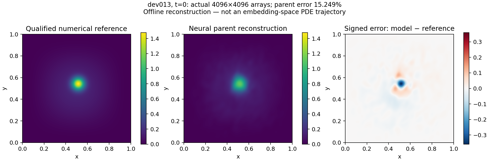

# Actual nonlinear neural tree: development evidence

These are provisional reconstruction and reference diagnostics for the new coordinate neural model. No trained neural-tree PDE trajectory or CROM/SNF-ROM runtime comparison is admitted yet.

The first global neural parent uses eight nonlinear embeddings and three sine-network hidden layers. Its selected checkpoint, at update 17000, has worst independent development reconstruction error **15.2487%** over all 44 trajectories and 11 times. The worst actual 4096×4096 reconstruction gives **15.2487%**, so the error is not a coarse scoring-grid artifact. The largest change between 128² and independent 256² scoring is 0.0000325 percentage points.

The parent fails the 0.5% representation gate. 16 of 484 embedding fits remain unfinished under the registered stopping criterion; these are explicitly retained. Most fits reach stationarity, which supports investigating decoder/training capacity and local corrections rather than assuming every large error is merely an unfinished optimizer. This does not establish an inherent neural-decoder limitation.

The initial assembled-child recipe checks parent-fit stability first, initializes children from missing reference fields, and jointly trains embeddings and shared networks across tree depths. Uniform and prescribed allocations use the same checkpoint. Full independent scoring and useful independent child-direction checks are required before embedding-space PDE trajectories. The implemented nonlinear weak solver passes dense arithmetic and derivative fixtures; this is not an accuracy qualification of a trained model.

All twelve named development extensions have completed spectral space/time ladders. Independent finite-difference checks are still pending, so these references are not yet admitted for method claims.

|Named development case|Largest spectral reference allowance|Ladder result|
|---|---:|---|
|named0_nu0.02|0.0001235%|Pass|
|named0_nu0.01|0.0001235%|Pass|
|named0_nu0.005|0.0001235%|Pass|
|named1_nu0.02|0.0000751%|Pass|
|named1_nu0.01|0.0000751%|Pass|
|named1_nu0.005|0.0000751%|Pass|
|named2_nu0.02|0.0000466%|Pass|
|named2_nu0.01|0.0000466%|Pass|
|named2_nu0.005|0.0000466%|Pass|
|named3_nu0.02|0.0000473%|Pass|
|named3_nu0.01|0.0000473%|Pass|
|named3_nu0.005|0.0000473%|Pass|

CROM and SNF-ROM source/environment qualification is running separately. CROM's supplied Burgers implementation is one-dimensional and forced; our two-dimensional viscous study requires a documented problem adapter. Native methods, verified ports and architecture-inspired ablations will remain distinct. No speed advantage over these methods is claimed.

The previous direct-coefficient tree result remains separate and negative on cost. These plots show the newly requested neural architecture, not the previous POD–Fourier or direct-coefficient models. Final tests remain unopened.

## Glossary

**Embedding:** small vector of independently adjustable model variables. **Parent:** global neural field covering the domain. **Child:** local neural correction with its own embedding. **Reconstruction:** fitting a known reference field offline; it is not a PDE prediction. **Relative L2 error:** physical squared-error integral, normalized by the current-time reference norm. **Stationarity:** the fitted objective's gradient is sufficiently small. **Allowance:** measured numerical-reference uncertainty. **Ladder:** progressively finer reference space/time settings. **Development:** exposed trajectories used to diagnose and select methods. **Native method:** author implementation with its intended training and evolution algorithm. **Actual resolution:** the model and reference arrays contain all 4096×4096 requested values; the overview image is reduced for display.
