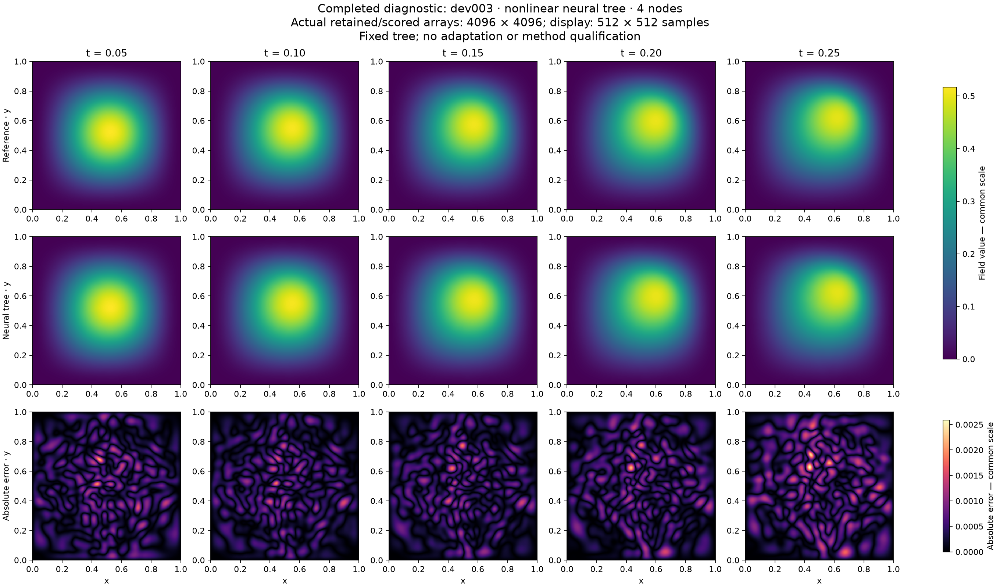
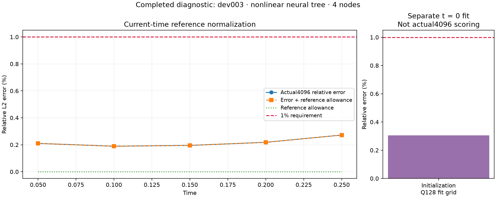
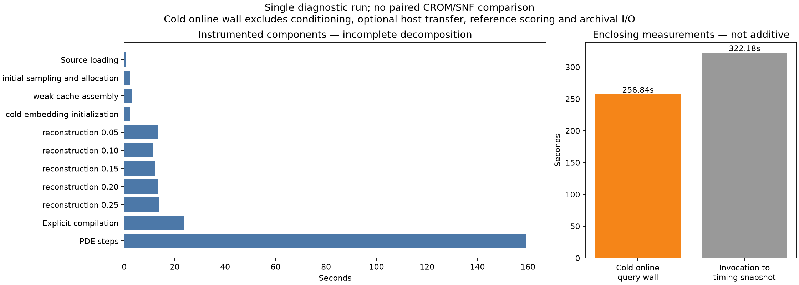

# First actual nonlinear neural-tree PDE diagnostic

The smooth held-out development case `dev003` completes all500 embedding-space PDE steps. Every requested actual4096-by4096 output is below1% relative L2 error, using the current-time reference norm. **This is one fixed-tree diagnostic, not all-case qualification or a speedup claim.** Narrow-pulse, ridge and two-pulse neural PDE qualification remains outstanding; final tests remain sealed.

The model uses the frozen32-code B7 neural parent and4 independently adjustable16-code nonlinear children (96 variables total), trained on the original primary cohort. Windows and weights stay fixed; no online adaptation occurs. Initialization uses only the common initial-field callable and training library; future reference fields enter only after model output, for scoring. The original fine upwind/weak PDE formulation usesL16384, integrationQ128,512test modes, dt0.0005 and unchanged stopping tolerances.

All retained arrays and error calculations are4096×4096. The image displays512×512 samples to fit the page; it does not represent a lower-resolution solve. Reference and model share one color scale; absolute errors share another.

| Output time | Actual4096 relative L2 error | Reference allowance |
|---|---:|---:|
| 0.05 | 0.210207% | 5.41e-10% |
| 0.10 | 0.189228% | 1.12e-09% |
| 0.15 | 0.195317% | 1.74e-09% |
| 0.20 | 0.218102% | 2.42e-09% |
| 0.25 | 0.272070% | 3.22e-09% |

Initial fitting error is0.305785% on itsQ128 integration grid, reported separately from actual4096 output scores. All500 PDE steps converged and used5 LM iterations each. Time-step halving, integration refinement, harder cases and final method freeze are still required.

## Runtime and advancement

The single cold online query costs **256.841seconds**, including source loading, initialization, assembly, compilation, Python control, mandatory acceptance transfers,500PDE steps and allfive requested device reconstructions. PDE steps account for159.225seconds; reconstruction including its explicit compilation accounts for66.369seconds. This is an enclosing wall measurement, not a sum advertised as complete time.

Separately excluded: reference scoring2.542s, optional output-to-host transfer0.193s, archival I/O59.883s, and GPUconditioning2.722s. The invocation-to-snapshot wall is322.182s. Reference/archival work occurs between outputs in this diagnostic; clean paired runtime runs remain necessary. There are no paired CROM/SNF timings, repetitions or eligible speed ratios here.

**Decision:** advance the neural implementation to equivalent Jacobian/output-cache optimization and numerical-convergence checks. Continue expanded nonlinear-child training and capacity diagnostics before claiming success on localized cases. Locality alone does not establish a faster PDE solve. Preserve this correct but costly implementation as the control.

The CROM high-rate attempt collapsed near a constant predictor and was interrupted with artifacts retained; it is not a fair competing result. A fresh lower-rate native-network repair is prepared. SNF native training-path qualification and matched-data training remain separate prerequisites. No competitor superiority claim is justified.

## Provenance

Solver job7386952, source `8406c37c9de74347ffedb4d36f4d2a281b3f0330`; model `b8childprimary` hash `55db1ce218df57408a3350bf6283eeb0f2b4824e17c4a1ded60b6fb3a52a074a`. Plot job7387022, source `1e680ddf8a177f68863f1a6c942d6ce0ccc3783a`. All solver/plot outputs retained with local and remote hash verification in `manifests/retention-b8treepde.json` and `manifests/retention-b8treeplots.json`. Plotting independently recomputed allfive full-grid errors and verified every saved error array against prediction-minus-reference.
