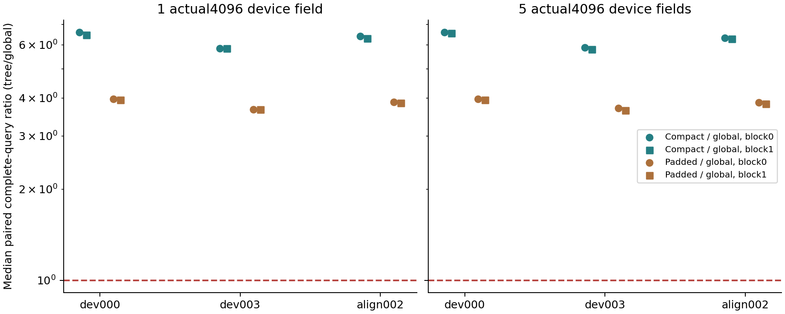

# Burgers tree embeddings: complete fixed-query cost diagnostic

The compact tree does not pass the three-case diagnostic cost criterion. This does not establish native NM-ROM superiority or a final-test result; review measured component costs before any finite next batch.

The direct24/52-node tree and stable global960 control use the admitted fine weak PDE, numerical tolerances and training data. Reusable tables cover all340 cells through depth4. Source verification, cache construction/storage and training-only prewarming are recorded separately. Every query charges initial sampling/selection, gathering, visibility, initial fitting, solving and actual requested reconstruction. Repeated timed queries disable internal stopwatches and synchronize all returned work. These fixed trees have no refinement trials or fallback; their zero counts do not predict adaptive cost.

|Run|Invocations|All gates pass|Distinct actual fields checked|
|---|---:|---|---:|
|b5cache|6|True|6|
|b5normal|6|True|6|
|b5compact|9|True|9|
|b5block0|90|True|120|
|b5block1|90|True|120|

|Tree evaluation|Requested fields|Median ratio|Trajectory-bootstrap95% interval|Worst case ratio|Cases faster|
|---|---:|---:|---|---:|---:|
|tree_direct24|1|6.360891|[5.834616, 6.540119]|6.540119|0/3|
|tree_packed_control|1|3.867359|[3.671177, 3.957766]|3.957766|0/3|
|tree_direct24|5|6.329574|[5.847108, 6.549011]|6.549011|0/3|
|tree_packed_control|5|3.858854|[3.672655, 3.958187]|3.958187|0/3|

Instrumented diagnostic components fromb5compact, in seconds. These single invocations locate work; the repeated uninstrumented measurements above determine cost comparisons.

|Case|Method|Selection/assembly|Initial fit|PDE stepping|Requested output|Whole query|
|---|---|---:|---:|---:|---:|---:|
|dev000|tree_direct24|0.194289|0.016886|28.206619|0.009167|28.429024|
|dev000|global_stable960|0.000006|0.009909|4.231778|0.000539|4.243197|
|dev000|tree_packed_control|0.168690|0.011349|16.999355|0.002146|17.182803|
|dev003|tree_direct24|0.200534|0.017402|21.760862|0.008648|21.990130|
|dev003|global_stable960|0.000003|0.010984|3.889230|0.000634|3.902199|
|dev003|tree_packed_control|0.202805|0.012058|13.737877|0.002476|13.956624|
|align002|tree_direct24|0.177998|0.016970|27.165188|0.009226|27.372358|
|align002|global_stable960|0.000003|0.010099|4.303007|0.000565|4.314797|
|align002|tree_packed_control|0.174439|0.011875|16.410278|0.001953|16.600282|

Ratios always compare invocations on the same GPU/allocation. The two allocations use opposite randomized method orders, with five repetitions per case and output contract. Accuracy and cost use the same returned states. One final4096-square device field is the primary contract; five4096-square fields use separate complete invocations. Host transfer is recorded separately. Each distinct float64 output is retained by raw-byte hash; exact repeats map to that retained array. No coefficient-only output substitutes for a requested field.

This panel contains only three development trajectories. The exact small-panel bootstrap resamples trajectories, not repetitions; its interval is a diagnostic with limited coverage, not final confirmation. The global control is POD plus prescribed Fourier completion, not a native Tunable/CROM/SNF/masked-autoencoder reproduction. Native competitors, deployable adaptation, method freeze and unopened final-test solutions remain separate requirements. An unqualified timing result is retained but cannot support a speed claim.

Latest scheduler snapshot: 40842 allocated GPU-seconds (11.345000h), with full outstanding reservations charged to40842 seconds against the cumulative cap42296. Active owned jobs: none. Generated 2026-11-19T17:59:23.410703+00:00. The old campaign remains paused; no merge or unrelated3D work.

## Glossary

- **Complete query:** the known initial callable enters, and actual requested device fields leave; all query-specific work is timed.
- **Reusable setup:** fixed-decoder tables and training-only compilation that can serve previously unseen inputs; construction and storage remain reported.
- **Compact/padded:** local patch arithmetic versus full-axis contractions containing support zeros; both implement the same decoder.
- **Paired ratio:** tree query duration divided by the global query duration from the same case, repetition and allocation. Below1 is faster.
- **Trajectory bootstrap:** resampling whole cases to summarize uncertainty, without treating repeated measurements as independent cases.
- **Equivalence gate:** field change at most1e-7 of the current reference norm, alongside physical and full solver-convergence checks.
- **Allocated GPU time:** complete scheduler duration, including compilation, failed jobs, scoring and output storage.
