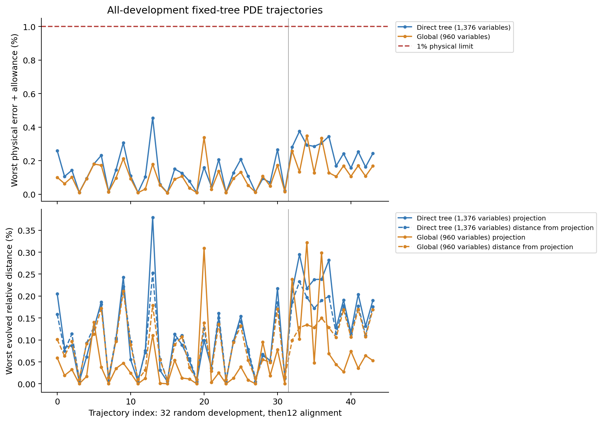

# Burgers tree embeddings: all-development fixed-tree qualification

All-development qualification remains incomplete. Outstanding: b4time, b4quad.

The same frozen direct24/52-node tree and stable global960 POD-plus-Fourier control use the initial-field callable, fine L16384 sign-upwind weak operator, Crank–Nicolson time integration,22016 tests and independently admitted packed field evaluation. The baseline uses step0.00125 and Q512; independent refinements halve the step and double Q. References enter only scoring after both solves. Final-test solution fields remain unopened.

Every physical decision covers all five evolved output times and the actual4096 final field, normalized by the reference norm at that same time and including its qualified allowance. Complete runs must save88 actual4096 float64 predictions, whose headers and full retained hashes are checked; reference coefficients are retained by hash instead of duplicating the same reference grid. Initial-fit error is recorded separately. Missing outputs fail admission. No incomplete step or trajectory is silently omitted.

|Run|Method|Median case error|90th percentile|Worst physical error|Worst error + allowance|Nonconverged steps|Largest refinement change|All gates pass|
|---|---|---:|---:|---:|---:|---:|---:|---|
|b4base|tree_direct24|0.147669%|0.301255%|0.455470%|0.455525%|0|0.000000%|True|
|b4base|global_stable960|0.103902%|0.202287%|0.348890%|0.348966%|0|0.000000%|True|

These are physical/numerical qualification runs, not paired speed benchmarks. Query clocks still charge shared comparison setup; no method-specific speed ratio is inferred. The nonlinear PDE checkpoint remains stopped after two failed optimizer repairs; the frozen tangent simplification also failed its representation screen. The cell catalogue has only CPU fixture evidence and is not used here. Native NM-ROM confirmation, deployable adaptation, complete-runtime benchmarking, method freeze and final-test evaluation remain outstanding.

Latest scheduler snapshot: 29489 allocated GPU-seconds (8.191389h); charge including full active reservations 29489, cumulative cap 41876. Active owned jobs: none. Generated 2026-11-19T04:02:14.141657+00:00. The old campaign remains paused; no automatic merge or unrelated3D work.

## Glossary

- **Case error:** worst current-time relative field error over that trajectory's required outputs. Median and90th percentile summarize the44 case errors, not correlated snapshots.
- **Allowance:** measured reference uncertainty, added before checking the1% physical gate.
- **Projection error:** diagnostic distance from the reference to its best-fit frozen representation; tiny regularization is retained from the diagnostic fit.
- **Distance from projection:** distance between the evolved state and that fitted field. It is reported separately from total physical error, not added as an assumed error bound.
- **Refinement change:** returned-state difference after independently changing one numerical setting, normalized by the current reference norm. The limit is0.1%; baseline has no comparison.
- **Complete convergence:** finite diagnostics, stationarity within tolerance and either a small field update or100 times smaller stationarity.
- **POD/Fourier:** a training-derived linear basis plus a prescribed trigonometric completion; this global control is not a native neural NM-ROM reproduction.
- **L/Q:** fine spatial-operator intervals and integration intervals per axis, respectively. Integration retains the fine stencil spacing.
- **Allocated GPU time:** scheduler duration including setup, compilation, scoring, storage and failed jobs; it differs from online query time.
