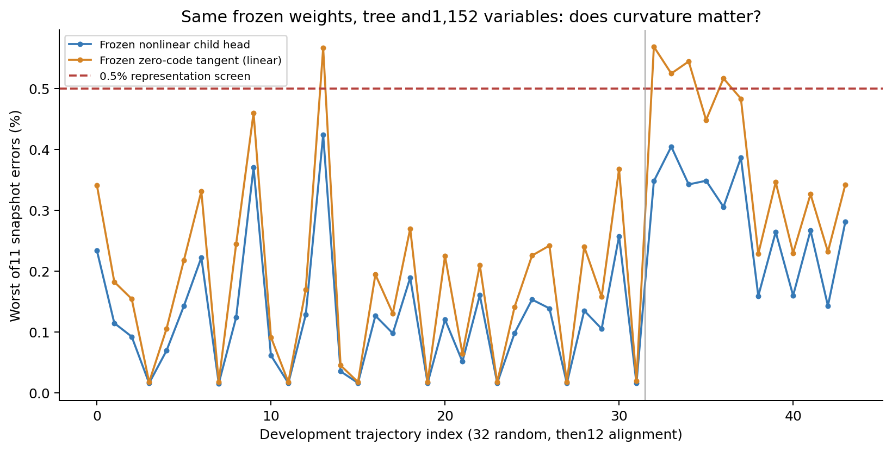

# Burgers tree embeddings: field implementation and frozen tangent diagnostics

Packed field diagnostic is outstanding. Stop this tangent ablation; retain the nonlinear representation and its scoped PDE solver failure.

The preceding three-case B2 setting passes physical accuracy and independent spatial, integration, weak-test, time-step and100x-precision checks. This batch tests one equivalent implementation and one specific architecture, under a finite one-GPU-hour allowance. It does not admit all-development PDE trajectories, deployable adaptation, a runtime win, native NM-ROM confirmation or final-test access. The original16.5% failure and all later representation results remain in [the representation report](2026-11-18-tree-embedding-representation.md).

## Frozen tangent architecture

This is a separately labelled direct-coefficient decoder: the derivative of each frozen child head at zero replaces its nonlinear output. The original nonlinear PDE optimizer remains stopped. Parent, shared weights,64 retained nodes and1152 adjustable variables are unchanged; all coefficients are jointly refitted with the complete physical overlap metric and no ridge/direction removal. Geometry is selected from the initial-field callable before reference access.

Worst physical projection error is0.56851064%; the actual4096 witness is0.56851065% atalign000, t=0.0. Maximum scaled stationarity is7.47044e-15. The representation gate is **False**. An unsuccessful screen is not admitted to PDE solving; a passing screen also requires the retained independent all-snapshot dense audit.

Latest scheduler-ledger snapshot: 27457 elapsed GPU-seconds (7.626944h); full outstanding reservations bring the charge to28464 seconds against a cumulative ceiling of30789. Active owned jobs: b3packed. Generated 2026-11-19T03:14:46.636948+00:00. Raw outputs and logs are retained with verified hashes before admission. Final-test solution fields remain unopened and the earlier campaign remains paused.

## Glossary

- **Tangent:** the decoder's derivative at zero child codes, used here as a fixed linear correction basis.
- **Curvature:** the change in a nonlinear decoder's directions as its codes move away from zero.
- **Projection:** an offline best-fit reconstruction that may use the reference field; it is not a PDE solve.
- **Stationarity:** the remaining physical objective gradient after fitting. Small values help distinguish limited representation from a poor fit.
- **Equivalence:** the returned field agrees with the unchanged compact implementation to the registered tolerance.
- **Cold initialization:** constructing/fitting the initial state, including compilation in this diagnostic.
- **MiB:**2^20 bytes. Padded cache memory includes zeros introduced to make array shapes independent of tree geometry.
- **Allocated time:** scheduler duration, including compilation, failures and idle portions; it is distinct from online query runtime.
