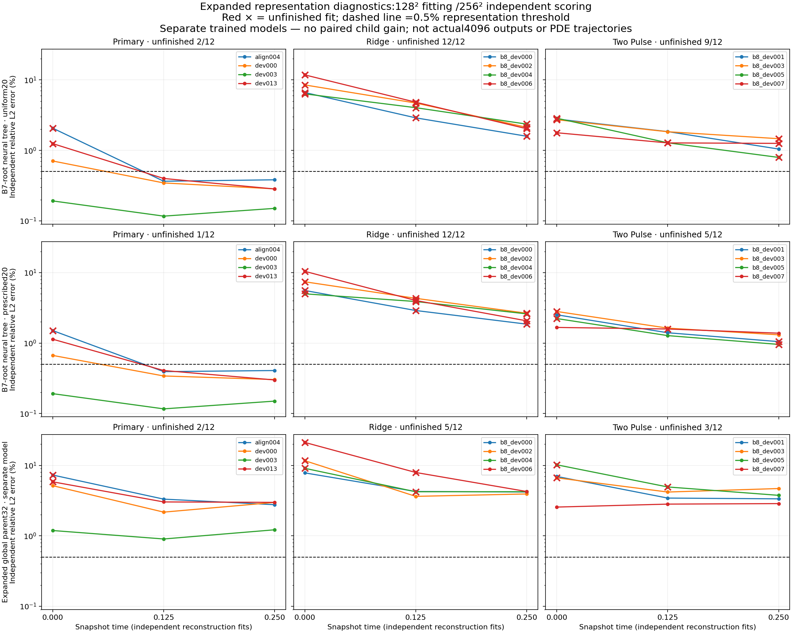
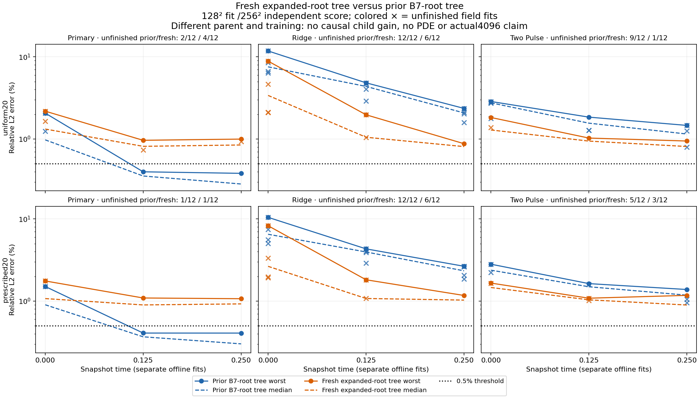

# Expanded neural representation: first retained comparison

The selected30k-update B7-root nonlinear tree has a worst independent reconstruction error of **11.779%**, with **41/72 fits unfinished**. The separately trained expanded global parent32 has worst error **21.174%**, with **10/36 fits unfinished**. Neither establishes representation qualification. Unfinished fits are not evidence of a decoder capacity floor.

These are offline field-fitting diagnostics on12 development trajectories at0,0.125,0.25:36 fields, with two tree layouts producing72 tree fits. Fitting uses128²Gauss quadrature and independent scoring256²Gauss, normalized by each current-time reference norm. Red crosses identify unfinished fits under unchanged stationarity/update criteria. The0.5%line is the representation threshold; crossing it alone does not satisfy convergence or all-case gates. Lines connect separately fitted snapshots, not an evolved PDE trajectory. **These are not actual4096 reconstruction plots.**

| Model / allocation | Family | Worst error | Median error | Unfinished | Error ≤0.5% |
|---|---|---:|---:|---:|---:|
| B7-root neural tree · uniform20 | primary | 2.065% | 0.355% | 2/12 | 9/12 |
| B7-root neural tree · uniform20 | ridge | 11.779% | 4.365% | 12/12 | 0/12 |
| B7-root neural tree · uniform20 | two pulse | 2.861% | 1.621% | 9/12 | 0/12 |
| B7-root neural tree · prescribed20 | primary | 1.505% | 0.368% | 1/12 | 9/12 |
| B7-root neural tree · prescribed20 | ridge | 10.439% | 3.959% | 12/12 | 0/12 |
| B7-root neural tree · prescribed20 | two pulse | 2.810% | 1.494% | 5/12 | 0/12 |
| Expanded global parent32 · separate model | primary | 7.289% | 2.984% | 2/12 | 0/12 |
| Expanded global parent32 · separate model | ridge | 21.174% | 4.257% | 5/12 | 0/12 |
| Expanded global parent32 · separate model | two pulse | 10.188% | 3.970% | 3/12 | 0/12 |

The first two rows of panels share one local checkpoint and compare uniform versus prescribed allocation. The bottom row is a separate expanded-data global parent, selected at update40000 and scored after its training-code refresh. The tree retains the original B7 parent and independently trained local corrections. These are different trained models; their difference must not be presented as paired child improvement over the expanded parent. Family assignments come from retained reference records, not case-number parity.

## Retained long-fit follow-up: separate24-field subset

The original72-fit panel and its unfinished counts above are unchanged. A separate continuation kept its selected weights fixed and jointly refitted parent/child codes for24 selected field/layout combinations, allowing up to1000additional LM iterations under the same convergence criteria. **19/24 converged; 5 remained unfinished**, with0 numerical failures. The subset's worst independent error moved from **11.7786% to11.6515%**.

| t=0 case | Allocation | Before | After long fit | Converged |
|---|---|---:|---:|---|
| b8_dev006 | uniform | 11.7786% | 11.6515% | No |
| b8_dev006 | prescribed | 10.4393% | 10.4210% | No |
| b8_dev000 | uniform | 6.6222% | 6.5678% | No |
| b8_dev000 | prescribed | 5.5815% | 5.5795% | Yes |
| b8_dev001 | uniform | 2.7850% | 2.7850% | Yes |
| b8_dev001 | prescribed | 2.5225% | 2.5225% | Yes |
| align004 | uniform | 2.0646% | 2.0646% | Yes |
| align004 | prescribed | 1.5052% | 1.5052% | Yes |

Several converged fits remain above the0.5% representation threshold, including the aligned narrow pulse, two-pulse case and one ridge fit. The original iteration limit alone is therefore not the main explanation for these remaining errors. This is not an absolute capacity proof: other local minima or a restricted nonlinear head remain possible, and five fits are still unfinished. The matched feature-span discriminator is the next test of feature capacity versus nonlinear-code restriction. Independent256 scoring remains offline; there is no actual4096 or PDE claim.

Continuation job7387441; verified result hash `046f71caa63d9507cc18952eddd2b671e5c298e2b0290eb8c7acca70b56e9a9d`. Its complete scalar records are retained alongside this report's metadata.

## Fresh children on the expanded parent: separate retained experiment

The fresh16-code children on the expanded-data parent selected update30000. Their worst independent error is **8.8624%**, with **21/72 unfinished fits**. The prior B7-root tree remains11.7786% with41/72 unfinished in its original selected panel. Both still fail the0.5% representation requirement; these are selected-field diagnostics, not all-case qualification.

Solid curves show each family's worst error at that time; dashed curves show its median. Colored crosses retain individual unfinished fits. The table uses each family's worst across all three times.

| Allocation | Family | Prior worst | Fresh worst | Prior unfinished | Fresh unfinished |
|---|---|---:|---:|---:|---:|
| uniform20 | primary | 2.065% | 2.181% | 2/12 | 4/12 |
| uniform20 | ridge | 11.779% | 8.862% | 12/12 | 6/12 |
| uniform20 | two pulse | 2.861% | 1.828% | 9/12 | 1/12 |
| prescribed20 | primary | 1.505% | 1.758% | 1/12 | 1/12 |
| prescribed20 | ridge | 10.439% | 8.257% | 12/12 | 6/12 |
| prescribed20 | two pulse | 2.810% | 1.656% | 5/12 | 3/12 |

Ridge and two-pulse worst errors are lower in this fresh experiment, while primary-family worst errors are slightly higher. The parent checkpoint and child training changed, so this comparison does not isolate the effect of children or establish a causal gain. It also does not replace the prior long-fit follow-up: that follow-up used the older tree checkpoint. Matched feature-span and local-enrichment diagnostics are needed to separate nonlinear-head limits, spatial coverage and fitting effort. These snapshots are independently fitted fields; no new PDE trajectory or actual4096 claim is made.

Fresh-child job7387425, model hash `a1121a65043c5bb03c62dac93c9d730610b8a62f9929aa0ba6b26467b3c61d15`; parent hash `153eb2c5b4f79ce61d845b44632f4d7e21f8c1cb67845b504b08a2f7523c4276`. Manifest-verified scalar source rows and summary are retained in this report's metadata. Original plots, original selected-panel counts and the older-checkpoint long-fit evidence remain unchanged.

**Decision:** retain all failures, use matched feature-span evidence to distinguish representation limits from nonlinear fitting, and use the fresh expanded-parent results as a separate architecture/training experiment. No final-test fields were opened; no CROM/SNF accuracy or runtime superiority is established here.

The earlier smooth-case actual4096 PDE fields, error plots, runtime accounting and optimized-replay postmortem remain available in [the neural-tree PDE diagnostic](2026-11-19-neural-tree-pde-diagnostic.md). Its successful single smooth case does not qualify these localized cases.

## Provenance

Tree job7386633, selected checkpoint `9c11e86ce064f980182d60f40f56efe1126256e2b4f91fa280c90cf809f07fb6`; expanded parent job7387351, checkpoint `153eb2c5b4f79ce61d845b44632f4d7e21f8c1cb67845b504b08a2f7523c4276`. Source records, checkpoints and expanded-reference family mapping were checked against COMPLETED local/remote retention manifests before reading. Full scalar plot inputs and hashes are retained in [representation_metadata.json](2026-11-20-expanded-neural-representation-assets/representation_metadata.json). This report only reads retained metadata; it performs no model decoding, fitting or PDE solve.
