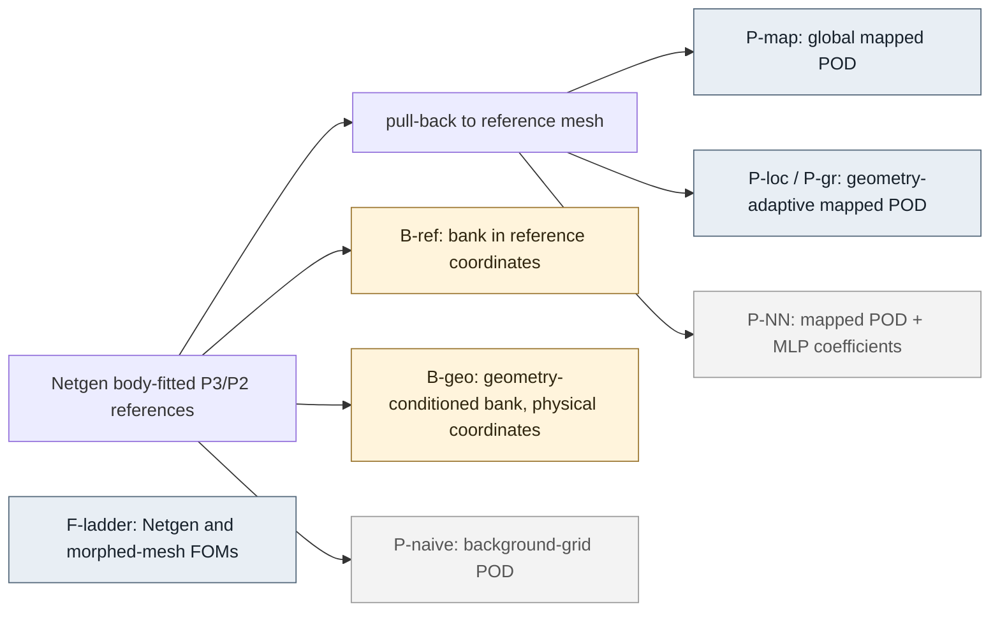
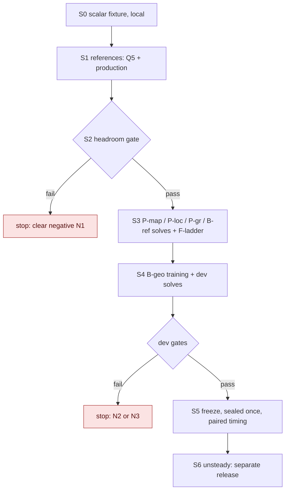

# Geometry-varying family: does a coordinate-network bank have a structural edge over POD?

Status: **prospective design, 2026-11-03. No job has run, nothing has been trained, and no number here is
measured.** Every threshold below is fixed before any data for this lane exists. Revision R0 (pre-audit). Lane
`exp/2026-11-03-geometry-family-design`, forked from the consolidated fork point `93f399faa` (code-only mirror parent
`5a64899fd`). This lane holds design only. Execution will need its own lanes, created after the user releases them.

## 0. Why this experiment, and what it is not

On fixed-mesh, fixed-geometry families our learned bank (a coordinate network giving spatial functions, used with
directly solved coefficients or a nonlinear head) has at best tied POD. That is what one should expect: in a fixed
inner product, the POD space of rank $r$ is the optimal linear rank-$r$ space for the training snapshots, so a
learned **fixed** linear span cannot beat it on representation. A nonlinear head inside a fixed bank only picks a
curved subset of that bank's span, so it cannot get outside the span either (decoder-history report, §"architectural
distinctions"). In 2D the bank has also paid neural-evaluation and quadrature overhead that POD does not pay.

A family whose **domain** varies changes the premise. Each snapshot lives on its own mesh, so plain POD has no common
vector space without an extra step: interpolating onto a background grid, mapping to a reference domain, or
registration. A coordinate network evaluates at any physical point and could also take the geometry as an input. The
question is whether that gives it a real advantage, **once POD has been given the standard and strong treatment of
varying geometry (a reference-domain map)**, rather than the weak one (naive interpolation).

The honest prior is not favourable (§1.5). For smooth shape families of the **steady** Navier–Stokes equations, the
solution manifold pulled back to a reference domain depends holomorphically on the shape (Cohen, Schwab and Zech
2018). That implies fast $n$-width decay, which is exactly the regime where mapped POD is strong. The design therefore
puts a **cheap, training-free headroom gate (S2) before any neural training**. If even an oracle geometry-adaptive
*linear* space cannot beat global mapped POD by a declared margin, the bank has no structural room and the lane stops
with a clear negative, at a cost of about 3.5 GPU-hours.

What this design does **not** do: it does not reopen the fixed-geometry obstacle campaign (its worktrees are
read-only for this lane), open any sealed cohort, or claim anything about 3D, moving or deforming bodies, or turbulence.

## 1. Literature and fair competitors

All entries were checked against publisher or arXiv records on 2026-11-03. "Role" says how the entry bears on this
design.

### 1.1 Reference-domain mapping (mesh morphing), the standard POD/RB treatment

| Source | Content | Role |
|---|---|---|
| Rozza, Huynh, Patera, *Arch. Comput. Methods Eng.* 15:229–275 (2008), doi:10.1007/s11831-008-9019-9 | Affine geometric parametrization by piecewise-affine maps to a reference domain; RB with offline/online split | Origin of the mapped formulation |
| Rozza, Huynh, Manzoni, *Numer. Math.* 125:115–152 (2013), doi:10.1007/s00211-013-0534-8 | RB for Stokes in parametrized geometries; role of inf-sup constants, supremizers | Pressure stability on mapped geometries |
| Ballarin, Manzoni, Quarteroni, Rozza, *IJNME* 102(5):1136–1161 (2015), doi:10.1002/nme.4772 | Supremizer-stabilised POD–Galerkin for parametrized steady incompressible NS | Pressure treatment for every POD arm |
| Barrault, Maday, Nguyen, Patera, *C. R. Math.* 339(9):667–672 (2004), doi:10.1016/j.crma.2004.08.006 | Empirical interpolation (EIM) for non-affine parameter dependence | Non-affine geometric factors |
| Chaturantabut, Sorensen, *SIAM J. Sci. Comput.* 32(5):2737–2764 (2010), doi:10.1137/090766498 | DEIM | Same, discrete version |
| Lassila, Rozza, *CMAME* 199(23–24):1583–1592 (2010), doi:10.1016/j.cma.2010.01.007 | Free-form deformation maps with RB | Smooth shape maps |
| Manzoni, Quarteroni, Rozza, *Int. J. Numer. Meth. Biomed. Eng.* 28(6–7):604–625 (2012), doi:10.1002/cnm.1465 | RB for flows in parametrized (vascular) geometries | Flow application of mapped RB |
| Ballarin, Faggiano, Ippolito, Manzoni, Quarteroni, Rozza, Scrofani, *J. Comput. Phys.* 315:609–628 (2016), doi:10.1016/j.jcp.2016.03.065 | POD–Galerkin NS on centreline-parametrized 3D grafts; <1 % error with O(100) online DOFs | Evidence that mapped POD is strong for steady-ish NS shape families |
| Stabile, Zancanaro, Rozza, *IJNME* 121(12):2655–2682 (2020), doi:10.1002/nme.6324 | Finite-volume POD on an average deformed configuration, RBF and Laplacian mesh motion, DEIM; geometrically parametrized NS | Mesh-motion POD for NS without an exact reference map |
| Quarteroni, Manzoni, Negri, *Reduced Basis Methods for PDEs*, Springer UNITEXT 92 (2016), doi:10.1007/978-3-319-15431-2 | Textbook: geometric parametrization, EIM, Stokes/NS | Implementation reference |

### 1.2 Embedded (no-map) POD on a fixed background mesh

| Source | Content | Role |
|---|---|---|
| Karatzas, Ballarin, Rozza, *Comput. Math. Appl.* 79:833–851 (2020), doi:10.1016/j.camwa.2019.08.003 | POD on CutFEM; extension and transport of embedded solutions to a common background; elliptic and Stokes | No-map alternative; shows that naive extension needs care |
| Karatzas, Stabile, Nouveau, Scovazzi, Rozza, *CMAME* 370:113273 (2020), doi:10.1016/j.cma.2020.113273 (arXiv:1907.10549) | POD on the shifted boundary method; steady NS at moderate Re; level-set geometry with 1 and 3 geometric parameters on a fixed Cartesian background | The closest published steady-NS varying-geometry ROM without a reference map |

### 1.3 Registration and transport-aware reduction

| Source | Content | Role |
|---|---|---|
| Taddei, *SIAM J. Sci. Comput.* 42(2):A997–A1027 (2020), doi:10.1137/19M1271270 | Registration (parametric map learned from data) for compression and geometry reduction | Map found by optimisation instead of being prescribed |
| Taddei, Zhang, *J. Sci. Comput.* 88:79 (2021), doi:10.1007/s10915-021-01584-y (arXiv:2101.10259) | Registration-based MOR in complex 2D geometries (spectral-element maps on subdomains) | Strongest form of the mapped competitor; out of scope to build (§1.6) |
| Iollo, Lombardi, *Phys. Rev. E* 89:022923 (2014), doi:10.1103/PhysRevE.89.022923 | Advection modes from optimal transport | Transport-aware bases (relevant for unsteady) |
| Reiss, Schulze, Sesterhenn, Mehrmann, *SIAM J. Sci. Comput.* 40(3):A1322–A1344 (2018), doi:10.1137/17M1113679 | Shifted POD | Transport-aware bases (relevant for unsteady) |
| Ohlberger, Rave, Proc. ALGORITMY 2016, 1–12 (arXiv:1511.02021) | Limits of linear RB: slow Kolmogorov $n$-width under transport | Motivation; also used as a warning |

### 1.4 Interpolation-based and parameter-adaptive POD

| Source | Content | Role |
|---|---|---|
| Amsallem, Farhat, *AIAA J.* 46(7):1803–1813 (2008), doi:10.2514/1.35374 | Interpolation of POD bases on the Grassmann manifold | Parameter-adaptive linear competitor **P-gr** |
| Hesthaven, Ubbiali, *J. Comput. Phys.* 363:55–78 (2018), doi:10.1016/j.jcp.2018.02.037 | POD-NN: regress POD coefficients with an MLP, including mapped parametrized domains | Non-intrusive competitor **P-NN** |
| Franco, Manzoni, Zunino, Hesthaven, arXiv:2404.18841 (2024), "Deep orthogonal decomposition" | A neural network outputs a **parameter-dependent orthonormal basis** that adapts continuously, to get past the Kolmogorov barrier | **Prior art for our primary arm's central idea.** We must not claim "a neural parameter-adaptive basis" as new |
| Cohen, DeVore, *Acta Numerica* 24:1–159 (2015), doi:10.1017/S0962492915000033 | Analytic parameter dependence implies fast $n$-width decay | Theoretical prior against a bank edge in smooth steady families |
| Cohen, Schwab, Zech, *SIAM J. Math. Anal.* 50(2):1720–1752 (2018), doi:10.1137/16M1099406 | Shape holomorphy of stationary NS (Leray solutions, no-slip, parameter-dependent domains) | The same prior, specifically for our steady case |

### 1.5 Neural fields and operators on varying domains

| Source | Content | Role |
|---|---|---|
| Chen et al., "CROM", ICLR 2023 (arXiv:2206.02607) | Implicit-neural-representation decoder; discretization-agnostic latent dynamics solved from the PDE | Closest prior art to "coordinate-network ROM solved by physics" |
| Serrano et al., "CORAL", NeurIPS 2023 (arXiv:2306.07266) | Neural-field operator learning on general geometries (airfoils) | Direct predictor on varying domains |
| Yin et al., "DINo", ICLR 2023 (arXiv:2209.14855) | Continuous-space INR dynamics forecasting | Direct predictor |
| Li, Huang, Liu, Anandkumar, "Geo-FNO", *JMLR* 24(388):1–26 (2023) (arXiv:2207.05209) | FNO with a learned deformation to a latent regular grid | Learned map, which is the neural analogue of the reference map |
| Pfaff, Fortunato, Sanchez-Gonzalez, Battaglia, "MeshGraphNets", ICLR 2021 (arXiv:2010.03409) | Graph-network simulator; its CylinderFlow data vary cylinder size and position in a channel | Shows our case is a standard learned-simulator benchmark class (data unusable here: COMSOL, coarse meshes, unsteady) |
| Wu et al., "Transolver", ICML 2024 (arXiv:2402.02366) | Transformer solver on general geometries | Direct predictor |

### 1.6 What a fair comparison must contain

1. **Mapped POD is the primary competitor, not naive interpolation.** For a circle moving and resizing in a channel, a
   smooth analytic map to a reference geometry is easy to build (§3.4). The literature above shows mapped POD with
   supremizers and EIM/DEIM, or with online quadrature assembly, is the standard strong method. Naive background-grid
   POD (**P-naive**) is reported for context and is **never** used as the decision denominator.
2. **The bank's central idea, a parameter-dependent basis, has classical and neural competitors.** Local or
   Grassmann-interpolated mapped POD (P-loc, P-gr) is the classical version and Deep Orthogonal Decomposition the neural
   one. Any accuracy edge of the geometry-conditioned bank must be shown against P-loc and P-gr, not only against
   global POD. We do not build DOD (it is a different code base). The report must name it as unbuilt prior art, and
   the novelty claim must be limited to what DOD does not cover: off-mesh coordinate evaluation in physical
   coordinates, combined with physics-solved weak-form coefficients on varying domains.
3. **Registration (Taddei) and embedded POD (CutFEM, SBM) are not built.** They are stated as untested stronger or
   alternative competitors. Every win is "against the strongest **tested** competitor".
4. **Full-order competitors must pay for the geometry too.** A new geometry costs the FOM a mesh (or a mesh
   morph) plus assembly. That cost is real, and it is the only cost the ROM can legitimately save. The morphed
   reference-mesh FOM (no remeshing) must be in the ladder, because it removes most of the meshing cost.

## 2. Pilot selection: steady NS rather than scalar Poisson with a hole

**Recommendation:** the scientific pilot is **steady 2D NS past a cylinder whose vertical position and radius vary in
the DFG 2D-1 channel**, gated by the training-free headroom test S2. A scalar Poisson or heat problem with a moving hole
is kept **only as a local code fixture** (S0): a manufactured solution that tests the map, the varying-domain
quadrature, the envelope and the mapped-POD code. It counts as no evidence.

Reasons:

- *A scalar elliptic pilot would almost certainly repeat E2 and teach nothing new.* For Poisson with a smooth moving
  hole, the mapped solution manifold is analytic in the shape parameters, so mapped POD reaches high accuracy at very
  small $r$ (Cohen–DeVore). A loss there would be predictable, and a win would be implausible and non-transferable.
- *Steady NS is the cheapest case that has any chance.* The geometry changes the flux split around the cylinder, the
  lift sign and magnitude, the separation points and the wake length, and wall proximity changes the boundary layer.
  Steady NS is still shape-holomorphic, though, so S2 has to settle empirically whether the constants leave headroom
  at practical ranks.
- *It reuses qualified infrastructure.* The obstacle campaign's NGSolve Taylor–Hood pipeline already takes the circle
  centre and radius from configuration (`ns-obstacle-2d/fom.py` `geo.AddCircle(cfg['center'], cfg['radius'], ...)`).
  Its reference gates (obstacle DESIGN §4), FD1 admission and DFG source agreement carry over. The lift, test-space,
  whitening and inf-sup machinery of obstacle DESIGN §5 carries over with geometry added.
- *Unsteady is where linear methods are structurally weakest*: the shedding frequency and phase vary with blockage
  and position, which is transport-like, so $n$-width decays slowly even after mapping. It is also where references
  are about 20–50× costlier. It is deferred to stage S6, after the G5 fixed-geometry unsteady campaign
  (`exp/2026-11-03-cylinder-unsteady*`) has qualified its pipeline. **A steady negative does not decide the unsteady
  question, and the report must say so.**

## 3. The case

### 3.1 PDE, conventions, boundary conditions

The PDE, kinematic-pressure convention ($\rho=1$), gradient-form outlet $(\nu\nabla u-pI)n=0$ with no extra pressure
gauge, physical symmetric-stress forces, and the parabolic inlet $u_x=4U_{\max}y(H-y)/H^2$ with $U_{\max}=0.3$,
$U=U_{\rm mean}=0.2$ are copied unchanged from obstacle DESIGN §2–3.1. The channel is $[0,2.2]\times[0,0.41]$. No-slip
holds on the walls and on the cylinder. The fixed finite channel is a **project-defined case**: FD1 found 5.09 % drag
sensitivity to inlet length (above the 0.2 % gate) and the user kept the finite channel, so no isolated-cylinder claim
is made.

### 3.2 Parameters and ranges

$\mu=(y_c,a,\mathrm{Re})$, with the cylinder centre $(x_c,y_c)$, $x_c=0.2$ fixed, radius $a$, and
$\mathrm{Re}=U\,(2a)/\nu$, so $\nu=0.4a/\mathrm{Re}$.

| Parameter | Range | Reason |
|---|---|---|
| $y_c$ | $[0.16,\,0.25]$ | Includes DFG ($0.20$, slightly below the centreline $0.205$); asymmetric wake and both lift signs |
| $a$ | $[0.04,\,0.06]$ | Blockage $2a/H\in[0.195,0.293]$; DFG $a=0.05$ inside |
| wall gap | $\min(y_c-a,\;H-y_c-a)\ge 0.10$ | Enforced as a constraint; leaves room for the map annulus (§3.4) |
| $\mathrm{Re}$ | $[15,\,30]$ | Inside the steady regime; checked, not assumed (gate R-st) |
| $x_c$ | fixed $0.2$ | Moving $x_c$ is near-pure translation (handled exactly by the map) and worsens the known inlet sensitivity. Deferred |

The DFG 2D-1 base instance $(0.20,0.05,20)$ is a **source-agreement control**, kept outside every split.

### 3.3 Splits (whole instances, geometry-blocked)

An *instance* is one $(y_c,a,\mathrm{Re})$ with its own Netgen mesh and its own steady solve. Splits are **blocked by
geometry**: no dev or sealed geometry appears in training at any Re. Generalisation to new geometries is the point of
the experiment.

| Split | Geometries | Re per geometry | Instances | Use |
|---|---|---|---|---|
| train | 24 (scrambled Sobol in the feasible $(y_c,a)$ set, seed 3112026) | 4, stratified in $[15,30]$ (seed 3112027) | 96 | POD, EIM/ECSW, quadrature fits, bank training |
| dev | 6 (independent Sobol stream, seed 3112028) | 2 | 12 | All selection: $r$, $m$, architecture, stopping |
| sealed | 10 (seed 3112029) | 2 | 20 | Opened **once**, after the freeze manifest is committed and audited |
| control | DFG base | 1 | 1 | Source agreement only |

Dev and sealed geometries are drawn from the inner 80 % of each range (rescaled box), and Re from $[16.5,28.5]$, so the
test is interpolation, not extrapolation. Their nearest-training-geometry distances are reported. The sealed generation
seed is held by the coordinator. Sealed fields are generated with the dev fields, but stored under a checksum-only
manifest and not read until release S5.

### 3.4 Reference map (shared by every map-using arm)

The reference geometry is $\hat c=(0.2,0.205)$, $\hat a=0.05$. The map is an annular blend:
$$\Phi_g(\hat x)=\hat x+w(\hat\rho)\Big[(c-\hat c)+\big(\tfrac{a}{\hat a}-1\big)(\hat x-\hat c)\Big],\qquad
\hat\rho=|\hat x-\hat c|,$$
with $w=1$ for $\hat\rho\le\hat a$, $w=0$ for $\hat\rho\ge R_{\rm out}=0.15$, and a $C^2$ quintic in between. The map
takes the reference circle exactly onto the instance circle, and it is the identity on the inlet, the walls and the
outlet. Gate **M1**: on a dense lattice over the whole parameter box, $\min\det D\Phi_g\ge0.2$, and the cell-aspect
distortion of the reference mesh under $\Phi_g$ stays below 4. Gate **M2**: the pull-back round trip (instance FE field →
reference points → push-forward → instance evaluation) has relative $L^2$ error $\le10^{-6}$. If M1 fails, the
parameter box is shrunk once, by a declared amendment, before any reference solve.

### 3.5 References and qualification (reusing the obstacle gates)

- **Discretisation:** NGSolve/Netgen curved body-fitted Taylor–Hood $P_3/P_2$, geometry order 3. The
  per-instance mesh-size policy scales the obstacle-campaign settings by $a/0.05$ near the cylinder. The FD1-admitted
  references were $P_4/P_3$ on mesh `528ffff3…` (437,140 DOFs) (lab log, G5 entry, 2026-11-03). $P_3/P_2$ on the same
  policy is the production choice, and $P_4/P_3$ is the cross-check.
- **Qualification set Q5:** five geometries, the four corners of the feasible $(y_c,a)$ box plus DFG, each at
  $\mathrm{Re}\in\{15,30\}$. These must pass **every** obstacle DESIGN §4 gate (geometry, analytic channel control,
  residual $\le10^{-9}$, tolerance adequacy, mass, divergence, boundary trace, two $h$-refinements plus a $p$
  cross-check, force-integration agreement, momentum and energy balance). DFG source agreement (drag and $\Delta p$
  $\le2\times10^{-3}$ relative, lift $\le10^{-4}$ absolute) applies to the control instance only. Pressure-drop probes
  move with the geometry: $(x_c\mp a,\,y_c)$.
- **Production gates (every instance):** independent residual $\le10^{-9}$, no iteration-limit exit, mass
  $\le10^{-7}$, divergence and boundary-trace bars as in §4, geometry area error $\le10^{-5}$. A random 15 % of
  instances (seed 3112030, fixed in advance, mixed across splits) get the $P_4/P_3$ check: common-field $u$ difference
  $\le10^{-3}$, $p\le2\times10^{-3}$, drag $\le2\times10^{-3}$ relative, lift $\le10^{-4}$ absolute.
- **Steadiness gate R-st:** at the Q5 corners with $\mathrm{Re}=30$, a short BDF2 run from the steady state plus a
  $10^{-3}$ asymmetric perturbation must show decaying perturbation energy over $T=20\,D/U$. If any corner fails, the Re
  range shrinks to the largest tested level that passes, before production. Recorded as an amendment.
- **Cross-discretisation check:** on Q5, a FOM solved directly on the **morphed reference mesh** must agree with the
  Netgen body-fitted reference to within the spatial-gate bars. This qualifies the morphed-mesh FOM competitor and the
  map together.
- Instances that fail are ineligible for ranking. Each one is listed, never dropped silently, and its slot is not
  refilled after the split seeds are drawn.

## 4. Formulations on a varying domain

### 4.1 Shared ingredients (identical for every reduced arm)

- **Lift.** $u_L(x;g)$ must carry the inlet data and vanish on the moving cylinder. We use an analytic
  stream-function lift, so no online FE solve is needed:
  $$\psi_L=\psi_P(y)+\big(\psi_P(y_c)-\psi_P(y)\big)\,\eta(\rho),\qquad u_L=\nabla^\perp\psi_L,$$
  where $\psi_P$ is the Poiseuille stream function, $\rho=|x-c|$, and $\eta$ is a $C^3$ cutoff with $\eta(a)=1$,
  $\eta'(a)=0$, $\eta=0$ for $\rho\ge a+0.08$. This makes $u_L$ exactly divergence-free. It equals the inlet profile at
  inflow, vanishes on the walls, and has zero velocity on the circle, because $\psi_L$ is constant there with zero
  gradient. The gap flux split is then corrected by the solved coefficients and the weak continuity equation. A
  manufactured check in S0 verifies the trace and the divergence. The lift pressure is zero; pressure is entirely in
  the solved modes. *Equal treatment:* POD arms subtract the same lift before the SVD.
- **Envelope (bank arms).** $b(x;g)=\frac{x}{L}\,\frac{y(H-y)}{H^2}\,\frac{\rho^2-a^2}{2a}$. The last factor
  approximates signed distance near the circle and keeps the normalisation uniform in $a$. It vanishes on the inlet,
  the walls and the circle, not on the outlet. This proves only that the correction trace is zero (as in obstacle §5).
  POD and mapped arms satisfy the same homogeneous conditions through the pulled-back snapshots.
- **Tests and weak residual.** These are the obstacle §5 weak-residual least-squares (LS) problem: steady momentum
  weak form plus tested divergence, fixed nondimensional H1/L2 Riesz whitening, damped Gauss–Newton with QR. The 64
  vector momentum and 16 scalar continuity smooth FE test modes are built **once on the reference mesh** and pushed
  forward, $\hat v\circ\Phi_g^{-1}$, so tests vanish on the moving essential boundaries. Equivalently, the residual is
  evaluated on the reference domain with the mapped weak form (Jacobian $D\Phi_g$, $\det D\Phi_g$). A square Galerkin
  variant may be reported for every arm under its correct name. $M>d$ throughout.
- **Quadrature.** *Q-map (primary):* the reference curved mesh's element Gauss rule, pushed forward with weights times
  $\det D\Phi_g$. It is positive, exact on the geometry, costs $O(m)$ per new geometry, and needs no fitting.
  *Q-fit (optional, any arm):* a reduced positive rule fitted by NNLS **on the reference domain**, on pulled-back
  decoder-output snapshots (never residual snapshots) from all training geometries, with $m\in\{320,640,1280,2560\}$
  and $m\approx4M$ or more. It is admitted per dev geometry using the obstacle §6 bars (operator and Jacobian
  $\le10^{-4}$, returned $u$ change $\le2\times10^{-4}$, $p\le5\times10^{-4}$, drag $\le10^{-3}$ relative, lift
  $\le10^{-4}$ absolute). Forces use an exact-arc Gauss rule on the circle with physical normals, refined separately.
- **Pressure stability.** Every arm has pressure modes and supremizer enrichment from the **training geometries
  only**. POD arms use the POD of pulled-back pressures and of approximate supremizers computed on the reference domain
  (Ballarin et al. 2015; Rozza–Huynh–Manzoni 2013). Bank arms use extra network output channels trained on the same
  pressure and supremizer snapshots. The obstacle §5 gate is evaluated **per dev geometry**: whitened inf-sup
  $\ge10^{-3}$ and $\ge\frac12$ of the full-velocity reference, Jacobian condition $\le10^{10}$, finite-difference
  Jacobian agreement $\le10^{-6}$. No pressure penalty.
- **Solver policy.** Every arm uses the same Newton tolerance, damping, iteration cap and initial state (lift plus the
  training-mean coefficients). There is no nearest-neighbour warm start in the primary workload.

### 4.2 Arms

| Arm | Trial space | Geometry handling | Online work for a new geometry |
|---|---|---|---|
| **B-geo** (primary) | $u=u_L+b(x;g)\sum_{i\le R} f_i(x;g,\theta)\,h_i(z)$. Two sub-arms: *lin* (ordered prefix, $h(z)=z$, $r=K$) and *head* (nonlinear $h$, $K<R$). Pressure: $\sum_j c_j\pi_j(x;g,\theta)$ | Network input $g=(y_c,a)$, by FiLM conditioning. Physical coordinates. The map is used **only** for quadrature and tests | Network values and gradients at $m$ points, then the reduced solve |
| **B-ref** (control) | Same network without the $g$ input, in reference coordinates $\hat x$ | Map | Cacheable bank values; only geometric factors change |
| **P-map** (primary competitor) | Global POD of lift-subtracted, pulled-back snapshots in the mapped $L^2$ inner product with $\det D\Phi$ | Map | Assemble reduced operators at $m$ Q-map points (or Q-fit, or DEIM of the geometric factors), $O(mr^3)$ for the convection tensor, then solve |
| **P-loc** | POD of the $k$ nearest training geometries (all Re) in $g$-space, $k\in\{3,4,6\}$ | Map | Neighbour lookup, a small SVD (or precomputed cluster bases), then as P-map |
| **P-gr** | Grassmann interpolation (Amsallem–Farhat) of per-geometry bases over $g$ | Map | Interpolate the basis, then as P-map |
| **P-NN** (non-intrusive, secondary) | P-map basis with an MLP from $\mu$ to coefficients | Map | One MLP evaluation plus reconstruction. **No PDE solve**: reported in its own column |
| **P-naive** (context only) | POD of snapshots interpolated to a fixed background grid, zero-extended in the solid | None | Reported floor and solve; never a decision denominator |
| **F-ladder** | Netgen $P_2/P_1$ and $P_3/P_2$ at coarser $h$ levels; morphed-reference-mesh FOM at the same levels; tuned Newton tolerances | Remesh or morph | Meshing or morphing, assembly, Newton. All charged |

Attribution control **B-geo-ref** ($g$-conditioned, but in reference coordinates) runs only if B-geo passes C1 or C2
(§5.4). It separates "parameter-adaptive basis" from "physical-coordinate evaluation".

### 4.3 Equal effort

- Identical training instances, lift, tests, whitening, quadrature options, supremizer sources, solver policy, output
  contracts and timing harness.
- **Tuning budget:** at most 12 configurations per arm are evaluated on dev, selected by a declared dev score (worst
  dev velocity error, ties broken by cost). The configuration space covers $r$, $m$ or rule, $k$ (P-loc), interpolation
  order (P-gr), DEIM tolerance, and architecture or width for bank arms. The FOM ladder gets at most 12 settings as well.
- **Training budget:** B-geo at most 3.0 GPU-h, B-ref at most 1.0 GPU-h, P-NN at most 0.5 GPU-h, all within the
  stage caps in §6. At most two B-geo architectures (FiLM-MLP; FiLM-MLP with Fourier features), one seed each, plus at
  most one retrain for a declared training defect (not for tuning). Bank recipes inherit the obstacle lane's
  coordinate-bank training: energy or trace objective, ordered prefixes, f64.
- Information: every arm that uses geometry receives exactly $g$ (or the map built from $g$). No arm sees dev or sealed
  fields during fitting.

## 5. Pre-registered metrics, gates and stop rules

### 5.1 Accuracy (per instance, on the physical domain)

The evaluation points are the instance reference mesh's own Gauss points (physical-volume weighted). Mapped arms are
evaluated through $\Phi_g^{-1}$, computed offline by point-wise Newton and not charged online.

- Primary: relative velocity $L^2$ error $e_u$.
- Secondary: pressure $e_p$ (outlet-fixed convention, no fitted shift); $C_D$ relative error and $C_L$ absolute error,
  both normalised with $D=2a$, $2F/(U^2D)$; $\Delta p$ between $(x_c\mp a,y_c)$; normalised divergence; inlet/outlet
  flux mismatch.
- Separate decomposition: the **representation floor** (best weighted projection onto the arm's trial space, with the
  lift fixed) and the **solve error**. Each is reported per arm and rank, so representation and dynamics are never
  confused.
- Report the median, the worst case and the counts above each target. Targets $\tau_u\in\{1\%,0.3\%,0.1\%\}$, with
  $e_p\le2\tau_u$, $C_D\le2\tau_u$ relative and $C_L\le2\times10^{-3}$ absolute (the obstacle §7 feasibility bars at
  $\tau_u=1\%$). A target is *resolved* only where reference uncertainty is at most $\tau/5$.

### 5.2 Cost

- **Complete online cost per query.** Geometry setup (map, quadrature push-forward, envelope and lift evaluation,
  basis or network evaluation, operator assembly or DEIM) + solve (iterations, Jacobian evaluations) + outputs. Two
  output contracts are kept separate: (a) forces plus $\Delta p$, (b) full $u,p$ on requested points.
- **Workloads.** *W1* (primary): every query has a new geometry, cold. *W2*: one geometry with a Re sweep of 8
  queries, so geometry setup is amortised over the sweep. FOM arms get the same amortisation (reused mesh,
  factorisation pattern, previous-Re warm start in the ordered sweep).
- **Timing protocol** (AGENTS.md): same CPU cores in one allocation for all arms, fixed thread counts, burn-in before
  each block, 7 repetitions with paired alternating order, stored repetition arrays, cost and accuracy from the same
  invocation, compilation reported separately. GPU timings are diagnostic only.
- **Offline cost, reported separately:** reference generation (meshing plus solves), pull-back, SVDs, DEIM/EIM,
  quadrature fits, training (GPU-h), qualification. Break-even query count against the best FOM in W1 is complete
  offline cost divided by per-query saving, or "none" if the saving is not positive.

### 5.3 Gates

- **S0 (local code fixture).** Poisson with a moving hole, manufactured solution, on the same map and Q-map rule.
  Pass: area and $\int b^2$ quadrature against closed forms $\le10^{-10}$; manufactured mapped-POD and B-ref solves
  converge at the expected rate; lift trace $\le10^{-12}$ and $\|\nabla\cdot u_L\|\le10^{-10}$; M1 and M2 pass. A
  fixture failure blocks S1. It is not a scientific result.
- **S1 (references).** §3.5 gates. A failed Q5 corner shrinks the box once (amendment). More than 10 % ineligible
  production instances stops the lane for review.
- **S2 (headroom, no training; computed on train and dev only).** Let $r^\star$ be the smallest rank at which P-map's
  **worst dev floor** is at most $\tau/5$, for $\tau=0.3\%$. Let $\mathcal O(r)$ be the worst dev floor of the best
  geometry-adaptive linear oracle, meaning the best of P-loc ($k\in\{3,4,6\}$) and P-gr, chosen **per instance with
  hindsight**. That is an oracle bound, and deliberately favourable to adaptivity.
  - **Pass (headroom exists)** if $\mathcal O(r^\star)\le0.5\,\mathrm{floor}_{\rm P\text{-}map}(r^\star)$, **or** if
    the oracle reaches $\tau/5$ at $r\le r^\star/2$.
  - **Too easy** if $r^\star\le6$. Then even a perfect adaptive basis saves at most a few online DOFs, which cannot
    pay for neural evaluation. One pre-declared widening is allowed: $a\in[0.035,0.065]$, gap $\ge0.085$, Re up to
    the R-st limit. After that, S2 is re-evaluated once.
  - **Fail (N1)** otherwise. Stop, with no neural training. Report "a reference map removes POD's structural weakness
    for this steady family", with the singular-value spectra of P-naive, P-map and P-loc as the evidence.
  - S2 also reports P-naive's $r$ for $\tau/5$, which quantifies how much of the "POD is weak on varying geometry"
    premise was a strawman.
- **S3 (classical arms and B-ref, dev only).** P-map, P-loc, P-gr, P-NN, F-ladder and B-ref complete solves and
  qualification on dev. B-ref is a **pipeline control**. Expected: B-ref floor $\ge$ P-map floor (§0). If B-ref's
  solved error exceeds 2× its own floor while P-map's does not, there is an implementation defect in the shared bank
  solver, and S4 is blocked until it is fixed.
- **S4 (B-geo, dev only).** Gates for continuing to S5:
  - *G4a, representation:* at $r^\star$, B-geo-lin's worst dev floor is at most $0.5\times$ the best of
    {P-map, P-loc, P-gr} floors, or B-geo reaches $\tau/5$ at $r\le r^\star/2$.
  - *G4b, solve:* B-geo's solved worst dev $e_u$ is at most $2\times$ its own floor, and all secondary bars hold at the
    selected $\tau$.
  - *G4c, cost plausibility:* dev W1 complete cost is no more than $2\times$ the best qualified competitor's at matched
    worst error. This is a screen, so a large cost loss stops the lane before sealed data is spent.
  - Failing G4a gives **N2**. Passing G4a and failing G4c gives **N3** unless C1 alone is pursued, which needs explicit
    user release.
- **S5 (freeze, sealed once).** The freeze manifest (configurations, rules, stopping, seeds, hashes) is committed and
  independently audited, then the sealed set is opened once. Paired timings on sealed.

### 5.4 Claims and what each outcome permits

| Outcome | Rule (sealed) | Permitted statement |
|---|---|---|
| **C1** accuracy at equal online dimension | B-geo median $e_u\le0.5\times$ the best of {P-map, P-loc, P-gr} at the same $r$, worst not larger, at each qualified $r\ge r^\star/2$; secondary bars hold | "On this steady geometry family, a geometry-conditioned coordinate bank gives a smaller error than the tested mapped POD variants at equal reduced dimension." This is a dimension claim, not a speed claim |
| **C2** cost at matched accuracy | W1: $S(\tau)=t^\star_{\rm best\ competitor}/t^\star_{\rm B\text{-}geo}\ge2$ at a worst-error target $\tau$, where the competitors are {F-ladder, P-map, P-loc, P-gr}, both sides qualified. W2 reported separately | Speed claim conditional on the tested ladder and the W1 contract |
| Attribution | C1 or C2 holds, and B-geo-ref reproduces at least half the margin | The margin comes from the parameter-adaptive basis rather than from physical coordinates (or the reverse) |
| **N1** clear negative (no training) | S2 fails | Mapped POD has no exploitable structural weakness here; the bank's premise fails before training |
| **N2** clear negative | S2 passes, G4a fails | Headroom exists, but the learned conditional bank does not capture it; P-loc or P-gr do or do not, as measured |
| **N3** cost negative | C1 holds, $S<1$ in W1 and W2 at every $\tau$ | Accuracy-at-dimension only; neural evaluation erases the saving. This repeats the E2 cost failure in a new setting |

A win against P-naive alone is **never** reported as a win.

### 5.5 Stop rules

- A stage that exceeds 1.5× its GPU-h estimate pauses for coordinator review. Nothing silently extends.
- No threshold changes after the relevant data are seen. Amendments keep the original rule and result.
- At most one widening (S2) and one box shrink (S1/M1). No other re-scoping to chase a pass.
- Failed jobs, rejected rules and retracted readings stay in the ledger and the lab log.

## 6. Budget (allocated GPU-hours, all failures counted)

FE reference work is CPU work. Repository practice has charged it inside GPU allocations, with the mandatory
preflight. If the user approves CPU-only allocations for explicitly CPU-only FE jobs (CLAUDE.md allows this), S1 moves
to about 50 CPU core-hours and the GPU total drops by about 3. Estimates scale from the obstacle campaign: about 1 min
per $P_3/P_2$ steady solve at about 250k DOFs with a direct solver, the Q5 ladder at about 3–6 min per solve, bank
training of 0.1–1 GPU-h (the 3000-step bank took 408 s; scanned fits took about 1 h).

| Stage | Work | Estimate (GPU-h) | Cap |
|---|---|---|---|
| S0 | scalar fixture, local GB10 only | ~0 (smoke) | 0.1 |
| S1 | Q5: 10 instances × (3 $h$ + $P_4$) ≈ 40 solves; R-st 4 transients; production 129 instances + 15 % $P_4$ checks; morphed-mesh cross-check | 2.5 | 3.0 |
| S2 | pull-back (≈130 fields), SVDs, oracle floors | 0.3 | 0.5 |
| **Pilot subtotal (decides N1)** | | **2.8** | **3.6** |
| S3 | P-map/P-loc/P-gr/P-NN dev solves and qualification, Q-fit ladder, B-ref training (≤1.0) and solves, F-ladder | 2.0 | 2.5 |
| S4 | B-geo: ≤2 architectures plus ≤1 retrain (≤3.0), dev solves | 3.0 | 3.5 |
| S5 | sealed solves, paired timings | 0.8 | 1.0 |
| reserve | | | 1.4 |
| **Steady total** | | **8.6** | **12.0** |
| S6 (separate release) | Unsteady geometry family at DFG 2D-2 conditions: about 40 geometries × transient references (about 0.5–1.5 h CPU each at $P_2/P_1$–$P_3/P_2$) + training + timing | 20–40 | set at release |

At most 2 concurrent allocations, ≤16 CPU cores each. Cluster namespace `geomfam-<stage>-2026MMDD`. All the usual
rules apply: f64, `JAX_DEFAULT_MATMUL_PRECISION=highest`, GPU preflight, regenerate from seed on the cluster, checksum
pull, delete the remote copy.

## 7. Risks

1. **The E2 failure mode, restated for this case.** In E2 (improvement campaign, `imp-geometry`) each geometry (an
   L-shape, a box with a hole) was **fixed**, and only the Burgers initial-condition descriptors varied. All snapshots
   lived on one grid, so R-PODG with an exact precontracted quadratic tensor, and POD+ECSW, were optimal linear and
   grid-cost-free online. The bank had no representational advantage and paid for network evaluation and a composite
   Gauss rule. Result: $S=0.0147$–$0.216$ against POD as the best competitor (holed box: measured loss; L-shape:
   undecidable references). Several bank test finalists also failed Q2. **Here, a good reference map turns our family
   back into a fixed reference domain with mildly parameter-dependent coefficients, and that is exactly E2.** S2 is
   designed to detect this before any training. The added risk is cost: B-geo must evaluate the network at $m$ points
   for every new geometry, while P-map assembles $O(mr^3)$ algebra that is milliseconds at $r\le16$. G4c screens this.
2. **Strong theory against us.** Shape holomorphy of steady NS (Cohen–Schwab–Zech) predicts fast $n$-width decay for
   P-map. N1 is a likely outcome, and that is acceptable.
3. **The coarse FOM can win outright** (the K2 lesson). 2D steady NS at about $10^4$–$10^5$ DOFs with a morphed mesh
   and a direct solver may take only tenths of a second. The F-ladder must be tuned with the same care as the ROMs.
4. **Prior-art overlap.** DOD (Franco et al. 2024) and CROM already cover a neural parameter-adaptive basis and a
   coordinate-network ROM solved by physics. The novelty statement is restricted (§1.6).
5. **Pressure and forces.** The obstacle campaign's binding errors were divergence, and lift from viscous traction.
   Geometry-varying pressure and supremizer channels add risk. The per-geometry inf-sup gate may fail for B-geo even
   when the velocity floors look good.
6. **Map validity and pull-back error** (M1, M2). The pull-back interpolates between independent meshes, which can
   inject error into POD floors. M2 bounds it, and the morphed-mesh FOM cross-check covers the rest.
7. **Lift subtlety.** The analytic lift fixes the cylinder's stream-function value at $\psi_P(y_c)$. If the true flux
   split differs strongly, the corrections must carry it. That is legitimate, but it may raise the required $r$ for
   every arm equally.
8. **Inherited domain sensitivity.** The fixed finite channel (5.09 % inlet-length drag sensitivity at DFG) is a
   project-defined case. Off-centre cylinders may increase the sensitivity, which is acceptable only because no
   isolated-body claim is made.
9. **Steadiness at the high-Re corners.** R-st guards it. A Hopf point inside the box would make some references
   meaningless.
10. **Selection bias.** Dev-only selection, a frozen manifest before sealed, and a hindsight oracle used only as a
    gate (never as a reported competitor).
11. **Disk.** Local disk is about 98 % full (103 GB free on 2026-11-03). Snapshot sets at about 250k DOFs × 130 are
    small (about 0.3 GB), but Q5 fine fields and timing arrays need retention planning before S1.

## 8. Unsteady extension (S6, outline only)

The case would be DFG 2D-2 conditions (Re about 100 at DFG) with $(y_c,a)$ varying as in §3.2, after G5 qualifies the
fixed-geometry unsteady pipeline. Primary metric: phase-sensitive velocity error over a declared horizon after
transient discard. Secondary: $\bar C_D$, $C_L'$, Strouhal number, phase drift. The S2 headroom gate is repeated on
**phase-sensitive** snapshot sets, and that is where linear methods are expected to be weakest. Transport-aware
competitors (shifted POD, registration in time) are then added to the competitor list. Budget and gates go into a
separate prospective release.

## 9. Evidence and handoff

The execution lanes save a job ledger, configurations, source hashes, meshes and DOF maps, raw fields and
coefficients, floors, timing repetitions, solver traces, gate JSONs and reviewer responses. Tables come from
JSON/NPZ via a script; no number is typed by hand. The report goes on `main` under `reports/`, and the user is asked
before any merge.

## Glossary

- **Bank:** a learned set of spatial functions $f_i(x)$, given by a coordinate network evaluated at any point.
- **B-geo / B-ref:** our bank with the geometry $g$ as an extra network input in physical coordinates, or without it
  in reference coordinates.
- **Head:** a small network $h(z)$ that maps $K$ solved latent coordinates to bank weights. *lin* means $h(z)=z$.
- **Envelope $b$:** a factor that vanishes on the Dirichlet boundaries, multiplying the bank so the correction obeys
  no-slip.
- **Lift $u_L$:** a fixed field carrying the inhomogeneous boundary data. The ROM solves only for the correction.
- **Reference map $\Phi_g$:** a smooth map from one reference channel-with-cylinder to each instance geometry.
- **Pull-back / push-forward:** composing a field with $\Phi_g$ to move it to the reference domain, or the reverse.
- **P-map, P-loc, P-gr, P-NN, P-naive:** global mapped POD; POD from the nearest training geometries; Grassmann-
  interpolated POD; POD with an MLP giving the coefficients; POD on a fixed background grid with zero extension.
- **F-ladder:** full-order FE solvers at a ladder of resolutions, either remeshed (Netgen) or morphed from the
  reference mesh.
- **Floor:** the best possible error of a trial space (weighted projection), as opposed to the error of the solved ROM.
- **$r$, $K$, $R$, $M$, $m$:** solved reduced dimension; head latent size; bank width; number of weak test functions;
  number of quadrature points.
- **Q-map / Q-fit:** a pushed-forward Gauss rule of the reference mesh; a fitted positive rule with few points.
- **Supremizer:** an extra velocity mode that keeps the reduced pressure stable (inf-sup).
- **W1 / W2:** new-geometry-every-query workload; fixed geometry with a Re sweep.
- **$S$:** competitor time divided by our time at matched worst error; $S\ge2$ is the win bar.
- **$r^\star$:** the smallest rank at which global mapped POD's worst dev floor reaches one fifth of the 0.3 % target.
- **Oracle:** a hindsight best-per-instance choice, used only to bound headroom, never as a competitor.
- **Q5:** the five qualification geometries (four corners plus DFG).
- **N1/N2/N3, C1/C2:** pre-registered negative and positive outcomes (§5.4).
- **Sealed:** a split whose fields are generated but not read until the frozen configuration is committed and audited.
- **DFG 2D-1 / 2D-2:** the Schäfer–Turek steady (Re 20) and periodic (Re 100) cylinder benchmarks.
