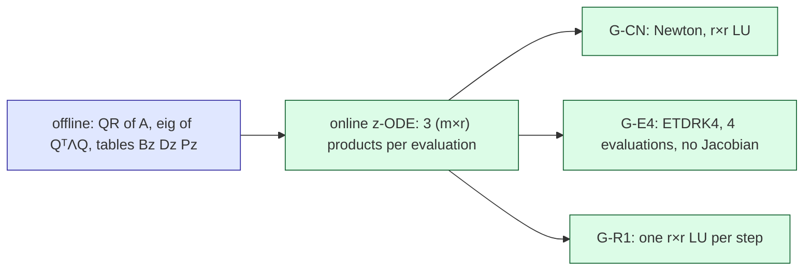
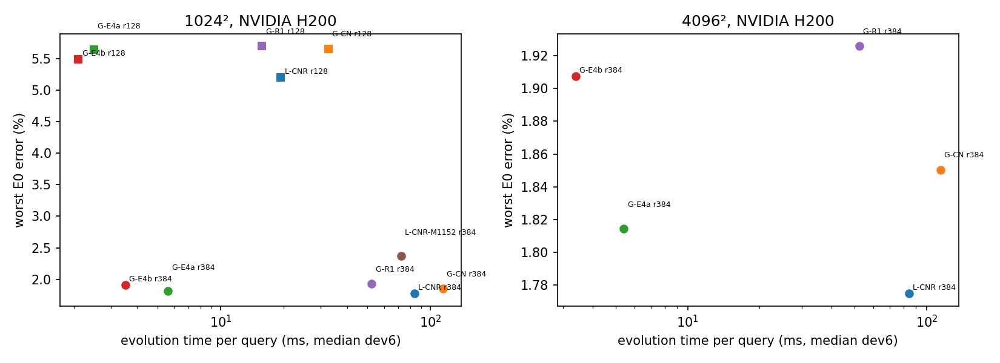

# E5: a faster reduced time step for the off-mesh bank ROM (Burgers 2D)

**Status:** final for this lane unless stated. f1024: mesh 1024², job 6178056, NVIDIA H200, offline acceptance yes; f4096: mesh 4096², job 6180532, NVIDIA H200, offline acceptance yes. All errors are conditional E0 ST accuracy estimates ($\varepsilon_{\rm ref}$ is a conditional Richardson estimate; inherited caveats carry forward: the E0 reference cross-check rule was amended after its data (E0 A10), and the combined lane's post-hoc labels A10, A11 and the retracted A15 apply to the incumbent configuration). The $4096^2$ job did not rerun the must-fire controls; it inherits the accepted real-size smoke `smk1` evidence by sha256 (DESIGN A5.10). POD comparisons are developmental, in-sample and unadjusted, on a snapshot-limited basis, with the 2D tuning-budget band unresolved. GPU-hours: 1.41 of 4 (ledger `runs/GPU-LEDGER.json`).

The question (DESIGN.md §1): does a Galerkin step with offline precontraction give an r = 384 evolution at least 3× faster than the incumbent LSPG CN-R, with no invalid or unstable run and no larger worst-case error? The stop rule (brief, verbatim): "Stop if any run is unstable or invalid, its worst error is above the current one (arm 1), or the r = 384 evolution is < 3× faster."

## Stop-rule outcome per new arm

| mesh | arm | invalid/unstable | worst error above arm 1 (all 38 / eligible) | r = 384 evolve speed-up | fires | numerically qualified | passes |
|---|---|---|---|---|---|---|---|
| 1024² | arm 2, Galerkin CN (precontracted) | no | r128: 5.65 % vs 5.2 %, r384: 1.85 % vs 1.78 % (fired / fired) | 0.726× | worst_error, speed | yes | no |
| 1024² | arm 3a, Galerkin ETDRK4 dt 0.0125 | no | r128: 5.63 % vs 5.2 %, r384: 1.82 % vs 1.78 % (fired / fired) | 14.3× | worst_error | yes | no |
| 1024² | arm 3b, Galerkin ETDRK4 dt 0.025 | no | r128: 5.49 % vs 5.2 %, r384: 1.91 % vs 1.78 % (fired / fired) | 22.8× | worst_error | yes | no |
| 1024² | arm 4, one-pass linearised Galerkin CN | no | r128: 5.69 % vs 5.2 %, r384: 1.93 % vs 1.78 % (fired / fired) | 1.58× | worst_error, speed | yes | no |
| 4096² | arm 2, Galerkin CN (precontracted) | no | r384: 1.85 % vs 1.77 % (fired / fired) | 0.733× | worst_error, speed | yes | no |
| 4096² | arm 3a, Galerkin ETDRK4 dt 0.0125 | no | r384: 1.81 % vs 1.77 % (fired / fired) | 15× | worst_error | yes | no |
| 4096² | arm 3b, Galerkin ETDRK4 dt 0.025 | no | r384: 1.91 % vs 1.77 % (fired / fired) | 24.1× | worst_error | yes | no |
| 4096² | arm 4, one-pass linearised Galerkin CN | no | r384: 1.93 % vs 1.77 % (fired / fired) | 1.59× | worst_error, speed | yes | no |

Per-case comparison with arm 1 (cases better / worse / tied by $2\varepsilon_{\rm ref}$, all cases E0-eligible):

- 1024², G-CN: r = 128: 26 / 12 / 0; r = 384: 36 / 2 / 0
- 1024², G-E4a: r = 128: 26 / 12 / 0; r = 384: 36 / 2 / 0
- 1024², G-E4b: r = 128: 26 / 12 / 0; r = 384: 34 / 4 / 0
- 1024², G-R1: r = 128: 26 / 12 / 0; r = 384: 36 / 2 / 0
- 4096², G-CN: r = 384: 36 / 2 / 0
- 4096², G-E4a: r = 384: 36 / 2 / 0
- 4096², G-E4b: r = 384: 34 / 4 / 0
- 4096², G-R1: r = 384: 36 / 2 / 0

Reading: the Galerkin arms are more accurate than the incumbent on most cases, but on the hardest case their error is larger by more than $2\varepsilon_{\rm ref}$, so the registered worst-error condition fires for every new arm at every mesh and rank. The ETDRK4 speed-ups are **evolution-only** speed-ups against the incumbent, not full-query gains against POD. "Offline acceptance" means the evidence passed every integrity check, not that E5 succeeded. The ETDRK4 finite-range slope observed in the smoke control fixture (dev6[0], $1024^2$) is 2.03 at $r = 384$ (stiff order reduction, DESIGN A6) and 3.75 at $r = 128$; it was not measured on every production case.

**E5 line:** fixed on the completed scope at every mesh run: no (per mesh: 1024²: no, 4096²: no).

## Accuracy, qualification and cost per arm

| mesh | arm | r | worst E0 error | median E0 error | Q1 | Q2 | init (ms) | evolve (ms) | per step (ms) | decode (ms) | full query (ms) |
|---|---|---|---|---|---|---|---|---|---|---|---|
| 1024² | G-CN | 128 | 5.65 % | 0.417 % | yes | pass | 0.136 | 32.5 | 0.651 | 0.388 | 33.2 |
| 1024² | G-E4a | 128 | 5.63 % | 0.414 % | yes | pass | 0.136 | 2.49 | 0.124 | 0.389 | 2.51 |
| 1024² | G-E4b | 128 | 5.49 % | 0.414 % | yes | pass | 0.136 | 2.1 | 0.21 | 0.389 | 2.07 |
| 1024² | G-R1 | 128 | 5.69 % | 0.417 % | yes | pass | 0.133 | 15.7 | 0.315 | 0.387 | 15.5 |
| 1024² | L-CNR | 128 | 5.2 % | 0.45 % | yes | pass | 0.139 | 19.3 | 0.387 | 0.395 | 19.8 |
| 1024² | G-CN | 384 | 1.85 % | 0.0495 % | yes | pass | 0.174 | 115 | 2.3 | 0.946 | 115 |
| 1024² | G-E4a | 384 | 1.82 % | 0.034 % | yes | pass | 0.179 | 5.61 | 0.281 | 0.947 | 6.07 |
| 1024² | G-E4b | 384 | 1.91 % | 0.0491 % | yes | pass | 0.175 | 3.52 | 0.352 | 0.946 | 4.17 |
| 1024² | G-R1 | 384 | 1.93 % | 0.0426 % | yes | pass | 0.175 | 52.5 | 1.05 | 0.95 | 52.6 |
| 1024² | L-CNR | 384 | 1.78 % | 0.198 % | yes | pass | 0.19 | 84 | 1.68 | 0.953 | 84.9 |
| 1024² | L-CNR-M1152 | 384 | 2.37 % | 0.199 % | yes | pass | 0.179 | 72.5 | 1.45 | 0.948 | 73.3 |
| 4096² | G-CN | 384 | 1.85 % | 0.0497 % | yes | pass | 0.155 | 114 | 2.29 | 13.8 | 127 |
| 4096² | G-E4a | 384 | 1.81 % | 0.0342 % | yes | pass | 0.154 | 5.4 | 0.27 | 13.8 | 18.2 |
| 4096² | G-E4b | 384 | 1.91 % | 0.0494 % | yes | pass | 0.161 | 3.4 | 0.34 | 13.8 | 16.3 |
| 4096² | G-R1 | 384 | 1.93 % | 0.0426 % | yes | pass | 0.155 | 52.2 | 1.04 | 13.8 | 64.9 |
| 4096² | L-CNR | 384 | 1.77 % | 0.198 % | yes | pass | 0.164 | 84.5 | 1.69 | 13.8 | 97 |

Times are medians over the six dev6 timing cases × 3 repetitions of the timed stages inside paired triplets on one GPU per job; never compare them across jobs or GPU types. The evolve column includes the ETDRK4 coefficient construction and the coordinate maps. "Per step" is the evolve time divided by the step count (setup and maps amortised), not a separately timed kernel. "Full query" is a separately timed fused invocation and is not the sum of the stage medians.

## F5 (arm 4) secondary criteria

| mesh | r | median observed slope | reference converged | order | worst error vs arm 2 | end-to-end gain over arm 2 | F5 outcome |
|---|---|---|---|---|---|---|---|
| 1024² | 128 | 2 | yes | pass | 5.69 % vs 5.65 % | 2.14× | rejected |
| 1024² | 384 | 2 | yes | pass | 1.93 % vs 1.85 % | 2.19× | rejected |
| 4096² | 384 | 2 | yes | pass | 1.93 % vs 1.85 % | 1.96× | rejected |

## H-base reading: matched POD competitors (1024² only)

| our arm | matched competitor B* (dev6) | B* labels (Q1 / Q2-POD) | match dev6 / val32 / all 38 | B* full-query time / ours (direct triplets) |
|---|---|---|---|---|
| L-CNR\|128 | pod-ecsw\|128\|k8\|ETDRK4\|0.025 | yes / HR-unqualified | yes / no / no | 0.102 |
| G-CN\|128 | pod-ecsw\|128\|k8\|ETDRK4\|0.025 | yes / HR-unqualified | yes / yes / yes | 0.0606 |
| G-E4a\|128 | pod-ecsw\|128\|k8\|ETDRK4\|0.025 | yes / HR-unqualified | yes / yes / yes | 0.853 |
| G-E4b\|128 | pod-ecsw\|128\|k8\|ETDRK4\|0.025 | yes / HR-unqualified | yes / yes / yes | 1.09 |
| G-R1\|128 | pod-ecsw\|128\|k8\|ETDRK4\|0.025 | yes / HR-unqualified | yes / yes / yes | 0.126 |
| L-CNR\|384 | pod-ecsw\|384\|k4\|ETDRK4\|0.025 | yes / HR-unqualified | yes / yes / yes | 0.0363 |
| G-CN\|384 | pod-ecsw\|384\|k4\|ETDRK4\|0.0125 | yes / HR-unqualified | yes / yes / yes | 0.0322 |
| G-E4a\|384 | pod-ecsw\|384\|k4\|ETDRK4\|0.0125 | yes / HR-unqualified | yes / yes / yes | 0.623 |
| G-E4b\|384 | pod-ecsw\|384\|k4\|ETDRK4\|0.025 | yes / HR-unqualified | yes / yes / yes | 0.796 |
| G-R1\|384 | pod-ecsw\|384\|k4\|ETDRK4\|0.0125 | yes / HR-unqualified | yes / yes / yes | 0.0699 |
| L-CNR-M1152\|384 | pod-ecsw\|384\|k4\|ETDRK4\|0.025 | yes / HR-unqualified | yes / yes / yes | 0.0424 |

Frozen dev6 best-stepper selection at 1024²: none qualified on dev6.

Frozen dev6 best-stepper selection at 4096²: `G-E4a|384`; on the 38 cases its worst error 1.81 % exceeds the incumbent's 1.77 %, so it is reported as a **failed frozen selection** (A2.9), not as a best stepper.

Q2-POD labels of the selected competitors: HR-unqualified (HR-unqualified = the successor-rule agreement fails the Q2-POD bar). Rows not matched on val32 or all 38 are "dev-matched only": no validation-population upper-bound claim is made for them.
A ratio above 1 means the competitor is slower than our arm on the full query. The POD ladder is finite, so every such speed-up is an upper bound, "against the strongest tested competitor". Unmatched rows mean no tested competitor reached our dev6 worst error.

Deferred at 4096² (registered defer order, GPU-hour cap): 4096^2 r = 128 (defer order item 1: cap binds, resources-f4096.json); M = 1152 control at 4096^2 (defer order item 2). The 4096² conclusion is therefore on the completed scope (r = 384, arms 1–4) only.

*Figure: worst conditional E0 error over the 38 cases against the median dev6 evolution time, per arm and rank, on the completed scope of each job (squares $r = 128$, circles $r = 384$).*

## Glossary

- **arm**: one time-stepping configuration of the reduced model; arm 1 is the deployed one.
- **LSPG / Galerkin**: two ways to reduce the equations: least-squares residual minimisation versus projection onto the tests.
- **CN-R**: Crank–Nicolson with two backward-Euler start-up steps (Rannacher).
- **ETDRK4**: a fourth-order exponential integrator that treats diffusion exactly and advection explicitly.
- **precontraction**: multiplying the fixed matrices together offline so each step needs only three small products.
- **r, M, m**: number of unknowns (bank columns), number of test functions, number of quadrature points.
- **E0 ST**: the second-order reference solutions the errors are measured against.
- **worst / median E0 error**: the largest / median, over the 38 dev6 + val32 cases, of the maximum over output times of the relative field error.
- **eligible**: cases whose reference uncertainty allows ranking two arms.
- **Q1**: numerical qualification: every run valid and certified step by step by independent code.
- **Q2**: quadrature qualification: a finer rule changes neither the advection nor the trajectory beyond the bars.
- **evolve speed-up**: incumbent evolution time divided by the arm's, paired on the same GPU.
- **B***: the fastest tested POD competitor whose dev6 worst error is no worse than ours.
- **dev6 / val32**: development (selection) and validation cohorts; no test cohort was used.
- **POD, ECSW**: the competitor: a mesh basis from snapshots (POD) with a reduced set of weighted mesh nodes for the nonlinear term (ECSW); k4 / k8 = about 4 or 8 nodes per unknown.
- **Q2-POD, HR-unqualified**: agreement of a POD member with the next larger node set; 'HR-unqualified' means that agreement fails the bar.
- **F5**: secondary criteria for arm 4: observed order >= 1.8, worst error not above arm 2, end-to-end gain >= 1.3x.
- **H-base**: the comparison against tuned POD + ECSW baselines.
- **Richardson uncertainty**: the reference error estimate from two reference resolutions, conditional on asymptotic behaviour.
- **observed slope, reference converged**: log-log slope of error against step size over the tested steps; the fine reference is accepted when its own step-halving change is 1000x smaller than the errors.
- **init / evolve / decode / full query**: fitting the initial state, time stepping, producing the six output fields, and the whole query in one call.
