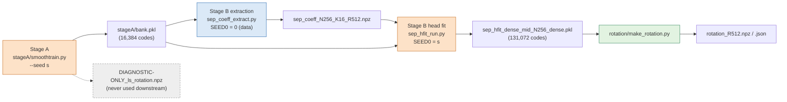

# train2d — E2 2D bank recipe for one seed (dn256b, R = 512, K = 16)

Code only; no results here. It reproduces the frozen recipe of DESIGN.md §3.1–3.2, A1.6 and A2.10, with only the
recipe seed $s$ changed. Every file except `run_seed.sh`, `FILES.txt`, `PROVENANCE.json` and this README is a
byte-identical copy (`PROVENANCE.json`: source branch, commit, path, sha256; `edited=false` for every file).
Checks: `experiments/jcp-robust/train_tests.py` (static checks, plus `--dry2d`, `--rotation-repro`).

## Layout and why

| directory | contents | source |
|---|---|---|
| `stageA/` | `smoothtrain.py`, `deps/burgers2d_film.py`, `deps/sep_common.py` | `exp/2026-10-08-jcp-smooth-bank` |
| `stageB/code/` | `sep_coeff_extract.py`, `sep_hfit_run.py`, `sep_hfit.py`, `sep_common.py` and their import closure under `deps/` | this branch (fork) + the patched generator from smooth-bank |
| `rotation/` | `make_rotation.py`, `arms.py`, `engines.py`, `sep_common.py`, `inputs/directions_qtd02.npz` | `exp/2026-09-23-burgers-bank-knob` |

**Stage B runs from `stageB/code/`, not from `experiments/separable-decoder/`** (the one deviation from the
brief, and why). `sep_coeff_extract.py` imports `blat_common`, which finds the truth generator through
`<HERE>/deps/burgers2d-coord-rom` or through a *sibling worktree* path (`<worktrees>/2026-08-14-burgers2d-coord-rom`).
From the repo layout neither the `deps/` directory nor `multistage-precision` exists, so a job directory laid out like
the repo fails at import. Run locally, it would silently pick up the sibling worktree's **unpatched** generator
(sha256 `51b02f5c…`), not the preconditioned one the dn256b job used (`c521b36a…`, `cluster/patch_bf_precond.py`).
`stageB/code/` therefore rebuilds the dn256b job's staged tree (`cluster/make_stage.sh` layout) for the import closure
only. All ten files equal their entries in `experiments/separable-decoder/runs/dn256b/MANIFEST.sha256`, and the
four `sep_*` scripts equal this branch's `experiments/separable-decoder/` copies and the 2026-08-25 sepdec-consolidated
worktree copies. A CPU import trace showed that only these files load, all from inside `stageB/code/`.

**No adapter is needed for the checkpoint.** smoothtrain writes `bank.pkl` with `sep_common.save_pkl`, as the
pickle `{params: {B, g, h, h_lin, out_scale}, Z_tr, cfg}`. This is the format and key set of the incumbent Stage-A file
`sep_burgers_r3_N256_K16_R512.pkl`. `sep_coeff_extract` reads only `params` and `Z_tr` (16,384 codes, so it uses the
same `LOOSE=1` unaligned-codes path as the incumbent), and `sep_hfit_run` copies `params` and `cfg`. Downstream, only
`cfg['N']` is read (`make_rotation`, `mr-burgers2d` drivers), and smoothtrain sets it to 256. The file name differs, and
the only effect is the `hfit_source_ckpt` string in the emitted cfg. The two `sep_common` versions (smooth-bank
`1f1c2796…` for Stage A, dn256b `a74f0279…` for Stage B) run in separate processes. They differ only in the
default-off `h_ff` option.

**Rotation inputs.** The deployed procedure is `make_rotation.py --checkpoint <dense mid pkl> --directions <npz>
--out <dir>` at the default `--train-mesh 256`. It uses the head coefficients $h_\theta(z_i)$ of all 131,072 emitted
codes, takes the QR of $G$ on the $255^2$ interior of the $1/256$ grid (`engines.coords(256)`), and normalises each row
before the SVD. `--directions` feeds only the diagnostic `correction_directions_energy_captured`; it does not enter
$T$ or $L$. The incumbent used `b-panel/inputs/directions_qtd02.npz` (sha256 `79d79458…`, as recorded in
`inputs/rotation_R512.json`), and every seed is given the same file. For a new bank that diagnostic describes the
incumbent's correction directions and has no meaning; ignore it.

**Seed-0 check of the rotation (done here, CPU).** `make_rotation.py` was rerun on the incumbent dense checkpoint
(sha256 `18f0266a…`). Its singular values and $R_G$ match the committed `rotation_R512.npz` to a relative error of
about $10^{-15}$. $L_{\rm new}T_{\rm inc}$ is diagonal with entries $\pm1$ to about $10^{-11}$ for $r\le384$, so the
rotation is identical up to column signs. $\lVert LT-I\rVert$ came out at $8.0\times10^{-12}$ against
$8.2\times10^{-12}$ committed, and the cumulative energies are identical. The run took 14 min on CPU; the incumbent took
34 s on GPU. Rerun it with `train_tests.py --rotation-repro`.

**Stage A seed 0.** smoothtrain's gates R0 (data fingerprint) and R2a (rel-MSE at steps 1 and 5,000 vs the r3a log)
fire only for the original configuration (`--seed 0`, 256 nodes, 300k steps, 576 trajectories). Seed 0 is therefore the
dry check that this copy reproduces the incumbent's Stage A. It is not run here (GPU, about 3 h).

## Paths

Every script resolves its imports from `__file__` or from `PYTHONPATH` that `run_seed.sh` sets to `train2d/rotation`.
No runtime file names `/home` or `/cluster` (checked by `train_tests.py`). Inputs and outputs are command-line or
environment paths under `<outdir>`. `run_seed.sh` unsets every environment name the vendored modules read. This
matters because `burgers2d_film` reads `SEED` as its *data* seed and `STEPS` as its step count, so only the explicit
per-command `env` of the dn256b job applies.

## Resources (from the incumbent logs)

| stage | incumbent | device | time |
|---|---|---|---|
| A (smoothtrain = r3a recipe) | job 2835788 | A100-PCIE-40GB | ≈ 10.7 ks |
| B extraction | job 2837431 | A100 80GB PCIe | 915 s |
| B head fit (mid, wide, k32) | job 2837431 | A100 80GB PCIe | 2,676 s (mid: 200,000 steps in 339 s) |
| rotation | bank-knob, local | GPU | 34 s |

Suggested request for one seed, all stages in one job: `--gres=gpu:a100:1 --constraint=a100-80G` (A2.10 puts Stage B
on the incumbent's type), `--cpus-per-task=8`, `--mem=160G` (the dn256b request), `--time=08:00:00`. Stage A holds the
16,384 × 254² f64 training matrix (8.5 GB) on host and device. `STAGES=A` / `STAGES=B,R` split the work into two jobs
if A100-80G time is scarce. Each stage writes `STAGE-COMPLETE` (sha256 of its files), and a later job re-verifies it
before using the outputs.

## Outputs (`<outdir>`)

- `stageA/`: `bank.pkl`, `train.json` (steps_done, R0/R2a for seed 0, `bank_sha256`), `stageA.log`, `DIAGNOSTIC-ONLY_ls_rotation.npz`
- `stageB/`: `sep_coeff_N256_K16_R512.{json,npz}`, `hfit_full.json`, `sep_hfit_dense_mid_N256_dense.pkl` (the bank +
  head the lane evaluates), `hfit_mid_summary.json` (`steps_done`, `time_cap_fired`, gpu, extraction gates), logs
- `rotation/`: `rotation_R512.npz` ($T$, $L$, singular values, $R_G$), `rotation_R512.json` ($\lVert LT-I\rVert$, orthonormality, energies)
- `device.txt` (nvidia-smi, `jax_backend=gpu`), `run_record.json`, `OUTPUTS.sha256`, `SEED-COMPLETE` (written last)

A seed whose `mid` fit hit `TIME_CAP=1500` (`time_cap_fired: true`) is a recipe deviation for that seed (A2.10).

## Glossary

- **Stage A**: training of the coordinate bank $G$ and 16,384 per-state codes (`smoothtrain.py`, the r3a recipe).
- **Stage B**: coefficient extraction (Gram matrix and least-squares coefficients of 4,608 trajectories' states on
  the frozen bank) followed by the refit of the head $h_\theta$ on 131,072 states ("dense", arm `mid`).
- **recipe seed $s$**: the seed of every algorithmic random stream (Stage-A init and point subsets, head-fit keys).
  The data (trajectories, state picks) stay fixed.
- **rotation**: the importance ordering $T$, $L=T^{-1}$ of the bank columns; prefixes $r$ of the rotated bank are the
  tunable widths.
- **TIME_CAP**: the head-fit wall-clock stop (1,500 s), which applies together with the 200,000-step limit.
- **dry run** (`TRAIN2D_DRYRUN=1`): $N=64$, 16 trajectories, 20 steps, on CPU. It proves only that the stages chain;
  it gives no results.
- **MANIFEST.sha256**: the dn256b job's list of staged code hashes; the reference for byte-identity.
