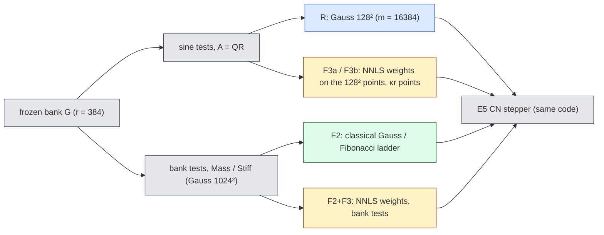
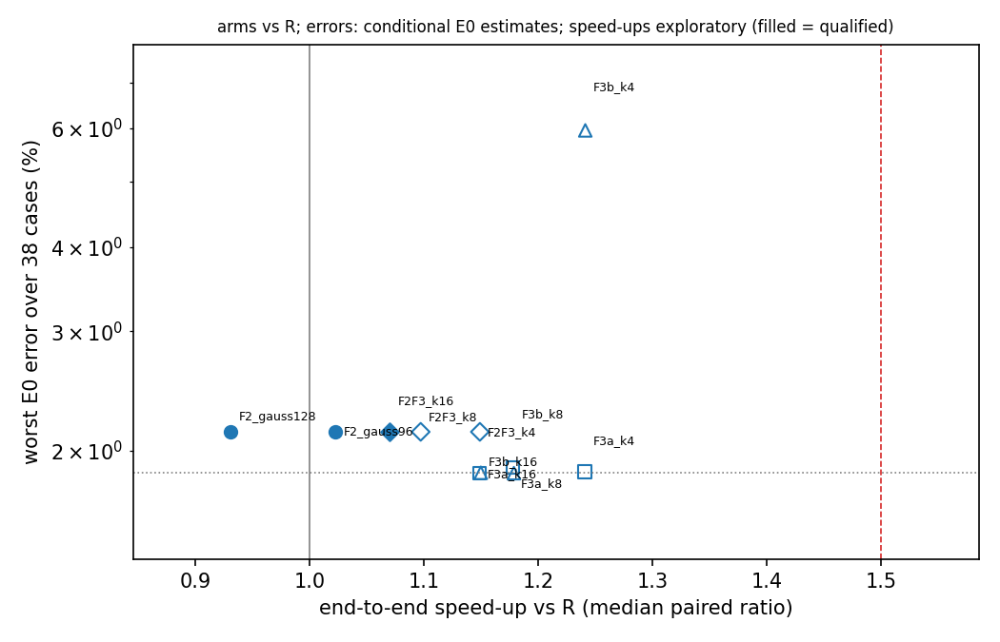
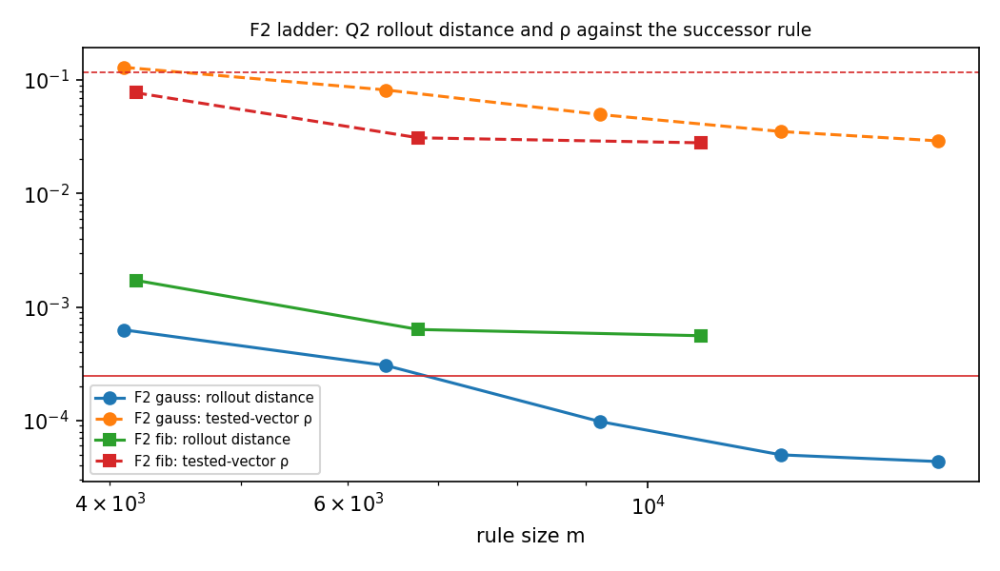

# imp-hrcost (E6): a cheaper nonlinear term by bank tests (F2) or fitted weights (F3) — neither lever passes its stop rule

**Status:** final for the registered production job `prd1` (one H200 job, all arms paired in it); production population yes. Every error is a **conditional E0 estimate** (second-order reference $R_{ST}$, conditional Richardson $\varepsilon_{\rm ref}$; E0 A10, combined A10/A11 and the retracted A15 labels carry forward). Speed-ups are paired, same-job, same-GPU ratios against the lane's reference arm R (E5's precontracted Galerkin CN), on `NVIDIA H200, GPU-9414f59f-8546-1c49-b2f9-c0bffc2ea441, 143771 MiB`; they are an internal ablation, **not** a comparison with any competitor. Every measured number below is generated by `make_report.py` from `checks/analysis-prd1.json`, the job's `result.json`, the ledger, the smoke acceptance `checks/smoke-accept-smk1.json` and the construction diagnostic named where used; bars, rule names and step sizes are registered design constants from `DESIGN.md`.

GPU-hours: 1.461 of the 3.0 cap (2 jobs; `runs/GPU-LEDGER.json`).

## Summary

- **F2 stop rule (bank-tested Galerkin, classical rules):** fired (tested failure): m* = gauss96, no_worse=False, faster=False. Non-binding Q2-projected reading: fired (tested failure): m* = gauss96, no_worse=False, faster=False.
- **F3 stop rule (sine-tested, fitted ECSW weights, $\kappa\le16$):** fired (tested failure). Non-binding reading: fired (tested failure).
- F3 Q2 rollout distances to the parent Gauss 128² rule (bar 2.5e-4, 16 cases): F3a_k4 1.93e-02, F3a_k8 6.26e-03, F3a_k16 5.42e-04, F3b_k4 4.00e-02, F3b_k8 1.86e-02, F3b_k16 2.50e-03.
- Reference R (sine tests, Gauss 128², m = 16384): Q1 pass, Q2 pass; worst error 1.851 %, median 0.049 % (conditional E0 estimates).
- Fastest numerically qualified arm: **F2F3_k16** (m = 6144), end-to-end 1.07× (95 % case-bootstrap 1.03–1.12; exploratory, in-sample, selection-unadjusted), evolution only 1.07×, worst error 2.131 %.
- Gains are small: the point-work microbenchmark (step-Jacobian assembly, $4mr^2$ flops) costs 1.37× for 2× the points and 2.14× for 4× (C5′ fired); a 4× point reduction therefore buys only a modest query gain; a latency or launch-overhead floor is a possible explanation that these measurements do not establish (it would need profiling).

## What was compared

Every arm is the precontracted Galerkin ODE $\dot c=-P^{\mathsf T}[(G_qc)\odot(G_sc)]+\nu\mathcal L_0c$ integrated by the same E5 Crank–Nicolson Newton stepper ($\Delta t_0=0.005$, 50 steps); only the tables differ.

## Arms (38 cases, 1024²; errors are conditional E0 estimates; speed-ups exploratory and unadjusted)

| arm | tests | rule | m | Q1 | Q2 (binding) | Q2-projected | worst error | median error | end-to-end × [95 % CI] | evolution × | no worse than R | faster | ≥ 1.5× |
|---|---|---|---|---|---|---|---|---|---|---|---|---|---|
| R | sine | gauss128 | 16384 | pass | pass | pass | 1.851 % | 0.049 % | — [—, —] | — | — | — | — |
| F2_gauss96 | bank | gauss96 | 9216 | pass | pass | pass | 2.131 % | 0.285 % | 1.02 [0.99, 1.07] | 1.02 | False | False | False |
| F2_gauss128 | bank | gauss128 | 16384 | pass | pass | pass | 2.131 % | 0.285 % | 0.93 [0.90, 0.97] | 0.93 | False | False | False |
| F3a_k4 | sine | F3ak4 | 1536 | pass | fail | fail | 1.859 % | 0.063 % | 1.24 [1.24, 1.24] | 1.24 | False | True | False |
| F3a_k8 | sine | F3ak8 | 3072 | pass | fail | fail | 1.889 % | 0.050 % | 1.18 [1.18, 1.18] | 1.18 | False | True | False |
| F3a_k16 | sine | F3ak16 | 6144 | pass | fail | fail | 1.851 % | 0.049 % | 1.15 [1.15, 1.15] | 1.15 | True | True | False |
| F3b_k4 | sine | F3bk4 | 1536 | pass | fail | fail | 5.951 % | 0.281 % | 1.24 [1.24, 1.25] | 1.24 | False | True | False |
| F3b_k8 | sine | F3bk8 | 3072 | pass | fail | fail | 1.851 % | 0.049 % | 1.18 [1.18, 1.18] | 1.18 | True | True | False |
| F3b_k16 | sine | F3bk16 | 6144 | pass | fail | fail | 1.853 % | 0.049 % | 1.15 [1.15, 1.15] | 1.15 | False | True | False |
| F2F3_k4 | bank | F2F3k4 | 1536 | pass | fail | fail | 2.130 % | 0.300 % | 1.15 [1.11, 1.21] | 1.15 | False | True | False |
| F2F3_k8 | bank | F2F3k8 | 3072 | pass | fail | fail | 2.131 % | 0.285 % | 1.10 [1.06, 1.15] | 1.10 | False | True | False |
| F2F3_k16 | bank | F2F3k16 | 6144 | pass | pass | pass | 2.131 % | 0.285 % | 1.07 [1.03, 1.12] | 1.07 | False | True | False |

*Figure: worst error (conditional E0 estimate) against the median paired end-to-end speed-up vs R (exploratory, in-sample, selection-unadjusted); filled = numerically qualified.*

## F2: the classical ladder for bank tests

Candidates ($m\le16384$, increasing): gauss64, fib4181, gauss80, fib6765, gauss96, fib10946, gauss112, gauss128. First qualified (binding): gauss96; $m^*$ identified: True; first qualified under Q2-projected: gauss96.

| rule | m | Q2 | rollout distance to successor | tested-vector ρ max | Q2-projected | Q1 |
|---|---|---|---|---|---|---|
| gauss64 | 4096 | fail | 6.30e-04 | 0.129 | fail | not evaluated |
| fib4181 | 4181 | fail | 1.72e-03 | 0.0772 | fail | not evaluated |
| gauss80 | 6400 | fail | 3.06e-04 | 0.0818 | fail | not evaluated |
| fib6765 | 6765 | fail | 6.35e-04 | 0.031 | fail | not evaluated |
| gauss96 | 9216 | pass | 9.81e-05 | 0.0497 | pass | pass |
| fib10946 | 10946 | fail | 5.60e-04 | 0.028 | fail | not evaluated |
| gauss112 | 12544 | pass | 5.00e-05 | 0.0352 | pass | not evaluated |
| gauss128 | 16384 | pass | 4.36e-05 | 0.0291 | pass | pass |

Bank linear terms (P3, A5): gauss1024 against the check rule, relative differences 2.0e-09 (mass) and 8.4e-07 (stiffness); cond(Mass) 2.57. The bank needs Gauss 1024² for its stiffness to converge to 2.5e-6 (Gauss 384² and 256² differ by 1.05 % in the construction diagnostic `checks/diag-mass-convergence-r384-gb10.json`, a GB10 run): the bank carries high-wavenumber content, which also enters the bank-tested advection integrand.

## F3: fitted weights on our off-mesh points

Construction seconds = training rollouts + ECSW system + one NNLS path (all κ checkpoints come from that one path) + support checks.

| family | κ | support | training-fit residual | status | total family construction seconds |
|---|---|---|---|---|---|
| F3a | 4 | 1536 | 3.41e-03 | built | 204 |
| F3a | 8 | 3072 | 1.34e-04 | built | 204 |
| F3a | 16 | 6144 | 4.03e-06 | built | 204 |
| F3b | 4 | 1536 | 4.21e-02 | built | 259 |
| F3b | 8 | 3072 | 1.10e-03 | built | 259 |
| F3b | 16 | 6144 | 5.02e-05 | built | 259 |
| F2F3 | 4 | 1536 | 6.15e-03 | built | 156 |
| F2F3 | 8 | 3072 | 5.44e-04 | built | 156 |
| F2F3 | 16 | 6144 | 1.80e-05 | built | 156 |

The training-fit residual is never used to certify a rule (lesson of 2026-08-25); Q2 on the arm's own dev/validation states decides.

## Controls

Smoke `smk1` acceptance: True (blocked claims: C5). C5′ in this job: quadruplicated-rule Jacobian ratio 2.14 (bar 1.5). A–A timing (C6, this job): 1.00.

| control | result |
|---|---|
| C1_sine | fired / passed |
| C1_bank | fired / passed |
| C2 | fired / passed |
| C3 | fired / passed |
| C4 | fired / passed |
| C5 | did not fire |
| C6 | fired / passed |
| C7 | fired / passed |
| C8 | fired / passed |
| P1 | fired / passed |
| P3 | fired / passed |
| P4 | fired / passed |
| P5 | fired / passed |
| P6 | fired / passed |
| P2 | fired / passed |

## What is provisional, and what was corrected

- All errors are conditional E0 estimates; all speed-ups are exploratory, in-sample, selection-unadjusted and against R only (one GPU type).
- Retracted during the lane: the registered mass/stiffness bar (1e-10 at Gauss 384²) was unattainable and was replaced before any verdict data (A5); the first justification for a projected ρ gate was withdrawn and the inherited tested-vector gate restored as binding (A2.1); the mesh-sum P5 fixtures were defective and replaced (A6); the doubled-rule timer control did not fire at real size and was replaced by C5′ (A9).
- The F2 arm changes both the test space and the diffusion discretisation (continuum Mass/Stiff instead of mesh eigenvalues); its accuracy difference is the combined effect.

## Setup cost (offline, not in the query time)

| item | seconds |
|---|---|
| bank Mass / Stiff (Gauss 1024² + check) | 5 |
| F3a: training rollouts + system + NNLS | 204 |
| F3b: training rollouts + system + NNLS | 259 |
| F2F3: training rollouts + system + NNLS | 156 |
| table build R (gauss128) | 4.31 |
| table build F2_gauss96 (gauss96) | 0.01 |
| table build F2_gauss128 (gauss128) | 0.15 |
| fitted-table builds (row subsets of the parent Gauss 128² tables) | not measured separately; the parent build is listed above |

Smallest numerically qualified fitted support among F3a/F3b ($\kappa^*$): none; F2+F3 qualified supports: F2F3_k16.

## Glossary

- **R**: the reference arm — E5's precontracted sine-tested Galerkin Crank–Nicolson step with the deployed Gauss 128² rule (m = 16384 points).
- **F2**: Galerkin with the bank functions themselves as test functions, classical (Gauss tensor or Fibonacci lattice) rules. **F3a / F3b**: R's projection with sparse non-negative (NNLS) weights fitted on the Gauss 128² points, target = projected (F3a) or full tested (F3b) advection. **F2+F3**: bank tests with fitted weights.
- **m**: number of quadrature points ($m^*$: the smallest qualified registered candidate); **κ**: fitted points per unknown (support $=\kappa r$); **r**: number of bank coefficients (384); **M**: number of sine tests (1536).
- **Q1**: solver qualification (valid runs, at most 1 % non-converged steps pooled, distance to tight / tighter solves). **Q2 (binding)**: quadrature qualification on the arm's own states — rollout distance to the next rule ≤ 2.5e-4 on 16 cases, tested-vector $\rho\le0.116$, and the next rule converged against the one after it on dev6 (check rule). **Q2-projected**: the same with ρ on the Galerkin-projected advection (non-binding). **ρ**: relative difference of the tested advection under two rules.
- **worst / median error**: max / median over the 38 dev6 + val32 cases of the max-over-time relative error against the E0 reference on the 257² lattice. **no worse than R**: worst error not above R's by more than $2\varepsilon^*$, with $\varepsilon^*$ the larger reference uncertainty at the two arms' worst cases. **ε_ref**: conditional Richardson estimate of the reference error (from comparing references at two resolutions; valid only if the reference converges as assumed).
- **end-to-end ×**: median over cases of the paired A–B–A time ratio (R time / arm time) of the whole query (initial fit + 50 steps + 1024² decode); **evolution ×**: the same for the 50 steps only. **faster**: median > 1 and bootstrap lower bound > 1. **≥ 1.5×**: median ≥ 1.5 and lower bound > 1.
- **stop rule fired (tested failure / incomplete evidence)**: the pre-registered kill criterion triggered on fully evaluated evidence / because some registered evidence was missing.
- **bank**: the frozen learned basis functions $G$ of the reduced model; **test functions**: the functions the residual is made orthogonal to (sines or the bank itself); **quadrature**: a weighted point rule approximating the integrals; **rollout distance**: relative difference of two reduced solutions on the scoring lattice.
- **ECSW**: energy-conserving sampling and weighting, a hyper-reduction that picks few points and fits non-negative weights so a reduced nonlinear term is reproduced on training snapshots. **NNLS**: non-negative least squares, the fit used for those weights. **training-fit residual**: the relative error of that fit on the training snapshots.
- **dev6 / val32**: the 6-case development and 32-case validation cohorts (selection allowed). **CI / bootstrap**: 95 % interval of the median paired ratio from 2000 resamples of the 38 cases. **cond(Mass)**: ratio of the largest to smallest eigenvalue of the bank mass matrix.
- **precontracted Galerkin**: the reduced equation with every test-space contraction done offline, so each step needs only $m\times r$ products; $P$, $G_q$, $G_s$: the per-point contraction, bank value and bank derivative tables; $\mathcal L_0$: the reduced diffusion operator; $\nu$: viscosity; $c$: bank coefficients.
- **controls**: C1 coarse rule must fail Q2; C2 permuted fitted weights must fail Q2; C3 corrupted states must be flagged; C4 a NaN table must be rejected; C5′ 4× points must cost ≥ 1.5× in the Jacobian benchmark; C6 R against itself must time 0.9–1.1; C7 a dev case in the fit set must be refused; C8 a swapped case id must be refused; P1–P6 positive equivalence / convergence / identity checks (DESIGN §6, A2.6, A6, E5R).
- **C1–C8, P1–P6, C5′**: must-fail controls and positive checks of DESIGN §6 and amendments.
