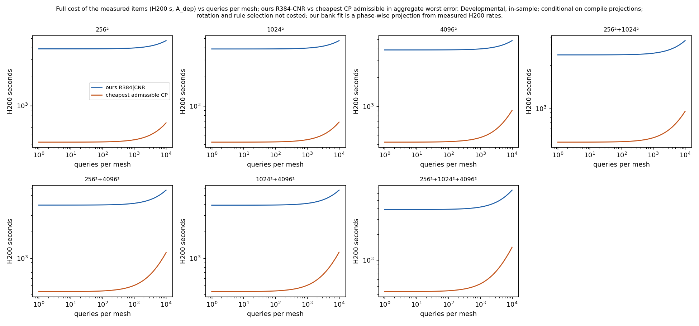

# Multi-mesh cost of the measured items: one coordinate-network bank against continuous POD (E7, viscous Burgers 2D)

Status: **final for this lane** (developmental, in-sample: dev6 + val32, 38 cases; errors against E0 ST references, $\varepsilon_{\rm ref}$ a conditional Richardson estimate). Every number below is generated by `make_report.py` from the run JSONs and logs (historical A100 records are read from their source files by `historical.py` into `inputs/historical.json`; J2's training and head timers exist only in its logs and are extracted to `checks/probe_numbers.json`). Primary stop-rule outcome: **FIRES** — **we withdraw the comparative multi-mesh cost claim under the registered primary criterion.** Costs are the *full cost of the measured items*; not costed (counted 0, which favours ours): the bank rotation and the selection of our frozen quadrature rules. All cost verdicts are conditional on the compilation projections (A7.1); our bank-fit time is a phase-wise projection from measured H200 rates.

## Question and stop rule

Our method uses one ordered bank and one off-mesh rule for every mesh; standard POD + ECSW is rebuilt per mesh. The fair control is a **continuous POD**: one POD basis built once on a source mesh $s\in\{256,1024\}$, resampled to other meshes by the exact sine series, with the ECSW rule refitted on each mesh (CPR-$s$) or the source rule reused on finer nested meshes (CPU-$s$). Workloads: every non-empty subset of $\{256^2, 1024^2, 4096^2\}$ × $q\in\{10,100,1000\}$ queries per mesh (21 workloads). Full cost $C(w) = O + \sum_{L\in w}(P(L) + q\,\bar t(L))$ in H200 seconds of the measured items.

> Stop rule (pre-registered, verbatim): If the continuous-POD control matches us (no more cost at equal or better worst error) on every workload, **drop the comparative multi-mesh cost claim** (mesh-independent evolution and mesh-free evaluation remain properties of the method, not comparative advantages).

## Outcome

| accuracy criterion | accounting | outcome | (w, X) MATCH | NO-MATCH | UNRESOLVED | compile-dependent |
|---|---|---|---|---|---|---|
| worst | A_dep | **FIRES** | 126 | 0 | 0 | 0 |
| worst | A_100 | **FIRES** | 126 | 0 | 0 | 0 |
| worst | A_nohead | **FIRES** | 126 | 0 | 0 | 0 |
| worst_eps | A_dep | **FIRES** | 126 | 0 | 0 | 0 |
| worst_eps | A_100 | **FIRES** | 126 | 0 | 0 | 0 |
| worst_eps | A_nohead | **FIRES** | 126 | 0 | 0 | 0 |
| casewise | A_dep | **NOT FIRED** | 84 | 42 | 0 | 0 |
| casewise | A_100 | **NOT FIRED** | 84 | 42 | 0 | 0 |
| casewise | A_nohead | **NOT FIRED** | 84 | 42 | 0 | 0 |
| worst_median | A_dep | **FIRES** | 126 | 0 | 0 | 0 |
| worst_median | A_100 | **FIRES** | 126 | 0 | 0 | 0 |
| worst_median | A_nohead | **FIRES** | 126 | 0 | 0 | 0 |
| rollout | A_dep | **NOT FIRED** | 0 | 126 | 0 | 0 |
| rollout | A_100 | **NOT FIRED** | 0 | 126 | 0 | 0 |
| rollout | A_nohead | **NOT FIRED** | 0 | 126 | 0 | 0 |

Criteria (A2.1): `worst` (primary) — aggregate worst error over every case and mesh of the workload, $W_{\rm CP}\le W_X$ (an aggregate comparison, not the casewise rank rule); `worst_eps` — $W_{\rm CP}\le W_X+2\max_c\varepsilon_{\rm ref}(c)$; `casewise` — on every (mesh, case), $e_{\rm CP}\le e_X+2\varepsilon_{\rm ref}(c)$; `worst_median` — `worst` and pooled median $M_{\rm CP}\le M_X$; `rollout` — `worst` restricted to competitor configurations whose $\kappa=4$ and $\kappa=8$ rollouts agree to $\le 2.5\times10^{-4}$ on every case. Accounting: `A_dep` H200-measured offline cost (measured items + phase-wise projected bank fit); `A_100` historical A100 bank fit and head; `A_nohead` head excluded.

The primary row is `worst | A_dep`. The other rows are the registered sensitivities (A2.1, A2.2, A7.1). "compile-dependent" counts (w, X) verdicts that change under the adverse compile assignments with $B$ = 10 × the largest measured compile time = 40.5 s; robustness assumes $B$ bounds the true compile cost.

**Reading.** Under the registered primary criterion the stop rule fires: on every one of the 21 workloads, for every one of our six qualified configurations, a continuous-POD combination is at least as accurate in worst error and no more costly. Cheapest-admissible cost ratios CP / ours range 0.0991–0.131 (median 0.105); cheapest arm counts: CPR-256 18, CPU-256 108. The verdict is the same under the A100 and no-head accounting variants, with the strict-median addition, and it is compile-robust within $B$.
- `casewise|A_dep`: NOT FIRED with 42 NO-MATCH cells, of which 42 have **no accuracy-admissible** competitor combination at all (cost advantage undetermined, A4.6).
- `rollout|A_dep`: NOT FIRED with 126 NO-MATCH cells, of which 126 have **no accuracy-admissible** competitor combination at all (cost advantage undetermined, A4.6).

Every NO-MATCH is listed in `checks/nomatch.json` (generated) with, for that workload and configuration, the cheapest Q1-qualified CP combination and the most accurate one (lowest aggregate worst error), each with its configuration choice, cost and the criterion it fails, for every accounting variant. Summary per configuration of ours (A_dep):

| criterion | ours | NO-MATCH workloads | most accurate CP: worst error | its cost / ours | cheapest CP: cost / ours |
|---|---|---|---|---|---|
| casewise | R256\|CNR | 21 | 1.19 %–1.34 % | 0.109–0.287 | 0.0933–0.103 |
| casewise | R384\|CNR | 21 | 1.19 %–1.34 % | 0.109–0.284 | 0.0933–0.1 |
| rollout | R128\|BE | 21 | 1.19 %–1.34 % | 0.109–0.288 | 0.093–0.104 |
| rollout | R128\|CNR | 21 | 1.19 %–1.34 % | 0.109–0.289 | 0.0933–0.105 |
| rollout | R256\|BE | 21 | 1.19 %–1.34 % | 0.109–0.286 | 0.0931–0.102 |
| rollout | R256\|CNR | 21 | 1.19 %–1.34 % | 0.109–0.287 | 0.0933–0.103 |
| rollout | R384\|BE | 21 | 1.19 %–1.34 % | 0.109–0.284 | 0.0931–0.0996 |
| rollout | R384\|CNR | 21 | 1.19 %–1.34 % | 0.109–0.284 | 0.0933–0.1 |

Reasons: casewise — every Q1-qualified CP combination is worse than X by more than $2\varepsilon_{\rm ref}$ on at least one (mesh, case); rollout — no Q1-qualified CP configuration passes the $\kappa=4$/$\kappa=8$ rollout agreement. In both, the competitor is not accuracy-matched under that criterion, so the cost advantage is undetermined (A4.6).

Primary-admissible alternatives for the same cells (they fail only the stricter criterion):

| criterion | ours | NO-MATCH workloads | reason | cheapest primary-admissible CP: ratio range (arm) |
|---|---|---|---|---|
| casewise | R256\|CNR | 21 | every Q1-qualified CP combination is worse than X by more than $2\varepsilon_{\rm ref}$ on at least one case | 0.108–0.131 (CPR-256, CPU-256) |
| casewise | R384\|CNR | 21 | every Q1-qualified CP combination is worse than X by more than $2\varepsilon_{\rm ref}$ on at least one case | 0.108–0.127 (CPR-256, CPU-256) |
| rollout | R128\|BE | 21 | no Q1-qualified CP configuration passes the $\kappa=4$/$\kappa=8$ rollout agreement | 0.0991–0.116 (CPR-256, CPU-256) |
| rollout | R128\|CNR | 21 | no Q1-qualified CP configuration passes the $\kappa=4$/$\kappa=8$ rollout agreement | 0.0995–0.117 (CPR-256, CPU-256) |
| rollout | R256\|BE | 21 | no Q1-qualified CP configuration passes the $\kappa=4$/$\kappa=8$ rollout agreement | 0.0993–0.114 (CPR-256, CPU-256) |
| rollout | R256\|CNR | 21 | no Q1-qualified CP configuration passes the $\kappa=4$/$\kappa=8$ rollout agreement | 0.108–0.131 (CPR-256, CPU-256) |
| rollout | R384\|BE | 21 | no Q1-qualified CP configuration passes the $\kappa=4$/$\kappa=8$ rollout agreement | 0.0993–0.113 (CPR-256, CPU-256) |
| rollout | R384\|CNR | 21 | no Q1-qualified CP configuration passes the $\kappa=4$/$\kappa=8$ rollout agreement | 0.108–0.127 (CPR-256, CPU-256) |

**Side finding (refitted rules on resampled bases).** Refitting ECSW on a resampled basis at $\kappa = 4$ is fragile: the largest worst errors are CPR-1024 at 4096² r384|k4|CNR: 1.58e+04 % (MEASURED-FAIL); CPR-256 at 4096² r384|k4|CNR: 167 % (MEASURED-FAIL); CPR-1024 at 256² r384|k4|CNR: 78.4 % (MEASURED-FAIL); CPR-256 at 1024² r384|k4|CNR: 59.1 % (MEASURED-Q1). The reused source rule (CPU-s) does not show this.

## Our offline cost (H200, job J2: measured items and a phase-wise projected bank fit)

| item | H200 seconds | A100 seconds (historical) |
|---|---|---|
| bank training data (576 FOM trajectories at $256^2$) | 56 | 126 |
| bank fit, 300,000 steps (phase-wise projection from measured rates) | 3.15e+03 | 1.07e+04 (recorded) |
| head dependency (coefficient extraction + producing head-fit arm, complete invocations) | 661 | 1.29e+03 |
| **total $O$ (A_dep)** | **3.86e+03** | 1.21e+04 (A_100) |

H200 rates: sub-sampled 0.0077 s/step, full-batch 0.0892 s/step, transition 8 s. Validation of the phase-wise formula on the A100 log alone: projected 1.07e+04 s vs recorded 1.07e+04 s (0.134 %; bar 5 %). Uncosted (counted 0, favour ours): the bank rotation and the selection of the frozen quadrature rules.

## Accuracy and per-query time per mesh

Worst / median E0 error over the 38 cases; $\bar t$ = mean warm full-query time (init + 50 steps + decode of the six full-field outputs), timing jobs J6/J6b. Competitors: only Q1-qualified configurations. On its own source mesh a continuous-POD arm is the per-mesh POD + ECSW of that mesh (CPR-256 at 256² = PM-256; CPR-1024 at 1024² = PM-1024); CPU-1024 at 256² uses the CPR-1024 refit (reuse is defined only on finer nested meshes). Each artefact-identical row is listed once. Query boundary (A2.7, identical for every arm): the full-field initial condition is already on the device; the query ends when the six full-field outputs are on the device; host transfers and storage are excluded.

| mesh | arm | configuration | status | worst | median | $\bar t$ (s) | median query time (s) |
|---|---|---|---|---|---|---|---|
| 256² | ours | R128\|BE | QUALIFIED | 4.85 % | 1.1 % | 0.0197 | 0.0197 |
| 256² | ours | R128\|CNR | QUALIFIED | 5.21 % | 0.452 % | 0.0197 | 0.0198 |
| 256² | ours | R256\|BE | QUALIFIED | 3.32 % | 0.984 % | 0.0497 | 0.0496 |
| 256² | ours | R256\|CNR | QUALIFIED | 2.52 % | 0.206 % | 0.0495 | 0.0493 |
| 256² | ours | R384\|BE | QUALIFIED | 3.01 % | 0.981 % | 0.0844 | 0.0843 |
| 256² | ours | R384\|CNR | QUALIFIED | 1.81 % | 0.201 % | 0.084 | 0.0836 |
| 256² | CPR-256 | r128\|k4\|CNR | Q1 | 10.4 % | 0.687 % | 0.0114 | 0.0114 |
| 256² | CPR-256 | r128\|k8\|CNR | Q1 | 7.01 % | 0.636 % | 0.0118 | 0.0119 |
| 256² | CPR-256 | r256\|k4\|CNR | Q1 | 3.26 % | 0.24 % | 0.0164 | 0.0163 |
| 256² | CPR-256 | r256\|k8\|CNR | Q1 | 2.74 % | 0.217 % | 0.0193 | 0.0193 |
| 256² | CPR-256 | r384\|k4\|CNR | Q1 | 1.5 % | 0.202 % | 0.0244 | 0.0243 |
| 256² | CPR-256 | r384\|k8\|CNR | Q1 | 1.34 % | 0.2 % | 0.0286 | 0.0284 |
| 256² | CPR-1024 | r128\|k4\|CNR | Q1 | 21.4 % | 1.88 % | 0.0114 | 0.0113 |
| 256² | CPR-1024 | r128\|k8\|CNR | Q1 | 5.29 % | 0.643 % | 0.0118 | 0.0118 |
| 256² | CPR-1024 | r256\|k8\|CNR | Q1 | 2.42 % | 0.231 % | 0.0196 | 0.0196 |
| 256² | CPR-1024 | r384\|k8\|CNR | Q1 | 1.19 % | 0.2 % | 0.0287 | 0.0286 |
| 1024² | ours | R128\|BE | QUALIFIED | 4.84 % | 1.1 % | 0.0203 | 0.0202 |
| 1024² | ours | R128\|CNR | QUALIFIED | 5.2 % | 0.45 % | 0.0203 | 0.0202 |
| 1024² | ours | R256\|BE | QUALIFIED | 3.32 % | 0.983 % | 0.0506 | 0.0507 |
| 1024² | ours | R256\|CNR | QUALIFIED | 2.52 % | 0.209 % | 0.0503 | 0.0502 |
| 1024² | ours | R384\|BE | QUALIFIED | 3.01 % | 0.978 % | 0.0854 | 0.0856 |
| 1024² | ours | R384\|CNR | QUALIFIED | 1.78 % | 0.198 % | 0.0848 | 0.0846 |
| 1024² | CPR-256 | r128\|k4\|CNR | Q1 | 9.74 % | 0.864 % | 0.012 | 0.0121 |
| 1024² | CPR-256 | r128\|k8\|CNR | Q1 | 7.1 % | 0.656 % | 0.0124 | 0.0125 |
| 1024² | CPR-256 | r256\|k4\|CNR | Q1 | 34.4 % | 1.29 % | 0.0177 | 0.0176 |
| 1024² | CPR-256 | r256\|k8\|CNR | Q1 | 2.76 % | 0.214 % | 0.0205 | 0.0204 |
| 1024² | CPR-256 | r384\|k4\|CNR | Q1 | 59.1 % | 0.93 % | 0.0262 | 0.026 |
| 1024² | CPR-256 | r384\|k8\|CNR | Q1 | 1.34 % | 0.195 % | 0.03 | 0.0299 |
| 1024² | CPR-1024 | r128\|k4\|CNR | Q1 | 10.1 % | 1.53 % | 0.0123 | 0.0122 |
| 1024² | CPR-1024 | r128\|k8\|CNR | Q1 | 5.82 % | 1.18 % | 0.0127 | 0.0126 |
| 1024² | CPR-1024 | r256\|k4\|CNR | Q1 | 16.4 % | 0.55 % | 0.0174 | 0.0174 |
| 1024² | CPR-1024 | r256\|k8\|CNR | Q1 | 2.72 % | 0.268 % | 0.0206 | 0.0205 |
| 1024² | CPR-1024 | r384\|k4\|CNR | Q1 | 10.7 % | 0.264 % | 0.0259 | 0.026 |
| 1024² | CPR-1024 | r384\|k8\|CNR | Q1 | 1.35 % | 0.198 % | 0.0301 | 0.0302 |
| 1024² | CPU-256 | r128\|k4\|CNR | Q1 | 10.4 % | 0.708 % | 0.012 | 0.012 |
| 1024² | CPU-256 | r128\|k8\|CNR | Q1 | 7.07 % | 0.656 % | 0.0124 | 0.0124 |
| 1024² | CPU-256 | r256\|k4\|CNR | Q1 | 3.28 % | 0.243 % | 0.0174 | 0.0172 |
| 1024² | CPU-256 | r256\|k8\|CNR | Q1 | 2.75 % | 0.214 % | 0.0205 | 0.0203 |
| 1024² | CPU-256 | r384\|k4\|CNR | Q1 | 1.51 % | 0.197 % | 0.0258 | 0.0258 |
| 1024² | CPU-256 | r384\|k8\|CNR | Q1 | 1.34 % | 0.195 % | 0.03 | 0.0299 |
| 4096² | ours | R128\|BE | QUALIFIED | 4.84 % | 1.1 % | 0.0245 | 0.0245 |
| 4096² | ours | R128\|CNR | QUALIFIED | 5.2 % | 0.45 % | 0.0246 | 0.0246 |
| 4096² | ours | R256\|BE | QUALIFIED | 3.32 % | 0.983 % | 0.0588 | 0.0588 |
| 4096² | ours | R256\|CNR | QUALIFIED | 2.52 % | 0.209 % | 0.0586 | 0.0584 |
| 4096² | ours | R384\|BE | QUALIFIED | 3.01 % | 0.978 % | 0.0977 | 0.0976 |
| 4096² | ours | R384\|CNR | QUALIFIED | 1.77 % | 0.198 % | 0.0973 | 0.0969 |
| 4096² | CPR-256 | r128\|k4\|CNR | Q1 | 11.6 % | 1.13 % | 0.0193 | 0.0194 |
| 4096² | CPR-256 | r128\|k8\|CNR | Q1 | 7.1 % | 0.657 % | 0.0196 | 0.0196 |
| 4096² | CPR-256 | r256\|k4\|CNR | Q1 | 25.3 % | 1.1 % | 0.032 | 0.0319 |
| 4096² | CPR-256 | r256\|k8\|CNR | Q1 | 2.76 % | 0.214 % | 0.0352 | 0.035 |
| 4096² | CPR-256 | r384\|k8\|CNR | Q1 | 1.34 % | 0.195 % | 0.0524 | 0.0524 |
| 4096² | CPR-1024 | r128\|k4\|CNR | Q1 | 23.6 % | 3.5 % | 0.02 | 0.0199 |
| 4096² | CPR-1024 | r128\|k8\|CNR | Q1 | 6.29 % | 1.28 % | 0.02 | 0.02 |
| 4096² | CPR-1024 | r256\|k8\|CNR | Q1 | 2.78 % | 0.274 % | 0.0353 | 0.0352 |
| 4096² | CPR-1024 | r384\|k8\|CNR | Q1 | 1.38 % | 0.198 % | 0.0526 | 0.0524 |
| 4096² | CPU-256 | r128\|k4\|CNR | Q1 | 10.4 % | 0.71 % | 0.0194 | 0.0194 |
| 4096² | CPU-256 | r128\|k8\|CNR | Q1 | 7.07 % | 0.657 % | 0.0198 | 0.0198 |
| 4096² | CPU-256 | r256\|k4\|CNR | Q1 | 3.28 % | 0.244 % | 0.0321 | 0.0319 |
| 4096² | CPU-256 | r256\|k8\|CNR | Q1 | 2.75 % | 0.214 % | 0.0352 | 0.035 |
| 4096² | CPU-256 | r384\|k4\|CNR | Q1 | 1.52 % | 0.197 % | 0.0485 | 0.0485 |
| 4096² | CPU-256 | r384\|k8\|CNR | Q1 | 1.34 % | 0.195 % | 0.0526 | 0.0524 |
| 4096² | CPU-1024 | r128\|k4\|CNR | Q1 | 10.5 % | 1.6 % | 0.0196 | 0.0196 |
| 4096² | CPU-1024 | r128\|k8\|CNR | Q1 | 6.29 % | 1.28 % | 0.02 | 0.0199 |
| 4096² | CPU-1024 | r256\|k4\|CNR | Q1 | 17.4 % | 0.526 % | 0.0322 | 0.032 |
| 4096² | CPU-1024 | r256\|k8\|CNR | Q1 | 2.78 % | 0.273 % | 0.0353 | 0.0352 |
| 4096² | CPU-1024 | r384\|k4\|CNR | Q1 | 10.8 % | 0.26 % | 0.0485 | 0.0484 |
| 4096² | CPU-1024 | r384\|k8\|CNR | Q1 | 1.38 % | 0.198 % | 0.0526 | 0.0524 |

## Construction artefacts (H200 seconds)

| artefact | seconds |
|---|---|
| `codes[1024]` | 13.1 |
| `codes[256]` | 2.17 |
| `ecsw[1024@1024,r128]` | 16.7 |
| `ecsw[1024@1024,r256]` | 44.7 |
| `ecsw[1024@1024,r384]` | 84.5 |
| `ecsw[1024@256,r128]` | 26.9 |
| `ecsw[1024@256,r256]` | 45.9 |
| `ecsw[1024@256,r384]` | 94.8 |
| `ecsw[1024@4096,r128]` | 58.5 |
| `ecsw[1024@4096,r256]` | 91 |
| `ecsw[1024@4096,r384]` | 155 |
| `ecsw[256@1024,r128]` | 29.5 |
| `ecsw[256@1024,r256]` | 56 |
| `ecsw[256@1024,r384]` | 103 |
| `ecsw[256@256,r128]` | 24.8 |
| `ecsw[256@256,r256]` | 48.2 |
| `ecsw[256@256,r384]` | 80.9 |
| `ecsw[256@4096,r128]` | 70.3 |
| `ecsw[256@4096,r256]` | 121 |
| `ecsw[256@4096,r384]` | 167 |
| `map[1024->4096,r128]` | 1.03e-04 |
| `map[1024->4096,r256]` | 1.63e-04 |
| `map[1024->4096,r384]` | 1.71e-04 |
| `map[256->1024,r128]` | 1.08e-04 |
| `map[256->1024,r256]` | 1.24e-04 |
| `map[256->1024,r384]` | 1.35e-04 |
| `map[256->4096,r128]` | 1.15e-04 |
| `map[256->4096,r256]` | 1.77e-04 |
| `map[256->4096,r384]` | 1.42e-04 |
| `pod[1024]` | 255 |
| `pod[256]` | 255 |
| `resample[1024->256]` | 4.13 |
| `resample[1024->4096]` | 7.67 |
| `resample[256->1024]` | 3.15 |
| `resample[256->4096]` | 3.31 |
| `snap[1024]` | 722 |
| `snap[256]` | 74 |
| `states[1024]` | 21.8 |
| `states[256]` | 5.95 |
| `states[4096]` | 274 |
| `trust[1024->256]` | 0.0575 |
| `trust[1024->4096]` | 0.0426 |
| `trust[256->1024]` | 1.2 |
| `trust[256->4096]` | 0.984 |

Per-mesh POD + ECSW at $4096^2$ is not built (the dense snapshot matrix does not fit). **Estimated** snapshot-only cost: 2.65e+03 s (576 × mean of 8 sampled trajectories; sample range 2.25e+03–3.36e+03 s); remaining setup and accuracy not measured.

## Workloads (primary: worst error, A_dep)

Each cell: state, and the cheapest accuracy-admissible continuous-POD combination as cost ratio CP / ours (arm). Ratio < 1: the control is cheaper. Full cost of the measured items, conditional on the compilation projections.

| workload | R128\|BE | R128\|CNR | R256\|BE | R256\|CNR | R384\|BE | R384\|CNR |
|---|---|---|---|---|---|---|
| 256\|q10 | MATCH 0.0991 (CPR-256) | MATCH 0.0995 (CPR-256) | MATCH 0.0993 (CPR-256) | MATCH 0.108 (CPR-256) | MATCH 0.0993 (CPR-256) | MATCH 0.108 (CPR-256) |
| 256\|q100 | MATCH 0.0995 (CPR-256) | MATCH 0.0998 (CPR-256) | MATCH 0.0995 (CPR-256) | MATCH 0.108 (CPR-256) | MATCH 0.0995 (CPR-256) | MATCH 0.108 (CPR-256) |
| 256\|q1000 | MATCH 0.103 (CPR-256) | MATCH 0.103 (CPR-256) | MATCH 0.102 (CPR-256) | MATCH 0.113 (CPR-256) | MATCH 0.102 (CPR-256) | MATCH 0.112 (CPR-256) |
| 1024\|q10 | MATCH 0.101 (CPU-256) | MATCH 0.101 (CPU-256) | MATCH 0.101 (CPU-256) | MATCH 0.109 (CPU-256) | MATCH 0.101 (CPU-256) | MATCH 0.109 (CPU-256) |
| 1024\|q100 | MATCH 0.101 (CPU-256) | MATCH 0.101 (CPU-256) | MATCH 0.101 (CPU-256) | MATCH 0.11 (CPU-256) | MATCH 0.101 (CPU-256) | MATCH 0.11 (CPU-256) |
| 1024\|q1000 | MATCH 0.105 (CPU-256) | MATCH 0.105 (CPU-256) | MATCH 0.104 (CPU-256) | MATCH 0.115 (CPU-256) | MATCH 0.104 (CPU-256) | MATCH 0.114 (CPU-256) |
| 4096\|q10 | MATCH 0.1 (CPU-256) | MATCH 0.101 (CPU-256) | MATCH 0.101 (CPU-256) | MATCH 0.109 (CPU-256) | MATCH 0.101 (CPU-256) | MATCH 0.109 (CPU-256) |
| 4096\|q100 | MATCH 0.101 (CPU-256) | MATCH 0.101 (CPU-256) | MATCH 0.101 (CPU-256) | MATCH 0.11 (CPU-256) | MATCH 0.101 (CPU-256) | MATCH 0.11 (CPU-256) |
| 4096\|q1000 | MATCH 0.108 (CPU-256) | MATCH 0.108 (CPU-256) | MATCH 0.107 (CPU-256) | MATCH 0.12 (CPU-256) | MATCH 0.107 (CPU-256) | MATCH 0.119 (CPU-256) |
| 256+1024\|q10 | MATCH 0.101 (CPU-256) | MATCH 0.101 (CPU-256) | MATCH 0.101 (CPU-256) | MATCH 0.11 (CPU-256) | MATCH 0.101 (CPU-256) | MATCH 0.11 (CPU-256) |
| 256+1024\|q100 | MATCH 0.102 (CPU-256) | MATCH 0.102 (CPU-256) | MATCH 0.102 (CPU-256) | MATCH 0.111 (CPU-256) | MATCH 0.101 (CPU-256) | MATCH 0.11 (CPU-256) |
| 256+1024\|q1000 | MATCH 0.108 (CPU-256) | MATCH 0.109 (CPU-256) | MATCH 0.107 (CPU-256) | MATCH 0.12 (CPU-256) | MATCH 0.106 (CPU-256) | MATCH 0.117 (CPU-256) |
| 256+4096\|q10 | MATCH 0.1 (CPU-256) | MATCH 0.101 (CPU-256) | MATCH 0.101 (CPU-256) | MATCH 0.109 (CPU-256) | MATCH 0.101 (CPU-256) | MATCH 0.109 (CPU-256) |
| 256+4096\|q100 | MATCH 0.101 (CPU-256) | MATCH 0.102 (CPU-256) | MATCH 0.101 (CPU-256) | MATCH 0.111 (CPU-256) | MATCH 0.101 (CPU-256) | MATCH 0.111 (CPU-256) |
| 256+4096\|q1000 | MATCH 0.111 (CPU-256) | MATCH 0.112 (CPU-256) | MATCH 0.11 (CPU-256) | MATCH 0.125 (CPU-256) | MATCH 0.109 (CPU-256) | MATCH 0.123 (CPU-256) |
| 1024+4096\|q10 | MATCH 0.102 (CPU-256) | MATCH 0.102 (CPU-256) | MATCH 0.102 (CPU-256) | MATCH 0.11 (CPU-256) | MATCH 0.102 (CPU-256) | MATCH 0.11 (CPU-256) |
| 1024+4096\|q100 | MATCH 0.103 (CPU-256) | MATCH 0.103 (CPU-256) | MATCH 0.103 (CPU-256) | MATCH 0.112 (CPU-256) | MATCH 0.102 (CPU-256) | MATCH 0.112 (CPU-256) |
| 1024+4096\|q1000 | MATCH 0.113 (CPU-256) | MATCH 0.113 (CPU-256) | MATCH 0.111 (CPU-256) | MATCH 0.126 (CPU-256) | MATCH 0.111 (CPU-256) | MATCH 0.124 (CPU-256) |
| 256+1024+4096\|q10 | MATCH 0.101 (CPU-256) | MATCH 0.102 (CPU-256) | MATCH 0.102 (CPU-256) | MATCH 0.111 (CPU-256) | MATCH 0.102 (CPU-256) | MATCH 0.111 (CPU-256) |
| 256+1024+4096\|q100 | MATCH 0.103 (CPU-256) | MATCH 0.104 (CPU-256) | MATCH 0.103 (CPU-256) | MATCH 0.113 (CPU-256) | MATCH 0.103 (CPU-256) | MATCH 0.112 (CPU-256) |
| 256+1024+4096\|q1000 | MATCH 0.116 (CPU-256) | MATCH 0.117 (CPU-256) | MATCH 0.114 (CPU-256) | MATCH 0.131 (CPU-256) | MATCH 0.113 (CPU-256) | MATCH 0.127 (CPU-256) |

*Figure: full cost of the measured items (H200 s, A_dep) against queries per mesh, for each mesh set, ours R384-CNR (our most accurate configuration) and the cheapest continuous-POD combination admissible under the primary aggregate worst-error criterion; developmental, in-sample; conditional on the compilation projections; full cost of the measured items (bank rotation and rule selection not costed; our bank fit is a phase-wise projection from measured H200 rates).*

## Break-even (lower envelope over $q$; conditional on the compilation projections)

Query counts $q$ (per mesh, $1\le q\le 10^6$) at which the cheaper side changes between ours and the cheapest worst-admissible CP combination, **located on a grid**: 241 nominal logarithmic samples rounded to 208 distinct integer $q$ (grid estimates, resolution about 6 % in $q$); empty = no change in the range.

| mesh set | configuration | crossings |
|---|---|---|
| 256 | R128\|BE | none |
| 256 | R128\|CNR | none |
| 256 | R256\|BE | none |
| 256 | R256\|CNR | none |
| 256 | R384\|BE | none |
| 256 | R384\|CNR | none |
| 1024 | R128\|BE | none |
| 1024 | R128\|CNR | none |
| 1024 | R256\|BE | none |
| 1024 | R256\|CNR | none |
| 1024 | R384\|BE | none |
| 1024 | R384\|CNR | none |
| 4096 | R128\|BE | 473151 |
| 4096 | R128\|CNR | 473151 |
| 4096 | R256\|BE | none |
| 4096 | R256\|CNR | none |
| 4096 | R384\|BE | none |
| 4096 | R384\|CNR | none |
| 256+1024 | R128\|BE | none |
| 256+1024 | R128\|CNR | none |
| 256+1024 | R256\|BE | none |
| 256+1024 | R256\|CNR | none |
| 256+1024 | R384\|BE | none |
| 256+1024 | R384\|CNR | none |
| 256+4096 | R128\|BE | 841395 |
| 256+4096 | R128\|CNR | 891251 |
| 256+4096 | R256\|BE | none |
| 256+4096 | R256\|CNR | none |
| 256+4096 | R384\|BE | none |
| 256+4096 | R384\|CNR | none |
| 1024+4096 | R128\|BE | 749894 |
| 1024+4096 | R128\|CNR | 794328 |
| 1024+4096 | R256\|BE | none |
| 1024+4096 | R256\|CNR | none |
| 1024+4096 | R384\|BE | none |
| 1024+4096 | R384\|CNR | none |
| 256+1024+4096 | R128\|BE | none |
| 256+1024+4096 | R128\|CNR | none |
| 256+1024+4096 | R256\|BE | none |
| 256+1024+4096 | R256\|CNR | none |
| 256+1024+4096 | R384\|BE | none |
| 256+1024+4096 | R384\|CNR | none |

## Timing panels and compilation

| mesh | timing job | sentinel ratios | A2/A1 ratios | identity | timing blocks (A1, A2 and competitor configurations) | outliers (> 3 × median) |
|---|---|---|---|---|---|---|
| 256² | J6 | 1–1.01 | 0.999–1.02 | True | 22 | 0 |
| 1024² | J6 | 1–1.01 | 0.993–1 | True | 30 | 0 |
| 4096² | J6b | 0.995–0.996 | 1–1.01 | True | 33 | 0 |

Query compilation (seconds): in-process AOT measurements (charged) and fresh-process probes (reported):

| probe | fresh process | in-process (same configuration) |
|---|---|---|
| PM-1024 r128\|k4\|CNR 1024² | 1.84 | 0.891 |
| PM-1024 r384\|k8\|CNR 1024² | 2.73 | 0.763 |
| PM-256 r128\|k4\|CNR 256² | 1.81 | 1.24 |
| PM-256 r384\|k8\|CNR 256² | 2.36 | 1.86 |
| CPR-256 r128\|k4\|CNR 4096² | 1.99 | 1.66 |
| CPR-256 r384\|k8\|CNR 4096² | 3.21 | 3.2 |
| ours R128\|BE 1024² | 3.02 | 1.3 |
| ours R384\|CNR 1024² | 4.05 | 1.01 |
| ours R128\|BE 256² | 3.1 | 2.99 |
| ours R384\|CNR 256² | 3.98 | 1.05 |
| ours R128\|BE 4096² | 2.94 | 2.96 |
| ours R384\|CNR 4096² | 4.03 | 1.06 |

**A_sel (descriptive, A5.2; deviation disclosed).** Selection work, each item once: competitors' 38-case configuration runs 1.25e+03 H200 s; every competitor construction artefact (snapshots, POD, codes, trust, states, resampling, contributions, NNLS, rule mapping; an upper bound on the non-deployed part) 2.96e+03 s; our J5 qualification job 2.68e+03 s (wall hours from the ledger); the non-producing head arms and experiments 7.64e+03 s (historical A100-80GB, cross-GPU); our rule selection and rotation not measured, replaced by the A3.4 stand-in (the competitors' selection work, added to ours). The subtraction of deployed items is not itemised: the competitor construction total is used whole (overcharges competitors). With these additions on both sides the largest cheapest-CP/ours ratio over the primary table is 0.255 (≤ 1: the A_sel reading does not change any MATCH).

**Coefficient check (results audit).** Fields rebuilt from the saved coefficients and two archived, sha256-verified lattice bases reproduce the recorded E0 errors: PM-256 at 256² max relative difference 1.96e-14; CPU-256 at 4096² max relative difference 3.38e-14.

## What was wrong or corrected

- Smoke attempt `s1` failed on device memory (an eager transpose of the $4096^2$ basis); attempt `s1b` failed control 4 because the tight anchors used the LM solver instead of jcp-hr-baselines' native Gauss–Newton. Both were fixed before any production job (DESIGN A8); `s1c` passed every control.
- The first design claimed the bank fit could be scaled by one early-window rate; the A100 log has a separate full-batch phase (DESIGN A1.2, A2.2). The deployed configurations depend on the head fit through the LSPG trust radius; it is charged (A2.2, A3.2).
- Resource certificates are planning projections (A9.2); the timing retry was disabled (A11). J6 failed at 4096² (autotuning out of memory) and was repeated for that mesh as J6b (A12).
- Results audit 1: a resampling artefact measured by two arms was charged with the later measurement; it is now charged with the larger one (verdicts unchanged).

## Glossary

- **ours (X)**: one of our six configurations: bank width 128, 256 or 384 combined with the BE or CNR time stepper.
- **PM**: per-mesh POD + ECSW: POD basis and ECSW rule built on that mesh from its own snapshots.
- **CP / CPR-s / CPU-s**: continuous POD from source mesh s: basis resampled by sine series; ECSW refitted on each mesh (R) or source rule reused (U).
- **ECSW**: energy-conserving sampling and weighting: a sparse weighted node set on which the residual is evaluated.
- **$r$, $\kappa$**: POD rank and ECSW support factor: the ECSW rule keeps $\kappa r$ mesh nodes.
- **Q1**: numerical qualification: valid runs, ≤ 1 % non-stationary steps, close to a tight solve, tight vs tighter agreement.
- **Q2**: quadrature qualification of ours: agreement with a successor rule on the reached states.
- **worst / median**: largest / median relative E0 error over the 38 cases (and meshes of a workload).
- **MATCH / NO-MATCH / UNRESOLVED**: a CP combination is / is provably not / cannot yet be shown to be at least as accurate and no more costly than X.
- **A_dep / A_100 / A_nohead**: accounting variants: H200 offline cost (measured items plus a bank-fit time projected from measured H200 training rates) / historical A100 costs / head fit excluded.
- **NNLS**: non-negative least squares: fits the non-negative ECSW weights; its greedy path adds one node at a time.
- **LM**: Levenberg–Marquardt: the damped least-squares solver used inside each time step.
- **trust radius**: the largest step the LM solver may take in reduced coordinates.
- **non-stationary step**: a time step whose returned state is not a minimiser of the step residual (normalised gradient above $10^{-3}$).
- **bank / head dependency**: the trained coordinate network (bank) and its nonlinear head, whose outputs set the LSPG trust radius.
- **bank rotation**: the fixed orthogonal reordering of the bank columns that makes prefixes of width 128, 256, 384 meaningful.
- **warm query**: a query timed after its program was compiled and run once.
- **tight / tighter solves**: the same run with much stricter solver tolerances ($10^{-7}$, $10^{-8}$), used as accuracy anchors for Q1.
- **fresh-process / in-process compile**: compile time of the query program measured in a new Python process / inside the timing job.
- **residual**: how far a candidate state is from satisfying the discretised equation over one time step.
- **snapshot**: a stored full-order solution at one time, used to build a POD basis.
- **successor rule**: the next finer quadrature rule in a registered ladder, used to check that the deployed rule has converged.
- **FIRES / NOT FIRED / NOT EVALUABLE**: the stop rule applies (drop the claim) / does not apply / cannot be decided from the evidence.
- **lower envelope**: for each query count, the cheaper of the competing cost lines.
- **phase-wise projection**: bank-fit time computed from measured per-step rates of its two training phases times their step counts.
- **configuration tokens**: `R128|BE` = ours with bank width 128 and BE; `r256|k8|CNR` = competitor POD rank 256, ECSW support $8r$, CNR.
- **quadrature / off-mesh rule**: the fixed set of points and weights where our method evaluates the PDE residual, independent of the mesh.
- **conditional Richardson estimate**: an error estimate of the reference obtained by comparing solutions on successively finer grids, valid if the convergence order holds.
- **E0 ST**: second-order space-time reference solutions; $\varepsilon_{\rm ref}$ their conditional Richardson uncertainty.
- **break-even**: query count at which the cheaper method changes.
- **POD**: proper orthogonal decomposition: the best linear basis for a set of solution snapshots.
- **FOM**: full-order model: the finite-difference solver on the mesh.
- **LSPG**: least-squares Petrov–Galerkin: each time step minimises the reduced residual.
- **BE / CNR**: backward Euler / Crank–Nicolson (started with two backward-Euler steps) time steppers.
- **dev6 / val32**: the 6 development and 32 validation cases (38 in total) used for selection and scoring.
- **developmental, in-sample**: configurations were chosen on the same cases they are scored on.
- **workload**: a set of meshes and a number q of queries to answer on each of them.
- **O, P(L), mean query time**: offline cost shared by all meshes; per-mesh setup on mesh L; mean time per query on mesh L.
- **sentinel ratio**: repeat timings of one fixed query during the timing job, relative to its first timing (drift check).
- **A2/A1**: second over first timing block of our configurations on a mesh (drift check).
- **identity**: every timed run reproduced its accuracy run exactly (coefficients, states, iterations).
- **AOT compile**: ahead-of-time compilation of the query program, measured separately.
- **A_sel**: a descriptive accounting that also charges selection and tuning work.
- **artefact keys**: snap/pod/codes/states/ecsw/resample/trust/map: snapshots, POD, projection codes, ECSW training states, ECSW contributions + NNLS path, basis resampling, trust radii, rule mapping; [s@L, r] = source s, mesh L, rank r.
- **QUALIFIED / NOT-QUALIFIED / UNRESOLVED**: our configuration passed Q1 and Q2 / failed one / lacks evidence.
- **MEASURED-Q1 / MEASURED-FAIL**: competitor configuration run and Q1-qualified / run but failed Q1.
- **$\varepsilon_{\rm ref}$**: reference uncertainty, a conditional Richardson estimate.
