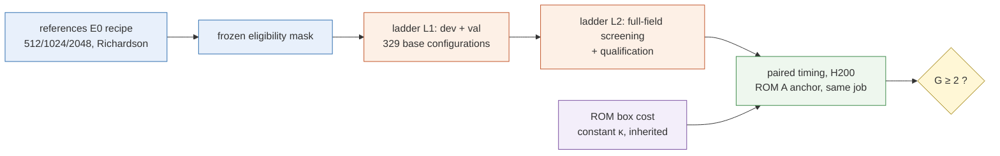
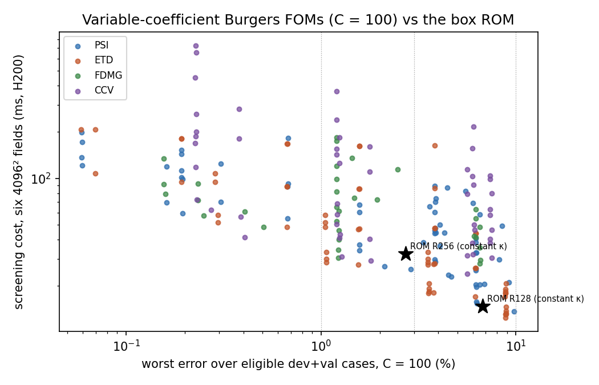
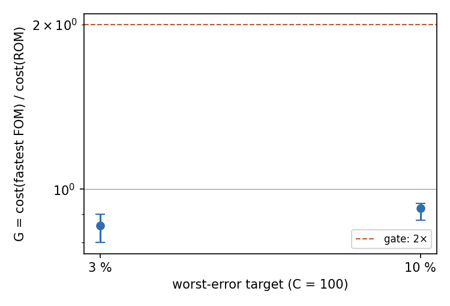

# Variable-coefficient Burgers: does the fastest full-order solver become 2× slower than the box ROM?

**Status:** final for Phase 1 (FOM-only benchmark, lane `imp-varcoef`, experiment E3, 2026-10-21). Gate outcome: **FAIL**
(no ROM trained). Accuracy numbers are **conditional** estimates against this lane's second-order references (E0 recipe,
Richardson $\epsilon_{\rm ref}$, conditional); every speed ratio is **against the strongest tested competitor** and a
**finite-ladder upper bound on the ROM speed-up**; the ROM costs are those of the **constant-viscosity** bank (inherited
qualification, prior evidence; E0 A10 and combined A10/A11/A15 labels carry forward). All measured results are generated
by `make_report.py` from the run JSONs (registered design constants such as cohort sizes, levels and caps are literals).

## 1. In brief

- **Gate ($C=100$, worst-error targets 3 % and 10 %; references under the post-hoc A10 cross-check rule):** FAIL
  (under the registered rule: UNRESOLVED). Per target:

| target (worst) | ROM (constant κ), worst | ROM cost (×A) | fastest FOM (stage-1 union winner) | FOM cost (×A) | $G$ [95 % slot bootstrap] | outcome |
|---|---|---|---|---|---|---|
| 1 % | none qualified – | – | – | – | – [–, –] | not decisive (no ROM) |
| 3 % | R256 2.71 % | 0.327 | `etd\|N48\|0.003125\|mid@C100` | 0.281 | 0.859 [0.799, 0.9] | fail |
| 10 % | R128 6.73 % | 0.148 | `etd\|N48\|0.0125\|mid@C100` | 0.136 | 0.923 [0.877, 0.943] | fail |

  Costs are anchor-normalised (ratio to the C2 reference ROM A, H200, same job). $G<1$ means the FOM is faster than the ROM.
- **Reading:** the coefficient matters (a constant-ν solver is off by 21.4 % median / 34.7 % worst on the
  dev cases at $C=100$, T-kappa diagnostic), yet the fastest tuned FOM at both decisive targets is the exponential integrator
  with a constant-coefficient split (union winners etd|N48|0.003125|mid@C100, etd|N48|0.0125|mid@C100), and it is
  not slower than the box ROM. Under the registered cross-check rule the gate is **UNRESOLVED**
  (references not decidable, A10); the outcome above uses the post-hoc A10 rule.
- **References:** 32 of 32 pooled cases eligible at $C=100$ (coverage rule ≥ 24: met),
  32 of 32 at $C=10$; $\epsilon_{\rm ref}$ (conditional) 2.23e-05–0.000135 at $C=100$;
  cross-checks passed at $C=100$: yes, at $C=10$: yes.
- **Compute:** 2.04 GPU-h of the 8 GPU-h Phase-1 cap (7 jobs, ledger below).

## 2. Problem, competitors and the gate

$$u_t+u(u_x+u_y)=\nabla\cdot(\kappa(x)\nabla u),\quad (0,1)^2,\ u=0\ \text{on the walls},\ t\in[0,0.25],$$

$\kappa=\nu e^{s\hat g(x)}$, $\hat g\in[-\tfrac12,\tfrac12]$ a normalised random cosine field (15 modes), contrast $C=e^s\in\{10,100\}$,
$\nu\in[0.02,0.1]$ log-uniform, the campaign's Gaussian initial data; six outputs at $t=0.05k$. Error: E0 metric (max over
$k\ge1$ of the lattice $L^2$ error relative to $\lVert R(t_0)\rVert$), worst and median over eligible cases. Design:
`DESIGN.md` (amendments A1–A9).

Competitors (each tuned over its knobs; DESIGN §6): **PSI** sine–Galerkin IMEX (SBDF2/CNAB2) with warm-started CG
preconditioned by the constant-coefficient inverse; **ETD** ETDRK4 with a constant-coefficient split; **FDMG** second-order FD,
SBDF2, CG with a geometric-multigrid (or DST) preconditioner; **CCv** the E0 scheme (CN-R, Newton–BiCGStab). Not built: Krylov/Leja
full-operator exponentials, reused factorisations, algebraic multigrid, POD-ECSW. Deferred (§11 order): $C=10$ timing, $C=10$
validation ladder, CCv at $L=512$.

## 3. Fastest qualified configuration per family at $C=100$ (ladder, pooled eligible dev+val)

Errors: conditional estimates against this lane's references; screening cost ranks only (not a paired timing).

| family | target | cheapest qualified (screening) | median | worst | screening cost |
|---|---|---|---|---|---|
| PSI | 1 % | `psi\|N64\|0.0015625\|CNAB2\|1e-05` | 0.0153 % | 0.673 % | 55 ms |
| PSI | 3 % | `psi\|N48\|0.003125\|CNAB2\|1e-05` | 0.0412 % | 1.58 % | 37 ms |
| PSI | 10 % | `psi\|N24\|0.00625\|SBDF2\|1e-05` | 0.196 % | 6.26 % | 19.8 ms |
| ETD | 1 % | `etd\|N64\|0.0015625\|mid` | 0.00752 % | 0.671 % | 48.4 ms |
| ETD | 3 % | `etd\|N48\|0.003125\|mid` | 0.017 % | 1.55 % | 27.6 ms |
| ETD | 10 % | `etd\|N48\|0.0125\|mid` | 0.35 % | 8.89 % | 13.1 ms |
| FDMG | 1 % | `fdmg\|L256\|0.0015625\|MG\|1e-07` | 0.0128 % | 0.233 % | 72 ms |
| FDMG | 3 % | `fdmg\|L128\|0.003125\|MG\|1e-07` | 0.049 % | 1.24 % | 40 ms |
| FDMG | 10 % | `fdmg\|L64\|0.003125\|MG\|1e-07` | 0.151 % | 6.54 % | 35.5 ms |
| CCV | 1 % | `ccv\|L256\|0.0015625\|t3` | 0.012 % | 0.228 % | 119 ms |
| CCV | 3 % | no qualified within the 8-attempt capped search (qualified `ccv\|L256\|0.0015625\|t3` from another target also meets it) | – | – | – |
| CCV | 10 % | `ccv\|L64\|0.05\|t3` | 5.02 % | 7.49 % | 30.5 ms |

*Figure 1 (illustrative; not a paired comparison).* Screening cost (full-field 4096² contract, single warm calls, ranking only) against pooled worst error for every
configuration matching some target at $C=100$; stars: the inherited constant-κ ROM denominators (C2 seconds).

Temporal checks (A4.10/A5.10) at $C=100$: PSI: accepted, ETD: accepted, FDMG: accepted, CCV: accepted.
$C=10$ (dev-only, deferred selection): 4336 lattice runs; T-kappa at $C=10$: 11 % median / 17.8 % worst.

## 4. Paired timing and the gate

Timing job: NVIDIA H200, job 6177992, gates {'G-RR': True, 'A-valid': True, 'G-FR': False}, controls fired: T-dbl yes, T-fault yes, T-id yes.
In-job ROM cost vs inherited C2 cost (ratio): 0.991, 0.982 (consistency band ±20 %).
Decomposition of the union winners (kernel with prepared setup / setup only, ×A): {"0.01|C100": null, "0.03|C100": {"kernel": 0.27687981668578965, "setup": 0.017160172030013986}, "0.1|C100": {"kernel": 0.13069817970376393, "setup": 0.01804484500762863}}.
Paired PSI reading (cost at $C=100$ / same configuration at $C=1$): {"0.01|C100": null, "0.03|C100": 1.7413260743248375, "0.1|C100": 1.447950624741829}.

*Figure 2 (paired, same H200 job; conditional references; strongest tested competitor, finite-ladder upper bound; inherited
constant-κ ROM).* Anchor-normalised cost ratio $G$ per decisive target with the slot-bootstrap interval; the gate line is 2.

## 5. Test-once (Phase-1 frozen winners, 16 test cases, not used for selection)

| configuration | target it won | test worst vs target | eligible test cases | median | worst | all valid |
|---|---|---|---|---|---|---|
| `ccv\|L64\|0.05\|t3@C100` | 10 % | misses | 14 | 6.99 % | 12.3 % | yes |
| `etd\|N48\|0.003125\|mid@C100` | 3 % | meets | 14 | 0.00882 % | 2.04 % | yes |
| `etd\|N48\|0.0125\|mid@C100` | 10 % | misses | 14 | 0.282 % | 11.7 % | yes |
| `fdmg\|L128\|0.003125\|MG\|1e-07@C100` | 3 % | meets | 14 | 0.0673 % | 0.999 % | yes |
| `fdmg\|L64\|0.003125\|MG\|1e-07@C100` | 10 % | meets | 14 | 0.232 % | 4.88 % | yes |
| `psi\|N24\|0.00625\|SBDF2\|1e-05@C100` | 10 % | misses | 14 | 0.234 % | 14 % | yes |
| `psi\|N48\|0.003125\|CNAB2\|1e-05@C100` | 3 % | meets | 14 | 0.0411 % | 1.15 % | yes |

Test references: 14 accepted, 2 order-fail of 16 cases. The A8.3 test fallback for the non-accepted cases was not run (time/usage budget; recorded as
deferred); test errors are over the eligible test cases only. A target met on dev + val need not be met on test: compare each
winner's test worst error with its target.

## 6. What is provisional, what was changed, what is retracted

- Accuracy: conditional on the lane's references ($\epsilon_{\rm ref}$ conditional Richardson) and on the eligible population.
- Speed: against the strongest *tested* competitor; Krylov/Leja exponentials, factorisations, AMG and POD-ECSW were not built,
  so a stronger FOM can only lower $G$ further.
- The ROM denominator is the inherited constant-κ configuration (not requalified here; lane brief). It is an assumed,
  optimistic comparator: the cost and accuracy of a variable-κ ROM remain unmeasured.
- Post-smoke amendments before production (A7–A9): shared compiled programs, a qualification cap (search truncation),
  reference levels one step coarser (with fallback), two-job ladder, deferrals. These are recorded in `DESIGN.md`.
- Timing identity: G-FR is False — subjects whose timed lattice error did not reproduce the ladder error within
  1e-9: `psi\|N64\|0.0015625\|CNAB2\|1e-05@C100`, `fdmg\|L256\|0.0015625\|DST\|1e-07@C100`, `ccv\|L256\|0.0015625\|t3@C100`, `KERNEL\|psi\|N64\|0.0015625\|CNAB2\|1e-05@C100`, `KERNEL\|fdmg\|L256\|0.0015625\|DST\|1e-07@C100`, `KERNEL\|ccv\|L256\|0.0015625\|t3@C100`
  (none is a decisive union winner; the gate uses only subjects whose scoring reproduced, `gate.py`).
- Ladder lineage: L2 recomputes some lattice runs of L1 (fields needed for qualification); candidate summaries keep the
  pre-qualification pooled statistics, which can differ from the recomputed runs in the last digits (`audits/codex-results-1.md`).
- Retractions: none within this lane. The where-we-win report's synthetic warm-start column for this setting (no configuration
  ≥ 2×) is qualitatively consistent with the measured outcome; this does not validate that synthetic model.

## 7. Jobs and audits

| job | Slurm id | node | state | GPU-h |
|---|---|---|---|---|
| smk1 | 6158986 | pax009 | COMPLETED | 0.286 |
| ref100 | 6170626 | pax009 | COMPLETED | 0.211 |
| ref10 | 6170629 | pax009 | COMPLETED | 0.0806 |
| lad1 | 6171584 | pax008 | COMPLETED | 0.525 |
| lad2 | 6173783 | pax009 | COMPLETED | 0.562 |
| time | 6177992 | pax010 | COMPLETED | 0.269 |
| test | 6180285 | pax010 | COMPLETED | 0.105 |

Smoke acceptance: accepted (`checks/smoke-accept.json`). Audits: codex-a7-1.md, codex-a7-2.md, codex-code-1.md, codex-code-2.md, codex-code-3.md, codex-code-4.md, codex-code-5.md, codex-design-1.md, codex-design-2.md, codex-design-3.md, codex-design-4.md, codex-design-5.md, codex-design-6.md, codex-job-lad2-1.md, codex-job-ref-1.md, codex-job-smk1-1.md, codex-job-time-1.md, codex-report-1.md, codex-results-1.md, codex-results-ref-1.md.

## 8. Glossary

- **FOM:** full-order model, a conventional solver on a grid or a spectral basis.
- **ROM / bank ROM:** the reduced model of the campaign (coordinate-network bank + off-mesh quadrature); here only its cost on
  the constant-viscosity problem is used.
- **Contrast $C$:** $\kappa_{\max}/\kappa_{\min}$ of the diffusion coefficient.
- **PSI / ETD / FDMG / CCv:** the four competitor families of §2.
- **Worst / median error:** maximum / median over eligible cases of the E0 error metric.
- **Target $\tau$:** a worst-error level (1 %, 3 %, 10 %) at which FOM and ROM are matched.
- **Eligible case:** its reference passed every E0 acceptance check with $\epsilon_{\rm ref}\le10^{-3}$ and the cross-check.
- **$\epsilon_{\rm ref}$:** conditional Richardson estimate of the reference error.
- **Screening cost:** single warm call latency used only to rank candidates; **anchor-normalised cost:** median over timing slots
  of $t_B/\tfrac12(t_{A1}+t_{A2})$ with A the reference ROM run in the same job.
- **$G$:** anchor-normalised cost of the fastest FOM divided by that of the ROM at the same target; the gate passes at $G\ge2$.
- **Qualified (FOM):** valid runs, tight-solve distance ≤ 2.5e-4, tight/tighter ≤ 2.5e-5, and (spectral) quadrature checks.
- **Slot:** one of six timing pairs (a FOM case and the ROM anchor case) resampled by the bootstrap.
- **dev / val / test:** development, validation (selection) and test-once cohorts, seeded separately.
- **T-kappa:** diagnostic: the constant-coefficient solver scored against the variable-coefficient reference.
- **Configuration keys:** `family|N or L|Δt|…`: N = spectral modes per axis, L = grid intervals per axis, Δt = time step; PSI adds the
  scheme (SBDF2/CNAB2: second-order implicit–explicit schemes) and CG tolerance; ETD adds `mid`/`max` (the constant
  coefficient κ̄ = mid-range or maximum of κ); FDMG adds MG/DST (multigrid or fast-sine-transform preconditioner) and tolerance;
  CCv adds `t1…t4` (Newton/linear tolerance levels, t4 loosest); `@C100` = contrast; `R256 gauss128` etc. name ROM bank width and quadrature.
- **A:** the reference ROM (R384, LSPG-CN-R) timed between every pair of measurements; **C2:** the earlier jcp-fom2d timing job whose
  ROM costs are inherited; **E0:** the campaign's second-order reference recipe.
- **G-RR / G-FR / A-valid:** timing-job checks that ROM and FOM errors reproduce their earlier values and that A's runs are valid;
  **T-dbl / T-fault / T-id:** timing controls (doubled work is detected, clock drift is rejected, a wrong identity is vetoed).
- **Slot bootstrap:** resampling the six timing slots to give a 95 % interval for $G$; **all valid:** every test run finished with finite
  output and converged solves.
