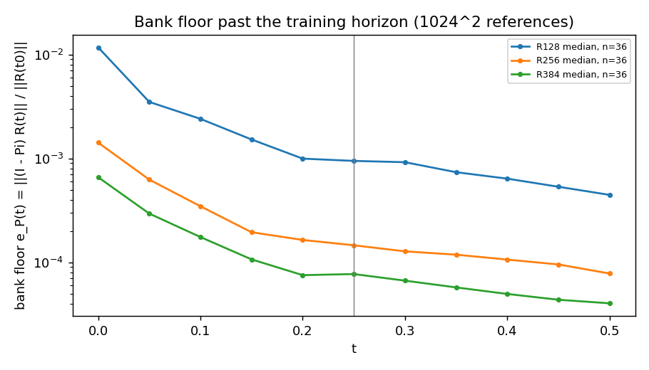
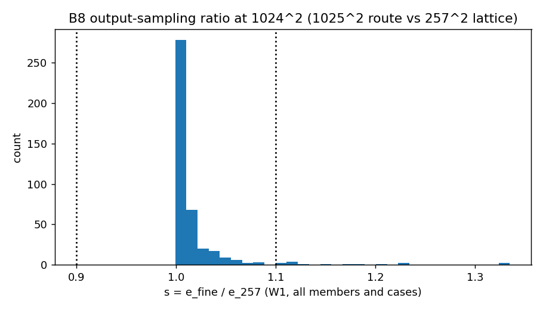
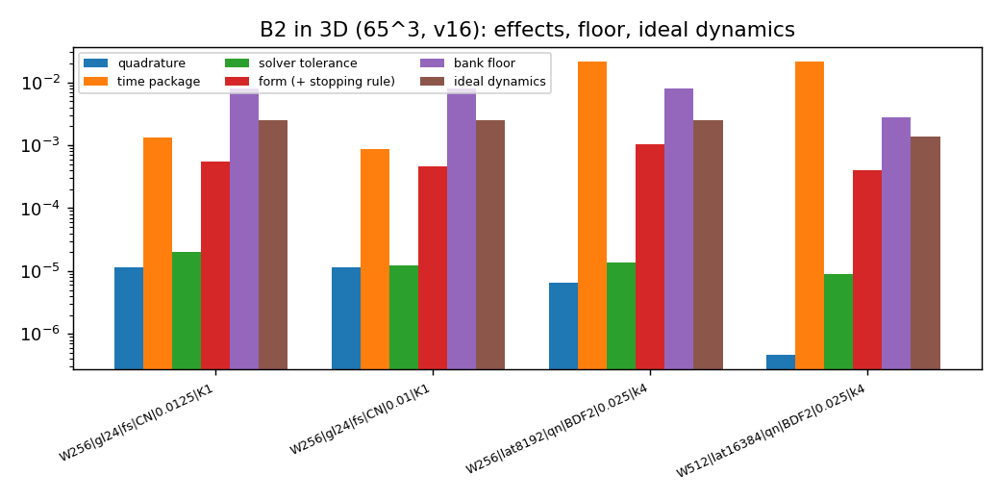

# jcp-budget: error budget, longer horizons and physical diagnostics for the off-mesh Burgers ROM (B2, B7, B8)

**Status:** generated by `make_report.py` from the lane's analysis JSONs; every number below is read from them. Accuracy numbers are scored against order-verified second-order references (E0 for $t\le0.25$, this lane's own references beyond); every $\varepsilon_{\rm ref}$ is a **conditional Richardson estimate**, not a bound. Post-hoc labels carried unchanged: E0 A10; combined A10, A11, retracted A15. GAL-CN rows are a registered diagnostic scheme. Pre-registration `DESIGN.md` with amendments A1–A14.

## What ran

| attempt | job id | state | elapsed GPU-h |
|---|---|---|---|
| smk1 | 5534971 | COMPLETED | 0.374 |
| smk2 | 5550659 | COMPLETED | 0.274 |
| ref2a | 5552268 | COMPLETED | 1.08 |
| ref2b | 5557492 | CANCELLED | 1.75 |
| ref2c | 5558492 | CANCELLED | 1.71 |
| ps2a | 5584547 | COMPLETED | 0.309 |
| ps2b | 5600233 | COMPLETED | 0.31 |
| b3d | 5615930 | COMPLETED | 0.558 |
| ref3 | 5625028 | CANCELLED | 0.0083 |
| ps3 | 5625089 | COMPLETED | 0.554 |
| ref2r | 5641802 | COMPLETED | 1.46 |
| ref3b | 5641862 | COMPLETED | 1.18 |
| b1024a | 5712471 | COMPLETED | 1.68 |
| b1024b | 5712569 | COMPLETED | 2.05 |
| b256 | 5712669 | COMPLETED | 1.36 |
| ref2t1 | 5787200 | CANCELLED | 7.8 |
| b4096 | 5801902 | COMPLETED | 0.918 |
| ps2t1 | 5818780 | COMPLETED | 0.602 |
| b1024t1 | 5873633 | COMPLETED | 0.102 |
| ref2t1w | 5981047 | COMPLETED | 1.83 |

Spent 25.9 of 45 GPU-h (Slurm accounting, `runs/GPU-LEDGER.json`). Every result-producing job ran on H200 under `/cluster/tufts/paralab/tawal01/jcp-budget/` with `jax_backend=gpu` in its log (smoke and collection checks); `ref3` was cancelled 30 s after it started, before any case, and has no collected log (A9). `ref2b`, `ref2c` and `ref2t1` were cancelled and partially collected (A9, A14).

## New references (B7, B8)

- **2D, $T=0.5$:** 38 cases, 36 accepted; refined 2, tight retries 0; G-R2 (agreement with E0 on $t\le0.25$) passed on 36; G-R3 (fine route = lattice at shared nodes) 38 of 38.
  - not accepted (non-rankable): unresolved-floor: val32 10, val32 31
  - window W1: median $\varepsilon_{\rm ref}$ 0.000376 %, worst 0.000952 % (conditional Richardson estimate)
  - window W2: median $\varepsilon_{\rm ref}$ 4.46e-05 %, worst 0.000399 % (conditional Richardson estimate)
- **2D, $T=1$:** 17 cases, 11 accepted; refined 0, tight retries 2; G-R2 (agreement with E0 on $t\le0.25$) passed on 15; G-R3 (fine route = lattice at shared nodes) 0 of 0.
  - not accepted (non-rankable): order-fail: dev6 3, val32 0; unresolved-floor: dev6 1, val32 1, val32 2, val32 3
  - window W1: median $\varepsilon_{\rm ref}$ 0.000384 %, worst 0.000952 % (conditional Richardson estimate)
  - window W2: median $\varepsilon_{\rm ref}$ 6.49e-05 %, worst 0.000399 % (conditional Richardson estimate)
  - window W3: median $\varepsilon_{\rm ref}$ 2.77e-05 %, worst 0.000162 % (conditional Richardson estimate)
- **3D, $T=0.5$:** 17 cases, 17 accepted; refined 0, tight retries 0; G-R2 (agreement with E0 on $t\le0.25$) passed on 17; G-R3 (fine route = lattice at shared nodes) 17 of 17.
  - window W1: median $\varepsilon_{\rm ref}$ 0.00358 %, worst 0.0116 % (conditional Richardson estimate)
  - window W2: median $\varepsilon_{\rm ref}$ 0.00193 %, worst 0.015 % (conditional Richardson estimate)

Pseudo-spectral cross-check (E0 procedure, per window) and the resulting tier (A2.3):

| dim | horizon | window | tier | per-case verdicts |
|---|---|---|---|---|
| 2d | T0.5 | W1 | validated | 0: PASS, 1: PASS, 5: PASS, 19: PASS |
| 2d | T0.5 | W2 | validated | 0: PASS, 1: PASS, 5: PASS, 19: PASS |
| 2d | T1 | W1 | validated | 0: PASS, 19: PASS |
| 2d | T1 | W2 | validated | 0: PASS, 19: PASS |
| 2d | T1 | W3 | unvalidated | 0: FD-INVALID, 19: PASS |
| 3d | T0.5 | W1 | validated | 0: PASS, 43: PASS |
| 3d | T0.5 | W2 | validated | 0: PASS, 43: PASS |

Reference gates: G-R1 —; G-R2 evaluable failures: none (not evaluable: 2d val32 10 T0.5, 2d val32 31 T0.5, 2d dev6 1 T1, 2d dev6 5 T1; A13); G-R3 yes; offline judge agreement yes; C-R1 (first-order ladder rejected) —; $T=1$ prefix no.

## B2: error budget

Per case and output time, relative to $n_0=\lVert R(t_0)\rVert$ on the scoring lattice: one-ingredient effects $I_x=u_x-u_\varnothing$ (switching quadrature to Gauss $320^2$, the time package to BDF2 at $\Delta t_0/8$, the form, the solver tolerance to tight, the initial condition to the full-grid least-squares projection, the test space to $M=2048$), pairwise interactions $I_{xy}=u_{xy}-u_x-u_y+u_\varnothing$, the floor $e_P=\lVert(I-\Pi)u_{\rm ref}\rVert$ and the ideal dynamics $e_{\star,\rm dyn}=\lVert u_\star-\Pi u_{\rm ref}\rVert$. Each is the max over the five output times; tables give medians over eligible cases. Norms are **not additive** (the per-time identity $e_v^2=e_P^2+\lVert v-\Pi u_{\rm ref}\rVert^2$ is gate G-B0).

### 256^2

| member | dominant | Q | T | F | S | I | M | e_P | e_dyn* | U* | e_tot | complete/eligible |
|---|---|---|---|---|---|---|---|---|---|---|---|---|
| R128 GAL CN 1 (diag.) | e_P | 1.88e-06 | 0.000252 | 0.000317 | 1.08e-10 | 0.000133 | 0.00215 | 0.00364 | 0.00174 | 1.27e-05 | 0.0042 | 38/38 |
| R128 GAL CN 2 (diag.) | e_P | 1.99e-06 | 0.000997 | 0.000529 | 1.19e-11 | 0.000134 | 0.0024 | 0.00364 | 0.00174 | 1.27e-05 | 0.00433 | 38/38 |
| R128 GAL CN 5 (diag.) | no single dominant | 3.06e-06 | 0.00864 | 0.00164 | 1.86e-11 | 0.000186 | 0.00767 | 0.00364 | 0.00174 | 1.27e-05 | 0.0122 | 38/38 |
| R128 LSPG BE 1 | T | 1.49e-06 | 0.0099 | 0.000499 | 4.69e-06 | 0.000144 | 0.00161 | 0.00364 | 0.00174 | 1.27e-05 | 0.011 | 38/38 |
| R128 LSPG BE 2.5 | T | 1.13e-06 | 0.0231 | 0.000889 | 1.15e-05 | 0.00015 | 0.00115 | 0.00364 | 0.00174 | 1.27e-05 | 0.0236 | 38/38 |
| R256 GAL CN 1 (diag.) | e_P | 9.82e-07 | 0.000261 | 7.46e-05 | 9.24e-11 | 0.000101 | 0.000405 | 0.00067 | 0.000505 | 1.29e-05 | 0.000969 | 38/38 |
| R256 GAL CN 2 (diag.) | no single dominant | 2.29e-06 | 0.00132 | 0.00017 | 1.26e-11 | 0.000116 | 0.00103 | 0.00067 | 0.000505 | 1.29e-05 | 0.00172 | 38/38 |
| R384 GAL CN 1 (diag.) | no single dominant | 1.25e-06 | 0.00026 | 5.17e-05 | 8.29e-11 | 0.000101 | 0.00017 | 0.000282 | 0.000208 | 1.29e-05 | 0.000504 | 38/38 |
| R384 LSPG CNR 1 | T | 6.59e-07 | 0.00189 | 5.04e-05 | 7.09e-07 | 9.96e-05 | 0.000139 | 0.000282 | 0.000208 | 1.29e-05 | 0.00201 | 38/38 |
| R384 LSPG CNR 2 | T | 6.44e-07 | 0.00723 | 7.77e-05 | 2.91e-06 | 0.000101 | 0.000148 | 0.000282 | 0.000208 | 1.29e-05 | 0.0073 | 38/38 |

| member | two largest main effects | their pair | interacting pairs |
|---|---|---|---|
| R128 GAL CN 1 | M, F | interacting | TF, FM |
| R128 GAL CN 2 | M, T | additive | TF, FM |
| R128 GAL CN 5 | T, M | interacting | TF, TM, FM |
| R128 LSPG BE 1 | T, M | additive | FM |
| R128 LSPG BE 2.5 | T, M | additive | FM |
| R256 GAL CN 1 | M, T | additive | TF |
| R256 GAL CN 2 | T, M | interacting | TM, FM |
| R384 GAL CN 1 | T, M | additive | TF |
| R384 LSPG CNR 1 | T, M | additive | none |
| R384 LSPG CNR 2 | T, M | additive | none |

Gates: G-B0 yes (worst 7.77e-11), G-B2 not applicable (pairwise design), G-B3 yes (380 reproductions, worst 1.54e-14), G-B6 yes, B0 mismatched-normaliser yes.

Controls: C-Q yes; C-S yes; C-I yes; G-Q yes; C-score yes; C-T yes; C-F yes.

### 1024^2

| member | dominant | Q | T | F | S | I | M | e_P | e_dyn* | U* | e_tot | complete/eligible |
|---|---|---|---|---|---|---|---|---|---|---|---|---|
| R128 GAL CN 1 (diag.) | e_P | 1.95e-06 | 0.000252 | 0.000325 | 1.09e-10 | 3.42e-05 | 0.00213 | 0.00364 | 0.00172 | 1.27e-05 | 0.00417 | 38/38 |
| R128 GAL CN 2 (diag.) | e_P | 2.08e-06 | 0.000998 | 0.000539 | 1.02e-11 | 3.41e-05 | 0.00261 | 0.00364 | 0.00172 | 1.27e-05 | 0.00434 | 38/38 |
| R128 GAL CN 5 (diag.) | no single dominant | 3.61e-06 | 0.00874 | 0.00166 | 2e-11 | 4.58e-05 | 0.00864 | 0.00364 | 0.00172 | 1.27e-05 | 0.0122 | 38/38 |
| R128 LSPG BE 1 | T | 1.6e-06 | 0.0099 | 0.000503 | 5.11e-06 | 3.57e-05 | 0.00157 | 0.00364 | 0.00172 | 1.27e-05 | 0.011 | 38/38 |
| R128 LSPG BE 2.5 | T | 1.18e-06 | 0.0231 | 0.000924 | 1.25e-05 | 3.87e-05 | 0.00114 | 0.00364 | 0.00172 | 1.27e-05 | 0.0236 | 38/38 |
| R256 GAL CN 1 (diag.) | no single dominant | 1.03e-06 | 0.000261 | 7.37e-05 | 9.24e-11 | 4.25e-05 | 0.000404 | 0.00067 | 0.000496 | 1.29e-05 | 0.00098 | 38/38 |
| R256 GAL CN 2 (diag.) | no single dominant | 2.6e-06 | 0.00133 | 0.000176 | 1.02e-11 | 5.03e-05 | 0.00111 | 0.00067 | 0.000496 | 1.29e-05 | 0.00179 | 38/38 |
| R256 LSPG CNR 2.5 | T | 7.89e-07 | 0.011 | 0.000153 | 4.65e-06 | 4.75e-05 | 0.000465 | 0.00067 | 0.000496 | 1.29e-05 | 0.0111 | 38/38 |
| R384 GAL CN 1 (diag.) | no single dominant | 1.23e-06 | 0.000261 | 5.59e-05 | 8.29e-11 | 4.09e-05 | 0.000178 | 0.000282 | 0.000188 | 1.29e-05 | 0.000495 | 38/38 |
| R384 LSPG CNR 1 | T | 8.12e-07 | 0.00189 | 5.31e-05 | 8.51e-07 | 4.19e-05 | 0.000138 | 0.000282 | 0.000188 | 1.29e-05 | 0.00198 | 38/38 |
| R384 LSPG CNR 2 | T | 8.11e-07 | 0.00723 | 8.54e-05 | 2.92e-06 | 4.36e-05 | 0.000148 | 0.000282 | 0.000188 | 1.29e-05 | 0.00726 | 38/38 |

| member | two largest main effects | their pair | interacting pairs |
|---|---|---|---|
| R128 GAL CN 1 | M, F | interacting | TF, FM |
| R128 GAL CN 2 | M, T | additive | TF, FM |
| R128 GAL CN 5 | T, M | interacting | TF, TM, FM |
| R128 LSPG BE 1 | T, M | additive | FM |
| R128 LSPG BE 2.5 | T, M | additive | FM |
| R256 GAL CN 1 | M, T | additive | TF |
| R256 GAL CN 2 | T, M | interacting | TM, FM |
| R256 LSPG CNR 2.5 | T, M | additive | FM |
| R384 GAL CN 1 | T, M | additive | TF |
| R384 LSPG CNR 1 | T, M | additive | none |
| R384 LSPG CNR 2 | T, M | additive | none |

Gates: G-B0 yes (worst 2.16e-11), G-B2 yes, G-B3 yes (304 reproductions, worst 1.21e-14), G-B6 yes, B0 mismatched-normaliser yes; G-B0 yes (worst 4.95e-11), G-B2 yes, G-B3 yes (114 reproductions, worst 1.53e-14), G-B6 yes, B0 mismatched-normaliser yes.

Controls: C-T yes; C-F yes; C-Q yes; C-S yes; C-I yes; G-Q yes; C-score yes.

### 4096^2

| member | dominant | Q | T | F | S | I | M | e_P | e_dyn* | U* | e_tot | complete/eligible |
|---|---|---|---|---|---|---|---|---|---|---|---|---|
| R128 GAL CN 1 (diag.) | e_P | 2.23e-06 | 0.00028 | 0.000448 | 1.34e-10 | 3.44e-05 | 0.00375 | 0.00605 | 0.0031 | 1.46e-05 | 0.00666 | 16/16 |
| R128 GAL CN 2 (diag.) | e_P | 2.26e-06 | 0.00114 | 0.000757 | 1.79e-11 | 3.48e-05 | 0.00385 | 0.00605 | 0.0031 | 1.46e-05 | 0.00684 | 16/16 |
| R128 GAL CN 5 (diag.) | no single dominant | 3.31e-06 | 0.00822 | 0.00173 | 1.95e-11 | 5.38e-05 | 0.00814 | 0.00605 | 0.0031 | 1.46e-05 | 0.0122 | 16/16 |
| R128 LSPG BE 1 | T | 1.64e-06 | 0.0112 | 0.000709 | 5.14e-06 | 3.92e-05 | 0.0025 | 0.00605 | 0.0031 | 1.46e-05 | 0.0137 | 16/16 |
| R128 LSPG BE 2 | T | 1.46e-06 | 0.0215 | 0.00109 | 1.55e-05 | 4.72e-05 | 0.00233 | 0.00605 | 0.0031 | 1.46e-05 | 0.0241 | 16/16 |
| R128 LSPG BE 2.5 | T | 1.37e-06 | 0.0263 | 0.00124 | 1.37e-05 | 5.07e-05 | 0.00236 | 0.00605 | 0.0031 | 1.46e-05 | 0.0294 | 16/16 |
| R256 GAL CN 1 (diag.) | e_P | 9.39e-07 | 0.000331 | 0.000131 | 9.24e-11 | 3.98e-05 | 0.000698 | 0.000932 | 0.00088 | 1.54e-05 | 0.00141 | 16/16 |
| R256 GAL CN 2 (diag.) | no single dominant | 1.17e-06 | 0.00133 | 0.000224 | 1.44e-11 | 4.11e-05 | 0.0012 | 0.000932 | 0.00088 | 1.54e-05 | 0.00196 | 16/16 |
| R256 LSPG CNR 2.5 | T | 8.04e-07 | 0.0113 | 0.000237 | 5.68e-06 | 4.29e-05 | 0.000612 | 0.000932 | 0.00088 | 1.54e-05 | 0.0115 | 16/16 |
| R384 GAL CN 1 (diag.) | no single dominant | 1.32e-06 | 0.000339 | 0.000114 | 7.79e-11 | 3.93e-05 | 0.000236 | 0.000523 | 0.000562 | 1.54e-05 | 0.000866 | 16/16 |
| R384 LSPG CNR 1 | T | 1.3e-06 | 0.00192 | 0.000118 | 1.02e-06 | 4e-05 | 0.000221 | 0.000523 | 0.000562 | 1.54e-05 | 0.00248 | 16/16 |
| R384 LSPG CNR 2 | T | 1.18e-06 | 0.00743 | 0.000188 | 5.92e-06 | 4.15e-05 | 0.000268 | 0.000523 | 0.000562 | 1.54e-05 | 0.00756 | 16/16 |

| member | two largest main effects | their pair | interacting pairs |
|---|---|---|---|
| R128 GAL CN 1 | M, F | additive | TF |
| R128 GAL CN 2 | M, T | additive | TF, FM |
| R128 GAL CN 5 | T, M | interacting | TF, TM, FM |
| R128 LSPG BE 1 | T, M | additive | FM |
| R128 LSPG BE 2 | T, M | additive | FM |
| R128 LSPG BE 2.5 | T, M | additive | FM |
| R256 GAL CN 1 | M, T | additive | TF |
| R256 GAL CN 2 | T, M | interacting | TF, TM, FM |
| R256 LSPG CNR 2.5 | T, M | additive | FM |
| R384 GAL CN 1 | T, M | additive | TF |
| R384 LSPG CNR 1 | T, M | additive | none |
| R384 LSPG CNR 2 | T, M | additive | none |

Gates: G-B0 yes (worst 1.85e-11), G-B2 not applicable (pairwise design), G-B3 yes (192 reproductions, worst 1.21e-14), G-B6 yes, B0 mismatched-normaliser yes.

Controls: C-Q yes; C-S yes; C-I yes; G-Q yes; C-score yes; C-T yes; C-F yes.

### Mesh invariance of the budget (sub16)

| member | same dominant at every mesh? | dominant per mesh |
|---|---|---|
| R128 GAL CN 1 | same | 256: e_P, 1024: e_P, 4096: e_P |
| R128 GAL CN 2 | same | 256: e_P, 1024: e_P, 4096: e_P |
| R128 GAL CN 5 | inconclusive | 256: no single dominant, 1024: no single dominant, 4096: no single dominant |
| R128 LSPG BE 1 | same | 256: T, 1024: T, 4096: T |
| R128 LSPG BE 2.5 | same | 256: T, 1024: T, 4096: T |
| R256 GAL CN 1 | same | 256: e_P, 1024: e_P, 4096: e_P |
| R256 GAL CN 2 | inconclusive | 256: no single dominant, 1024: no single dominant, 4096: no single dominant |
| R384 GAL CN 1 | inconclusive | 256: no single dominant, 1024: no single dominant, 4096: no single dominant |
| R384 LSPG CNR 1 | same | 256: T, 1024: T, 4096: T |
| R384 LSPG CNR 2 | same | 256: T, 1024: T, 4096: T |

### 3D (65^3, cohort 923801 cases 0–15)

| member | dominant | Q | T | S | F (tight end) | e_P | e_dyn* | U* | pairs |
|---|---|---|---|---|---|---|---|---|---|
| W256 gl24 fs CN 0.0125 K1 | e_P | 1.16e-05 | 0.00135 | 2e-05 | 0.000552 | 0.00809 | 0.00254 | 5.41e-05 | SF: undefined (A3.1), QT: additive, QS: mixed, TS: additive, QF: additive, TF: interacting |
| W256 gl24 fs CN 0.01 K1 | e_P | 1.14e-05 | 0.000865 | 1.24e-05 | 0.000456 | 0.00809 | 0.00254 | 5.41e-05 | SF: undefined (A3.1), QT: additive, QS: mixed, TS: additive, QF: additive, TF: interacting |
| W256 lat8192 qn BDF2 0.025 k4 | T | 6.58e-06 | 0.0215 | 1.37e-05 | 0.00106 | 0.00809 | 0.00254 | 5.41e-05 | SF: undefined (A3.1), QT: additive, QS: mixed, TS: additive, QF: additive, TF: additive |
| W512 lat16384 qn BDF2 0.025 k4 | T | 4.64e-07 | 0.0216 | 8.97e-06 | 0.000399 | 0.00283 | 0.00136 | 5.45e-05 | SF: undefined (A3.1), QT: additive, QS: mixed, TS: additive, QF: additive, TF: additive |

Gates: G-B0 yes, G-B2 yes, G-B3 yes. Controls: C-Q yes, C-T yes, C-S yes, G-Q yes, C-score yes, C-F yes.

Not reported by `ana3d`: G-B5 does not apply in 3D (no IC ingredient); G-B1 and G-B6 are not computed in 3D — the bitwise reproduction of every deployed corner is G-B3, and the logical corner settings were reconstructed independently in the results audit (`audits/codex-results-1.md`), not by a gate of this lane.

## B7: longer horizons

The bank was trained on $t\le0.25$; beyond it the model extrapolates in time. Q1/Q2 are certified over every step to $T$ (horizon-specific labels); growth $g=e_{W_2}/e_{W_1}$ uses this lane's references for both windows; labels carry the cross-check tier (A2.3).

### 256^2, $T=0.5$

| member | Q1 at T | Q2 at T | qualified at T | stable (outputs) | growth W2/W1 | median g | n |
|---|---|---|---|---|---|---|---|
| R128 GAL CN 1 | yes | pass | yes | yes | no growth | 0.288 | 36 |
| R128 GAL CN 2 | yes | pass | yes | yes | no growth | 0.275 | 36 |
| R128 GAL CN 5 | yes | pass | yes | yes | no growth | 0.228 | 36 |
| R128 LSPG BE 1 | yes | pass | yes | yes | no growth | 0.54 | 36 |
| R128 LSPG BE 2.5 | no | pass | no | yes | no growth | 0.666 | 36 |
| R256 GAL CN 1 | yes | pass | yes | yes | no growth | 0.279 | 36 |
| R256 GAL CN 2 | yes | pass | yes | yes | no growth | 0.234 | 36 |
| R384 GAL CN 1 | yes | pass | yes | yes | no growth | 0.268 | 36 |
| R384 LSPG CNR 1 | yes | pass | yes | yes | no growth | 0.179 | 36 |
| R384 LSPG CNR 2 | yes | pass | yes | yes | no growth | 0.166 | 36 |

Front order W1 → W2: all members not preserved; LSPG members preserved.

### 1024^2, $T=0.5$

| member | Q1 at T | Q2 at T | qualified at T | stable (outputs) | growth W2/W1 | median g | n |
|---|---|---|---|---|---|---|---|
| R128 GAL CN 1 | yes | pass | yes | yes | no growth | 0.288 | 36 |
| R128 GAL CN 2 | yes | pass | yes | yes | no growth | 0.275 | 36 |
| R128 GAL CN 5 | yes | pass | yes | yes | no growth | 0.228 | 36 |
| R128 LSPG BE 1 | yes | pass | yes | yes | no growth | 0.539 | 36 |
| R128 LSPG BE 2.5 | no | pass | no | yes | no growth | 0.666 | 36 |
| R256 GAL CN 1 | yes | pass | yes | yes | no growth | 0.277 | 36 |
| R256 GAL CN 2 | yes | pass | yes | yes | no growth | 0.231 | 36 |
| R256 LSPG CNR 2.5 | no | pass | no | yes | no growth | 0.17 | 36 |
| R384 GAL CN 1 | yes | pass | yes | yes | no growth | 0.263 | 36 |
| R384 LSPG CNR 1 | yes | pass | yes | yes | no growth | 0.172 | 36 |
| R384 LSPG CNR 2 | yes | pass | yes | yes | no growth | 0.165 | 36 |

Front order W1 → W2: all members not preserved; LSPG members preserved.

### 4096^2, $T=0.5$

| member | Q1 at T | Q2 at T | qualified at T | stable (outputs) | growth W2/W1 | median g | n |
|---|---|---|---|---|---|---|---|
| R128 GAL CN 1 | yes | pass | yes | yes | no growth | 0.264 | 16 |
| R128 GAL CN 2 | yes | pass | yes | yes | no growth | 0.241 | 16 |
| R128 GAL CN 5 | yes | pass | yes | yes | no growth | 0.214 | 16 |
| R128 LSPG BE 1 | yes | pass | yes | yes | no growth | 0.506 | 16 |
| R128 LSPG BE 2 | yes | pass | yes | yes | no growth | 0.607 | 16 |
| R128 LSPG BE 2.5 | yes | pass | yes | yes | no growth | 0.628 | 16 |
| R256 GAL CN 1 | yes | pass | yes | yes | no growth | 0.206 | 16 |
| R256 GAL CN 2 | yes | pass | yes | yes | no growth | 0.216 | 16 |
| R256 LSPG CNR 2.5 | yes | pass | yes | yes | no growth | 0.17 | 16 |
| R384 GAL CN 1 | yes | pass | yes | yes | no growth | 0.209 | 16 |
| R384 LSPG CNR 1 | yes | pass | yes | yes | no growth | 0.161 | 16 |
| R384 LSPG CNR 2 | yes | pass | yes | yes | no growth | 0.172 | 16 |

Front order W1 → W2: all members not preserved; LSPG members preserved.

### 3D, $T=0.5$

| member | Q1 at T | Q2 at T | qualified at T | stable | growth W2/W1 |
|---|---|---|---|---|---|
| W256 gl24 fs CN 0.0125 K1 | yes | fail | no | yes | no growth |
| W256 gl24 fs CN 0.01 K1 | yes | fail | no | yes | no growth |
| W256 lat8192 qn BDF2 0.025 k4 | yes | fail | no | yes | no growth |
| W512 lat16384 qn BDF2 0.025 k4 | no | fail | no | yes | no growth |

### 1024^2, $T=1.0$ (sub16)

| member | Q1 at T | Q2 at T | stable | growth W2/W1 | growth W3/W2 | median g W3/W2 | n (W3/W2) |
|---|---|---|---|---|---|---|---|
| R128 GAL CN 1 | yes | pass | yes | no growth | no verdict (cross-check unvalidated); provisional: no growth | 0.36 | 9 |
| R128 GAL CN 2 | yes | pass | yes | no growth | no verdict (cross-check unvalidated); provisional: no growth | 0.356 | 9 |
| R128 GAL CN 5 | yes | pass | yes | no growth | no verdict (cross-check unvalidated); provisional: no growth | 0.395 | 9 |
| R128 LSPG BE 1 | yes | pass | yes | no growth | no verdict (cross-check unvalidated); provisional: no growth | 0.568 | 9 |
| R128 LSPG BE 2.5 | yes | pass | yes | no growth | no verdict (cross-check unvalidated); provisional: no growth | 0.616 | 9 |
| R256 GAL CN 1 | yes | pass | yes | no growth | no verdict (cross-check unvalidated); provisional: no growth | 0.299 | 9 |
| R256 GAL CN 2 | yes | pass | yes | no growth | no verdict (cross-check unvalidated); provisional: no growth | 0.33 | 9 |
| R256 LSPG CNR 2.5 | yes | pass | yes | no growth | no verdict (cross-check unvalidated); provisional: no growth | 0.406 | 9 |
| R384 GAL CN 1 | yes | pass | yes | no growth | no verdict (cross-check unvalidated); provisional: no growth | 0.434 | 9 |
| R384 LSPG CNR 1 | yes | pass | yes | no growth | no verdict (cross-check unvalidated); provisional: no growth | 0.39 | 9 |
| R384 LSPG CNR 2 | yes | pass | yes | no growth | no verdict (cross-check unvalidated); provisional: no growth | 0.423 | 9 |

Front order W1 → W2 (all / LSPG): not preserved / preserved. Front order W2 → W3 (all / LSPG; W3 tier unvalidated, so provisional, no verdict): no verdict (cross-check unvalidated); provisional: not preserved / no verdict (cross-check unvalidated); provisional: preserved.

## B8: physical diagnostics and output-sampling adequacy

### 256^2

| member | sampling W1 | sampling W2 | median s (W1) | max |E_rom/E_ref - 1| | undershoot > 1e-3 | overshoot > 1e-3 | median near-wall density | IC error / floor at t0 |
|---|---|---|---|---|---|---|---|---|
| R128 GAL CN 1 | adequate | adequate | 1.01 | 0.00553 | 36/38 | 8/38 | 2.73 | 1.01 |
| R128 GAL CN 2 | adequate | adequate | 1 | 0.00817 | 36/38 | 8/38 | 2.42 | 1.01 |
| R128 GAL CN 5 | adequate | adequate | 1 | 0.027 | 36/38 | 8/38 | 1.04 | 1.01 |
| R128 LSPG BE 1 | adequate | adequate | 1 | 0.0395 | 36/38 | 8/38 | 0.138 | 1.01 |
| R128 LSPG BE 2.5 | adequate | adequate | 1 | 0.0966 | 36/38 | 8/38 | 0.0584 | 1.01 |
| R256 GAL CN 1 | adequate | mixed | 1.02 | 0.00153 | 30/38 | 4/38 | 4.35 | 1.09 |
| R256 GAL CN 2 | adequate | adequate | 1.01 | 0.00387 | 30/38 | 4/38 | 2.26 | 1.09 |
| R384 GAL CN 1 | mixed | inadequate | 1.05 | 0.000898 | 32/38 | 1/38 | 4.73 | 1.23 |
| R384 LSPG CNR 1 | adequate | adequate | 1.01 | 0.00383 | 32/38 | 1/38 | 1.19 | 1.23 |
| R384 LSPG CNR 2 | adequate | adequate | 1 | 0.0167 | 32/38 | 1/38 | 0.172 | 1.23 |

Front-ranking adequacy (W1, LSPG): adequate. Lane statement: **the 257^2 lattice is adequate for the qualified 2D front (relative to the 1025^2 route)**.

### 1024^2

| member | sampling W1 | sampling W2 | median s (W1) | max |E_rom/E_ref - 1| | undershoot > 1e-3 | overshoot > 1e-3 | median near-wall density | IC error / floor at t0 |
|---|---|---|---|---|---|---|---|---|
| R128 GAL CN 1 | adequate | adequate | 1.01 | 0.00553 | 36/38 | 9/38 | 2.72 | 1 |
| R128 GAL CN 2 | adequate | adequate | 1 | 0.00816 | 36/38 | 9/38 | 2.41 | 1 |
| R128 GAL CN 5 | adequate | adequate | 1 | 0.027 | 36/38 | 9/38 | 1.01 | 1 |
| R128 LSPG BE 1 | adequate | adequate | 1 | 0.0395 | 36/38 | 9/38 | 0.137 | 1 |
| R128 LSPG BE 2.5 | adequate | adequate | 1 | 0.0965 | 36/38 | 9/38 | 0.0581 | 1 |
| R256 GAL CN 1 | adequate | mixed | 1.02 | 0.00158 | 32/38 | 4/38 | 4.31 | 1.01 |
| R256 GAL CN 2 | adequate | adequate | 1.01 | 0.00392 | 32/38 | 4/38 | 2.08 | 1.01 |
| R256 LSPG CNR 2.5 | adequate | adequate | 1 | 0.027 | 32/38 | 4/38 | 0.133 | 1.01 |
| R384 GAL CN 1 | mixed | inadequate | 1.05 | 0.000931 | 32/38 | 3/38 | 4.67 | 1.03 |
| R384 LSPG CNR 1 | adequate | adequate | 1.01 | 0.00436 | 32/38 | 3/38 | 1.3 | 1.03 |
| R384 LSPG CNR 2 | adequate | adequate | 1 | 0.0172 | 32/38 | 3/38 | 0.171 | 1.03 |

Front-ranking adequacy (W1, LSPG): adequate. Lane statement: **the 257^2 lattice is adequate for the qualified 2D front (relative to the 1025^2 route)**.

### 4096^2

| member | sampling W1 | sampling W2 | median s (W1) | max |E_rom/E_ref - 1| | undershoot > 1e-3 | overshoot > 1e-3 | median near-wall density | IC error / floor at t0 |
|---|---|---|---|---|---|---|---|---|
| R128 GAL CN 1 | adequate | adequate | 1 | 0.00553 | 16/16 | 5/16 | 2.54 | 1 |
| R128 GAL CN 2 | adequate | adequate | 1 | 0.00815 | 16/16 | 5/16 | 2.23 | 1 |
| R128 GAL CN 5 | adequate | adequate | 1 | 0.0269 | 16/16 | 5/16 | 0.985 | 1 |
| R128 LSPG BE 1 | adequate | adequate | 1 | 0.0395 | 16/16 | 5/16 | 0.21 | 1 |
| R128 LSPG BE 2 | adequate | adequate | 1 | 0.0777 | 16/16 | 5/16 | 0.114 | 1 |
| R128 LSPG BE 2.5 | adequate | adequate | 1 | 0.0965 | 16/16 | 5/16 | 0.093 | 1 |
| R256 GAL CN 1 | adequate | mixed | 1.02 | 0.00159 | 15/16 | 4/16 | 3.99 | 1.01 |
| R256 GAL CN 2 | adequate | adequate | 1.02 | 0.00392 | 15/16 | 4/16 | 2.14 | 1.01 |
| R256 LSPG CNR 2.5 | adequate | adequate | 1 | 0.0179 | 15/16 | 4/16 | 0.241 | 1.01 |
| R384 GAL CN 1 | mixed | mixed | 1.05 | 0.000936 | 15/16 | 3/16 | 4.4 | 1.02 |
| R384 LSPG CNR 1 | adequate | adequate | 1.01 | 0.00322 | 15/16 | 3/16 | 1.54 | 1.02 |
| R384 LSPG CNR 2 | adequate | adequate | 1 | 0.012 | 15/16 | 3/16 | 0.24 | 1.02 |

Front-ranking adequacy (W1, LSPG): adequate. Lane statement: **the 257^2 lattice is adequate for the qualified 2D front (relative to the 1025^2 route)**.

## Deferred items

- B8 3D (fine route at 127^3, C-A / C-E in 3D): defer item 2, recorded in A4 (implementation scope)

## What was wrong or corrected

- G-B2's registered bar (relative to ||u_all - u_0||) was too tight for a 32-term sum; restated relative to the largest corner norm (A6), found on the smoke.
- Offline reference identity compares case descriptors, not the cohort hash, because np.exp's last bit differs across numpy versions (A6).
- The first resource certificates under-priced the reference retry path and the pseudo-spectral cross-check; repriced before submission (A7, job audits refs2d-1..3).
- The E0 tight re-solve of a refined triple at the round-off floor costs about 27x a production solve at T = 0.5; two reference jobs (ref2b, ref2c) were cancelled, their completed cases kept, and the rerun (ref2r, ref3b) skips that re-solve: such cases are terminal 'unresolved-floor' and non-rankable (A9).
- The first A9 eligibility rule was per window only, so an A9-terminal case with an accepted W2 window would have been rankable; fixed so every window of such a case is ineligible (A9.1, audit codex-job-a9-1).
- The b-job reservations were priced at the time limits; measured run times were 3-7x shorter than the certificates (b3d 0.56 h vs 1.61 h projected; ps jobs 0.3-0.55 h vs 2.29 h).
- At T = 1.0 the first eligibility code let a failed whole-case reference keep an accepted window and took W2 eligibility from the wrong horizon; fixed before submission (A11.1, audit codex-job-t1-1).
- G-R2 on 3D val64 case 43 failed only because E0's own saved IC array differs in the last bit from the initial rows of E0's own levels; the shared-IC requirement was restated level-wise (A13).
- E0's tight re-solve of a failing base triple costs about 22x a production solve at T = 1.0 and did not certify dev6 case 1; ref2t1 was cancelled after dev6 case 5 and the val32 cases rerun without that retry (ref2t1w): such cases are terminal and non-rankable (A14).
- Two analysis caches were defeated by eager dict.setdefault arguments (a QR per case); the first local B7/B8 analyses were also terminated under memory pressure on the shared box and rerun one at a time (A12.2); performance only, identical values.
- jcp-qualify's raw archives were moved to the cluster during the analysis (COMMON-BRIEF 16); G-B3 / G-L1 read hash-verified cached copies (A12).
- A14.1 suggested the A14 rule might have cost rankable cases; it did not: a case certified by the tight retry has no production-tolerance level to match E0 or the T = 0.5 reference, so it is non-rankable under the registered G-R2 / prefix rules anyway (A14.2).

## Audits

| file | verdict |
|---|---|
| audits/codex-design-1.md | NEEDS-FIX (fixed in A1-A3) |
| audits/codex-design-2.md | NEEDS-FIX (fixed in A1-A3) |
| audits/codex-design-3.md | NEEDS-FIX (fixed in A1-A3) |
| audits/codex-design-4.md | READY |
| audits/codex-code-1.md | NEEDS-FIX (fixed before the next round) |
| audits/codex-code-2.md | NEEDS-FIX (fixed before the next round) |
| audits/codex-code-3.md | NEEDS-FIX (fixed before the next round) |
| audits/codex-code-4.md | NEEDS-FIX (fixed before the next round) |
| audits/codex-code-5.md | NEEDS-FIX (fixed before the next round) |
| audits/codex-code-6.md | NEEDS-FIX (fixed before the next round) |
| audits/codex-code-7.md | NEEDS-FIX (fixed before the next round) |
| audits/codex-code-8.md | NEEDS-FIX (fixed before the next round) |
| audits/codex-code-9.md | READY-FOR-SMOKE |
| audits/codex-job-smk1-1.md | FIX-FIRST |
| audits/codex-job-smk1-2.md | SUBMIT |
| audits/codex-job-smk2-1.md | FIX-FIRST |
| audits/codex-job-smk2-2.md | SUBMIT |
| audits/codex-job-refs2d-1.md | FIX-FIRST (A7 repricing) |
| audits/codex-job-refs2d-2.md | FIX-FIRST |
| audits/codex-job-refs2d-3.md | SUBMIT |
| audits/codex-job-b2d-1.md | FIX-FIRST (b1024 only) |
| audits/codex-job-b2d-2.md | SUBMIT |
| audits/codex-job-3d-1.md | FIX-FIRST |
| audits/codex-job-3d-2.md | SUBMIT |
| audits/codex-job-a9-1.md | FIX-FIRST (A9.1) |
| audits/codex-job-a9-2.md | SUBMIT |
| audits/codex-job-t1-1.md | FIX-FIRST (A11.1) |
| audits/codex-job-t1-2.md | SUBMIT |

## Glossary

- **B2 / B7 / B8**: the plan items: error budget; longer horizons; physical diagnostics and output-sampling adequacy.
- **r (R′)**: number of bank coefficients the reduced model solves for.
- **M**: number of sine test functions (deployed 4r; the M ingredient switches to 2048).
- **member**: one qualified configuration of the 2D front (bank width, form, time scheme, step factor) at one mesh.
- **LSPG / GAL**: least-squares and Galerkin reduced equations; GAL-CN rows are a registered diagnostic scheme.
- **ingredient / corner**: one numerical choice switched to its ideal value; a run with a given set of switches.
- **main effect I_x, pair I_xy**: the change caused by one switch; the part of a two-switch change not explained by the two single switches.
- **e_P (floor)**: distance from the reference to the bank span on the scoring lattice: no reduced solution can beat it.
- **e_dyn***: distance of the ideal-end trajectory (all numerics converged, Galerkin) from the projected reference: the error of the reduced dynamics itself.
- **U***: the ideal end's own numerical uncertainty (half-step and tighter-tolerance replays); smaller effects are "unresolved".
- **dominant**: the component that is largest on more than half of the complete cases.
- **e_tot**: the deployed configuration's error against the E0 reference (max over the five output times).
- **eps_ref**: Richardson estimate of the reference's own error; conditional, not a bound.
- **W1, W2, W3**: output-time windows (0, 0.25], (0.25, 0.5], (0.5, 1].
- **Q1 / Q2**: solver qualification (stationarity, distance to a tight solve) and quadrature qualification (agreement with a finer rule), here certified to the long horizon.
- **growth g**: ratio of the window errors W2/W1 per case; labels from the median's bootstrap interval.
- **tier**: validated (cross-check passed) / unvalidated (no verdicts, provisional values) / suspended (descriptive only).
- **s**: ratio of the error measured on the 1025^2 lattice to the error on the 257^2 scoring lattice.
- **near-wall density**: error energy in the band within 1/32 of the walls per node, relative to the whole interior per node.
- **G-… / C-…**: gates (must pass) and must-fail controls of DESIGN section 7 and amendments.
