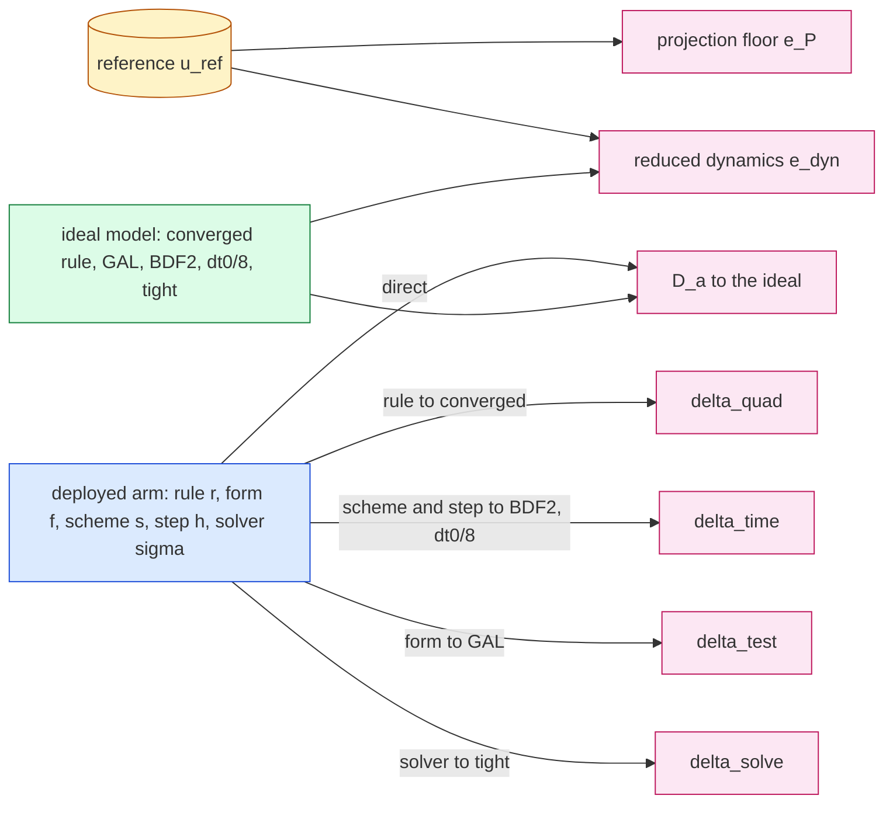
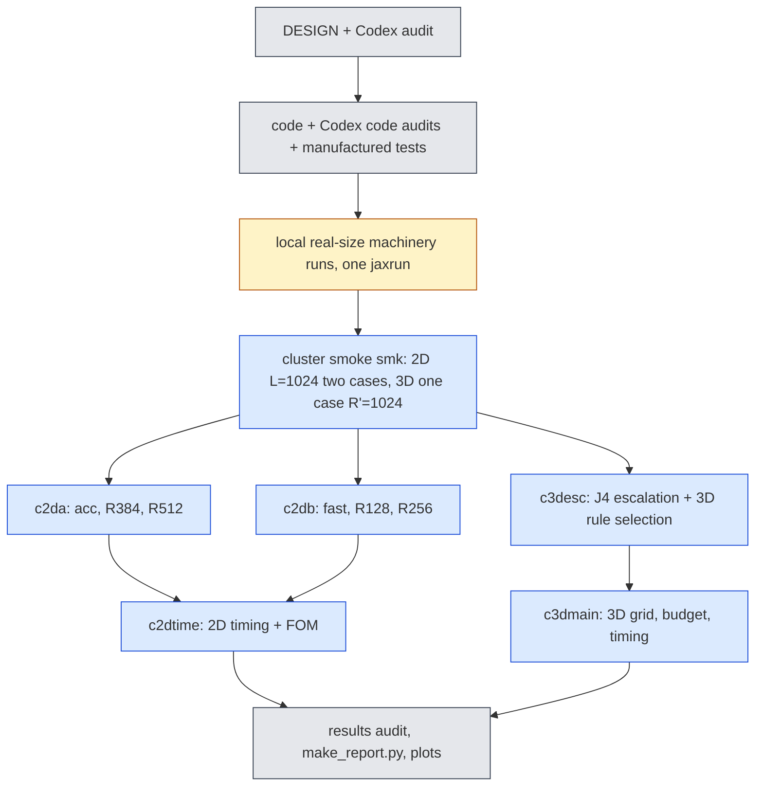

# jcp-combined — the best version of the method: second-order stepping × wide bank × fast solver, with an error budget (pre-registration)

Step 2 of the JCP campaign (`reports/2026-10-06-jcp-offmesh-paper-plan.md` on `main`, rows E3 and E4-ROM side).
Status: **pre-registration, 2026-10-13, before any code.** Amendments are appended at the end, dated; nothing above
them is rewritten. Every accuracy number this lane produces is **PROVISIONAL** (first-order references), and is
labelled so next to the number.

## 1. Question and motivation

Lane C2 (`exp/2026-10-08-jcp-time2`) showed that second-order reduced time stepping removes the backward-Euler (BE)
time error that dominated the reduced model: in the 2D accurate setting the median error against the space+time
reference ST fell from 0.906 % to 0.098 % at equal cost (all PROVISIONAL), and in 3D the time error (anchor
discrepancy) fell 21× — but the 3D general solver cost ≈ 1.7× the deployed fixed-sweep BE solver, so 3D gained no speed.
Lane C1 (`exp/2026-10-08-jcp-wide-bank`) showed that widening the bank lowers the representation floor (3D: 3.23 % →
1.29 %) but not the BE rollout error, and that the 2D dial stopped at $R'=384$ (R′ = 512 worse against S on 28/38 cases);
its 3D verdict at $R'\ge768$ was unavailable because the converged-rule gate failed. Lane C3 found the bank is not the
bottleneck. **The question of this lane: once time error is removed, what is the best deployed method, how fast is it,
and what limits it next?** Concretely:

- **Q1 (2D).** Second-order stepping on the full $R'$ dial (128, 256, 384, 512): does widening the bank now pay off, does
  the tunability (accuracy–cost dial) survive, and why did the fast setting's worst case get worse under CN?
- **Q2 (3D).** Second-order stepping on the $R=1024$ bank ($R'$ up to 1024) with a **fast fixed-sweep second-order
  solver** (fixed number of Gauss–Newton/LM sweeps per step, like the deployed BE solver), so the time-error gain
  becomes a speed gain; and resolve or explain the $R'\ge768$ converged-rule gate failure (escalation to Gauss $64^3$).
- **Q3 (both).** A per-case error budget (plan E3 style): bank-projection floor, quadrature error, time-discretisation
  error, test-space error and solver error, **each measured by its own ablation, none defined as the remainder**, with
  interactions reported.
- **Q4 (timing).** Paired A–B–A timing inside one job on one GPU, warm JIT, burn-in; 2D speed against the C2 lane's fair
  second-order full-order model (FOM), re-run in the same job.

## 2. The reduced model (unchanged ingredients) and the two-step method

Bank coefficients $c\in\mathbb R^{R'}$, $u=\hat G_{R'}(x)\,c$; $A=\Phi^{\mathsf T}\hat G_{R'}\in\mathbb R^{M\times R'}$ (exact
discrete sine projection), $\Lambda$ the discrete eigenvalues, $N(c)$ the tested advection by an off-mesh rule
(Hari's point form, exact bank gradient), $F(c)=N(c)+\nu\Lambda Ac$. Two-step linear multistep method (C2, `t2core.py`):

$$\mathcal R_n(c)=A(\alpha_0c+\alpha_1c_n+\alpha_2c_{n-1})+\Delta t\,\big(\beta_0F(c)+\beta_1F(c_n)\big).$$

| scheme | $\alpha_0,\alpha_1,\alpha_2$ | $\beta_0,\beta_1$ | startup |
|---|---|---|---|
| BE | $1,-1,0$ | $1,0$ | — |
| CN | $1,-1,0$ | $\tfrac12,\tfrac12$ | — |
| CN-R | as CN | as CN | first 2 steps BE |
| BDF2 | $\tfrac32,-2,\tfrac12$ | $1,0$ | first step BE |

Forms: **LSPG** minimises $\lVert D\mathcal R_n\rVert$, $D=(\alpha_0+\beta_0\Delta t\,\nu\Lambda)^{-1}$; **GAL** solves
$Q^{\mathsf T}\mathcal R_n=0$, $A=QR$. C2 established on real data: GAL-CN/BDF2/CN-R order 2 everywhere; LSPG CN-R and
BDF2 order 2 in the 2D accurate setting and 3D (`gl24_R512`), not established elsewhere; LSPG-CN never second order
(its $\Delta t$-dependent test space makes it converge to the Galerkin trajectory at order 1, C2 A1.2).

### 2.1 New: the 3D fixed-sweep second-order solver (`fs3.py`)

The deployed 3D solver (`offmesh.make_fsc_rule`) does adaptive LM on the first $a$ steps and then **one** cached-predictor
LM sweep per step. Because every off-mesh rule is a symmetric quadratic form, $N(c)=\tfrac12J_u(c)c$ with $J_u$ linear in
$c$, so $F(c_n)=\tfrac12J_u(c_n)c_n+\nu\Lambda Ac_n$ costs nothing extra (the accepted $J_u(c_n)$ is carried). The new
solver is `make_fsc_rule` with the BE residual replaced by the LSPG LMM residual

$$r(c)=S\odot\Big(A(\alpha_0c+\alpha_1c_n+\alpha_2c_{n-1})+\Delta t\big(\beta_0(\tfrac12J_u(c)c+\nu\Lambda Ac)+\beta_1F(c_n)\big)\Big),\quad S=(\alpha_0+\beta_0\Delta t\nu\Lambda)^{-1},$$

Jacobian $A+\beta_0\Delta t\,S\odot J_u(c)$ (since $S(\alpha_0+\beta_0\Delta t\nu\Lambda)=1$), the same quadratic predictor
(best residual among $c_n$, linear and quadratic extrapolation, $J_u$ extrapolated exactly), **$K\in\{1,2\}$ sweeps per
step** after the adaptive start, the scheme's BE startup steps inside the adaptive phase. With BE coefficients and $K=1$
it is the deployed solver (gate G-FS1). The vendored file is copied into the lane and edited there; `vendor/` is not
touched.

## 3. Arms

### 3.1 2D (Burgers 2D, frozen bank `dn256b`, rotation `rotation_R512`, linear rung, mesh $L=1024$)

Settings (all $M=4R'$, the $M$ lowest discrete sine tests):

| setting | $R'$ | main rule | provenance of the rule |
|---|---|---|---|
| `fast` | 128 | Fibonacci 1597 | 2D-lane deployed (C2 `fast`) |
| `R128` | 128 | Fibonacci 4181 | C1 $m^\star$ ($\tau=2.5\times10^{-4}$, validation) |
| `R256` | 256 | Gauss $96^2$ | C1 $m^\star$ |
| `acc` | 384 | Gauss $96^2$ | 2D-lane deployed (C2 `acc`) |
| `R384` | 384 | Gauss $128^2$ | C1 $m^\star$ |
| `R512` | 512 | Gauss $192^2$ | C1 $m^\star$ |

The **dial** is `R128 → R256 → R384 → R512` (one rule-selection procedure); `fast` and `acc` are the currently deployed
settings (continuity with C2). Scheme-forms: LSPG-BE (deployed), LSPG-CN, LSPG-CN-R, LSPG-BDF2, GAL-CN. Steps
$\Delta t/\Delta t_0\in\{\tfrac12,1,\tfrac53,2,\tfrac52,5,10\}$, $\Delta t_0=0.005$ (each divides the output spacing 0.05).
Production tolerances as C2 (LSPG `gtol` $10^{-3}$, GAL residual $10^{-10}\lVert Ac_n\rVert$, budget 600 LM iterations).

### 3.2 3D (Burgers 3D, mesh $65^3$, validation cohort 923801, 64 cases)

| setting | bank | $R'$ | $M$ | main rule |
|---|---|---|---|---|
| `M2_512` | `model_M2` ($R=512$, the deployed 3D bank) | 512 | complete($4R'$) | Gauss $24^3$ (3D-lane deployed; C2 `gl24_R512`) |
| `W256` | `model_W1024` (C1, $R=1024$) | 256 | complete($4R'$) | selected by §3.3 |
| `W512` | W1024 | 512 | complete($4R'$) | selected by §3.3 |
| `W768` | W1024 | 768 | complete($4R'$) | selected by §3.3 |
| `W1024` | W1024 | 1024 | complete($4R'$) | selected by §3.3 |

Solvers per setting: (i) the deployed fixed-sweep BE at $\Delta t_0=0.01$ (adaptive start $a=6$ for W1024 as C1 A8;
$a=3$ for `M2_512` as deployed); (ii) the new fixed-sweep LSPG {CN, CN-R, BDF2} × $K\in\{1,2\}$ × $\Delta t/\Delta t_0\in\{1,\tfrac54,\tfrac53,\tfrac52,5\}$;
(iii) the generic adaptive LM (C2 `t2core.make_evolve`) at the tight tolerance for the same LSPG schemes and steps (the
solver ablation), plus GAL-CN adaptive at $\{1,\tfrac52\}$; (iv) the anchor GAL-BDF2 at $\Delta t_0/8$ (tight) and, on
the first 16 cases, at $\Delta t_0/16$ (anchor uncertainty).

### 3.3 3D converged rule and rule selection (job `c3desc`, before `c3dmain`)

**J4 escalation.** For W1024 at $R'\in\{768,1024\}$, $65^3$, 64 validation cases: rollouts with Gauss $48^3$, $56^3$,
$64^3$ under three solvers — the C1 J4 fixed-sweep BE ($a=6$), the adaptive LSPG-BE at the tight tolerance, and the
fixed-sweep LSPG-CN ($K=1$) at $\tfrac52\Delta t_0$. Distances $d(p,q)=\max_{\text{case}}\max_t\lVert u_p-u_q\rVert/\lVert u_0\rVert$
(field metric on the mesh, as C1 K-conv). Bar: $2.5\times10^{-5}$ (C1 `conv_bar`). Pre-registered classification per
$R'$:

- **(C) check under-resolved, resolved by escalation:** $d(56,64)\le$ bar under the adaptive solver → Gauss $56^3$ is
  the converged rule (check $64^3$); C1's failure was the $48^3$ check.
- **(B) solver artefact:** additionally $d(48,56)\le$ bar under the adaptive solver but $>$ bar under the fixed-sweep
  solver → the gate failure is produced by the fixed-sweep solver's sensitivity, not by quadrature.
- **(A) quadrature not converged:** $d(56,64)>$ bar under the adaptive solver → the converged rule is Gauss $64^3$ if
  $d(64,80)\le$ bar (Gauss $80^3$ run on the first 16 cases), else **unresolved** (no $R'\ge768$ selection is made).

(C) and (B) are not exclusive; both are reported. $R'\in\{256,512\}$ keep C1's converged pair (Gauss $56^3$/$48^3$),
re-checked here with $d(56,64)$.

**Selection.** Per setting, ladder lattice {8192, 16384, 32768, 65536, 131072} and Gauss {24, 32, 40, 48}$^3$; control
`lat256` (must fail). $m^\star$ per family = smallest rule whose rollouts are eligible (finite, no damping-limit exit,
non-stationary steps ≤ 1 % pooled, as C1 A7) and within $\tau=2.5\times10^{-4}$ of the converged rule's rollout on
every case, **under both** the deployed fixed-sweep BE at $\Delta t_0$ and the fixed-sweep LSPG-CN $K=1$ at
$\tfrac52\Delta t_0$ (a representative second-order arm, chosen from C2's 3D anchor discrepancies; same converged rule
and solver on both sides of each distance). The deployed rule is the faster of the two families' $m^\star$ in an A–B–A
panel inside `c3desc`. $\rho$ is not used (C1: the distance always decided $m^\star$). This job reads only the validation
cohort.

## 4. References and scoring (all accuracy PROVISIONAL)

- **2D:** the 2D lane's $8192^2$ references (sign-upwind, BE): **ST** ($\Delta t_0/16$), **S** ($\Delta t_0$), and
  $\mathrm{TX}=(16\,\mathrm{ST}-\mathrm{S})/15$, on the $257^2$ shared nodes, manifest + sha256 checked as C2. S is reported
  for every arm but only the BE ROM is meaningfully compared with it (S carries BE time error); second-order arms are
  judged against **ST and TX**, both reported. Per case, the reference time-uncertainty indicator is
  $\varepsilon_{\rm ref}=\max_t\lVert \mathrm{ST}-\mathrm{TX}\rVert/\lVert u_0\rVert$; a paired difference between two arms smaller than
  $2\varepsilon_{\rm ref}$ is a **tie** (plan E0 rule); TX's own error and the references' spatial (upwind) error are not
  estimable here and are stated as such.
- **3D:** the 3D lane's 513-node BE reference at $\Delta t_0/4$ on the $63^3$ lattice — reference-limited (C2 A13): it
  cannot rank first- against second-order schemes. 3D time-stepping conclusions rest on the **anchor discrepancy** (distance
  to GAL-BDF2 at $\Delta t_0/8$, reference-free), observed orders from C2, and cost.
- **One-switch rescoring.** Every rollout saves its six output coefficient vectors $W\in\mathbb R^{6\times R'}$ (and the
  initial coefficients). `score.py --refs <registry-name>` decodes $W$ through the bank **at the reference's own lattice
  coordinates** (the bank is a coordinate network, so any lattice works) and recomputes every table. The reference
  registry (`refs.json`) maps a name to (files, lattice coordinates, normalisation); adding the second-order references
  when lane E0 lands is one registry entry. The in-job scores and `score.py` must agree to $10^{-10}$ relative (gate).

Metric: $e_{\rm ref}=\max_{t\in\{0.05,\dots,0.25\}}\lVert u(t)-u_{\rm ref}(t)\rVert_2/\lVert u_0\rVert_2$ on the shared nodes;
cohort worst and median.

## 5. The error budget (Q3)

For a deployed arm $a=(r,f,s,h,\sigma)$ — rule $r$, form $f$, scheme $s$, step $h$, solver $\sigma$ (production tolerance
or fixed sweeps) — and the **ideal model** $\star=(r_\infty,\text{GAL},\text{BDF2},h_\star,\text{tight})$ with $r_\infty$ the
converged rule and $h_\star=\Delta t_0/8$, every quantity below is a measured distance (max over the five evolved output
times, relative to $\lVert u_0\rVert$, on the shared nodes):

| component | definition | ablation (one ingredient changed) |
|---|---|---|
| total error | $e_{\rm tot}=\lVert u_a-u_{\rm ref}\rVert$ | — |
| projection floor | $e_P=\lVert(I-\Pi_{R'})u_{\rm ref}\rVert$ | the reference itself, least squares on the span at the nodes |
| reduced-dynamics error | $e_{\rm dyn}=\lVert u_\star-\Pi_{R'}u_{\rm ref}\rVert$ | the ideal model vs the projected reference |
| quadrature | $\delta_{\rm quad}=\lVert u_a-u_{a[r\to r_\infty]}\rVert$ | rule |
| time discretisation | $\delta_{\rm time}=\lVert u_a-u_{a[(s,h)\to(\text{BDF2},h_\star)]}\rVert$ | scheme and step together, form kept |
| test space | $\delta_{\rm test}=\lVert u_a-u_{a[f\to\text{GAL}]}\rVert$ (0 for GAL arms) | form |
| solver | $\delta_{\rm solve}=\lVert u_a-u_{a[\sigma\to\text{tight}]}\rVert$ | solver (2D: tight `gtol`; 3D: adaptive tight LM) |
| ROM discretisation | $D_a=\lVert u_a-u_\star\rVert$ | all four together (direct) |

Because $u_\star$ lies in the span and $\Pi_{R'}$ is the orthogonal projection at the nodes, $\lVert u_\star-u_{\rm ref}\rVert^2=e_P^2+e_{\rm dyn}^2$
**at every time exactly** (checked, gate B0). Nothing is a remainder: $e_{\rm tot}$, $D_a$ and every $\delta$ are measured.
**Interactions** are reported three ways: (i) the closure ratios $D_a/\sqrt{\sum\delta^2}$ and $D_a/\sum\delta$; (ii) the
same one-ingredient changes made **from the ideal end** for the three arm-independent ingredients
($\star[r_\infty\to r]$, $\star[\text{GAL}\to\text{LSPG}]$, $\star[\text{tight}\to\sigma]$): a component that differs by more
than a factor 2 between the two ends is flagged *interacting*; (iii) the triangle bounds
$|e_{\rm tot}-\lVert u_\star-u_{\rm ref}\rVert|\le D_a$. "What limits next" = the largest measured component per case,
counted over cases. Reference-dependent components ($e_{\rm tot}$, $e_P$, $e_{\rm dyn}$) carry the PROVISIONAL label and
are rescored by `score.py`; $\delta$'s and $D_a$ are reference-free.

**Budget arms.** 2D, per setting: LSPG-BE, LSPG-CN, LSPG-CN-R, LSPG-BDF2, GAL-CN at $\Delta t_0$ and $2\Delta t_0$ (10
arms). 3D, per setting: deployed fixed-sweep BE at $\Delta t_0$ and fixed-sweep LSPG {CN, CN-R, BDF2} ($K=1$) at
$\Delta t_0$ and $\tfrac52\Delta t_0$ (7 arms); the ideal-model runs on the first 32 cases (cost), the $\delta$'s on all 64.
**Converged rule for the budget:** 2D Gauss $320^2$, gated against Gauss $640^2$ on dev6 for every budget arm's
$a[r\to r_\infty]$ (bar $2.5\times10^{-5}$; escalation to $640^2$ if it fails); 3D the converged rule of §3.3.

## 6. Pre-registered hypotheses, bars and selection (validation/development cohorts only)

**Scheme selection (2D).** Candidates GAL-CN, LSPG-CN-R, LSPG-BDF2 (LSPG-CN is run, reported, and excluded from
selection: not second order, C2). Per dial setting, the *accurate-equal-cost* arm = smallest median $e_{\rm TX}$ among
eligible candidate arms (verified on all 38 cases, C2 G3) with median paired time ratio ≤ 1 against that setting's
LSPG-BE at $\Delta t_0$; the **selected scheme** is the one that wins most of the four dial settings (ties: smaller sum of
the four medians, then LSPG before GAL). Sensitivity with ST reported. The *fast-equal-accuracy* arm per setting (cheapest
eligible candidate with worst and median $e_{\rm ST}$ and $e_{\rm TX}$ ≤ that setting's LSPG-BE at $\Delta t_0$) is reported.

- **H1 (2D, the wide bank pays off once time error is removed).** With the selected scheme at each dial setting's
  accurate-equal-cost arm: (a) median $e_{\rm TX}$ falls by ≥ 25 % at each of R128→R256 and R256→R384; (b) **R384→R512
  pays off** iff ≥ 60 % of the *resolved* cases improve (paired, ties at $2\varepsilon_{\rm ref}$ excluded from the denominator
  and counted), the median falls ≥ 10 %, and the worst rises ≤ 0.10 pp — all against TX **and** ST. The same quantities
  for LSPG-BE at $\Delta t_0$ are reported (C1: flat against ST). If fewer than half the cases are resolved at a step, that
  step's verdict is **reference-limited** (not pass, not fail).
- **H2 (tunability survives).** (a) The second-order error–cost front (dial settings × candidate scheme × all steps;
  cost = median paired time ratio against the common timing baseline; error = worst and, separately, median $e_{\rm TX}$)
  dominates the BE front: every BE front point has a second-order point with ≤ cost and ≤ error. (b) Along the dial, the
  accurate-equal-cost arms have strictly increasing cost and non-increasing median $e_{\rm TX}$ for at least three of the
  four rungs.
- **H3 (why the fast worst case got worse under CN).** Pre-registered explanation: *error cancellation*. For the `fast`
  worst case (largest LSPG-CN $\Delta t_0$ $e_{\rm ST}$) and every case, with $\varepsilon_\infty=u_{\rm anc}-u_{\rm ref}$ (the anchor
  GAL-BDF2 at $\Delta t_0/8$ with the deployed rule, time-converged) and $\delta_{\rm BE}=u_{\rm BE}-u_{\rm anc}$ at the worst time:
  confirmed iff (a) $e_{\rm BE}(\Delta t_0)<e_\infty$ and $|e_{\rm CN}(\Delta t_0)-e_\infty|\le0.2\,|e_{\rm BE}-e_\infty|$, (b)
  $\cos\angle(\delta_{\rm BE},\varepsilon_\infty)\le-0.3$, and (c) the cross term $-2\langle\delta_{\rm BE},\varepsilon_\infty\rangle$ is ≥ 50 % of
  $e_\infty^2-e_{\rm BE}^2+\lVert\delta_{\rm BE}\rVert^2$, against both ST and TX. The budget then names what dominates $e_\infty$
  for that case (floor, dynamics, quadrature); whether `R128`/`R256` with the selected scheme removes the worse worst
  case is reported. Failure of (a)–(c) is reported as "cancellation not supported".
- **H4 (3D, the fast solver turns time accuracy into speed).** Per W setting, with the deployed fixed-sweep BE at
  $\Delta t_0$ as comparator (same bank, $R'$ and rule). Eligible fixed-sweep candidates: all 64 cases finite, no
  damping-limit exit, and solver distance to the adaptive-tight run of the same scheme and step ≤ $2.5\times10^{-4}$ on every
  case. **H4a (speed at equal accuracy):** some eligible candidate with $\Delta t\ge\tfrac54\Delta t_0$ has worst and median
  anchor discrepancy ≤ the comparator's and median paired time ratio ≤ 0.6. **H4b (accuracy at equal cost):** some eligible
  candidate at $\Delta t_0$ has median anchor discrepancy ≤ 0.1 × the comparator's and paired ratio ≤ 1.1. Selection per
  setting: *fast-equal-accuracy* (H4a's cheapest) and *accurate-equal-cost* (smallest median anchor discrepancy, ratio ≤ 1);
  $K$ is part of the arm. Errors against the 3D reference are reported beside them (reference-limited).
- **H5 (2D FOM).** The C2 rule (A9.4): for each eligible ROM arm, the cheapest calibrated FOM configuration with cohort-worst
  $e_{\rm ST}$ ≤ the ROM's; speed-up = FOM time / ROM time, same job, same GPU; also with $e_{\rm TX}$. H5 passes iff the best
  combined-method matched speed-up (any dial setting) is ≥ 1.2 × the best matched speed-up of C2's `acc` arms re-measured
  in the same job (C2 printed 3.65×; its re-measured value is the comparator, not the printed one).
- **H6 (3D wide dial).** Reported, with the converged rule of §3.3: median and worst anchor discrepancy and reference error
  of the accurate-equal-cost arm per $R'$; "the dial extends to $R'$" iff the median reference error falls ≥ 10 % from the
  previous rung with ≥ 60 % of cases improving (reference-limited, PROVISIONAL), and the budget shows which component
  limits it.

No historical test cohort (2D `test64`, 3D 923901) is used in this lane unless an amendment adds a replication after the
selection is frozen and hashed (`checks/FROZEN-SELECTION.json`). No new cohort is drawn.

## 7. Gates and controls (checked at one real mesh before any verdict)

- **G0 integrity**: GPU backend, x64, `highest`, reference manifests and sha256, cohort hashes (cluster), finiteness.
- **G1 reproduction (must hold; control must fail).** 2D: LSPG-BE at $\Delta t_0$ reproduces C2 `a1kacc`/`a1kfast`
  per-case $e_{\rm ST}$, $e_{\rm S}$ (`acc`, `fast`) and C1 `j1` per-case errors (`R128`…`R512` with C1's rules) within
  $10^{-6}$ (different job/GPU: reported, and a failure is diagnosed before any verdict); LSPG-CN at $\Delta t_0$ reproduces
  C2's LSPG-CN rows within $10^{-6}$. Control: LSPG-CN compared with the BE rows must exceed the tolerance on most cases.
  3D: the deployed fixed-sweep BE reproduces C1 `j4` per-case errors (W1024, same rule and $a$) within $10^{-6}$.
- **G-FS1 (fixed-sweep identity).** `fs3` with BE coefficients and $K=1$ equals the vendored `make_fsc_rule` on every
  case: coefficients ≤ $10^{-12}$ relative, iterations and exit reasons equal. Control: `fs3` with CN coefficients must
  differ by > $10^{-6}$.
- **G-FS2 (fixed-sweep order, manufactured, CPU).** On C2's manufactured system (`test_lmm.py` problem; quadratic $N$,
  so $N=\tfrac12J(c)c$ holds) the fixed-sweep LSPG-CN-R and LSPG-BDF2 with $K=1$ and the quadratic predictor match their
  adaptive LSPG counterparts within $10^{-3}$ of the time error at the finest step, and GAL-equivalent order is not
  claimed. **Must-fail control:** $K=1$ with the previous-state predictor (no extrapolation) must lose that agreement
  (distance > 10 × the agreement bar).
- **G-B (budget machinery).** B0: $\lVert u_\star-u_{\rm ref}\rVert^2=e_P^2+e_{\rm dyn}^2$ per time to $10^{-10}$ relative. B1 sham:
  re-running the deployed arm gives $\delta=0$ (same compiled function, bitwise). B2 known effect (must fail the
  deployed-rule $\tau$ bar): the control rule (2D Gauss $8^2$, 3D `lat256`) as $r$ gives $\delta_{\rm quad}>\tau$ on most cases.
  B3 the time ablation can fail: $\delta_{\rm time}$ of LSPG-BE at $\Delta t_0$ exceeds 0.1 % on most cases (C2: ≈ 1 %).
  B4: the 2D converged rule gate of §5.
- **G-sel (3D selection controls).** `lat256` must not be selected under either solver; the converged-rule outcome is
  classified (§3.3) before any selection is read.
- **G-time.** A–B–A drift within 10 %, timed outputs bitwise equal to the same job's accuracy-phase outputs, compiled-cache
  sizes unchanged during timing, one GPU uuid per job.
- **G-score.** `score.py` reproduces the in-job errors to $10^{-10}$ relative (independent decode path: bank evaluated at
  the lattice coordinates, not the mesh rows).

## 8. Timing (paired A–B–A, one job, one GPU)

2D (`c2dtime`, A100-80G): all production arms of §3.1 with $\Delta t\ge\Delta t_0/2$ in all six settings plus the FOM
configurations (C2 `fom2.make_fom_lmm`, BE/CN/CN-R/BDF2 at $\Delta t/\Delta t_0\in\{\tfrac12,1,2,5\}$, tolerance calibration
on dev6 as C2 A9.2, accuracy on all 38 cases). A = `acc` LSPG-BE at $\Delta t_0$ (one common baseline, so every arm has a
cost on one axis); 6 dev6 timing cases × 3 repetitions, randomised order, 0.1 s burn before each call, warm JIT. The
job also re-evaluates every timed ROM arm on the 6 timing cases and checks its coefficients against the accuracy job's
within $10^{-10}$ (cross-job reproducibility; different GPU allowed for accuracy, never for timing). 3D (`c3dmain`,
H200): per setting, A = the deployed fixed-sweep BE at $\Delta t_0$; B = every fixed-sweep candidate, the adaptive arms
and the generic BE; first 8 cases × 3 repetitions.

## 9. Jobs, GPUs and budget (concurrent cap 3, local `jaxrun` cap 1)

| job | content | GPU | estimate (GPU-h) |
|---|---|---|---|
| `smk` | real-size smoke, every phase, 2 cases (2D), 1 case (3D) | A100-80G / H200 | 1.0 |
| `c2da` | 2D grid + budget, `acc`, `R384`, `R512`, 38 cases | A100-80G | 3.5 |
| `c2db` | 2D grid + budget, `fast`, `R128`, `R256`, 38 cases | A100-80G | 2.0 |
| `c2dtime` | 2D timing (all settings) + FOM calibration/accuracy/timing | A100-80G | 2.5 |
| `c3desc` | J4 escalation (3 solvers × 3 Gauss rules × 2 $R'$) + selection at 4 $R'$ | H200 | 3.5 |
| `c3dmain` | 3D grid, anchors, budget, timing, 5 settings, 64 cases | H200 | 4.5 |

Total ≈ 17 GPU-h (≈ 21 with 25 % contingency). Each job has its own directory under
`/cluster/tufts/paralab/tawal01/jcp-comb/<job>/`; `squeue` before and after every submit; pull, verify, delete.

## 10. Deliverables

`DESIGN.md` (+ amendments); code (`fs3.py`, `c2run.py`, `c3esc.py`, `c3run.py`, `c2time.py`, `score.py`,
`budget.py`, `test_fs.py`, `audit_c*.py`, `make_report.py`, cluster `stage.py`/`submit.sh`/`collect.sh`); every Codex
audit in `audits/`; pulled runs under `runs/` (large files by SHA256 manifest `LARGE_FILES.sha256`); `report.md`
generated by `make_report.py` (status line, LaTeX, mermaid, closing glossary, PROVISIONAL next to every accuracy number);
PNG plots in `plots/`: error–cost Pareto fronts (BE vs second order × bank width, 2D, ST and TX), the 2D dial under BE and
second order, error-budget stacked bars (2D and 3D, per setting), 3D speed-up of the fixed-sweep solver vs anchor
discrepancy, the J4 escalation distances, and the FOM comparison.

## Glossary

- **bank, $R'$, dial**: the frozen ordered coordinate network; a solve uses its first $R'$ columns; the dial is the sequence
  of $R'$ settings (more columns: more accurate, more costly).
- **$M$, test functions**: the $M$ lowest discrete sine modes in which the residual is tested.
- **rule, $m$**: an off-mesh quadrature (Gauss $p^d$, Fibonacci or rank-1 lattice) with $m$ points for the advection term;
  **converged rule** $r_\infty$: a rule fine enough that a finer one changes the rollout by less than the bar.
- **BE / CN / CN-R / BDF2**: backward Euler; Crank–Nicolson; CN with two BE start steps; second-order backward
  differentiation with one BE start step. **LSPG / GAL**: least-squares and Galerkin solves of each step.
- **fixed-sweep solver, $K$, $a$**: after $a$ adaptive steps, exactly $K$ Levenberg–Marquardt sweeps per time step with a
  cached extrapolated predictor (no convergence loop); the deployed 3D BE solver has $K=1$.
- **ST / S / TX**: 2D references at $8192^2$ with $\Delta t_0/16$ / $\Delta t_0$ / their Richardson combination; all first order.
- **$\varepsilon_{\rm ref}$, tie**: the per-case ST-to-TX distance; paired differences below $2\varepsilon_{\rm ref}$ are not ranked.
- **anchor, anchor discrepancy**: GAL-BDF2 at $\Delta t_0/8$ with tight tolerance (a time-converged reduced solution); the
  distance of a rollout from it estimates that rollout's time-stepping error (reference-free).
- **projection floor $e_P$, reduced-dynamics error $e_{\rm dyn}$, $\delta$'s, $D_a$**: see section 5.
- **paired time ratio, A–B–A**: candidate time divided by the mean of a baseline run just before and after it, same GPU.
- **eligible / verified**: every step met its acceptance test (2D) or no damping-limit exit and ≤ 1 % non-stationary
  steps (3D fixed sweep).
- **dev6, val32, 923801**: development and validation cohorts (selection allowed). **test64, 923901**: historical test
  cohorts (replication only, not used here).
- **PROVISIONAL**: scored against first-order references; not a physical-accuracy claim. **pp**: percentage points of
  $\lVert u_0\rVert$.
