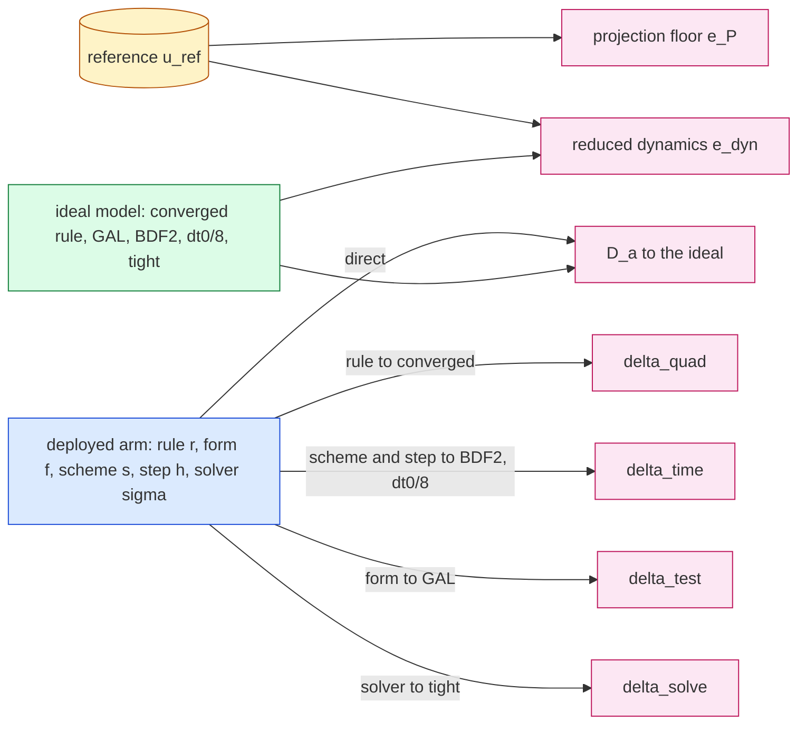
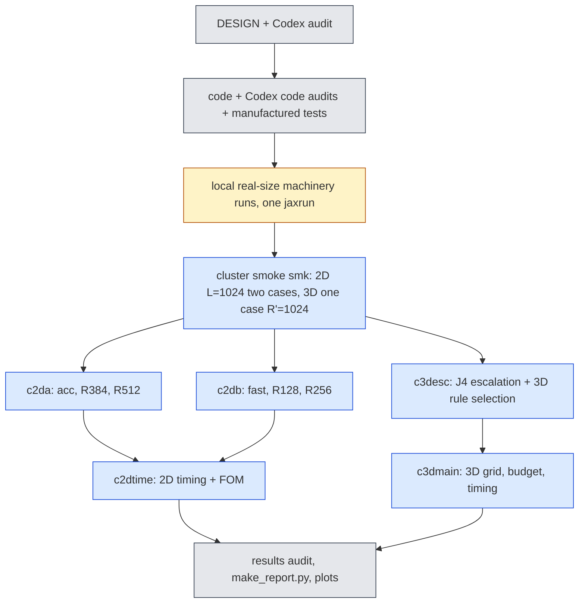

# jcp-combined — the best version of the method: second-order stepping × wide bank × fast solver, with an error budget (pre-registration)

Step 2 of the JCP campaign (`reports/2026-10-06-jcp-offmesh-paper-plan.md` on `main`, rows E3 and E4-ROM side).
Status: **pre-registration, 2026-10-13, before any code.** Amendments are appended at the end, dated; nothing above
them is rewritten. Every accuracy number this lane produces is **PROVISIONAL** (first-order references), and is
labelled so next to the number.

## 1. Question and motivation

Lane C2 (`exp/2026-10-08-jcp-time2`) showed that second-order reduced time stepping removes the backward-Euler (BE)
time error that dominated the reduced model: in the 2D accurate setting the median error against the space+time
reference ST fell from 0.906 % to 0.098 % at equal cost (all PROVISIONAL), and in 3D the time error (anchor
discrepancy) fell 21× — but the 3D general solver cost ≈ 1.7× the deployed fixed-sweep BE solver, so 3D gained no speed.
Lane C1 (`exp/2026-10-08-jcp-wide-bank`) showed that widening the bank lowers the representation floor (3D: 3.23 % →
1.29 %) but not the BE rollout error, and that the 2D dial stopped at $R'=384$ (R′ = 512 worse against S on 28/38 cases);
its 3D verdict at $R'\ge768$ was unavailable because the converged-rule gate failed. Lane C3 found the bank is not the
bottleneck. **The question of this lane: once time error is removed, what is the best deployed method, how fast is it,
and what limits it next?** Concretely:

- **Q1 (2D).** Second-order stepping on the full $R'$ dial (128, 256, 384, 512): does widening the bank now pay off, does
  the tunability (accuracy–cost dial) survive, and why did the fast setting's worst case get worse under CN?
- **Q2 (3D).** Second-order stepping on the $R=1024$ bank ($R'$ up to 1024) with a **fast fixed-sweep second-order
  solver** (fixed number of Gauss–Newton/LM sweeps per step, like the deployed BE solver), so the time-error gain
  becomes a speed gain; and resolve or explain the $R'\ge768$ converged-rule gate failure (escalation to Gauss $64^3$).
- **Q3 (both).** A per-case error budget (plan E3 style): bank-projection floor, quadrature error, time-discretisation
  error, test-space error and solver error, **each measured by its own ablation, none defined as the remainder**, with
  interactions reported.
- **Q4 (timing).** Paired A–B–A timing inside one job on one GPU, warm JIT, burn-in; 2D speed against the C2 lane's fair
  second-order full-order model (FOM), re-run in the same job.

## 2. The reduced model (unchanged ingredients) and the two-step method

Bank coefficients $c\in\mathbb R^{R'}$, $u=\hat G_{R'}(x)\,c$; $A=\Phi^{\mathsf T}\hat G_{R'}\in\mathbb R^{M\times R'}$ (exact
discrete sine projection), $\Lambda$ the discrete eigenvalues, $N(c)$ the tested advection by an off-mesh rule
(Hari's point form, exact bank gradient), $F(c)=N(c)+\nu\Lambda Ac$. Two-step linear multistep method (C2, `t2core.py`):

$$\mathcal R_n(c)=A(\alpha_0c+\alpha_1c_n+\alpha_2c_{n-1})+\Delta t\,\big(\beta_0F(c)+\beta_1F(c_n)\big).$$

| scheme | $\alpha_0,\alpha_1,\alpha_2$ | $\beta_0,\beta_1$ | startup |
|---|---|---|---|
| BE | $1,-1,0$ | $1,0$ | — |
| CN | $1,-1,0$ | $\tfrac12,\tfrac12$ | — |
| CN-R | as CN | as CN | first 2 steps BE |
| BDF2 | $\tfrac32,-2,\tfrac12$ | $1,0$ | first step BE |

Forms: **LSPG** minimises $\lVert D\mathcal R_n\rVert$, $D=(\alpha_0+\beta_0\Delta t\,\nu\Lambda)^{-1}$; **GAL** solves
$Q^{\mathsf T}\mathcal R_n=0$, $A=QR$. C2 established on real data: GAL-CN/BDF2/CN-R order 2 everywhere; LSPG CN-R and
BDF2 order 2 in the 2D accurate setting and 3D (`gl24_R512`), not established elsewhere; LSPG-CN never second order
(its $\Delta t$-dependent test space makes it converge to the Galerkin trajectory at order 1, C2 A1.2).

### 2.1 New: the 3D fixed-sweep second-order solver (`fs3.py`)

The deployed 3D solver (`offmesh.make_fsc_rule`) does adaptive LM on the first $a$ steps and then **one** cached-predictor
LM sweep per step. Because every off-mesh rule is a symmetric quadratic form, $N(c)=\tfrac12J_u(c)c$ with $J_u$ linear in
$c$, so $F(c_n)=\tfrac12J_u(c_n)c_n+\nu\Lambda Ac_n$ costs nothing extra (the accepted $J_u(c_n)$ is carried). The new
solver is `make_fsc_rule` with the BE residual replaced by the LSPG LMM residual

$$r(c)=S\odot\Big(A(\alpha_0c+\alpha_1c_n+\alpha_2c_{n-1})+\Delta t\big(\beta_0(\tfrac12J_u(c)c+\nu\Lambda Ac)+\beta_1F(c_n)\big)\Big),\quad S=(\alpha_0+\beta_0\Delta t\nu\Lambda)^{-1},$$

Jacobian $A+\beta_0\Delta t\,S\odot J_u(c)$ (since $S(\alpha_0+\beta_0\Delta t\nu\Lambda)=1$), the same quadratic predictor
(best residual among $c_n$, linear and quadratic extrapolation, $J_u$ extrapolated exactly), **$K\in\{1,2\}$ sweeps per
step** after the adaptive start, the scheme's BE startup steps inside the adaptive phase. With BE coefficients and $K=1$
it is the deployed solver (gate G-FS1). The vendored file is copied into the lane and edited there; `vendor/` is not
touched.

## 3. Arms

### 3.1 2D (Burgers 2D, frozen bank `dn256b`, rotation `rotation_R512`, linear rung, mesh $L=1024$)

Settings (all $M=4R'$, the $M$ lowest discrete sine tests):

| setting | $R'$ | main rule | provenance of the rule |
|---|---|---|---|
| `fast` | 128 | Fibonacci 1597 | 2D-lane deployed (C2 `fast`) |
| `R128` | 128 | Fibonacci 4181 | C1 $m^\star$ ($\tau=2.5\times10^{-4}$, validation) |
| `R256` | 256 | Gauss $96^2$ | C1 $m^\star$ |
| `acc` | 384 | Gauss $96^2$ | 2D-lane deployed (C2 `acc`) |
| `R384` | 384 | Gauss $128^2$ | C1 $m^\star$ |
| `R512` | 512 | Gauss $192^2$ | C1 $m^\star$ |

The **dial** is `R128 → R256 → R384 → R512` (one rule-selection procedure); `fast` and `acc` are the currently deployed
settings (continuity with C2). Scheme-forms: LSPG-BE (deployed), LSPG-CN, LSPG-CN-R, LSPG-BDF2, GAL-CN. Steps
$\Delta t/\Delta t_0\in\{\tfrac12,1,\tfrac53,2,\tfrac52,5,10\}$, $\Delta t_0=0.005$ (each divides the output spacing 0.05).
Production tolerances as C2 (LSPG `gtol` $10^{-3}$, GAL residual $10^{-10}\lVert Ac_n\rVert$, budget 600 LM iterations).

### 3.2 3D (Burgers 3D, mesh $65^3$, validation cohort 923801, 64 cases)

| setting | bank | $R'$ | $M$ | main rule |
|---|---|---|---|---|
| `M2_512` | `model_M2` ($R=512$, the deployed 3D bank) | 512 | complete($4R'$) | Gauss $24^3$ (3D-lane deployed; C2 `gl24_R512`) |
| `W256` | `model_W1024` (C1, $R=1024$) | 256 | complete($4R'$) | selected by §3.3 |
| `W512` | W1024 | 512 | complete($4R'$) | selected by §3.3 |
| `W768` | W1024 | 768 | complete($4R'$) | selected by §3.3 |
| `W1024` | W1024 | 1024 | complete($4R'$) | selected by §3.3 |

Solvers per setting: (i) the deployed fixed-sweep BE at $\Delta t_0=0.01$ (adaptive start $a=6$ for W1024 as C1 A8;
$a=3$ for `M2_512` as deployed); (ii) the new fixed-sweep LSPG {CN, CN-R, BDF2} × $K\in\{1,2\}$ × $\Delta t/\Delta t_0\in\{1,\tfrac54,\tfrac53,\tfrac52,5\}$;
(iii) the generic adaptive LM (C2 `t2core.make_evolve`) at the tight tolerance for the same LSPG schemes and steps (the
solver ablation), plus GAL-CN adaptive at $\{1,\tfrac52\}$; (iv) the anchor GAL-BDF2 at $\Delta t_0/8$ (tight) and, on
the first 16 cases, at $\Delta t_0/16$ (anchor uncertainty).

### 3.3 3D converged rule and rule selection (job `c3desc`, before `c3dmain`)

**J4 escalation.** For W1024 at $R'\in\{768,1024\}$, $65^3$, 64 validation cases: rollouts with Gauss $48^3$, $56^3$,
$64^3$ under three solvers — the C1 J4 fixed-sweep BE ($a=6$), the adaptive LSPG-BE at the tight tolerance, and the
fixed-sweep LSPG-CN ($K=1$) at $\tfrac52\Delta t_0$. Distances $d(p,q)=\max_{\text{case}}\max_t\lVert u_p-u_q\rVert/\lVert u_0\rVert$
(field metric on the mesh, as C1 K-conv). Bar: $2.5\times10^{-5}$ (C1 `conv_bar`). Pre-registered classification per
$R'$:

- **(C) check under-resolved, resolved by escalation:** $d(56,64)\le$ bar under the adaptive solver → Gauss $56^3$ is
  the converged rule (check $64^3$); C1's failure was the $48^3$ check.
- **(B) solver artefact:** additionally $d(48,56)\le$ bar under the adaptive solver but $>$ bar under the fixed-sweep
  solver → the gate failure is produced by the fixed-sweep solver's sensitivity, not by quadrature.
- **(A) quadrature not converged:** $d(56,64)>$ bar under the adaptive solver → the converged rule is Gauss $64^3$ if
  $d(64,80)\le$ bar (Gauss $80^3$ run on the first 16 cases), else **unresolved** (no $R'\ge768$ selection is made).

(C) and (B) are not exclusive; both are reported. $R'\in\{256,512\}$ keep C1's converged pair (Gauss $56^3$/$48^3$),
re-checked here with $d(56,64)$.

**Selection.** Per setting, ladder lattice {8192, 16384, 32768, 65536, 131072} and Gauss {24, 32, 40, 48}$^3$; control
`lat256` (must fail). $m^\star$ per family = smallest rule whose rollouts are eligible (finite, no damping-limit exit,
non-stationary steps ≤ 1 % pooled, as C1 A7) and within $\tau=2.5\times10^{-4}$ of the converged rule's rollout on
every case, **under both** the deployed fixed-sweep BE at $\Delta t_0$ and the fixed-sweep LSPG-CN $K=1$ at
$\tfrac52\Delta t_0$ (a representative second-order arm, chosen from C2's 3D anchor discrepancies; same converged rule
and solver on both sides of each distance). The deployed rule is the faster of the two families' $m^\star$ in an A–B–A
panel inside `c3desc`. $\rho$ is not used (C1: the distance always decided $m^\star$). This job reads only the validation
cohort.

## 4. References and scoring (all accuracy PROVISIONAL)

- **2D:** the 2D lane's $8192^2$ references (sign-upwind, BE): **ST** ($\Delta t_0/16$), **S** ($\Delta t_0$), and
  $\mathrm{TX}=(16\,\mathrm{ST}-\mathrm{S})/15$, on the $257^2$ shared nodes, manifest + sha256 checked as C2. S is reported
  for every arm but only the BE ROM is meaningfully compared with it (S carries BE time error); second-order arms are
  judged against **ST and TX**, both reported. Per case, the reference time-uncertainty indicator is
  $\varepsilon_{\rm ref}=\max_t\lVert \mathrm{ST}-\mathrm{TX}\rVert/\lVert u_0\rVert$; a paired difference between two arms smaller than
  $2\varepsilon_{\rm ref}$ is a **tie** (plan E0 rule); TX's own error and the references' spatial (upwind) error are not
  estimable here and are stated as such.
- **3D:** the 3D lane's 513-node BE reference at $\Delta t_0/4$ on the $63^3$ lattice — reference-limited (C2 A13): it
  cannot rank first- against second-order schemes. 3D time-stepping conclusions rest on the **anchor discrepancy** (distance
  to GAL-BDF2 at $\Delta t_0/8$, reference-free), observed orders from C2, and cost.
- **One-switch rescoring.** Every rollout saves its six output coefficient vectors $W\in\mathbb R^{6\times R'}$ (and the
  initial coefficients). `score.py --refs <registry-name>` decodes $W$ through the bank **at the reference's own lattice
  coordinates** (the bank is a coordinate network, so any lattice works) and recomputes every table. The reference
  registry (`refs.json`) maps a name to (files, lattice coordinates, normalisation); adding the second-order references
  when lane E0 lands is one registry entry. The in-job scores and `score.py` must agree to $10^{-10}$ relative (gate).

Metric: $e_{\rm ref}=\max_{t\in\{0.05,\dots,0.25\}}\lVert u(t)-u_{\rm ref}(t)\rVert_2/\lVert u_0\rVert_2$ on the shared nodes;
cohort worst and median.

## 5. The error budget (Q3)

For a deployed arm $a=(r,f,s,h,\sigma)$ — rule $r$, form $f$, scheme $s$, step $h$, solver $\sigma$ (production tolerance
or fixed sweeps) — and the **ideal model** $\star=(r_\infty,\text{GAL},\text{BDF2},h_\star,\text{tight})$ with $r_\infty$ the
converged rule and $h_\star=\Delta t_0/8$, every quantity below is a measured distance (max over the five evolved output
times, relative to $\lVert u_0\rVert$, on the shared nodes):

| component | definition | ablation (one ingredient changed) |
|---|---|---|
| total error | $e_{\rm tot}=\lVert u_a-u_{\rm ref}\rVert$ | — |
| projection floor | $e_P=\lVert(I-\Pi_{R'})u_{\rm ref}\rVert$ | the reference itself, least squares on the span at the nodes |
| reduced-dynamics error | $e_{\rm dyn}=\lVert u_\star-\Pi_{R'}u_{\rm ref}\rVert$ | the ideal model vs the projected reference |
| quadrature | $\delta_{\rm quad}=\lVert u_a-u_{a[r\to r_\infty]}\rVert$ | rule |
| time discretisation | $\delta_{\rm time}=\lVert u_a-u_{a[(s,h)\to(\text{BDF2},h_\star)]}\rVert$ | scheme and step together, form kept |
| test space | $\delta_{\rm test}=\lVert u_a-u_{a[f\to\text{GAL}]}\rVert$ (0 for GAL arms) | form |
| solver | $\delta_{\rm solve}=\lVert u_a-u_{a[\sigma\to\text{tight}]}\rVert$ | solver (2D: tight `gtol`; 3D: adaptive tight LM) |
| ROM discretisation | $D_a=\lVert u_a-u_\star\rVert$ | all four together (direct) |

Because $u_\star$ lies in the span and $\Pi_{R'}$ is the orthogonal projection at the nodes, $\lVert u_\star-u_{\rm ref}\rVert^2=e_P^2+e_{\rm dyn}^2$
**at every time exactly** (checked, gate B0). Nothing is a remainder: $e_{\rm tot}$, $D_a$ and every $\delta$ are measured.
**Interactions** are reported three ways: (i) the closure ratios $D_a/\sqrt{\sum\delta^2}$ and $D_a/\sum\delta$; (ii) the
same one-ingredient changes made **from the ideal end** for the three arm-independent ingredients
($\star[r_\infty\to r]$, $\star[\text{GAL}\to\text{LSPG}]$, $\star[\text{tight}\to\sigma]$): a component that differs by more
than a factor 2 between the two ends is flagged *interacting*; (iii) the triangle bounds
$|e_{\rm tot}-\lVert u_\star-u_{\rm ref}\rVert|\le D_a$. "What limits next" = the largest measured component per case,
counted over cases. Reference-dependent components ($e_{\rm tot}$, $e_P$, $e_{\rm dyn}$) carry the PROVISIONAL label and
are rescored by `score.py`; $\delta$'s and $D_a$ are reference-free.

**Budget arms.** 2D, per setting: LSPG-BE, LSPG-CN, LSPG-CN-R, LSPG-BDF2, GAL-CN at $\Delta t_0$ and $2\Delta t_0$ (10
arms). 3D, per setting: deployed fixed-sweep BE at $\Delta t_0$ and fixed-sweep LSPG {CN, CN-R, BDF2} ($K=1$) at
$\Delta t_0$ and $\tfrac52\Delta t_0$ (7 arms); the ideal-model runs on the first 32 cases (cost), the $\delta$'s on all 64.
**Converged rule for the budget:** 2D Gauss $320^2$, gated against Gauss $640^2$ on dev6 for every budget arm's
$a[r\to r_\infty]$ (bar $2.5\times10^{-5}$; escalation to $640^2$ if it fails); 3D the converged rule of §3.3.

## 6. Pre-registered hypotheses, bars and selection (validation/development cohorts only)

**Scheme selection (2D).** Candidates GAL-CN, LSPG-CN-R, LSPG-BDF2 (LSPG-CN is run, reported, and excluded from
selection: not second order, C2). Per dial setting, the *accurate-equal-cost* arm = smallest median $e_{\rm TX}$ among
eligible candidate arms (verified on all 38 cases, C2 G3) with median paired time ratio ≤ 1 against that setting's
LSPG-BE at $\Delta t_0$; the **selected scheme** is the one that wins most of the four dial settings (ties: smaller sum of
the four medians, then LSPG before GAL). Sensitivity with ST reported. The *fast-equal-accuracy* arm per setting (cheapest
eligible candidate with worst and median $e_{\rm ST}$ and $e_{\rm TX}$ ≤ that setting's LSPG-BE at $\Delta t_0$) is reported.

- **H1 (2D, the wide bank pays off once time error is removed).** With the selected scheme at each dial setting's
  accurate-equal-cost arm: (a) median $e_{\rm TX}$ falls by ≥ 25 % at each of R128→R256 and R256→R384; (b) **R384→R512
  pays off** iff ≥ 60 % of the *resolved* cases improve (paired, ties at $2\varepsilon_{\rm ref}$ excluded from the denominator
  and counted), the median falls ≥ 10 %, and the worst rises ≤ 0.10 pp — all against TX **and** ST. The same quantities
  for LSPG-BE at $\Delta t_0$ are reported (C1: flat against ST). If fewer than half the cases are resolved at a step, that
  step's verdict is **reference-limited** (not pass, not fail).
- **H2 (tunability survives).** (a) The second-order error–cost front (dial settings × candidate scheme × all steps;
  cost = median paired time ratio against the common timing baseline; error = worst and, separately, median $e_{\rm TX}$)
  dominates the BE front: every BE front point has a second-order point with ≤ cost and ≤ error. (b) Along the dial, the
  accurate-equal-cost arms have strictly increasing cost and non-increasing median $e_{\rm TX}$ for at least three of the
  four rungs.
- **H3 (why the fast worst case got worse under CN).** Pre-registered explanation: *error cancellation*. For the `fast`
  worst case (largest LSPG-CN $\Delta t_0$ $e_{\rm ST}$) and every case, with $\varepsilon_\infty=u_{\rm anc}-u_{\rm ref}$ (the anchor
  GAL-BDF2 at $\Delta t_0/8$ with the deployed rule, time-converged) and $\delta_{\rm BE}=u_{\rm BE}-u_{\rm anc}$ at the worst time:
  confirmed iff (a) $e_{\rm BE}(\Delta t_0)<e_\infty$ and $|e_{\rm CN}(\Delta t_0)-e_\infty|\le0.2\,|e_{\rm BE}-e_\infty|$, (b)
  $\cos\angle(\delta_{\rm BE},\varepsilon_\infty)\le-0.3$, and (c) the cross term $-2\langle\delta_{\rm BE},\varepsilon_\infty\rangle$ is ≥ 50 % of
  $e_\infty^2-e_{\rm BE}^2+\lVert\delta_{\rm BE}\rVert^2$, against both ST and TX. The budget then names what dominates $e_\infty$
  for that case (floor, dynamics, quadrature); whether `R128`/`R256` with the selected scheme removes the worse worst
  case is reported. Failure of (a)–(c) is reported as "cancellation not supported".
- **H4 (3D, the fast solver turns time accuracy into speed).** Per W setting, with the deployed fixed-sweep BE at
  $\Delta t_0$ as comparator (same bank, $R'$ and rule). Eligible fixed-sweep candidates: all 64 cases finite, no
  damping-limit exit, and solver distance to the adaptive-tight run of the same scheme and step ≤ $2.5\times10^{-4}$ on every
  case. **H4a (speed at equal accuracy):** some eligible candidate with $\Delta t\ge\tfrac54\Delta t_0$ has worst and median
  anchor discrepancy ≤ the comparator's and median paired time ratio ≤ 0.6. **H4b (accuracy at equal cost):** some eligible
  candidate at $\Delta t_0$ has median anchor discrepancy ≤ 0.1 × the comparator's and paired ratio ≤ 1.1. Selection per
  setting: *fast-equal-accuracy* (H4a's cheapest) and *accurate-equal-cost* (smallest median anchor discrepancy, ratio ≤ 1);
  $K$ is part of the arm. Errors against the 3D reference are reported beside them (reference-limited).
- **H5 (2D FOM).** The C2 rule (A9.4): for each eligible ROM arm, the cheapest calibrated FOM configuration with cohort-worst
  $e_{\rm ST}$ ≤ the ROM's; speed-up = FOM time / ROM time, same job, same GPU; also with $e_{\rm TX}$. H5 passes iff the best
  combined-method matched speed-up (any dial setting) is ≥ 1.2 × the best matched speed-up of C2's `acc` arms re-measured
  in the same job (C2 printed 3.65×; its re-measured value is the comparator, not the printed one).
- **H6 (3D wide dial).** Reported, with the converged rule of §3.3: median and worst anchor discrepancy and reference error
  of the accurate-equal-cost arm per $R'$; "the dial extends to $R'$" iff the median reference error falls ≥ 10 % from the
  previous rung with ≥ 60 % of cases improving (reference-limited, PROVISIONAL), and the budget shows which component
  limits it.

No historical test cohort (2D `test64`, 3D 923901) is used in this lane unless an amendment adds a replication after the
selection is frozen and hashed (`checks/FROZEN-SELECTION.json`). No new cohort is drawn.

## 7. Gates and controls (checked at one real mesh before any verdict)

- **G0 integrity**: GPU backend, x64, `highest`, reference manifests and sha256, cohort hashes (cluster), finiteness.
- **G1 reproduction (must hold; control must fail).** 2D: LSPG-BE at $\Delta t_0$ reproduces C2 `a1kacc`/`a1kfast`
  per-case $e_{\rm ST}$, $e_{\rm S}$ (`acc`, `fast`) and C1 `j1` per-case errors (`R128`…`R512` with C1's rules) within
  $10^{-6}$ (different job/GPU: reported, and a failure is diagnosed before any verdict); LSPG-CN at $\Delta t_0$ reproduces
  C2's LSPG-CN rows within $10^{-6}$. Control: LSPG-CN compared with the BE rows must exceed the tolerance on most cases.
  3D: the deployed fixed-sweep BE reproduces C1 `j4` per-case errors (W1024, same rule and $a$) within $10^{-6}$.
- **G-FS1 (fixed-sweep identity).** `fs3` with BE coefficients and $K=1$ equals the vendored `make_fsc_rule` on every
  case: coefficients ≤ $10^{-12}$ relative, iterations and exit reasons equal. Control: `fs3` with CN coefficients must
  differ by > $10^{-6}$.
- **G-FS2 (fixed-sweep order, manufactured, CPU).** On C2's manufactured system (`test_lmm.py` problem; quadratic $N$,
  so $N=\tfrac12J(c)c$ holds) the fixed-sweep LSPG-CN-R and LSPG-BDF2 with $K=1$ and the quadratic predictor match their
  adaptive LSPG counterparts within $10^{-3}$ of the time error at the finest step, and GAL-equivalent order is not
  claimed. **Must-fail control:** $K=1$ with the previous-state predictor (no extrapolation) must lose that agreement
  (distance > 10 × the agreement bar).
- **G-B (budget machinery).** B0: $\lVert u_\star-u_{\rm ref}\rVert^2=e_P^2+e_{\rm dyn}^2$ per time to $10^{-10}$ relative. B1 sham:
  re-running the deployed arm gives $\delta=0$ (same compiled function, bitwise). B2 known effect (must fail the
  deployed-rule $\tau$ bar): the control rule (2D Gauss $8^2$, 3D `lat256`) as $r$ gives $\delta_{\rm quad}>\tau$ on most cases.
  B3 the time ablation can fail: $\delta_{\rm time}$ of LSPG-BE at $\Delta t_0$ exceeds 0.1 % on most cases (C2: ≈ 1 %).
  B4: the 2D converged rule gate of §5.
- **G-sel (3D selection controls).** `lat256` must not be selected under either solver; the converged-rule outcome is
  classified (§3.3) before any selection is read.
- **G-time.** A–B–A drift within 10 %, timed outputs bitwise equal to the same job's accuracy-phase outputs, compiled-cache
  sizes unchanged during timing, one GPU uuid per job.
- **G-score.** `score.py` reproduces the in-job errors to $10^{-10}$ relative (independent decode path: bank evaluated at
  the lattice coordinates, not the mesh rows).

## 8. Timing (paired A–B–A, one job, one GPU)

2D (`c2dtime`, A100-80G): all production arms of §3.1 with $\Delta t\ge\Delta t_0/2$ in all six settings plus the FOM
configurations (C2 `fom2.make_fom_lmm`, BE/CN/CN-R/BDF2 at $\Delta t/\Delta t_0\in\{\tfrac12,1,2,5\}$, tolerance calibration
on dev6 as C2 A9.2, accuracy on all 38 cases). A = `acc` LSPG-BE at $\Delta t_0$ (one common baseline, so every arm has a
cost on one axis); 6 dev6 timing cases × 3 repetitions, randomised order, 0.1 s burn before each call, warm JIT. The
job also re-evaluates every timed ROM arm on the 6 timing cases and checks its coefficients against the accuracy job's
within $10^{-10}$ (cross-job reproducibility; different GPU allowed for accuracy, never for timing). 3D (`c3dmain`,
H200): per setting, A = the deployed fixed-sweep BE at $\Delta t_0$; B = every fixed-sweep candidate, the adaptive arms
and the generic BE; first 8 cases × 3 repetitions.

## 9. Jobs, GPUs and budget (concurrent cap 3, local `jaxrun` cap 1)

| job | content | GPU | estimate (GPU-h) |
|---|---|---|---|
| `smk` | real-size smoke, every phase, 2 cases (2D), 1 case (3D) | A100-80G / H200 | 1.0 |
| `c2da` | 2D grid + budget, `acc`, `R384`, `R512`, 38 cases | A100-80G | 3.5 |
| `c2db` | 2D grid + budget, `fast`, `R128`, `R256`, 38 cases | A100-80G | 2.0 |
| `c2dtime` | 2D timing (all settings) + FOM calibration/accuracy/timing | A100-80G | 2.5 |
| `c3desc` | J4 escalation (3 solvers × 3 Gauss rules × 2 $R'$) + selection at 4 $R'$ | H200 | 3.5 |
| `c3dmain` | 3D grid, anchors, budget, timing, 5 settings, 64 cases | H200 | 4.5 |

Total ≈ 17 GPU-h (≈ 21 with 25 % contingency). Each job has its own directory under
`/cluster/tufts/paralab/tawal01/jcp-comb/<job>/`; `squeue` before and after every submit; pull, verify, delete.

## 10. Deliverables

`DESIGN.md` (+ amendments); code (`fs3.py`, `c2run.py`, `c3esc.py`, `c3run.py`, `c2time.py`, `score.py`,
`budget.py`, `test_fs.py`, `audit_c*.py`, `make_report.py`, cluster `stage.py`/`submit.sh`/`collect.sh`); every Codex
audit in `audits/`; pulled runs under `runs/` (large files by SHA256 manifest `LARGE_FILES.sha256`); `report.md`
generated by `make_report.py` (status line, LaTeX, mermaid, closing glossary, PROVISIONAL next to every accuracy number);
PNG plots in `plots/`: error–cost Pareto fronts (BE vs second order × bank width, 2D, ST and TX), the 2D dial under BE and
second order, error-budget stacked bars (2D and 3D, per setting), 3D speed-up of the fixed-sweep solver vs anchor
discrepancy, the J4 escalation distances, and the FOM comparison.

## Glossary

- **bank, $R'$, dial**: the frozen ordered coordinate network; a solve uses its first $R'$ columns; the dial is the sequence
  of $R'$ settings (more columns: more accurate, more costly).
- **$M$, test functions**: the $M$ lowest discrete sine modes in which the residual is tested.
- **rule, $m$**: an off-mesh quadrature (Gauss $p^d$, Fibonacci or rank-1 lattice) with $m$ points for the advection term;
  **converged rule** $r_\infty$: a rule fine enough that a finer one changes the rollout by less than the bar.
- **BE / CN / CN-R / BDF2**: backward Euler; Crank–Nicolson; CN with two BE start steps; second-order backward
  differentiation with one BE start step. **LSPG / GAL**: least-squares and Galerkin solves of each step.
- **fixed-sweep solver, $K$, $a$**: after $a$ adaptive steps, exactly $K$ Levenberg–Marquardt sweeps per time step with a
  cached extrapolated predictor (no convergence loop); the deployed 3D BE solver has $K=1$.
- **ST / S / TX**: 2D references at $8192^2$ with $\Delta t_0/16$ / $\Delta t_0$ / their Richardson combination; all first order.
- **$\varepsilon_{\rm ref}$, tie**: the per-case ST-to-TX distance; paired differences below $2\varepsilon_{\rm ref}$ are not ranked.
- **anchor, anchor discrepancy**: GAL-BDF2 at $\Delta t_0/8$ with tight tolerance (a time-converged reduced solution); the
  distance of a rollout from it estimates that rollout's time-stepping error (reference-free).
- **projection floor $e_P$, reduced-dynamics error $e_{\rm dyn}$, $\delta$'s, $D_a$**: see section 5.
- **paired time ratio, A–B–A**: candidate time divided by the mean of a baseline run just before and after it, same GPU.
- **eligible / verified**: every step met its acceptance test (2D) or no damping-limit exit and ≤ 1 % non-stationary
  steps (3D fixed sweep).
- **dev6, val32, 923801**: development and validation cohorts (selection allowed). **test64, 923901**: historical test
  cohorts (replication only, not used here).
- **PROVISIONAL**: scored against first-order references; not a physical-accuracy claim. **pp**: percentage points of
  $\lVert u_0\rVert$.

---

## Amendment A1 (2026-10-13, after the Codex design audit `audits/codex-design-1.md`; before any code)

Item numbers refer to that audit. Where A1 and the text above disagree, A1 governs.

**A1.0 Job structure (items 8, 20, 24, 26).** Budgets are computed **after** selection, so every selected arm is budgeted.
New sequence (concurrent cap 3 unchanged):
1. `smk` — cluster real-size smoke (2D $L=1024$, dev6 cases 0 and 2, every phase on a reduced grid; 3D $65^3$, one case,
   $R'=1024$, every phase). Its measured per-phase times produce the deduplicated run inventory and wall-time/memory
   estimates (`checks/inventory.json`) that gate the submission of every later job.
2. `c2grid` (A100-80G) — the whole 2D grid of §3.1 on all 38 cases, the 2D anchors and their qualification (A1.6), the FOM
   (order check, calibration, accuracy on 38 cases), and all 2D timing, **in one job on one GPU** (the grid is cheap:
   C2's `acc` grid was 1.18 A100-h; accuracy of every timed arm is therefore same-job, item 24).
3. `c3desc` (H200) — J4 escalation and 3D rule selection (A1.7).
4. `c3grid` (H200, after `c3desc` is audited) — the 3D grid of §3.2 on 64 cases, anchors and qualification on 64 cases,
   per-setting A–B–A timing and one common cross-setting panel.
5. Offline selection from `c2grid`/`c3grid`, frozen in `checks/FROZEN-SELECTION.json` (sha256 committed) **before** step 6.
6. `c2bud` and `c3bud` — budgets (§5 as amended) of the selected arms and the pre-specified diagnostic arms (A1.5);
   2D all 38 cases, 3D first 32 cases.

Revised estimate ≈ 20 GPU-h (25 with contingency): `smk` 1, `c2grid` 3, `c3desc` 3.5, `c3grid` 4, `c2bud` 4, `c3bud` 4.
The estimate is a placeholder until `smk` replaces it with measured numbers (item 26).

**A1.1 Wording (items 2, 6, 9, 12).** (i) "$F(c_n)$ costs no additional Jacobian contraction"; the fixed-sweep solver
caches the accepted $Ac_n$ and $F(c_n)=\tfrac12J_u(c_n)c_n+\nu\Lambda Ac_n$ (computed once per step from the carried
$J_u(c_n)$; its arithmetic is inside the timed query). (ii) LSPG CN, CN-R and BDF2 are called **CN-, CN-R-, BDF2-family**
schemes; no formal order is claimed for any new setting or for the fixed-sweep solver. Hypotheses are about measured
accuracy and cost. Observed self-convergence slopes are reported descriptively where the runs exist. §3.3's
"representative second-order arm" reads "representative CN-family arm". (iii) $\delta_{\rm time}$ is renamed the
**temporal-discretisation package sensitivity** (scheme, step, startup, LSPG weights and, for fixed sweeps, the adaptive
fraction change together), and a **within-scheme refinement distance** $\lVert u_{a[\sigma\to\text{tight}]}-u_{a[\sigma\to\text{tight},h\to h/2]}\rVert$
is added for attribution to time error proper. (iv) $\delta_{\rm test}$ is renamed **form sensitivity** ($M$ and the sine
tests are unchanged). (v) $e_{\rm dyn}$ is renamed the **ideal-ROM vs projected-reference discrepancy**; it is a measured
composite (initial fit, finite tests, residual anchor/quadrature/solver error), not a causal attribution. The initial-fit
error ($t=0$) is reported separately. "What limits next" reads "the largest measured sensitivity or discrepancy", which is not
necessarily the change that would most improve accuracy.

**A1.2 Fixed-sweep solver details (items 3, 4, 5, 21).**
- Adaptive start in **time**: $a_{\rm eff}(h)=\min\big(N_{\rm steps},\max(\lceil a\,\Delta t_0/h\rceil,\,n_{\rm startup})\big)$ with
  $a=6$ (W1024) or 3 (`M2_512`). At $h=\Delta t_0$ this is the deployed count; at $5\Delta t_0$ (5 steps), 2 adaptive steps
  for $a=6$. The adaptive and fixed step counts of every arm are recorded; an arm whose steps are all adaptive is labelled
  so.
- Recorded per step: the chosen predictor candidate, accepted/rejected sweeps, the damping value carried, damping
  saturation ($\lambda\ge10^{14}$, a new explicit flag, since the vendor fixed-sweep phase reports reason 3 only for a
  non-finite residual), the stationarity ratio, and the residual norm. Second-order *behaviour* of the fixed-sweep
  algorithm is a measured property (anchor discrepancy versus step), not a consequence of the predictor.
- **G-FS1 restated.** `fs3` keeps the vendor arithmetic path for the BE residual (the BE branch evaluates the vendor
  expression $(Ac-p+\Delta t(\tfrac12J_uc+\nu\lambda Ac))S$ verbatim; schemes are static Python branches). Same-job gate:
  coefficients $\le10^{-12}$ relative, iterations and exit reasons equal on every case of the job. If it fails, the
  fallback criterion is C2's A2.9 ($\max_k\lVert W^{\rm fs}_k-W^{\rm ven}_k\rVert/\lVert W^{\rm ven}_0\rVert\le10^{-8}$ and fields $\le10^{-8}$),
  reported with the diagnosis. Negative control: CN coefficients on the named non-stationary case `923801/0` must differ by
  $>10^{-6}$ (empirical expectation; if it does not, the control is reported non-discriminating and investigated).

**A1.3 G-FS2 restated (item 7).** CPU, the C2 manufactured system (quadratic $N=\tfrac12J(c)c$). Oracle: SciPy Radau on
the Galerkin ODE (as C2 `test_lmm.py`), error $\max_k\lVert c_k-c_{\rm orc}(t_k)\rVert/\lVert c_0\rVert$. Reported: (a) the fixed-sweep
($K=1,2$) and adaptive LSPG errors against the oracle at $h\in\{0.05/16,0.05/32,0.05/64\}$ and their observed slopes
(descriptive); (b) **gate:** fixed-sweep vs adaptive LSPG distance (same scheme, step, startup) $\le0.1\times$ the
adaptive run's oracle error at every tested step for $K=2$, and reported for $K=1$; (c) **mandatory mutation controls**
(each must change the trajectory by $>10\times$ the gate-(b) distance at the finest step, or fail an independent NumPy
step-residual check): `stale_hist` (BDF2 uses $c_{n-2}$), `no_startup` (BDF2 without its BE start), `stale_fn` (CN uses
$F(c_{n-1})$), `wrong_weight` ($S$ built with $\beta_1$). The previous-state predictor is reported as an empirical
comparison only.

**A1.4 Budget definitions restated (items 8, 10, 11, 13, 14).**
- **Per-time notation.** Every component is a function of the output time $t_k$, $k=1..5$, with the common denominator
  $n_0=\lVert u_0(X)\rVert$ (physical initial field on the shared nodes $X$). The identity B0 is checked **per time**:
  $\lVert u_\star(t_k)-u_{\rm ref}(t_k)\rVert^2=e_P(t_k)^2+e_{\rm dyn}(t_k)^2$. Tables report each component's max over $t_k$ and,
  separately, the orthogonal pair at $t^\ast=\arg\max_k\lVert u_\star-u_{\rm ref}\rVert$. Plots show ablation sensitivities as
  **grouped** bars/points, never stacked as additive parts of the total error.
- **Form and solver ablations are chained at the tight level (item 8).** The solver ablation is $a\to a[\sigma\to\text{tight}]$
  (2D: LSPG `gtol` $10^{-7}$; GAL residual $10^{-13}\lVert Ac_n\rVert$; 3D fixed-sweep → generic adaptive LM at the tight
  level, same scheme, step, startup and predictor). The form sensitivity is measured **from the tight-solver arm**:
  $\delta_{\rm form}=\lVert u_{a[\sigma\to\text{tight}]}-u_{a[\sigma\to\text{tight},f\to\text{GAL}]}\rVert$ — one ingredient changed,
  with well-defined semantics in both forms (adaptive LM to its stopping test). No fixed-sweep GAL algorithm is defined or
  used. The ideal-end changes are $\star[r_\infty\to r]$ and $\star[\text{GAL}\to\text{LSPG}]$ (both tight); $\star[\text{tight}\to\sigma]$
  is dropped (undefined for the ideal GAL model).
- **Identical initial coefficients** across every ablation of an arm (same $R'$, same initial fit; asserted in-job).
- **Mixed differences (item 13).** Saved signed per-time coefficient states give, for every budget arm,
  $I_{\rm time\times quad}=u(r_\infty,\star_t)-u(r_\infty,s,h)-u(r,\star_t)+u(r,s,h)$ and
  $I_{\rm time\times solve}=u(\text{tight},\star_t)-u(\text{tight},s,h)-u(\sigma,\star_t)+u(\sigma,s,h)$ (with $\star_t=(\text{BDF2},h_\star)$,
  everything else fixed), reported as $\max_k\lVert I\rVert/n_0$ beside the two main effects. The closure ratios and
  triangle bounds are kept as descriptive diagnostics (0/0 := reported as "both zero"; $x/0$ := "undefined").
- **Ideal and anchors qualified (item 14).** 2D: the ideal ($r_\infty$, GAL-BDF2, $\Delta t_0/8$, tight) is accompanied on
  **every** case by the same at $\Delta t_0/16$ and a tighter-tolerance replay; its uncertainty indicator is
  $U_\star=\lVert u_\star^{h_0/8}-u_\star^{h_0/16}\rVert+s^{h_0/8}+s^{h_0/16}$ (C2 A2.8). 3D: the same on all 32 budget cases.
  Components smaller than $3U_\star$ are reported as unresolved.
- **Converged rule (2D).** Gauss $320^2$ is checked against Gauss $640^2$ on dev6 for **every** budget run that uses $r_\infty$
  (deployed-end $a[r\to r_\infty]$, the ideal, its qualification runs and the ideal-end runs). Bar $2.5\times10^{-5}$. Fail →
  pre-registered successor Gauss $640^2$ checked against Gauss $768^2$ on dev6; fail again → the quadrature sensitivity is
  reported against $320^2$ labelled "converged rule unverified" and no quadrature attribution is claimed.

**A1.5 Budget arms (items 16, 20).** 2D, per setting (six): LSPG-BE at $\Delta t_0$; the selected scheme's
accurate-equal-cost and fast-equal-accuracy arms (A1.9); GAL-CN at $\Delta t_0$ (diagnostic). 3D, per setting (five): the
deployed fixed-sweep BE at $\Delta t_0$; the H4a and H4b selected arms (including any $K=2$ or non-standard step);
fixed-sweep LSPG-CN $K=1$ at $\Delta t_0$ and $\tfrac52\Delta t_0$ (diagnostics). **Finalist quadrature check:** every selected
arm's $\delta_{\rm quad}$ must be $\le\tau=2.5\times10^{-4}$ on every budget case; otherwise the arm is flagged "rule
inadequate for this arm" and the next larger rung of its family (frozen in `FROZEN-SELECTION.json` as the fallback) is
reported beside it. This applies equally to the inherited 2D rules.

**A1.6 Anchors (2D grid and 3D grid; items 14, 18, 20).** The deployed-rule anchor GAL-BDF2 at $\Delta t_0/8$ (tight)
is run on every case with $\Delta t_0/16$ and tighter replays (2D: 38 cases; 3D: all 64). Anchor uncertainty $U_{\rm anc}$
as C2 A2.8. A case is **resolved** for an arm iff the arm's anchor discrepancy exceeds $3U_{\rm anc}$. H3 uses this
deployed-rule anchor (not the converged-rule ideal).

**A1.7 J4 escalation and 3D selection restated (items 15, 16).**
- Rules Gauss $48^3,56^3,64^3$ (and $80^3$ if reached) at $R'\in\{768,1024\}$ (and $56^3,64^3$ at 256, 512) on all 64 cases,
  under four solver arms: fixed-sweep BE $\Delta t_0$ ($a=6$), adaptive tight LSPG-BE $\Delta t_0$, fixed-sweep LSPG-CN
  $K=1$ at $\tfrac52\Delta t_0$, adaptive tight LSPG-CN at $\tfrac52\Delta t_0$. Two **separate axes** are reported: the
  quadrature-agreement distances $d_\sigma(p,q)$ per solver arm, and the solver sensitivities
  $\lVert u_{\rm fixed}-u_{\rm adaptive}\rVert$ (same scheme and step) per rule; plus an **operator-level** check on common states
  (the reached states of the $64^3$ adaptive BE run): $\max\lVert N_p(c)-N_q(c)\rVert/\lVert N_q(c)\rVert$, which separates operator
  difference from rollout amplification.
- **Converged pair** for an $R'$: the first of $(56^3,48^3)$ (C1's), $(56^3,64^3)$, $(64^3,80^3)$ — converged rule first — whose
  $d_\sigma\le$ bar for **both selection solver arms** (fixed BE $\Delta t_0$, fixed CN $\tfrac52\Delta t_0$) on all 64 cases, every
  run eligible. None → **unresolved** ($R'$ not selected; reported). Gauss $80^3$ runs on all 64 cases if reached.
- Explanations are labelled, not inferred beyond the data: "consistent with an under-resolved check" when the C1 pair fails
  but $(56^3,64^3)$ passes; "solver sensitivity contributes" when a pair passes under the adaptive arms and fails under the
  fixed-sweep arms; "operator-level difference small, amplified by the rollout" when the operator distance is
  $<0.1\times$ the rollout distance. Non-finite or ineligible runs → "unresolved".
- **Selection** requires the converged pair checked under both selection solvers (above). Deployed family: the family whose
  $m^\star$ has the smaller sum of median times of the two selection arms in the `c3desc` A–B–A panel (deterministic; ties
  by smaller $m$). No admissible family → the setting is reported unavailable.

**A1.8 References and tie policy (items 17, 22, 23).** $\varepsilon_{\rm ref}$ is renamed the **heuristic temporal tie
threshold** (ST's leading BE term if the first-order expansion holds; it does not certify TX or the spatial error). It is
applied consistently: per-case paired comparisons (ties at $2\varepsilon_{\rm ref}$), cohort medians (tie iff the difference is
$\le2\,\mathrm{median}\,\varepsilon_{\rm ref}$), worst values (tie iff $\le2\varepsilon_{\rm ref}$ of the worst case), in the scheme selection,
Pareto dominance, H1, H2, H5 and H6. When lane E0's verified uncertainty exists it replaces this threshold by one
registry switch. **Rescoring contract:** the registry pins bank and rotation sha256, case descriptors, coordinate ordering,
boundary convention, output times and the normalisation (physical initial field evaluated **at the reference's nodes** from
the case formula; never the decoded $W_0$); decoding is chunked. Rescoring applies to the same cases and saved times;
frozen selections are kept when references change (a rescore is not a reselection). FOM fields of `c2grid` are saved on the
full $1024^2$ mesh (float32) for every case and configuration, so H5 can be rescored at any lattice that is a subset of the
mesh (other lattices need an audited interpolation or a rerun, stated).

**A1.9 Selection and hypotheses restated (items 18, 19, 20, 25).**
- **Scheme × setting first:** for each candidate scheme-form (GAL-CN, LSPG-CN-R, LSPG-BDF2) and each setting, its
  accurate-equal-cost arm = smallest median $e_{\rm TX}$ over its eligible steps with median paired ratio ≤ 1 against that
  setting's LSPG-BE at $\Delta t_0$; its fast-equal-accuracy arm = cheapest eligible step with worst and median $e_{\rm ST}$ and
  $e_{\rm TX}$ ≤ that setting's LSPG-BE at $\Delta t_0$ (within the tie policy). A scheme with no eligible arm loses that setting.
  **Global scheme:** the one whose accurate-equal-cost arm has the smallest median $e_{\rm TX}$ on most of the four dial
  settings (ties per A1.8 count for neither); then smaller sum of the four medians; then the fixed order LSPG-BDF2,
  LSPG-CN-R, GAL-CN. H1 and H2 use the global scheme's own arms.
- **H1** unchanged in bars; it is stated that the dial changes $R'$, $M$, the rule and the selected step jointly.
- **H2(b)** restated: along R128→R256→R384, cost strictly increasing and median $e_{\rm TX}$ non-increasing (tie policy) at
  both transitions; R384→R512 reported. H2(a) dominance uses the tie policy.
- **H3** restated: per case, at the common time $t^\ast=\arg\max_k e_\infty(t_k)$, with $\delta_{\rm BE}=u_{\rm BE}-u_{\rm anc}$ and
  $\varepsilon_\infty=u_{\rm anc}-u_{\rm ref}$ (deployed-rule anchor): (a) $e_{\rm BE}(t^\ast)<e_\infty(t^\ast)$ and
  $|e_{\rm CN}(t^\ast)-e_\infty(t^\ast)|\le0.2\,|e_{\rm BE}(t^\ast)-e_\infty(t^\ast)|$; (b) $\cos\angle(\delta_{\rm BE},\varepsilon_\infty)\le-0.3$;
  (c) $e_\infty(t^\ast)^2-e_{\rm BE}(t^\ast)^2\ge0.5\,\lVert\delta_{\rm BE}(t^\ast)\rVert^2$ (i.e. the cancelling cross term is at least
  $1.5\lVert\delta_{\rm BE}\rVert^2$). Evaluated against ST and TX for the `fast` worst case (primary) and reported for every case.
- **H4** restated: per case, eligibility of a fixed-sweep candidate additionally requires its solver distance (to the
  adaptive tight run of the same scheme, step and startup) $\le\min(2.5\times10^{-4},\,0.25\times$ its own anchor discrepancy$)$;
  H4a/H4b are evaluated on the resolved cases (A1.6) and require ≥ 80 % of the 64 cases resolved for the comparator,
  otherwise "anchor-limited". H6 distinguishes the deployed-rule selected arm (reported) from converged-rule diagnostics
  (budget only).
- **H5** restated as "best among the listed calibrated configurations, development cohorts, $L=1024$". Comparator
  inventory (frozen): the `acc` setting's LSPG-BE, LSPG-CN, LSPG-CN-R, LSPG-BDF2 and GAL-CN at
  $\Delta t/\Delta t_0\in\{\tfrac12,1,2,5,10\}$ (C2's evaluated set). The combined set is every eligible ROM arm of every
  setting. Unmatched arms are reported as unmatched. FOM: C2's order check at $L=256$ (with FOM-CN's "pre-asymptotic"
  qualification), calibration (A9.2) and per-step residual verification are carried over; the tie policy applies to the
  matching.

**A1.10 Gates and controls restated (item 21).** Same-job implementation checks are strict gates (G-FS1, B1, timing
determinism, G-score). Historical reproductions (G1: C2/C1 rows across jobs and GPUs) are **diagnostics**: reported, and a
failure beyond $10^{-6}$ is investigated before any verdict is read, but it is not by itself a stop. Score agreement:
$|x-y|\le10^{-13}+10^{-10}|y|$. Empirical controls (B2, B3, CN-vs-BE, `lat256`): if one does not fail as expected it is
reported as **non-discriminating** and the verdict that relies on it is withheld until diagnosed. B0 negative controls
(must break the identity by $>10^{-6}$): a one-node coordinate shift of the reference, a projector from a perturbed
basis, and a mismatched normaliser. G-score negative controls: case swap, time shift, ST/S swap (C2 A3.6). Tight
tolerances spelled out: LSPG tight `gtol` $10^{-7}$, tighter $10^{-8}$; GAL tight $10^{-13}$, tighter $10^{-15}$ (C2 A5.1).

**A1.11 Timing (item 24).** Every timed subject is the end-to-end query (initial fit, stepping including diagnostics, decode
of the six output fields). Every invocation (case, repetition, $t_{A_1},t_B,t_{A_2}$, output hash) is saved; aggregate =
median over cases × repetitions of per-invocation paired ratios, with IQR and MAD outliers. 3D: per-setting panels
(randomised order, 0.1 s burn, warm JIT, drift reported) **and** one common cross-setting panel with a single baseline
(W512 deployed BE) containing every setting's deployed BE and selected arms, so absolute costs across widths are on one
axis; absolute ms are always reported. Cross-job reproducibility (accuracy job vs timing job) is no longer needed in 2D
(same job); in 3D `c3bud` vs `c3grid` arms are compared by field distance $\le10^{-8}$ (an implementation-consistency
check, far below any reported difference).

**A1.12 Scope (item 27).** This lane answers a provisional development-cohort question about the combined method; it does
not complete E3's strong-reference, sealed-cohort, multi-mesh claim, and `FROZEN-SELECTION.json` does not replace the
campaign's global sealing.

## Amendment A2 (2026-10-13, after the re-audit `audits/codex-design-2.md`; before any code)

Item labels: "Pn" = previous-audit item n with partial resolution; "Nn" = new finding n.

**A2.1 G-FS1 acceptance (P5).** Two named outcomes: **exact** (coefficients $\le10^{-12}$ relative, iterations and exit
reasons equal on every case) or **approved-equivalent** (the A2.9-style $10^{-8}$ trajectory and field criterion **and**
identical per-case eligibility and identical verified-exit counts). Either lets the job proceed; which one occurred is
reported. Anything else stops the job before any verdict.

**A2.2 Manufactured mutations (P7, N13).** Each mutation has a designated scheme and an independent NumPy step-residual
expectation: `stale_fn` → CN (uses $F(c_{n-1})$; residual check from step 2); `stale_hist` → BDF2 ($c_{n-2}$ for $c_{n-1}$;
from step 3); `no_startup` → BDF2 (first step BDF2 with $c_{-1}=c_0$; step 1); `wrong_weight` → BDF2 ($S$ built with
$\beta_1=0$, i.e. $S=1/\alpha_0$; trajectory and residual). Each must be detected on its own fixture; no mutation is required
to discriminate other schemes.

**A2.3 Interaction diagnostics (P13).** The endpoint comparison is renamed **context sensitivity** and is computed only when
both distances exceed a resolution floor $10^{-8}$ (else "below floor"). Mixed differences use four explicitly inventoried
corners with identical $w_0$, common times and unchanged other ingredients; an LSPG corner is never substituted by a GAL
run; if any corner is unverified the contrast is "unavailable".

**A2.4 Quadrature qualification (P14, P16, N5).**
- 2D: the converged-rule check ($320^2$ vs $640^2$, successor $640^2$ vs $768^2$) runs for every $r_\infty$-dependent budget
  trajectory type (deployed-end, ideal and its qualification runs, ideal-end, mixed-difference corners) on **dev6 ∪ the
  first 10 val32 cases** (16 cases). Convergence claims are restricted to these checked cases; on the other 22 cases the
  quadrature sensitivity is reported with the label "converged rule checked on 16/38 cases".
- 3D: the accepted converged rule must also pass against its **finer** neighbour (A1.7 pair list is replaced by: converged
  rule $r_\infty$ = the first of $56^3,64^3$ such that $d(r_\infty,\text{next finer})\le$ bar under both selection solvers on all 64
  cases; next finer of $64^3$ is $80^3$). The C1 pair $(56^3,48^3)$ is reported but cannot by itself accept $56^3$. In
  `c3bud` every $r_\infty$-dependent trajectory type is re-checked against the next finer rule on all 32 budget cases.
  `M2_512` gets its own check ($56^3$ vs $64^3$, both selection solvers, 64 cases) inside `c3desc`.
- **Finalist and fallback inventory (P16, N2):** `FROZEN-SELECTION.json` lists, per setting, the selected arm IDs and an
  explicit ordered fallback list (the next two larger rungs of the same family, then "unavailable"). The finalist check
  ($\delta_{\rm quad}\le\tau$) runs in the budget jobs on all budget cases (2D 38; 3D 32) **and**, in 3D, on all 64 cases for the
  selected arms (they are cheap at the deployed rule; only the $r_\infty$ runs are costly, and the selected arms' $r_\infty$
  runs at deployed steps are included). A selected arm failing it is reported as **failing qualification**; its selection
  verdict is preserved; any fallback is a separate diagnostic unless it receives accuracy, solver, quadrature and same-job
  timing qualification (which the budget jobs provide for the first fallback only).

**A2.5 J4 statuses (P15, N6).** Per $R'$ and rule pair two fields are recorded: `selection_pair_status` ∈ {pass, fail,
unresolved} from the two **fixed-sweep** selection solver arms only, and `adaptive_diagnostic_status` ∈ {pass, fail,
unresolved} from the adaptive arms. Only the former gates selection; the latter is diagnostic and never vetoes. The
operator-level check is reported as its own number (relative tested-operator difference on common states, denominator-zero
→ "undefined"); the quantitative "amplification" wording is withdrawn.

**A2.6 Tie policy made symmetric and complete (P17, P19, N9).**
- Per case: arms $x,y$ tie iff $|e_x-e_y|\le2\varepsilon_{\rm ref}$ of that case.
- Worst: tie iff $|\max_ie_{x,i}-\max_ie_{y,i}|\le2\max_i\varepsilon_{\rm ref,i}$ (cohort maximum of the threshold, symmetric).
- Median: tie iff $|\mathrm{med}_ie_{x,i}-\mathrm{med}_ie_{y,i}|\le2\,\mathrm{med}_i\varepsilon_{\rm ref,i}$. These are declared heuristics. When E0
  provides verified case-wise uncertainty $\eta_i$, comparisons use intervals $[\max(0,e_i-\eta_i),e_i+\eta_i]$ propagated to
  medians and maxima by their endpoints, and arms tie iff the intervals overlap.
- Step choice within a scheme × setting: smallest median $e_{\rm TX}$; ties (policy) → smaller cost; then larger step.
- Global scheme algorithm: for each dial setting, the set of **winners** = candidate schemes whose accurate-equal-cost median
  $e_{\rm TX}$ is not beaten (beaten = strictly smaller by more than the tie threshold) by any other candidate; every winner
  gets one point. Highest points wins; ties → smaller sum of the four medians, where a scheme missing an arm at a setting is
  ineligible for the sum comparison and ranks after every scheme with all four; then the fixed order LSPG-BDF2, LSPG-CN-R,
  GAL-CN. If the global scheme has no eligible arm at a setting, H1/H2 steps involving that setting are **unavailable**.
- Pareto dominance (H2a): point $p$ dominates $q$ iff $p$'s cost ≤ $q$'s and $p$'s error is not beaten by $q$'s (policy).

**A2.7 H3 normalisation (N7).** All vectors are divided by $n_0$ (A1.4) before norms and inner products. $t^\ast$ is chosen
separately for ST and for TX (ties → the earliest time). If $\lVert\delta_{\rm BE}\rVert=0$ or $\lVert\varepsilon_\infty\rVert=0$ the angle is
"undefined" and H3 is not confirmed for that case. Confirmation is withheld if moving $e_\infty$ by $\pm U_{\rm anc}$ can reverse
(a) or (c). The conclusion is scoped to cancellation at $t^\ast$; it does not claim to explain where the CN trajectory attains
its maximum error.

**A2.8 H4 populations and comparator (P20, N8).** Fixed comparison population per setting: the cases on which the
comparator (deployed fixed-sweep BE, $\Delta t_0$) is resolved; H4 is evaluated only if this is ≥ 52 of 64 cases, else
"anchor-limited". On that population, a candidate's unresolved cases are kept and enter with the conservative bound
"anchor discrepancy = $3U_{\rm anc}$" (its error cannot be shown smaller). The comparator's own solver sensitivity
(fixed BE vs adaptive tight BE) is reported, and the adaptive comparators of every candidate must be verified with tighter
replay sensitivity $\le0.1\times$ the solver distance bar, else that candidate's step is "solver-unqualified". H4b witness:
fixed-sweep candidates at $\Delta t_0$ only with ratio ≤ 1.1; the separately reported accurate-equal-cost selection uses ratio ≤
1.0 at any step. Both are reported; they need not coincide.

**A2.9 B0 negative controls (P21, N10).** Replaced by constructions that break the identity by construction: (i) a
deterministic fixture ($v$ in span, $y$ arbitrary) where the projector is replaced by a known **non-orthogonal**
idempotent $P'$ (oblique projection), expected defect computed analytically; (ii) $v$ plus a controlled out-of-span
component of norm $10^{-3}$, expected defect $\ge$ known amount; (iii) a mismatched normaliser on only one term. Coordinate
alignment is tested separately: decoding at the scoring nodes must reproduce the mesh-restricted in-job fields
(G-score), and a one-node shift of the scoring coordinates must break that agreement.

**A2.10 FOM storage and decisions (P23, N11).** FOM fields are saved losslessly (float64) at the $257^2$ shared nodes for
every case and configuration (strict score reproduction), and as float32 on the full $1024^2$ mesh for lattice rescoring,
with the float32 serialisation error bound recorded per file ($\max|x_{32}-x_{64}|/\max|x_{64}|$) and a separate archive
gate (bound $\le10^{-6}$). Mesh shape and node coordinates are pinned. Under a new reference: the frozen inventories (ROM arm
IDs, FOM configuration IDs, calibrated tolerances) are fixed; the matching and the H5 maximiser are **recomputed and
labelled "reference-dependent rematching"**.

**A2.11 Timing statistics (P24, N1, N12).**
- 2D `c2grid`: per-setting A–B–A panels (A = that setting's LSPG-BE at $\Delta t_0$; B = every production arm of that setting
  with $\Delta t\ge\Delta t_0/2$) drive selection; one common panel (A = `acc` LSPG-BE at $\Delta t_0$; B = every production arm
  of every setting and every FOM configuration) gives the common cost axis (H2) and the FOM/ROM speed-ups (H5). H5 speed-up
  per (ROM, FOM) pair = median over cases × repetitions of $t_{\rm FOM}/t_{\rm ROM}$ where both come from invocations of the
  common panel normalised by their own flanking baselines, i.e. $\mathrm{med}(r_{\rm FOM})/\mathrm{med}(r_{\rm ROM})$ is **not** used;
  instead each case/repetition's ratio $r_{\rm FOM,i}/r_{\rm ROM,i}$ (same case and repetition index) and its median.
- 3D `c3grid`: per-setting panels (A = deployed fixed-sweep BE at $\Delta t_0$; B = every fixed-sweep candidate and the
  adaptive arms) drive selection; the common panel contains **every potentially selectable arm** (all fixed-sweep
  candidates at $\Delta t\ge\Delta t_0$) of every setting with baseline `W512` deployed BE (fallback: `M2_512` deployed BE if
  W512 is unavailable); common-panel cases = the first 4 cases, 2 repetitions, seed 20261013.
- Drift: the inherited 10 % gate applies to every panel; a failing panel is reported "timing-invalid" and is not used for
  selection or H-verdicts (rerun in a new job by amendment).

**A2.12 Inventory gate (P26).** `checks/inventory.json` (generated by the drivers' `--dry-run`) enumerates every run of every
job including conditional successors (2D $640^2/768^2$, 3D $80^3$), qualification and tighter replays, mixed-difference
corners, first fallbacks, timing invocations and decodes, with per-run step counts; `smk` measures per-run times per
(setting, rule, solver type, step) and peak device memory; each job is submitted only when its projected wall time
(with a 1.5× margin) fits its Slurm limit and its projected peak memory fits the GPU.

## Amendment A3 (2026-10-13, after `audits/codex-design-3.md`; before any code)

**A3.1 Pareto fronts and H2a (F1).** Fronts are ordinary Pareto fronts on numerical (cost, error): $p$ dominates $q$ iff
cost$_p\le$ cost$_q$ and error$_p\le$ error$_q$ with at least one strict; exact duplicates collapse to the lowest arm ID. The
tie policy is applied only afterwards, in **H2a coverage**: every eligible BE arm $q$ (of every setting) must have an
eligible candidate-scheme arm $p$ with cost$_p\le$ cost$_q$ and error$_p$ not beaten by error$_q$ (A2.6 "beaten"), for worst and
for median $e_{\rm TX}$ separately.

**A3.2 Step selection (F2; replaces the "step choice" bullet of A2.6).**
- *Accurate-equal-cost* (scheme × setting): feasible = eligible arms with median paired ratio ≤ 1; the **unbeaten set** = feasible
  arms whose median $e_{\rm TX}$ is not beaten by any other feasible arm; choose the minimum cost in it, then the larger step.
- *Fast-equal-accuracy*: feasible = eligible arms whose worst and median $e_{\rm ST}$ and $e_{\rm TX}$ are each not beaten by the
  setting's LSPG-BE at $\Delta t_0$ (i.e. are ≤ it or tied); choose the minimum cost, then the smaller median $e_{\rm TX}$, then the
  larger step.
- Empty feasible set → unavailable. With E0 intervals, "beaten" = interval strictly above.

**A3.3 H3 robustness (F3; replaces the last sentences of A2.7).** With $E=\lVert\varepsilon_\infty\rVert$, $D=\lVert\delta_{\rm BE}\rVert$,
$U=U_{\rm anc}$ (all at $t^\ast$, normalised), confirmation additionally requires the conservative guards: (a′)
$e_{\rm BE}<E-U$ and $|e_{\rm CN}-E|+U\le0.2\,(E-U-e_{\rm BE})$; (b′) $\langle\delta_{\rm BE},\varepsilon_\infty\rangle+U(D+E)+U^2\le-0.3\,(D+U)(E+U)$
(a sufficient bound on the perturbed cosine for any anchor perturbation of norm ≤ $U$); (c′)
$\max(0,E-U)^2-e_{\rm BE}^2\ge\tfrac12(D+U)^2$. If (a)–(c) hold but a guard fails: "consistent with cancellation, not
resolved against anchor uncertainty". $U$ is an indicator, not a certified bound; the result is labelled so.

**A3.4 H4 comparator probe (P20/N8).** The deployed BE comparator's adaptive-tight probe gets the same verification and
tighter-replay contract as the candidates' probes; if it fails, its solver-sensitivity diagnostic is "unavailable" and H4
remains a comparison against the deployed fixed-sweep BE as run.

**A3.5 B0 fixtures (F4; replaces A2.9 (i)–(iii)).** Unit-normalised analytic fixtures, absolute-defect test (must exceed
$10^{-6}$; expected values exact): (i) orthogonal $P=\mathrm{diag}(1,0)$, $v=e_1+10^{-3}e_2$, $y=e_2$: defect $-2\times10^{-3}$;
(ii) oblique $P'=\begin{pmatrix}1&\tfrac12\\0&0\end{pmatrix}$, $v=e_1$, $y=e_2$: defect $\tfrac12$; (iii) normaliser mismatch on
one term with a fixed real-data case (defect computed and must exceed $10^{-6}$). The coordinate-shift control uses a pinned
spatially varying case (dev6 case 0 at $t=0.05$), on which the shift must break G-score agreement by more than $10^{-6}$.

**A3.6 Finalist reference qualification on 64 cases (F5, P14, P16, N5).** In 3D, for every selected arm and every fallback
claimed as fully qualified, both its $r_\infty$ trajectory **and** the next-finer-rule trajectory under the arm's own
scheme, step, $K$ and solver run on all 64 cases (`c3bud`); qualification = $d(r_\infty,\text{finer})\le$ bar and
$\delta_{\rm quad}\le\tau$ on all 64. If the reference check fails: quadrature qualification "unavailable", conclusions that need
it withheld, frozen selection record preserved. Other budget diagnostics stay on 32 cases. 2D: the same for selected arms on
all 38 cases (2D $r_\infty$ runs at deployed steps are affordable); the 16-case restriction of A2.4 applies to the other
budget trajectory types only.

## Amendment A4 (2026-10-13, code time, after `audits/codex-code-1.md` and the manufactured tests; before any cluster job)

**A4.1 G-FS2 comparator (A1.3).** The adaptive LSPG comparator of gate (b) runs at the job's tight level (`gtol`
$10^{-7}$) and must be verified. At $10^{-12}$ the inherited adaptive LSPG ends most steps on tiny-step exits on the
manufactured system (204 of 320 steps at $h=0.05/64$, unverified), and its $t=0.25$ state is $1.05\times10^{-3}$ from the exact
rollout; this is C2's known unattainable-tolerance behaviour (C2 A5.1), not a defect in C2's results, which used $10^{-7}$.
An independent SciPy rollout of the exact intended LSPG steps is the second comparator; the adaptive comparator must agree
with it within $10^{-3}\times$ its own oracle error (100× tighter than gate (b)). Added gate (e): an independent NumPy
re-implementation of the vendor fixed-sweep BE algorithm must reproduce fs3's BE $K=1$ trajectory (states $\le10^{-9}$,
iterations and exits equal), with a previous-state-predictor control that must differ. `test_fs.py` exits non-zero on
any failure; SciPy success is asserted.

**A4.2 FOM storage (replaces the full-mesh float32 clause of A1.8/A2.10).** FOM fields are saved losslessly (float64) on
the $257^2$ nodes only. Reason: the plan's E0 requires a scoring lattice that is a subset of **every** compared mesh, and the
compared meshes include $256^2$; the $257^2$ nodes are therefore a superset of any admissible future scoring lattice.
Full-mesh float32 storage (≈ 15 GB for 38 cases × 16 configurations) adds no admissible rescoring capability. A future
reference on another lattice requires an FOM rerun (stated in the report).

**A4.3 3D per-setting timing subjects (A2.11).** The adaptive arms timed in each per-setting panel are the tight-level
adaptive LSPG arms of every scheme at $\Delta t_0$ and $\tfrac52\Delta t_0$ and the adaptive GAL-CN arm at $\tfrac52\Delta t_0$
(not every adaptive step): the adaptive arms are solver probes, not deployment candidates, and timing all of them would
roughly triple the 3D timing cost. Form data (GAL QR) are prepared once per rule outside every timed call.

**A4.4 Gates enforced in-job.** 2D G1a: per case $\lVert W^{\rm gen}-W^{\rm ven}\rVert/\lVert W^{\rm ven}_0\rVert\le10^{-8}$ and
$w_0$ $\le10^{-12}$, else the job stops. 3D G-FS1: per case, exact or approved-equivalent (A2.1), else the job stops before the
grid. Every timing panel records `hashes_ok` (A and B hashes non-missing and equal to the accuracy phase, every invocation)
and `valid` (hashes ok and median $t_{A_2}/t_{A_1}\in[1/1.1,1.1]$); invalid panels are unusable for selection.

**A4.5 Validity and eligibility (3D).** Per run: finite coefficients, no reason-3 step, no damping saturation (fs only).
Pooled over the cohort: all runs valid and non-stationary steps (reasons 0 and 2; adaptive arms: failed steps) ≤ 1 %. The
escalation statuses use pooled eligibility per arm and rule; numerators and denominators are saved.

**A4.6 Smokes.** The cluster smoke is three attempts: `smk2d` (2D, $L=1024$, dev6 cases 0 and 2, all settings, reduced
step ladder, every phase), `smk3esc` and `smk3grid` (3D, $65^3$, cases 0 and 1, W1024 at $R'=1024$ with the escalation rules
through $64^3$ and the conditional $80^3$, and W512). `inventory.py` turns each smoke into the resource certificate
`checks/inventory-<attempt>.json` (1.5× margin on the projected wall time, peak memory ≤ 90 % of the GPU); `stage.py`
refuses a production attempt without a passing certificate at HEAD.

**A4.7 In-job 3D scoring.** In-job refined errors decode through the mesh rows at $n=65$ (whose interior is the $63^3$
lattice); `score.py` recomputes them independently by evaluating the bank at the lattice coordinates (G-score).

## Amendment A5 (2026-10-13, code time, after `audits/codex-code-2.md`; before any cluster job)

**A5.1 Adaptive validity.** Adaptive (generic LM) arms are valid only if every step is verified (C2 A1.5); the 1 %
pooled non-stationarity allowance of A4.5 applies to the fixed-sweep and vendor arms only.
**A5.2 Timed adaptive subjects.** A4.3 is corrected to what is run: adaptive tight LSPG arms of every scheme and the
adaptive GAL-CN arm, each at $\Delta t_0$ and $\tfrac52\Delta t_0$.
**A5.3 Drift gate per subject (replaces the pooled median of A4.4).** A panel is valid iff every invocation's hashes match,
every paired ratio is finite and positive, and **every subject's** median $t_{A_2}/t_{A_1}$ lies in $[1/1.1,1.1]$
(`timing.panel_validity`; its self-test shows a 20 % drift injected into one subject is detected while the pooled median
would have hidden it). Worst subject drift and the 5–95 % drift range are reported.
**A5.4 FOM archive scope (corrects A4.2's wording).** E0 allows shared-subset lattices **or** audited interpolation; this
lane supports only the shared-subset route (any lattice contained in the $257^2$ nodes, coordinates $x=i/256$ and output
times saved in the archive). Other lattices need an FOM rerun or an audited interpolation, stated in the report.
**A5.5 Smoke classification.** A config carries `"smoke": true` explicitly (not inferred from its name). Smoke results are
used only for machinery checks and the resource certificate, never for verdicts.
**A5.6 Residency (3D).** Escalation rules are released after use ($64^3$ kept for the operator check); the ladder runs one
rule at a time and the family panel runs per ladder rule (A = converged rule's fixed BE at $\Delta t_0$, B = that rule's two
selection arms), so at most the converged rule and one ladder rule are resident; grid mode keeps each setting's deployed
rule (≤ ladder sizes) for the common panel.
**A5.7 G-FS1 comparison and control.** Approved-equivalence also requires identical per-case exit-reason counts and
identical pooled eligibility; the CN negative control is on the named case 923801/0. A non-discriminating control is
flagged and every verdict that depends on G-FS1's discrimination (H4) is withheld until diagnosed.
**A5.8 Manufactured test fidelity.** The NumPy vendor re-implementation follows the vendor exit semantics (initial
non-finite → reason 3; tiny-step test on the pre-update state; Cholesky; non-finite steps rejected) and is also run with a
finite trust radius where the clip is active; mutation detection additionally requires the independent intended-step
stationarity ratio to exceed 10× the unmutated run's; the certificate hashes include the vendored 3D solver files.
**A5.9 Deferred, before any result is read:** the resource-gate rework (code audit 2 items 10, 21: invocation-level
inventory incl. common panels and warm-ups, rule-keyed rates, projected residency, GPU-type and source/config binding,
fail-closed) is completed before the first **production** submission; the analysis-layer items 13–20 (common-panel
validity in H2/H5, G-score coverage and controls, registry authentication, frozen selection and FOM rescoring under a new
reference, exact H1/H2 transition rules, anchor qualification in H3, global-scheme tie rule) are completed and re-audited
before any result is reported.

## Amendment A6 (2026-10-13, after the cluster smokes `smk2d` 5208761, `smk3esc` 5208766, `smk3grid` 5208768; before any production job)

The smokes ran every phase on two validation cases (A4.6) and passed their machinery gates (2D: G1a exact to $10^{-15}$,
288/288 runs verified, all seven panels valid, G-score 5472/5472 values to $8\times10^{-17}$ with every control breaking,
the historical C2 rows reproduced to $6\times10^{-16}$; 3D: G-FS1 **exact** at W1024 and W512 with the CN control
discriminating, every panel valid). No verdict is read from them (A5.5). They exposed a defect in the pre-registered
eligibility of fixed-sweep arms, which this amendment fixes before production:

**A6.1 Finding.** On the two smoke cases, fixed-sweep arms with $K=1$ at steps above $\Delta t_0$ end many steps without
meeting the stationarity test `gtol` $10^{-3}$ (e.g. BE $K=1$ at $\tfrac54\Delta t_0$: 2/40 steps, CN $K=1$ at $\tfrac52\Delta t_0$:
13/20) even where their coefficients agree with the converged adaptive solve of the same scheme and step to
$\lesssim10^{-5}$ (BE at $\tfrac54\Delta t_0$: 0), while CN $K=1$ at $\tfrac52\Delta t_0$ is genuinely inaccurate (coefficient distance
$1.5\times10^{-2}$ on one case). Stationarity after a fixed number of sweeps is therefore not a measure of a fixed-sweep
solve's accuracy, and the pooled-stationarity criterion of A1.7/A4.5 would declare the CN selection arm ineligible for
every rule (all escalation pairs "unresolved"). $K=2$ stays within $\sim4\times10^{-5}$ (coefficients) of the converged solve at
every step up to $\tfrac52\Delta t_0$.

**A6.2 Eligibility of fixed-sweep arms (replaces A4.5's pooled-stationarity clause for fixed-sweep arms, and A1.7's
"eligible" for the selection arms).** A fixed-sweep arm is eligible on a cohort iff every run is valid (finite, no
reason-3 step, no damping saturation) **and** its worst field distance (Gram metric, max over evolved times, relative to
$\lVert u_0\rVert$) to the verified adaptive tight solve of the same scheme, step and startup is $\le2.5\times10^{-4}$. H4 keeps its
stricter per-case bar $\min(2.5\times10^{-4},0.25\times$ own anchor discrepancy$)$ (A1.9). Non-stationary step counts are reported
beside every arm. Adaptive arms keep "every step verified" (A5.1).

**A6.3 Selection arms (replaces the second arm of §3.3 / A1.7).** The second selection arm is fixed-sweep LSPG-CN with
**$K=2$** at $\tfrac52\Delta t_0$ (its adaptive diagnostic counterpart unchanged); the first remains the deployed fixed-sweep BE
($K=1$) at $\Delta t_0$. The escalation's selection axis uses A6.2 eligibility at each rule (the fixed-vs-adaptive distance at
that rule).

**A6.4 J4 observation (smoke, 2 cases, no verdict).** At W1024 $R'=1024$ every escalation distance on the two smoke cases is
far below the bar under every solver (Gauss $48^3$–$56^3$ $1.0\times10^{-7}$, $56^3$–$64^3$ $9.5\times10^{-9}$, $64^3$–$80^3$ $1.5\times10^{-9}$),
whereas C1's J4 measured $1.7\times10^{-4}$ for $48^3$–$56^3$ over 64 cases. Whether C1's failure is driven by a few cases is
answered by `c3desc` on all 64 cases.

**A6.5 Job split (scheduling only).** `c3desc` is split by setting into `c3descA` (W1024, W768) and `c3descB` (M2_512, W256,
W512): the escalation and selection of each setting are independent, so no comparison crosses the two jobs (the family
panels are per setting). The resource certificates (smoke-projected, 1.5× margin) are `c2grid` 14.2 h → requested 18 h
(A100-80G), `c3descA` and `c3descB` requested below their certified projections (H200); the partition limit is 48 h.

## Amendment A7 (2026-10-13, after `audits/codex-job-prod1.md`; before any production job)

**A7.1 Ladder qualification.** Every ladder rule runs both selection arms **and their adaptive counterparts** (adaptive
tight LSPG-BE at $\Delta t_0$, LSPG-CN at $\tfrac52\Delta t_0$) on all 64 cases, so A6.2 eligibility (validity plus fixed-vs-adaptive
distance $\le2.5\times10^{-4}$ at that rule) is applied to every candidate rule; the selection requires it. Eligibilities are
saved per rule.
**A7.2 No other cohort generated.** The 2D loader generates only the configured development/validation cohorts (the
earlier code also regenerated the historical test64 descriptors for an overlap check; no reference or score of test64 was
ever loaded or computed).
**A7.3 Operator check** is chunked over states (bounded intermediates).
**A7.4 Resource certificate.** Every production job requests the partition maximum (48 h); the certificate (smoke-projected,
1.5×) must fit it. The staging verifier recomputes the time and memory inequalities from the certificate's stored
projection, derives capacity from the allocation type, re-hashes every staged file (complete manifest: lane code, vendored
dependencies, inputs and `inventory.py`) and every smoke `result.json`, and re-checks the smokes' machinery gates and GPU
type. The projection itself is an engineering estimate with stated approximations (cost proxy $mR'(M+2R')$ for 3D, smoke
rates, timing priced at the most expensive subject); it is not a proof, and a job that nonetheless exceeds its limit is
reported as a failed attempt and rerun, never silently truncated (results are saved per setting).
**A7.5 Job split (supersedes A6.5).** 3D escalation/selection jobs: `c3descW1024`, `c3descW768`, `c3descB` (M2_512, W256,
W512), one per directory, each certified separately.
**A7.6 Corrections to A6 wording.** A6.1: the BE $K=1$ coefficient distance at $\tfrac54\Delta t_0$ is $\sim5\times10^{-6}$ (not 0). A6.4:
the worst pairwise distances over the smoke's solvers are $1.45\times10^{-7}$ ($48^3$–$56^3$), $1.22\times10^{-8}$ ($56^3$–$64^3$),
$1.76\times10^{-9}$ ($64^3$–$80^3$). A6.5's "below" read "above": requested hours exceed the certified projections.

## Amendment A8 (2026-10-13, after `audits/codex-code-4.md`; before any budget job and before any result is read)

**A8.1 Offline analysis on CPU (finding).** One offline 3D scoring run of the `smk3grid` smoke on the local GB10 **GPU**
(accompanied by an XLA autotuner "Red zone modified" message) produced wrong reference errors for every R′ = 1024
trajectory (168 % instead of 1.05 % for one case) while R′ = 512 agreed with the job to $10^{-16}$; the same computation
repeated directly, and the scorer rerun on **CPU**, reproduce the job to $8\times10^{-17}$ (G-score pass, all controls
breaking). The G-score gate caught the corruption. Every offline scoring, selection and analysis step of this lane
therefore runs with `JAX_PLATFORMS=cpu` (the GPU jobs on the cluster are unaffected: they pass their own in-job gates
and are rescored independently on CPU).
**A8.2 Explicit case ids.** Every 3D trajectory array is saved with its case ids; scoring, budgets and selections join
by id (the 3D budget mixes all-case and 32-case populations).
**A8.3 Freeze-to-budget binding.** `make_budget_configs.py` writes the budget configs from the committed
`FROZEN-SELECTION.json` and records its sha256; staging refuses a mismatch. The 3D budget baseline is the fixed-sweep
BE $K=1$ at $\Delta t_0$ (identical to the vendor solver by G-FS1) throughout analysis, freeze, budget and controls; H4a and
H4b witnesses are budgeted explicitly.
**A8.4 3D H6 is descriptive.** No verified or heuristic tie threshold exists for the 3D reference (BE at $\Delta t_0/4$); H6's
bars are evaluated on raw values and reported with the label "reference-limited (descriptive)", never as a pass/fail
verdict.
**A8.5 Budget validity and controls.** Every budget component is available only where all of its trajectories are
verified/valid (else "unavailable", counted); B1 (bitwise sham) is a stopping gate in both budget drivers; a
non-discriminating B2 or B3 control withholds the quadrature or time attribution respectively; the converged-rule check
requires finite distances and verified rows, and if the 2D successor also fails the budget reports against Gauss
$320^2$ labelled "converged rule unverified". Budget reproduction covers every job row (original reference only) and
the arm runs must reproduce the grid jobs' runs to $10^{-8}$ (fields).
**A8.6 Fallbacks.** A selected arm that fails its finalist qualification is reported as failing; its first fallback (from
the frozen list) is qualified in a separate conditional follow-up job (`c2fb` / `c3fb`, accuracy + solver + quadrature +
same-job timing), staged only if needed, under the same gates. No fallback replaces a selection silently.
**A8.7 Rescoring certification.** A score file against a new reference is accepted only together with the passing
original-reference G-score file of the same `result.json` and the frozen selection; with verified case-wise uncertainty
$\eta$ the comparisons use interval overlap (ties at $|x-y|\le2\eta$, medians and worst values by endpoint propagation).

## Amendment A9 (2026-10-13, after `audits/codex-code-6.md`; before any budget job and before any result is read)

**A9.1 B2 and B3 are computed offline from the archived runs.** B2 (known effect): $\delta_{\rm quad}$ with the control rule
substituted for $r$, i.e. $\lVert u_{\rm ctrl}-u_{r_\infty}\rVert$ of the baseline arm, on the check / budget cases; discriminating iff
complete (every control and converged run valid, distance finite) and $>\tau$ on more than half the cases. B3 (time
ablation can fail): the baseline's $\delta_{\rm time}>10^{-3}$ on more than half of the complete, valid budget population. A
non-discriminating control withholds the matching attribution (A8.5). The in-job B2 numbers are informational.
**A9.2 Budget population.** Budget statistics and "largest component" classifications use only the budget population
(2D: all 38 cases; 3D: the first 32); the all-case runs of selected arms serve only the finalist qualification.
**A9.3 Inventories from the plan.** The converged-rule check inventory (budgets) and the scorer's coverage (3D) are
derived from the configured plan (`c3run.bud_specs` / `c3run.inventory`), not from what was archived; a missing required
trajectory fails the check.
**A9.4 Non-finite results.** Rows serialised as `null` (non-finite) are accounted as invalid; a non-finite pair passes the
reproduction gate only when the in-job row is itself invalid, and is never counted as a finite agreement.
**A9.5 Grid reproduction** is mandatory for production budgets; its expected population comes from the config (2D: every
arm × 38 cases; 3D: selected arms × 64 + other arms × 32).
**A9.6 G-score for budget outputs.** The budget analyzers are the G-score of the budget jobs: every job row reproduced per
time against the original reference, plus the case-swap / time-shift (/ ST–S swap in 2D) negative controls, each of which
must break agreement by $>10^{-6}$.

## Amendment A10 (2026-10-13, POST HOC: written after the production escalation logs of `c3descW768` 5209535 and `c3descW1024` 5209530 were read; before any reference error, selection or timing ratio was read)

**A10.1 Finding (pre-registered outcome).** In both production escalation jobs the fixed-sweep LSPG-CN $K=2$ selection arm
at $\tfrac52\Delta t_0$ is ineligible under A6.2 at every rule: on a small subset of the 64 cases its distance to the
verified adaptive tight CN solve of the same step is far above $2.5\times10^{-4}$ (the same seven cases at every non-control rule in both jobs, with one further case
just above the bar at one W1024 rule; the control `lat256` fails on every case; `checks/cnfail3d-c3desc*.json`; the job logs
print the non-stationary step counts, the saved `escalation_rule_eligibility` / `ladder_eligibility` carry the distances).
Every escalation pair's selection axis is therefore "unresolved", the job's converged rule is `None`, and the
**pre-registered 3D rule selection is unavailable**. This is reported as the pre-registered result (`checks/SELECTION-3D.json`).
The two-case smoke (A6.1) did not contain any of the affected cases.

**A10.2 Post-hoc diagnostic selection.** So that the 3D second-order grid can still run on a defensible rule, a second
selection is computed **post hoc** from the archived escalation outputs (no new runs) and labelled "POST HOC (A10)" in every
downstream file, table and figure:
- second selection arm = the adaptive tight LSPG-CN at $\tfrac52\Delta t_0$ (the existing diagnostic counterpart, run at every
  escalation and ladder rule under A7.1), eligible at a rule iff every one of its runs is valid (every step verified, A5.1);
  the first arm (fixed-sweep BE $K=1$ at $\Delta t_0$, A6.2 eligibility) is unchanged;
- converged rule $r_\infty$ by the A2.4 order applied to the two arms' per-pair statuses already saved by the job:
  Gauss $56^3$ if ($56^3$, $64^3$) passes both arms, else $64^3$ if ($64^3$, $80^3$) passes both, else none;
- $m^\star$ per family, the control `lat256` non-qualification requirement, $\tau=2.5\times10^{-4}$, the cost (sum of the median
  times of the two timed fixed-sweep arms in the family panels, A1.7), tie-breaking and fallbacks are unchanged.
`select3d.py --posthoc` implements it and writes `checks/SELECTION-3D-POSTHOC.json`. **What it establishes is narrower**
than the pre-registered selection: quadrature agreement of the rule for the fixed-sweep BE trajectory and for the
adaptive CN trajectory (whose steps pass the implemented stopping verification, which is a stopping criterion and not a
bound on solver error), **not** for the fixed-sweep CN trajectories or for every grid candidate. Every later arm-specific
gate (H4 solver eligibility, finalist qualification with the converged-rule check, A8.5/A8.6) therefore stays in force
unchanged and is what qualifies any individual grid arm.

**A10.2a Rules run twice.** Gauss $48^3$ is both an escalation rule and a ladder rule and was rolled out twice in each job
(identical saved numerical diagnostics apart from elapsed time; only the second run's trajectories are saved, so
bitwise equality of the two trajectory copies is not established from the archive). Offline tools join rows to trajectories by the
last block and require every block to have the same case order; the production escalation jobs predate the explicit
case-id arrays (A8.2), so the join uses the job's row order, which is the same loop that fills the trajectory array.

**A10.3 Consequences.** The 3D grid (`c3grid`) runs on the post-hoc deployed rule; every 3D result inherits the "POST HOC
rule" label (`freeze.py` records `posthoc`, `label`, the effective and the pre-registered converged rule per setting; the
`c3grid` and `c3bud` configs carry the label, and `score.py`, `analyze3d.py` and `budget3d.py` copy it from the config
into their outputs). The fixed-sweep CN arms remain grid candidates and are judged by the unchanged per-case H4 eligibility
(A1.9, A6.2), so the fixed-sweep CN failure cases appear as ineligible there, not silently. The failing cases are
investigated descriptively (which cases, which steps, whether $K=3$ or a smaller step fixes them) in the report, as part of
the "why did the fast CN worst case get worse" question; that investigation selects nothing.

## Amendment A11 (2026-10-13, POST HOC: written after the `c3descW1024` 5209530 escalation statuses were read; before any reference error, selection outcome or timing ratio of W1024 was read)

**A11.1 Finding (pre-registered and A10 outcomes).** At W1024 ($R'=1024$) no escalation pair passes, under either the
pre-registered or the A10 axis, up to Gauss $80^3$: the fixed-sweep BE distance falls with the rule ($48^3$–$56^3$, $56^3$–$64^3$,
$64^3$–$80^3$) but stays above the bar $2.5\times10^{-5}$ on **one case** (case 5 of cohort 923801), while every other case is
at least about 15 times below it at every pair (`checks/SELECTION-3D-POSTHOC-W1024only.json`, per-case distances in the job's escalation
record). At W768 the same case is the worst one and passes the A10 and adaptive axes at ($64^3$, $80^3$) (its
pre-registered axis stays unresolved because the fixed-sweep CN arm is ineligible, A10.1). This identifies what drives the
"J4 fails at $R'\ge768$" observation: the quadrature disagreement between successive rules is concentrated in a single
case whose successive-rule differences decrease slowly with the rule size, more slowly at $R'=1024$ than at $R'=768$; it
is an identification of the driving case and its rule dependence, not a causal account of why that case is hard. W1024's rule selection is therefore
**unavailable** under both A2.4 and A10, and is reported so.

**A11.2 Escalation extension (post hoc, W1024 only).** To find whether a converged rule exists for W1024 at all, a separate
job `c3extW1024` continues the escalation on all 64 cases with the two selection arms and their adaptive counterparts at
Gauss $80^3$, $96^3$ and, unless ($80^3$, $96^3$) passes the A10 axis (i.e. on fail or unresolved), $112^3$ (new rules from the vendored, unchanged
generator, `rules3d/make_rules_ext2.py`, sha256-pinned). Each consecutive pair gets the pre-registered selection axis,
the adaptive axis and the A10 axis. The A2.4 order is continued: $r_\infty=80^3$ if ($80^3$, $96^3$) passes the A10 axis,
else $96^3$ if ($96^3$, $112^3$) passes, else none. The extension's $80^3$ trajectories must reproduce the escalation job's
$80^3$ trajectories (field distance $\le10^{-10}$ for every arm) or the extension is not used. The ladder runs, the
selection procedure for $m^\star$ (re-applied, not its earlier value), the control requirement, $\tau$ and the cost are
those of `c3descW1024` (its ladder distances are recomputed against the new $r_\infty$, whose trajectories exist in that
job for $80^3$ and in the extension for $96^3$). The selector accepts the extension only for W1024 and only if its numerical contract
(bank, $R'$, startup steps, mesh, `gtol`, trust fraction, bar, cohort size and table hash, reference identified by its
sha256, size and step, not by its job-specific staged path) and population equal the escalation job's
(production: all 64 cases), all four arms' $80^3$ trajectories reproduce, and every extension pair status it recomputes
from the trajectories and rows agrees with the job's. The extension is exploratory selection on the validation cohort
motivated by its own outcome, not independent confirmation; case 5 is treated exactly like every other case.
`select3d.py --posthoc --ext <archive>` implements it; its label is "POST HOC (DESIGN A10, A11 extension)". A cluster
smoke `smk3ext` (two cases, $96^3$ and $112^3$, the largest rule) gates memory and rate before the production job; its
machinery gate has no timing panel by design and instead requires the complete inventory: every planned rule (the last
omitted only after a passing A10 pair), every (rule, arm, case) row present once and valid, and every consecutive pair
recorded with all arms on all three axes finite. The local
run `local3ext` (W256, Gauss $24^3$–$40^3$) is control-flow evidence only (it exercised the branch that runs the
conditional rule; it was on the local GPU, which logged the XLA "Red zone" warning of A8.1).
If no converged rule is found, W1024 is reported without a 3D grid (the R′ dial then ends at 768 in the second-order
grid) and the extension distances are reported descriptively.

## Amendment A12 (2026-10-13, after the budget smokes `smk3bud` 5212781 and `smk2bud` 5213594; before any production budget)

**A12.1 B0 real-data mismatch control is relative.** The A3.5(iii) control (one term with a mismatched normaliser) was
tested as an **absolute** defect $>10^{-6}$. Its value is about $99\,e_P^2$, which is below $10^{-6}$ whenever the projection
floor $e_P$ is small: on the 2D budget smoke it was non-discriminating (the gate failed while every other B0 check passed).
The control now uses the **relative** defect $|e_\star^2-(e_P/0.1)^2-e_{\rm dyn}^2|/e_\star^2$, the same normalisation as the B0
gate itself ($\le10^{-10}$), and must exceed $10^{-6}$; the 3D budget uses the same definition. The budget smokes otherwise
passed their machinery gates (B0 $\le10^{-10}$, analytic fixtures, B1 bitwise, inventory, job-row reproduction with every
G-score control breaking; 3D B2 and B3 discriminating, converged-rule check passing); grid reproduction is not run in a smoke.

**A11.3 (after the smoke `smk3ext` 5215974 failed).** Gauss $112^3$ (1.4 M points) at $R'=1024$ does not fit a 141 GB H200
with the vendored, unchunked table builder (out of memory allocating 42.9 GiB in the test-function block, after
$96^3$ had run all four arms on both smoke cases). The vendored code is not modified, so the extension stops at $96^3$:
`c3extW1024` runs Gauss $80^3$ and $96^3$; $r_\infty=80^3$ if ($80^3$, $96^3$) passes the A10 axis, otherwise W1024 has no
converged rule up to $96^3$ and is reported without a 3D grid. The re-run smoke is `smk3ext2` (two cases, $80^3$ and $96^3$).
The failed smoke's logs are archived in `runs/smk3ext/failed-5215974/` and recorded in the job ledger.

**A11.4 (contract binding, after the extension job).** The in-job cohort-table hash is not node-stable: two different
hashes occur among the 3D jobs, all on H200 nodes; between `c3descW1024` and `c3extW1024` only case 1's initial
coefficients differ (largest relative difference $\approx1.2\times10^{-16}$) and the $80^3$ trajectories agree to
$\sim10^{-15}$. The table includes a peak normaliser computed in the job (on the GPU), the most likely source; this is
not proven. The selector
therefore binds the extension to the escalation job by cohort seed and count and by the initial coefficients of every
case (agreement $\le10^{-12}$ relative, per case), not by the in-job table hash; offline scoring keeps checking the CPU table hash
against the registry (`score.py`).

## Amendment A13 (2026-10-14, after the E0 references landed; before any score against them was read)

The E0 lane (`exp/2026-10-06-jcp-references`, report `experiments/jcp-references/report.md`, store version
`3ec3b5492748…`) delivered order-verified second-order references for the historical cohorts: 2D dev6, val32 (and
test64, not used here) and 3D val64 (= seed 923801). Instruction from the campaign coordinator (2026-10-14): score
against them as the primary reference, keep the first-order references beside them for continuity, respect E0's
non-rankable flags, and phrase the accuracy label as E0 allows.

**A13.1 Registry entries** (`refs.json`, written by `make_e0_registry.py`, pinned to the store version; files are read
through the E0 loader `refstore.py`, which verifies every file's sha256 against the E0 manifest; nothing under `sealed/`
or `custody/` and no sealed/OOD cohort is touched — the loader refuses them):
- `2d_e0`: tags `ST` = $R_{ST}$ (central differences + Crank–Nicolson with a Rannacher start; the primary reference for
  every arm) and `S` = $R_S$ (central + backward Euler at $\Delta t_0=0.005$; time-matched to the LSPG-BE arms at
  $\Delta t_0$ only — no CN-matched space-only reference exists). The first-order construction TX is retired: under E0 the
  pre-registered TX-based machinery (selection rules, H1–H3, budgets) is evaluated on $R_{ST}$ (TX is an alias of ST in this
  entry), so "TX" and "ST" columns coincide when scored against E0 and are reported once.
- `3d_e0`: $R_{ST}$ of cohort val64. The 3D space-only $R_S$ (BE at 0.005) does not match the 3D ROM step 0.01 and is not used.
- Normaliser: $\lVert R(t_0)\rVert$ of the E0 reference at the scoring nodes, which equals our $\lVert u_0\rVert$ at the nodes to
  round-off; the scorer asserts this per case (relative $10^{-12}$) and that $R(t_0)$ equals our initial field (relative
  $10^{-12}$). Lattices and output times are unchanged (2D $257^2$ nodes incl. walls, 3D the $63^3$ lattice).

**A13.2 Uncertainty and ties.** Each case carries $\eta=\epsilon_{\rm ref}(R_{ST})$ (E0's Richardson estimate). Rankings
use E0's rule: two arms are ranked on a case only if their errors differ by more than $2\eta$ **and** the case-kind is
eligible. In the 2D analysis this is the pre-registered verified-uncertainty path (A8.7: interval overlap, endpoint
propagation for medians and worst values); in 3D, H6 becomes a paired, tie-aware statement (resolved iff
$|e_2-e_1|>2\eta$ on an eligible case; improved fraction over resolved cases; fewer than half resolved → reference-limited).
Non-eligible case-kinds in our cohorts — 2D `dev6/1/S`, `val32/21/S`, `val32/24/S` (E0 outcome `unresolved-floor`);
none in 3D val64 — are scored and reported but never ranked (S is never a ranking reference in this lane; the flags are
carried into every output).

**A13.3 What does not change.** Every selection stays frozen (2D: `FROZEN-SELECTION.json`, made against the first-order
references as pre-registered; 3D: the rule selection and the solver selection are reference-free). Rescoring follows
A8.7: an E0 score file is accepted only together with the passing first-order G-score of the same `result.json` and the
frozen selection; there is no in-job row to reproduce against E0, so the E0 score file's own gate reads "not applicable".
The anchor-based 3D quantities (H4) are reference-free and unchanged.

**A13.4 Reporting.** E0 is the primary scoring in `report.md`; the first-order numbers stay beside them, labelled
PROVISIONAL. Numbers against E0 drop "PROVISIONAL" only in E0's sense: they are measured against an order-verified
second-order reference, and rankings are conditional on $\epsilon_{\rm ref}$ being a valid estimate (asymptotic regime;
cross-checked on 8 cases per dimension), not a rigorous bound. The E0 report's old-versus-new distances (2D up to 0.349 %,
3D up to 2.81 %) bound how far each first-order **ST** (and 2D **S**) error of a case can move on the same fields and
lattice; they do not bound the change from the old TX to the new ST, nor medians, ratios or hypothesis statistics.

**A13.5 (after `audits/codex-a13-1.md`).** (i) The contract checks are mandatory in the loader for every consumer (scorer,
analyses, budgets): allowed cohorts only (2D dev6, val32; 3D val64), store version, normaliser and $t_0$ field. (ii) H3's
uncertainty guards add $\eta$ of the case to the anchor uncertainty under E0. (iii) Budget rescoring against E0 requires the
passing first-order budget analysis of the same `result.json` (`--certified`) and the exact frozen-selection version the
job was bound to (`--frozen`), and carries the non-rankable flags. (iv) In 2D, $R_S$-based numbers are time-matched only
for LSPG-BE at $\Delta t_0$; every other S value is an unmatched diagnostic, labelled so. (v) The 3D E0 analysis runs only
after the first-order 3D solver selection is frozen.

## Amendment A14 (2026-10-14, after the 2D budget analyses `checks/budget2d-c2bud{A,B,C}-2d_first_order.json`; the conditional fallback step pre-registered in A2.4/A8.6)

**A14.1 Finalist outcome.** Against the converged rule (Gauss $320^2$, itself verified against $640^2$ in every setting),
the selected LSPG-CN-R arms (at $\Delta t_0$ and $2\Delta t_0$) qualify at R128 (Fibonacci 4181), R384 (Gauss $128^2$) and
R512 (Gauss $192^2$), and **fail** the finalist quadrature check ($\delta_{\rm quad}\le\tau$ on every case) at `fast`
(Fibonacci 1597), `acc` (Gauss $96^2$, $R'=384$) and R256 (Gauss $96^2$). Per A2.4 the selection verdicts are preserved and
the failing arms are reported as "rule inadequate for this arm".

**A14.2 First fallbacks.** The frozen first fallbacks are: `fast` → Fibonacci 4181, `acc` → Gauss $128^2$, R256 → Gauss
$128^2$. The first two are, model for model, the dial settings R128 ($R'=128$, Fibonacci 4181) and R384 ($R'=384$,
Gauss $128^2$), which already received accuracy, solver, quadrature (finalist pass) and timing in the same production jobs;
their cost against the original deployed BE is read from the common A–B–A panel of `c2grid` (both arms timed against the
same baseline in one job; ratio of the two medians). R256 at Gauss $128^2$ exists in no setting, so it is qualified in two
conditional jobs (A8.6): `c2fbgrid` (settings R256 at Gauss $96^2$ and R256fb at Gauss $128^2$; LSPG-BE and LSPG-CN-R at
$\Delta t_0$ and $2\Delta t_0$, anchors; per-setting panels and a common panel with baseline the deployed R256 LSPG-BE at
Gauss $96^2$; no FOM) and `c2fbbud` (the budget of R256fb with the two selected arms, the BE baseline and the GAL-CN
diagnostic; finalist check against Gauss $320^2$/$640^2$). **A14.3 Qualification (after `audits/codex-a14-1.md`; the inherited gates, unchanged).** A fallback arm is "qualified"
iff all of: every run verified on all 38 cases (accuracy), valid timing panel, its all-case finalist check passes
($\delta_{\rm quad}\le\tau$ on every case and the converged-rule check), the applicable reproduction gates pass, and the
arm's ORIGINAL selection criterion holds against the original deployed BE of its setting: for the accurate arm the
paired time ratio $\le1$ (A3.2); for the fast arm accuracy feasibility — worst and median ST and TX errors no larger than
the deployed BE's under A3.2's tie policy (cost is then only reported). For `fast` and `acc` the cost against the
original deployed BE is estimated as the ratio of the two arms' median paired ratios in the `c2grid` common panel (a
ratio of medians, not a directly measured paired median); for R256 it is measured directly in `c2fbgrid`'s common panel.
No fallback replaces a selection silently; both are reported side by side, with the failing finalist verdict preserved.

## Amendment A15 (2026-10-14, after `audits/codex-results3d-1.md`; before any 3D budget job)

**A15.1 Retraction: 3D fast-equal-accuracy selection.** DESIGN §6 defines the 3D fast-equal-accuracy arm as **H4a's
cheapest** (an eligible candidate with $\Delta t\ge\tfrac54\Delta t_0$, worst and median anchor discrepancy no larger than the
deployed BE's, and median paired ratio $\le0.6$). `analyze3d.py` selected instead the cheapest eligible candidate with
equal or better anchor discrepancy **without** the step and 0.6 constraints, and that selection was frozen
(`FROZEN-SELECTION.json` sha `f47442d9…`, commit `52779085e`) and written into the 3D budget configs. This is retracted
before any budget job ran. Under the registered rule H4a fails at every setting, so **no 3D fast-equal-accuracy arm
exists** (selection "unavailable"); the broader cheapest equal-accuracy arm is kept in the analysis output only as a
labelled diagnostic (its paired ratios are 0.85–0.96, i.e. no speed-up of the 0.6 kind). The accurate-equal-cost
selections and every H4 verdict are unchanged. The analysis is re-run, the 3D solver selection re-frozen, the 3D budget
configs and certificates regenerated, and re-audited.

**A15.2 Correction of a commit message.** The `budget3d.py` fix of commit `52779085e` replaced a leftover first-order
reference access in the G-score case-swap / time-shift controls (not "at the B0 fixture").

**A14.4 (fallback analysis).** `c2fbgrid` runs only the LSPG-BE and LSPG-CN-R arms, so the `c2fbbud` budget's GAL-CN
diagnostic arm has no grid twin; its grid-reproduction gate is therefore evaluated on the arms the fallback grid ran (no
failure and full 38-case coverage of those arms). `fallback2d.py` computes the qualification table.
