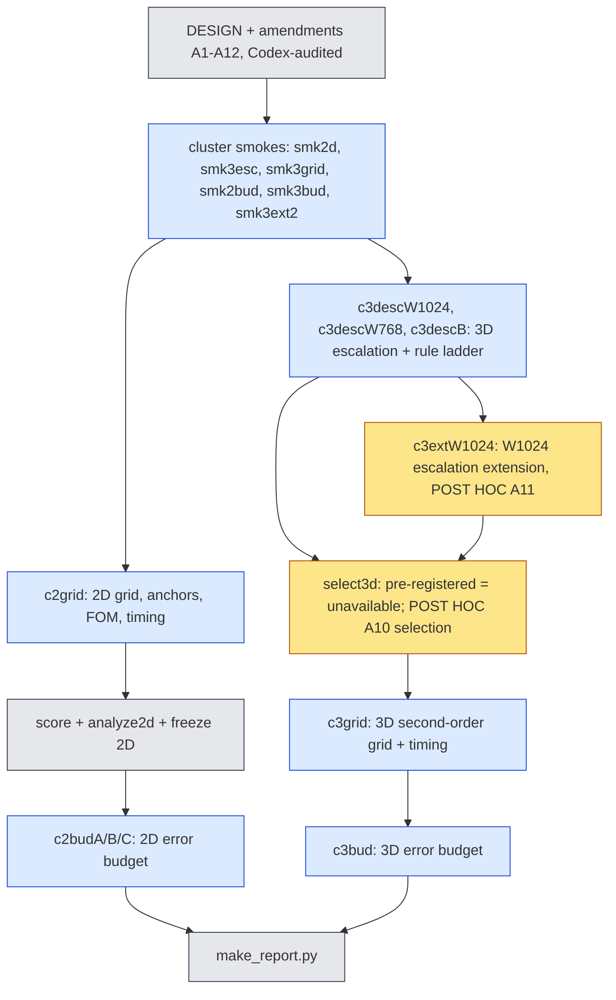
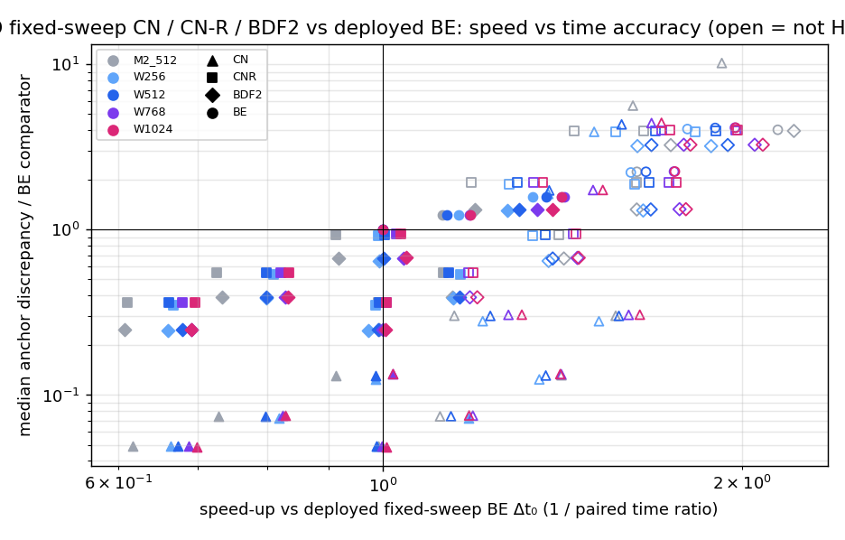
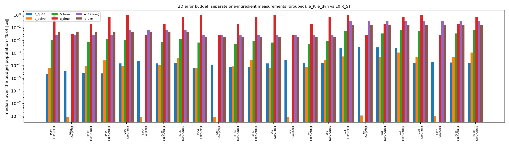
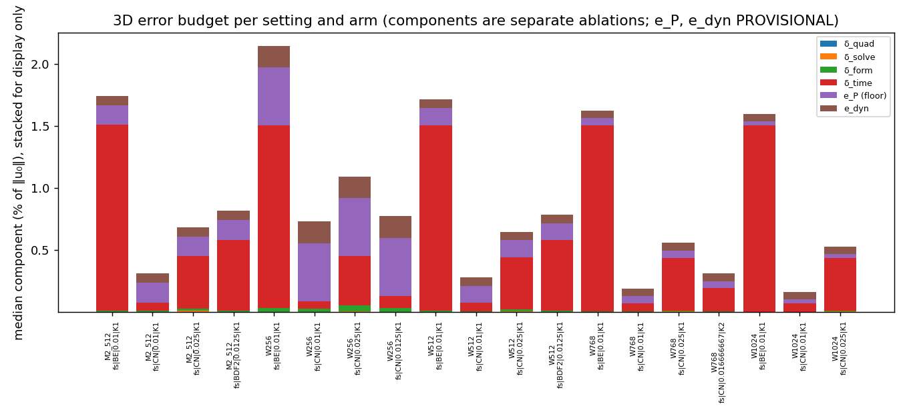

# jcp-combined: second-order stepping with a wide bank and a fast fixed-sweep solver, with an error budget

**Status:** all stages complete. Every accuracy number is **PROVISIONAL** (scored against first-order references: 2D ST/S/TX, 3D the BE reference at Δt₀/4) and is marked so where it appears. The 3D rule selection is **POST HOC** (DESIGN A10, A11): the pre-registered selection was unavailable. Lane `exp/2026-10-13-jcp-combined`, generated by `make_report.py` from the committed analysis files.

## Answers in brief (generated)

- **2D scheme.** LSPG-CNR (selected against the first-order references, frozen). Against E0 R_ST: H1 R128->R256 **pass**; H1 R256->R384 **fail**; H1 R384->R512 **does not pay off**; H2 (tunability) **pass**; H3 at val32|19: **cancellation not supported**; H5 best matched speed-up 17.7× vs re-measured C2 `acc` 3.89× (**pass**).
- **2D finalist quadrature check.** The selected CN-R arms fail it (δ_quad > τ) at fast, acc, R256; first fallbacks qualified: fast (fast equal accuracy arm → fib4181), acc (fast equal accuracy arm → gauss128), R256 (fast equal accuracy arm → gauss128); not qualified: fast (accurate equal cost arm: cost 1.31× the deployed BE), acc (accurate equal cost arm: cost 1.56× the deployed BE), R256 (accurate equal cost arm: cost 1.49× the deployed BE).
- **3D converged-rule gate (J4).** Cases above the bar at any successive pair (fixed-sweep BE): M2_512 0, W256 0, W512 0, W1024 1, W768 1; worst case at every pair: case 5. POST HOC converged rules: W1024 gl80, W768 gl64, M2_512 gl56, W256 gl56, W512 gl56.
- **3D fixed-sweep CN (K = 2, 2.5 Δt₀)** departs from the verified adaptive solve on a fixed set of cases (the same at every rule), so the pre-registered rule selection was unavailable; the POST HOC selection uses the adaptive CN arm.
- **3D fast solver (H4).** H4a (speed at equal accuracy, ratio ≤ 0.6): M2_512 fail, W256 fail, W512 fail, W768 fail, W1024 fail; H4b (accuracy at equal cost): M2_512 pass, W256 pass, W512 pass, W768 pass, W1024 pass. Read together: the second-order fixed-sweep solver buys accuracy at equal cost, not speed at equal accuracy.
- **2D budget: what limits next** (largest component per setting-arm, by number of setting-arms): delta_time 16, e_P 7, e_dyn 1.

## How the work was done

## 2D (Burgers 2D, dev6 + val32 = 38 cases)

**Primary scoring: the E0 second-order references** — E0 second-order reference: accuracy against an order-verified reference for eligible case-kinds (flagged case-kinds are scored but not ranked); rankings conditional on eps_ref (a Richardson estimate under the asymptotic assumption, not a rigorous bound; the cross-check rule was amended post data, E0 A10); R_S is time-matched to the BE arms at dt0 only, every other S value is an unmatched diagnostic. Non-rankable case-kinds (scored, never ranked): dev6|1|S, val32|21|S, val32|24|S.

**Scoring gate (first-order, certifies every rescoring).** `score.py` re-decoded every saved trajectory on CPU and reproduced 171000 of 171000 job values (worst difference 8.33e-17); every negative control broke agreement (case swap 1.12e+00, time shift 1.76e-01, ST↔S swap 2.90e-03).

**Ties (E0).** Per case $\eta=\epsilon_{\rm ref}(R_{ST})$ (median 0.000376 %, largest 0.000952 %); two arms are ranked on a case only if their errors differ by more than $2\eta$; medians and worst values compare by interval overlap with endpoint propagation.

### Which second-order scheme (selected against the first-order references, frozen)

Scheme wins over the four dial settings: LSPG-BDF2 3, LSPG-CNR 4, GAL-CN 4; tie broken by the smaller sum of the four medians (LSPG-BDF2 1.15 %, LSPG-CNR 1.04 %, GAL-CN 1.07 %, PROVISIONAL). **Selected scheme: LSPG-CNR.**

Per setting, the selected scheme's frozen arms against that setting's deployed LSPG-BE. Primary columns against E0 R_ST; S is the space-only reference time-matched to LSPG-BE at Δt₀ only; the last two columns are the first-order scores (PROVISIONAL, continuity):

| setting | role | arm | cost / own BE | median E0 R_ST | worst E0 R_ST | median S (BE-matched) | old median TX | old median ST |
|---|---|---|---|---|---|---|---|---|
| fast | accurate, equal cost | LSPG-CN-R at 1Δt₀ | 0.999 | 0.45 % | 5.2 % | unmatched | 0.444 % | 0.42 % |
| fast | fast, equal accuracy | LSPG-CN-R at 2Δt₀ | 0.611 | 0.792 % | 4.95 % | unmatched | 0.795 % | 0.727 % |
| fast | baseline | LSPG-BE at 1Δt₀ | 1 | 1.09 % | 4.84 % | 0.412 % | 1.09 % | 1.03 % |
| R128 | accurate, equal cost | LSPG-CN-R at 1Δt₀ | 0.998 | 0.45 % | 5.2 % | unmatched | 0.444 % | 0.42 % |
| R128 | fast, equal accuracy | LSPG-CN-R at 2Δt₀ | 0.587 | 0.792 % | 4.95 % | unmatched | 0.795 % | 0.727 % |
| R128 | baseline | LSPG-BE at 1Δt₀ | 1 | 1.1 % | 4.84 % | 0.412 % | 1.09 % | 1.04 % |
| R256 | accurate, equal cost | LSPG-CN-R at 1Δt₀ | 0.999 | 0.209 % | 2.52 % | unmatched | 0.21 % | 0.149 % |
| R256 | fast, equal accuracy | LSPG-CN-R at 2Δt₀ | 0.561 | 0.734 % | 2.47 % | unmatched | 0.725 % | 0.668 % |
| R256 | baseline | LSPG-BE at 1Δt₀ | 1 | 0.983 % | 3.32 % | 0.0915 % | 0.97 % | 0.91 % |
| acc | accurate, equal cost | LSPG-CN-R at 1Δt₀ | 0.998 | 0.198 % | 1.78 % | unmatched | 0.195 % | 0.135 % |
| acc | fast, equal accuracy | LSPG-CN-R at 2Δt₀ | 0.56 | 0.726 % | 1.9 % | unmatched | 0.715 % | 0.658 % |
| acc | baseline | LSPG-BE at 1Δt₀ | 1 | 0.978 % | 3.01 % | 0.0337 % | 0.967 % | 0.906 % |
| R384 | accurate, equal cost | LSPG-CN-R at 1Δt₀ | 0.996 | 0.198 % | 1.78 % | unmatched | 0.195 % | 0.135 % |
| R384 | fast, equal accuracy | LSPG-CN-R at 2Δt₀ | 0.551 | 0.726 % | 1.9 % | unmatched | 0.715 % | 0.658 % |
| R384 | baseline | LSPG-BE at 1Δt₀ | 1 | 0.978 % | 3.01 % | 0.0337 % | 0.967 % | 0.906 % |
| R512 | accurate, equal cost | LSPG-CN-R at 1Δt₀ | 0.986 | 0.199 % | 2.17 % | unmatched | 0.196 % | 0.137 % |
| R512 | fast, equal accuracy | LSPG-CN-R at 2Δt₀ | 0.536 | 0.726 % | 2.3 % | unmatched | 0.715 % | 0.657 % |
| R512 | baseline | LSPG-BE at 1Δt₀ | 1 | 0.979 % | 3.09 % | 0.0541 % | 0.968 % | 0.907 % |

### H1: does the wide bank pay off once time error is removed?

| dial step | reference | verdict | median from | median to | change | improved/worsened/tied | worst from | worst to |
|---|---|---|---|---|---|---|---|---|
| R128->R256 | E0 R_ST | pass | 0.45 % | 0.209 % | -53.7 % | 38/0/0 | 5.2 % | 2.52 % |
| R128->R256 | E0 R_ST (LSPG-BE Δt₀) |  | 1.1 % | 0.983 % | -10.3 % | 38/0/0 | 4.84 % | 3.32 % |
| R256->R384 | E0 R_ST | fail | 0.209 % | 0.198 % | -5.2 % | 34/0/4 | 2.52 % | 1.78 % |
| R256->R384 | E0 R_ST (LSPG-BE Δt₀) |  | 0.983 % | 0.978 % | -0.5 % | 23/1/14 | 3.32 % | 3.01 % |
| R384->R512 | E0 R_ST | does not pay off | 0.198 % | 0.199 % | +0.7 % | 6/22/10 | 1.78 % | 2.17 % |
| R384->R512 | E0 R_ST (LSPG-BE Δt₀) |  | 0.978 % | 0.979 % | +0.2 % | 4/16/18 | 3.01 % | 3.09 % |

First-order verdicts (PROVISIONAL, continuity): R128->R256 pass; R256->R384 reference-limited; R384->R512 reference-limited.

A step is **reference-limited** when fewer than half of the 38 cases are resolved (paired difference above the tie threshold). Verdicts: R128->R256 **pass**; R256->R384 **fail**; R384->R512 **does not pay off**.

### H2: does tunability survive?

(a) Every eligible LSPG-BE arm is covered by a second-order arm with lower or equal cost and error: worst 42/42, median 42/42 → **pass**. (b) Along the dial, the accurate-equal-cost arms' common-baseline cost and median error (E0 R_ST): R128 0.239× / 0.45 %; R256 0.568× / 0.209 %; R384 1.56× / 0.198 %; R512 5.36× / 0.199 % → **pass**.

### H3: why did the fast setting's worst case get worse under CN?

| reference | worst case | output index t* | e(BE Δt₀) | e(CN Δt₀) | e(anchor) = e∞ | cos(δ_BE, ε∞) | guards a b c | verdict |
|---|---|---|---|---|---|---|---|---|
| E0 R_ST | val32 / 19 | 5 | 4.84 % | 5.22 % | 5.65 % | -0.527 | no yes yes | cancellation not supported |

Pre-registered explanation (error cancellation) at the worst case val32|19: **cancellation not supported**; failing guards: a. Criterion (a) needs |e(CN) − e∞| ≤ 0.2 |e(BE) − e∞|; here |e(CN) − e∞| = 0.424 % and |e(BE) − e∞| = 0.802 %. The fast setting's LSPG-BE worst error is 4.84 %; fast LSPG-CNR accurate arm worst 5.2 %; R128 LSPG-CNR accurate arm worst 5.2 %; R256 LSPG-CNR accurate arm worst 2.52 % (against E0 R_ST). indicator-based; U_anc is not a certified bound; scoped to cancellation at t*; under E0 the guards add eta = eps_ref (conditional Richardson estimate)

### H5: speed against the second-order full-order model (same job, same GPU)

Matched on worst error against E0 R_ST. Best matched speed-up of any eligible ROM arm: **17.7×** (fast|LSPG|CN|0.025|prod); the C2 `acc` arms re-measured in this job: 3.89× (acc|LSPG|CNR|0.01|prod). Verdict: **pass**. Scope: the overall winner may be an LSPG-CN arm (not second order, excluded from scheme selection); the best matched speed-up of the selected scheme LSPG-CNR is 13.6× (fast|LSPG|CNR|0.0125|prod). The FOM is second order in time only; its advection stays sign-upwind (first order in space).

First-order matching (PROVISIONAL, continuity): best 17.7× (fast|LSPG|CN|0.025|prod), comparator 3.8×, verdict pass.

## 3D (Burgers 3D, 65³, validation cohort 923801, 64 cases)

### The converged-rule gate (J4) and why it failed at R′ ≥ 768

| setting | rule pair | worst dist. fixed BE | worst dist. adaptive CN | cases > bar (fixed BE) | worst case | pre-registered axis | adaptive axis |
|---|---|---|---|---|---|---|---|
| M2_512 | Gauss 56 vs Gauss 64 | 4.47e-08 | 6.42e-08 | 0 | case 5 | unresolved | pass |
| M2_512 | Gauss 64 vs Gauss 80 | 6.62e-09 | 9.34e-09 | 0 | case 5 | unresolved | pass |
| W256 | Gauss 56 vs Gauss 64 | 1.87e-06 | 2.28e-06 | 0 | case 5 | unresolved | pass |
| W256 | Gauss 64 vs Gauss 80 | 4.24e-07 | 5.18e-07 | 0 | case 5 | unresolved | pass |
| W512 | Gauss 56 vs Gauss 64 | 4.40e-06 | 2.47e-06 | 0 | case 5 | unresolved | pass |
| W512 | Gauss 64 vs Gauss 80 | 1.02e-06 | 5.70e-07 | 0 | case 5 | unresolved | pass |
| W768 | Gauss 48 vs Gauss 56 | 3.06e-05 | 6.40e-05 | 1 | case 5 | unresolved | fail |
| W768 | Gauss 56 vs Gauss 64 | 1.79e-05 | 3.92e-05 | 0 | case 5 | unresolved | fail |
| W768 | Gauss 64 vs Gauss 80 | 4.57e-06 | 9.77e-06 | 0 | case 5 | unresolved | pass |
| W1024 | Gauss 48 vs Gauss 56 | 1.72e-04 | 3.59e-04 | 1 | case 5 | unresolved | fail |
| W1024 | Gauss 56 vs Gauss 64 | 1.11e-04 | 2.33e-04 | 1 | case 5 | unresolved | fail |
| W1024 | Gauss 64 vs Gauss 80 | 2.69e-05 | 5.64e-05 | 1 | case 5 | unresolved | fail |
| W1024 | Gauss 80 vs Gauss 96 | 1.17e-05 | 2.43e-05 | 0 | case 5 | unresolved | pass |

The pre-registered selection axis is "unresolved" wherever its second arm (fixed-sweep LSPG-CN, $K=2$, $\tfrac52\Delta t_0$) is ineligible (next subsection). Largest number of cases above the bar at any pair (fixed-sweep BE): M2_512 0, W256 0, W512 0, W1024 1, W768 1.

### The fixed-sweep CN arm fails on a fixed subset of cases

| setting | rules | failing cases (distance > 2.5e-4) | same set at every rule | median of per-rule median distance | largest distance |
|---|---|---|---|---|---|
| M2_512 | 12 | 1, 5, 7, 11, 12, 20, 22, 30, 36, 40, 43, 45, 46, 55, 62 | yes | 5.97e-06 | 3.00e-01 |
| W256 | 12 | 5, 7, 11, 30, 40, 43, 62 | yes | 2.43e-05 | 4.36e-01 |
| W512 | 12 | 5, 7, 11, 30, 40, 43, 62 | yes | 5.98e-06 | 2.32e-01 |
| W1024 | 12 | 5, 7, 11, 30, 40, 43, 46, 62 | no | 1.55e-07 | 2.36e-01 |
| W768 | 12 | 5, 7, 11, 30, 40, 43, 62 | yes | 4.76e-07 | 2.35e-01 |

On the failing cases the two LM sweeps per step leave most steps, from the first step after the adaptive start on, non-stationary (gradient norm far above the 10⁻³ stationarity test), and the distance to the adaptive solve then grows over the rollout; on every other case the fixed-sweep CN trajectory agrees with the verified adaptive solve. The set does not depend on the rule, so it is a solver failure, not a quadrature effect. Per-case evidence: `checks/cnfail3d-*.json`.

### Rule selection, pre-registered (DESIGN 3.3 / A6 / A7)

| setting | converged rule | status | m* lattice | m* Gauss | deployed | fallbacks |
|---|---|---|---|---|---|---|
| M2_512 | none | unavailable (no converged rule) | — | — | — | — |
| W256 | none | unavailable (no converged rule) | — | — | — | — |
| W512 | none | unavailable (no converged rule) | — | — | — | — |
| W768 | none | unavailable (no converged rule) | — | — | — | — |
| W1024 | none | unavailable (no converged rule) | — | — | — | — |

### Rule selection, POST HOC (DESIGN A10, A11 extension)

| setting | converged rule | status | m* lattice | m* Gauss | deployed | fallbacks |
|---|---|---|---|---|---|---|
| M2_512 | gl56 | selected | lat32768 | gl32 | gl32 | gl40, gl48, unavailable |
| W256 | gl56 | selected | lat16384 | gl24 | gl24 | gl32, gl40, unavailable |
| W512 | gl56 | selected | lat32768 | gl32 | lat32768 | lat65536, lat131072, unavailable |
| W768 | gl64 | selected | lat32768 | gl40 | lat32768 | lat65536, lat131072, unavailable |
| W1024 | gl80 | selected | lat65536 | gl48 | lat65536 | lat131072, unavailable |

W1024 extension (A11): pair statuses recomputed {'gl80|gl96': 'pass'} (agree with the job: True); 80³ reproduction across jobs fs|BE|0.01|K1 1.52e-15, fs|CN|0.025|K2 6.84e-16, ad|LSPG|BE|0.01|tight 1.50e-15, ad|LSPG|CN|0.025|tight 6.19e-16.

### 3D second-order grid (H4, H6) and speed-up

Rule selection label carried by the grid: **POST HOC (DESIGN A10, A11 extension)**. Comparator: the deployed fixed-sweep BE at Δt₀ (K = 1) on the same bank, R′ and rule. Anchor discrepancy = distance to GAL-BDF2 at Δt₀/8 (time-converged, reference-free; H4 and the selections use only it). Reference errors: E0 second-order reference: accuracy against an order-verified reference for eligible case-kinds (flagged case-kinds are scored but not ranked); rankings conditional on eps_ref (a Richardson estimate under the asymptotic assumption, not a rigorous bound; the cross-check rule was amended post data, E0 A10); R_S is time-matched to the BE arms at dt0 only, every other S value is an unmatched diagnostic.

| setting | rule | anchor-resolved cases | H4a | H4b | fast-equal-accuracy arm | time ratio | median anchor disc. | median ref. error | accurate-equal-cost arm | time ratio | median anchor disc. | median ref. error | BE median anchor disc. | BE median ref. error | cheapest equal-accuracy arm (diagnostic, ratio) |
|---|---|---|---|---|---|---|---|---|---|---|---|---|---|---|---|
| M2_512 | gl32 | 63/64 | fail | pass | none | — | — | — | fs / BDF2 / 0.0125 / K1 | 0.874 | 5.97e-03 | 0.642 % | 1.53e-02 | 1.57 % | fs / BDF2 / 0.0125 / K1 (0.874) |
| W256 | gl24 | 64/64 | fail | pass | none | — | — | — | fs / CN / 0.0125 / K1 | 0.848 | 1.13e-03 | 0.589 % | 1.56e-02 | 1.68 % | fs / CN / 0.0125 / K1 (0.848) |
| W512 | lat32768 | 64/64 | fail | pass | none | — | — | — | fs / BDF2 / 0.0125 / K1 | 0.863 | 5.96e-03 | 0.641 % | 1.53e-02 | 1.57 % | fs / BDF2 / 0.0125 / K1 (0.863) |
| W768 | lat32768 | 64/64 | fail | pass | none | — | — | — | fs / CN / 0.016666667 / K2 | 0.981 | 2.04e-03 | 0.255 % | 1.53e-02 | 1.54 % | fs / BDF2 / 0.016666667 / K2 (0.962) |
| W1024 | lat65536 | 64/64 | fail | pass | none | — | — | — | fs / CN / 0.01 / K1 | 0.992 | 7.41e-04 | 0.12 % | 1.53e-02 | 1.53 % | fs / BDF2 / 0.016666667 / K2 (0.956) |

The registered fast-equal-accuracy arm is H4a's cheapest (Δt ≥ 1.25 Δt₀, anchor discrepancy no worse than the comparator, paired ratio ≤ 0.6); where H4a fails it is "none". The last column is a diagnostic only (A15: an earlier frozen selection used it by mistake and was retracted before any budget job).

H6 compares the **selected accurate-equal-cost configurations** along the dial (scheme, step and K change with R′ and the rule), so it is a statement about the deployed dial, not an isolated bank-width effect. Median / worst error of the selected arm per rung (E0): M2_512 0.642 % / 4.41 %; W256 0.589 % / 6.31 %; W512 0.641 % / 5.37 %; W768 0.255 % / 6.7 %; W1024 0.12 % / 5.57 %. The worst error rises at W512->W768 although the median bars are met.

H6 (3D dial, against E0 with per-case ties at 2 ε_ref): W256->W512: **does not extend** (median change +8.9 %, resolved 63, improved/worsened 33/30, ties 1); W512->W768: **dial extends** (median change -60.2 %, resolved 64, improved/worsened 63/1, ties 0); W768->W1024: **dial extends** (median change -52.9 %, resolved 64, improved/worsened 64/0, ties 0).

First-order H6 (PROVISIONAL, descriptive): W256->W512: median change -21.2 %, bars met True; W512->W768: median change +21.0 %, bars met False; W768->W1024: median change -12.8 %, bars met True.

## Error budget (each component its own ablation; none is a remainder)

$e_{\rm tot}=\lVert u_a-u_{\rm ref}\rVert$; floor $e_P=\lVert(I-\Pi_{R'})u_{\rm ref}\rVert$; reduced dynamics $e_{\rm dyn}=\lVert u_\star-\Pi_{R'}u_{\rm ref}\rVert$ (ideal model $\star$ = converged rule, GAL, BDF2, $\Delta t_0/8$, tight); $\delta_{\rm quad},\delta_{\rm solve},\delta_{\rm form},\delta_{\rm time}$ = distance of the arm to the same arm with only the rule / solver tolerance / test space / (scheme, step) changed to the ideal; $D_a=\lVert u_a-u_\star\rVert$ measured directly. All are maxima over the five evolved output times relative to $\lVert u_0\rVert$, medians over the budget population (2D: 38 cases; 3D: first 32). $e_{\rm tot}$, $e_P$, $e_{\rm dyn}$ are PROVISIONAL (first-order references); the $\delta$'s and $D_a$ are reference-free.

### 2D budget (median over 38 cases; e_tot, e_P, e_dyn against the E0 R_ST reference)

Label: E0 second-order reference: accuracy against an order-verified reference for eligible case-kinds (flagged case-kinds are scored but not ranked); rankings conditional on eps_ref (a Richardson estimate under the asymptotic assumption, not a rigorous bound; the cross-check rule was amended post data, E0 A10); R_S is time-matched to the BE arms at dt0 only, every other S value is an unmatched diagnostic. Not rankable (scored, never ranked): dev6|1|S, val32|21|S, val32|24|S.

| setting | arm | role | δ_quad | δ_solve | δ_form | δ_time | D_a | e_tot | e_P | e_dyn | largest component (cases) | finalist qualified |
|---|---|---|---|---|---|---|---|---|---|---|---|---|
| R512 | LSPG / BE / 1 | baseline | 2.24e-07 | 6.09e-07 | 1.03e-04 | 9.77e-03 | 9.77e-03 | 0.979 % | 0.0251 % | 0.0505 % | delta_time 38 | — |
| R512 | GAL / CN / 1 | diagnostic | 3.85e-07 | 8.45e-11 | 0.00e+00 | 3.41e-04 | 3.41e-04 | 0.0753 % | 0.0251 % | 0.0505 % | e_dyn 29, delta_time 9 | — |
| R512 | LSPG / CNR / 1 | accurate_equal_cost | 2.53e-07 | 9.58e-07 | 7.92e-05 | 1.89e-03 | 1.89e-03 | 0.199 % | 0.0251 % | 0.0505 % | delta_time 26, e_dyn 12 | yes |
| R512 | LSPG / CNR / 2 | fast_equal_accuracy | 2.39e-07 | 2.61e-06 | 1.29e-04 | 7.23e-03 | 7.23e-03 | 0.726 % | 0.0251 % | 0.0505 % | delta_time 36, e_dyn 2 | yes |
| R256 | LSPG / BE / 1 | baseline | 1.49e-06 | 9.00e-07 | 1.05e-04 | 9.77e-03 | 9.77e-03 | 0.983 % | 0.067 % | 0.0498 % | delta_time 38 | — |
| R256 | GAL / CN / 1 | diagnostic | 2.48e-06 | 9.23e-11 | 0.00e+00 | 2.61e-04 | 2.61e-04 | 0.0981 % | 0.067 % | 0.0498 % | e_dyn 10, delta_time 7, e_P 21 | — |
| R256 | LSPG / CNR / 1 | accurate_equal_cost | 1.51e-06 | 1.13e-06 | 7.23e-05 | 1.89e-03 | 1.89e-03 | 0.209 % | 0.067 % | 0.0498 % | delta_time 27, e_P 6, e_dyn 5 | no |
| R256 | LSPG / CNR / 2 | fast_equal_accuracy | 1.54e-06 | 3.92e-06 | 1.20e-04 | 7.24e-03 | 7.24e-03 | 0.734 % | 0.067 % | 0.0498 % | delta_time 37, e_P 1 | no |
| R384 | LSPG / BE / 1 | baseline | 6.89e-07 | 6.17e-07 | 6.83e-05 | 9.77e-03 | 9.77e-03 | 0.978 % | 0.0282 % | 0.0189 % | delta_time 38 | — |
| R384 | GAL / CN / 1 | diagnostic | 1.23e-06 | 8.29e-11 | 0.00e+00 | 2.61e-04 | 2.61e-04 | 0.0495 % | 0.0282 % | 0.0189 % | e_dyn 11, delta_time 12, e_P 15 | — |
| R384 | LSPG / CNR / 1 | accurate_equal_cost | 8.12e-07 | 8.51e-07 | 5.32e-05 | 1.89e-03 | 1.89e-03 | 0.198 % | 0.0282 % | 0.0189 % | delta_time 30, e_P 3, e_dyn 5 | yes |
| R384 | LSPG / CNR / 2 | fast_equal_accuracy | 8.11e-07 | 2.92e-06 | 8.59e-05 | 7.23e-03 | 7.23e-03 | 0.726 % | 0.0282 % | 0.0189 % | delta_time 37, e_dyn 1 | yes |
| acc | LSPG / BE / 1 | baseline | 1.47e-06 | 6.53e-07 | 6.83e-05 | 9.77e-03 | 9.77e-03 | 0.978 % | 0.0282 % | 0.0189 % | delta_time 38 | — |
| acc | GAL / CN / 1 | diagnostic | 2.78e-06 | 8.29e-11 | 0.00e+00 | 2.61e-04 | 2.61e-04 | 0.0495 % | 0.0282 % | 0.0189 % | e_dyn 11, delta_time 12, e_P 15 | — |
| acc | LSPG / CNR / 1 | accurate_equal_cost | 1.57e-06 | 8.35e-07 | 5.32e-05 | 1.89e-03 | 1.89e-03 | 0.198 % | 0.0282 % | 0.0189 % | delta_time 30, e_P 3, e_dyn 5 | no |
| acc | LSPG / CNR / 2 | fast_equal_accuracy | 1.57e-06 | 2.73e-06 | 8.59e-05 | 7.23e-03 | 7.23e-03 | 0.726 % | 0.0282 % | 0.0189 % | delta_time 37, e_dyn 1 | no |
| fast | LSPG / BE / 1 | baseline | 2.61e-05 | 5.26e-06 | 5.07e-04 | 9.90e-03 | 9.93e-03 | 1.09 % | 0.364 % | 0.172 % | delta_time 30, e_P 5, e_dyn 3 | — |
| fast | GAL / CN / 1 | diagnostic | 2.85e-05 | 1.10e-10 | 0.00e+00 | 2.52e-04 | 2.69e-04 | 0.417 % | 0.364 % | 0.172 % | e_P 35, e_dyn 3 | — |
| fast | LSPG / CNR / 1 | accurate_equal_cost | 2.74e-05 | 5.00e-06 | 3.51e-04 | 1.92e-03 | 1.94e-03 | 0.45 % | 0.364 % | 0.172 % | e_P 25, delta_time 10, e_dyn 3 | no |
| fast | LSPG / CNR / 2 | fast_equal_accuracy | 2.42e-05 | 1.10e-05 | 6.28e-04 | 7.29e-03 | 7.31e-03 | 0.792 % | 0.364 % | 0.172 % | delta_time 25, e_P 10, e_dyn 3 | no |
| R128 | LSPG / BE / 1 | baseline | 1.60e-06 | 5.11e-06 | 5.07e-04 | 9.90e-03 | 9.93e-03 | 1.1 % | 0.364 % | 0.172 % | delta_time 30, e_P 5, e_dyn 3 | — |
| R128 | GAL / CN / 1 | diagnostic | 1.95e-06 | 1.09e-10 | 0.00e+00 | 2.52e-04 | 2.52e-04 | 0.417 % | 0.364 % | 0.172 % | e_P 35, e_dyn 3 | — |
| R128 | LSPG / CNR / 1 | accurate_equal_cost | 1.77e-06 | 4.94e-06 | 3.52e-04 | 1.92e-03 | 1.96e-03 | 0.45 % | 0.364 % | 0.172 % | e_P 25, delta_time 10, e_dyn 3 | yes |
| R128 | LSPG / CNR / 2 | fast_equal_accuracy | 1.55e-06 | 1.09e-05 | 6.28e-04 | 7.29e-03 | 7.30e-03 | 0.792 % | 0.364 % | 0.172 % | delta_time 25, e_P 10, e_dyn 3 | yes |

Budget gates: c2budA: B0 pass, B0_fixtures pass, B0_real_mismatch pass, B1 pass, reproduction not applicable (new reference), inventory pass, grid_reproduction pass; c2budB: B0 pass, B0_fixtures pass, B0_real_mismatch pass, B1 pass, reproduction not applicable (new reference), inventory pass, grid_reproduction pass; c2budC: B0 pass, B0_fixtures pass, B0_real_mismatch pass, B1 pass, reproduction not applicable (new reference), inventory pass, grid_reproduction pass.

**The H3 worst case (val32|19, `fast` setting) through the budget** (max over output times; e_tot, e_⋆, e_P, e_dyn against E0 R_ST): e_⋆ is the error of the ideal model (converged rule, GAL, BDF2 at Δt₀/8, tight), e_P the bank's projection floor, e_dyn the ideal model's distance to the projected reference.

| arm | e_tot | e_⋆ (ideal) | e_P (floor) | e_dyn | δ_time | δ_form | δ_quad |
|---|---|---|---|---|---|---|---|
| LSPG-BE at 1Δt₀ | 4.84 % | 5.64 % | 4.15 % | 3.87 % | 3.66 % | 0.752 % | 0.0129 % |
| GAL-CN at 1Δt₀ | 5.65 % | 5.64 % | 4.15 % | 3.87 % | 0.121 % | 0 % | 0.0227 % |
| LSPG-CN-R at 1Δt₀ | 5.2 % | 5.64 % | 4.15 % | 3.87 % | 0.651 % | 0.733 % | 0.0201 % |
| LSPG-CN-R at 2Δt₀ | 4.95 % | 5.64 % | 4.15 % | 3.87 % | 1.38 % | 1.19 % | 0.0182 % |

### 2D finalist failures and their fallbacks (A14, pre-registered conditional step)

The selected arms whose deployed rule fails the finalist quadrature check (δ_quad ≤ τ on every case) keep their selection verdict, labelled "rule inadequate for this arm"; their first fallback rule is qualified separately (accuracy, solver, quadrature, timing, and the arm's original criterion against the original deployed BE). Accuracy in this table: first-order (the selection reference, PROVISIONAL) and E0 R_ST beside it.

| setting | arm | step | fallback (rule) | finalist pass | worst δ_quad | median TX (old) | median E0 R_ST | cost vs original BE | original criterion met | fallback qualified |
|---|---|---|---|---|---|---|---|---|---|---|
| fast | accurate equal cost | LSPG-CN-R at 1Δt₀ | R128 (fib4181) | yes | 1.01e-04 | 0.444 % | 0.45 % | 1.31 | no | **no** |
| fast | fast equal accuracy | LSPG-CN-R at 2Δt₀ | R128 (fib4181) | yes | 1.30e-04 | 0.795 % | 0.792 % | 0.762 | yes | **yes** |
| acc | accurate equal cost | LSPG-CN-R at 1Δt₀ | R384 (gauss128) | yes | 1.10e-04 | 0.195 % | 0.198 % | 1.56 | no | **no** |
| acc | fast equal accuracy | LSPG-CN-R at 2Δt₀ | R384 (gauss128) | yes | 1.49e-04 | 0.715 % | 0.726 % | 0.864 | yes | **yes** |
| R256 | accurate equal cost | LSPG-CN-R at 1Δt₀ | R256fb (gauss128) | yes | 7.38e-05 | 0.21 % | 0.209 % | 1.49 | no | **no** |
| R256 | fast equal accuracy | LSPG-CN-R at 2Δt₀ | R256fb (gauss128) | yes | 8.29e-05 | 0.725 % | 0.734 % | 0.816 | yes | **yes** |

Cost method: c2fbgrid common panel (baseline: deployed R256 BE), median paired ratio; c2grid common panel: ratio of the two median paired ratios (not a directly paired median).

### 3D budget (median over the first 32 cases; e_tot, e_P, e_dyn against the E0 R_ST reference)

Label: E0 second-order reference: accuracy against an order-verified reference for eligible case-kinds (flagged case-kinds are scored but not ranked); rankings conditional on eps_ref (a Richardson estimate under the asymptotic assumption, not a rigorous bound; the cross-check rule was amended post data, E0 A10); R_S is time-matched to the BE arms at dt0 only, every other S value is an unmatched diagnostic.

| setting | arm | role | δ_quad | δ_solve | δ_form | δ_time | D_a | e_tot | e_P | e_dyn | largest component (cases) | finalist qualified |
|---|---|---|---|---|---|---|---|---|---|---|---|---|
| M2_512 | fs / BE / 0.01 / K1 | baseline | 1.54e-06 | 2.41e-06 | 1.29e-04 | 1.50e-02 | 1.50e-02 | 1.54 % | 0.159 % | 0.0743 % | delta_time 31, e_dyn 1 | — |
| M2_512 | fs / CN / 0.01 / K1 | diagnostic+H4b_witness | 1.85e-06 | 2.76e-06 | 9.82e-05 | 6.84e-04 | 6.84e-04 | 0.214 % | 0.159 % | 0.0743 % | e_P 25, delta_time 6, e_dyn 1 | yes |
| M2_512 | fs / CN / 0.025 / K1 | diagnostic | 2.14e-06 | 1.09e-04 | 1.98e-04 | 4.21e-03 | 4.20e-03 | 0.558 % | 0.159 % | 0.0743 % | e_P 7, delta_time 22, delta_solve 3 | — |
| M2_512 | fs / BDF2 / 0.0125 / K1 | accurate_equal_cost | 1.73e-06 | 4.64e-06 | 1.35e-04 | 5.69e-03 | 5.70e-03 | 0.627 % | 0.159 % | 0.0743 % | delta_time 28, e_dyn 1, e_P 3 | yes |
| W256 | fs / BE / 0.01 / K1 | baseline | 6.61e-06 | 2.29e-06 | 3.45e-04 | 1.47e-02 | 1.47e-02 | 1.63 % | 0.468 % | 0.175 % | delta_time 28, e_P 4 | — |
| W256 | fs / CN / 0.01 / K1 | diagnostic+H4b_witness | 8.19e-06 | 4.70e-06 | 2.60e-04 | 6.20e-04 | 6.23e-04 | 0.51 % | 0.468 % | 0.175 % | e_P 32 | yes |
| W256 | fs / CN / 0.025 / K1 | diagnostic | 9.72e-06 | 4.75e-05 | 5.16e-04 | 3.95e-03 | 3.93e-03 | 0.839 % | 0.468 % | 0.175 % | e_P 17, delta_time 14, delta_solve 1 | — |
| W256 | fs / CN / 0.0125 / K1 | accurate_equal_cost | 8.23e-06 | 7.60e-06 | 3.10e-04 | 9.86e-04 | 9.74e-04 | 0.525 % | 0.468 % | 0.175 % | e_P 30, delta_time 2 | yes |
| W512 | fs / BE / 0.01 / K1 | baseline | 2.44e-08 | 2.41e-06 | 1.09e-04 | 1.50e-02 | 1.50e-02 | 1.53 % | 0.137 % | 0.0694 % | delta_time 31, e_dyn 1 | — |
| W512 | fs / CN / 0.01 / K1 | diagnostic+H4b_witness | 2.82e-08 | 2.79e-06 | 8.84e-05 | 6.81e-04 | 6.80e-04 | 0.197 % | 0.137 % | 0.0694 % | e_P 22, delta_time 7, e_dyn 3 | yes |
| W512 | fs / CN / 0.025 / K1 | diagnostic | 2.94e-08 | 4.99e-05 | 1.67e-04 | 4.22e-03 | 4.20e-03 | 0.52 % | 0.137 % | 0.0694 % | e_P 6, delta_time 25, delta_solve 1 | — |
| W512 | fs / BDF2 / 0.0125 / K1 | accurate_equal_cost | 2.68e-08 | 4.15e-06 | 1.22e-04 | 5.68e-03 | 5.69e-03 | 0.62 % | 0.137 % | 0.0694 % | delta_time 28, e_dyn 2, e_P 2 | yes |
| W768 | fs / BE / 0.01 / K1 | baseline | 4.26e-08 | 2.04e-06 | 5.25e-05 | 1.50e-02 | 1.50e-02 | 1.51 % | 0.0574 % | 0.0614 % | delta_time 31, e_dyn 1 | — |
| W768 | fs / CN / 0.01 / K1 | diagnostic+H4b_witness | 5.48e-08 | 2.69e-06 | 4.46e-05 | 6.89e-04 | 6.90e-04 | 0.166 % | 0.0574 % | 0.0614 % | e_dyn 11, delta_time 12, e_P 9 | yes |
| W768 | fs / CN / 0.025 / K1 | diagnostic | 6.35e-08 | 6.05e-05 | 8.59e-05 | 4.25e-03 | 4.25e-03 | 0.484 % | 0.0574 % | 0.0614 % | delta_time 29, delta_solve 2, e_P 1 | — |
| W768 | fs / CN / 0.016666667 / K2 | accurate_equal_cost | 5.51e-08 | 3.93e-06 | 6.52e-05 | 1.86e-03 | 1.87e-03 | 0.24 % | 0.0574 % | 0.0614 % | e_dyn 7, delta_time 20, e_P 5 | yes |
| W1024 | fs / BE / 0.01 / K1 | baseline | 1.03e-08 | 1.30e-06 | 3.02e-05 | 1.51e-02 | 1.51e-02 | 1.51 % | 0.0319 % | 0.0594 % | delta_time 31, e_dyn 1 | — |
| W1024 | fs / CN / 0.01 / K1 | diagnostic+accurate_equal_cost+H4b_witness | 1.16e-08 | 1.64e-06 | 3.72e-05 | 6.76e-04 | 6.78e-04 | 0.117 % | 0.0319 % | 0.0594 % | e_dyn 16, delta_time 14, e_P 2 | yes |
| W1024 | fs / CN / 0.025 / K1 | diagnostic | 1.13e-08 | 6.10e-05 | 6.01e-05 | 4.26e-03 | 4.26e-03 | 0.461 % | 0.0319 % | 0.0594 % | delta_time 30, delta_solve 2 | — |

Budget gates: c3budA:B0 True, c3budA:B0_fixtures True, c3budA:inventory True, c3budA:B0_real_mismatch True, c3budA:B1 True, c3budA:reproduction not applicable, c3budA:grid_reproduction True, c3budW1024r:B0 True, c3budW1024r:B0_fixtures True, c3budW1024r:inventory True, c3budW1024r:B0_real_mismatch True, c3budW1024r:B1 True, c3budW1024r:reproduction not applicable, c3budW1024r:grid_reproduction True.

Converged-rule check per setting (r_inf vs the next finer rule, every r_inf-dependent run type, 32 cases): M2_512 worst 8.41e-08, all runs valid False, passed False; W256 worst 3.68e-06, all runs valid 1.0, passed True; W512 worst 4.40e-06, all runs valid 1.0, passed True; W768 worst 8.02e-06, all runs valid 1.0, passed True; W1024 worst 1.84e-05, all runs valid 1.0, passed True. Withheld attributions: M2_512: ['quadrature attribution (converged rule not verified against the finer rule)'].

## Corrections and retractions

- **Pre-registered 3D selection unavailable.** The second selection arm (fixed-sweep LSPG-CN, $K=2$) was ineligible on every rule in every setting, so the pre-registered selection could not be made; the 3D rules used downstream come from the post-hoc A10 selection (adaptive CN arm), labelled as such.
- **The two-case smokes did not contain any failing case**, so the A6 choice of $K=2$ looked safe on the smoke and was not.
- **C1's J4 failure was not only an under-resolved 48³ check**: at R′ = 1024 the successive-rule distance of one case stays above the bar up to 64³ vs 80³ (A11); the extension to 96³ is post hoc.
- **Gauss 112³ at R′ = 1024 is infeasible** on a 141 GB H200 with the vendored table builder (smoke `smk3ext` failed out of memory, A11.3); the extension stops at 96³.
- **B0 real-data mismatch control was non-discriminating** as an absolute test on the 2D smoke; it is now relative (A12).
- **Offline scoring on the local GB10 GPU corrupted R′ = 1024 decodes** (caught by the G-score gate); all offline analysis runs on CPU (A8.1).
- **Retracted: the first frozen 3D fast-equal-accuracy selection** (A15). It ignored H4a's step and 0.6-ratio constraints; under the registered rule no 3D fast-equal-accuracy arm exists. Caught by the Codex results audit before any 3D budget job ran; the retracted frozen file is kept in `checks/frozen-versions/`.
- **Deployed 2D rules are too coarse for the selected second-order arms at `fast`, `acc` and R256** (finalist quadrature check, A14); the first-order selection verdicts stand, labelled "rule inadequate for this arm", and the fallbacks are reported beside them.
- **First-order 2D/3D conclusions that change under E0** (A13): 2D H1 R256→R384 and R384→R512 were "reference-limited" against the first-order references and are resolved against E0 (see H1); 3D H6 was descriptive and two of its three transitions reverse direction against E0. The first-order numbers are kept beside the E0 ones and are superseded by them; the frozen selections are unchanged.
- **The in-job 3D cohort-table hash is not stable across H200 nodes** (A11.4): the extension job is bound to the escalation job by the initial coefficients instead; offline scoring checks the CPU table hash.
- **A leftover first-order reference access in `budget3d.py`** (G-score controls) was missed by the A13 code audit and caught when the smoke budget analysis was re-run; fixed before any production 3D budget analysis.

## Jobs

| attempt | Slurm id | GPU | commit | role | status |
|---|---|---|---|---|---|
| smk2d | 5208761 | a100-80G | c6b4c338c | smoke (A4.6) | collected; all machinery gates passed |
| smk3esc | 5208766 | h200 | c6b4c338c | smoke (A4.6) | collected; all machinery gates passed |
| smk3grid | 5208768 | h200 | c6b4c338c | smoke (A4.6) | collected; all machinery gates passed |
| c2grid | 5209526 | a100-80G | 43d00da63 | 2D grid + anchors + FOM + timing (A1.0) | complete, collected |
| c3descW1024 | 5209530 | h200 | 43d00da63 | 3D escalation + selection, W1024 (A7.5) | complete, collected |
| c3descW768 | 5209535 | h200 | 43d00da63 | 3D escalation + selection, W768 (A7.5) | complete, collected (elapsed 0.96 h) |
| c3descB | 5210959 | h200 | 9c10d673b | 3D escalation + selection, M2_512/W256/W512 (A7.5) | complete, collected |
| smk3bud | 5212781 | h200 | 886482410 | 3D budget smoke | complete, collected; machinery gates passed |
| smk2bud | 5213594 | a100-80G | 886482410 | 2D budget smoke | complete, collected; machinery gates passed |
| smk3ext2 | 5216909 | h200 | a25bdff09 | A11.3 extension smoke (gl80, gl96; 2 cases) | complete, collected |
| c3extW1024 | 5217010 | h200 | 42dfeb454 | A11 W1024 escalation extension gl80->gl96, 64 cases (POST HOC) | complete, collected |
| c2budA | 5218146 | a100-80G | 0bc851461 | 2D error budget (R512, R256) | complete, collected |
| c2budB | 5218149 | a100-80G | 0bc851461 | 2D error budget (R384, acc) | complete, collected |
| c3grid | 5219449 | h200 | 1cf409c9a | 3D second-order grid + timing, 5 settings, POST HOC rules (A10/A11) | complete, collected |
| c2budC | 5225286 | a100-80G | 29dc2743a | 2D error budget (fast, R128); resubmission after the cancelled 5218166 | complete, collected |
| c2fbgrid | 5228777 | a100-80G | 91f723746 | A14 fallback grid: R256 gauss96 vs gauss128 (accuracy + timing) | complete, collected |
| c2fbbud | 5228780 | a100-80G | 91f723746 | A14 fallback budget: R256fb (gauss128) | complete, collected |
| c3budA | 5231973 | h200 | 51730ce18 | 3D error budget, M2_512/W256/W512/W768 | complete, collected |
| c3budW1024r | 5241089 | h200 | a7711b82c | 3D error budget, W1024 (rerun after the A16 fix) | complete, collected (9.5 h) |

| failed attempt | Slurm id | note |
|---|---|---|
| smk3esc | — | first submission attempt: rsync aborted by login-node connection drop before sbatch; partial staging dir removed; no job created |
| smk3ext | 5215974 | A11 extension smoke: gl96 ran (all four arms, 2 cases); gl112 (1.4M points, R'=1024) OOM in the vendored offmesh_tables test_block (42.9 GiB allocation) -> A11.3 drops gl112; logs and partial result in runs/smk3ext/failed-5215974 |
| c2budC | 5218166 | cancelled while PENDING (never started) to free a lane slot for c3grid; cluster dir removed; to be re-staged and resubmitted |
| c3budW1024 | 5231969 | OOM (27 GiB) preparing the finer rule Gauss 96^3 after 3.6 h: c3run bud mode kept a local reference to the Gauss 80^3 tables while preparing the next rule; fixed (A16); no result.json was written; logs in runs/c3budW1024/failed-5231969; rerun as c3budW1024r |

## Codex audits

Chronological; the opening statement of each audit (its verdict line). Every WRONG / HOLD was fixed and re-audited before the next step; the full findings are in the files.

| audit | opening statement |
|---|---|
| `audits/codex-design-1.md` | Overall: the design needs amendments before implementation. The LMM algebra is sound, but several classifications and hypotheses cannot support their stated conclusions. I reviewed the pre-registration against the named … |
| `audits/codex-design-2.md` | Overall verdict: NOT READY. A1 repairs much of the original design, but selection sequencing, quadrature qualification, H4 eligibility, and several mandatory controls still need amendments. No files were modified, includ… |
| `audits/codex-design-3.md` | A2 is not yet ready. It resolves most operational issues, but leaves gaps in finalist qualification, selection semantics, H3 uncertainty handling, and mandatory negative controls. |
| `audits/codex-design-4.md` | All requested findings are RESOLVED at the design-contract level by A3. No files were modified, including the lab log. |
| `audits/codex-code-1.md` | Overall verdict: NEEDS-FIX — do not accept production results yet. I found one reproducible runtime blocker and several paths that can accept invalid evidence. No files were modified, including the lab log. Validation wa… |
| `audits/codex-code-2.md` | NOT READY. Several original defects are fixed, but resource certification, scoring gates, and hypothesis evaluation still admit invalid conclusions. |
| `audits/codex-code-3.md` | NOT READY FOR SMOKE. All three staged jobs lack a required module. I also reproduced a false G-FS1 pass and a submission-cap failure. |
| `audits/codex-job-smk.md` | The four previous findings are RESOLVED, but the smokes still have two MAJOR evidence-collection gaps. |
| `audits/codex-job-smk-2.md` | Both MAJOR findings are RESOLVED for smoke submission. |
| `audits/codex-job-prod1.md` | DO NOT SUBMIT. Audit items 10 and 21 remain NOT RESOLVED. The principal blockers are incomplete resource certification and missing A6.2 qualification data for the 3D selection ladder. |
| `audits/codex-job-prod2.md` | No production-blocking defect found for the three named jobs under A7. Read-only review completed: no files modified, no project modules imported, no jobs submitted. |
| `audits/codex-code-4.md` | NOT READY FOR BUDGET SMOKES. |
| `audits/codex-code-5.md` | NOT READY FOR BUDGET SMOKES. |
| `audits/codex-code-6.md` | NOT READY FOR BUDGET SMOKES. |
| `audits/codex-code-7.md` | NOT READY FOR BUDGET SMOKES. |
| `audits/codex-code-8.md` | Reviewed `fc04bb9d9` against DESIGN A1–A9. No files modified, project modules imported, or GPU jobs launched. Reproductions used extracted source and synthetic inputs. |
| `audits/codex-job-smkbud.md` | No BLOCKER or MAJOR findings. One smoke-coverage limitation remains. |
| `audits/codex-a10-1.md` | Overall: WRONG as an end-to-end implementation. The core post-hoc selector is correct for complete `c3run.py` outputs, but downstream freezing loses the new converged rule and the post-hoc label. Some diagnostic claims a… |
| `audits/codex-a10-2.md` | Overall: WRONG — the W768 post-hoc selection is supported, but not every round-1 finding is fixed. Label propagation still stops before downstream analyses, and diagnostic rule coverage remains incomplete. |
| `audits/codex-a10-3.md` | Overall: CORRECT for the requested round-3 fixes. Round-2 items 4–7 are resolved. |
| `audits/codex-a11-1.md` | Overall: WRONG — A11 is a defensible post-hoc experiment, but its implementation is not ready for acceptance. The main blockers are an incomplete reproduction gate, insufficient archive binding, and a resource-certificat… |
| `audits/codex-a11-2.md` | Overall: WRONG — important fixes landed, but extension acceptance and smoke certification still have defects. Job gate: SUBMIT the H200 smoke; HOLD production. |
| `audits/codex-a11-3.md` | Overall: CORRECT for the revised A11.3 plan. SUBMIT `smk3ext2.json` on H200. HOLD `c3extW1024` until the new smoke passes its machinery gate and a valid resource certificate passes staging verification. No blocking defec… |
| `audits/codex-results2d-1.md` | Overall: WRONG — budget job HOLD. The 2D numerical selections and hypothesis verdicts reproduce. The submission certificate omits substantial required work, and the new smoke gate accepts incomplete or failed evidence. N… |
| `audits/codex-results2d-2.md` | HOLD: c2budA, c2budB and c2budC. The rollout inventory and pricing repairs cover the required work, and all three certificates reproduce. Smoke validation still does not fully fail closed. |
| `audits/codex-results2d-3.md` | HOLD: c2budA, c2budB, c2budC. Audited HEAD `d1beec3d2d87b56fa1e63ea90cb65a977cf9e9e8`. The original single-field mutations now fail closed, but additional in-memory mutations expose remaining gaps. |
| `audits/codex-results2d-4.md` | HOLD: c2budA, c2budB, c2budC. Audited HEAD `a87c14df41293796d8552e30989d3a19b1095991`. Configuration-derived coverage is repaired, but G-score evidence validation still accepts failed controls—even through certificate ve… |
| `audits/codex-results2d-5.md` | SUBMIT: c2budA, c2budB, c2budC. Audited HEAD `840c96c5649f8e651efb622bb4fd85c8356838b2`. |
| `audits/codex-results3dsel-1.md` | HOLD c3grid pending correction and regeneration of the resource certificate. The selections are supported; the blocker is common-panel pricing, not insufficient allocation. |
| `audits/codex-results3dsel-2.md` | SUBMIT c3grid at HEAD `1f1b16986`. The common-panel pricing blocker is resolved. |
| `audits/codex-a13-1.md` | Overall: NOT READY for production E0 scoring. The registry and core scoring conventions check out, but the budget paths bypass promised safeguards, and the frozen 3D solver selection is missing. |
| `audits/codex-a13-2.md` | c2grid (2D): READY for production E0 scoring. |
| `audits/codex-a14-1.md` | JOB GATE: SUBMIT `c2fbgrid`; SUBMIT `c2fbbud`. The configs and resource certificates support running both jobs. This does not qualify any fallback in advance. A14’s qualification wording needs clarification before report… |
| `audits/codex-results3d-1.md` | JOB GATE: HOLD both `c3budA` and `c3budW1024`. Their resource certificates pass, but the frozen fast-equal-accuracy selection violates the registered selection rule. |
| `audits/codex-results2d-e0-1.md` | Overall: NEEDS-RESTATEMENT for provenance/reporting; the audited numerical results are CORRECT. No files were created, modified, or appended. |
| `audits/codex-results3d-2.md` | JOB GATE: SUBMIT `c3budW1024` and `c3budA`. The round-1 selection blocker is resolved. |
| `audits/codex-results3d-e0-1.md` | Overall: NEEDS-RESTATEMENT. The rescoring and A13 H6 calculations are correct. The interpretation must distinguish a selected-configuration dial from a bank-width effect, and reporting needs the qualifications below. No … |
| `audits/codex-job-c3budW1024r.md` | SUBMIT `c3budW1024r` on the certified H200 / 200G / 48-hour allocation. No blocking finding. |

## Glossary

- **bank, R′, dial**: the frozen ordered coordinate network; a solve uses its first R′ columns; the dial is the sequence of R′ settings (R128 → R256 → R384 → R512 in 2D; W256 … W1024 in 3D). `fast` and `acc` are the 2D settings deployed before this lane; `M2_512` the deployed 3D setting.
- **rule, m, m\***: an off-mesh quadrature for the advection term (Gauss pᵈ tensor, Fibonacci or rank-1 lattice) with m points; m\* is the smallest rule of a family whose rollouts stay within τ = 2.5×10⁻⁴ of the converged rule's.
- **converged rule, J4, bar**: a rule fine enough that the next finer rule changes the rollout by at most the bar 2.5×10⁻⁵ (worst case over 64 cases, field distance relative to ‖u₀‖); J4 is that check.
- **BE, CN, CN-R, BDF2**: backward Euler; Crank–Nicolson; CN with two BE start steps; second-order backward differentiation with one BE start step. **LSPG / GAL**: least-squares and Galerkin solves of each step.
- **fixed-sweep solver, K**: after a few adaptive steps, exactly K Levenberg–Marquardt sweeps per time step with an extrapolated predictor (the deployed 3D BE solver is K = 1). **Adaptive (tight)**: iterate each step until its stopping test passes ("verified").
- **solver distance**: field distance between a fixed-sweep run and the verified adaptive run of the same scheme and step; eligible if ≤ 2.5×10⁻⁴ on every case.
- **ST / S / TX**: 2D references at 8192² with Δt₀/16 / Δt₀ / their Richardson combination, all first-order accurate in time; the 3D reference is BE at Δt₀/4 on 513³ nodes. **PROVISIONAL**: scored against these first-order references; not a physical-accuracy claim.
- **tie, ε_ref, resolved**: a paired difference below 2ε_ref (ε_ref = per-case ST–TX distance) is a tie; a case is resolved when it is not a tie; a verdict with fewer than half the cases resolved is **reference-limited**.
- **accurate-equal-cost / fast-equal-accuracy**: the lowest-median-error candidate arm costing no more than the setting's LSPG-BE at Δt₀; the cheapest candidate arm whose worst and median errors are no larger than that BE arm's.
- **cost / own BE, common-baseline cost**: median paired A–B–A time ratio against the setting's own LSPG-BE at Δt₀, or against one common baseline (acc LSPG-BE Δt₀ in 2D).
- **anchor, e∞**: GAL-BDF2 at Δt₀/8, tight tolerance (time-converged reduced solution) and its error.
- **matched speed-up**: FOM time / ROM time for the cheapest calibrated FOM configuration whose worst error is no larger than the ROM arm's; same job, same GPU.
- **pre-registered / POST HOC**: decided before results were read / decided after (labelled; exploratory).
- **dev6, val32, 923801**: development and validation cohorts (selection allowed); test64 / 923901 are replication-only and were not used.
- **pp, % of ‖u₀‖**: errors are reported relative to the initial-condition norm.

