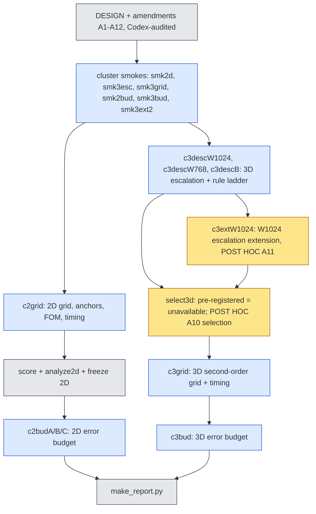
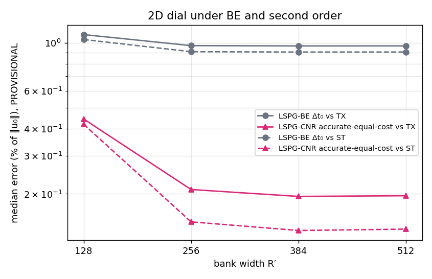
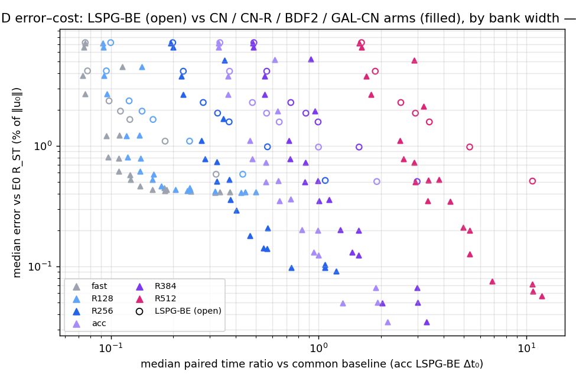
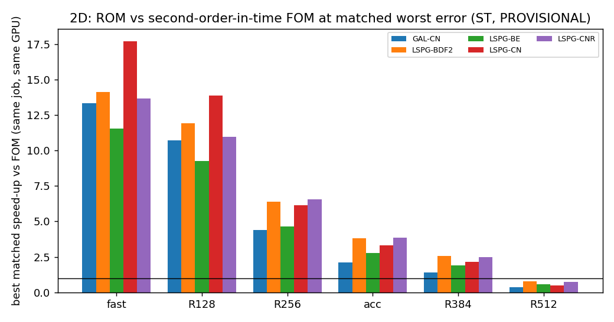
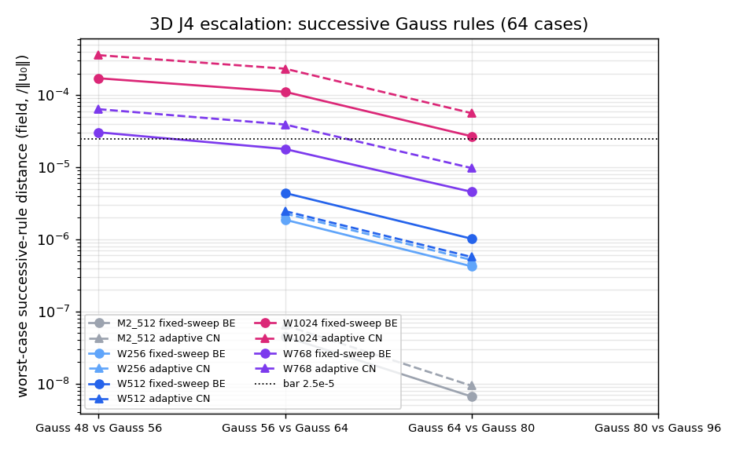

# jcp-combined: second-order stepping with a wide bank and a fast fixed-sweep solver, with an error budget

**Status:** interim; pending: grid3d, bud2d, bud3d. Every accuracy number is **PROVISIONAL** (scored against first-order references: 2D ST/S/TX, 3D the BE reference at Δt₀/4) and is marked so where it appears. The 3D rule selection is **POST HOC** (DESIGN A10, A11): the pre-registered selection was unavailable. Lane `exp/2026-10-13-jcp-combined`, generated by `make_report.py` from the committed analysis files.

## How the work was done

## 2D (Burgers 2D, dev6 + val32 = 38 cases)

**Primary scoring: the first-order references** — True.

**Scoring gate (first-order, certifies every rescoring).** `score.py` re-decoded every saved trajectory on CPU and reproduced 171000 of 171000 job values (worst difference 8.33e-17); every negative control broke agreement (case swap 1.12e+00, time shift 1.76e-01, ST↔S swap 2.90e-03).

**Tie thresholds** (heuristic, from ST−TX): medians 0.122 %, worst values 0.353 %.

### Which second-order scheme (selected against the first-order references, frozen)

Scheme wins over the four dial settings: LSPG-BDF2 3, LSPG-CNR 4, GAL-CN 4; tie broken by the smaller sum of the four medians (LSPG-BDF2 1.15 %, LSPG-CNR 1.04 %, GAL-CN 1.07 %, PROVISIONAL). **Selected scheme: LSPG-CNR.**

Per setting, the selected scheme's frozen arms against that setting's deployed LSPG-BE. Primary columns against TX (PROVISIONAL); S is the space-only reference time-matched to LSPG-BE at Δt₀ only; the last two columns are the first-order scores (PROVISIONAL, continuity):

| setting | role | arm | cost / own BE | median TX (PROVISIONAL) | worst TX (PROVISIONAL) | median S (BE-matched) | old median TX | old median ST |
|---|---|---|---|---|---|---|---|---|
| fast | accurate, equal cost | LSPG-CN-R at 1Δt₀ | 0.999 | 0.444 % | 5.18 % | 0.94 % | 0.444 % | 0.42 % |
| fast | fast, equal accuracy | LSPG-CN-R at 2Δt₀ | 0.611 | 0.795 % | 4.91 % | 0.601 % | 0.795 % | 0.727 % |
| fast | baseline | LSPG-BE at 1Δt₀ | 1 | 1.09 % | 4.75 % | 0.412 % | 1.09 % | 1.03 % |
| R128 | accurate, equal cost | LSPG-CN-R at 1Δt₀ | 0.998 | 0.444 % | 5.17 % | 0.94 % | 0.444 % | 0.42 % |
| R128 | fast, equal accuracy | LSPG-CN-R at 2Δt₀ | 0.587 | 0.795 % | 4.91 % | 0.601 % | 0.795 % | 0.727 % |
| R128 | baseline | LSPG-BE at 1Δt₀ | 1 | 1.09 % | 4.75 % | 0.412 % | 1.09 % | 1.04 % |
| R256 | accurate, equal cost | LSPG-CN-R at 1Δt₀ | 0.999 | 0.21 % | 2.49 % | 0.851 % | 0.21 % | 0.149 % |
| R256 | fast, equal accuracy | LSPG-CN-R at 2Δt₀ | 0.561 | 0.725 % | 2.42 % | 0.587 % | 0.725 % | 0.668 % |
| R256 | baseline | LSPG-BE at 1Δt₀ | 1 | 0.97 % | 3.21 % | 0.0924 % | 0.97 % | 0.91 % |
| acc | accurate, equal cost | LSPG-CN-R at 1Δt₀ | 0.998 | 0.195 % | 1.76 % | 0.847 % | 0.195 % | 0.135 % |
| acc | fast, equal accuracy | LSPG-CN-R at 2Δt₀ | 0.56 | 0.715 % | 1.84 % | 0.587 % | 0.715 % | 0.658 % |
| acc | baseline | LSPG-BE at 1Δt₀ | 1 | 0.967 % | 2.92 % | 0.0508 % | 0.967 % | 0.906 % |
| R384 | accurate, equal cost | LSPG-CN-R at 1Δt₀ | 0.996 | 0.195 % | 1.76 % | 0.847 % | 0.195 % | 0.135 % |
| R384 | fast, equal accuracy | LSPG-CN-R at 2Δt₀ | 0.551 | 0.715 % | 1.84 % | 0.587 % | 0.715 % | 0.658 % |
| R384 | baseline | LSPG-BE at 1Δt₀ | 1 | 0.967 % | 2.92 % | 0.0508 % | 0.967 % | 0.906 % |
| R512 | accurate, equal cost | LSPG-CN-R at 1Δt₀ | 0.986 | 0.196 % | 2.15 % | 0.85 % | 0.196 % | 0.137 % |
| R512 | fast, equal accuracy | LSPG-CN-R at 2Δt₀ | 0.536 | 0.715 % | 2.24 % | 0.587 % | 0.715 % | 0.657 % |
| R512 | baseline | LSPG-BE at 1Δt₀ | 1 | 0.968 % | 3 % | 0.0595 % | 0.968 % | 0.907 % |

### H1: does the wide bank pay off once time error is removed?

| dial step | reference | verdict | median from | median to | change | improved/worsened/tied | worst from | worst to |
|---|---|---|---|---|---|---|---|---|
| R128->R256 | TX | pass | 0.444 % | 0.21 % | -52.8 % | 27/0/11 | 5.17 % | 2.49 % |
| R128->R256 | ST | pass | 0.42 % | 0.149 % | -64.6 % | 27/0/11 | 5.14 % | 2.47 % |
| R128->R256 | TX (LSPG-BE Δt₀) |  | 1.09 % | 0.97 % | -11.1 % | 14/0/24 | 4.75 % | 3.21 % |
| R256->R384 | TX | reference-limited | 0.21 % | 0.195 % | -7.1 % | 6/0/32 | 2.49 % | 1.76 % |
| R256->R384 | ST | reference-limited | 0.149 % | 0.135 % | -8.8 % | 6/0/32 | 2.47 % | 1.76 % |
| R256->R384 | TX (LSPG-BE Δt₀) |  | 0.97 % | 0.967 % | -0.3 % | 0/0/38 | 3.21 % | 2.92 % |
| R384->R512 | TX | reference-limited | 0.195 % | 0.196 % | +0.7 % | 0/5/33 | 1.76 % | 2.15 % |
| R384->R512 | ST | reference-limited | 0.135 % | 0.137 % | +1.5 % | 0/6/32 | 1.76 % | 2.14 % |
| R384->R512 | TX (LSPG-BE Δt₀) |  | 0.967 % | 0.968 % | +0.0 % | 0/1/37 | 2.92 % | 3 % |

A step is **reference-limited** when fewer than half of the 38 cases are resolved (paired difference above the tie threshold). Verdicts: R128->R256 **pass**; R256->R384 **reference-limited**; R384->R512 **reference-limited**.

### H2: does tunability survive?

(a) Every eligible LSPG-BE arm is covered by a second-order arm with lower or equal cost and error: worst 42/42, median 42/42 → **pass**. (b) Along the dial, the accurate-equal-cost arms' common-baseline cost and median error (TX (PROVISIONAL)): R128 0.239× / 0.444 %; R256 0.568× / 0.21 %; R384 1.56× / 0.195 %; R512 5.36× / 0.196 % → **pass**.

### H3: why did the fast setting's worst case get worse under CN?

| reference | worst case | output index t* | e(BE Δt₀) | e(CN Δt₀) | e(anchor) = e∞ | cos(δ_BE, ε∞) | guards a b c | verdict |
|---|---|---|---|---|---|---|---|---|
| ST | val32 / 19 | 5 | 4.64 % | 5.17 % | 5.61 % | -0.569 | no yes yes | cancellation not supported |
| TX | val32 / 19 | 5 | 4.75 % | 5.2 % | 5.63 % | -0.547 | no yes yes | cancellation not supported |

Pre-registered explanation (error cancellation) at the worst case val32|19: **cancellation not supported**; failing guards: a. Criterion (a) needs |e(CN) − e∞| ≤ 0.2 |e(BE) − e∞|; here |e(CN) − e∞| = 0.44 % and |e(BE) − e∞| = 0.974 %. The fast setting's LSPG-BE worst error is 4.64 %; fast LSPG-CNR accurate arm worst 5.14 %; R128 LSPG-CNR accurate arm worst 5.14 %; R256 LSPG-CNR accurate arm worst 2.47 % (against TX (PROVISIONAL)). indicator-based; U_anc is not a certified bound; scoped to cancellation at t*

### H5: speed against the second-order full-order model (same job, same GPU)

Matched on worst error against TX (PROVISIONAL). Best matched speed-up of any eligible ROM arm: **17.7×** (fast|LSPG|CN|0.025|prod); the C2 `acc` arms re-measured in this job: 3.8× (acc|LSPG|BDF2|0.025|prod). Verdict: **pass**. Scope: the overall winner may be an LSPG-CN arm (not second order, excluded from scheme selection); the best matched speed-up of the selected scheme LSPG-CNR is 13.6× (fast|LSPG|CNR|0.0125|prod). The FOM is second order in time only; its advection stays sign-upwind (first order in space).

## 3D (Burgers 3D, 65³, validation cohort 923801, 64 cases)

### The converged-rule gate (J4) and why it failed at R′ ≥ 768

| setting | rule pair | worst dist. fixed BE | worst dist. adaptive CN | cases > bar (fixed BE) | worst case | pre-registered axis | adaptive axis |
|---|---|---|---|---|---|---|---|
| M2_512 | Gauss 56 vs Gauss 64 | 4.47e-08 | 6.42e-08 | 0 | case 5 | unresolved | pass |
| M2_512 | Gauss 64 vs Gauss 80 | 6.62e-09 | 9.34e-09 | 0 | case 5 | unresolved | pass |
| W256 | Gauss 56 vs Gauss 64 | 1.87e-06 | 2.28e-06 | 0 | case 5 | unresolved | pass |
| W256 | Gauss 64 vs Gauss 80 | 4.24e-07 | 5.18e-07 | 0 | case 5 | unresolved | pass |
| W512 | Gauss 56 vs Gauss 64 | 4.40e-06 | 2.47e-06 | 0 | case 5 | unresolved | pass |
| W512 | Gauss 64 vs Gauss 80 | 1.02e-06 | 5.70e-07 | 0 | case 5 | unresolved | pass |
| W768 | Gauss 48 vs Gauss 56 | 3.06e-05 | 6.40e-05 | 1 | case 5 | unresolved | fail |
| W768 | Gauss 56 vs Gauss 64 | 1.79e-05 | 3.92e-05 | 0 | case 5 | unresolved | fail |
| W768 | Gauss 64 vs Gauss 80 | 4.57e-06 | 9.77e-06 | 0 | case 5 | unresolved | pass |
| W1024 | Gauss 48 vs Gauss 56 | 1.72e-04 | 3.59e-04 | 1 | case 5 | unresolved | fail |
| W1024 | Gauss 56 vs Gauss 64 | 1.11e-04 | 2.33e-04 | 1 | case 5 | unresolved | fail |
| W1024 | Gauss 64 vs Gauss 80 | 2.69e-05 | 5.64e-05 | 1 | case 5 | unresolved | fail |
| W1024 | Gauss 80 vs Gauss 96 | 1.17e-05 | 2.43e-05 | 0 | case 5 | unresolved | pass |

The pre-registered selection axis is "unresolved" wherever its second arm (fixed-sweep LSPG-CN, $K=2$, $\tfrac52\Delta t_0$) is ineligible (next subsection). Largest number of cases above the bar at any pair (fixed-sweep BE): M2_512 0, W256 0, W512 0, W1024 1, W768 1.

### The fixed-sweep CN arm fails on a fixed subset of cases

| setting | rules | failing cases (distance > 2.5e-4) | same set at every rule | median of per-rule median distance | largest distance |
|---|---|---|---|---|---|
| M2_512 | 12 | 1, 5, 7, 11, 12, 20, 22, 30, 36, 40, 43, 45, 46, 55, 62 | yes | 5.97e-06 | 3.00e-01 |
| W256 | 12 | 5, 7, 11, 30, 40, 43, 62 | yes | 2.43e-05 | 4.36e-01 |
| W512 | 12 | 5, 7, 11, 30, 40, 43, 62 | yes | 5.98e-06 | 2.32e-01 |
| W1024 | 12 | 5, 7, 11, 30, 40, 43, 46, 62 | no | 1.55e-07 | 2.36e-01 |
| W768 | 12 | 5, 7, 11, 30, 40, 43, 62 | yes | 4.76e-07 | 2.35e-01 |

On the failing cases the two LM sweeps per step leave most steps, from the first step after the adaptive start on, non-stationary (gradient norm far above the 10⁻³ stationarity test), and the distance to the adaptive solve then grows over the rollout; on every other case the fixed-sweep CN trajectory agrees with the verified adaptive solve. The set does not depend on the rule, so it is a solver failure, not a quadrature effect. Per-case evidence: `checks/cnfail3d-*.json`.

### Rule selection, pre-registered (DESIGN 3.3 / A6 / A7)

| setting | converged rule | status | m* lattice | m* Gauss | deployed | fallbacks |
|---|---|---|---|---|---|---|
| M2_512 | none | unavailable (no converged rule) | — | — | — | — |
| W256 | none | unavailable (no converged rule) | — | — | — | — |
| W512 | none | unavailable (no converged rule) | — | — | — | — |
| W768 | none | unavailable (no converged rule) | — | — | — | — |
| W1024 | none | unavailable (no converged rule) | — | — | — | — |

### Rule selection, POST HOC (DESIGN A10, A11 extension)

| setting | converged rule | status | m* lattice | m* Gauss | deployed | fallbacks |
|---|---|---|---|---|---|---|
| M2_512 | gl56 | selected | lat32768 | gl32 | gl32 | gl40, gl48, unavailable |
| W256 | gl56 | selected | lat16384 | gl24 | gl24 | gl32, gl40, unavailable |
| W512 | gl56 | selected | lat32768 | gl32 | lat32768 | lat65536, lat131072, unavailable |
| W768 | gl64 | selected | lat32768 | gl40 | lat32768 | lat65536, lat131072, unavailable |
| W1024 | gl80 | selected | lat65536 | gl48 | lat65536 | lat131072, unavailable |

W1024 extension (A11): pair statuses recomputed {'gl80|gl96': 'pass'} (agree with the job: True); 80³ reproduction across jobs fs|BE|0.01|K1 1.52e-15, fs|CN|0.025|K2 6.84e-16, ad|LSPG|BE|0.01|tight 1.50e-15, ad|LSPG|CN|0.025|tight 6.19e-16.

### 3D second-order grid (H4, H6) and speed-up

Pending (`c3grid`).

## Error budget (each component its own ablation; none is a remainder)

$e_{\rm tot}=\lVert u_a-u_{\rm ref}\rVert$; floor $e_P=\lVert(I-\Pi_{R'})u_{\rm ref}\rVert$; reduced dynamics $e_{\rm dyn}=\lVert u_\star-\Pi_{R'}u_{\rm ref}\rVert$ (ideal model $\star$ = converged rule, GAL, BDF2, $\Delta t_0/8$, tight); $\delta_{\rm quad},\delta_{\rm solve},\delta_{\rm form},\delta_{\rm time}$ = distance of the arm to the same arm with only the rule / solver tolerance / test space / (scheme, step) changed to the ideal; $D_a=\lVert u_a-u_\star\rVert$ measured directly. All are maxima over the five evolved output times relative to $\lVert u_0\rVert$, medians over the budget population (2D: 38 cases; 3D: first 32). $e_{\rm tot}$, $e_P$, $e_{\rm dyn}$ are PROVISIONAL (first-order references); the $\delta$'s and $D_a$ are reference-free.

2D budget pending (`c2budA/B/C`).

3D budget pending (`c3bud`).

## Corrections and retractions

- **Pre-registered 3D selection unavailable.** The second selection arm (fixed-sweep LSPG-CN, $K=2$) was ineligible on every rule in every setting, so the pre-registered selection could not be made; the 3D rules used downstream come from the post-hoc A10 selection (adaptive CN arm), labelled as such.
- **The two-case smokes did not contain any failing case**, so the A6 choice of $K=2$ looked safe on the smoke and was not.
- **C1's J4 failure was not only an under-resolved 48³ check**: at R′ = 1024 the successive-rule distance of one case stays above the bar up to 64³ vs 80³ (A11); the extension to 96³ is post hoc.
- **Gauss 112³ at R′ = 1024 is infeasible** on a 141 GB H200 with the vendored table builder (smoke `smk3ext` failed out of memory, A11.3); the extension stops at 96³.
- **B0 real-data mismatch control was non-discriminating** as an absolute test on the 2D smoke; it is now relative (A12).
- **Offline scoring on the local GB10 GPU corrupted R′ = 1024 decodes** (caught by the G-score gate); all offline analysis runs on CPU (A8.1).

## Jobs

| attempt | Slurm id | GPU | commit | role | status |
|---|---|---|---|---|---|
| smk2d | 5208761 | a100-80G | c6b4c338c | smoke (A4.6) | collected; all machinery gates passed |
| smk3esc | 5208766 | h200 | c6b4c338c | smoke (A4.6) | collected; all machinery gates passed |
| smk3grid | 5208768 | h200 | c6b4c338c | smoke (A4.6) | collected; all machinery gates passed |
| c2grid | 5209526 | a100-80G | 43d00da63 | 2D grid + anchors + FOM + timing (A1.0) | complete, collected |
| c3descW1024 | 5209530 | h200 | 43d00da63 | 3D escalation + selection, W1024 (A7.5) | complete, collected |
| c3descW768 | 5209535 | h200 | 43d00da63 | 3D escalation + selection, W768 (A7.5) | complete, collected (elapsed 0.96 h) |
| c3descB | 5210959 | h200 | 9c10d673b | 3D escalation + selection, M2_512/W256/W512 (A7.5) | complete, collected |
| smk3bud | 5212781 | h200 | 886482410 | 3D budget smoke | complete, collected; machinery gates passed |
| smk2bud | 5213594 | a100-80G | 886482410 | 2D budget smoke | complete, collected; machinery gates passed |
| smk3ext2 | 5216909 | h200 | a25bdff09 | A11.3 extension smoke (gl80, gl96; 2 cases) | complete, collected |
| c3extW1024 | 5217010 | h200 | 42dfeb454 | A11 W1024 escalation extension gl80->gl96, 64 cases (POST HOC) | complete, collected |
| c2budA | 5218146 | a100-80G | 0bc851461 | 2D error budget (R512, R256) |  |
| c2budB | 5218149 | a100-80G | 0bc851461 | 2D error budget (R384, acc) |  |
| c3grid | 5219449 | h200 | 1cf409c9a | 3D second-order grid + timing, 5 settings, POST HOC rules (A10/A11) | complete, collected |
| c2budC | 5225286 | a100-80G | 29dc2743a | 2D error budget (fast, R128); resubmission after the cancelled 5218166 |  |

| failed attempt | Slurm id | note |
|---|---|---|
| smk3esc | — | first submission attempt: rsync aborted by login-node connection drop before sbatch; partial staging dir removed; no job created |
| smk3ext | 5215974 | A11 extension smoke: gl96 ran (all four arms, 2 cases); gl112 (1.4M points, R'=1024) OOM in the vendored offmesh_tables test_block (42.9 GiB allocation) -> A11.3 drops gl112; logs and partial result in runs/smk3ext/failed-5215974 |
| c2budC | 5218166 | cancelled while PENDING (never started) to free a lane slot for c3grid; cluster dir removed; to be re-staged and resubmitted |

## Codex audits

Chronological; the opening statement of each audit (its verdict line). Every WRONG / HOLD was fixed and re-audited before the next step; the full findings are in the files.

| audit | opening statement |
|---|---|
| `audits/codex-design-1.md` | Overall: the design needs amendments before implementation. The LMM algebra is sound, but several classifications and hypotheses cannot support their stated conclusions. I reviewed the pre-registration against the named … |
| `audits/codex-design-2.md` | Overall verdict: NOT READY. A1 repairs much of the original design, but selection sequencing, quadrature qualification, H4 eligibility, and several mandatory controls still need amendments. No files were modified, includ… |
| `audits/codex-design-3.md` | A2 is not yet ready. It resolves most operational issues, but leaves gaps in finalist qualification, selection semantics, H3 uncertainty handling, and mandatory negative controls. |
| `audits/codex-design-4.md` | All requested findings are RESOLVED at the design-contract level by A3. No files were modified, including the lab log. |
| `audits/codex-code-1.md` | Overall verdict: NEEDS-FIX — do not accept production results yet. I found one reproducible runtime blocker and several paths that can accept invalid evidence. No files were modified, including the lab log. Validation wa… |
| `audits/codex-code-2.md` | NOT READY. Several original defects are fixed, but resource certification, scoring gates, and hypothesis evaluation still admit invalid conclusions. |
| `audits/codex-code-3.md` | NOT READY FOR SMOKE. All three staged jobs lack a required module. I also reproduced a false G-FS1 pass and a submission-cap failure. |
| `audits/codex-job-smk.md` | The four previous findings are RESOLVED, but the smokes still have two MAJOR evidence-collection gaps. |
| `audits/codex-job-smk-2.md` | Both MAJOR findings are RESOLVED for smoke submission. |
| `audits/codex-job-prod1.md` | DO NOT SUBMIT. Audit items 10 and 21 remain NOT RESOLVED. The principal blockers are incomplete resource certification and missing A6.2 qualification data for the 3D selection ladder. |
| `audits/codex-job-prod2.md` | No production-blocking defect found for the three named jobs under A7. Read-only review completed: no files modified, no project modules imported, no jobs submitted. |
| `audits/codex-code-4.md` | NOT READY FOR BUDGET SMOKES. |
| `audits/codex-code-5.md` | NOT READY FOR BUDGET SMOKES. |
| `audits/codex-code-6.md` | NOT READY FOR BUDGET SMOKES. |
| `audits/codex-code-7.md` | NOT READY FOR BUDGET SMOKES. |
| `audits/codex-code-8.md` | Reviewed `fc04bb9d9` against DESIGN A1–A9. No files modified, project modules imported, or GPU jobs launched. Reproductions used extracted source and synthetic inputs. |
| `audits/codex-job-smkbud.md` | No BLOCKER or MAJOR findings. One smoke-coverage limitation remains. |
| `audits/codex-a10-1.md` | Overall: WRONG as an end-to-end implementation. The core post-hoc selector is correct for complete `c3run.py` outputs, but downstream freezing loses the new converged rule and the post-hoc label. Some diagnostic claims a… |
| `audits/codex-a10-2.md` | Overall: WRONG — the W768 post-hoc selection is supported, but not every round-1 finding is fixed. Label propagation still stops before downstream analyses, and diagnostic rule coverage remains incomplete. |
| `audits/codex-a10-3.md` | Overall: CORRECT for the requested round-3 fixes. Round-2 items 4–7 are resolved. |
| `audits/codex-a11-1.md` | Overall: WRONG — A11 is a defensible post-hoc experiment, but its implementation is not ready for acceptance. The main blockers are an incomplete reproduction gate, insufficient archive binding, and a resource-certificat… |
| `audits/codex-a11-2.md` | Overall: WRONG — important fixes landed, but extension acceptance and smoke certification still have defects. Job gate: SUBMIT the H200 smoke; HOLD production. |
| `audits/codex-a11-3.md` | Overall: CORRECT for the revised A11.3 plan. SUBMIT `smk3ext2.json` on H200. HOLD `c3extW1024` until the new smoke passes its machinery gate and a valid resource certificate passes staging verification. No blocking defec… |
| `audits/codex-results2d-1.md` | Overall: WRONG — budget job HOLD. The 2D numerical selections and hypothesis verdicts reproduce. The submission certificate omits substantial required work, and the new smoke gate accepts incomplete or failed evidence. N… |
| `audits/codex-results2d-2.md` | HOLD: c2budA, c2budB and c2budC. The rollout inventory and pricing repairs cover the required work, and all three certificates reproduce. Smoke validation still does not fully fail closed. |
| `audits/codex-results2d-3.md` | HOLD: c2budA, c2budB, c2budC. Audited HEAD `d1beec3d2d87b56fa1e63ea90cb65a977cf9e9e8`. The original single-field mutations now fail closed, but additional in-memory mutations expose remaining gaps. |
| `audits/codex-results2d-4.md` | HOLD: c2budA, c2budB, c2budC. Audited HEAD `a87c14df41293796d8552e30989d3a19b1095991`. Configuration-derived coverage is repaired, but G-score evidence validation still accepts failed controls—even through certificate ve… |
| `audits/codex-results2d-5.md` | SUBMIT: c2budA, c2budB, c2budC. Audited HEAD `840c96c5649f8e651efb622bb4fd85c8356838b2`. |
| `audits/codex-results3dsel-1.md` | HOLD c3grid pending correction and regeneration of the resource certificate. The selections are supported; the blocker is common-panel pricing, not insufficient allocation. |
| `audits/codex-results3dsel-2.md` | SUBMIT c3grid at HEAD `1f1b16986`. The common-panel pricing blocker is resolved. |
| `audits/codex-a13-1.md` | Overall: NOT READY for production E0 scoring. The registry and core scoring conventions check out, but the budget paths bypass promised safeguards, and the frozen 3D solver selection is missing. |
| `audits/codex-a13-2.md` | c2grid (2D): READY for production E0 scoring. |

## Glossary

- **bank, R′, dial**: the frozen ordered coordinate network; a solve uses its first R′ columns; the dial is the sequence of R′ settings (R128 → R256 → R384 → R512 in 2D; W256 … W1024 in 3D). `fast` and `acc` are the 2D settings deployed before this lane; `M2_512` the deployed 3D setting.
- **rule, m, m\***: an off-mesh quadrature for the advection term (Gauss pᵈ tensor, Fibonacci or rank-1 lattice) with m points; m\* is the smallest rule of a family whose rollouts stay within τ = 2.5×10⁻⁴ of the converged rule's.
- **converged rule, J4, bar**: a rule fine enough that the next finer rule changes the rollout by at most the bar 2.5×10⁻⁵ (worst case over 64 cases, field distance relative to ‖u₀‖); J4 is that check.
- **BE, CN, CN-R, BDF2**: backward Euler; Crank–Nicolson; CN with two BE start steps; second-order backward differentiation with one BE start step. **LSPG / GAL**: least-squares and Galerkin solves of each step.
- **fixed-sweep solver, K**: after a few adaptive steps, exactly K Levenberg–Marquardt sweeps per time step with an extrapolated predictor (the deployed 3D BE solver is K = 1). **Adaptive (tight)**: iterate each step until its stopping test passes ("verified").
- **solver distance**: field distance between a fixed-sweep run and the verified adaptive run of the same scheme and step; eligible if ≤ 2.5×10⁻⁴ on every case.
- **ST / S / TX**: 2D references at 8192² with Δt₀/16 / Δt₀ / their Richardson combination, all first-order accurate in time; the 3D reference is BE at Δt₀/4 on 513³ nodes. **PROVISIONAL**: scored against these first-order references; not a physical-accuracy claim.
- **tie, ε_ref, resolved**: a paired difference below 2ε_ref (ε_ref = per-case ST–TX distance) is a tie; a case is resolved when it is not a tie; a verdict with fewer than half the cases resolved is **reference-limited**.
- **accurate-equal-cost / fast-equal-accuracy**: the lowest-median-error candidate arm costing no more than the setting's LSPG-BE at Δt₀; the cheapest candidate arm whose worst and median errors are no larger than that BE arm's.
- **cost / own BE, common-baseline cost**: median paired A–B–A time ratio against the setting's own LSPG-BE at Δt₀, or against one common baseline (acc LSPG-BE Δt₀ in 2D).
- **anchor, e∞**: GAL-BDF2 at Δt₀/8, tight tolerance (time-converged reduced solution) and its error.
- **matched speed-up**: FOM time / ROM time for the cheapest calibrated FOM configuration whose worst error is no larger than the ROM arm's; same job, same GPU.
- **pre-registered / POST HOC**: decided before results were read / decided after (labelled; exploratory).
- **dev6, val32, 923801**: development and validation cohorts (selection allowed); test64 / 923901 are replication-only and were not used.
- **pp, % of ‖u₀‖**: errors are reported relative to the initial-condition norm.

