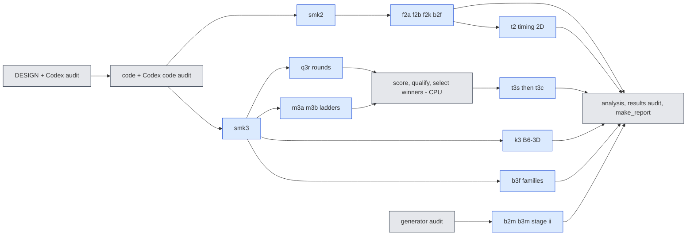

# jcp-dims — how do representation size $r$, test-space size $M$ and quadrature size $m$ each drive accuracy and cost, how many points does each rule family need, and does a quadrature-qualified 3D speed-up exist? (pre-registration)

**Status:** pre-registration, 2026-10-18, written before any code or data of this lane. Amendments are appended at the
end, dated; nothing above them is rewritten. Every accuracy number of this lane is scored against the E0 second-order
reference $R_{ST}$, whose per-case uncertainty $\varepsilon_{\rm ref}$ is a **conditional Richardson estimate** (not a
rigorous bound; the E0 cross-check rule was amended after data, E0 A10). Post-hoc labels carry forward unchanged: E0 A10;
combined A10, A11 and the retracted A15.

Governing documents (later supersedes earlier): `reports/2026-10-17-full-experiment-plan/PLAN-v2.md` (A3, A4, B3, B6),
`PLAN-v3-amendments.md` (V3-1, V3-3, V3-5), `PLAN-v4-amendments.md` (V4-1, V4-2, V4-5); `campaign/P1-RESTATEMENT.md` +
`P1-RESTATEMENT-AMENDMENTS.md` (AM-2 Q2, AM-4/AM-7 verdict style); `campaign/briefs/COMMON-BRIEF.md` (binding);
`campaign/briefs/jcp-dims.md` (lane brief, wins on conflict); `reports/2026-10-08-jcp-lane-agent-rules.md`.

Lane: worktree `worktrees/2026-10-18-jcp-dims`, branch `exp/2026-10-18-jcp-dims` (fork `21c175a1b`, setup `2045e5908`),
lane dir `experiments/jcp-dims` (here), namespace `/cluster/tufts/paralab/tawal01/jcp-dims/`, lane cap **3** concurrent
jobs (campaign cap 8, checked on the account before every submit), **55 GPU-h** including contingency, with reservation.

Built on (read, cited; code copied with provenance; their certified results are **cited, not re-run** except where a
reproduction gate needs them): `jcp-qualify` (`worktrees/2026-10-18-jcp-qualify`, final: Q1/Q2 machinery, 2D driver
`qacc.py`, timing driver `qtime.py`, FRONT-2D, the 3D Q2 rounds that stopped at the round limit with 16 exposed and 146
open candidates); `jcp-p1-scaling` (frozen mode lists, `p1core`/`p1common`, kernel harness, statistics); `jcp-speed3d`
(3D context `s3ctx`, solvers `fs3`/`qn3`, screening and confirmation timing, comparators C_old, C_W768, C_W1024, its 436
eligible screened configurations); `jcp-wide-bank` (configurable $M$: `w2d.py`, `w3d.py`; first-order M/r = 2, 3, 4
results, PROVISIONAL); the 2026-10-01 quadrature lanes (rule generators: 2D `qcore.offmesh_rule`, Hari's
`hari_quadrature.py`; 3D `rules.py`); `jcp-mechanism` (the gain comes from the exact gradient, not point placement).

Prior facts that shape the questions (cited, not re-derived): K2 fired in 2D and 3D (a spectral FOM wins at equal
accuracy); speed3d's H2 winners are **not** quadrature-qualified (qualify: successor-rule distances 8.1e-4, 9.5e-4 >
2.5e-4); in 3D only 4 of 55 tested speed3d configurations passed Q2, all at W256 or W512; wide-bank's 2D/3D trims to
$M/r<4$ were "not acceptable" against first-order references and its predicted "smaller $M$ needs fewer points" was
contradicted. The low mixed-frequency idea comes from the paper plan (`2026-10-06-jcp-offmesh-paper-plan/02`,
`07` C4): Smolyak fails because the sine tests have high mixed frequencies.

## 0. Questions and outcome labels

| item | question | outcome labels |
|---|---|---|
| **A3** | in the factorial $r\times M\times m$ (2D at $1024^2$, 3D at $65^3$), how do accuracy and cost change along each axis with the other two held fixed, and how does the change along the deployed path ($M=4r$, $m=m^\*$) split into representation, test-space and quadrature parts? | per transition: improves / does not improve / inconclusive (AM-7, §6.1); per axis cost elasticity with interval (descriptive); decomposition shares with intervals (descriptive) |
| **A4** | $m^\*(r,M)$: the smallest qualifying point count per rule family on a pre-declared candidate list, own reached states, both Q2 bars | $m^\*$ = a candidate (stable / non-monotone) or **none**, or "not reached" (§6.2) |
| **A4-3D front** | complete the 3D Q2 search (the 16 exposed candidates first) so every width W256–W1024 has qualified members; re-time qualified 3D configurations against C_old, C_W768, C_W1024 in paired panels | per width: covered yes/no; H2q per comparator: pass / fail / no qualified tie-or-beat configuration (§6.5) |
| **B3** | do rule families (Gauss, lattice, Sobol, Smolyak, 2D Halton; then MC and 3D Halton) reach qualification with different point counts, and do they converge to the same answer? | per family pair: fewer points / comparable / qualifies-vs-not (§6.3); cross-family limit agreement pass / flagged |
| **B6** | does accuracy change with the test-space ratio $M/r\in\{1,2,3,4,8\}$; does the weak control $M=r$ degrade; is Galerkin ($Q^{\mathsf T}\mathcal R=0$) more or less accurate than LSPG at each ratio; does a low mixed-frequency test set help Smolyak? | per transition: improves / does not improve / inconclusive; control fired / not fired (blocks B6); GAL vs LSPG: GAL more accurate / LSPG more accurate / neither / inconclusive (§6.4) |

Three labels are kept separate everywhere (V4-2): (1) **numerical qualification** (Q1 + Q2), (2) **role
qualification** (§6.5 only: "ties-or-beats comparator C"), (3) **frontier usefulness** (not dominated). An unqualified
cell is reported with its failing label and never enters a verdict, a front or an $m^\*$.

## 1. The reduced model (unchanged from qualify §1 / speed3d §1)

**2D.** Bank coefficients $c\in\mathbb R^{r}$, $u=\hat G_r(x)\,c$ (frozen checkpoint `dn256b`, $R=512$, $K=16$,
rotation `rotation_R512`, ordered nested prefixes, full R512 bank with edges $[0,128,256,384,512]$). Test space: the
first $M$ entries of an explicit ordered list of discrete sine modes, $A=\Phi_M^{\mathsf T}\hat G_r$, $\Lambda$ the discrete
eigenvalues; tested advection by an off-mesh point rule $(x_q,w_q)_{q=1}^m$, $N(c)=\Psi^{\mathsf T}[(G_qc)\odot(G_sc)]$;
two-step LMM residual
$$\mathcal R_n(c)=A(\alpha_0c+\alpha_1c_n+\alpha_2c_{n-1})+\Delta t\,(\beta_0F(c)+\beta_1F(c_n)),\qquad F(c)=N(c)+\nu\Lambda Ac.$$
LSPG minimises $\lVert D\mathcal R_n\rVert$, $D=(\alpha_0+\beta_0\Delta t\,\nu\Lambda)^{-1}$; GAL solves
$Q^{\mathsf T}\mathcal R_n(c)=0$ with $A=QR_m$ (thin QR). Tolerances, budget, solver, initialisation contract
("full-field input sampled at quadrature points; full-field decode"), horizon 0.25 and outputs every 0.05: exactly
qualify §1 (`p1core.py`, `p1common.py` copied unchanged; the only change is the explicit $M$, §2.1).

**3D.** Speed3d's model at $65^3$ (W1024 bank prefixes W256/W512/W768/W1024, M2 bank M2_512), LSPG on the $M$ lowest
mesh sine tests with shell completion `complete_M` by default, off-mesh rule tables $B=\hat G(X)$, $D$, $P$; solvers
FS-K$k$ (`fs3`), QN-$k$ (`qn3`) and the adaptive reference ADT (`t2core`, level tight); cohort 923801 (64 cases); the
A2.3 lattice metric on $63^3$. No 3D Galerkin solver exists; B6 in 3D is LSPG only (scope statement, not a deferral).

## 2. Configurations (frozen before data)

### 2.1 2D: the factorial $\mathcal F_2$ at $1024^2$ (A3, A4, B6)

**Mode lists.** One explicit ordered list $F_{4096}$ = `modes_lean(1024, 4096)`; a cell with test count $M$ uses its
prefix $F_M$ (nested by the stable sort; V4-1 "fixed-mode" list at $1024^2$, the only mesh of this lane, so policy
"frozen" and "nominal" coincide here). Positive gate G-modes: the first 2048 entries of $F_{4096}$ equal P1's frozen
$F_{2048}$ (`list_hash_2048` recorded by qualify's `acc1024`), else stop.

**Cells.** $r\in\{128,256,384,512\}$; for each $r$ the test counts
$$\mathcal M(r)=\{\kappa r:\kappa\in\{1,2,3,4,8\}\}\cup\{4r':r'\in\{128,256,384,512\},\,4r'\ge r\}\cup\{2048\},$$
i.e. R128: {128, 256, 384, 512, 1024, 1536, 2048}; R256: {256, 512, 768, 1024, 1536, 2048}; R384: {384, 512, 768, 1024,
1152, 1536, 2048, 3072}; R512: {512, 1024, 1536, 2048, 4096} — **26 $(r,M)$ cells**. The union contains every panel:
fixed $(M,m)$ ($M=2048$, any rung, every $r$), fixed $m$ with $M=4r$, fixed $(r,m)$ over $\kappa$ (B6), fixed $(r,M)$ over
$m$ (A4), and every corner of the deployed-path decomposition (§6.1c).

**Gauss ladder** $\mathcal L_G$ = gauss64, gauss96, gauss128, gauss160, gauss192, gauss256, gauss320, gauss384
($m=p^2$: 4,096 … 147,456). Every $(r,M)$ cell runs every rung: **208 cells** per scheme.
**$m^\*$ candidates** (each needs $q^+$ and $q^{++}$ on the ladder): gauss64 … gauss256.

**Schemes per cell.**
- **LSPG-CN-R, $\Delta t_0=0.005$** (registered accurate LSPG scheme, primary in fom2d): all 208 cells.
- **GAL-CN, $\Delta t_0$** (Galerkin; GAL-CN stays a diagnostic per the coordinator decision of 2026-10-18 — its
  B6 comparison is reported as such): the 20 $\kappa$-cells ($r\times\kappa$) × all 8 rungs = 160 cells.
- **LSPG-CN, $\Delta t_0$** (the same LMM as GAL-CN, so GAL vs LSPG compares the solve equation alone): the 20
  $\kappa$-cells × all 8 rungs = 160 cells.
- **LSPG-BE, $\Delta t_0$** (deployed BE): the 20 $\kappa$-cells at gauss256 plus their $q^+$/$q^{++}$ (gauss320,
  gauss384) = 60 cells.

### 2.2 2D: rule families (B3) and the low mixed-frequency test set

**Family panel** at $(r,M)\in\{(128,512),(384,1536)\}$ (deployed nominal $M=4r$), LSPG-CN-R $\Delta t_0$. Ladders (rule
names of `qcore.offmesh_rule`; random families repeat the whole ladder for draws $s=0..4$; draw 0 is Hari's default):

| family | ladder | $m^\*$ candidates | draws |
|---|---|---|---|
| Gauss (deterministic) | $\mathcal L_G$ (from $\mathcal F_2$) | gauss64 … gauss256 | 1 |
| Fibonacci lattice, random shift | fib2584, 4181, 6765, 10946, 17711, 28657, 46368, 75025, 121393 | fib2584 … fib46368 | 5 (shift seed $s$) |
| Sobol, scrambled | sobol$2^{k}$, $k=11..17$ | $k=11..15$ | 5 (scramble seed $s$) |
| Halton, scrambled (2D) | halton$2^{k}$, $k=11..17$ | $k=11..15$ | 5 |
| Smolyak (Clenshaw–Curtis, boundary nodes removed) | smolyak8 … smolyak14 | smolyak8 … smolyak12 | 1 |
| **stage (ii)** Monte Carlo, uniform | mc$2^{k}$, $k=11..17$ | $k=11..15$ | 5 |

Stage (ii) (MC) runs only after its generator (a new `offmesh_rule` name `mc<m>` with a seed suffix, wrapping Hari's
`uniform_mc`) passes the Codex code audit and the CPU generator tests of §7. Seeds are carried in the rule name
(`fib4181s3`, `sobol8192s2`; no suffix = seed 0 = the deployed realisation), so every table carries its draw identity.

**Target (cross-family reference).** The gauss384 run of the same $(r,M)$ cell (from $\mathcal F_2$). For every family
rung the lattice distance to the target is recorded (the family's quadrature error against an independent family).

**Low mixed-frequency test set (B6-LMF; defer order position 2).** Selection rule (frozen): order all modes
$(k_x,k_y)$, $1\le k_x,k_y\le1023$, by the product $k_xk_y$ ascending, ties by the discrete eigenvalue $\lambda$, then
by $k_x$ (a hyperbolic cross); take the first $M=1536$ ($r=384$). Cells: Gauss ladder and Smolyak ladder, LSPG-CN-R
$\Delta t_0$, all 38 cases, full Q1/Q2. Stability checks (must pass before any accuracy number of the arm is read):
(i) $\mathrm{rank}(A)=r$ at $10^{-13}$ and $\mathrm{cond}(A)\le10\times$ the cond of the default $(384,1536)$ cell;
(ii) every run valid; (iii) Q1 pass at gauss256. A failed stability check makes the LMF result "unstable test space"
(reported, no verdict). Prediction registered (from the plan's C4): Smolyak's $m^\*$ under LMF is smaller than under the
default list; Gauss's is not larger.

### 2.3 3D: front completion and the $m^\*$ ladders (A4-3D, B6-3D, A3-3D, B3-3D)

**Rule ladders (3D)** — Gauss $\mathcal G_3$: gl16, gl20, gl24, gl32, gl40, gl48, gl56, gl64; lattice (CBC rank-1, shift
seed 0) $\mathcal T_3$: lat8192, lat16384, lat32768, lat65536, lat131072, **lat262144** (new; generated once locally by
the vendored, unchanged `cbc_lattice_vector3` + `rank1_lattice3`, committed with sha256 and its $P_2$ merit, exactly as
speed3d's `rules3d/make_rules.py` generated lat65536/lat131072). $m^\*$ candidates: gl16 … gl48; lat8192 … lat65536.

**(3R) Rounds.** Continue qualify's round procedure (its A1.1/A2.1, unchanged predicate and candidate universe: speed3d's
436 eligible configurations with a valid screening panel; dominance rule qualify §6 with speed3d's per-case $\eta$;
Q2-failed or unverified configurations removed after each round). Round 4 = qualify's 16 exposed candidates
(`exposed_untested`). Rounds 5–8: the current open candidates that are front members of the untested-plus-passed set,
ranked by screening cost, ≤ 20 per round. Lattice members whose $q^{++}$ was missing (lat65536 → lat131072 → none) now
use lat262144. Labels as qualify A2.1: always "qualified subset of the tested candidates", never "complete"; open list
reported.

**(3M) $m^\*$ ladders.** Settings $w\in\{$M2_512, W256, W512, W768, W1024$\}$ (deployed $M$ = `complete_M(65,4r)`)
× specs $\sigma\in\{$`fs|CN|0.01|K1` (accurate, Δt₀), `qn|BDF2|0.025|k4` (fast, 2.5Δt₀)$\}$ × both ladders, every rung,
all 64 cases. Plus the three comparators' own Q2 (C_old `M2_512|gl32|fs|BE|0.01|K1`, C_W768 `W768|lat32768|fs|BE|0.01|K1`,
C_W1024 `W1024|lat65536|fs|BE|0.01|K1`: $q^+$ on 64 cases, $q^{++}$ on cases 0–7). Configurations already in speed3d's
grid are rerun (reproduction gate ≤ 1e-10 against the speed3d archive, as qualify §2.4).

**(3B) Test-space and factorial panels (3D).** W512 (W1024 bank, $r=512$), spec `fs|CN|0.01|K1`, lattice ladder
lat16384 … lat262144, all 64 cases. Test lists: $\kappa=1$ **explicit lowest-512 list** (the first 512 entries of the
stable eigenvalue order; this breaks the degenerate shell and is labelled "shell-breaking control"); $\kappa=2,3,4,8$:
`complete_M(65, κ·512)` (shell-completed; $\kappa=4$ is the deployed 2052). Fixed-$(M,m)$ panel: the frozen $65^3$ list of
$r=512$ ($M=2052$, hashed) for $r\in\{256,512,768,1024\}$ on the lattice ladder (W1024 at $M=2052$ is $\kappa\approx2$,
labelled). The fixed-$m$ panel ($M$ nominal, lat65536, $r\in\{256,512,768,1024\}$) is contained in (3M) and costs
nothing extra.

**(3F) Rule families (3D, B3).** W512, $\kappa=4$, `fs|CN|0.01|K1`: Gauss and lattice from (3M); lattice shift draws
$s=1..4$ (lat8192 … lat262144); Sobol (`sobol3`, scrambled, $m=2^{13}..2^{18}$, draws $s=0..4$); Smolyak (`smolyak3`,
levels with $m\le262144$; `smol8` stays the registered must-fail control). Stage (ii): MC (`mc3` from Hari's `dim3.py`,
copied) and 3D Halton (new: `scipy.stats.qmc.Halton(d=3, scramble=True, seed=s)`), $m=2^{13}..2^{18}$, 5 draws, only
after the generator code audit. Target = the gl64 run of W512 (3M).

### 2.4 Cohorts, references, scoring (common brief §2; qualify §2.5)

2D: dev6 and val32 only (training disjointness asserted); 3D: 923801 only. No test64/923901 run, no sealed/OOD access;
`sealed/` and `custody/` never touched. Scoring offline on CPU through `refstore` (E0 store version pinned):
$e=\max_{k=1..5}\lVert u(t_k)-R(t_k)\rVert/\lVert R(t_0)\rVert$ on the $257^2$ / $63^3$ lattice; eligibility per case-kind
read from the store at scoring time; S only for LSPG-BE at $\Delta t_0$ in 2D (labelled), never in 3D; ties
$\lvert\Delta e\rvert\le2\varepsilon_{\rm ref}$; every scored record asserts its identity (cohort, case, time tag,
reference kind, reference sha256, store version, metric id, rule name including draw, $M$ and mode-list hash).

## 3. Qualification (inherited contract; nothing weakened)

**Q1 (2D)** — qualify §4.1 + A1.3 + A2.5 exactly: valid runs; in-job per-step certificate with a fresh autodiff
Jacobian (LSPG: $\gamma_n\le10^{-3}$; GAL: $\eta_n\le10^{-8}$, the registered Galerkin residual predicate);
non-certified steps ≤ 1 % pooled over all steps of all cases; lattice distance to the adaptive **tight** solve
≤ 2.5e-4 on **every** case; tight/tighter ≤ 2.5e-5 on dev6; G-cert and offline recomputation as qualify.
**Q1 (3D)** — speed3d eligibility (E-a valid, E-b certified non-stationary ≤ 1 % pooled, E-c Gram-lattice distance to
ADT ≤ 2.5e-4 on every case) plus ADT tight/tighter ≤ 2.5e-5 on cases 0–7 (the brief's anchor item, which speed3d
covered by its ADT gate); configurations certified in this lane's jobs.

**Q2 (both)** — AM-2 with the ladder: for rung $q_k$, $q^+=q_{k+1}$ and $q^{++}=q_{k+2}$ of the **same family and the
same draw**. Rollout bar: max over the five evolved outputs of the lattice relative distance between the $q_k$ and
$q_{k+1}$ runs ≤ 2.5e-4 on **every** case of the population (2D: all 38 — stricter than qualify's 16; 3D: all 64);
ρ bar: $\rho_{\max}\le0.116$ over the six own output states of every case, with $N$ the tested advection of the cell
(length $M$); finer-rule convergence: $q_{k+1}$ vs $q_{k+2}$ meets the rollout bar on dev6 (2D) / cases 0–7 (3D), else
"unverified (finer rule not converged)". Because the ladder neighbours are full production runs of the same cell, the
$q^+$ "replay" is the next rung's production run (same configuration in everything but the rule; asserted by manifest).
Labels pass / fail / unverified; the top two rungs of a ladder have no Q2 label ("ladder top").
**Numerically qualified** = Q1 pass and Q2 pass.

**Q3** — $\mathrm{cond}(A)$ and rank per $(r,M)$ cell (and per LMF/shell-breaking list); step-Jacobian singular values
at output indices 1, 3, 5 of dev6 for the $\kappa$-cells at gauss256 (descriptive; qualify §4.3).

## 4. Cost (timing)

**2D (job `t2`, H200, one job).** qualify's `qtime` protocol unchanged except the subject key adds $M$: reference A =
P1/qualify's (r = 384, $1024^2$, LSPG-CN-R, $\Delta t_0$, $F_{1536}$, gauss128); split and fused triplets, burn,
synchronisation, drift band $[1/1.1,1.1]$ (≤ 2 retries), dev6 × 2 repetitions, randomised order, doubled-work control,
injected identity fault. Cost $c$ = median over valid fused triplets of $t_{\rm fused}/\bar t_A$ (online cost,
full-field contract); $c_{\rm ev}$ = evolution only. Subjects: all 208 LSPG-CN-R cells, and for GAL-CN, LSPG-CN and
LSPG-BE the $\kappa$-cells at gauss256 and at their cell's $m^\*$ rung. **Timing-job identity** (replaces qualify's
in-job re-certification, because accuracy and timing run on the same GPU type): each subject's untimed scoring run must
equal the accuracy job's archived production run of the same cell to ≤ 1e-10 relative ($\max_k\lVert\Delta W_k\rVert/
\lVert W_0\rVert$) on every dev6 case, else that subject's timing is "unusable (identity)"; timed executions must
reproduce the scoring run's identity hash (qualify A4.1).

**3D (jobs `t3s`, `t3c`, H200).** Screening `t3s`: every numerically qualified 3D configuration of this lane and
qualify, plus C_old, C_W768, C_W1024, in speed3d's screening panel (A = C_old, cases 0–3 × 2 repetitions, A–B–A,
hashes, drift; `Ctx.time_panel` unchanged). Confirmation `t3c` (after the CPU selection of §6.5): speed3d's confirmation
panel for each (comparator C, winner) pair — A = C, B = winner, cases 0–7 × 3 repetitions (24 invocations), the full
mesh-path query (projection, step loop, decode), H200.

## 5. Cost model statements (descriptive, A3)

Per-iteration leading-order costs (plan §1): $C_N=O(mr+mM)$, $C_{J_N}=O(mMr)$, $C_{J^{\mathsf T}J}=O(Mr^2)$,
$C_{\rm chol}=O(r^3)$. For the 2D factorial the elasticities of $c$ are fitted as
$\log c=\beta_0+\beta_r\log r+\beta_M\log M+\beta_m\log m$ (least squares over the qualified LSPG-CN-R cells, case
bootstrap of the per-cell medians, 10,000 resamples, 95 % percentile intervals), reported beside the operation-model
values (1, 1, 1 if $J_N$ formation dominates). Iteration counts per cell are reported (cost can move through them).
No verdict: P1 already found kernel slopes below the operation model (its 7/8 fits failed).

## 6. Decision rules (frozen before data; three-way outcomes, precedence, actual eligible populations)

Throughout, a **resolved** case of a paired comparison is an eligible case (E0 eligibility of its case-kind, both
configurations numerically qualified, both runs valid) with $\lvert e_X-e_Y\rvert>2\varepsilon_{\rm ref}$; the others
are ties. Counts improve / worsen / tie / unqualified / ineligible are always reported, with the median paired change and
the worst change.

### 6.1 A3 (2D and 3D)

**(a) Transition rule (AM-7, verbatim style).** For a pair of cells $X\to Y$ differing in one axis: if either cell is
not numerically qualified → "inconclusive (unqualified cell)". Else if resolved cases < 50 % of the eligible cases →
"inconclusive (resolution)". Else **"improves"** iff > 50 % of resolved cases improve **and** the median paired change
$e_Y-e_X$ over eligible cases is < 0; **"does not improve"** otherwise. Precedence: unqualified, then resolution, then
the improvement test.

**(b) Panels and their transitions.**
- *Representation size* at fixed $(M,m)$: $M=2048$, rung gauss256: $r$ 128→256→384→512 (2D); $M=2052$ frozen, lat65536:
  $r$ 256→512→768→1024 (3D).
- *Representation size* at fixed $m$, $M=4r$: gauss256 (2D); lat65536 (3D) — reported, same rule.
- *Test space* at fixed $(r,m)$: §6.4.
- *Quadrature* at fixed $(r,M)$: §6.2.
- A **range** claim ("monotone over the panel") requires every transition of the panel to "improve"; otherwise the
  claim is limited to the named transitions; any inconclusive transition makes the range "inconclusive" unless another
  transition already "does not improve" (then "not monotone"). Every transition is reported, never only the passing ones.

**(c) Deployed-path decomposition (2D, descriptive).** Path points $P(r)=(r,4r,m^\*_G(r,4r))$ with $m^\*_G$ the
Gauss $m^\*$ of §6.2 (LSPG-CN-R). For consecutive $r_a\to r_b$ the change of median error $\Delta=f(P(r_b))-f(P(r_a))$
and of cost is split into the three one-axis steps by the Shapley average over the six axis orderings (every corner
cell exists in $\mathcal F_2$). A share is computed only if all eight corner cells are numerically qualified; otherwise
"decomposition not reached (unqualified corner)". Case-bootstrap 95 % intervals (cases resampled jointly across cells);
a component is labelled "reduces error" / "increases error" if its interval excludes 0, else "indistinguishable from
zero". Descriptive: no pass/fail.

### 6.2 A4 — $m^\*(r,M)$ per rule family

For a ladder (family, draw, cell, scheme) with candidates $q_1<\dots<q_J$: $m^\*$ = the point count of the **first**
candidate that is numerically qualified. Outcomes: **"$m^\*=m(q_j)$, stable"** if every larger candidate with a Q2
label is also qualified; **"$m^\*=m(q_j)$, non-monotone"** otherwise (the failing larger candidates listed); **"none
(within the candidate list)"** if no candidate qualifies; "not reached (budget / memory)" for an unrun ladder. A
candidate whose Q2 is "unverified" is not qualified. Random families: per-draw $m^\*_s$; the **family $m^\*$** is the
smallest candidate at which **all five draws** are numerically qualified ("none" if there is none); the median-draw
$m^\*$ and the range over draws are reported beside it. The 3D accurate and fast specs give separate $m^\*$ values; the
3D "width $m^\*$" is the larger of the two (reported with both).

### 6.3 B3 — rule families

At each family-panel cell and for the 2D/3D scheme of §2.2/§2.3:
- **Point efficiency** for families $X,Y$ with family $m^\*$ values: "**X needs fewer points**" iff
  $m^\*_X\le0.8\,m^\*_Y$; "**Y needs fewer points**" symmetric; "**comparable**" otherwise; "**X qualifies, Y does not
  (within its list)**" when exactly one is "none"; "neither qualifies" when both are.
- **Cross-family limit agreement (gate, per family):** the finest rung of each family (each draw) must be within the
  rollout bar (2.5e-4, every case) of the target (gauss384 in 2D; gl64 W512 in 3D). A family that fails is
  **"flagged: limit disagrees with an independent family"**, and its $m^\*$ is reported but not used in a point-efficiency
  verdict. (This is the plan's E1 requirement that a bad generating vector be caught by an independent family; the
  must-fail control is §7.)
- **Error against $m$** (descriptive): distance to the target against $m$ per family, with the min–max range over
  draws; E0 median and worst error against $m$. Intervals across draws are ranges over the 5 draws (labelled; with 5
  draws a percentile interval is not claimed).
- Prediction (registered, from `07-literature-check.md` C4; reported as confirmed / not confirmed, not as a verdict):
  Gauss geometric; lattice and Sobol algebraic; Smolyak fails on the mixed-frequency sine tests; MC slowest.

### 6.4 B6 — test space

Per $r$ and scheme, at **fixed rung gauss256** (primary; the same $m$ for every $\kappa$, so only the test space moves)
and at each cell's own $m^\*$ (secondary):
- Transitions $\kappa$: 1→2, 2→3, 3→4, 4→8 by the §6.1a rule; range verdict over 2–4 (primary, the plan's ratios) and
  over 1–8.
- **Must-degrade control (M = r):** for LSPG-CN-R at every $r$, the transition 1→4 must "improve" (equivalently $M=r$
  is worse than $M=4r$) by the §6.1a rule; if it does not at some $r$, the control "did not fire" there and every B6
  verdict at that $r$ is blocked ("test-space metric not shown to be sensitive"). If the $M=r$ cell is not numerically
  qualified (e.g. invalid runs), the control has fired by failure (reported as such).
- **GAL vs LSPG** at each $(r,\kappa)$, same rule: GAL-CN against LSPG-CN (same LMM; primary) and against LSPG-CN-R
  (the deployed LSPG scheme; secondary). Paired per case: "**GAL more accurate**" iff > 50 % of resolved cases favour GAL
  and the median paired change $e_{\rm GAL}-e_{\rm LSPG}<0$; "**LSPG more accurate**" symmetric; "**neither**" otherwise;
  "inconclusive" under the §6.1a precedence. At $\kappa=1$ the two forms solve the same square system when $A$ is
  invertible; their agreement there is a positive gate (≤ 1e-8 lattice distance on every case where both are valid).
- **B6-LMF:** Smolyak and Gauss $m^\*$ under the LMF list against the default list at $(384,1536)$, by the §6.3
  point-efficiency rule; E0 accuracy of LMF vs default at gauss256 by the §6.4 GAL-vs-LSPG rule with "LMF" and
  "default" in place of the forms.
- **3D:** the same transitions at W512 on the lattice ladder rung lat65536 (primary) and at $m^\*$; the $\kappa=1$
  shell-breaking list is labelled; the must-degrade control applies to 1→4.

### 6.5 A4-3D front and qualified re-timing (H2q)

- **Per-width coverage:** width $w$ is "covered" iff at least one numerically qualified configuration with that width
  exists among all tested (qualify's 4 passes, rounds 4–8, ladders); else "not covered", with the closest failing
  configurations listed.
- **Qualified 3D front:** qualify §6 dominance on the qualified configurations, cost = this lane's `t3s` screening
  ratio × $t_A$ (one job, so all costs share one panel), error median/worst over 64 cases. Labelled "qualified subset of
  the tested candidates" (never complete); open candidates listed.
- **H2q.** For each $C\in\{$C_old, C_W768, C_W1024$\}$: the winner $W_C$ = the cheapest (by `t3s` cost; ties within 3 %
  to the lower median then worst error, speed3d's `pick`) numerically qualified configuration whose median **and** worst
  E0 errors tie-or-beat $C$'s (speed3d §5 tie rule: interval overlap with endpoint propagation). $S_C$ = 1/(median
  confirmation ratio $t_W/\bar t_C$) from `t3c`. **Pass** iff $S_C\ge1/0.6$ and the confirmation panel is valid;
  **fail** iff $S_C<1/0.6$; "**no qualified tie-or-beat configuration**" if no winner exists; "inconclusive (panel
  invalid)". Each verdict carries the comparator's own Q2 label (§2.3); if $C$ itself is not quadrature-qualified the
  speed-up is labelled "qualified configuration vs the deployed (unqualified) comparator". Secondary (descriptive): the
  same against $C^q_w$ = the BE FS-K1 $\Delta t_0$ configuration of width $w$ at its smallest qualified rule
  (if it exists), so a qualified-vs-qualified ratio is available.
- Scope label on every 3D speed: "full-field $65^3$ mesh-path query, H200; not a comparison with the best FOM (K2
  already fired)". Speed3d's 2.01×/5.37×/17.2× are not re-labelled here; H2q is a new, separate quantity.

## 7. Controls (fixture, predicate, what it blocks)

Every control is shown to behave as registered in the real-size smokes (synthetic ones in CPU tests) before any verdict
is read; a misbehaving control blocks its claims until fixed and re-audited.

| control | kind | fixture and predicate | blocks |
|---|---|---|---|
| G-modes | positive | first 2048 entries of $F_{4096}$ hash-equal to P1's `list_hash_2048` | everything 2D |
| reproduction (2D, $M=4r$) | positive | the lane driver with explicit $M=4r$ at R384 gauss128 and R128 fib4181, LSPG-CN-R and LSPG-BE $\Delta t_0$, dev6: coefficients equal qualify's `acc1024`/P1 archives ≤ 1e-10 (H200 vs A100 archive: the bar is ≤ 1e-10, not bitwise) | all 2D cells |
| reproduction (3D, $M$ override) | positive | `Setting` with explicit $M$ = `complete_M(65,4r)` reproduces speed3d's archived coefficients of `W512|lat16384|fs|CN|0.01|K1` and `M2_512|gl24|fs|BDF2|0.0125|K1` ≤ 1e-10 on cases 0–3 | all 3D cells |
| under-resolved rule (2D) | negative | P1 A1.1 fixture (R384 $M=1536$ gauss32 → gauss64, LSPG-BE $\Delta t_0$, dev6; independent evidence `p1-scaling/checks/ctrl-fixture-under-resolved.json`): lane Q2 must return fail | Q2, A4, B3 |
| under-resolved rule (3D) | negative | qualify's fixture W512 lat8192 → lat16384 FS-K1 BE 0.01 (independent evidence: combined `SELECTION-3D-POSTHOC.json`); lane Q2 must return fail | Q2-3D, 3D front |
| Smolyak must-fail (3D) | negative | `smol8` at W512 κ=4: Q2 fail or Q1 fail (registered in quadrature-burgers3d as a must-fail rule) | B3-3D |
| bad generating vector (2D, 3D) | negative | rank-1 lattice with $z=(1,1)$ (2D, $n$ = fib ladder sizes) / $z=(1,1,1)$ (3D, lattice sizes), shift seed 0: the cross-family gate (§6.3) must flag it on ≥ 1 case, whatever its own Q2 says | B3 point-efficiency verdicts |
| draw identity | positive / negative | same seed twice → identical tables (sha256); seeds 0 and 1 → different tables; seed 0 equals the deployed rule's sha256 (fib4181, lat-family) | B3 draws |
| M = r must-degrade | negative (scientific control) | §6.4 | B6 at that $r$ |
| GAL = LSPG at κ = 1 | positive | §6.4 | B6 GAL vs LSPG |
| Q1 negatives | negative | qualify's LSPG and GAL budget-0 fixtures (independent NumPy evidence first), zero-update (motion > 100 × 2.5e-4) | Q1 |
| wrong-mesh / wrong-list table | negative | a table built for $M=1536$ fed to an $M=1024$ setting must raise; a $256^2$ table to $1024^2$ must raise | all |
| case / time / reference / rule-draw swap | negative | a swapped record (case, time tag, reference kind, Δt, rule draw suffix, $M$) must raise in scoring | all accuracy |
| timing | positive / negative | doubled work B/A ∈ [1.8, 2.2] with identical iteration counts; injected identity fault invalidates every triplet of that subject; speed3d T1 (C_old twice → ratio ∈ [1.8, 2.2]) in `t3s` | A3 cost, H2q |
| decision-rule synthetics | negative / positive | CPU fixtures through the actual functions: transition rule (all-improve → improves; 40 % resolved → inconclusive; unqualified → inconclusive), $m^\*$ (stable, non-monotone, none, all-draw), point efficiency (0.8 boundary), Shapley (additive synthetic → exact shares), GAL-vs-LSPG (symmetric cases) | all verdicts |
| generator tests (stage ii) | positive | CPU: MC/Halton3 points in $(0,1)^d$, weights sum 1, seeds distinct; integration of $\prod_i\sin(\pi x_i)$ and a smooth Gaussian bump: MC error within 4 standard errors over 32 seeds; Halton error < MC error at $m=2^{16}$ | B3 stage (ii) |
| memory pilot | positive | the largest 2D cell (R512, $M=4096$, gauss384 + its $q$ tables) and the largest 3D table (W1024 gl64; W1024 lat262144) built in the smoke; peak ≤ 120 GB (decimal), else the cell is "not reached (memory)" | the cells concerned |

## 8. Jobs, resources, defer order

| job | GPU | content |
|---|---|---|
| `smk2` | h200 | real-size smoke at $1024^2$: G-modes, 2D reproduction gates, a dev2 slice of every scheme on 4 cells (incl. R512 $M=4096$ gauss384 memory pilot and an $M=r$ cell), every 2D control, one family ladder per random family (2 draws, 2 rungs), the LMF stability checks, cost probes for the certificate |
| `smk3` | h200 | 3D smoke: $M$-override reproduction, the 3D under-resolved, smol8 and bad-vector controls, one ladder (W512 lattice, 2 rungs, cases 0–3), memory pilot W1024 gl64 and lat262144, cost probes |
| `f2a`, `f2b` | h200 | $\mathcal F_2$ LSPG-CN-R (`f2a`: R128, R256, R384; `f2b`: R512) |
| `f2k` | h200 | $\kappa$-cells: GAL-CN, LSPG-CN, LSPG-BE (+ LMF arm if not deferred) |
| `b2f` | h200 | 2D families stage (i) |
| `q3r` | h200 | 3D rounds 4–8 (one job per round, ≤ 20 members) |
| `m3a`, `m3b` | h200 | 3D ladders (`m3a`: M2_512, W256, W512; `m3b`: W768, W1024) + comparator Q2 |
| `k3` | h200 | 3D test-space and fixed-$(M,m)$ panels |
| `b3f` | h200 | 3D families stage (i) |
| `b2m`, `b3m` | h200 | stage (ii) MC / Halton3 (after the generator audit) |
| `t2` | h200 | 2D timing panel |
| `t3s`, `t3c` | h200 | 3D screening, then confirmation |

**Budget.** Hard cap 55 GPU-h including contingency; qualify's `ledger.py` (cap, namespace, job prefix `jd_` edited):
a job is submitted only if spent + Σ time limits of queued/running lane jobs + this job's time limit + the projected time
limits of the not-yet-submitted **never-dropped** jobs ≤ 55, the lane has < 3 jobs queued/running and the account < 8.
Time limit = 1.5 × a smoke-derived projection (`resources.py`; estimates, not bounds). A-priori estimate (re-priced by
the certificate): smokes 2; `f2a`+`f2b` 3; `f2k` 3; `b2f` 2.5; `q3r` 1; `m3a`+`m3b` 5; `k3` 1.5; `b3f` 2; `b2m`+`b3m` 2;
`t2` 2; `t3s`+`t3c` 1.5 ≈ 26 GPU-h.

**Defer order** (brief; the first listed is dropped first): (1) B3 stage (ii) (`b2m`, `b3m`); (2) the low
mixed-frequency test set; (3) the A3 3D fixed-$m$ panel (here contained in `m3`; only its separate reporting would be
dropped); (4) B6 $M/r=8$ (2D: the κ=8 cells of every scheme; 3D: κ=8). **Never dropped:** A4 2D (the Gauss ladders of
$\mathcal F_2$ and the B3 family $m^\*$ at the two cells, stage (i)), A4 3D front completion (`q3r`, `m3a`, `m3b`) and the
qualified 3D re-timing (`t3s`, `t3c`), B6 $M/r\in\{2,4\}$ and $M=r$ (2D and 3D). Deferred items are reported "deferred
(budget)", never silently omitted. If a never-dropped job cannot be reserved after every permitted deferral, the outcome
is "core incomplete (budget)" with the shortfall reported.

## 9. Analysis and deliverables

`dscore.py` (CPU): E0 scoring with identity assertions (incl. $M$, mode-list hash, rule draw), offline recomputation of
every Q1/Q2 quantity (independent NumPy decode as qualify `npcheck`), labels. `dstats.py`: transition rule, $m^\*$,
point efficiency, cross-family gate, Shapley decomposition, GAL vs LSPG, elasticity fit (all with the CPU fixtures of §7).
`analyze.py` → `runs/EXPORT.json` (every label, verdict, $m^\*$, front, key number; a `contract` field on every cost);
`make_report.py` → `report.md` + PNG plots: error and cost heat maps over $(r,M)$ per rung; error vs $m$ per family with
draw ranges; $m^\*$ table; $\kappa$ curves per $r$ and form; Shapley bars; 3D per-width $m^\*$ and the qualified front;
H2q panel. `runs/GPU-LEDGER.json`. No hand-typed number; Codex audits at every gated step.

## 10. Code (copy, then edit in the lane; `vendor/` untouched)

Copied from qualify (`exp/2026-10-18-jcp-qualify` @ `4399491eb`, sha256 in `PROVENANCE.json`): `p1core.py`,
`p1common.py` (edited: explicit $M$ and $M_{\max}=4096$, mode-list policies `frozen`/`lmf`; recorded as an edit with
the new sha256), `qcert.py`, `qacc.py` → `dacc.py` (ladder- and $M$-aware driver), `qtime.py` → `dtime.py`,
`qscore.py`, `qstats.py`, `npcheck.py`, `ledger.py`, `resources.py`, `cluster/{stage,submit,collect}`; from speed3d via
qualify: `c3common`, `s3common`, `s3ctx`, `fs3`, `fs3p`, `qn3`, `t2core`, `timing`, `replay`, `score3`, rule files,
`q3run.py` → `d3run.py` (ladder, $M$ override, ADT certification, screening and confirmation panels), `front3d.py`.
New: `rules3d/make_rules_dims.py` (lat262144, 3D Sobol/MC/Halton draws, bad-vector fixtures), the 2D rule-name parser
(draw suffix, `mc`, bad-vector `badlat<n>`), `dscore.py`, `dstats.py`, `analyze.py`, `make_report.py`, `make_configs.py`,
`test_dims.py` (CPU controls).

## 11. Integrity rules carried

Never quote a pre-September Burgers speed-up; never mention the heat POD-128 comparison; retractions stated plainly.
Every GPU number from the cluster (H200 throughout); local GB10 only for CPU analysis (`JAX_PLATFORMS=cpu`) and at most
one `jaxrun`. Codex audits read-only, no large copies (≤ 2 GB scratch under `/tmp/jcp-dims-audit-scratch/`, deleted
after each round), `df -h /home` ≥ 60 GB before each audit. Waits on PIDs with an overall deadline. Big arrays stay on the
cluster until pulled into `runs/` (local disk ~130 GB free; large `.npz` listed by sha256 in `LARGE_FILES.sha256`).

---

## Amendment A1 (2026-10-18, before any lane job; answers `audits/codex-design-1.md`, NEEDS-RESTATEMENT)

Supersedes the text above wherever they differ. Numbered by the audit's ranked blockers, then its other items.

**A1.1 Timing-job certification restored (blocker 1).** The §4 "timing-job identity" shortcut is **withdrawn**. `dtime`
keeps qualify's contract: every subject's untimed scoring run (dev6) is the recording program, certified in-job at every
step with a fresh autodiff Jacobian (LSPG $\gamma$, GAL $\eta$; A1.2 for $\kappa=1$), with tight replays on every dev6 case,
tighter replays on dev6, and Q2 on dev6 from the **same job**: the rollout bar against the next rung's scoring run (every
rung of a timed ladder is a subject, so the successor exists in-job; a subject whose successor is not a subject gets an
explicit $q^+$ replay), $q^{++}$ likewise, ρ on its own six dev6 states against the $q^+$ table. Timed executions must
reproduce the scoring run's identity hash (W, every internal state, per-step exit reasons and iteration counts; qualify
A4.1). The cross-job comparison with the accuracy job's archive (≤ 1e-10) is reported as an extra check, not a substitute.
A cell's **timing-job label** is "numerically qualified (dev6)" iff all of this passes; A3 cost verdicts and fronts use
only cells qualified in both the accuracy job (38 cases) and the timing job (dev6). 3D: `t3s`/`t3c` subjects are
re-run untimed and certified in-job exactly as speed3d's `rollouts` + ADT do, with hash identity of timed outputs.

**A1.2 Controls separated from scientific outcomes (blocker 2).**
- The GAL = LSPG agreement gate at $\kappa=1$ is **withdrawn**; the lattice distance between the two forms at $\kappa=1$ is
  reported as measured evidence (no gate, no block).
- **Square-system certificate.** At $\kappa=1$ ($M=r$, $A$ square) the LSPG stationarity ratio has the root pathology of
  qualify A2.5 (bounded below by about $\sigma_{\min}(J)/\lVert J\rVert_F$ at any non-zero residual), so for LSPG at
  $\kappa=1$ the per-step certificate is the residual predicate $\eta_n=\lVert\mathcal R_n(c_{n+1})\rVert/\lVert Ac_n\rVert
  \le10^{-8}$ (unweighted residual; $D$ is a positive diagonal, so the root sets coincide). This is a stated deviation for
  the square case only; the literal $\gamma_n$ is reported. G-cert for these steps compares the recomputed residual norm
  with the solver's recorded `tolratio` × tolerance (A3.2 of qualify for the zero-scale case).
- **$M=r$ must-degrade control** (brief): outcome "**fired**" iff the $\kappa$ 1→4 transition at that $r$ "improves" by
  the §6.1a rule on numerically qualified cells; "**did not fire**" iff both cells are qualified and the transition "does
  not improve" — an **adverse scientific result**, reported as such, and B6 transition verdicts at that $r$ are labelled
  "test-space sensitivity not demonstrated at this $r$" (blocked as the brief requires, never repaired by changing the
  criterion); "**unavailable (<reason>)**" if either cell is not numerically qualified or the transition is inconclusive —
  then the B6 verdicts at that $r$ are "blocked (control unavailable)". A qualification failure is **never** counted as
  degradation. The fraction of invalid runs and E0 errors of the $\kappa=1$ cells are reported regardless.
- **Smolyak** (2D and 3D) is a scientific family with a registered prediction, not a must-fail gate; `smol8` is not a control.
- **Bad generating vector** (2D `badlat`, 3D `badlat`): before any GPU use, an **independent CPU establishment** (NumPy,
  `npcheck`-style independent decode, not the job code) computes, at a frozen fixture — 2D: R384, $M=1536$, the six saved
  output states of dev6|0 from qualify's `acc1024` LSPG-CN-R $\Delta t_0$ archive; 3D: W512, $M=2052$, the six saved states of
  case 0 of qualify's `q3d` archive of `W512|lat16384|fs|CN|0.01|K1` — the target-relative tested-advection error
  $\rho_{\rm tgt}=\lVert N_{\rm bad}(c)-N_{\rm tgt}(c)\rVert/\lVert N_{\rm tgt}(c)\rVert$ (target gauss384 / gl64) for the
  bad rule at the size of the family's finest rung; the fixture is admitted only if $\rho_{\rm tgt}\ge1$ at every state
  (a tested advection wrong by ≥ 100 %). The control then requires the §6.3 cross-family gate to flag the bad rule on ≥ 1
  case (or the bad rule's cell to be not Q1-qualified, which is reported separately and does **not** count as the gate
  firing — the control is then "unavailable"). An admitted fixture that the gate does not flag blocks every point-
  efficiency verdict.
- **3D $M$ override (independent check).** For W512 the setting with $M=1027$ must satisfy, for the same rule (lat16384)
  and three fixed coefficient vectors (dev states of the reproduction fixture): (i) $A_{1027}$, $\lambda_{1027}$ and the
  $P$ columns equal the first 1027 rows/columns of the default ($M=2052$) setting's arrays (≤ 1e-13 relative; the tables
  are built at $M_{\max}$ and sliced, so this checks the slicing path), (ii) the tested advection $N(c)$ of the override
  equals the first 1027 entries of the default's $N(c)$ (≤ 1e-12), (iii) the recorded mode hash equals the hash of
  `C.modes(65, 1027)` computed independently on CPU, and the table shapes are $(1027,512)$ and $(m,1027)$. The default-$M$
  reproduction against speed3d's archive stays as a second, separate gate. Failure blocks every non-default 3D cell.
- **Cross-GPU reproduction:** a failed ≤ 1e-10 gate opens a diagnosis (driver, edit, provenance, GPU type); no attribution
  is made in advance and no 2D cell is read until it is resolved.

**A1.3 3D explicit-mode path (blocker 3).** `d3common.TablesM`/`SettingM` replace `c3common.Tables`/`s3common.Setting`
(installed before `s3ctx.Ctx` is built): the setting config carries an explicit $M$ (default: speed3d's
`complete_M(65, 4r)`); tables are built once per bank at $M_{\max}$ = the largest $M$ requested for that bank (W512
$\kappa=8$ requires `complete_M(65, 4096)` = **4097**, so the W1024 bank is built at 4097 whenever κ=8 runs); every
setting records $M$, the mode-list hash of `kxyz[:M]`, the rule sha256 (points + weights); `lean`, `rule_data`, the rule
cache and all identities carry $M$. The $\kappa=1$ control uses exactly 512 modes (shell-breaking, labelled). 3D lists for
$\kappa=2,3,4,8$ at $r=512$: `complete_M` of 1024, 1536, 2048, 4096 = 1027, 1538, 2052, 4097.

**A1.4 Table lifetimes and the memory pilot (blocker 4).** No job retains tables beyond their use: `dacc` processes one
(cell, rung) setting at a time (main + $q^+$ role tables live, then dropped; compiled queries cleared per setting);
`dtime` keeps only the reference A's tables persistent and builds each cell's ladder tables rung by rung (at most the
current and the next rung live), timing that cell's subjects in a block with fresh A–B–A triplets (randomised order inside
the block, block order randomised); 3D runners drop each rule's data (`Setting.drop`) after its last use (at most the
current rung, $q^+$ and target alive). The smokes pilot the **actual** live footprint of the heaviest block of each job
type: `dacc` R512 $M=4096$ rungs gauss256→320→384 with LSPG and GAL forms; `dtime` the reference A plus that block; 3D the
W1024 ladder tail gl48→gl56→gl64 and lat131072→lat262144 at $M=4097$ with the ADT and adaptive GAL queries compiled.
Peak device bytes ≤ 120 GB (decimal), else the cell or block is "not reached (memory)". The local CBC search for
lat262144 is CPU pre-processing (quadratic; run once locally, minutes), not charged to the GPU ledger, recorded in
`rules3d/rules_dims.json` with its runtime. For signed-weight rules (Smolyak) the 3D mesh-free Gram/Cholesky of
`Setting.data` is skipped (it is never used on the mesh path) so an indefinite Gram cannot invalidate a run.

**A1.5 Qualification state machine and decision precedence (blocker 5).** Labels per configuration, in this precedence:
1. **missing** — any registered run of its population absent (job failure / not run): no Q label, "not reached".
2. **Q1 fail** — any production run invalid; pooled non-certified > 1 %; any tight or tighter anchor invalid (the case
   is then unqualified and Q1 fails, qualify §4.1); any distance > bar or non-finite; G-cert or offline recomputation
   mismatch.
3. **Q2** (only if the next rung's runs exist): "**unverified (ladder top)**" for the top two rungs of a ladder (not
   qualified); "**unverified (successor invalid)**" if any $q^+$ run is invalid or missing on the population; else
   **fail** if any case's rollout distance > 2.5e-4 or is non-finite, or $\rho_{\max}>0.116$ (ρ conventions of
   `p1common.rho`: $0/0$ → excluded and counted, $b=0\ne a$ → $+\infty$, non-finite → $+\infty$); else "**unverified
   (finer rule unavailable)**" if $q^{++}$ runs are missing/invalid on the check cases; "**unverified (finer rule not
   converged)**" if they fail the bar; else **pass**.
4. **Numerically qualified** iff Q1 pass and Q2 pass. Unverified ≠ qualified, ≠ failed.

Decision-rule edge cases (frozen):
- Any comparison with **zero eligible cases** → "inconclusive (no eligible cases)"; the §6.1a resolution test requires a
  non-empty eligible population.
- **$m^\*$**: requires every candidate below it to carry a terminal label (pass/fail/unverified); a missing lower
  candidate → "not reached (incomplete ladder)". "Stable" requires every larger candidate labelled and qualified; a missing
  larger candidate → "$m^\*$ = X (stability unverified: incomplete ladder)".
- **Random families**: per-draw outcomes all listed; the number of draws with a finite $m^\*_s$ is reported; the family
  $m^\*$ is the smallest candidate qualified in **all five** draws (else "none"); the median-draw $m^\*$ treats "none" as
  $+\infty$ (censored) and is reported as "> top candidate" when censored; ranges are over finite draws with the censored
  count beside them.
- **3D width $m^\*$** = the smallest candidate qualified for **every** registered spec (the intersection; "none" if
  empty); per-spec $m^\*$ reported beside.
- **Cross-family gate**: evaluated only if the family's finest rung and the target are both valid and Q1-qualified on
  every case; otherwise "gate unavailable" and that family's point-efficiency verdicts are "inconclusive (gate
  unavailable)".
- **Shapley (§6.1c)**: computed on the common population of cases eligible and valid in all eight corner cells; $m^\*$
  values are frozen at their full-sample values (not re-selected in the bootstrap); the accuracy bootstrap resamples the
  38 cases, the cost bootstrap resamples the six dev6 timing cases (jointly across cells), separately; contributions are
  reported in absolute units, normalised shares only when $|\Delta|>2\times$ the median $\varepsilon_{\rm ref}$ of the
  population. Wording: "a selection-conditioned description of the difference between two deployed configurations, not a
  decomposition of the error norm".
- **H2q precedence** (§6.5): (1) comparator unavailable (missing runs, Q1 not passed, or invalid screening entry) →
  "inconclusive (comparator unavailable)"; (2) no numerically qualified configuration with a valid screening entry ties-
  or-beats $C$ → "no qualified tie-or-beat configuration **among the tested candidates** (bounded search)"; (3)
  confirmation panel invalid (speed3d `timing.py` validity: hashes, finite ratios, median drift in band, complete 24
  invocations) → "inconclusive (panel invalid)"; (4) $S_C\ge1/0.6$ → **pass**; else **fail ("the selected candidate failed
  confirmation")** — never "no qualified speed-up exists". Tie-or-beat uses speed3d `analyze.py:48–65` exactly: per-case
  endpoints ($e_i\pm\eta_i$) aggregated (median / max over cases) before the comparison, not an aggregate uncertainty added
  afterwards. Screening validity = speed3d's (`analyze.py:208–229`: valid panel, comparator selectable first).

**A1.6 3D Galerkin and the defer / core sets (blocker 6).**
- **3D GAL is included.** The adaptive Galerkin path exists (`c3common.Solvers.ad('GAL')`, `t2core`). The lane runs
  adaptive **GAL-CN** and adaptive **LSPG-CN** at $\Delta t_0=0.01$, prod tolerances, through `p1core.make_evolve` (the
  P1 copy of `t2core.make_evolve` with internal-state recording; dimension-agnostic, taking `c3common.nl3`/`nlJ3` and the
  3D form data of `t2core.form_data`), so both are certified in-job (LSPG γ, GAL η, qualify A1.3/A2.5; the κ = 1 rule of
  A1.2) with tight/tighter anchors. Panel: W512, $\kappa\in\{1,2,3,4,8\}$, lattice rungs lat65536 (primary), lat131072
  ($q^+$), lat262144 ($q^{++}$), 64 cases. The fixed-sweep `fs|CN|0.01|K1` κ-panel of §2.3 (3B) stays (deployment
  solver), with the lattice ladder lat16384 … lat262144.
- **Deferral is over unique configurations.** B6 $M/r=8$ deferral removes only configurations that exist solely as κ = 8:
  2D LSPG-CN-R cells (384, 3072) and (512, 4096) (all rungs) — (128, 1024) and (256, 2048) are shared with the deployed-
  path corners and the fixed-$M$ panel and are never dropped; the κ = 8 cells of GAL-CN, LSPG-CN and LSPG-BE (none shared);
  3D κ = 8 ($M=4097$) of every 3D form. The **A3 3D fixed-$m$ panel** is computed inside the never-dropped `m3` ladders, so
  deferring it saves no GPU time; it is therefore **not deferred** (stated, so the defer order's third item is void in
  effect). Low mixed-frequency: the LMF arm of `f2k` (its own settings). B3 stage (ii): jobs `b2m`, `b3m`.
- **Core (never dropped)**, per the brief: the 2D Gauss ladders of every non-κ=8-only $\mathcal F_2$ cell (LSPG-CN-R);
  the 2D family panel stage (i); the 3D rounds and `m3` ladders (with the BE spec, A1.7) and `t3s`/`t3c`; B6 $\kappa\in\{1,
  2,4\}$ for every 2D scheme and every 3D form. Everything else is non-deferrable but not core (κ = 3 cells, `b3f`, `k3`
  fixed-(M, m) panel, `t2`).

**A1.7 Manifests, comparators, fixtures (blocker 7).**
- `make_configs.py` writes `configs/MANIFEST-cells.json`: every configuration name, its full numerical identity (bank,
  rotation, $r$, $M$, list policy and hash, rule name with draw, $m$, scheme, form, Δt, tolerance level, budget,
  initialisation, weighting, output times, metric id), its $q^+$/$q^{++}$ links, and the candidate lists per (family, draw,
  cell, scheme); its counts are asserted against §2 and audited with the code. Rule names are the concrete parser names
  (`sobol2048s3`, not "sobol$2^{11}$").
- **3D Smolyak ladder (frozen):** smolyak8, 9, 10, 11, 12, 13 ($m$ = 2,559; 6,271; 15,103; 35,839; 83,967; 194,559;
  signed weights, boundary nodes removed); candidates smolyak8 … smolyak11.
- **3D Sobol ladder:** sob8192 … sob262144 ($2^{13}..2^{18}$) per draw; candidates sob8192 … sob65536.
- **BE spec added to `m3`.** The `m3` ladders run three specs: `fs|BE|0.01|K1` (deployed BE, the comparators' solver),
  `fs|CN|0.01|K1`, `qn|BDF2|0.025|k4`. The comparators' own Q2 labels are then ladder labels (C_old = M2_512 gl32 BE;
  C_W768 = W768 lat32768 BE; C_W1024 = W1024 lat65536 BE), and $C^q_w$ (§6.5) = the BE configuration of width $w$ at its
  BE-spec $m^\*$ (Gauss or lattice, the cheaper by `t3s` cost), if one exists; the comparator's Q1 is required in every
  case (speed3d eligibility recomputed in-job).
- The 2D LSPG-BE arm is not given an $m^\*$ (it runs only at gauss256/320/384: Q labels at gauss256 only).
- Previously failed qualify configurations are not re-tested; configurations whose $q^{++}$ is now available (lat262144)
  are tested afresh in round 4 if exposed (the 16 exposed include `W1024|lat65536|…`).

**A1.8 Other corrections.**
- Elasticity fit (§5): computed only if ≥ 12 qualified cells, the design matrix has full column rank with condition
  number ≤ 1e3, all costs positive and finite; else "fit unavailable"; the bootstrap resamples the six dev6 timing cases
  jointly across cells; labelled "descriptive full-query elasticities, not kernel exponents".
- Wording: every 3D absence statement says "among the tested candidates (bounded search)"; a winner failing confirmation
  is "the selected candidate failed confirmation".
- K2 and the retraction of the speed3d winners' qualification are carried unchanged; nothing in H2q is a comparison with
  the best FOM.

---

## Amendment A2 (2026-10-18, before any lane job; answers `audits/codex-design-2.md`, NEEDS-RESTATEMENT)

**A2.1 Square-system LSPG: stopping and certificate together (blocker 1).** A1.2's unweighted certificate is
**withdrawn** and replaced. For LSPG at $\kappa=1$ only ($M=r$; adaptive solver, 2D and 3D):
- *Stopping.* The solver records the weighted residual $r_n=\lVert D\mathcal R_n\rVert$ and stops at $\gamma\le g_{\rm tol}$
  or $r_n\le{\rm tol}_f\times$scale. For $\kappa=1$ the tolerance levels are prod $(10^{-3},10^{-9})$ (unchanged), **tight
  $(10^{-7},10^{-13})$, tighter $(10^{-8},10^{-15})$** — the inherited tight/tighter pairs with $t_f=0$ could stop only at an
  exactly zero residual on a nonsingular square system, so the residual alternative is given the GAL anchor values
  ($10^{-13}$, $10^{-15}$, relative to the same scale). Stated deviation for the square case.
- *Certificate.* Step $n$ is certified iff $\eta^w_n=\lVert D\mathcal R_n(c_{n+1})\rVert/{\rm scale}\le100\,t_f^{\rm prod}=10^{-7}$
  (the solver's own weighted quantity, recomputed from the saved states with the autodiff-free residual; 100× margin as for
  GAL), or ${\rm scale}=0$ and the raw weighted residual is exactly 0. G-cert compares the recomputed weighted norm with the
  solver's recorded `tolratio` × tol (same weighted norm; $|\Delta|\le10^{-6}\times$raw $+10^{-15}$). The literal $\gamma_n$
  and the unweighted $\lVert\mathcal R_n\rVert/\lVert Ac_n\rVert$ are reported without a verdict. "Square" does not imply a
  nonsingular step Jacobian: $\mathrm{cond}(J)$ is recorded per certified step (Q3) and a step with $\mathrm{cond}(J)>10^{12}$
  is reported as ill-posed (the certificate stands; a near-singular step is flagged in the report).
- The 3D fixed-sweep solver (`fs`) does not run at $\kappa=1$ (its stationarity certificate has the same pathology and it
  has no residual tolerance); the 3D $\kappa=1$ cells are the adaptive LSPG-CN and GAL-CN forms only.
- **Control mapping.** Each (dimension, scheme/form) has its own $M=r$ control, its own 1→4 transition at the B6 primary
  rung: 2D LSPG-CN-R, LSPG-CN, GAL-CN and LSPG-BE at every $r$; 3D adaptive LSPG-CN and GAL-CN at W512. The 3D `fs` κ-panel
  (κ ∈ {2, 3, 4, 8}) is governed by the 3D adaptive LSPG-CN control (labelled "control from the adaptive LSPG form").

**A2.2 Bad generating vector: fixtures pinned, predicate matched (blocker 2).** The cross-family gate (§6.3, A1.5) gets
a second, state-frozen component, and the control targets exactly that component:
- *Gate.* A family is **flagged** iff (a) its finest rung's rollout is farther than 2.5e-4 from the target's on ≥ 1 case
  (as before), **or** (b) $\rho_{\rm tgt}=\lVert N_{\rm fin}(c)-N_{\rm tgt}(c)\rVert/\lVert N_{\rm tgt}(c)\rVert>0.116$ at
  any state $c$ of the frozen fixture set $\mathcal S_{\rm fix}$ (the ρ bar of AM-2 applied to an independent family at
  rule-independent states). Both parts are computed in-job and recomputed offline.
- *Fixtures (pinned by sha256).* 2D: the six output states of dev6|0 in qualify `runs/smkA/archive/output/qacc_smkA/
  R_R384_LSPG_CNR_1.npz` (sha256 `3b00ba0f24261e4792fa05468313f7a6e1ab349ce883b53ce18fdd65a3c93dee`; R384 gauss128,
  $M=1536$, LSPG-CN-R $\Delta t_0$) — used for the $(384,1536)$ family panel; the $(128,512)$ panel uses the first 128
  coefficients of the same states (prefix bank; labelled "kernel fixture, not reached states of R128", as P1's fixtures).
  3D: the six output states of case 0 of member `W512|gl24|fs|CN|0.01|K1#q|fs|CN|0.01|K1` in qualify
  `runs/q3d/archive/output/q3run_q3d/W_q2.npz` (sha256 `0ca5015571184c2feba922cf014d18bdcbc7feba99fc009e60fa863989583f5b`;
  W512, $M=2052$).
- *Establishment (CPU, before any GPU use; independent NumPy code, `npcheck`-style decode of the bank at the rule points,
  not the job code):* $\rho_{\rm tgt}$ of `badlat<n>` ($n$ = the family's finest size: 2D fib121393 → `badlat121393`; 3D
  lat262144 → `badlat262144`) at every state of $\mathcal S_{\rm fix}$. The fixture is **admitted** iff $\rho_{\rm tgt}\ge1$
  at every state (ten times the bar). If not admitted, the control is "**unavailable (fixture not established)**", recorded,
  and the point-efficiency verdicts are labelled "bad-vector control unavailable" — the fixture is **not** re-chosen after
  seeing the result. An admitted fixture requires the in-job gate component (b) to flag `badlat`; otherwise every
  point-efficiency verdict is blocked. Component (a) for `badlat` is reported, with no required outcome.

**A2.3 3D timed/scored identity (blocker 3).** Every timed 3D execution (screening, confirmation, κ-panel cost) is
compared with its untimed scoring run by the sha256 of **all internal states and stopping records**: `fs`/`qn`: `W_all`
(every step's state) + per-step `reason`, `it`, `rej`; adaptive forms: `states` + `step_reason` + `step_it`; plus the six
output coefficient vectors. The timed query returns these arrays (hashed after the timer stops). A mismatch invalidates
that invocation (speed3d `timing.py` rule otherwise unchanged).

**A2.4 3D timing lifetimes (blocker 4).** 3D panels are run in blocks: the reference A's tables and compiled query are
persistent; per block (one setting × rule, all its subjects) the rule data are built, subjects created and warmed, A–B–A
triplets timed (randomised order within the block, block order randomised), then the subject closures, compiled queries
of that block (`Ctx.queries` entries) and rule data are deleted and `gc.collect()` + a device-memory check (in-use bytes
back within 1 GB of the pre-block value, else the job stops with "memory not released"). Expected invocation counts are
validated per subject across blocks (a subject with fewer valid invocations than registered is "panel incomplete").
The `smk3` pilot runs the actual block sequence on the heaviest blocks (W1024 gl64/lat262144 with A = C_old).

**A2.5 Shapley thresholds separated (blocker 5).** Accuracy shares are normalised only if $|\Delta e|>2\times$ the median
$\varepsilon_{\rm ref}$ of the common population; **cost** shares only if $|\Delta c|/c_a>0.05$ **and** the cost-bootstrap
95 % interval of $\Delta c$ excludes 0; otherwise absolute contributions only.

**A2.6 Re-pricing.** The resource certificate (`resources.py`) is computed from the smokes including the added 3D GAL,
the BE spec ladders and all certification, anchor and timing-certification work; no production job is staged without it.

---

## Amendment A3 (2026-10-18, before any lane job; answers `audits/codex-design-3.md`, NEEDS-RESTATEMENT)

**A3.1 3D identity payload per solver (blocker 1).** A2.3's field list is replaced by a solver-agnostic rule: the
identity of an execution is the sha256 of a deterministic serialisation of **every per-step array the query returns**
(keys sorted; for each key the key name, dtype, shape and bytes) plus the six output coefficient vectors and `W_all` /
`states`. Concretely, from the current code: `fs` — `W_all`, `reason`, `it`, `rej`, `pred`, `sat`, `gn`, `rn`, `lam`;
`qn` — `W_all`, `reason` and every per-step record of `qn3` (`q`, `n_exec`, `n_ref`, `n_bt`, `n_clip`, `n_mu`,
`refresh`, and any other per-step key present); adaptive (`p1core` recording evolve) — `states`, `step_reason`,
`step_it`, `step_gn`, `step_tolratio`. The list actually hashed is recorded per subject; the code audit checks it covers
every per-step key. The timed wrapper returns the whole payload, synchronises it before the timer stops, and hashes after.

**A3.2 Cross-family gate precedence (blocker 2).** Component (b) depends only on the rule tables at the frozen states, not
on any rollout: it is **available** whenever the finest rung's and the target's tables are built; a non-finite
$N_{\rm fin}$, a zero $\lVert N_{\rm tgt}\rVert$ with non-zero difference, or a non-finite ratio counts as
$\rho_{\rm tgt}=+\infty$ (flags); $0/0$ is impossible for a non-zero target state and is treated as flags if it occurs.
Precedence: (1) (b) flags → **flagged** (whatever the rollouts' Q1); (2) else, if the rollout part is available (finest
rung and target valid and Q1-qualified on every case) and (a) flags → **flagged**; (3) else if the rollout part is
unavailable → "**gate unavailable (rollout part)**" (point-efficiency verdicts for that family inconclusive); (4) else
**pass**. A1.5's Q1 prerequisite applies to part (a) only. The bad-vector control requires (b) to flag.

**A3.3 Zero-scale G-cert (blocker 3).** The solver's recorded weighted norm is recovered as
$r^{\rm rec}={\rm tolratio}\times({\rm tol}+10^{-300})$ (exactly inverting `p1core`'s record), at every scale; it must be
finite (an overflowed ratio fails G-cert for that step); G-cert: $|r^{\rm cert}-r^{\rm rec}|\le10^{-6}r^{\rm rec}+10^{-15}$.
The zero-scale certificate (certified iff the recomputed raw weighted residual is exactly 0) is unchanged. Raw norms and
scales are stored. The same recovery is used for GAL (qualify A3.2 is the special case).

---

## Amendment A4 (2026-10-18, before any lane job; answers `audits/codex-design-4.md`, NEEDS-RESTATEMENT on one item)

**A4.1 Fixture admission requires finite evidence.** The bad-vector fixture (A2.2) is **admitted** only if, at every
state of $\mathcal S_{\rm fix}$, the input coefficients, $N_{\rm bad}(c)$ and $N_{\rm tgt}(c)$ are finite, $\lVert
N_{\rm tgt}(c)\rVert>0$, and the finite ratio $\rho_{\rm tgt}\ge1$. Any non-finite value or zero target norm in the
establishment makes the fixture "**unavailable (fixture not established)**" — a computational failure is never an
established discrepancy. The conservative non-finite → flag convention of A3.2 applies only to the production gate. A3.2's
sentence "0/0 is impossible for a non-zero target state" is withdrawn (a non-zero coefficient vector need not give a
non-zero tested advection); the conservative flag stays. G-cert recovery (A3.3) is algebraically exact; floating-point
rounding is covered by its tolerance; for GAL the tolerance is the per-step $t_f\lVert Ac_n\rVert$ (`p1core.py:192`).

---

## Amendment A5 (2026-10-18, before any production job; dispositions of the smoke job audits)

**A5.1 Smolyak 3D is not a gate** (`audits/codex-job-smk3-1.md` item 1): §7's "Smolyak must-fail (3D)" row was withdrawn
by A1.2 ("Smolyak (2D and 3D) is a scientific family with a registered prediction, not a must-fail gate; `smol8` is not
a control"); the smoke therefore carries no `smol8` predicate. Smolyak runs as a family in `b3f` (smolyak8 … 13).
**A5.2 Smoke allowance.** The lane brief bounds each pre-production cluster smoke at ≤ 2 GPU-h and one at a time; each
smoke is reserved at its 2 h limit in the ledger and charged its measured hours. **A5.3** The submission's account-count
check inside the campaign lock fails closed (a failed `squeue` aborts with exit 76; COMMON-BRIEF §14).
**A5.4 Production release (coordinator, 2026-10-18 ~14:15 UTC).** Production is released once this lane's design, code
and smoke gates are clean; submission through the shared campaign sbatch lock (§14), lane cap 3, 55 GPU-h. In-lane
priority: A4 3D front completion + qualified 3D re-timing and A4 2D first (the never-dropped items).

## Amendment A6 (2026-10-18, after the 2D smoke smk2 5528125, before any production job)

**A6.1 G-cert floor (smoke finding).** The A3.3 G-cert bar $|r^{\rm cert}-r^{\rm rec}|\le10^{-6}r^{\rm rec}+10^{-15}$ was
too tight at machine-precision residuals: in `smk2` the recomputed and recorded raw residuals of GAL-CN steps and of
square-LSPG steps differed by up to $7\times10^{-14}$ absolute ($\le4.3\times10^{-15}$ relative to the step's scale) where
the residual itself was $\sim10^{-14}$ — round-off between the solver's and the certifier's evaluation order, while
qualify's GAL G-cert ($10^{-13}$ floor in $\eta$ units) passed the same steps. The bar becomes
$|r^{\rm cert}-r^{\rm rec}|\le10^{-6}r^{\rm rec}+10^{-13}\,{\rm scale}+10^{-15}$ (scale = $\lVert Ac_n\rVert$ for GAL, the LSPG
scale for square LSPG; i.e. qualify's floor transformed to raw units; a 23× margin over the observed round-off). Smoke
G-cert verdicts are recomputed offline with this bar; nothing else of the smoke is re-read. No production data exist.
**A6.2 Independent ρ subset.** The offline recomputation of ρ with independent NumPy tables (qualify recomputed it on the
dev cases of every configuration) is done on dev6|0 (six outputs) for every rho-carrying 2D configuration with
$m\cdot M\le4\times10^{7}$ (the NumPy tables of larger cells are too large for the local CPU), and the in-job ρ is used for the
rest; agreement on the subset is a required analysis check. 3D ρ is in-job only (as qualify's Q2-3D, recomputed offline on
two cases per job by `q3offline`-style CPU code where it fits).

## Amendment A7 (2026-10-18, production; resource certificates)

**A7.1 Cost model of the 2D accuracy certificate.** The first `f2b` attempt (5537386, H200) was cancelled after 14 min
(0.24 GPU-h charged): its certificate (linear-in-$w=mMr$ scaling from the heaviest smoke point, floored at the smallest
smoke per-case cost) under-estimated the small cells, whose per-case cost is dominated by fixed work (tight / tighter
solves, the $1024^2$ decode, ρ). `resources.py` now uses $t_{\rm case}=a+b\,w$ ($a$ = 75th percentile of the smoke
per-case costs of the arms with $w<w_{\rm ref}/10$; $b$ from the heaviest smoke point of the same form); `f2b` is resubmitted
as `f2br1` with that certificate. Further 2D certificates may be calibrated on the completed `f2a` production job's
per-arm elapsed times (same driver, same GPU type, 168 cells; GAL forms scaled by the smoke GAL/LSPG ratio), stated in the
certificate. Certificates remain estimates; the scheduler limit is the bound; ledger hours are charged as measured.
