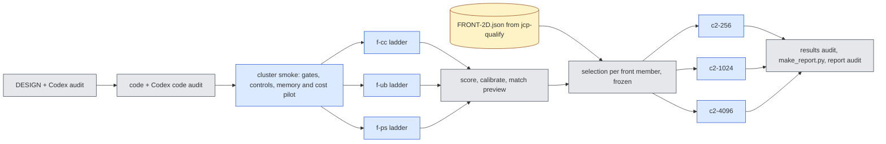

# jcp-fom2d — the 2D full-order comparator ladder (C1), the ROM–FOM crossover (C2) and 2D H-comp (pre-registration)

Lane `exp/2026-10-18-jcp-fom2d`, worktree `worktrees/2026-10-18-jcp-fom2d`, cluster namespace
`/cluster/tufts/paralab/tawal01/jcp-fom2d/` (one directory per job), at most 3 concurrent lane jobs and at most 8 on the
account, at most one local `jaxrun`, GPU-hour cap 30 including contingency (reservation = each job's Slurm time limit).
Written 2026-10-18 before any code or job of this lane. Governing documents: `reports/2026-10-17-full-experiment-plan/`
(PLAN-v2 C1/C2, V3-1, V3-5, V4-2, V4-6), the campaign briefs `COMMON-BRIEF.md` and `jcp-fom2d.md`, and
`reports/2026-10-08-jcp-lane-agent-rules.md`. Amendments are appended at the end, dated; this text is never rewritten.

## 0. Why, and the question

* The only 2D ROM–FOM speed-up on record that is matched in accuracy (combined H5, 13.6× for the selected LSPG-CN-R
  scheme, 17.7× best arm) was measured against a **same-mesh** finite-difference FOM with **sign-upwind** advection and
  CN/BDF2 time stepping, Newton tolerances calibrated on dev6, matched on the worst error only. The comparator mesh was
  never varied, no central-difference or spectral FOM was in the ladder, and the median was not matched.
* In 3D, jcp-speed3d added the FOM mesh and the central-CN-R and pseudo-spectral families: the spectral FOM at
  $N=16$ beat every selected ROM at equal accuracy and K2 of the governing plan fired (finite-ladder upper bound).
* P1 (jcp-p1-scaling) certified 2D ROM configurations at $256^2, 1024^2, 4096^2$ with flat evolution time
  (22–88 ms per query on an H200, full-field contract); the jcp-qualify lane will publish the qualified 2D front
  `runs/FRONT-2D.json`.

**Question.** For 2D viscous Burgers on the validation cohorts, what is the cheapest validated full-order model of each
family — upwind + BE, central + CN-R, sine pseudo-spectral ETDRK4 — over mesh × time step × solver tolerance, at the
accuracy of each qualified ROM front member; and, in paired timing on one GPU, how fast is each front member against
(a) the same-mesh FOM and (b) the best accuracy-matched FOM on any mesh, at the ROM meshes $256^2$, $1024^2$, $4096^2$?

## 1. The PDE, cohorts and references (inherited, unchanged)

$u_t + u(\partial_x u + \partial_y u) = \nu\Delta u$ on $(0,1)^2$, zero Dirichlet walls, Gaussian ICs
(`engines.initial`), outputs $t_k = 0.05k$, $k=0..5$. Cohorts: **dev6 + val32 = 38 cases** (selection population).
The historical test64 cohort is not used (no ROM counterpart is published for it; nothing here needs replication on it).
Sealed and OOD cohorts are never touched.

Reference: E0 $R_{ST}$ (store version pinned at first load, loader `refstore.py`, `JCPREF_STORE` on the cluster), metric
$e=\max_{k\ge1}\lVert u(t_k)-R(t_k)\rVert_2/\lVert R(t_0)\rVert_2$ on the $257^2$ scoring lattice (walls included),
per-case uncertainty $\eta=\epsilon_{\rm ref}$. Every accuracy number carries the label: *conditional E0 estimate
($\epsilon_{\rm ref}$ is a conditional Richardson estimate; E0 cross-check rule amended after data, E0 A10; combined
A10/A11 and the retracted A15 carry forward)*. **Eligibility is read per case from the store** (`reference_status`);
ineligible case-kinds are shown and never ranked or matched. $R_S$ is used only for upwind + BE at physical
$\Delta t = 0.005$ (reported beside, descriptive); every other $R_S$ comparison is an "unmatched diagnostic" and is not made.

**Tie rule** (speed3d §5 / Step 2, unchanged): on the common eligible cases, "$a$ ties-or-beats $b$" on the median (worst)
iff ${\rm median}(e_a-\eta)\le{\rm median}(e_b+\eta)$ (${\max}(e_a-\eta)\le\max(e_b+\eta)$). Per case, two arms are
resolved only if $|e_a-e_b|>2\eta$.

## 2. FOM families and code (all f64, every large array a traced jit argument)

| id | family | code | input (prepared outside every timer) |
|---|---|---|---|
| F-UB | sign-upwind advection + 5-point Laplacian, backward Euler | lane copy of E0 `refcore.py` (`adv='upwind'`, scheme `be`); arithmetic of the vendor `engines.make_fom` | nodal IC on the interior of mesh $L$ |
| F-CC | central advection + 5-point Laplacian, Crank–Nicolson with Rannacher start (CN-R) | lane copy of E0 `refcore.py` (`adv='central'`, `cnr`): E0's own scheme | nodal IC on the interior of mesh $L$ |
| F-PS | sine pseudo-spectral, 3/2-padded collocation, ETDRK4 | E0 `pscore.py` (byte-identical copy) wrapped as one jitted query `psjax2d.py` | sine coefficients of the continuous IC (`pscore.ic_coefs_2d`, Gauss–Legendre quadrature) |

Newton with BiCGStab on the JVP, preconditioned by the exact DST-I Helmholtz inverse, stop when
$\lVert{\rm res}\rVert\le n_{\rm tol}\lVert u_n\rVert$ or 20 Newton iterations or non-finite (E0 rule, unchanged).
Upwind + CN-R (speed3d F-UC) is **not** in this lane's brief and is not run.

**Output contracts.** Every FOM query maps (prepared input, $\nu$) to six output fields **inside one jitted call**:
* **lattice contract** (accuracy, and the screening cost): the $257^2$ scoring lattice. FD with $L\ge256$: the lattice
  nodes are mesh nodes (stride $L/256$, as E0 `to_lattice`). FD with $L<256$ ($L\in\{64,128\}$): **sine (DST-I)
  interpolation** of the interior nodal values — orthonormal DST-I of the $(L-1)^2$ values, coefficients scaled by
  $256/L$, zero-padded to $255^2$, inverse DST-I — exact at the coincident nodes. PS: synthesis of the sine series at the
  lattice (pscore).
* **full-field contract** (C2 timing, the contract of the P1/qualify ROM timings: "full-field input sampled at quadrature
  points; full-field decode"): the six fields on the $(N+1)^2$ nodes of the ROM mesh $N$. FD with $L=N$: native; $L>N$
  ($N\mid L$): restriction by stride; $L<N$ ($L\mid N$): the same sine interpolation to mesh $N$. PS: sine synthesis on
  mesh $N$ (pscore's `sine_synth_last` on zero-padded coefficients).

Lattice-contract fields of a full-field run are its stride-$N/256$ restriction, so the two contracts give **identical
lattice errors** (checked, gate G-CT). The ROM's input is its full-field IC on mesh $N$ sampled at its quadrature points
inside the timed query (P1 contract, unchanged); each FOM's input preparation is timed separately and reported, never
added to a ratio (speed3d A2.7(e)).

## 3. C1 — the FOM ladder

| family | mesh / modes | $\Delta t$ | tolerance levels |
|---|---|---|---|
| F-CC | $L\in\{64,128,256,512,1024,2048,4096\}$ | $\{0.025,0.0125,0.01,0.005,0.0025\}$ | calibrated (below) |
| F-UB | $L\in\{128,256,512,1024,2048,4096\}$ | $\{0.005,0.0025,0.00125,0.000625\}$ | calibrated |
| F-PS | $N\in\{16,24,32,48,64,96,128,192,256\}$ | $\{0.025,0.0125,0.01,0.005,0.0025,0.001,0.0005\}$ | none (explicit) |

That is 35 + 24 + 63 = 122 configurations, each run on all 38 cases (lattice contract).

**Tolerance levels (FD):** $t_0=(10^{-10},10^{-11})$ (reference), $t_1=(10^{-8},10^{-9})$, $t_2=(10^{-6},10^{-7})$,
$t_3=(10^{-4},10^{-5})$ as $(n_{\rm tol},l_{\rm tol})$. **Calibration** per (family, $L$, $\Delta t$) on dev6 cases 0–3:
$t_0$ must pass (finite; every stage's recorded relative residual $\le n_{\rm tol}$; complete stage evidence; a stage
that stops at the 20-iteration limit with the residual met counts as converged and is flagged — speed3d A2.5/A4.2), else
the configuration is **unavailable** (no fallback). The chosen level is the **loosest** $t_\ell$ that passes the same
convergence test and whose lattice output differs from $t_0$'s by $\le10^{-6}\,n_0$ at every output time on all four
cases ($n_0=\lVert R(t_0)\rVert$). Production then runs all 38 cases at the chosen level; a production case with any
unconverged stage makes the configuration **inadmissible** (reported, never matched).

**PS validity:** finite outputs and finite running $\max|u|$ on every case; otherwise inadmissible (explicit
ETDRK4 at large $\Delta t$ is expected to blow up at small viscosity — reported).

**Screening cost:** per configuration, after its 38 production runs, the warm lattice-contract time on dev6 cases 0, 1
× 3 repetitions (output hash equal to the production run), median. Screening costs only **order** candidates; every
cost that enters a speed-up comes from a C2 paired panel (§5).

**Per-family FOM Pareto front (C1 deliverable):** admissible configurations not beaten in all of screening cost,
median error and worst error (descriptive), with cost per FOM at each mesh.

## 4. Selection (matching) rules — pre-declared

For a **target** $T$ (a ROM front member at mesh $N$, with its per-case E0 errors) and a family $f$:

* **Admissible** FOM configuration: calibrated (FD) / valid (PS); converged and finite with complete evidence on every
  one of the 38 cases; finite scores; hash-checked finite screening timings.
* **Common population:** the cases of $T$'s published population that are E0-eligible; $\eta$ must agree between the
  ROM's and the FOM's score records (same store version) to $10^{-15}$.
* **Joint match (primary):** median **and** worst tie-or-beat $T$'s (§1 rule). **Median-only match** and **worst-only
  match** are recorded too (brief: "record both median-matched and worst-matched comparisons").
* **Selection:** the screening-cheapest matching configuration. **Confirmation by paired timing:** the three
  screening-cheapest joint matches (fewer if fewer exist) are all timed in the C2 panel; the confirmed comparator is the
  one with the smallest paired cost among them. Median-only and worst-only selections are timed (top 1 each).
* **Same-mesh match** (crossover (a)), FD families only: the screening-cheapest joint match among configurations with
  $L=N$. If none matches, "no same-mesh match"; the most accurate (lowest worst error) admissible configuration at
  $L=N$ is then timed and reported as an **unmatched** same-mesh comparison with both errors beside. PS has no mesh in
  this sense and enters only (b) and the union.
* **Labels.** Every matched speed-up is an **upper bound on the claimed ROM speed-up** (a finite ladder gives an upper
  bound on the optimal FOM cost; V4-6, speed3d `DESIGN.md:373–379`). A match at a **ladder edge** (the family's coarsest
  mesh / fewest modes, or its largest $\Delta t$) is flagged "edge": a cheaper FOM outside the ladder might also match.
  "No ladder match" = no admissible member ties-or-beats jointly; nothing is claimed for that cell.
* Matched labels **never transfer across ROM meshes**: matching is recomputed against the ROM's errors at each mesh.

Before FRONT-2D exists, the same matcher is run against P1's 22 qualified configurations as a **preview** (labelled
"preview against P1 configurations; superseded by FRONT-2D"; it selects nothing).

## 5. C2 — paired timing and crossover

**One job per ROM mesh $N\in\{256,1024,4096\}$, all on H200** (the 4096² bank needs 68.7 GB, P1). In each job:

* **A** (common baseline) = the P1 reference ROM configuration at mesh $N$: R384, gauss128, frozen mode list, LSPG-CN-R
  at $\Delta t_0$, **fused full query** (init + evolve + decode), full-field contract.
* **Subjects B:** every FRONT-2D member at mesh $N$ (fused full query, full-field contract) and every FOM selected in §4
  for any of them (full-field contract, one jitted call). Duplicates timed once.
* **Untimed scoring run** of every subject on the timing cases first: ROM per-case errors must reproduce FRONT-2D's to
  $|\Delta e|\le10^{-9}$ (gate G-RR); FOM per-case errors must reproduce the ladder's to $|\Delta e|\le10^{-9}$ (G-FR).
  Every later timed call's output must equal its scoring run's (identity: bitwise sha256; if the smoke shows that a
  family is not bitwise reproducible on the GPU, the pre-declared fallback is max relative difference $\le10^{-12}$, stated
  per family).
* **Triplets:** dev6 cases × 3 repetitions, randomised order (seeded), each `burn | A | burn | B | burn | A`, warm JIT
  (every subject run once per case before timing), drift $t_{A2}/t_{A1}\in[1/1.1,1.1]$ else repeated (≤ 2 retries) else
  invalid; P1's `timing.panel_validity` subject-level rule.
* **Cost** of B: median over valid (case, rep) of $t_B/\tfrac12(t_{A1}+t_{A2})$; absolute seconds beside. **Speed-up** of ROM
  $X$ against FOM $Y$: $S={\rm cost}(Y)/{\rm cost}(X)$. **Interval:** 10,000 case-level bootstrap resamples (cases with
  replacement; per case the median ratio over repetitions), percentile 95 %. With six cases the interval is coarse;
  "inconclusive" is an expected outcome.

**Crossover (a) same-mesh**, per FD family and front member: $S_a(N)$ against the same-mesh comparator at each $N$.
**Crossover (b) best matched**, per family and the **union** (the cheapest confirmed joint match over the three
families): $S_b(N)$. A crossover is reported only as a **bracket between actually run meshes** ("ROM faster from $N_i$",
"between $N_i$ and $N_{i+1}$", "not reached by $4096^2$", "ROM faster at every mesh") using the interval rule: ROM
faster at $N$ iff the lower bound of $S\ge1$; FOM faster iff the upper bound $<1$; else unresolved. Never interpolated
(governing plan E4: speed-ups are read from actually run settings). The same bracket is reported for $S\ge2$.

**H-comp (2D) decision rule (V3-5):** per (front member, family) cell and for the union, at $4096^2$ and at $1024^2$:
**pass** ("≥ 2× faster at matched accuracy") iff joint-matched and the lower bound of $S_b\ge2$; **fail** iff the upper
bound $<2$; **inconclusive** otherwise; "no ladder match" cells claim nothing. "≥ 2×" is stated only for passing cells.
**K2** (governing plan): fires iff, at $4096^2$, every linear-span front member's union speed-up has upper bound $<2$;
does not fire iff some member passes; otherwise inconclusive. If it fires it is reported prominently, as a valid result.

## 6. Gates (must pass) and controls (must fail), each checked on real data in the cluster smoke

| id | kind | check | blocks |
|---|---|---|---|
| G-FD1 | gate | lane `fomcore2` equals E0 `refcore` bit-for-bit (CPU, $L=256$, dev6 case 0, central CN-R and upwind BE) | every FD number |
| G-FD2 | gate | F-UB equals vendor `engines.make_fom` (BE, $L=256$, $\Delta t=0.005$, equal tolerances) to $10^{-12}$ relative (CPU) | F-UB as "the deployed FOM" |
| G-E0 | gate (**reproduce a trusted FOM**) | F-CC at $L=2048$, $\Delta t=0.00125$, $(10^{-11},10^{-9})$ on dev6 cases 0, 1 equals the stored E0 level `a0_L2048` lattice fields to $10^{-10}$ relative (GPU) | every F-CC number |
| G-PS1 | gate | `psjax2d` lattice output equals `pscore.make_ps(N,2).run` to $10^{-12}$ relative ($N=32$, 2 cases); control: half $\Delta t$ differs by $>10^{-9}$ | every F-PS number |
| G-PS2 | gate (**reproduce a trusted FOM**) | F-PS reproduces one stored E0 cross-check PS field (val32 case 0, run `N1024_dt0_a0`: its stored $N$, $\Delta t$ and IC quadrature) to $10^{-10}$ relative | every F-PS number |
| G-INT | gate | sine interpolation exact at coincident nodes ($10^{-14}$) and exact for a band-limited sine field ($10^{-12}$); PS FFT synthesis equals pscore matrix synthesis at the lattice ($10^{-12}$) | $L<256$ and full-field outputs |
| G-CT | gate | lattice restriction of a full-field output equals the lattice-contract output to $10^{-13}$ (each family, $N=1024$) | C2 accuracy pairing |
| K-loose | control | tolerance level X $=(10^{-2},10^{-3})$ with at most 1 Newton iteration at (F-CC, $L=256$, $\Delta t=0.01$) is **rejected** by calibration | calibration / "non-converged or too loose comparator rejected" |
| K-syn | control | synthetic matcher entries (zero cost but one unconverged case; zero cost but errors $10e_{\rm ROM}+4\eta+10^{-3}$) are rejected for every target | every match |
| K-false | control | a **falsely matched pair**: the selected real FOM's per-case errors with its worst case raised to $\max(e_T)+3\eta$ (median unchanged) must fail the joint match and pass the median-only match; and with every case raised by $3\eta$ above $T$'s median must fail the median match | every joint match |
| K-swap | control | scoring a FOM field against another case's reference, or with output times shifted by one, changes the score by $>10^{-6}$ | every score |
| T-dbl | control (positive) | B = A executed twice back-to-back in one timed interval: ratio in $[1.8,2.2]$ | every C2 ratio |
| T-fault | control | an injected fault (one subject's $A_2$ interval contains A executed twice): its drift is outside the band and the triplet is invalid | the drift gate |
| T-id | control | an injected wrong identity reference for one subject invalidates its triplets | identity veto |

A control that does not fire **blocks the claim it protects**; no case hunting. G-RR and G-FR (§5) gate each C2 job.

## 7. Jobs and GPU-hours (H200 throughout, so every timing shares one GPU type)

Estimate (before the smoke's cost certificate): smoke 0.5 h; f-cc 2 h, f-ub 2.5 h, f-ps 1 h; c2-256 1 h, c2-1024
1.5 h, c2-4096 2.5 h; reruns 25 %: **about 14 GPU-hours** (cap 30). Each production job needs a smoke-derived cost
certificate (`resources.py`, measured per-stage and per-call times × 1.5 within its time limit) and a ledger reservation
(`ledger.py`: spent + reserved + new limit ≤ 30). **Defer order** if the cap binds (first dropped first): F-UB at
$L=4096$ → tolerance levels $t_1,t_3$ (calibrate between $t_0$ and $t_2$ only) → the $256^2$ crossover job. Never
dropped: F-PS and F-CC at the ladder and in the $1024^2$ and $4096^2$ panels.

**If FRONT-2D.json is not committed and audited** when C2 is ready: heartbeat "waiting for FRONT-2D.json", poll at
most every 20 minutes, 12-hour deadline from the start of the wait; at the deadline C2 proceeds with **P1's qualified
configurations** as the targets at each mesh, labelled "P1 targets, FRONT-2D unavailable", and the hand-back says so.

## 8. Integrity

Every result records commit, config hash, cases, mesh, GPU, backend (`jax_backend=gpu` in the log), precision
(`JAX_DEFAULT_MATMUL_PRECISION=highest`, x64), job id and output paths. Scoring and analysis run on CPU (`JAX_PLATFORMS=cpu`)
from the pulled fields; the in-job scores are recomputed offline and must agree to $10^{-12}$. Anything chosen after
seeing this lane's data is labelled POST HOC. Large field archives stay outside git with a SHA256 manifest.

## 9. Deliverables

`DESIGN.md`, `INHERITED.json` (provenance of copied files), code (`fomcore2.py`, `psjax2d.py`, `fomrun2.py`,
`ladder.py`, `match2.py`, `c2time.py`, `offline.py`, `resources.py`, `ledger.py`, `cluster/`), `runs/GPU-LEDGER.json`,
`checks/` (gates, calibration, scores, matches, frozen selection), `audits/`, `report.md` generated by `make_report.py`,
plots (PNG): FOM Pareto fronts per family with the ROM front overlaid, cost per FOM against mesh, speed-up against mesh
with brackets; `runs/EXPORT.json` for the coordinator.

---

## Amendment A1 (2026-10-18, before any job; answers `audits/codex-design-1.md`, verdict NOT READY)

**A1.0 Wording.** §0: P1's 22–88 ms are **evolution** times (P1 `report.md` timing diagnostics), not full-query latencies.
Every "cheapest FOM" in this lane means **cheapest among the calibrated, admissible members of the tested ladder**; the
calibration rule (§3) is a conservative numerical-qualification policy, not an optimisation over tolerances. Combined
H5's E0 numbers were rematched from existing timings (no new timing), as its report says.

**A1.1 Ladder widened, PS stability label, one bounded extension round (audit item 4).** Replaces the table of §3:

| family | mesh / modes | $\Delta t$ |
|---|---|---|
| F-CC | $L\in\{32,64,128,256,512,1024,2048,4096\}$ | $\{0.05,0.025,0.0125,0.01,0.005,0.0025\}$ |
| F-UB | $L\in\{64,128,256,512,1024,2048,4096\}$ | $\{0.05,0.025,0.01,0.005,0.0025,0.00125,0.000625\}$ |
| F-PS | $N\in\{8,12,16,24,32,48,64,96,128,192,256\}$ | $\{0.05,0.025,0.0125,0.01,0.005,0.0025,0.001,0.0005\}$ |

(48 + 49 + 88 = 185 configurations.) **PS stability:** every PS configuration also carries E0's stability label
$\Delta t\le0.66\cdot2.8/(2d\pi N u_{\max})$ (`refjob.py:448–452`, $d=2$), with $u_{\max}$ the largest $|u|$ over the six
lattice outputs (a lower bound on E0's padded-grid running maximum, so the label is optimistic and called "E0 stability
label (lattice proxy)"). Admissibility does **not** require it (finite outputs only, as pre-registered); the report states
how many selected PS comparators carry a failing label. **PS anchor:** for every selected PS comparator the same $N$ at
$\Delta t/2$ (in the ladder, or run in C2 stage 0) gives a reported temporal self-difference. **Extension rule (one
round, bounded):** if a FRONT-target joint match of a family lies on that family's ladder edge (coarsest resolution or
largest $\Delta t$ among admissible members), one extension job adds, for that family only, the next coarser resolution
(CC/UB $L/2$ down to 16; PS $N-4$ down to 4) at every ladder $\Delta t$, and $\Delta t=0.05$ is already the output spacing
(no larger step exists). Matches still on an edge afterwards are labelled "edge (after one extension)". **Production
recovery rule:** if a production case is unconverged at the chosen level, the configuration is rerun once at the next
tighter level (all 38 cases); if that also fails it is inadmissible.

**A1.2 Same-mesh scope (audit items 1, 3).** Same-mesh crossover (a) uses FD at $L=N$ (UB, CC) and **same-resolution PS**
($N_{\rm PS}=N$, i.e. $N-1$ sine modes per axis, the FD interior count). PS at $N_{\rm PS}=256$ is in the ladder. PS at
$N_{\rm PS}\in\{1024,4096\}$ is **not run**: E0's stability rule needs $\Delta t\lesssim7\times10^{-5}$ and
$2\times10^{-5}$ there (E0 itself used $3.125\times10^{-5}$ at $N=1024$, 46 s per case on an A100), projected at ≳ 20 s
and ≳ 20 min per query, far above every matched comparator and unaffordable on 38 cases within the cap. Those cells are
reported as "same-resolution PS not run (projected cost)", never as "no match". The **same-mesh union** at a mesh is the
cheapest same-mesh joint match over the families available there (labelled with the families included).

**A1.3 C2 inference (audit item 6, blocking 1).** Replaces the cost/interval text of §5.
* **Three stages per job.** *Stage 0 (full-field screening, unpaired):* every admissible configuration that is a joint,
  median-only, worst-only or same-mesh match for any target at this mesh, plus the A1.1 PS anchors: one warm full-field
  run on dev6 cases 0 and 1 (median), identity-checked. *Stage 1 (selection block):* per (target, family, criterion) the
  three stage-0-cheapest matches → paired A–B–A on dev6 cases 0–5 × 1 repetition; the **selected comparator** is the one
  with the smallest stage-1 cost (median over cases of the per-case ratio). *Stage 2 (inference block):* every target ROM
  and every selected comparator, **fresh** triplets on dev6 cases 0–5 × 3 repetitions. **Only stage-2 data enter
  speed-ups, intervals and verdicts**; stage 1 only selects (no reuse of the selecting measurement).
* **Estimand.** Per subject B and case $i$: $r_{B,i}$ = median over its valid stage-2 repetitions of
  $t_B/\tfrac12(t_{A1}+t_{A2})$. ${\rm cost}(B)={\rm median}_i\,r_{B,i}$. Speed-up of ROM X against FOM Y:
  $S={\rm cost}(Y)/{\rm cost}(X)$ over the **common valid cases** (a case is valid for a subject if ≥ 2 of its 3
  repetitions are valid). If fewer than 5 of the 6 cases are common-valid, the pair has "invalid timing" (no verdict).
* **Interval.** 10,000 bootstrap draws of the common-valid case IDs with replacement; in each draw the **same** IDs are
  used for X and Y and the exact estimand is recomputed; percentile 95 % interval.
* **Identity veto (subject level).** A subject any of whose executions (scoring run, stage 0/1/2 timings) fails its
  identity check is **vetoed**: every claim using it is void and reported as such. If A fails identity, the whole panel is
  void.
* **Crossover brackets.** Each mesh is classified ROM-faster (lower bound ≥ 1), FOM-faster (upper bound < 1) or
  unresolved. The bracket reports both endpoint classifications ("FOM-faster at 256², ROM-faster at 1024²"), never an
  interpolated mesh, and reports non-monotone sequences as such ("reversal"). Same for the 2× level.

**A1.4 Populations, identities and K2 (audit items 3, 5, 6).**
* **Configuration identity** of a ROM target = (bank, $r$, rule, mode policy, scheme, $\Delta t$, solver, tolerances),
  mesh excluded. Crossover curves follow one identity across meshes; a mesh where that identity is not a numerically
  qualified FRONT member is reported as "not qualified at this mesh" and the bracket uses the remaining meshes, labelled.
* **Populations.** H-comp at a mesh uses the target's population at that mesh. **Crossover brackets use the common
  cross-mesh population** of that identity (the intersection of its populations at the three meshes, e.g. the 16-case
  subset if 4096² was scored on 16): the joint match is recomputed on that population at every mesh; the
  larger-population matches are tabled alongside. Case IDs, store version and candidate sets are frozen in
  `checks/FROZEN-SELECTION-<mesh>.json` (sha256 recorded) before stage 2 of each C2 job.
* **K2 universe = every numerically qualified linear-span configuration at $4096^2$** listed in FRONT-2D (front members
  and dominated qualified settings). All of them are subjects of the $4096^2$ C2 job. If FRONT-2D lists only front
  members, a dominated qualified setting X with dominator Y (cheaper, and median and worst both no larger) is covered by
  the monotonicity check $S_X\le S_Y$ (any FOM jointly matching Y also matches X when ${\rm med}(e_Y+\eta)\le{\rm med}(e_X+\eta)$ and
  $\max(e_Y+\eta)\le\max(e_X+\eta)$, verified numerically per pair); a setting for which neither direct timing nor the
  check is available makes K2 **inconclusive**, never an empty pass. Unqualified settings are outside "validated".

**A1.5 Controls repaired (audit item 7).**
* **K-false (constructed from the target, no real FOM needed):** clone the target's errors $e'=e_T$ (must tie-or-beat on
  both: asserted). *Worst failure:* on the case $j$ with the largest $e_{T,j}$ set $e'_j=U_T+\eta_j+\delta$,
  $U_T=\max_i(e_{T,i}+\eta_i)$, $\delta=10^{-9}$: the median is unchanged (upper-tail case, $n\ge3$) and the worst
  endpoint exceeds $U_T$, so the joint match must fail and the median-only match must pass (both outcomes asserted
  analytically before the matcher runs). *Median failure:* $e'=e_T+2\eta+\delta$: the median and worst must both fail.
* **K-syn:** synthetic records with cost $10^{-9}$ (valid positive) through the same validator; (a) one unconverged case
  must be rejected **with reason** "not converged", (b) errors $10e_T+4\eta+10^{-3}$ must be admissible and rejected by
  the tie rule (reason asserted).
* **K-loose:** fixture (F-CC, $L=256$, $\Delta t=0.01$, level X = $(10^{-2},10^{-3})$, ≤ 1 Newton iteration), dev6
  cases 0–3. Expected rejecting predicate: the $10^{-6}n_0$ agreement test (a local CPU check at $L=64$ gave
  $1.3\times10^{-4}$ and $7\times10^{-4}$); convergence is recorded separately. If the agreement predicate does not reject,
  the control has failed and blocks the calibration claim.
* **K-swap:** fixed pair (dev6 case 0's field against dev6 case 1's reference) and fixed time permutation
  $(t_0,t_0,t_1,t_2,t_3,t_4)$; labelled a sensitivity check of the scorer (metadata rejection is E0's loader tests G6/G7).
* **G-PS1:** fixture dev6 cases 0, 1, $N=32$, $\Delta t=0.01$; the half-step control compares $\Delta t=0.01$ with $0.005$.
* **G-PS2:** stored run `N1024_dt0_a0` ($N=1024$, $\Delta t=3.125\times10^{-5}$), IC by 256 panels × 32 Gauss points,
  lattice by the matrix synthesis retaining all modes (pscore `lattice_S`), as E0 `refjob.py:422–434`.
* **G-CT coverage:** $L<N$ (CC $L=128\to1024$), $L=N$ (CC $L=1024$), $L>N$ (UB $L=2048\to1024$), PS ($N=32\to1024$), and
  the largest workload (CC $L=256\to4096$).
* **G-INT sizes:** $L\in\{32,64,128\}\to256$ and $L\in\{64,256\}\to\{1024,4096\}$, both axes, zero walls.
* **T-dbl / T-fault:** two **separately dispatched, synchronised** executions inside the timed interval (P1 AM-8); the
  injected-fault drift is verified to lie outside the band before the classifier is read.
* **T-id:** subject-level veto (A1.3).
* **Where each control is shown to fire:** C1 controls (G-*, K-loose, K-swap) in the ladder smoke; K-syn and K-false on
  the P1 preview targets (offline, before FRONT) and again on the FRONT targets; T-* and G-RR/G-FR in a **C2 smoke**
  (one mesh, P1 reference ROM, two FOMs) before the C2 production jobs. G-RR/G-FR are scalar gates; trajectory identity
  is the subsequent timed-output identity check.

**A1.6 Resources (audit item 8).** The ladder smoke measures per-stage times for every family and resolution (one case,
every tolerance level) and the C2 smoke measures a **combined 4096² workload** (bank + largest FD/PS comparators + output
buffers, one shared bank, FOM executables cached per (L, target) and dropped after their subject's stage). Certificates
count calibration levels, compilation, scoring runs, warm-ups, stage 0–2 calls and retries, × 1.5. Deferred same-mesh
upwind cells are labelled "deferred", never "no match".

**A1.7 FRONT fallback (audit item 1).** If the 12-hour wait expires, C2 on P1 targets is reported as **partial P1-target
evidence**: FRONT-2D C2, the FRONT H-comp cells and the FRONT K2 stay outstanding and are listed as open in the hand-back.

---

## Amendment A2 (2026-10-18, before any job; answers `audits/codex-design-2.md`, verdict NOT READY)

**A2.1 C2 selection and inference (blocking 1).** Supersedes the remaining parts of A1.3.
* **Groups.** For each target $T$ (a ROM identity at mesh $N$ with a named population, A2.3) and each criterion
  (joint, median-only, worst-only, same-mesh, same-mesh-unmatched): one **family group** per family (its candidates =
  the family's matches under that criterion, A1.3 stage 0 order) and one **union group** for the joint and same-mesh
  criteria (candidates = the three stage-0-cheapest of every family group of that criterion, pooled).
* **Stage-1 validity.** Each candidate gets one A–B–A triplet per dev6 case (≤ 2 drift retries, identity veto). A group's
  selection population = the cases valid for **every** candidate of its stage-1 shortlist; if it has fewer than 5 of the
  6 cases, the group's selection is "invalid timing" (no selected comparator, no verdict). Stage-1 cost = median over the
  selection population of the per-case ratio. Ties: smaller stage-0 cost, then the key's lexical order.
* **Frozen before stage 2:** `FROZEN-SELECTION-<mesh>.json` holds every group's shortlist, stage-0 and stage-1 costs and
  the **selected comparator ID** (family groups and union groups); its sha256 is in the result. Stage 2 then measures
  every target ROM and every selected comparator afresh; speed-ups use only stage-2 data (A1.3 estimand and bootstrap).
  The union winner is never re-chosen from stage-2 data.
* **Scope of the inference.** Stages 1 and 2 use the same six dev6 cases: fresh repetitions remove selection on timing
  noise, not on case-specific workload. Every C2 speed-up and interval is therefore stated **conditional on the dev6
  timing workload**; the case bootstrap describes case-to-case variation within that workload and is not a
  selection-adjusted population inference. All C2 latencies are **prepared-input latencies** (A1 §2 input contract).
* **"Cheapest" wording.** The comparator is "the comparator selected by the registered screening procedure (stage 0 →
  stage 1)". If the procedure misses the ladder's true cheapest member, the reported FOM cost is too high and the ROM
  speed-up too favourable to the ROM — the same direction as the finite-ladder label, so every speed-up remains an
  **upper bound on the claimed ROM speed-up**. No claim of having found the ladder minimum is made.
* **PS anchors** are accuracy differences computed offline from ladder fields, not C2 runs: for a selected PS
  comparator $(N,\Delta t)$, the lattice distance (max over outputs and cases, relative to $n_0$) to $(N,\Delta t')$ with
  $\Delta t'$ the next smaller ladder step (for the smallest ladder step, the next larger one), reported beside it.

**A2.2 K2 (blocking 2).** The dominance shortcut of A1.4 is **withdrawn**. K2 is evaluated **directly**: the K2 universe
is the complete list of numerically qualified linear-span configurations at $4096^2$ in the jcp-qualify qualification
manifest (FRONT-2D or its companion manifest); every one of them is a subject of the $4096^2$ C2 job with its own
groups. If no complete manifest is available, K2 is reported as **inconclusive** with the front-member-only evaluation
beside it, labelled "front members only".

**A2.3 Populations in execution (blocking 3).** A target's key includes its population: `<identity>@<mesh>|H`
(H-comp population: the target's published population at that mesh) and `<identity>@<mesh>|X` (crossover population:
the intersection of the identity's eligible cases over every mesh where it is numerically qualified). Both get their own
matching, groups and selected comparators (deduplicated when the populations coincide). Matching on a population with
fewer than **3 eligible cases** is refused ("population too small"); K-false is evaluated only on populations with
$n\ge3$ eligible cases, with $j$ the first case (in population order) attaining the largest raw error.

**A2.4 Same-resolution PS at $1024^2$ and $4096^2$ (blocking 4).** A1.2's projected-cost argument is **withdrawn**. These
cells are **deferred by scope** (not run, no comparative claim), labelled "same-resolution PS not run (deferred)"; the
same-mesh union there is over the families run. As information only, the ladder smoke times one case of PS at
$N=1024$, $\Delta t=0.05/800$ (no claim attaches to it).

**A2.5 Extension rule made deterministic (blocking 5).** One global round, after every required target population at
every mesh (FRONT, or the A1.7 P1 fallback, same rule) has been matched on the base ladder. Trigger per family: some
selected **joint** comparator (any target, population or mesh) has that family's smallest admissible resolution. Added:
CC/UB $L_{\min}/2$ (only if $\ge16$ and not already in the ladder), PS $N_{\min}-4$ (only if $\ge4$ and not already
tested), at **every** ladder $\Delta t$ of that family, through the same calibration, admissibility and matching. A
step-edge-only trigger adds nothing: $\Delta t=0.05$ (the output spacing) is in every family's ladder, so no larger step
exists; such matches are labelled "edge (step = output spacing)". Coordinate-edge labels and the **boundary** label
(matched at the cheapest admissible member by screening cost) are reported separately. The C2 configurations are built
after the extension round. The unmatched same-mesh comparator is called the "lowest-worst-error unmatched comparator".

**A2.6 Code contract alignments.**
* **FD timed program:** the E0 solver's compiled call followed by the compiled output map, dispatched back-to-back
  inside one timed interval with no host synchronisation between them (E0 `refcore` is used byte-identically, so the two
  are not fused into one XLA program; the map is a few FFT/stride operations). Replaces "one jitted call" for FD.
* **PS validity:** `psjax2d` carries the running maximum of $|u|$ on the padded grid over every stage evaluation (as
  `pscore.make_ps`); a configuration is valid only if every case has finite outputs **and** a finite running maximum.
* **G-FD1** is the sha256 identity of the copied E0 modules (`refcore.py`, `pscore.py`, `cohorts.py`, `verdict.py`,
  `refstore.py`) with their sources: there is no lane modification, so execution equality follows; G-FD2 and G-E0 are the
  executed equalities.
* **Recovery (A1.1):** the recovery level is the next tighter level that **itself passed** the calibration predicate
  (convergence and $10^{-6}n_0$ agreement on the calibration cases; $t_0$ passes by definition); the offline validator
  accepts exactly that level for a recorded recovery; otherwise the configuration is inadmissible.
* **K-loose** fires only if the agreement predicate rejects (convergence recorded separately).
* **Interpolation factor:** from mesh $L$ to mesh $N$ ($L\mid N$) the orthonormal DST-I coefficients are scaled by $N/L$.
* **Resources:** certificates include input preparation, recovery reruns, the extension round and both population
  selections.
