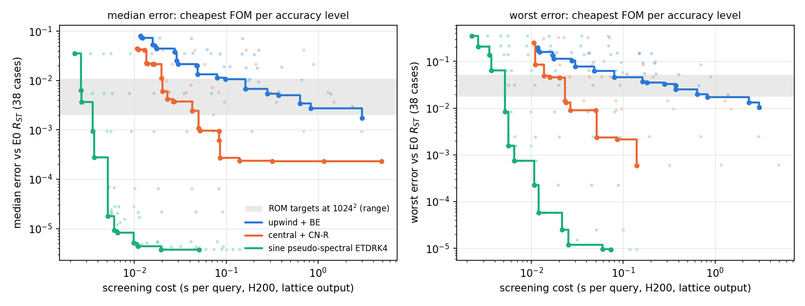
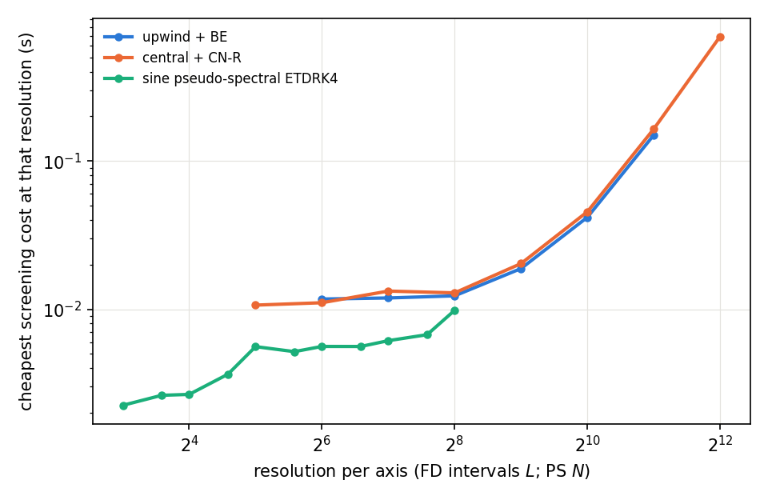
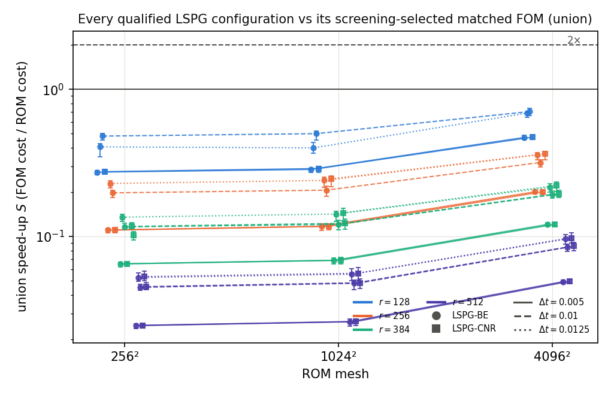

# 2D full-order comparator ladder and ROM–FOM crossover (viscous Burgers)

**Status:** final. Lane `jcp-fom2d` (plan C1, C2, 2D H-comp). Every accuracy number is a **conditional E0 estimate** against $R_{ST}$ (store `3ec3b5492748`; $\epsilon_{ref}$ is a conditional Richardson estimate, E0 A10; combined A10/A11 and the retracted A15 carry forward). Every matched speed-up is an **upper bound on the claimed ROM speed-up** (finite ladder; screening-selected comparator), stated conditional on the dev6 timing workload. Generated by `make_report.py` from the lane's JSON files and, for the historical H5 values, the combined lane's analysis JSON at a pinned commit; no measured number is typed by hand (registered design constants such as thresholds and ladder values excepted).

## Summary

- **C1 ladder:** 185 FOM configurations run on the 38 validation cases (dev6 + val32); 170 admissible. Acceptance: smoke_accepted yes, ladders_complete yes, ladders_accepted yes, store_versions_equal yes, offline_agrees yes, calibration_agrees yes, controls_all_fire yes.
- **upwind + BE:** 26 configurations on its (cost, median, worst) Pareto front; lowest-median-error front member UB $L=4096$, $\Delta t=0.000625$, t1 (median 0.150 %, worst 0.687 % — conditional E0 estimates; 13.0 s screening cost).
- **central + CN-R:** 26 configurations on its (cost, median, worst) Pareto front; lowest-median-error front member CC $L=4096$, $\Delta t=0.0025$, t1 (median 0.0232 %, worst 0.0624 % — conditional E0 estimates; 4.91 s screening cost).
- **sine pseudo-spectral ETDRK4:** 22 configurations on its (cost, median, worst) Pareto front; lowest-median-error front member PS $N=128$, $\Delta t=0.001$ (median 3.76e-4 %, worst 0.00251 % — conditional E0 estimates; 0.0509 s screening cost).
- **C1 screening selections (union, joint median-and-worst match, H populations):** the cheapest by lattice screening cost among the calibrated admissible tested ladder is sine pseudo-spectral ETDRK4 for 98 targets.
- **K2 (governing plan), primary scope LSPG-BE / LSPG-CN-R at $4096^2$:** fires under the registered dev6 workload rule (A3.1) — 21 qualified configurations, union speed-up $S$ between 0.0493 and 0.706 (below 1: the matched FOM is faster).
- **H-comp at $4096^2$, primary:** CC: ROM < 2x ×19; CC: unresolved ×2; PS: ROM < 2x ×21; UB: ROM < 2x ×2; UB: ROM >= 2x ×16; UB: unresolved ×3; union: ROM < 2x ×21.
- **H-comp at $4096^2$, GAL-CN diagnostic (post hoc):** CC: ROM < 2x ×11; CC: unresolved ×1; PS: ROM < 2x ×12; UB: ROM < 2x ×3; UB: ROM >= 2x ×6; UB: no match ×3; union: ROM < 2x ×12.
- **H-comp at $1024^2$, primary:** CC: ROM < 2x ×19; CC: unresolved ×2; PS: ROM < 2x ×21; UB: ROM < 2x ×2; UB: ROM >= 2x ×16; UB: unresolved ×3; union: ROM < 2x ×21.
- **H-comp at $1024^2$, GAL-CN diagnostic (post hoc):** CC: ROM < 2x ×11; CC: unresolved ×1; PS: ROM < 2x ×12; UB: ROM < 2x ×2; UB: ROM >= 2x ×6; UB: no match ×3; UB: unresolved ×1; union: ROM < 2x ×12.
- **Same mesh at $4096^2$ (central CN-R on the ROM mesh, joint matched):** $S$ between 5.84 and 83.6 (selected-comparator values: an upper bound on the claimed ROM speed-up over the same-mesh family; dev6 workload; compare the union range above, which uses the screening-selected comparator across families and meshes).

## Jobs, budget and integrity

| attempt | job id | GPU allocation | elapsed (GPU-h) | state |
|---|---|---|---|---|
| smk1 | 5366293 | gres/gpu=1 | 0.0889 | COMPLETED |
| fcc | 5373119 | gres/gpu=1 | 0.429 | COMPLETED |
| fub | 5373122 | gres/gpu=1 | 0.290 | COMPLETED |
| fps | 5373281 | gres/gpu=1 | 0.218 | COMPLETED |
| smkc2 | 5380338 | gres/gpu=1 | 0.0461 | COMPLETED |
| fub4k | 5380943 | gres/gpu=1 | 0.713 | COMPLETED |
| c24096 | 5456288 | gres/gpu=1 | 1.18 | COMPLETED |
| c21024 | 5456289 | gres/gpu=1 | 0.781 | COMPLETED |
| c2256 | 5456290 | gres/gpu=1 | 0.853 | COMPLETED |

GPU-hours spent: **4.59** of the 30.0 cap (ledger `runs/GPU-LEDGER.json`; measured `sacct` elapsed time, one GPU per job). Recorded devices: NVIDIA H200; every job logged `jax_backend=gpu`, f64 and `JAX_DEFAULT_MATMUL_PRECISION=highest`; cluster namespace `/cluster/tufts/paralab/tawal01/jcp-fom2d/` (job directories removed after collection; archives local, SHA256 manifests `runs/*/ARCHIVE.sha256`).

## Gates and controls

| check | passed / fired | numbers |
|---|---|---|
| G-FD1 (E0 modules byte-identical) | yes | 7 files |
| G-FD2 (F-UB = vendor `engines.make_fom`) | yes | max rel. diff 0 |
| G-E0 (reproduce E0 level `a0_L2048`, central CN-R) | yes | dev6\|0: 8.52e-15, dev6\|1: 9.08e-15 |
| G-PS1 (= `pscore.make_ps`; half-step control) | yes | rel 5.09e-16, 4.72e-16; half-step 3.59e-6, 1.17e-5 |
| G-PS2 (reproduce stored E0 PS run) | yes | N1024_dt0_a0: rel 5.20e-15 |
| G-INT (sine interpolation, PS synthesis) | yes | max 6.15e-15 |
| G-CT (full-field restriction = lattice output) | yes | max 1.63e-15 |
| K-loose (too-loose comparator rejected) | yes | agreement 1.43e-4, 7.17e-4, 0.00129, 6.25e-4 > 1e-6 |
| K-swap (case swap / time shift change the score) | yes | 0.00147 → 1.12 / 0.181 |

| C2 smoke ($4096^2$) | result | numbers |
|---|---|---|
| G-RR (ROM errors reproduce their targets) | yes |  |
| G-FR (FOM errors reproduce the ladder) | yes |  |
| T-dbl (doubled work) | yes | median ratio 1.98 |
| T-fault (injected drift caught) | yes | drift 1.97 |
| T-id (identity veto) | yes |  |
| combined workload memory | yes | peak 96.6 GB of 138 GB |

Matcher controls on every evaluated target (196): K-syn fired on 196, K-false (falsely matched pair rejected) fired on 196. Offline rescoring agrees with the in-job scores to 0.

## C1 — the FOM ladder

Three families on the $257^2$ scoring lattice: $F_{UB}$ sign-upwind + backward Euler (the project FOM), $F_{CC}$ central differences + Crank–Nicolson with Rannacher start (E0's scheme; its error against E0 partly measures the reference's own level difference), $F_{PS}$ sine pseudo-spectral + ETDRK4. FD meshes coarser than $256$ reach the lattice by sine (DST-I) interpolation; the metric is

$$e=\max_{k=1..5}\frac{\lVert u(t_k)-R_{ST}(t_k)\rVert_2}{\lVert R_{ST}(t_0)\rVert_2}.$$

Tolerance calibration (97 FD groups): production level counts t1: 37, t2: 60; recovered groups: 0; recomputed choice agrees with the job: yes.

| family | configurations | admissible | reasons (inadmissible) |
|---|---|---|---|
| upwind + BE | 49 | 49 | – |
| central + CN-R | 48 | 48 | – |
| sine pseudo-spectral ETDRK4 | 88 | 73 | non-finite score: 15; not converged / invalid on some case: 14 |

**Per-family Pareto front** (errors are conditional E0 estimates; admissible configurations not beaten in screening cost, median and worst error; screening cost = warm lattice-contract time on dev6 cases 0–1, H200, used only to order candidates):

*upwind + BE*

| configuration | screening cost (s) | median error | worst error |
|---|---|---|---|
| UB $L=64$, $\Delta t=0.05$, t2 | 0.0117 | 8.11 % | 19.9 % |
| UB $L=128$, $\Delta t=0.05$, t2 | 0.0119 | 7.55 % | 17.2 % |
| UB $L=256$, $\Delta t=0.05$, t2 | 0.0123 | 7.36 % | 16.0 % |
| UB $L=64$, $\Delta t=0.025$, t2 | 0.0159 | 5.36 % | 17.1 % |
| UB $L=128$, $\Delta t=0.025$, t2 | 0.0172 | 4.68 % | 13.4 % |
| UB $L=256$, $\Delta t=0.025$, t2 | 0.0174 | 4.40 % | 11.3 % |
| UB $L=64$, $\Delta t=0.01$, t2 | 0.0274 | 3.77 % | 15.6 % |
| UB $L=512$, $\Delta t=0.025$, t2 | 0.0276 | 4.28 % | 10.4 % |
| UB $L=128$, $\Delta t=0.01$, t2 | 0.0290 | 2.52 % | 10.7 % |
| UB $L=256$, $\Delta t=0.01$, t2 | 0.0300 | 2.17 % | 7.80 % |
| UB $L=128$, $\Delta t=0.005$, t2 | 0.0474 | 2.02 % | 9.91 % |
| UB $L=512$, $\Delta t=0.01$, t2 | 0.0484 | 2.01 % | 6.21 % |
| UB $L=256$, $\Delta t=0.005$, t2 | 0.0489 | 1.32 % | 6.51 % |
| UB $L=512$, $\Delta t=0.005$, t2 | 0.0800 | 1.14 % | 4.56 % |
| UB $L=256$, $\Delta t=0.0025$, t1 | 0.0979 | 1.06 % | 5.87 % |
| UB $L=512$, $\Delta t=0.0025$, t1 | 0.163 | 0.679 % | 3.69 % |
| UB $L=1024$, $\Delta t=0.005$, t2 | 0.180 | 1.06 % | 3.55 % |
| UB $L=512$, $\Delta t=0.00125$, t1 | 0.282 | 0.541 % | 3.26 % |
| UB $L=512$, $\Delta t=0.000625$, t1 | 0.371 | 0.501 % | 3.05 % |
| UB $L=1024$, $\Delta t=0.0025$, t1 | 0.373 | 0.586 % | 2.52 % |
| UB $L=1024$, $\Delta t=0.00125$, t1 | 0.637 | 0.344 % | 1.99 % |
| UB $L=1024$, $\Delta t=0.000625$, t1 | 0.829 | 0.274 % | 1.73 % |
| UB $L=2048$, $\Delta t=0.00125$, t1 | 2.34 | 0.297 % | 1.33 % |
| UB $L=2048$, $\Delta t=0.000625$, t1 | 3.02 | 0.173 % | 1.04 % |
| UB $L=4096$, $\Delta t=0.00125$, t1 | 10.1 | 0.275 % | 1.01 % |
| UB $L=4096$, $\Delta t=0.000625$, t1 | 13.0 | 0.150 % | 0.687 % |

*central + CN-R*

| configuration | screening cost (s) | median error | worst error |
|---|---|---|---|
| CC $L=32$, $\Delta t=0.05$, t2 | 0.0107 | 4.41 % | 24.9 % |
| CC $L=64$, $\Delta t=0.05$, t2 | 0.0111 | 4.22 % | 8.51 % |
| CC $L=256$, $\Delta t=0.05$, t2 | 0.0129 | 4.16 % | 8.58 % |
| CC $L=128$, $\Delta t=0.05$, t2 | 0.0133 | 4.18 % | 8.57 % |
| CC $L=32$, $\Delta t=0.025$, t2 | 0.0136 | 2.25 % | 30.8 % |
| CC $L=64$, $\Delta t=0.025$, t2 | 0.0138 | 2.19 % | 4.91 % |
| CC $L=128$, $\Delta t=0.025$, t2 | 0.0159 | 2.15 % | 4.55 % |
| CC $L=256$, $\Delta t=0.025$, t2 | 0.0165 | 2.14 % | 4.64 % |
| CC $L=32$, $\Delta t=0.0125$, t2 | 0.0197 | 1.12 % | 32.3 % |
| CC $L=64$, $\Delta t=0.0125$, t2 | 0.0202 | 0.609 % | 4.43 % |
| CC $L=64$, $\Delta t=0.01$, t2 | 0.0229 | 0.424 % | 4.52 % |
| CC $L=256$, $\Delta t=0.0125$, t2 | 0.0234 | 0.578 % | 1.42 % |
| CC $L=128$, $\Delta t=0.0125$, t2 | 0.0237 | 0.586 % | 1.33 % |
| CC $L=128$, $\Delta t=0.01$, t2 | 0.0264 | 0.379 % | 0.911 % |
| CC $L=256$, $\Delta t=0.01$, t2 | 0.0270 | 0.375 % | 0.922 % |
| CC $L=64$, $\Delta t=0.005$, t1 | 0.0426 | 0.246 % | 4.70 % |
| CC $L=512$, $\Delta t=0.01$, t2 | 0.0430 | 0.371 % | 0.951 % |
| CC $L=128$, $\Delta t=0.005$, t1 | 0.0502 | 0.109 % | 0.901 % |
| CC $L=256$, $\Delta t=0.005$, t1 | 0.0517 | 0.0959 % | 0.235 % |
| CC $L=512$, $\Delta t=0.005$, t1 | 0.0835 | 0.0950 % | 0.240 % |
| CC $L=128$, $\Delta t=0.0025$, t1 | 0.0840 | 0.0613 % | 0.917 % |
| CC $L=256$, $\Delta t=0.0025$, t1 | 0.0862 | 0.0272 % | 0.212 % |
| CC $L=512$, $\Delta t=0.0025$, t1 | 0.139 | 0.0239 % | 0.0594 % |
| CC $L=1024$, $\Delta t=0.0025$, t1 | 0.316 | 0.0234 % | 0.0601 % |
| CC $L=2048$, $\Delta t=0.0025$, t1 | 1.16 | 0.0233 % | 0.0619 % |
| CC $L=4096$, $\Delta t=0.0025$, t1 | 4.91 | 0.0232 % | 0.0624 % |

*sine pseudo-spectral ETDRK4*

| configuration | screening cost (s) | median error | worst error |
|---|---|---|---|
| PS $N=8$, $\Delta t=0.05$ | 0.00225 | 3.51 % | 35.2 % |
| PS $N=12$, $\Delta t=0.05$ | 0.00263 | 0.633 % | 20.9 % |
| PS $N=16$, $\Delta t=0.05$ | 0.00266 | 0.364 % | 6.14e24 % |
| PS $N=12$, $\Delta t=0.025$ | 0.00347 | 0.555 % | 21.4 % |
| PS $N=16$, $\Delta t=0.025$ | 0.00350 | 0.0939 % | 13.8 % |
| PS $N=24$, $\Delta t=0.025$ | 0.00365 | 0.0275 % | 6.34 % |
| PS $N=48$, $\Delta t=0.0125$ | 0.00518 | 0.00178 % | 0.845 % |
| PS $N=96$, $\Delta t=0.0125$ | 0.00561 | 0.00240 % | 0.157 % |
| PS $N=64$, $\Delta t=0.0125$ | 0.00561 | 0.00200 % | 0.259 % |
| PS $N=48$, $\Delta t=0.01$ | 0.00601 | 9.35e-4 % | 0.842 % |
| PS $N=96$, $\Delta t=0.01$ | 0.00650 | 0.00121 % | 0.0752 % |
| PS $N=64$, $\Delta t=0.01$ | 0.00661 | 8.27e-4 % | 0.246 % |
| PS $N=48$, $\Delta t=0.005$ | 0.00986 | 5.11e-4 % | 0.843 % |
| PS $N=96$, $\Delta t=0.005$ | 0.0108 | 4.49e-4 % | 0.0225 % |
| PS $N=64$, $\Delta t=0.005$ | 0.0110 | 4.34e-4 % | 0.243 % |
| PS $N=128$, $\Delta t=0.005$ | 0.0120 | 4.75e-4 % | 0.00577 % |
| PS $N=96$, $\Delta t=0.0025$ | 0.0195 | 3.78e-4 % | 0.0224 % |
| PS $N=128$, $\Delta t=0.0025$ | 0.0217 | 3.86e-4 % | 0.00251 % |
| PS $N=192$, $\Delta t=0.0025$ | 0.0253 | 4.33e-4 % | 0.00118 % |
| PS $N=128$, $\Delta t=0.001$ | 0.0509 | 3.76e-4 % | 0.00251 % |
| PS $N=192$, $\Delta t=0.001$ | 0.0598 | 3.80e-4 % | 9.53e-4 % |
| PS $N=256$, $\Delta t=0.001$ | 0.0730 | 3.79e-4 % | 9.44e-4 % |

**Cost per FOM by resolution** (screening-cheapest admissible tested configuration at each FD mesh $L$ / PS $N$, whatever its accuracy — not an accuracy-matched comparison; errors are conditional E0 estimates):

| family | resolution | cheapest configuration | cost (s) | median | worst |
|---|---|---|---|---|---|
| upwind + BE | 64 | UB $L=64$, $\Delta t=0.05$, t2 | 0.0117 | 8.11 % | 19.9 % |
| upwind + BE | 128 | UB $L=128$, $\Delta t=0.05$, t2 | 0.0119 | 7.55 % | 17.2 % |
| upwind + BE | 256 | UB $L=256$, $\Delta t=0.05$, t2 | 0.0123 | 7.36 % | 16.0 % |
| upwind + BE | 512 | UB $L=512$, $\Delta t=0.05$, t2 | 0.0188 | 7.27 % | 15.5 % |
| upwind + BE | 1024 | UB $L=1024$, $\Delta t=0.05$, t2 | 0.0417 | 7.23 % | 15.2 % |
| upwind + BE | 2048 | UB $L=2048$, $\Delta t=0.05$, t2 | 0.150 | 7.21 % | 15.1 % |
| upwind + BE | 4096 | UB $L=4096$, $\Delta t=0.05$, t2 | 0.636 | 7.20 % | 15.0 % |
| central + CN-R | 32 | CC $L=32$, $\Delta t=0.05$, t2 | 0.0107 | 4.41 % | 24.9 % |
| central + CN-R | 64 | CC $L=64$, $\Delta t=0.05$, t2 | 0.0111 | 4.22 % | 8.51 % |
| central + CN-R | 128 | CC $L=128$, $\Delta t=0.05$, t2 | 0.0133 | 4.18 % | 8.57 % |
| central + CN-R | 256 | CC $L=256$, $\Delta t=0.05$, t2 | 0.0129 | 4.16 % | 8.58 % |
| central + CN-R | 512 | CC $L=512$, $\Delta t=0.05$, t2 | 0.0203 | 4.16 % | 8.59 % |
| central + CN-R | 1024 | CC $L=1024$, $\Delta t=0.05$, t2 | 0.0455 | 4.16 % | 8.59 % |
| central + CN-R | 2048 | CC $L=2048$, $\Delta t=0.05$, t2 | 0.164 | 4.16 % | 8.59 % |
| central + CN-R | 4096 | CC $L=4096$, $\Delta t=0.05$, t2 | 0.692 | 4.16 % | 8.59 % |
| sine pseudo-spectral ETDRK4 | 8 | PS $N=8$, $\Delta t=0.05$ | 0.00225 | 3.51 % | 35.2 % |
| sine pseudo-spectral ETDRK4 | 12 | PS $N=12$, $\Delta t=0.05$ | 0.00263 | 0.633 % | 20.9 % |
| sine pseudo-spectral ETDRK4 | 16 | PS $N=16$, $\Delta t=0.05$ | 0.00266 | 0.364 % | 6.14e24 % |
| sine pseudo-spectral ETDRK4 | 24 | PS $N=24$, $\Delta t=0.025$ | 0.00365 | 0.0275 % | 6.34 % |
| sine pseudo-spectral ETDRK4 | 32 | PS $N=32$, $\Delta t=0.0125$ | 0.00559 | 0.00216 % | 3.13 % |
| sine pseudo-spectral ETDRK4 | 48 | PS $N=48$, $\Delta t=0.0125$ | 0.00518 | 0.00178 % | 0.845 % |
| sine pseudo-spectral ETDRK4 | 64 | PS $N=64$, $\Delta t=0.0125$ | 0.00561 | 0.00200 % | 0.259 % |
| sine pseudo-spectral ETDRK4 | 96 | PS $N=96$, $\Delta t=0.0125$ | 0.00561 | 0.00240 % | 0.157 % |
| sine pseudo-spectral ETDRK4 | 128 | PS $N=128$, $\Delta t=0.0125$ | 0.00614 | 0.00280 % | 0.157 % |
| sine pseudo-spectral ETDRK4 | 192 | PS $N=192$, $\Delta t=0.0125$ | 0.00673 | 0.00283 % | 0.157 % |
| sine pseudo-spectral ETDRK4 | 256 | PS $N=256$, $\Delta t=0.0125$ | 0.00984 | 0.00283 % | 0.157 % |

*Figure 1.* Screening-cheapest tested ladder member per accuracy level, drawn separately for the median and the worst error (these are single-statistic envelopes, not the joint median-and-worst match used for selection); errors are conditional E0 estimates; the shaded band is the range of the primary LSPG targets at $1024^2$. Admissible points with error $\ge 1$ are not drawn (median panel 0, worst panel 1).

*Figure 2.* Screening cost of the cheapest admissible tested configuration at each resolution; the accuracy of these configurations differs and the curves are not an equal-accuracy comparison.

**C1 screening selections against the targets at $1024^2$** (other meshes in `checks/match-final.json`; source: FRONT-2D (inputs/FRONT-2D.json, sha256 a51ac1a250f00d4b0006a84f2434ab3c96407b1f575f4ffff7a3eb25b7a8b77d, commit 2374fafe19866303852137fab68f0de8d32f30b7); H populations; joint = median **and** worst tie-or-beat the target (conditional E0 estimates); selection by lattice screening cost among the tested ladder, the C2 selection may differ; GAL-CN rows are a diagnostic scheme, post hoc, A8):

| target | scope | target median | target worst | UB joint | CC joint | PS joint | union |
|---|---|---|---|---|---|---|---|
| R128 fib4181 LSPG-BE $\Delta t=0.0125$ @ $1024^2$ | primary | 2.36 % | 6.73 % | UB $L=512$, $\Delta t=0.01$, t2 | CC $L=64$, $\Delta t=0.025$, t2 | PS $N=24$, $\Delta t=0.025$ | sine pseudo-spectral ETDRK4 |
| R128 fib4181 GAL-CN $\Delta t=0.025$ @ $1024^2$ | GAL-CN diagnostic | 1.22 % | 5.91 % | UB $L=512$, $\Delta t=0.005$, t2 | CC $L=64$, $\Delta t=0.0125$, t2 | PS $N=48$, $\Delta t=0.0125$ | sine pseudo-spectral ETDRK4 |
| R128 fib4181 GAL-CN $\Delta t=0.01$ @ $1024^2$ | GAL-CN diagnostic | 0.434 % | 5.68 % | UB $L=1024$, $\Delta t=0.00125$, t1 | CC $L=64$, $\Delta t=0.01$, t2 | PS $N=48$, $\Delta t=0.0125$ | sine pseudo-spectral ETDRK4 |
| R128 fib4181 LSPG-BE $\Delta t=0.005$ @ $1024^2$ | primary | 1.10 % | 4.84 % | UB $L=512$, $\Delta t=0.0025$, t1 | CC $L=64$, $\Delta t=0.0125$, t2 | PS $N=48$, $\Delta t=0.0125$ | sine pseudo-spectral ETDRK4 |
| R128 fib4181 GAL-CN $\Delta t=0.005$ @ $1024^2$ | GAL-CN diagnostic | 0.417 % | 5.65 % | UB $L=1024$, $\Delta t=0.00125$, t1 | CC $L=128$, $\Delta t=0.01$, t2 | PS $N=48$, $\Delta t=0.0125$ | sine pseudo-spectral ETDRK4 |
| R256 gauss128 GAL-CN $\Delta t=0.01$ @ $1024^2$ | GAL-CN diagnostic | 0.179 % | 2.75 % | UB $L=2048$, $\Delta t=0.000625$, t1 | CC $L=128$, $\Delta t=0.005$, t1 | PS $N=48$, $\Delta t=0.0125$ | sine pseudo-spectral ETDRK4 |
| R384 gauss128 LSPG-CNR $\Delta t=0.01$ @ $1024^2$ | primary | 0.726 % | 1.90 % | UB $L=1024$, $\Delta t=0.000625$, t1 | CC $L=256$, $\Delta t=0.0125$, t2 | PS $N=48$, $\Delta t=0.0125$ | sine pseudo-spectral ETDRK4 |
| R256 gauss128 GAL-CN $\Delta t=0.005$ @ $1024^2$ | GAL-CN diagnostic | 0.0980 % | 2.72 % | no ladder match | CC $L=256$, $\Delta t=0.005$, t1 | PS $N=48$, $\Delta t=0.0125$ | sine pseudo-spectral ETDRK4 |
| R384 gauss128 LSPG-CNR $\Delta t=0.005$ @ $1024^2$ | primary | 0.198 % | 1.78 % | UB $L=2048$, $\Delta t=0.000625$, t1 | CC $L=128$, $\Delta t=0.005$, t1 | PS $N=48$, $\Delta t=0.0125$ | sine pseudo-spectral ETDRK4 |
| R384 gauss128 GAL-CN $\Delta t=0.005$ @ $1024^2$ | GAL-CN diagnostic | 0.0495 % | 1.85 % | no ladder match | CC $L=256$, $\Delta t=0.0025$, t1 | PS $N=48$, $\Delta t=0.0125$ | sine pseudo-spectral ETDRK4 |
| R128 fib4181 LSPG-BE $\Delta t=0.01$ @ $1024^2$ | primary | 1.94 % | 6.03 % | UB $L=512$, $\Delta t=0.005$, t2 | CC $L=64$, $\Delta t=0.0125$, t2 | PS $N=48$, $\Delta t=0.0125$ | sine pseudo-spectral ETDRK4 |
| R128 fib4181 LSPG-CNR $\Delta t=0.005$ @ $1024^2$ | primary | 0.450 % | 5.20 % | UB $L=1024$, $\Delta t=0.00125$, t1 | CC $L=64$, $\Delta t=0.01$, t2 | PS $N=48$, $\Delta t=0.0125$ | sine pseudo-spectral ETDRK4 |
| R256 gauss128 LSPG-BE $\Delta t=0.005$ @ $1024^2$ | primary | 0.983 % | 3.32 % | UB $L=512$, $\Delta t=0.00125$, t1 | CC $L=256$, $\Delta t=0.0125$, t2 | PS $N=48$, $\Delta t=0.0125$ | sine pseudo-spectral ETDRK4 |
| R256 gauss128 LSPG-BE $\Delta t=0.01$ @ $1024^2$ | primary | 1.87 % | 5.20 % | UB $L=512$, $\Delta t=0.005$, t2 | CC $L=64$, $\Delta t=0.0125$, t2 | PS $N=48$, $\Delta t=0.0125$ | sine pseudo-spectral ETDRK4 |
| R256 gauss128 LSPG-BE $\Delta t=0.0125$ @ $1024^2$ | primary | 2.29 % | 6.11 % | UB $L=512$, $\Delta t=0.005$, t2 | CC $L=64$, $\Delta t=0.025$, t2 | PS $N=48$, $\Delta t=0.0125$ | sine pseudo-spectral ETDRK4 |
| R256 gauss128 LSPG-CNR $\Delta t=0.005$ @ $1024^2$ | primary | 0.209 % | 2.52 % | UB $L=2048$, $\Delta t=0.000625$, t1 | CC $L=128$, $\Delta t=0.005$, t1 | PS $N=48$, $\Delta t=0.0125$ | sine pseudo-spectral ETDRK4 |
| R256 gauss128 GAL-CN $\Delta t=0.025$ @ $1024^2$ | GAL-CN diagnostic | 1.67 % | 7.97 % | UB $L=256$, $\Delta t=0.005$, t2 | CC $L=64$, $\Delta t=0.0125$, t2 | PS $N=24$, $\Delta t=0.025$ | sine pseudo-spectral ETDRK4 |
| R384 gauss128 LSPG-BE $\Delta t=0.005$ @ $1024^2$ | primary | 0.978 % | 3.01 % | UB $L=1024$, $\Delta t=0.0025$, t1 | CC $L=256$, $\Delta t=0.0125$, t2 | PS $N=48$, $\Delta t=0.0125$ | sine pseudo-spectral ETDRK4 |
| R384 gauss128 LSPG-BE $\Delta t=0.01$ @ $1024^2$ | primary | 1.87 % | 5.12 % | UB $L=512$, $\Delta t=0.005$, t2 | CC $L=64$, $\Delta t=0.0125$, t2 | PS $N=48$, $\Delta t=0.0125$ | sine pseudo-spectral ETDRK4 |
| R384 gauss128 LSPG-BE $\Delta t=0.0125$ @ $1024^2$ | primary | 2.29 % | 6.05 % | UB $L=512$, $\Delta t=0.005$, t2 | CC $L=64$, $\Delta t=0.025$, t2 | PS $N=48$, $\Delta t=0.0125$ | sine pseudo-spectral ETDRK4 |
| R384 gauss128 GAL-CN $\Delta t=0.01$ @ $1024^2$ | GAL-CN diagnostic | 0.201 % | 1.94 % | UB $L=2048$, $\Delta t=0.000625$, t1 | CC $L=128$, $\Delta t=0.005$, t1 | PS $N=48$, $\Delta t=0.0125$ | sine pseudo-spectral ETDRK4 |
| R384 gauss128 GAL-CN $\Delta t=0.025$ @ $1024^2$ | GAL-CN diagnostic | 1.95 % | 8.15 % | UB $L=256$, $\Delta t=0.005$, t2 | CC $L=64$, $\Delta t=0.0125$, t2 | PS $N=24$, $\Delta t=0.025$ | sine pseudo-spectral ETDRK4 |
| R512 gauss192 LSPG-BE $\Delta t=0.005$ @ $1024^2$ | primary | 0.979 % | 3.09 % | UB $L=512$, $\Delta t=0.000625$, t1 | CC $L=256$, $\Delta t=0.0125$, t2 | PS $N=48$, $\Delta t=0.0125$ | sine pseudo-spectral ETDRK4 |
| R512 gauss192 LSPG-BE $\Delta t=0.01$ @ $1024^2$ | primary | 1.87 % | 5.13 % | UB $L=512$, $\Delta t=0.005$, t2 | CC $L=64$, $\Delta t=0.0125$, t2 | PS $N=48$, $\Delta t=0.0125$ | sine pseudo-spectral ETDRK4 |
| R512 gauss192 LSPG-BE $\Delta t=0.0125$ @ $1024^2$ | primary | 2.29 % | 6.05 % | UB $L=512$, $\Delta t=0.005$, t2 | CC $L=64$, $\Delta t=0.025$, t2 | PS $N=48$, $\Delta t=0.0125$ | sine pseudo-spectral ETDRK4 |
| R512 gauss192 LSPG-CNR $\Delta t=0.005$ @ $1024^2$ | primary | 0.199 % | 2.17 % | UB $L=2048$, $\Delta t=0.000625$, t1 | CC $L=128$, $\Delta t=0.005$, t1 | PS $N=48$, $\Delta t=0.0125$ | sine pseudo-spectral ETDRK4 |
| R512 gauss192 LSPG-CNR $\Delta t=0.01$ @ $1024^2$ | primary | 0.726 % | 2.30 % | UB $L=1024$, $\Delta t=0.00125$, t1 | CC $L=256$, $\Delta t=0.0125$, t2 | PS $N=48$, $\Delta t=0.0125$ | sine pseudo-spectral ETDRK4 |
| R512 gauss192 LSPG-CNR $\Delta t=0.0125$ @ $1024^2$ | primary | 1.10 % | 2.71 % | UB $L=1024$, $\Delta t=0.0025$, t1 | CC $L=256$, $\Delta t=0.0125$, t2 | PS $N=48$, $\Delta t=0.0125$ | sine pseudo-spectral ETDRK4 |
| R512 gauss192 GAL-CN $\Delta t=0.005$ @ $1024^2$ | GAL-CN diagnostic | 0.0753 % | 2.35 % | no ladder match | CC $L=128$, $\Delta t=0.0025$, t1 | PS $N=48$, $\Delta t=0.0125$ | sine pseudo-spectral ETDRK4 |
| R512 gauss192 GAL-CN $\Delta t=0.01$ @ $1024^2$ | GAL-CN diagnostic | 0.344 % | 3.76 % | UB $L=1024$, $\Delta t=0.00125$, t1 | CC $L=128$, $\Delta t=0.005$, t1 | PS $N=48$, $\Delta t=0.0125$ | sine pseudo-spectral ETDRK4 |
| R512 gauss192 GAL-CN $\Delta t=0.025$ @ $1024^2$ | GAL-CN diagnostic | 2.12 % | 8.31 % | UB $L=512$, $\Delta t=0.01$, t2 | CC $L=64$, $\Delta t=0.0125$, t2 | PS $N=24$, $\Delta t=0.025$ | sine pseudo-spectral ETDRK4 |
| R256 gauss128 LSPG-CNR $\Delta t=0.0125$ @ $1024^2$ | primary | 1.11 % | 2.71 % | UB $L=1024$, $\Delta t=0.0025$, t1 | CC $L=256$, $\Delta t=0.0125$, t2 | PS $N=48$, $\Delta t=0.0125$ | sine pseudo-spectral ETDRK4 |
| R384 gauss128 LSPG-CNR $\Delta t=0.0125$ @ $1024^2$ | primary | 1.10 % | 2.69 % | UB $L=1024$, $\Delta t=0.0025$, t1 | CC $L=256$, $\Delta t=0.0125$, t2 | PS $N=48$, $\Delta t=0.0125$ | sine pseudo-spectral ETDRK4 |

Extension round (A3.2), for the FRONT-2D targets: UB: not triggered (base minimum resolution 64); CC: not triggered (base minimum resolution 32); PS: not triggered (base minimum resolution 8); complete: yes.

**Selected PS comparators — diagnostics** (E0 stability label from the padded-grid running maximum; a failing label does not affect admissibility, A3.3; the anchor is the lattice distance to the adjacent ladder step and certifies nothing, A3.4):

| PS comparator | target variants selecting it (H+X) | cases passing the E0 stability label | anchor |
|---|---|---|---|
| PS $N=24$, $\Delta t=0.025$ | 24 | 0 of 38 | ok, steps 0.025 vs 0.0125, both valid yes, distance 0.0429 |
| PS $N=48$, $\Delta t=0.0125$ | 172 | 0 of 38 | ok, steps 0.0125 vs 0.01, both valid yes, distance 9.14e-4 |

Note: PS $N=16$, $\Delta t=0.05$ is admissible (finite outputs) but blows up on one case (worst error 6.14e22); it never matches jointly, yet it is the **median-only** selection for 18 target variants — the median-only criterion ignores the worst case by construction, so median-only selections are reported, never used as accuracy matches.

## C2 — paired ROM–FOM timing, crossover, H-comp and K2

One H200 job per ROM mesh, every FRONT-2D numerically qualified configuration as a subject. $A$ = the P1 reference ROM (R384, gauss128, frozen modes, LSPG-CN-R, $\Delta t_0$, fused full-field query). Cost of a subject $B$: median over the six dev6 cases of the per-case median of $t_B/\tfrac12(t_{A1}+t_{A2})$ (stage 2, fresh triplets); $S=\mathrm{cost}(\mathrm{FOM})/\mathrm{cost}(\mathrm{ROM})$ with a paired case-bootstrap 95 % interval (descriptive of the dev6 workload). Full-field contract: both deliver the six fields on the ROM mesh; latencies are prepared-input latencies. **Primary verdicts use the registered deployment schemes LSPG-BE and LSPG-CN-R; GAL-CN rows are a diagnostic scheme, post-hoc comparison, not a registered deployment arm (A8).**

| mesh | job | panel valid (gates, controls, pilots) | controls fired | FOM candidates timed |
|---|---|---|---|---|
| 256² | 5456290 | yes | T-dbl yes, T-fault yes, T-id yes | 134 |
| 1024² | 5456289 | yes | T-dbl yes, T-fault yes, T-id yes | 134 |
| 4096² | 5456288 | yes | T-dbl yes, T-fault yes, T-id yes | 134 |

**H-comp cells — Primary (LSPG-BE, LSPG-CN-R)** (joint median-and-worst matches, H populations; entries $S$ [95 % interval]; "fail (dev6 rule)" = upper end below 2, a conservative witness under the registered dev6 descriptive-bootstrap rule; "pass vs selected" = lower end at least 2 against the screening-selected comparator only):

| mesh | ROM | UB | CC | PS | union | union comparator | H-comp (union) |
|---|---|---|---|---|---|---|---|
| 4096² | R128 fib4181 LSPG-BE $\Delta t=0.005$ @ $4096^2$ | 7.23 [6.31, 9.38] | 1.20 [1.08, 1.46] | 0.471 [0.455, 0.487] | 0.471 [0.455, 0.487] | PS $N=48$, $\Delta t=0.0125$ | fail (dev6 rule) |
| 4096² | R128 fib4181 LSPG-BE $\Delta t=0.0125$ @ $4096^2$ | 4.10 [3.57, 5.12] | 1.57 [1.39, 2.14] | 0.689 [0.646, 0.702] | 0.689 [0.646, 0.702] | PS $N=24$, $\Delta t=0.025$ | fail (dev6 rule) |
| 4096² | R128 fib4181 LSPG-BE $\Delta t=0.01$ @ $4096^2$ | 5.55 [4.70, 7.24] | 1.79 [1.58, 2.18] | 0.706 [0.661, 0.740] | 0.706 [0.661, 0.740] | PS $N=48$, $\Delta t=0.0125$ | fail (dev6 rule) |
| 4096² | R128 fib4181 LSPG-CNR $\Delta t=0.005$ @ $4096^2$ | 27.1 [24.7, 34.2] | 1.33 [1.19, 1.58] | 0.473 [0.455, 0.491] | 0.473 [0.455, 0.491] | PS $N=48$, $\Delta t=0.0125$ | fail (dev6 rule) |
| 4096² | R256 gauss128 LSPG-BE $\Delta t=0.005$ @ $4096^2$ | 5.12 [4.74, 6.39] | 0.567 [0.517, 0.732] | 0.201 [0.194, 0.206] | 0.201 [0.194, 0.206] | PS $N=48$, $\Delta t=0.0125$ | fail (dev6 rule) |
| 4096² | R256 gauss128 LSPG-BE $\Delta t=0.0125$ @ $4096^2$ | 2.82 [2.38, 3.72] | 0.702 [0.632, 0.972] | 0.358 [0.332, 0.371] | 0.358 [0.332, 0.371] | PS $N=48$, $\Delta t=0.0125$ | fail (dev6 rule) |
| 4096² | R256 gauss128 LSPG-BE $\Delta t=0.01$ @ $4096^2$ | 2.50 [2.13, 3.34] | 0.808 [0.713, 1.00] | 0.318 [0.296, 0.331] | 0.318 [0.296, 0.331] | PS $N=48$, $\Delta t=0.0125$ | fail (dev6 rule) |
| 4096² | R256 gauss128 LSPG-CNR $\Delta t=0.005$ @ $4096^2$ | 58.5 [50.7, 87.2] | 1.07 [0.964, 1.35] | 0.201 [0.195, 0.207] | 0.201 [0.195, 0.207] | PS $N=48$, $\Delta t=0.0125$ | fail (dev6 rule) |
| 4096² | R256 gauss128 LSPG-CNR $\Delta t=0.0125$ @ $4096^2$ | 12.6 [10.4, 17.0] | 1.03 [0.882, 1.33] | 0.365 [0.333, 0.379] | 0.365 [0.333, 0.379] | PS $N=48$, $\Delta t=0.0125$ | fail (dev6 rule) |
| 4096² | R384 gauss128 LSPG-BE $\Delta t=0.005$ @ $4096^2$ | 4.18 [3.64, 5.61] | 0.340 [0.310, 0.438] | 0.121 [0.117, 0.124] | 0.121 [0.117, 0.124] | PS $N=48$, $\Delta t=0.0125$ | fail (dev6 rule) |
| 4096² | R384 gauss128 LSPG-BE $\Delta t=0.0125$ @ $4096^2$ | 1.70 [1.41, 2.27] | 0.423 [0.375, 0.594] | 0.216 [0.199, 0.228] | 0.216 [0.199, 0.228] | PS $N=48$, $\Delta t=0.0125$ | fail (dev6 rule) |
| 4096² | R384 gauss128 LSPG-BE $\Delta t=0.01$ @ $4096^2$ | 1.52 [1.30, 2.00] | 0.491 [0.436, 0.602] | 0.193 [0.182, 0.203] | 0.193 [0.182, 0.203] | PS $N=48$, $\Delta t=0.0125$ | fail (dev6 rule) |
| 4096² | R384 gauss128 LSPG-CNR $\Delta t=0.005$ @ $4096^2$ | 35.2 [30.6, 52.7] | 0.640 [0.580, 0.814] | 0.121 [0.117, 0.124] | 0.121 [0.117, 0.124] | PS $N=48$, $\Delta t=0.0125$ | fail (dev6 rule) |
| 4096² | R384 gauss128 LSPG-CNR $\Delta t=0.0125$ @ $4096^2$ | 7.69 [6.35, 10.4] | 0.626 [0.540, 0.809] | 0.222 [0.202, 0.234] | 0.222 [0.202, 0.234] | PS $N=48$, $\Delta t=0.0125$ | fail (dev6 rule) |
| 4096² | R384 gauss128 LSPG-CNR $\Delta t=0.01$ @ $4096^2$ | 15.7 [13.9, 23.0] | 0.548 [0.482, 0.702] | 0.194 [0.184, 0.206] | 0.194 [0.184, 0.206] | PS $N=48$, $\Delta t=0.0125$ | fail (dev6 rule) |
| 4096² | R512 gauss192 LSPG-BE $\Delta t=0.005$ @ $4096^2$ | 1.71 [1.48, 2.30] | 0.139 [0.126, 0.180] | 0.0493 [0.0481, 0.0506] | 0.0493 [0.0481, 0.0506] | PS $N=48$, $\Delta t=0.0125$ | fail (dev6 rule) |
| 4096² | R512 gauss192 LSPG-BE $\Delta t=0.0125$ @ $4096^2$ | 0.759 [0.636, 0.997] | 0.189 [0.169, 0.261] | 0.0965 [0.0887, 0.103] | 0.0965 [0.0887, 0.103] | PS $N=48$, $\Delta t=0.0125$ | fail (dev6 rule) |
| 4096² | R512 gauss192 LSPG-BE $\Delta t=0.01$ @ $4096^2$ | 0.666 [0.563, 0.886] | 0.215 [0.189, 0.267] | 0.0847 [0.0791, 0.0886] | 0.0847 [0.0791, 0.0886] | PS $N=48$, $\Delta t=0.0125$ | fail (dev6 rule) |
| 4096² | R512 gauss192 LSPG-CNR $\Delta t=0.005$ @ $4096^2$ | 14.4 [12.6, 21.6] | 0.263 [0.237, 0.334] | 0.0495 [0.0481, 0.0509] | 0.0495 [0.0481, 0.0509] | PS $N=48$, $\Delta t=0.0125$ | fail (dev6 rule) |
| 4096² | R512 gauss192 LSPG-CNR $\Delta t=0.0125$ @ $4096^2$ | 3.37 [2.79, 4.46] | 0.274 [0.237, 0.349] | 0.0973 [0.0901, 0.106] | 0.0973 [0.0901, 0.106] | PS $N=48$, $\Delta t=0.0125$ | fail (dev6 rule) |
| 4096² | R512 gauss192 LSPG-CNR $\Delta t=0.01$ @ $4096^2$ | 4.92 [4.39, 6.36] | 0.242 [0.212, 0.313] | 0.0858 [0.0798, 0.0909] | 0.0858 [0.0798, 0.0909] | PS $N=48$, $\Delta t=0.0125$ | fail (dev6 rule) |
| 1024² | R128 fib4181 LSPG-BE $\Delta t=0.005$ @ $1024^2$ | 8.29 [7.17, 10.9] | 1.10 [0.944, 1.41] | 0.285 [0.272, 0.292] | 0.285 [0.272, 0.292] | PS $N=96$, $\Delta t=0.0125$ | fail (dev6 rule) |
| 1024² | R128 fib4181 LSPG-BE $\Delta t=0.0125$ @ $1024^2$ | 5.01 [4.21, 6.58] | 1.56 [1.25, 2.39] | 0.400 [0.367, 0.434] | 0.400 [0.367, 0.434] | PS $N=24$, $\Delta t=0.025$ | fail (dev6 rule) |
| 1024² | R128 fib4181 LSPG-BE $\Delta t=0.01$ @ $1024^2$ | 7.09 [5.96, 9.54] | 1.92 [1.59, 2.45] | 0.499 [0.453, 0.519] | 0.499 [0.453, 0.519] | PS $N=96$, $\Delta t=0.0125$ | fail (dev6 rule) |
| 1024² | R128 fib4181 LSPG-CNR $\Delta t=0.005$ @ $1024^2$ | 32.6 [29.6, 41.5] | 1.25 [1.10, 1.56] | 0.289 [0.272, 0.299] | 0.289 [0.272, 0.299] | PS $N=96$, $\Delta t=0.0125$ | fail (dev6 rule) |
| 1024² | R256 gauss128 LSPG-BE $\Delta t=0.005$ @ $1024^2$ | 5.73 [5.34, 7.20] | 0.511 [0.444, 0.710] | 0.117 [0.110, 0.121] | 0.117 [0.110, 0.121] | PS $N=96$, $\Delta t=0.0125$ | fail (dev6 rule) |
| 1024² | R256 gauss128 LSPG-BE $\Delta t=0.0125$ @ $1024^2$ | 3.41 [2.84, 4.63] | 0.654 [0.525, 1.00] | 0.240 [0.216, 0.253] | 0.240 [0.216, 0.253] | PS $N=96$, $\Delta t=0.0125$ | fail (dev6 rule) |
| 1024² | R256 gauss128 LSPG-BE $\Delta t=0.01$ @ $1024^2$ | 2.93 [2.46, 4.06] | 0.792 [0.658, 1.04] | 0.206 [0.187, 0.220] | 0.206 [0.187, 0.220] | PS $N=96$, $\Delta t=0.0125$ | fail (dev6 rule) |
| 1024² | R256 gauss128 LSPG-CNR $\Delta t=0.005$ @ $1024^2$ | 68.0 [59.7, 102] | 1.10 [0.975, 1.42] | 0.117 [0.111, 0.121] | 0.117 [0.111, 0.121] | PS $N=96$, $\Delta t=0.0125$ | fail (dev6 rule) |
| 1024² | R256 gauss128 LSPG-CNR $\Delta t=0.0125$ @ $1024^2$ | 16.7 [13.3, 22.6] | 1.08 [0.866, 1.51] | 0.246 [0.217, 0.259] | 0.246 [0.217, 0.259] | PS $N=96$, $\Delta t=0.0125$ | fail (dev6 rule) |
| 1024² | R384 gauss128 LSPG-BE $\Delta t=0.005$ @ $1024^2$ | 4.65 [4.00, 6.28] | 0.300 [0.259, 0.419] | 0.0687 [0.0650, 0.0716] | 0.0687 [0.0650, 0.0716] | PS $N=96$, $\Delta t=0.0125$ | fail (dev6 rule) |
| 1024² | R384 gauss128 LSPG-BE $\Delta t=0.0125$ @ $1024^2$ | 2.02 [1.66, 2.75] | 0.386 [0.308, 0.595] | 0.142 [0.126, 0.149] | 0.142 [0.126, 0.149] | PS $N=96$, $\Delta t=0.0125$ | fail (dev6 rule) |
| 1024² | R384 gauss128 LSPG-BE $\Delta t=0.01$ @ $1024^2$ | 1.71 [1.46, 2.33] | 0.463 [0.389, 0.598] | 0.121 [0.111, 0.129] | 0.121 [0.111, 0.129] | PS $N=96$, $\Delta t=0.0125$ | fail (dev6 rule) |
| 1024² | R384 gauss128 LSPG-CNR $\Delta t=0.005$ @ $1024^2$ | 40.0 [34.8, 59.7] | 0.647 [0.575, 0.832] | 0.0690 [0.0648, 0.0718] | 0.0690 [0.0648, 0.0718] | PS $N=96$, $\Delta t=0.0125$ | fail (dev6 rule) |
| 1024² | R384 gauss128 LSPG-CNR $\Delta t=0.0125$ @ $1024^2$ | 9.79 [7.90, 13.3] | 0.632 [0.513, 0.885] | 0.145 [0.128, 0.155] | 0.145 [0.128, 0.155] | PS $N=96$, $\Delta t=0.0125$ | fail (dev6 rule) |
| 1024² | R384 gauss128 LSPG-CNR $\Delta t=0.01$ @ $1024^2$ | 19.5 [17.1, 28.8] | 0.537 [0.445, 0.737] | 0.123 [0.112, 0.132] | 0.123 [0.112, 0.132] | PS $N=96$, $\Delta t=0.0125$ | fail (dev6 rule) |
| 1024² | R512 gauss192 LSPG-BE $\Delta t=0.005$ @ $1024^2$ | 1.78 [1.54, 2.40] | 0.115 [0.100, 0.160] | 0.0263 [0.0246, 0.0274] | 0.0263 [0.0246, 0.0274] | PS $N=96$, $\Delta t=0.0125$ | fail (dev6 rule) |
| 1024² | R512 gauss192 LSPG-BE $\Delta t=0.0125$ @ $1024^2$ | 0.787 [0.656, 1.07] | 0.151 [0.121, 0.230] | 0.0554 [0.0499, 0.0604] | 0.0554 [0.0499, 0.0604] | PS $N=96$, $\Delta t=0.0125$ | fail (dev6 rule) |
| 1024² | R512 gauss192 LSPG-BE $\Delta t=0.01$ @ $1024^2$ | 0.682 [0.574, 0.935] | 0.184 [0.153, 0.240] | 0.0480 [0.0436, 0.0506] | 0.0480 [0.0436, 0.0506] | PS $N=96$, $\Delta t=0.0125$ | fail (dev6 rule) |
| 1024² | R512 gauss192 LSPG-CNR $\Delta t=0.005$ @ $1024^2$ | 15.3 [13.3, 22.9] | 0.248 [0.220, 0.319] | 0.0264 [0.0248, 0.0274] | 0.0264 [0.0248, 0.0274] | PS $N=96$, $\Delta t=0.0125$ | fail (dev6 rule) |
| 1024² | R512 gauss192 LSPG-CNR $\Delta t=0.0125$ @ $1024^2$ | 3.80 [3.10, 5.04] | 0.246 [0.201, 0.336] | 0.0562 [0.0504, 0.0616] | 0.0562 [0.0504, 0.0616] | PS $N=96$, $\Delta t=0.0125$ | fail (dev6 rule) |
| 1024² | R512 gauss192 LSPG-CNR $\Delta t=0.01$ @ $1024^2$ | 5.45 [4.86, 7.08] | 0.211 [0.177, 0.295] | 0.0484 [0.0444, 0.0513] | 0.0484 [0.0444, 0.0513] | PS $N=96$, $\Delta t=0.0125$ | fail (dev6 rule) |

**H-comp cells — Diagnostic GAL-CN (post hoc, A8)** (joint median-and-worst matches, H populations; entries $S$ [95 % interval]; "fail (dev6 rule)" = upper end below 2, a conservative witness under the registered dev6 descriptive-bootstrap rule; "pass vs selected" = lower end at least 2 against the screening-selected comparator only):

| mesh | ROM | UB | CC | PS | union | union comparator | H-comp (union) |
|---|---|---|---|---|---|---|---|
| 4096² | R128 fib4181 GAL-CN $\Delta t=0.005$ @ $4096^2$ | 21.5 [20.2, 24.6] | 1.17 [1.09, 1.33] | 0.376 [0.331, 0.390] | 0.376 [0.331, 0.390] | PS $N=48$, $\Delta t=0.0125$ | fail (dev6 rule) |
| 4096² | R128 fib4181 GAL-CN $\Delta t=0.01$ @ $4096^2$ | 30.9 [28.0, 39.9] | 1.52 [1.35, 1.84] | 0.539 [0.517, 0.556] | 0.539 [0.517, 0.556] | PS $N=48$, $\Delta t=0.0125$ | fail (dev6 rule) |
| 4096² | R128 fib4181 GAL-CN $\Delta t=0.025$ @ $4096^2$ | 5.86 [4.71, 7.16] | 1.89 [1.56, 2.16] | 0.745 [0.633, 0.826] | 0.745 [0.633, 0.826] | PS $N=48$, $\Delta t=0.0125$ | fail (dev6 rule) |
| 4096² | R256 gauss128 GAL-CN $\Delta t=0.005$ @ $4096^2$ | no match | 0.880 [0.800, 0.994] | 0.159 [0.138, 0.166] | 0.159 [0.138, 0.166] | PS $N=48$, $\Delta t=0.0125$ | fail (dev6 rule) |
| 4096² | R256 gauss128 GAL-CN $\Delta t=0.01$ @ $4096^2$ | 68.3 [59.3, 104] | 1.24 [1.12, 1.60] | 0.235 [0.226, 0.244] | 0.235 [0.226, 0.244] | PS $N=48$, $\Delta t=0.0125$ | fail (dev6 rule) |
| 4096² | R256 gauss128 GAL-CN $\Delta t=0.025$ @ $4096^2$ | 1.54 [1.39, 1.96] | 0.765 [0.686, 0.940] | 0.259 [0.249, 0.302] | 0.259 [0.249, 0.302] | PS $N=24$, $\Delta t=0.025$ | fail (dev6 rule) |
| 4096² | R384 gauss128 GAL-CN $\Delta t=0.005$ @ $4096^2$ | no match | 0.800 [0.775, 0.879] | 0.0942 [0.0809, 0.0992] | 0.0942 [0.0809, 0.0992] | PS $N=48$, $\Delta t=0.0125$ | fail (dev6 rule) |
| 4096² | R384 gauss128 GAL-CN $\Delta t=0.01$ @ $4096^2$ | 39.8 [34.4, 61.7] | 0.725 [0.653, 0.955] | 0.137 [0.132, 0.146] | 0.137 [0.132, 0.146] | PS $N=48$, $\Delta t=0.0125$ | fail (dev6 rule) |
| 4096² | R384 gauss128 GAL-CN $\Delta t=0.025$ @ $4096^2$ | 0.889 [0.739, 1.15] | 0.441 [0.364, 0.551] | 0.149 [0.133, 0.177] | 0.149 [0.133, 0.177] | PS $N=24$, $\Delta t=0.025$ | fail (dev6 rule) |
| 4096² | R512 gauss192 GAL-CN $\Delta t=0.005$ @ $4096^2$ | no match | 0.324 [0.311, 0.352] | 0.0394 [0.0339, 0.0410] | 0.0394 [0.0339, 0.0410] | PS $N=48$, $\Delta t=0.0125$ | fail (dev6 rule) |
| 4096² | R512 gauss192 GAL-CN $\Delta t=0.01$ @ $4096^2$ | 3.44 [3.17, 4.53] | 0.318 [0.287, 0.413] | 0.0599 [0.0549, 0.0630] | 0.0599 [0.0549, 0.0630] | PS $N=48$, $\Delta t=0.0125$ | fail (dev6 rule) |
| 4096² | R512 gauss192 GAL-CN $\Delta t=0.025$ @ $4096^2$ | 0.380 [0.320, 0.507] | 0.189 [0.159, 0.244] | 0.0639 [0.0568, 0.0779] | 0.0639 [0.0568, 0.0779] | PS $N=24$, $\Delta t=0.025$ | fail (dev6 rule) |
| 1024² | R128 fib4181 GAL-CN $\Delta t=0.005$ @ $1024^2$ | 24.7 [23.2, 28.0] | 1.12 [1.02, 1.34] | 0.220 [0.193, 0.233] | 0.220 [0.193, 0.233] | PS $N=96$, $\Delta t=0.0125$ | fail (dev6 rule) |
| 1024² | R128 fib4181 GAL-CN $\Delta t=0.01$ @ $1024^2$ | 38.9 [34.8, 50.6] | 1.49 [1.30, 1.90] | 0.345 [0.320, 0.354] | 0.345 [0.320, 0.354] | PS $N=96$, $\Delta t=0.0125$ | fail (dev6 rule) |
| 1024² | R128 fib4181 GAL-CN $\Delta t=0.025$ @ $1024^2$ | 7.48 [5.75, 9.14] | 2.02 [1.54, 2.35] | 0.527 [0.425, 0.589] | 0.527 [0.425, 0.589] | PS $N=96$, $\Delta t=0.0125$ | fail (dev6 rule) |
| 1024² | R256 gauss128 GAL-CN $\Delta t=0.005$ @ $1024^2$ | no match | 0.876 [0.796, 0.999] | 0.0903 [0.0791, 0.0959] | 0.0903 [0.0791, 0.0959] | PS $N=96$, $\Delta t=0.0125$ | fail (dev6 rule) |
| 1024² | R256 gauss128 GAL-CN $\Delta t=0.01$ @ $1024^2$ | 82.6 [72.0, 125] | 1.34 [1.17, 1.74] | 0.143 [0.133, 0.148] | 0.143 [0.133, 0.148] | PS $N=96$, $\Delta t=0.0125$ | fail (dev6 rule) |
| 1024² | R256 gauss128 GAL-CN $\Delta t=0.025$ @ $1024^2$ | 1.69 [1.44, 2.18] | 0.741 [0.620, 0.940] | 0.135 [0.121, 0.170] | 0.135 [0.121, 0.170] | PS $N=24$, $\Delta t=0.025$ | fail (dev6 rule) |
| 1024² | R384 gauss128 GAL-CN $\Delta t=0.005$ @ $1024^2$ | no match | 0.821 [0.791, 0.912] | 0.0525 [0.0463, 0.0556] | 0.0525 [0.0463, 0.0556] | PS $N=96$, $\Delta t=0.0125$ | fail (dev6 rule) |
| 1024² | R384 gauss128 GAL-CN $\Delta t=0.01$ @ $1024^2$ | 47.9 [40.7, 73.9] | 0.774 [0.678, 1.03] | 0.0826 [0.0760, 0.0879] | 0.0826 [0.0760, 0.0879] | PS $N=96$, $\Delta t=0.0125$ | fail (dev6 rule) |
| 1024² | R384 gauss128 GAL-CN $\Delta t=0.025$ @ $1024^2$ | 0.935 [0.747, 1.26] | 0.411 [0.321, 0.545] | 0.0747 [0.0650, 0.0931] | 0.0747 [0.0650, 0.0931] | PS $N=24$, $\Delta t=0.025$ | fail (dev6 rule) |
| 1024² | R512 gauss192 GAL-CN $\Delta t=0.005$ @ $1024^2$ | no match | 0.312 [0.300, 0.345] | 0.0206 [0.0183, 0.0218] | 0.0206 [0.0183, 0.0218] | PS $N=96$, $\Delta t=0.0125$ | fail (dev6 rule) |
| 1024² | R512 gauss192 GAL-CN $\Delta t=0.01$ @ $1024^2$ | 3.67 [3.36, 4.86] | 0.306 [0.270, 0.403] | 0.0326 [0.0290, 0.0339] | 0.0326 [0.0290, 0.0339] | PS $N=96$, $\Delta t=0.0125$ | fail (dev6 rule) |
| 1024² | R512 gauss192 GAL-CN $\Delta t=0.025$ @ $1024^2$ | 0.359 [0.293, 0.500] | 0.158 [0.126, 0.216] | 0.0287 [0.0241, 0.0374] | 0.0287 [0.0241, 0.0374] | PS $N=24$, $\Delta t=0.025$ | fail (dev6 rule) |

**K2 (governing plan), primary scope (primary: registered deployment schemes LSPG-BE / LSPG-CN-R (A8)): fires under the registered dev6 workload rule (A3.1).** Universe: 21 numerically qualified LSPG configurations at $4096^2$, complete: yes; union $S$ ranges over 0.0493–0.706.

Diagnostic GAL-CN analogue (post hoc, not a K2 verdict): fires under the registered dev6 workload rule (A3.1); union $S$ 0.0394–0.745 over 12 configurations.

**Same-mesh and median-/worst-only comparisons at $4096^2$** (entries $S$ [95 % interval]: upper bounds on the claimed ROM speed-up, dev6 workload; primary scope; same-mesh = FD at $L=4096$, matched jointly where possible, else the lowest-worst-error unmatched comparator; median-/worst-only are recorded comparisons, not accuracy matches; same-resolution PS at $4096^2$ deferred, A2.4):

| ROM | UB same-mesh | CC same-mesh | PS median-only | PS worst-only |
|---|---|---|---|---|
| R128 fib4181 LSPG-BE $\Delta t=0.005$ @ $4096^2$ | 121 [102, 174] | 55.8 [45.7, 83.3] | 0.363 [0.349, 0.374] | 0.471 [0.455, 0.487] |
| R128 fib4181 LSPG-BE $\Delta t=0.0125$ @ $4096^2$ | 129 [94.5, 191] | 65.5 [48.2, 117] | 0.616 [0.564, 0.636] | 0.689 [0.646, 0.702] |
| R128 fib4181 LSPG-BE $\Delta t=0.01$ @ $4096^2$ | 114 [84.8, 169] | 83.6 [66.5, 124] | 0.544 [0.507, 0.568] | 0.706 [0.661, 0.740] |
| R128 fib4181 LSPG-CNR $\Delta t=0.005$ @ $4096^2$ | 423 [382, 547] | 63.5 [54.4, 92.5] | 0.364 [0.349, 0.378] | 0.473 [0.455, 0.491] |
| R256 gauss128 LSPG-BE $\Delta t=0.005$ @ $4096^2$ | 109 [92.6, 149] | 23.8 [19.6, 35.7] | 0.155 [0.151, 0.159] | 0.201 [0.194, 0.206] |
| R256 gauss128 LSPG-BE $\Delta t=0.0125$ @ $4096^2$ | 57.8 [42.8, 87.0] | 29.3 [21.9, 53.0] | 0.276 [0.253, 0.285] | 0.358 [0.332, 0.371] |
| R256 gauss128 LSPG-BE $\Delta t=0.01$ @ $4096^2$ | 81.8 [67.5, 120] | 37.6 [30.1, 57.2] | 0.245 [0.226, 0.255] | 0.318 [0.296, 0.331] |
| R256 gauss128 LSPG-CNR $\Delta t=0.005$ @ $4096^2$ | 252 [219, 380] | 54.5 [46.7, 74.7] | 0.169 [0.163, 0.174] | 0.201 [0.195, 0.207] |
| R256 gauss128 LSPG-CNR $\Delta t=0.0125$ @ $4096^2$ | 197 [159, 272] | 43.2 [33.8, 65.1] | 0.281 [0.254, 0.291] | 0.365 [0.333, 0.379] |
| R384 gauss128 LSPG-BE $\Delta t=0.005$ @ $4096^2$ | 65.2 [56.0, 89.5] | 14.3 [11.9, 21.4] | 0.0929 [0.0900, 0.0954] | 0.121 [0.117, 0.124] |
| R384 gauss128 LSPG-BE $\Delta t=0.0125$ @ $4096^2$ | 34.8 [25.4, 53.2] | 17.7 [13.0, 32.4] | 0.166 [0.153, 0.175] | 0.216 [0.199, 0.228] |
| R384 gauss128 LSPG-BE $\Delta t=0.01$ @ $4096^2$ | 49.7 [41.3, 71.8] | 22.9 [18.4, 34.4] | 0.149 [0.139, 0.156] | 0.193 [0.182, 0.203] |
| R384 gauss128 LSPG-CNR $\Delta t=0.005$ @ $4096^2$ | 152 [132, 229] | 32.7 [28.2, 45.1] | 0.102 [0.0987, 0.104] | 0.121 [0.117, 0.124] |
| R384 gauss128 LSPG-CNR $\Delta t=0.0125$ @ $4096^2$ | 120 [97.6, 165] | 26.3 [20.7, 39.5] | 0.171 [0.154, 0.180] | 0.222 [0.202, 0.234] |
| R384 gauss128 LSPG-CNR $\Delta t=0.01$ @ $4096^2$ | 105 [87.2, 143] | 23.0 [18.5, 34.3] | 0.150 [0.140, 0.159] | 0.194 [0.184, 0.206] |
| R512 gauss192 LSPG-BE $\Delta t=0.005$ @ $4096^2$ | 26.7 [22.8, 36.7] | 5.84 [4.84, 8.78] | 0.0380 [0.0368, 0.0390] | 0.0493 [0.0481, 0.0506] |
| R512 gauss192 LSPG-BE $\Delta t=0.0125$ @ $4096^2$ | 15.6 [11.5, 23.3] | 7.90 [5.86, 14.2] | 0.0743 [0.0677, 0.0795] | 0.0965 [0.0887, 0.103] |
| R512 gauss192 LSPG-BE $\Delta t=0.01$ @ $4096^2$ | 21.8 [17.9, 31.8] | 10.0 [7.97, 15.2] | 0.0653 [0.0604, 0.0682] | 0.0847 [0.0791, 0.0886] |
| R512 gauss192 LSPG-CNR $\Delta t=0.005$ @ $4096^2$ | 62.2 [54.3, 94.0] | 13.4 [11.5, 18.5] | 0.0417 [0.0404, 0.0428] | 0.0495 [0.0481, 0.0509] |
| R512 gauss192 LSPG-CNR $\Delta t=0.0125$ @ $4096^2$ | 52.6 [42.9, 71.2] | 11.5 [9.09, 17.0] | 0.0750 [0.0687, 0.0818] | 0.0973 [0.0901, 0.106] |
| R512 gauss192 LSPG-CNR $\Delta t=0.01$ @ $4096^2$ | 46.4 [38.3, 64.0] | 10.2 [8.12, 15.3] | 0.0661 [0.0609, 0.0699] | 0.0858 [0.0798, 0.0909] |

**Absolute prepared-input latencies at $4096^2$** (median stage-2 seconds per query, H200):

| ROM | ROM (s) | union comparator | FOM (s) |
|---|---|---|---|
| R128 fib4181 LSPG-BE $\Delta t=0.005$ @ $4096^2$ | 0.0249 | PS $N=48$, $\Delta t=0.0125$ | 0.0117 |
| R128 fib4181 LSPG-BE $\Delta t=0.0125$ @ $4096^2$ | 0.0147 | PS $N=24$, $\Delta t=0.025$ | 0.0102 |
| R128 fib4181 LSPG-BE $\Delta t=0.01$ @ $4096^2$ | 0.0165 | PS $N=48$, $\Delta t=0.0125$ | 0.0117 |
| R128 fib4181 LSPG-CNR $\Delta t=0.005$ @ $4096^2$ | 0.0248 | PS $N=48$, $\Delta t=0.0125$ | 0.0117 |
| R256 gauss128 LSPG-BE $\Delta t=0.005$ @ $4096^2$ | 0.0583 | PS $N=48$, $\Delta t=0.0125$ | 0.0117 |
| R256 gauss128 LSPG-BE $\Delta t=0.0125$ @ $4096^2$ | 0.0328 | PS $N=48$, $\Delta t=0.0125$ | 0.0117 |
| R256 gauss128 LSPG-BE $\Delta t=0.01$ @ $4096^2$ | 0.0369 | PS $N=48$, $\Delta t=0.0125$ | 0.0117 |
| R256 gauss128 LSPG-CNR $\Delta t=0.005$ @ $4096^2$ | 0.0583 | PS $N=48$, $\Delta t=0.0125$ | 0.0117 |
| R256 gauss128 LSPG-CNR $\Delta t=0.0125$ @ $4096^2$ | 0.0323 | PS $N=48$, $\Delta t=0.0125$ | 0.0117 |
| R384 gauss128 LSPG-BE $\Delta t=0.005$ @ $4096^2$ | 0.0972 | PS $N=48$, $\Delta t=0.0125$ | 0.0117 |
| R384 gauss128 LSPG-BE $\Delta t=0.0125$ @ $4096^2$ | 0.0543 | PS $N=48$, $\Delta t=0.0125$ | 0.0117 |
| R384 gauss128 LSPG-BE $\Delta t=0.01$ @ $4096^2$ | 0.0608 | PS $N=48$, $\Delta t=0.0125$ | 0.0117 |
| R384 gauss128 LSPG-CNR $\Delta t=0.005$ @ $4096^2$ | 0.0971 | PS $N=48$, $\Delta t=0.0125$ | 0.0117 |
| R384 gauss128 LSPG-CNR $\Delta t=0.0125$ @ $4096^2$ | 0.0530 | PS $N=48$, $\Delta t=0.0125$ | 0.0117 |
| R384 gauss128 LSPG-CNR $\Delta t=0.01$ @ $4096^2$ | 0.0605 | PS $N=48$, $\Delta t=0.0125$ | 0.0117 |
| R512 gauss192 LSPG-BE $\Delta t=0.005$ @ $4096^2$ | 0.237 | PS $N=48$, $\Delta t=0.0125$ | 0.0117 |
| R512 gauss192 LSPG-BE $\Delta t=0.0125$ @ $4096^2$ | 0.122 | PS $N=48$, $\Delta t=0.0125$ | 0.0117 |
| R512 gauss192 LSPG-BE $\Delta t=0.01$ @ $4096^2$ | 0.139 | PS $N=48$, $\Delta t=0.0125$ | 0.0117 |
| R512 gauss192 LSPG-CNR $\Delta t=0.005$ @ $4096^2$ | 0.237 | PS $N=48$, $\Delta t=0.0125$ | 0.0117 |
| R512 gauss192 LSPG-CNR $\Delta t=0.0125$ @ $4096^2$ | 0.121 | PS $N=48$, $\Delta t=0.0125$ | 0.0117 |
| R512 gauss192 LSPG-CNR $\Delta t=0.01$ @ $4096^2$ | 0.137 | PS $N=48$, $\Delta t=0.0125$ | 0.0117 |

**Crossover brackets** (primary scope; crossover populations; classes from the interval rule at each actually run mesh, never interpolated). (b) union = screening-selected joint-matched comparator across families and meshes; (a) CC same-mesh = central CN-R on the ROM mesh. Per-family and UB same-mesh brackets are in `runs/EXPORT.json`; the same-mesh union mixes PS only at $256^2$ (same-resolution PS deferred above), so it is not tabled:

| ROM | (b) union 1× | (b) union 2× | (a) CC same-mesh 1× | (a) CC same-mesh 2× |
|---|---|---|---|---|
| R128 fib4181 LSPG-BE $\Delta t=0.005$ | FOM faster at every run mesh; crossover not reached by 4096^2 | ROM < 2x at every run mesh; crossover not reached by 4096^2 | ROM faster at every run mesh (256, 1024, 4096) | crossover between 256^2 (ROM < 2x) and 1024^2 (ROM >= 2x) (256^2: ROM < 2x; 1024^2: ROM >= 2x; 4096^2: ROM >= 2x) |
| R128 fib4181 LSPG-BE $\Delta t=0.0125$ | FOM faster at every run mesh; crossover not reached by 4096^2 | ROM < 2x at every run mesh; crossover not reached by 4096^2 | ROM faster at every run mesh (256, 1024, 4096) | unresolved endpoints (256^2: unresolved; 1024^2: ROM >= 2x; 4096^2: ROM >= 2x) |
| R128 fib4181 LSPG-BE $\Delta t=0.01$ | FOM faster at every run mesh; crossover not reached by 4096^2 | ROM < 2x at every run mesh; crossover not reached by 4096^2 | ROM faster at every run mesh (256, 1024, 4096) | unresolved endpoints (256^2: unresolved; 1024^2: ROM >= 2x; 4096^2: ROM >= 2x) |
| R128 fib4181 LSPG-CNR $\Delta t=0.005$ | FOM faster at every run mesh; crossover not reached by 4096^2 | ROM < 2x at every run mesh; crossover not reached by 4096^2 | ROM faster at every run mesh (256, 1024, 4096) | unresolved endpoints (256^2: unresolved; 1024^2: ROM >= 2x; 4096^2: ROM >= 2x) |
| R256 gauss128 LSPG-BE $\Delta t=0.005$ | FOM faster at every run mesh; crossover not reached by 4096^2 | ROM < 2x at every run mesh; crossover not reached by 4096^2 | crossover between 256^2 (FOM faster) and 1024^2 (ROM faster) (256^2: FOM faster; 1024^2: ROM faster; 4096^2: ROM faster) | unresolved endpoints (256^2: ROM < 2x; 1024^2: unresolved; 4096^2: ROM >= 2x) |
| R256 gauss128 LSPG-BE $\Delta t=0.0125$ | FOM faster at every run mesh; crossover not reached by 4096^2 | ROM < 2x at every run mesh; crossover not reached by 4096^2 | unresolved endpoints (256^2: unresolved; 1024^2: ROM faster; 4096^2: ROM faster) | unresolved endpoints (256^2: ROM < 2x; 1024^2: unresolved; 4096^2: ROM >= 2x) |
| R256 gauss128 LSPG-BE $\Delta t=0.01$ | FOM faster at every run mesh; crossover not reached by 4096^2 | ROM < 2x at every run mesh; crossover not reached by 4096^2 | unresolved endpoints (256^2: unresolved; 1024^2: ROM faster; 4096^2: ROM faster) | crossover between 256^2 (ROM < 2x) and 1024^2 (ROM >= 2x) (256^2: ROM < 2x; 1024^2: ROM >= 2x; 4096^2: ROM >= 2x) |
| R256 gauss128 LSPG-CNR $\Delta t=0.005$ | FOM faster at every run mesh; crossover not reached by 4096^2 | ROM < 2x at every run mesh; crossover not reached by 4096^2 | ROM faster at every run mesh (256, 1024, 4096) | crossover between 256^2 (ROM < 2x) and 1024^2 (ROM >= 2x) (256^2: ROM < 2x; 1024^2: ROM >= 2x; 4096^2: ROM >= 2x) |
| R256 gauss128 LSPG-CNR $\Delta t=0.0125$ | FOM faster at every run mesh; crossover not reached by 4096^2 | ROM < 2x at every run mesh; crossover not reached by 4096^2 | ROM faster at every run mesh (1024, 4096) | ROM >= 2x at every run mesh (1024, 4096) |
| R384 gauss128 LSPG-BE $\Delta t=0.005$ | FOM faster at every run mesh; crossover not reached by 4096^2 | ROM < 2x at every run mesh; crossover not reached by 4096^2 | unresolved endpoints (256^2: FOM faster; 1024^2: unresolved; 4096^2: ROM faster) | crossover between 1024^2 (ROM < 2x) and 4096^2 (ROM >= 2x) (256^2: ROM < 2x; 1024^2: ROM < 2x; 4096^2: ROM >= 2x) |
| R384 gauss128 LSPG-BE $\Delta t=0.0125$ | FOM faster at every run mesh; crossover not reached by 4096^2 | ROM < 2x at every run mesh; crossover not reached by 4096^2 | crossover between 256^2 (FOM faster) and 1024^2 (ROM faster) (256^2: FOM faster; 1024^2: ROM faster; 4096^2: ROM faster) | unresolved endpoints (256^2: ROM < 2x; 1024^2: unresolved; 4096^2: ROM >= 2x) |
| R384 gauss128 LSPG-BE $\Delta t=0.01$ | FOM faster at every run mesh; crossover not reached by 4096^2 | ROM < 2x at every run mesh; crossover not reached by 4096^2 | crossover between 256^2 (FOM faster) and 1024^2 (ROM faster) (256^2: FOM faster; 1024^2: ROM faster; 4096^2: ROM faster) | unresolved endpoints (256^2: ROM < 2x; 1024^2: unresolved; 4096^2: ROM >= 2x) |
| R384 gauss128 LSPG-CNR $\Delta t=0.005$ | FOM faster at every run mesh; crossover not reached by 4096^2 | ROM < 2x at every run mesh; crossover not reached by 4096^2 | crossover between 256^2 (FOM faster) and 1024^2 (ROM faster) (256^2: FOM faster; 1024^2: ROM faster; 4096^2: ROM faster) | crossover between 256^2 (ROM < 2x) and 1024^2 (ROM >= 2x) (256^2: ROM < 2x; 1024^2: ROM >= 2x; 4096^2: ROM >= 2x) |
| R384 gauss128 LSPG-CNR $\Delta t=0.0125$ | FOM faster at every run mesh; crossover not reached by 4096^2 | ROM < 2x at every run mesh; crossover not reached by 4096^2 | ROM faster at every run mesh (1024, 4096) | unresolved endpoints (1024^2: unresolved; 4096^2: ROM >= 2x) |
| R384 gauss128 LSPG-CNR $\Delta t=0.01$ | FOM faster at every run mesh; crossover not reached by 4096^2 | ROM < 2x at every run mesh; crossover not reached by 4096^2 | crossover between 256^2 (FOM faster) and 1024^2 (ROM faster) (256^2: FOM faster; 1024^2: ROM faster; 4096^2: ROM faster) | unresolved endpoints (256^2: ROM < 2x; 1024^2: unresolved; 4096^2: ROM >= 2x) |
| R384 gauss160 LSPG-CNR $\Delta t=0.0125$ | point only (256^2: FOM faster) | point only (256^2) | point only (256^2: FOM faster) | point only (256^2) |
| R512 gauss192 LSPG-BE $\Delta t=0.005$ | FOM faster at every run mesh; crossover not reached by 4096^2 | ROM < 2x at every run mesh; crossover not reached by 4096^2 | crossover between 1024^2 (FOM faster) and 4096^2 (ROM faster) (256^2: FOM faster; 1024^2: FOM faster; 4096^2: ROM faster) | crossover between 1024^2 (ROM < 2x) and 4096^2 (ROM >= 2x) (256^2: ROM < 2x; 1024^2: ROM < 2x; 4096^2: ROM >= 2x) |
| R512 gauss192 LSPG-BE $\Delta t=0.0125$ | FOM faster at every run mesh; crossover not reached by 4096^2 | ROM < 2x at every run mesh; crossover not reached by 4096^2 | unresolved endpoints (256^2: FOM faster; 1024^2: unresolved; 4096^2: ROM faster) | crossover between 1024^2 (ROM < 2x) and 4096^2 (ROM >= 2x) (256^2: ROM < 2x; 1024^2: ROM < 2x; 4096^2: ROM >= 2x) |
| R512 gauss192 LSPG-BE $\Delta t=0.01$ | FOM faster at every run mesh; crossover not reached by 4096^2 | ROM < 2x at every run mesh; crossover not reached by 4096^2 | unresolved endpoints (256^2: FOM faster; 1024^2: unresolved; 4096^2: ROM faster) | crossover between 1024^2 (ROM < 2x) and 4096^2 (ROM >= 2x) (256^2: ROM < 2x; 1024^2: ROM < 2x; 4096^2: ROM >= 2x) |
| R512 gauss192 LSPG-CNR $\Delta t=0.005$ | FOM faster at every run mesh; crossover not reached by 4096^2 | ROM < 2x at every run mesh; crossover not reached by 4096^2 | unresolved endpoints (256^2: FOM faster; 1024^2: unresolved; 4096^2: ROM faster) | crossover between 1024^2 (ROM < 2x) and 4096^2 (ROM >= 2x) (256^2: ROM < 2x; 1024^2: ROM < 2x; 4096^2: ROM >= 2x) |
| R512 gauss192 LSPG-CNR $\Delta t=0.0125$ | FOM faster at every run mesh; crossover not reached by 4096^2 | ROM < 2x at every run mesh; crossover not reached by 4096^2 | unresolved endpoints (256^2: FOM faster; 1024^2: unresolved; 4096^2: ROM faster) | crossover between 1024^2 (ROM < 2x) and 4096^2 (ROM >= 2x) (256^2: ROM < 2x; 1024^2: ROM < 2x; 4096^2: ROM >= 2x) |
| R512 gauss192 LSPG-CNR $\Delta t=0.01$ | FOM faster at every run mesh; crossover not reached by 4096^2 | ROM < 2x at every run mesh; crossover not reached by 4096^2 | unresolved endpoints (256^2: FOM faster; 1024^2: unresolved; 4096^2: ROM faster) | crossover between 1024^2 (ROM < 2x) and 4096^2 (ROM >= 2x) (256^2: ROM < 2x; 1024^2: ROM < 2x; 4096^2: ROM >= 2x) |

*Figure 3.* Union speed-up $S$ (FOM cost / ROM cost) of every qualified LSPG configuration against its screening-selected joint-matched comparator, at each ROM mesh; bars are the paired case-bootstrap 95 % intervals over the six dev6 timing cases (descriptive of that workload); prepared-input latencies; every $S$ is an upper bound on the claimed ROM speed-up (finite ladder, screening selection). Colour = rank $r$, marker = scheme, line style = time step; small horizontal offsets separate overlapping configurations.

## What is provisional, and what changes earlier claims

- All accuracy numbers are conditional E0 estimates; FOM–ROM ties use the per-case $2\epsilon_{ref}$ rule.
- Every matched speed-up is an upper bound on the claimed ROM speed-up: the FOM ladder is finite, the comparator is chosen by a screening procedure, and the timing interval describes the six dev6 timing cases only.
- **Correction of an earlier claim.** The earlier 2D matched speed-up (combined H5: 13.6× for LSPG-CN-R, 17.7× best arm; `experiments/jcp-combined/checks/analysis-c2grid-2d_e0.json @ a3c9e170d, hypotheses.H5.ST`) was measured against a **same-mesh sign-upwind** FOM matched on the worst error only. Within that scope it stands as reported. It does **not** establish an advantage over the expanded comparator ladder: against the screening-selected joint match across families and meshes (C2 above), every qualified LSPG configuration is slower than its comparator at every mesh, and K2 fires.
- Same-resolution PS at $1024^2$ and $4096^2$ was **not run (deferred by scope, A2.4)**: those same-mesh cells carry no comparative claim; the same-mesh union there covers the FD families only.

## Audits

| file | verdict (first sentence) | status |
|---|---|---|
| `audits/codex-c1results-1.md` | C1 RESULTS NOT ACCEPTED — reporting fixes required. | superseded by a later round |
| `audits/codex-c1results-2.md` | C1 RESULTS ACCEPTED. | current |
| `audits/codex-c2code-1.md` | NOT READY to stage the C2 smoke. | superseded by a later round |
| `audits/codex-c2code-2.md` | NOT READY to submit runs/smkc2 as staged. | superseded by a later round |
| `audits/codex-c2code-3.md` | READY to submit runs/smkc2. | current |
| `audits/codex-c2results-1.md` | C2 RESULTS ACCEPTED. | current |
| `audits/codex-c2smoke-1.md` | SMOKE ACCEPTED for proceeding to C2 production. | current |
| `audits/codex-code-1.md` | NOT READY to run configs/smk1.json. | superseded by a later round |
| `audits/codex-code-2.md` | NOT READY to submit runs/smk1 as the C1 acceptance/resource smoke. | superseded by a later round |
| `audits/codex-code-3.md` | NOT READY to submit runs/smk1 as the acceptance/resource smoke. | superseded by a later round |
| `audits/codex-code-4.md` | READY to submit runs/smk1. | current |
| `audits/codex-design-1.md` | Overall verdict: NOT READY. | superseded by a later round |
| `audits/codex-design-2.md` | NOT READY. | superseded by a later round |
| `audits/codex-design-3.md` | NOT READY. | superseded by a later round |
| `audits/codex-design-4.md` | NOT READY. | superseded by a later round |
| `audits/codex-design-5.md` | READY — for the design, with both Round 4 blockers resolved at lane scope. | current |
| `audits/codex-job-c2-1.md` | Verdict: SUBMIT all three staged jobs through the guarded submission script. | current |
| `audits/codex-job-ladder-1.md` | Part A: ACCEPTED. | current |
| `audits/codex-report-1.md` | NOT READY — reporting fixes required. | superseded by a later round |
| `audits/codex-report-2.md` | NOT READY — reporting/provenance fixes remain. | current |

## Glossary

- **FOM** — full-order model: a conventional finite-difference (FD) or spectral solver of the PDE.
- **ROM** — the reduced model: a linear span of $r$ columns of a trained coordinate-network bank (a fixed set of basis functions given by a neural network), solved by least-squares Petrov–Galerkin (LSPG) or Galerkin (GAL) with nonlinear terms evaluated at quadrature points (a fixed set of sample points with weights).
- **R128, R256, R384, R512** — the ROM rank $r$ (number of bank columns).
- **fib4181, gauss128, gauss160, gauss192** — quadrature rules: a 4181-point Fibonacci lattice and Gauss rules with 128 (160, 192) points per axis.
- **LSPG-BE, LSPG-CN-R, GAL-CN** — ROM schemes: LSPG with backward Euler, LSPG with Crank–Nicolson after Rannacher start-up steps (the registered deployment schemes), and Galerkin Crank–Nicolson (a diagnostic scheme, reported separately).
- **UB, CC, PS** — FOM families: upwind advection + backward Euler (UB), central differences + Crank–Nicolson with Rannacher start (CC), sine pseudo-spectral + ETDRK4 (PS, a fourth-order exponential time integrator).
- **$L$, $N$, $\Delta t$** — FD intervals per axis; PS resolution parameter (sine modes $1,\dots,N-1$ per axis); time step.
- **configuration key** — "CC $L=256$, $\Delta t=0.0125$, t2" = family, resolution, step and tolerance level.
- **E0, $R_{ST}$** — the second-order reference solutions (central + Crank–Nicolson, three refinement levels) every error is measured against.
- **$\epsilon_{ref}$, Richardson estimate** — per-case uncertainty of the reference, estimated from the differences between its refinement levels assuming the asymptotic convergence order (hence "conditional"); two errors closer than $2\epsilon_{ref}$ are a tie.
- **conditional E0 estimate** — an error measured against $R_{ST}$, valid only as far as that reference and its $\epsilon_{ref}$ are.
- **median / worst error** — the median and the maximum of the per-case error over the eligible cases of a population.
- **target, target median / worst** — a ROM configuration whose accuracy a FOM must match, with its median and worst error.
- **tie-or-beat** — the median (worst) of $e_{FOM}-\epsilon_{ref}$ is no larger than the median (worst) of $e_{ROM}+\epsilon_{ref}$.
- **joint match; median-only; worst-only** — a FOM that ties-or-beats the ROM on both statistics; on the median alone; on the worst alone (the last two are recorded comparisons, not accuracy matches).
- **same-mesh** — the FOM runs on the ROM's own mesh (FD $L=N$, or PS with $N$ equal to it where run).
- **union** — the cheapest of the three families' selected comparators.
- **screening cost** — warm wall time of one FOM query with lattice output on two dev6 cases (H200), used only to order candidates.
- **Newton, BiCGStab, t0–t3** — each implicit FD time step solves a nonlinear system: Newton iterations repeatedly linearise it, and BiCGStab (an iterative linear solver) solves each linearised system; t0–t3 are their tolerance levels from $(10^{-10},10^{-11})$ to $(10^{-4},10^{-5})$; the calibrated level is the loosest within $10^{-6}$ of t0.
- **admissible; reasons** — calibrated, converged with complete evidence on all 38 cases, finite scores, bitwise-identical repeated screening outputs; a configuration can fail several reasons at once.
- **Pareto front** — admissible configurations not beaten simultaneously in screening cost, median and worst error.
- **edge / boundary** — edge: matched at the family's coarsest resolution or largest step; boundary: matched at the screening-cheapest admissible member.
- **E0 stability label, anchor** — E0's step-size rule for the spectral solver evaluated with the run's own maximum $|u|$ (diagnostic); anchor = lattice distance between the selected PS run and the same $N$ at the adjacent ladder step (both must be valid; it certifies nothing).
- **H / crossover population** — H: the ROM target's own case population at that mesh; crossover (X): the cases common to every mesh where the ROM configuration is qualified.
- **job table** — attempt = lane job name; job id = Slurm id; GPU allocation = requested resource; elapsed = measured GPU-hours; state = Slurm final state.
- **gates and controls** — gates must pass (G-…: reproduction and consistency checks, reported as maximum relative differences); controls must fire (K-…, T-…: deliberately wrong inputs that the checks must reject); drift = ratio of the two flanking reference timings; identity veto = a subject whose outputs ever differ from its scoring run is excluded.
- **panel valid** — every gate passed, every timing control fired, every combined-workload pilot valid, and the reference A never vetoed.
- **A–B–A, stage 0/1/2** — paired timing: reference A before and after subject B; stage 0 screens, stage 1 selects the comparator, stage 2 measures afresh for the reported speed-ups.
- **prepared-input latency** — wall time of one query from inputs already on the GPU in each method's own form (FD nodal field, PS sine coefficients, ROM full-field IC) to the six output fields on the mesh; input preparation is excluded and reported separately.
- **$S$, speed-up; interval** — FOM cost over ROM cost (ratio of case medians against the common reference A); above 1 the ROM is faster; the interval is a paired bootstrap over the six dev6 cases.
- **H-comp; fail (dev6 rule); pass vs selected; unresolved** — the plan's competition hypothesis (ROM at least 2× faster); fail = interval upper end below 2; pass vs selected = lower end at least 2 against the screening-selected comparator only; unresolved = neither.
- **crossover bracket, 1× / 2×** — the classification of each actually run mesh (ROM faster / FOM faster / unresolved, or ≥ 2× / < 2×) and the pair of meshes between which it changes; "point only" = one qualified mesh; never interpolated.
- **K2** — the governing plan's kill criterion: the speed-up over the best validated FOM is below 2× at the largest mesh for every linear setting; here evaluated against screening-selected comparators under the dev6 rule.
- **dev6, val32** — the six development and 32 validation cases (selection population).
- **smoke, pilot** — smoke = a small real-size cluster job run before production to show that every gate passes and every control fires; pilot = a single untimed run of a heavy configuration to measure its memory and time.
- **peak memory / limit** — the largest GPU memory in use during the job against the memory the job may use on the H200.
- **cheapest configuration at a resolution** — the admissible tested configuration with the smallest screening cost at that $L$ or $N$, whatever its accuracy (no accuracy match).
- **anchor distance** — max over output times and cases of $\lVert u_a(t_k)-u_b(t_k)\rVert_2/\lVert R_{ST}(t_0)\rVert_2$ on the scoring lattice between the two runs.
- **FOM candidates timed** — number of distinct FOM configurations screened in stage 0 at that mesh (every match of any criterion for any target).
- **no match vs unresolved** — no match = no tested admissible configuration of that family ties-or-beats the target (nothing timed); unresolved = a comparator was timed but its interval straddles the threshold.
- **ROM (s), FOM (s)** — median over all valid stage-2 timed executions (pooled over cases and repetitions) of the absolute wall time per query; unlike $S$, not normalised by the reference A.
- **audit table** — each Codex audit file with the first sentence of its verdict; earlier rounds of the same audit are superseded by later ones.
