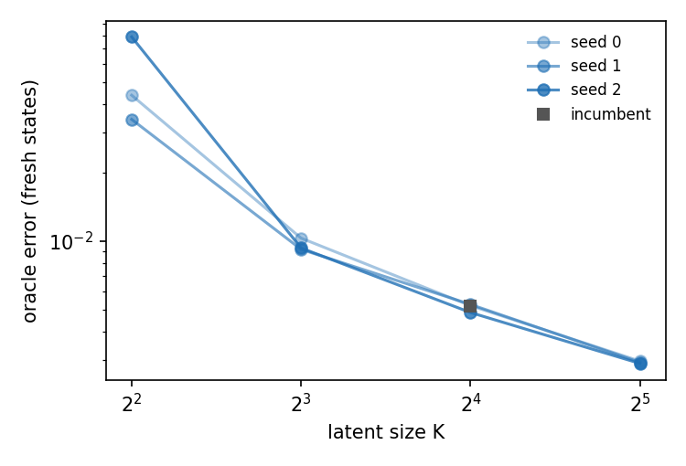
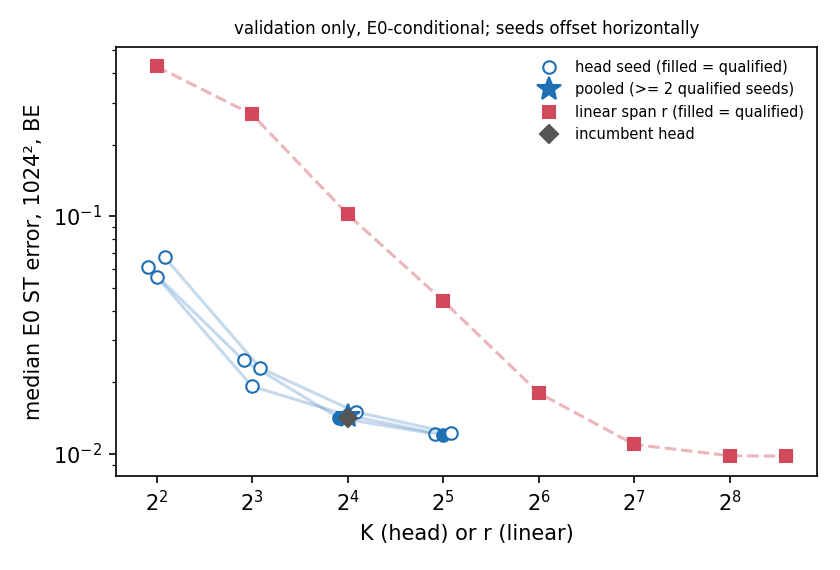
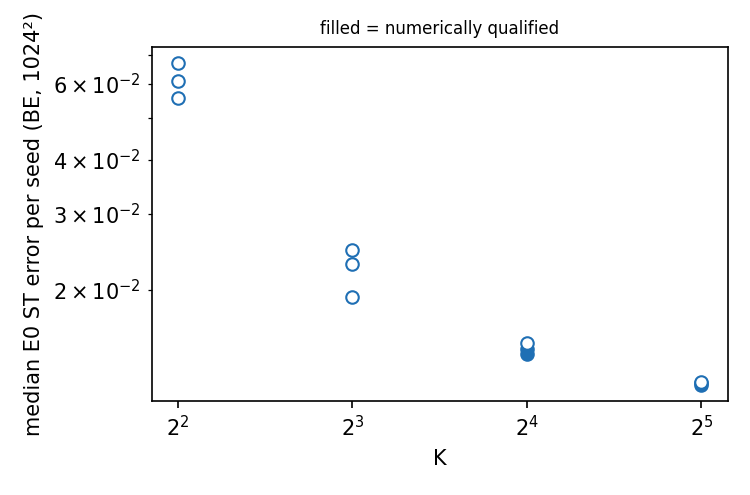
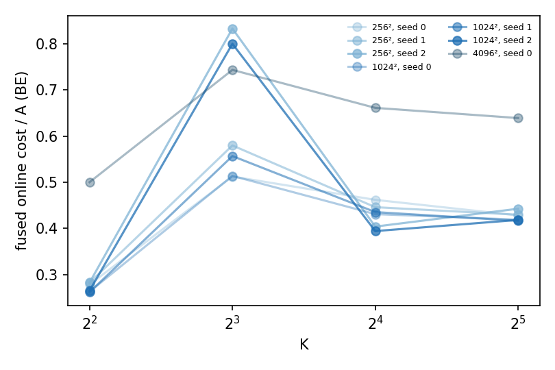
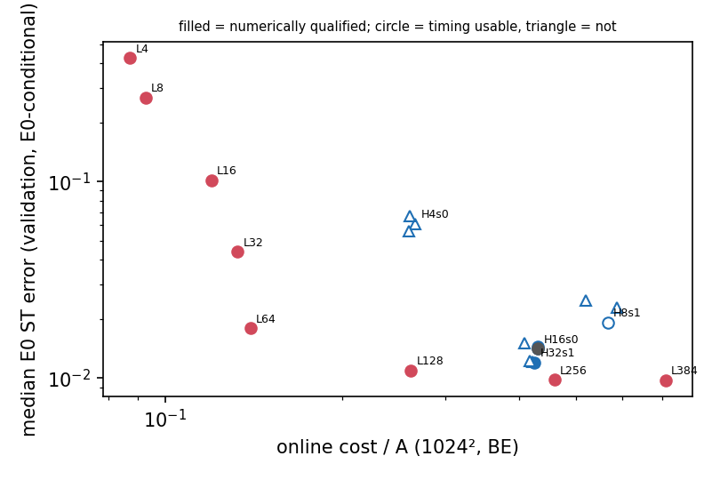

# Linear span against the nonlinear head: error and cost against the head latent size K (Burgers 2D, jcp-heads)

**Status:** generated by `make_report.py` from `runs/EXPORT.json`. Every label is **exploratory validation evidence** (dev6 + val32 only; DESIGN A4.1): no family-wise error-rate claim is made, and sealed cohorts were not touched. Errors are measured against the E0 second-order references (ST primary) and are **E0-conditional**; $\varepsilon_{\rm ref}$ is a conditional Richardson estimate. Costs are A-normalised online query times on one GPU type per mesh (H200), never compared across GPU types. The error of a rollout is $e=\max_{k=1..5}\lVert u(t_k)-R(t_k)\rVert/\lVert R(t_0)\rVert$ on the $257^2$ scoring lattice at $t_k=0.05k$, with $R$ the E0 ST reference; a case is *eligible* when the E0 store marks its reference as rankable (all 38 are). Post-hoc labels carried forward unchanged from earlier lanes: E0 A10; combined A10, A11 and the retracted A15.

Plan item C5 (PLAN-v2) asks whether the nonlinear head earns the paper's "nonlinear manifold" wording. This lane trains matched heads of latent size $K\in\{4,8,16,32\}$ (three seeds each) on the frozen R512 bank with the incumbent's recipe, and compares the head ROM with the linear-span ROM of the same bank at matched online dimension ($r=K$) and at equal online cost.

```mermaid
flowchart LR
  D[frozen coefficient data, 4,608 trajectories]:::frozen --> T[train 12 heads, K x seed]:::trained
  B[frozen R512 bank + rotation]:::frozen --> T
  T --> R[rule selection, Gauss ladder, Q2]:::solved
  B --> R
  R --> A[accuracy + Q1/Q2 at 1024^2, 38 cases]:::solved
  R --> C[timing, A-B-A, 256^2 / 1024^2 / 4096^2]:::solved
  A --> V[verdicts: H-acc-K, Q-LH-dim, Q-LH-cost, F5]:::out
  C --> V
  classDef frozen fill:#e5e7eb,stroke:#374151; classDef trained fill:#dbeafe,stroke:#1e40af;
  classDef solved fill:#dcfce7,stroke:#166534; classDef out fill:#fef3c7,stroke:#92400e;
```

## Headline

- **F5 reading (BE, 1024²):** inconclusive.
- **Error against K (BE):** range verdict `inconclusive`; transitions 4->8: `unqualified size`, 8->16: `unqualified size`, 16->32: `unqualified size`.
- **K = 4:** against linear r = K: `unavailable (timing incomplete or unqualified)`; at no more online cost: `unavailable (timing incomplete or unqualified)`.
- **K = 8:** against linear r = K: `unavailable (timing incomplete or unqualified)`; at no more online cost: `unavailable (timing incomplete or unqualified)`.
- **K = 16:** against linear r = K: `neither (trade-off)`; at no more online cost: `linear at no more cost is at least as accurate (rung 128: linear more accurate)`.
- **K = 32:** against linear r = K: `unavailable (timing incomplete or unqualified)`; at no more online cost: `unavailable (timing incomplete or unqualified)`.
- **In numbers (BE, 1024², exploratory, E0-conditional):** the K = 16 head (a summary over the qualified retrains [0, 1], not one deployable model) has median E0 ST error 1.44 %; the linear span at r = 16 has 10.2 % and costs 0.265× the head's online query (cheaper, much less accurate); the linear span at r = 128 has 1.1 % at 0.591× the head's cost.
- **Qualification decides the scope:** numerically qualified seeds per K (BE, 1024²): K = 4: none, K = 8: none, K = 16: [0, 1], K = 32: [1]. Sizes with fewer than two qualified seeds get no pooled verdict, so the error-against-K and F5 readings are inconclusive, not negative.
- **Retrain of the incumbent (K = 16, seed 0):** `reproduces` (pipeline oracle ratio 1, ROM median-error ratio 1).

## 1. Matched heads (training)

Recipe: `sep_hfit_run.py` arm `mid` (512 × 2 SiLU MLP + linear skip, 200,000 Adam steps, batch 4096), whitened coefficient objective on the frozen bank; only $K$ and the seed change (DESIGN 2.1, A1.1). "Oracle" is the representation oracle on 408 pipeline-test states (a diagnostic that uses their truth).

| arm | K | recon (train) | oracle (fresh) | oracle / span floor | code-refit gain | seconds |
|---|---|---|---|---|---|---|
| mid_k4_s0 | 4 | 5.94 % | 4.37 % | 206 | 1 | 331 |
| mid_k4_s1 | 4 | 5.16 % | 3.42 % | 161 | 1 | 321 |
| mid_k4_s2 | 4 | 7.46 % | 7.88 % | 371 | 1 | 321 |
| mid_k8_s0 | 8 | 1.4 % | 1.03 % | 48.5 | 1.03 | 339 |
| mid_k8_s1 | 8 | 1.37 % | 0.919 % | 43.3 | 1.06 | 330 |
| mid_k8_s2 | 8 | 1.34 % | 0.932 % | 43.9 | 1.06 | 330 |
| identity | 16 | 0.751 % | 0.52 % | 24.5 | 1.09 | 24.3 |
| mid_k16_s0 | 16 | 0.751 % | 0.52 % | 24.5 | 1.09 | 345 |
| mid_k16_s1 | 16 | 0.764 % | 0.527 % | 24.8 | 1.09 | 342 |
| mid_k16_s2 | 16 | 0.677 % | 0.485 % | 22.8 | 1.08 | 342 |
| probe_k16_s0_2000 | 16 | 19 % | 11.5 % | 541 | 1.35 | 15.3 |
| mid_k32_s0 | 32 | 0.419 % | 0.297 % | 14 | 1.13 | 383 |
| mid_k32_s1 | 32 | 0.411 % | 0.293 % | 13.8 | 1.13 | 372 |
| mid_k32_s2 | 32 | 0.417 % | 0.29 % | 13.6 | 1.13 | 372 |

The seed-0, K = 16 retrain uses the incumbent's exact recipe, data and seed, and the copied driver reproduces the incumbent essentially bit for bit (same-seed replay of the recipe, not an independent replication). "Code-refit gain" > 1 would mean the training codes had not converged.

Training gates (recomputed): accepted = `True` (identity of the copied driver on the incumbent: recon rel. dev. 2.31e-15, oracle rel. dev. 2.67e-15). Sensitivity probe (2,000 steps, K = 16, seed 0): oracle ratio to the full budget 22.1 (A1.7, reported, no required outcome).



## 2. Quadrature rules (smallest passing rule on the common Gauss ladder, A1.4 / A2.5)

| group | status | rule | trail (rule: passing arms / needed) |
|---|---|---|---|
| H4 | selected | gauss48 | gauss16:0/2 → gauss24:0/2 → gauss32:0/2 → gauss48:3/2 |
| H8 | selected | gauss96 | gauss16:0/2 → gauss24:0/2 → gauss32:0/2 → gauss48:0/2 → gauss64:0/2 → gauss96:2/2 |
| H16 | selected | gauss96 | gauss16:0/2 → gauss24:0/2 → gauss32:0/2 → gauss48:0/2 → gauss64:0/2 → gauss96:3/2 |
| H32 | selected | gauss96 | gauss16:0/2 → gauss24:0/2 → gauss32:0/2 → gauss48:0/2 → gauss64:0/2 → gauss96:2/2 |
| H4m128 | selected | gauss48 | gauss16:0/2 → gauss24:0/2 → gauss32:0/2 → gauss48:2/2 |
| H8m128 | selected | gauss96 | gauss16:0/2 → gauss24:0/2 → gauss32:0/2 → gauss48:0/2 → gauss64:0/2 → gauss96:3/2 |
| H16m128 | selected | gauss96 | gauss16:0/2 → gauss24:0/2 → gauss32:0/2 → gauss48:0/2 → gauss64:0/2 → gauss96:3/2 |
| Hinc | selected | gauss96 | gauss16:0/1 → gauss24:0/1 → gauss32:0/1 → gauss48:0/1 → gauss64:0/1 → gauss96:1/1 |
| L4 | selected | gauss24 | gauss16:0/1 → gauss24:1/1 |
| L8 | selected | gauss24 | gauss16:0/1 → gauss24:1/1 |
| L16 | selected | gauss48 | gauss16:0/1 → gauss24:0/1 → gauss32:0/1 → gauss48:1/1 |
| L32 | selected | gauss48 | gauss16:0/1 → gauss24:0/1 → gauss32:0/1 → gauss48:1/1 |
| L64 | selected | gauss48 | gauss16:0/1 → gauss24:0/1 → gauss32:0/1 → gauss48:1/1 |
| L128 | selected | gauss96 | gauss16:0/1 → gauss24:0/1 → gauss32:0/1 → gauss48:0/1 → gauss64:0/1 → gauss96:1/1 |
| L256 | selected | gauss96 | gauss16:0/1 → gauss24:0/1 → gauss32:0/1 → gauss48:0/1 → gauss64:0/1 → gauss96:1/1 |
| L384 | selected | gauss96 | gauss16:0/1 → gauss24:0/1 → gauss32:0/1 → gauss48:0/1 → gauss64:0/1 → gauss96:1/1 |
| L4m128 | selected | gauss24 | gauss16:0/1 → gauss24:1/1 |
| L8m128 | selected | gauss24 | gauss16:0/1 → gauss24:1/1 |
| L16m128 | selected | gauss48 | gauss16:0/1 → gauss24:0/1 → gauss32:0/1 → gauss48:1/1 |

## 3. Numerical qualification and accuracy at 1024² (38 cases; E0 ST)

| configuration | rule | M | Q1 / Q2 | numerically qualified | median error | worst error | Q3 flags |
|---|---|---|---|---|---|---|---|
| H16s0m128\|BE | gauss96 | 128 | Q1 pass, Q2 pass | yes | 1.2 % | 5.4 % | — |
| H16s0\|BE | gauss96 | 64 | Q1 pass, Q2 pass | yes | 1.41 % | 5.84 % | — |
| H16s0\|CNR | gauss96 | 64 | Q1 pass, Q2 pass | yes | 1.04 % | 6.55 % | — |
| H16s1m128\|BE | gauss96 | 128 | Q1 pass, Q2 pass | yes | 1.25 % | 5.62 % | — |
| H16s1\|BE | gauss96 | 64 | Q1 pass, Q2 pass | yes | 1.45 % | 6.77 % | — |
| H16s1\|CNR | gauss96 | 64 | Q1 pass, Q2 pass | yes | 0.984 % | 7.1 % | — |
| H16s2m128\|BE | gauss96 | 128 | Q1 pass, Q2 pass | yes | 1.25 % | 5.45 % | — |
| H16s2\|BE | gauss96 | 64 | Q1 fail, Q2 pass | no | 1.5 % | 6.22 % | — |
| H16s2\|CNR | gauss96 | 64 | Q1 fail, Q2 pass | no | 1.06 % | 6.57 % | — |
| H32s0\|BE | gauss96 | 128 | Q1 fail, Q2 fail | no | 1.21 % | 4.22 % | — |
| H32s0\|CNR | gauss96 | 128 | Q1 fail, Q2 fail | no | 0.473 % | 4.49 % | — |
| H32s1\|BE | gauss96 | 128 | Q1 pass, Q2 pass | yes | 1.2 % | 4.26 % | — |
| H32s1\|CNR | gauss96 | 128 | Q1 pass, Q2 pass | yes | 0.472 % | 4.43 % | — |
| H32s2\|BE | gauss96 | 128 | Q1 fail, Q2 pass | no | 1.22 % | 4.57 % | — |
| H32s2\|CNR | gauss96 | 128 | Q1 fail, Q2 pass | no | 0.476 % | 5.14 % | — |
| H4s0m128\|BE | gauss48 | 128 | Q1 fail, Q2 fail | no | 5.77 % | 20.7 % | — |
| H4s0\|BE | gauss48 | 16 | Q1 fail, Q2 pass | no | 6.11 % | 29.5 % | — |
| H4s0\|CNR | gauss48 | 16 | Q1 fail, Q2 pass | no | 5.99 % | 29.5 % | — |
| H4s1m128\|BE | gauss48 | 128 | Q1 fail, Q2 pass | no | 5.05 % | 21.3 % | — |
| H4s1\|BE | gauss48 | 16 | Q1 fail, Q2 pass | no | 5.57 % | 20.8 % | — |
| H4s1\|CNR | gauss48 | 16 | Q1 fail, Q2 pass | no | 5.4 % | 21.3 % | — |
| H4s2m128\|BE | gauss48 | 128 | Q1 fail, Q2 pass | no | 5.53 % | 21.7 % | — |
| H4s2\|BE | gauss48 | 16 | Q1 fail, Q2 pass | no | 6.71 % | 35.9 % | — |
| H4s2\|CNR | gauss48 | 16 | Q1 fail, Q2 pass | no | 6.5 % | 36.2 % | — |
| H8s0m128\|BE | gauss96 | 128 | Q1 fail, Q2 pass | no | 1.59 % | 6.7 % | — |
| H8s0\|BE | gauss96 | 32 | Q1 fail, Q2 fail | no | 2.47 % | 12.8 % | — |
| H8s0\|CNR | gauss96 | 32 | Q1 fail, Q2 fail | no | 2.3 % | 12.5 % | — |
| H8s1m128\|BE | gauss96 | 128 | Q1 fail, Q2 pass | no | 1.63 % | 6.35 % | — |
| H8s1\|BE | gauss96 | 32 | Q1 fail, Q2 pass | no | 1.92 % | 12.2 % | — |
| H8s1\|CNR | gauss96 | 32 | Q1 fail, Q2 pass | no | 1.77 % | 12.2 % | — |
| H8s2m128\|BE | gauss96 | 128 | Q1 fail, Q2 pass | no | 1.64 % | 6.46 % | — |
| H8s2\|BE | gauss96 | 32 | Q1 fail, Q2 pass | no | 2.3 % | 9.84 % | — |
| H8s2\|CNR | gauss96 | 32 | Q1 fail, Q2 pass | no | 2 % | 9.37 % | — |
| Hinc\|BE | gauss96 | 64 | Q1 pass, Q2 pass | yes | 1.41 % | 5.84 % | — |
| Hinc\|CNR | gauss96 | 64 | Q1 pass, Q2 pass | yes | 1.04 % | 6.55 % | — |
| L128\|BE | gauss96 | 512 | Q1 pass, Q2 pass | yes | 1.1 % | 4.84 % | — |
| L128\|CNR | gauss96 | 512 | Q1 pass, Q2 pass | yes | 0.45 % | 5.2 % | — |
| L16m128\|BE | gauss48 | 128 | Q1 fail, Q2 pass | no | 10.2 % | 44.7 % | — |
| L16\|BE | gauss48 | 64 | Q1 pass, Q2 pass | yes | 10.2 % | 44.7 % | — |
| L16\|CNR | gauss48 | 64 | Q1 fail, Q2 pass | no | 10.2 % | 44.7 % | — |
| L256\|BE | gauss96 | 1024 | Q1 pass, Q2 pass | yes | 0.983 % | 3.32 % | — |
| L256\|CNR | gauss96 | 1024 | Q1 pass, Q2 fail | no | 0.209 % | 2.52 % | — |
| L32\|BE | gauss48 | 128 | Q1 pass, Q2 pass | yes | 4.4 % | 23.8 % | — |
| L32\|CNR | gauss48 | 128 | Q1 fail, Q2 pass | no | 4.3 % | 23.7 % | — |
| L384\|BE | gauss96 | 1536 | Q1 pass, Q2 pass | yes | 0.978 % | 3.01 % | — |
| L384\|CNR | gauss96 | 1536 | Q1 pass, Q2 fail | no | 0.198 % | 1.78 % | — |
| L4m128\|BE | gauss24 | 128 | Q1 pass, Q2 pass | yes | 42.6 % | 71 % | — |
| L4\|BE | gauss24 | 16 | Q1 pass, Q2 pass | yes | 42.6 % | 71 % | — |
| L4\|CNR | gauss24 | 16 | Q1 pass, Q2 pass | yes | 42.6 % | 71 % | — |
| L64\|BE | gauss48 | 256 | Q1 pass, Q2 pass | yes | 1.8 % | 10.6 % | — |
| L64\|CNR | gauss48 | 256 | Q1 pass, Q2 fail | no | 1.6 % | 10.7 % | — |
| L8m128\|BE | gauss24 | 128 | Q1 pass, Q2 pass | yes | 26.7 % | 57.2 % | — |
| L8\|BE | gauss24 | 32 | Q1 pass, Q2 pass | yes | 26.8 % | 57.2 % | — |
| L8\|CNR | gauss24 | 32 | Q1 pass, Q2 fail | no | 27.3 % | 57.2 % | — |

Numerical qualification means local stationarity and solver / quadrature convergence only; it says nothing about accuracy (A1.3). Failing predicates of the configurations that are not numerically qualified:

| configuration | Q1 predicates failing | Q2 label | Q2 worst successor distance |
|---|---|---|---|
| H16s2\|BE | distance | pass | 0.00017 |
| H16s2\|CNR | distance | pass | 0.00016 |
| H32s0\|BE | distance | fail | 0.000348 |
| H32s0\|CNR | distance | fail | 0.000308 |
| H32s2\|BE | distance | pass | 0.000135 |
| H32s2\|CNR | distance | pass | 0.000137 |
| H4s0m128\|BE | anchors_verified, distance, tight_tighter | fail | 0.000292 |
| H4s0\|BE | anchors_verified, tight_tighter | pass | 0.000168 |
| H4s0\|CNR | anchors_verified, tight_tighter | pass | 0.000172 |
| H4s1m128\|BE | anchors_verified, tight_tighter | pass | 0.000145 |
| H4s1\|BE | anchors_verified, distance, tight_tighter | pass | 0.000165 |
| H4s1\|CNR | anchors_verified, distance, tight_tighter | pass | 0.000169 |
| H4s2m128\|BE | anchors_verified, distance, tight_tighter | pass | 0.000155 |
| H4s2\|BE | anchors_verified, distance, tight_tighter | pass | 0.000222 |
| H4s2\|CNR | anchors_verified, distance, tight_tighter | pass | 0.000224 |
| H8s0m128\|BE | distance | pass | 7.12e-05 |
| H8s0\|BE | distance | fail | 0.00175 |
| H8s0\|CNR | distance | fail | 0.0015 |
| H8s1m128\|BE | anchors_verified, distance | pass | 5.93e-05 |
| H8s1\|BE | anchors_verified, distance | pass | 4.03e-05 |
| H8s1\|CNR | anchors_verified, tight_tighter | pass | 4.38e-05 |
| H8s2m128\|BE | anchors_verified, distance | pass | 6.93e-05 |
| H8s2\|BE | anchors_verified, distance, tight_tighter | pass | 0.00011 |
| H8s2\|CNR | anchors_verified, distance | pass | 5.37e-05 |
| L16m128\|BE | distance | pass | 0.000106 |
| L16\|CNR | distance | pass | 0.00011 |
| L256\|CNR | — | fail | 0.000254 |
| L32\|CNR | distance | pass | 0.000122 |
| L384\|CNR | — | fail | 0.000261 |
| L64\|CNR | — | fail | 0.000269 |
| L8\|CNR | — | fail | 0.000265 |

Q1 predicates: `all_valid` (finite, no damping saturation, initial fit converged), `anchors_verified` (tight solves certified), `certificate` (≤ 1 % non-stationary steps), `distance` (production within 2.5e-4 of the tight solve on every case), `tight_tighter` (tight within 2.5e-5 of tighter on dev6).

## 4. Error against K (H-acc-K, per-case seed medians over qualified seeds)

**BE** — range `inconclusive`

| transition | outcome | seeds (lo) | seeds (hi) | median (lo) | median (hi) | improve | worsen | tie |
|---|---|---|---|---|---|---|---|---|
| 4->8 | unqualified size | [] | [] | n/a | n/a | — | — | — |
| 8->16 | unqualified size | [] | [0, 1] | n/a | n/a | — | — | — |
| 16->32 | unqualified size | [0, 1] | [1] | n/a | n/a | — | — | — |

**CNR** — range `inconclusive`

| transition | outcome | seeds (lo) | seeds (hi) | median (lo) | median (hi) | improve | worsen | tie |
|---|---|---|---|---|---|---|---|---|
| 4->8 | unqualified size | [] | [] | n/a | n/a | — | — | — |
| 8->16 | unqualified size | [] | [0, 1] | n/a | n/a | — | — | — |
| 16->32 | unqualified size | [0, 1] | [1] | n/a | n/a | — | — | — |

Fixed-$M=128$ sensitivity panel (BE): range `inconclusive`; 4->8: `unqualified size`, 8->16: `unqualified size`, 16->32: `unqualified size`.



**Seed spread (BE, 1024²):** median E0 ST error of each retrain; pooled numbers in this report are summaries over the numerically qualified retrains and need not describe any single deployable model (A2.3).

| K | seed 0 | seed 1 | seed 2 | max / min |
|---|---|---|---|---|
| 4 | 6.11 % (unq.) | 5.57 % (unq.) | 6.71 % (unq.) | 1.2 |
| 8 | 2.47 % (unq.) | 1.92 % (unq.) | 2.3 % (unq.) | 1.29 |
| 16 | 1.41 % | 1.45 % | 1.5 % (unq.) | 1.06 |
| 32 | 1.21 % (unq.) | 1.2 % | 1.22 % (unq.) | 1.02 |



**Head initial fit (production, 38 cases):** exit reasons, initial-fit LM iterations and stationarity ratio $\gamma_{\rm ic}$ (gtol $10^{-6}$), and the rollout's total LM iterations; per-case values in `runs/EXPORT.json`.

| configuration | stationary | residual | other (invalid) | initial-fit iterations (median) | gamma_ic (median) | gamma_ic (max) | rollout LM iterations (median) |
|---|---|---|---|---|---|---|---|
| H16s0m128\|BE | 38/38 | 0 | 0 | 17 | 6.18e-07 | 9.81e-07 | 76 |
| H16s0\|BE | 38/38 | 0 | 0 | 17 | 6.18e-07 | 9.81e-07 | 82 |
| H16s0\|CNR | 38/38 | 0 | 0 | 17 | 6.18e-07 | 9.81e-07 | 84.5 |
| H16s1m128\|BE | 38/38 | 0 | 0 | 15 | 4.23e-07 | 9.79e-07 | 78 |
| H16s1\|BE | 38/38 | 0 | 0 | 15 | 4.23e-07 | 9.79e-07 | 84.5 |
| H16s1\|CNR | 38/38 | 0 | 0 | 15 | 4.23e-07 | 9.79e-07 | 89 |
| H16s2m128\|BE | 38/38 | 0 | 0 | 14 | 6.38e-07 | 9.8e-07 | 73 |
| H16s2\|BE | 38/38 | 0 | 0 | 14 | 6.38e-07 | 9.8e-07 | 79.5 |
| H16s2\|CNR | 38/38 | 0 | 0 | 14 | 6.38e-07 | 9.8e-07 | 83 |
| H32s0\|BE | 38/38 | 0 | 0 | 10 | 5.1e-07 | 9.96e-07 | 66 |
| H32s0\|CNR | 38/38 | 0 | 0 | 10 | 5.1e-07 | 9.96e-07 | 67 |
| H32s1\|BE | 38/38 | 0 | 0 | 11 | 5.2e-07 | 9.58e-07 | 65 |
| H32s1\|CNR | 38/38 | 0 | 0 | 11 | 5.2e-07 | 9.58e-07 | 68 |
| H32s2\|BE | 38/38 | 0 | 0 | 11 | 5.87e-07 | 9.77e-07 | 68.5 |
| H32s2\|CNR | 38/38 | 0 | 0 | 11 | 5.87e-07 | 9.77e-07 | 70.5 |
| H4s0m128\|BE | 38/38 | 0 | 0 | 7 | 3.11e-07 | 9.76e-07 | 51 |
| H4s0\|BE | 38/38 | 0 | 0 | 7 | 3.11e-07 | 9.76e-07 | 51 |
| H4s0\|CNR | 38/38 | 0 | 0 | 7 | 3.11e-07 | 9.76e-07 | 51 |
| H4s1m128\|BE | 38/38 | 0 | 0 | 7 | 3.84e-07 | 8.39e-07 | 51 |
| H4s1\|BE | 38/38 | 0 | 0 | 7 | 3.84e-07 | 8.39e-07 | 51 |
| H4s1\|CNR | 38/38 | 0 | 0 | 7 | 3.84e-07 | 8.39e-07 | 51 |
| H4s2m128\|BE | 38/38 | 0 | 0 | 7 | 3.85e-07 | 9.31e-07 | 50 |
| H4s2\|BE | 38/38 | 0 | 0 | 7 | 3.85e-07 | 9.31e-07 | 51 |
| H4s2\|CNR | 38/38 | 0 | 0 | 7 | 3.85e-07 | 9.31e-07 | 51 |
| H8s0m128\|BE | 38/38 | 0 | 0 | 17 | 4.71e-07 | 9.87e-07 | 71 |
| H8s0\|BE | 38/38 | 0 | 0 | 17 | 4.71e-07 | 9.87e-07 | 79.5 |
| H8s0\|CNR | 38/38 | 0 | 0 | 17 | 4.71e-07 | 9.87e-07 | 86 |
| H8s1m128\|BE | 38/38 | 0 | 0 | 32.5 | 5.69e-07 | 9.97e-07 | 76 |
| H8s1\|BE | 38/38 | 0 | 0 | 32.5 | 5.69e-07 | 9.97e-07 | 99.5 |
| H8s1\|CNR | 38/38 | 0 | 0 | 32.5 | 5.69e-07 | 9.97e-07 | 102 |
| H8s2m128\|BE | 38/38 | 0 | 0 | 34 | 6.37e-07 | 9.98e-07 | 78 |
| H8s2\|BE | 38/38 | 0 | 0 | 34 | 6.37e-07 | 9.98e-07 | 90.5 |
| H8s2\|CNR | 38/38 | 0 | 0 | 34 | 6.37e-07 | 9.98e-07 | 95.5 |
| Hinc\|BE | 38/38 | 0 | 0 | 17 | 6.18e-07 | 9.81e-07 | 82 |
| Hinc\|CNR | 38/38 | 0 | 0 | 17 | 6.18e-07 | 9.81e-07 | 84.5 |

## 5. Online cost against K

Cost = median over cases (and repeats) of the A-normalised fused online query time (contract: online query, full-field contract: supplied field sampled at the initial-fit points, initial fit, evolution, full-field decode of the six outputs; A-normalised (A = linear r = 384, 1024^2, LSPG-CN-R, dt0, gauss128)).

**256²**

| subject | fused cost / A | evolution cost / A | timing complete | usable (gates pass) | fused median (ms) |
|---|---|---|---|---|---|
| 1024\|A_R384\|gauss128\|CNR | n/a | n/a | no | no | n/a |
| 256\|H16s0\|gauss96\|BE | 0.462 | 0.398 | yes | yes | 40.8 |
| 256\|H16s1\|gauss96\|BE | 0.446 | 0.411 | yes | yes | 38.7 |
| 256\|H16s2\|gauss96\|BE | 0.404 | 0.37 | yes | yes | 34.5 |
| 256\|H32s0\|gauss96\|BE | 0.428 | 0.401 | yes | no | 37.5 |
| 256\|H32s1\|gauss96\|BE | 0.43 | 0.405 | yes | yes | 36.7 |
| 256\|H32s2\|gauss96\|BE | 0.443 | 0.421 | yes | yes | 38.7 |
| 256\|H4s0\|gauss48\|BE | 0.278 | 0.264 | yes | no | 24 |
| 256\|H4s1\|gauss48\|BE | 0.282 | 0.265 | yes | yes | 23.7 |
| 256\|H4s2\|gauss48\|BE | 0.282 | 0.263 | yes | no | 24.1 |
| 256\|H8s0\|gauss96\|BE | 0.512 | 0.49 | yes | no | 43.4 |
| 256\|H8s1\|gauss96\|BE | 0.58 | 0.544 | yes | no | 49.4 |
| 256\|H8s2\|gauss96\|BE | 0.833 | 0.73 | yes | yes | 71.1 |
| 256\|Hinc\|gauss96\|BE | 0.449 | 0.396 | yes | yes | 39.1 |
| 256\|L128\|gauss96\|BE | 0.276 | 0.278 | yes | yes | 23.6 |
| 256\|L16\|gauss48\|BE | 0.116 | 0.125 | yes | yes | 10.4 |
| 256\|L256\|gauss96\|BE | 0.462 | 0.463 | yes | yes | 39.7 |
| 256\|L32\|gauss48\|BE | 0.136 | 0.147 | yes | yes | 11.7 |
| 256\|L384\|gauss96\|BE | 0.715 | 0.721 | yes | yes | 61.5 |
| 256\|L4\|gauss24\|BE | 0.0944 | 0.106 | yes | yes | 8 |
| 256\|L64\|gauss48\|BE | 0.148 | 0.148 | yes | yes | 13.1 |
| 256\|L8\|gauss24\|BE | 0.0956 | 0.105 | yes | yes | 8.26 |

**1024²**

| subject | fused cost / A | evolution cost / A | timing complete | usable (gates pass) | fused median (ms) |
|---|---|---|---|---|---|
| 1024\|A_R384\|gauss128\|CNR | n/a | n/a | no | no | n/a |
| 1024\|H16s0\|gauss96\|BE | 0.431 | 0.368 | yes | yes | 36.9 |
| 1024\|H16s0\|gauss96\|CNR | 0.444 | 0.377 | yes | yes | 37.7 |
| 1024\|H16s1\|gauss96\|BE | 0.43 | 0.376 | yes | yes | 37.3 |
| 1024\|H16s1\|gauss96\|CNR | 0.438 | 0.381 | yes | yes | 38.1 |
| 1024\|H16s2\|gauss96\|BE | 0.409 | 0.358 | yes | no | 34.9 |
| 1024\|H16s2\|gauss96\|CNR | 0.407 | 0.366 | yes | no | 34.9 |
| 1024\|H32s0\|gauss96\|BE | 0.421 | 0.385 | yes | no | 36.5 |
| 1024\|H32s0\|gauss96\|CNR | 0.435 | 0.386 | yes | no | 37.1 |
| 1024\|H32s1\|gauss96\|BE | 0.425 | 0.39 | yes | yes | 36.5 |
| 1024\|H32s1\|gauss96\|CNR | 0.43 | 0.39 | yes | yes | 37 |
| 1024\|H32s2\|gauss96\|BE | 0.417 | 0.383 | yes | no | 35.9 |
| 1024\|H32s2\|gauss96\|CNR | 0.424 | 0.394 | yes | no | 36.9 |
| 1024\|H4s0\|gauss48\|BE | 0.267 | 0.244 | yes | no | 22.4 |
| 1024\|H4s0\|gauss48\|CNR | 0.268 | 0.242 | yes | no | 23.1 |
| 1024\|H4s1\|gauss48\|BE | 0.26 | 0.245 | yes | no | 22.1 |
| 1024\|H4s1\|gauss48\|CNR | 0.261 | 0.244 | yes | no | 22.1 |
| 1024\|H4s2\|gauss48\|BE | 0.26 | 0.241 | yes | no | 22.2 |
| 1024\|H4s2\|gauss48\|CNR | 0.265 | 0.242 | yes | no | 22.3 |
| 1024\|H8s0\|gauss96\|BE | 0.52 | 0.463 | yes | no | 45.1 |
| 1024\|H8s0\|gauss96\|CNR | 0.53 | 0.478 | yes | no | 45.9 |
| 1024\|H8s1\|gauss96\|BE | 0.566 | 0.524 | yes | yes | 48.7 |
| 1024\|H8s1\|gauss96\|CNR | 0.616 | 0.527 | yes | no | 53.7 |
| 1024\|H8s2\|gauss96\|BE | 0.587 | 0.495 | yes | no | 51.4 |
| 1024\|H8s2\|gauss96\|CNR | 0.579 | 0.518 | yes | no | 51.7 |
| 1024\|Hinc\|gauss96\|BE | 0.43 | 0.365 | yes | yes | 37.4 |
| 1024\|Hinc\|gauss96\|CNR | 0.437 | 0.37 | yes | yes | 37.6 |
| 1024\|L128\|gauss96\|BE | 0.262 | 0.264 | yes | yes | 22.2 |
| 1024\|L128\|gauss96\|CNR | 0.265 | 0.269 | yes | yes | 22.5 |
| 1024\|L16\|gauss48\|BE | 0.12 | 0.126 | yes | yes | 10.5 |
| 1024\|L16\|gauss48\|CNR | 0.123 | 0.129 | yes | yes | 10.5 |
| 1024\|L256\|gauss96\|BE | 0.459 | 0.453 | yes | yes | 38.9 |
| 1024\|L256\|gauss96\|CNR | 0.455 | 0.45 | yes | yes | 38.5 |
| 1024\|L32\|gauss48\|BE | 0.133 | 0.139 | yes | yes | 11.4 |
| 1024\|L32\|gauss48\|CNR | 0.132 | 0.137 | yes | yes | 11.3 |
| 1024\|L384\|gauss96\|BE | 0.71 | 0.707 | yes | yes | 60.7 |
| 1024\|L384\|gauss96\|CNR | 0.71 | 0.708 | yes | yes | 60.4 |
| 1024\|L4\|gauss24\|BE | 0.0872 | 0.0953 | yes | yes | 7.45 |
| 1024\|L4\|gauss24\|CNR | 0.0879 | 0.0955 | yes | yes | 7.44 |
| 1024\|L64\|gauss48\|BE | 0.14 | 0.143 | yes | yes | 11.8 |
| 1024\|L64\|gauss48\|CNR | 0.14 | 0.146 | yes | yes | 11.9 |
| 1024\|L8\|gauss24\|BE | 0.0926 | 0.1 | yes | yes | 7.8 |
| 1024\|L8\|gauss24\|CNR | 0.0929 | 0.0991 | yes | yes | 7.85 |

**4096²**

| subject | fused cost / A | evolution cost / A | timing complete | usable (gates pass) | fused median (ms) |
|---|---|---|---|---|---|
| 1024\|A_R384\|gauss128\|CNR | n/a | n/a | no | no | n/a |
| 4096\|H16s0\|gauss96\|BE | 0.661 | 0.385 | yes | yes | 57.1 |
| 4096\|H32s0\|gauss96\|BE | 0.639 | 0.389 | yes | no | 55.2 |
| 4096\|H4s0\|gauss48\|BE | 0.5 | 0.256 | yes | no | 42.4 |
| 4096\|H8s0\|gauss96\|BE | 0.744 | 0.479 | yes | no | 62.2 |
| 4096\|Hinc\|gauss96\|BE | 0.659 | 0.385 | yes | yes | 56.8 |

**Cost against K (BE, dev6; descriptive, all trained seeds):** median fused and evolution cost / A, LM iterations per time step, evolution cost per LM iteration (/ A).

256²

| subject | fused / A | evolution / A | LM iterations per step | evolution / A per iteration | usable |
|---|---|---|---|---|---|
| H16s0 | 0.462 | 0.398 | 1.72 | 0.00464 | yes |
| H16s1 | 0.446 | 0.411 | 1.85 | 0.00455 | yes |
| H16s2 | 0.404 | 0.37 | 1.46 | 0.00507 | yes |
| H32s0 | 0.428 | 0.401 | 1.3 | 0.00614 | no |
| H32s1 | 0.43 | 0.405 | 1.3 | 0.00612 | yes |
| H32s2 | 0.443 | 0.421 | 1.44 | 0.0058 | yes |
| H4s0 | 0.278 | 0.264 | 1.03 | 0.00524 | no |
| H4s1 | 0.282 | 0.265 | 1.02 | 0.00518 | yes |
| H4s2 | 0.282 | 0.263 | 1.02 | 0.00517 | no |
| H8s0 | 0.512 | 0.49 | 1.62 | 0.00605 | no |
| H8s1 | 0.58 | 0.544 | 1.92 | 0.00568 | no |
| H8s2 | 0.833 | 0.73 | 3.19 | 0.00458 | yes |
| Hinc | 0.449 | 0.396 | 1.72 | 0.00462 | yes |
| L128 | 0.276 | 0.278 | 1.03 | 0.0053 | yes |
| L16 | 0.116 | 0.125 | 0.74 | 0.00358 | yes |
| L256 | 0.462 | 0.463 | 1.08 | 0.0085 | yes |
| L32 | 0.136 | 0.147 | 1.02 | 0.00292 | yes |
| L384 | 0.715 | 0.721 | 1.08 | 0.0133 | yes |
| L4 | 0.0944 | 0.106 | 0.47 | 0.00447 | yes |
| L64 | 0.148 | 0.148 | 1.02 | 0.00295 | yes |
| L8 | 0.0956 | 0.105 | 0.46 | 0.00452 | yes |

Fit $t(K)=a+bK^p$ to the per-case seed-median fused cost over K = [4, 8, 16, 32] (seeds [0, 1, 2]): exponent **not identified**: the constrained fit fails the inherited acceptance threshold (relative rms 0.236 > 0.2). No functional form is claimed.

1024²

| subject | fused / A | evolution / A | LM iterations per step | evolution / A per iteration | usable |
|---|---|---|---|---|---|
| H16s0 | 0.431 | 0.372 | 1.73 | 0.00432 | yes |
| H16s1 | 0.435 | 0.396 | 1.8 | 0.00441 | yes |
| H16s2 | 0.394 | 0.349 | 1.46 | 0.00477 | no |
| H32s0 | 0.419 | 0.374 | 1.32 | 0.0057 | no |
| H32s1 | 0.416 | 0.378 | 1.3 | 0.00575 | yes |
| H32s2 | 0.418 | 0.383 | 1.38 | 0.00569 | no |
| H4s0 | 0.263 | 0.241 | 1.03 | 0.00477 | no |
| H4s1 | 0.262 | 0.245 | 1.02 | 0.00474 | no |
| H4s2 | 0.265 | 0.246 | 1.02 | 0.00473 | no |
| H8s0 | 0.514 | 0.473 | 1.63 | 0.00586 | no |
| H8s1 | 0.557 | 0.512 | 1.92 | 0.00534 | yes |
| H8s2 | 0.8 | 0.687 | 3.12 | 0.00442 | no |
| Hinc | 0.437 | 0.391 | 1.73 | 0.00452 | yes |
| L128 | 0.263 | 0.263 | 1.03 | 0.00519 | yes |
| L16 | 0.113 | 0.12 | 0.74 | 0.00407 | yes |
| L256 | 0.459 | 0.454 | 1.08 | 0.00839 | yes |
| L32 | 0.131 | 0.139 | 1.02 | 0.00273 | yes |
| L384 | 0.707 | 0.707 | 1.08 | 0.013 | yes |
| L4 | 0.0876 | 0.0937 | 0.47 | 0.00407 | yes |
| L64 | 0.138 | 0.145 | 1.02 | 0.00284 | yes |
| L8 | 0.0904 | 0.0996 | 0.46 | 0.00432 | yes |

Fit $t(K)=a+bK^p$ to the per-case seed-median fused cost over K = [4, 8, 16, 32] (seeds [0, 1, 2]): exponent **not identified**: the constrained fit fails the inherited acceptance threshold (relative rms 0.329 > 0.2). No functional form is claimed.

4096²

| subject | fused / A | evolution / A | LM iterations per step | evolution / A per iteration | usable |
|---|---|---|---|---|---|
| H16s0 | 0.661 | 0.385 | 1.72 | 0.00446 | yes |
| H32s0 | 0.639 | 0.389 | 1.32 | 0.00589 | no |
| H4s0 | 0.5 | 0.256 | 1.03 | 0.00496 | no |
| H8s0 | 0.744 | 0.479 | 1.62 | 0.00599 | no |
| Hinc | 0.659 | 0.385 | 1.72 | 0.00447 | yes |

Fit $t(K)=a+bK^p$ to the per-case seed-median fused cost over K = [4, 8, 16, 32] (seeds [0]): p = 0.119 (95 % case-bootstrap interval [0.0797817396372318, 0.16521097073031996]).



**H-cost-N for the head (seed 0, BE, evolution only, dev6):**

| K | outcome | max/min ratio | 95 % interval | meshes |
|---|---|---|---|---|
| 4 | verdict not reached | n/a | None | None |
| 8 | verdict not reached | n/a | None | None |
| 16 | pass | 1.06 | [1.0451016734543945, 1.1310142732168889] | [256, 1024, 4096] |
| 32 | verdict not reached | n/a | None | None |
| inc | pass | 1.03 | [1.0216264589342823, 1.0937653553069986] | [256, 1024, 4096] |

Descriptive sensitivity (no verdict): median evolution cost / A over dev6 for every head timed at all three meshes (the seed-0 heads and the incumbent), whether or not the timing-job gates pass:

| head | 256² | 1024² | 4096² | max / min | all gates pass |
|---|---|---|---|---|---|
| H16s0 | 0.398 | 0.374 | 0.385 | 1.06 | yes |
| H32s0 | 0.403 | 0.381 | 0.391 | 1.06 | no |
| H4s0 | 0.267 | 0.241 | 0.256 | 1.11 | no |
| H8s0 | 0.489 | 0.478 | 0.492 | 1.03 | no |
| Hinc | 0.396 | 0.393 | 0.385 | 1.03 | yes |



## 6. Linear span against the head at 1024² (Q-LH-dim, Q-LH-cost)

**BE** (X = head; error labels of head against linear r = K)

| K | qualified seeds | timing-usable seeds | Q-LH-dim | error (r = K) | cost (head / linear) | at most equal cost | equal-cost rungs |
|---|---|---|---|---|---|---|---|
| 4 | [] | [] | unavailable (timing incomplete or unqualified) | — | — | — | — |
| 8 | [] | [] | unavailable (timing incomplete or unqualified) | — | — | — | — |
| 16 | [0, 1] | [0, 1] | neither (trade-off) | head more accurate | head costlier | linear at no more cost is at least as accurate (rung 128: linear more accurate) | no equal-cost rung on the ladder |
| 32 | [1] | [1] | unavailable (timing incomplete or unqualified) | — | — | — | — |

| K | certified-affordable rungs | possibly-affordable rungs | bracket r below | dominance (below) | bracket r above | dominance (above) | cost coverage |
|---|---|---|---|---|---|---|---|
| 16 | 4, 8, 16, 32, 64, 128 | 4, 8, 16, 32, 64, 128, 256 | 128 | linear dominates | 384 | neither (trade-off) | — |

**CNR** (X = head; error labels of head against linear r = K)

| K | qualified seeds | timing-usable seeds | Q-LH-dim | error (r = K) | cost (head / linear) | at most equal cost | equal-cost rungs |
|---|---|---|---|---|---|---|---|
| 4 | [] | [] | unavailable (timing incomplete or unqualified) | — | — | — | — |
| 8 | [] | [] | unavailable (timing incomplete or unqualified) | — | — | — | — |
| 16 | [0, 1] | [0, 1] | unqualified | head more accurate | head costlier | linear at no more cost is at least as accurate (rung 128: linear more accurate) | no equal-cost rung on the ladder |
| 32 | [1] | [1] | unavailable (timing incomplete or unqualified) | — | — | — | — |

| K | certified-affordable rungs | possibly-affordable rungs | bracket r below | dominance (below) | bracket r above | dominance (above) | cost coverage |
|---|---|---|---|---|---|---|---|
| 16 | 4, 128 | 4, 128 | 128 | linear dominates | no rung above | n/a | — |

Every linear rung against every head size (BE). Cost label and cost ratio compare the linear rung with the head (ratio = linear cost / head cost); the error label compares the head with the linear rung; p = the one-sided signed-rank p-value for "head more accurate" (Holm decisions in `runs/EXPORT.json`):

| K | r | r qualified | cost (linear vs head) | cost ratio linear / head (median) | error (head vs linear) | head median | linear median | p |
|---|---|---|---|---|---|---|---|---|
| 16 | 4 | yes | linear cheaper | 0.205 | head more accurate | 1.44 % | 42.6 % | 3.64e-12 |
| 16 | 8 | yes | linear cheaper | 0.222 | head more accurate | 1.44 % | 26.8 % | 3.64e-12 |
| 16 | 16 | yes | linear cheaper | 0.265 | head more accurate | 1.44 % | 10.2 % | 3.64e-12 |
| 16 | 32 | yes | linear cheaper | 0.295 | head more accurate | 1.44 % | 4.4 % | 3.64e-12 |
| 16 | 64 | yes | linear cheaper | 0.314 | head more accurate | 1.44 % | 1.8 % | 2.7e-05 |
| 16 | 128 | yes | linear cheaper | 0.591 | linear more accurate | 1.44 % | 1.1 % | 1 |
| 16 | 256 | yes | unresolved | 1.05 | linear more accurate | 1.44 % | 0.983 % | 1 |
| 16 | 384 | yes | linear costlier | 1.61 | linear more accurate | 1.44 % | 0.978 % | 1 |

Per-seed sensitivity (each individual head; single-seed pools):

| scheme | seed | K | Q-LH-dim | at most equal cost | head median |
|---|---|---|---|---|---|
| BE | 0 | 4 | unavailable (timing incomplete or unqualified) | — | — |
| BE | 0 | 8 | unavailable (timing incomplete or unqualified) | — | — |
| BE | 0 | 16 | neither (trade-off) | linear at no more cost is at least as accurate (rung 128: linear more accurate) | 1.41 % |
| BE | 0 | 32 | unavailable (timing incomplete or unqualified) | — | — |
| BE | 1 | 4 | unavailable (timing incomplete or unqualified) | — | — |
| BE | 1 | 8 | unavailable (timing incomplete or unqualified) | — | — |
| BE | 1 | 16 | neither (trade-off) | linear at no more cost is at least as accurate (rung 128: linear more accurate) | 1.45 % |
| BE | 1 | 32 | neither (trade-off) | linear at no more cost is at least as accurate (rung 128: matches) | 1.2 % |
| BE | 2 | 4 | unavailable (timing incomplete or unqualified) | — | — |
| BE | 2 | 8 | unavailable (timing incomplete or unqualified) | — | — |
| BE | 2 | 16 | unavailable (timing incomplete or unqualified) | — | — |
| BE | 2 | 32 | unavailable (timing incomplete or unqualified) | — | — |
| CNR | 0 | 4 | unavailable (timing incomplete or unqualified) | — | — |
| CNR | 0 | 8 | unavailable (timing incomplete or unqualified) | — | — |
| CNR | 0 | 16 | unqualified | linear at no more cost is at least as accurate (rung 128: linear more accurate) | 1.04 % |
| CNR | 0 | 32 | unavailable (timing incomplete or unqualified) | — | — |
| CNR | 1 | 4 | unavailable (timing incomplete or unqualified) | — | — |
| CNR | 1 | 8 | unavailable (timing incomplete or unqualified) | — | — |
| CNR | 1 | 16 | unqualified | linear at no more cost is at least as accurate (rung 128: linear more accurate) | 0.984 % |
| CNR | 1 | 32 | unqualified | unresolved | 0.472 % |
| CNR | 2 | 4 | unavailable (timing incomplete or unqualified) | — | — |
| CNR | 2 | 8 | unavailable (timing incomplete or unqualified) | — | — |
| CNR | 2 | 16 | unavailable (timing incomplete or unqualified) | — | — |
| CNR | 2 | 32 | unavailable (timing incomplete or unqualified) | — | — |

**256² (deferrable panel; error on eligible all38 (acc256), cost on dev6 (time256)):**

| K | qualified seeds (256²) | timing-usable seeds | Q-LH-dim | at most equal cost |
|---|---|---|---|---|
| 4 | [] | [] | unavailable (timing incomplete or unqualified) | unavailable (timing incomplete or unqualified) |
| 8 | [] | [] | unavailable (timing incomplete or unqualified) | unavailable (timing incomplete or unqualified) |
| 16 | [0, 2] | [0, 2] | neither (trade-off) | linear at no more cost is at least as accurate (rung 128: linear more accurate) |
| 32 | [1, 2] | [1, 2] | neither (trade-off) | linear at no more cost is at least as accurate (rung 128: matches) |

## 6b. Head and linear errors across meshes (256² vs 1024², descriptive; governing-plan E3c context)

| configuration | median \|change\| (pp of u0) | max \|change\| | case of max | qualified at both |
|---|---|---|---|---|
| H16s0\|BE | 0.0122 % | 1.01 % | val32\|20 | yes |
| H16s0\|CNR | 0.0181 % | 0.975 % | val32\|20 | yes |
| H16s1\|BE | 0.0124 % | 1.05 % | val32\|14 | no |
| H16s1\|CNR | 0.013 % | 1.06 % | val32\|14 | no |
| H16s2\|BE | 0.00843 % | 0.54 % | val32\|0 | no |
| H16s2\|CNR | 0.00987 % | 0.476 % | val32\|0 | no |
| H32s0\|BE | 0.00441 % | 1.57 % | dev6\|3 | no |
| H32s0\|CNR | 0.00468 % | 1.35 % | dev6\|3 | no |
| H32s1\|BE | 0.00316 % | 0.455 % | val32\|11 | yes |
| H32s1\|CNR | 0.0037 % | 0.442 % | val32\|11 | yes |
| H32s2\|BE | 0.00372 % | 0.716 % | val32\|11 | no |
| H32s2\|CNR | 0.0041 % | 0.688 % | val32\|11 | no |
| H4s0\|BE | 0.00246 % | 0.0665 % | val32\|26 | no |
| H4s0\|CNR | 0.00212 % | 0.0677 % | val32\|26 | no |
| H4s1\|BE | 0.00332 % | 0.0827 % | val32\|27 | no |
| H4s1\|CNR | 0.00265 % | 0.0754 % | val32\|27 | no |
| H4s2\|BE | 0.00203 % | 0.0466 % | val32\|5 | no |
| H4s2\|CNR | 0.00204 % | 0.0524 % | val32\|10 | no |
| H8s0\|BE | 0.0112 % | 0.852 % | val32\|23 | no |
| H8s0\|CNR | 0.0106 % | 0.872 % | val32\|23 | no |
| H8s1\|BE | 0.0196 % | 3.65 % | val32\|11 | no |
| H8s1\|CNR | 0.0149 % | 3.73 % | val32\|11 | no |
| H8s2\|BE | 0.0134 % | 2.3 % | val32\|14 | no |
| H8s2\|CNR | 0.0152 % | 2.25 % | val32\|14 | no |
| Hinc\|BE | 0.0122 % | 1.01 % | val32\|20 | yes |
| Hinc\|CNR | 0.0181 % | 0.975 % | val32\|20 | yes |
| L128\|BE | 0.00131 % | 0.0178 % | val32\|11 | yes |
| L128\|CNR | 0.00163 % | 0.0144 % | val32\|5 | yes |
| L16\|BE | 0.000877 % | 0.00622 % | val32\|5 | yes |
| L16\|CNR | 0.000864 % | 0.0081 % | val32\|5 | no |
| L256\|BE | 0.00164 % | 0.00872 % | val32\|5 | yes |
| L256\|CNR | 0.00237 % | 0.025 % | val32\|5 | no |
| L32\|BE | 0.00106 % | 0.00901 % | val32\|11 | yes |
| L32\|CNR | 0.000984 % | 0.00887 % | val32\|11 | no |
| L384\|BE | 0.00159 % | 0.0123 % | val32\|5 | no |
| L384\|CNR | 0.00292 % | 0.0491 % | val32\|5 | no |
| L4\|BE | 0.00026 % | 0.00233 % | val32\|7 | yes |
| L4\|CNR | 0.00026 % | 0.00248 % | val32\|7 | yes |
| L64\|BE | 0.00233 % | 0.0388 % | val32\|11 | yes |
| L64\|CNR | 0.000982 % | 0.0344 % | val32\|11 | no |
| L8\|BE | 0.00037 % | 0.00551 % | val32\|5 | yes |
| L8\|CNR | 0.000424 % | 0.00586 % | val32\|5 | no |

## 6c. Timing-job qualification and usability

| subject | timing-job Q1/Q2 (dev6) | max distance to accuracy-job trajectory | split = fused | subject drift | usable for cost labels |
|---|---|---|---|---|---|
| 1024\|A_R384\|gauss128\|CNR | pass (Q1 only; reference subject) | — | yes | n/a | no |
| 256\|H16s0\|gauss96\|BE | pass | — | yes | 0.998 | yes |
| 256\|H16s1\|gauss96\|BE | pass | — | yes | 0.999 | yes |
| 256\|H16s2\|gauss96\|BE | pass | — | yes | 1 | yes |
| 256\|H32s0\|gauss96\|BE | fail | — | yes | 0.999 | no |
| 256\|H32s1\|gauss96\|BE | pass | — | yes | 1 | yes |
| 256\|H32s2\|gauss96\|BE | pass | — | yes | 1 | yes |
| 256\|H4s0\|gauss48\|BE | fail | — | yes | 0.998 | no |
| 256\|H4s1\|gauss48\|BE | pass | — | yes | 1 | yes |
| 256\|H4s2\|gauss48\|BE | fail | — | yes | 1 | no |
| 256\|H8s0\|gauss96\|BE | fail | — | yes | 0.998 | no |
| 256\|H8s1\|gauss96\|BE | fail | — | yes | 0.999 | no |
| 256\|H8s2\|gauss96\|BE | pass | — | yes | 0.998 | yes |
| 256\|Hinc\|gauss96\|BE | pass | — | yes | 1 | yes |
| 256\|L128\|gauss96\|BE | pass | — | yes | 0.998 | yes |
| 256\|L16\|gauss48\|BE | pass | — | yes | 1.01 | yes |
| 256\|L256\|gauss96\|BE | pass | — | yes | 0.999 | yes |
| 256\|L32\|gauss48\|BE | pass | — | yes | 1 | yes |
| 256\|L384\|gauss96\|BE | pass | — | yes | 0.999 | yes |
| 256\|L4\|gauss24\|BE | pass | — | yes | 1.01 | yes |
| 256\|L64\|gauss48\|BE | pass | — | yes | 1 | yes |
| 256\|L8\|gauss24\|BE | pass | — | yes | 1 | yes |
| 1024\|A_R384\|gauss128\|CNR | pass (Q1 only; reference subject) | — | yes | n/a | no |
| 1024\|H16s0\|gauss96\|BE | pass | 5.756429792574705e-14 | yes | 1 | yes |
| 1024\|H16s0\|gauss96\|CNR | pass | 5.315963975309548e-14 | yes | 1 | yes |
| 1024\|H16s1\|gauss96\|BE | pass | 4.9121785122967805e-14 | yes | 0.994 | yes |
| 1024\|H16s1\|gauss96\|CNR | pass | 3.31568308577674e-14 | yes | 1 | yes |
| 1024\|H16s2\|gauss96\|BE | fail | 4.938019660766059e-14 | yes | 1 | no |
| 1024\|H16s2\|gauss96\|CNR | fail | 7.232754260418002e-14 | yes | 1 | no |
| 1024\|H32s0\|gauss96\|BE | fail | 3.131782422621826e-14 | yes | 1 | no |
| 1024\|H32s0\|gauss96\|CNR | fail | 2.95063856013773e-14 | yes | 1 | no |
| 1024\|H32s1\|gauss96\|BE | pass | 3.1431889705599715e-14 | yes | 0.999 | yes |
| 1024\|H32s1\|gauss96\|CNR | pass | 3.456782944223625e-14 | yes | 1 | yes |
| 1024\|H32s2\|gauss96\|BE | fail | 3.278362563071143e-14 | yes | 0.998 | no |
| 1024\|H32s2\|gauss96\|CNR | fail | 3.320057612811957e-14 | yes | 0.997 | no |
| 1024\|H4s0\|gauss48\|BE | fail | 1.0189288232438268e-13 | yes | 0.996 | no |
| 1024\|H4s0\|gauss48\|CNR | fail | 1.0428867549003229e-13 | yes | 0.999 | no |
| 1024\|H4s1\|gauss48\|BE | fail | 8.92426769886698e-14 | yes | 0.999 | no |
| 1024\|H4s1\|gauss48\|CNR | fail | 1.5211993364006237e-13 | yes | 0.997 | no |
| 1024\|H4s2\|gauss48\|BE | fail | 9.248985864550637e-14 | yes | 1 | no |
| 1024\|H4s2\|gauss48\|CNR | fail | 9.337830001684477e-14 | yes | 1 | no |
| 1024\|H8s0\|gauss96\|BE | fail | 2.0158568203588387e-13 | yes | 1 | no |
| 1024\|H8s0\|gauss96\|CNR | fail | 1.0102816888227609e-13 | yes | 1 | no |
| 1024\|H8s1\|gauss96\|BE | pass | 2.6040492377534355e-13 | yes | 0.999 | yes |
| 1024\|H8s1\|gauss96\|CNR | fail | 1.170523424664805e-13 | yes | 1 | no |
| 1024\|H8s2\|gauss96\|BE | fail | 8.75527042790759e-14 | yes | 0.998 | no |
| 1024\|H8s2\|gauss96\|CNR | fail | 1.0896048155553563e-13 | yes | 1 | no |
| 1024\|Hinc\|gauss96\|BE | pass | 6.339791981447527e-14 | yes | 0.997 | yes |
| 1024\|Hinc\|gauss96\|CNR | pass | 7.635308129529157e-14 | yes | 0.998 | yes |
| 1024\|L128\|gauss96\|BE | pass | 3.0571226216117684e-15 | yes | 1 | yes |
| 1024\|L128\|gauss96\|CNR | pass | 1.906968703390848e-15 | yes | 1 | yes |
| 1024\|L16\|gauss48\|BE | pass | 1.8743246399160308e-14 | yes | 1.01 | yes |
| 1024\|L16\|gauss48\|CNR | pass | 2.289010102734334e-14 | yes | 1.01 | yes |
| 1024\|L256\|gauss96\|BE | pass | 1.701192206337943e-15 | yes | 1 | yes |
| 1024\|L256\|gauss96\|CNR | pass | 1.670308089654988e-15 | yes | 1.01 | yes |
| 1024\|L32\|gauss48\|BE | pass | 5.628783682755476e-15 | yes | 1 | yes |
| 1024\|L32\|gauss48\|CNR | pass | 3.890864409594503e-15 | yes | 0.999 | yes |
| 1024\|L384\|gauss96\|BE | pass | 1.599221173979978e-15 | yes | 1 | yes |
| 1024\|L384\|gauss96\|CNR | pass | 1.892220572506043e-15 | yes | 1 | yes |
| 1024\|L4\|gauss24\|BE | pass | 7.069203152289516e-15 | yes | 1.01 | yes |
| 1024\|L4\|gauss24\|CNR | pass | 1.1148169038621732e-14 | yes | 1.01 | yes |
| 1024\|L64\|gauss48\|BE | pass | 2.5828307922244123e-15 | yes | 1 | yes |
| 1024\|L64\|gauss48\|CNR | pass | 3.169888477499334e-15 | yes | 0.996 | yes |
| 1024\|L8\|gauss24\|BE | pass | 2.2387733704169326e-14 | yes | 1.02 | yes |
| 1024\|L8\|gauss24\|CNR | pass | 1.796156857051147e-14 | yes | 1.01 | yes |
| 1024\|A_R384\|gauss128\|CNR | pass (Q1 only; reference subject) | — | yes | n/a | no |
| 4096\|H16s0\|gauss96\|BE | pass | — | yes | 1 | yes |
| 4096\|H32s0\|gauss96\|BE | fail | — | yes | 0.999 | no |
| 4096\|H4s0\|gauss48\|BE | fail | — | yes | 0.999 | no |
| 4096\|H8s0\|gauss96\|BE | fail | — | yes | 1 | no |
| 4096\|Hinc\|gauss96\|BE | pass | — | yes | 0.999 | yes |

## 6d. Relation to earlier results, and what is provisional

- **Earlier "the head is necessary at matched latent dimension" (2026-09-14 head ablation, LAB-LOG):** at matched dimension this lane also finds the head more accurate than the linear span (K = 16 vs r = 16), but that comparison ignores cost. At no more online cost, the qualified linear rung r = 128 is more accurate than the K = 16 head (section 6). The earlier statement therefore does **not** carry over to an accuracy-per-cost claim for this bank, rule policy and solver; it is qualified here, not contradicted. The earlier ablation used different comparison arms (a POD map inside the bank), metrics and solver/quadrature settings, so this is not a numerical replication of it.
- **Quadrature for the head:** the quadrature-study lane's post-hoc head rule was Gauss 32² (not confirmed on test64). Under this lane's successor-agreement policy the smallest passing rule on the registered ladder for the incumbent head is gauss96 at 1024² (a policy outcome, not a universal requirement).
- **Provisional:** every error is E0-conditional ($\varepsilon_{\rm ref}$ is a conditional Richardson estimate); everything is validation-only (dev6 + val32) and exploratory (A4.1); costs are H200-specific A-normalised ratios; nothing here bears on K2 (the full-order comparison), and the sealed-cohort K5 test was not run.
- **Open (governing plan E3c):** the head-repair hypotheses (initial-fit basin, LM branch, mesh-dependent linear terms) were not tested; section 6b gives the descriptive cross-mesh spread only.

## 7. Jobs, budget, deferrals

From `runs/GPU-LEDGER.json` (sacct elapsed hours) and each job's recorded device name:

| attempt | job | state | GPU model | GPU-hours |
|---|---|---|---|---|
| smk1 | 5517490 | COMPLETED | NVIDIA A100 80GB PCIe (smk1 job record) | 0.155 |
| smk2 | 5525309 | COMPLETED | NVIDIA H200 (smk2 job record) | 0.0853 |
| train | 5533155 | COMPLETED | NVIDIA A100 80GB PCIe | 1.17 |
| rule1024 | 5581241 | COMPLETED | NVIDIA A100 80GB PCIe | 0.297 |
| acc1024 | 5600165 | COMPLETED | NVIDIA A100 80GB PCIe | 0.4 |
| time1024 | 5610590 | COMPLETED | NVIDIA H200 | 0.901 |
| time256 | 5618145 | COMPLETED | NVIDIA H200 | 0.276 |
| time4096 | 5636451 | COMPLETED | NVIDIA H200 | 0.111 |
| acc256 | 5651378 | COMPLETED | NVIDIA A100 80GB PCIe | 0.291 |

GPU-hours spent: 3.68 of 35. Deferred items: none.


## Glossary

| term | meaning |
|---|---|
| bank | the frozen coordinate-network basis (512 functions of space) shared by every reduced model here |
| linear span (r) | reduced model whose state is a combination of the first r ordered bank functions; r unknowns |
| nonlinear head (K) | a small neural network mapping K latent numbers to the 512 bank coefficients; the reduced state has K unknowns |
| seed | one of three retrainings of the same head recipe with different random seeds (retrains are not guaranteed to be bitwise reproducible across runs or hardware) |
| incumbent | the K = 16 head used in earlier campaign work (checkpoint dn256b) |
| M | number of sine test functions the residual is tested against (M = 4K or 4r here; 128 in the sensitivity panel) |
| LSPG-BE / LSPG-CN-R | least-squares Petrov–Galerkin time stepping with backward Euler / Crank–Nicolson with two BE start-up steps |
| E0 ST | second-order reference solution (space and time refined); the error is the largest, over the five output times, L2 difference on the 257 x 257 scoring lattice divided by the L2 norm of the reference at t = 0 |
| median / worst error | median / largest error over the eligible cases |
| pp of u0 | percentage points of the error defined above (it is normalised by the reference at t = 0) |
| eligible | a case whose reference the E0 store marks as rankable (all 38 here) |
| configuration names | H<K>s<seed>: head of latent size K, retrain seed; Hinc: the incumbent head; L<r>: linear span of r bank functions; suffix m128: the fixed-M = 128 sensitivity panel; \|BE or \|CNR: time scheme; mesh\|name\|rule\|scheme for timed subjects |
| rule (gaussN) | tensor Gauss–Legendre quadrature with N x N points used for the tested advection term |
| LM | Levenberg–Marquardt, the nonlinear least-squares solver of each time step and of the initial fit |
| gamma_ic | stationarity ratio \|J^T r\| / (\|J\| \|r\|) at the end of the head initial fit (target 1e-6) |
| recon (train) | mean relative reconstruction error of the training states by the head with its fitted codes |
| code-refit gain | re-solving the training codes with the head frozen; a gain above 1 means the codes had not converged |
| Q3 flags | warnings from the singular values of the step Jacobian (rank-deficient or degenerate) |
| timing complete | every timed case has the registered number of repeats with valid, hash-matched measurements |
| split = fused | the separately timed initial fit, time stepping and decode reproduce the single fused query exactly |
| subject drift | median ratio of the reference query time measured after vs before the subject; must lie in [1/1.1, 1.1] |
| bracket below / above | the costliest linear rung certified no costlier than the head / the cheapest rung certified costlier, with their dominance labels |
| cost coverage | whether any linear rung is certified affordable |
| p | one-sided Wilcoxon signed-rank p-value over cases for "head more accurate than this rung" |
| case bootstrap | resampling the cases with replacement (10,000 times) to get an interval for a median ratio or a fitted exponent |
| LM iterations per step / evolution / A per iteration | median solver iterations per time step; evolution cost divided by the total iterations |
| max / min | largest over smallest value in the row (across meshes, or across seeds) |
| n/a | not available or not applicable (e.g. a subject not timed, or a quantity undefined for that configuration) |
| eps_ref | estimated uncertainty of the reference; two errors closer than 2 eps_ref are treated as tied |
| Q1 | solver qualification: valid runs, at most 1 % non-stationary steps, verified tight anchors, distance to the tight solve below 2.5e-4 on every case, tight/tighter agreement below 2.5e-5 |
| Q2 | quadrature qualification: the next finer rule changes the trajectory by less than 2.5e-4 (16 cases), the tested advection by a relative rho below 0.116, and the next pair of rules agrees too |
| numerically qualified | Q1 and Q2 both pass; says nothing about accuracy |
| Q-LH-dim | head K against linear r = K: who is more accurate (paired signed-rank test or TOST) and who is cheaper |
| Q-LH-cost | head K against the linear rungs at no more online cost: certified-affordable rungs (cost interval within or below the equal-cost band) and possibly-affordable rungs (not certified costlier) |
| usable (timing) | the timing of a subject passed its own Q1/Q2 check on dev6, its controls, and (at 1024²) matched the accuracy-job trajectory |
| dominates | at least as accurate and at least as cheap, strictly better in one |
| TOST | two one-sided signed-rank tests of statistical equivalence of the paired differences, with margin max(2 eps_ref, 10 % of the smaller error); it does not imply every single difference is inside the margin |
| Holm | step-down multiplicity adjustment over all (K, r) comparisons, used here as a fixed decision rule |
| A-normalised cost | query time divided by the time of a fixed reference query (linear r = 384, CN-R) measured just before and after |
| fused / evolution cost | the whole online query (input sampling, initial fit, time stepping, decode) / time stepping only |
| H-cost-N | whether the head's solve cost stays within a factor 1.25 across meshes 256², 1024², 4096² |
| H-acc-K | whether error decreases from each K to the next (more than half of resolved cases improve, median change negative) |
| F5 | the governing plan's reading for the "nonlinear manifold" wording, decided here on validation evidence only |
| oracle error | smallest error a local latent fit from two starting points reaches for a given state (training diagnostic, uses that state's truth; not a proven global optimum) |
| span floor | best error the bank itself can represent; oracle / span floor measures how much of the bank the head reaches |

