# C3-minimal: POD-LSPG baselines with ECSW and Q-DEIM hyper-reduction against our configurations

Viscous Burgers, 2D $256^2$ and $1024^2$ and 3D $64^3$ (64 intervals, 65 nodes, $63^3$ interior unknowns): tuned POD-LSPG baselines (no hyper-reduction, ECSW, Q-DEIM; native and common solvers) against our configurations, timed in the same job on the same GPU. In 2D every X is qualified (Q1 + Q2, jcp-p1-scaling; four are FRONT-2D members). In 3D, 4 X are qualified (batch 2, jcp-qualify Q2, a qualified subset) and 5 are **diagnostic only** (batch 1, speed3d deployed rules, which fail jcp-qualify Q2); batch-1 lines never support a conclusion about our qualified method. Numbers are final for this lane: the final attempt of every cell completed and passed its results audit; three earlier attempts were cancelled (their reasons and cost are listed under "Cancelled attempts" and their hours are counted in the budget), and 72 3D ECSW configurations at rank 1,024 could not be constructed (memory).

Generated by `make_report.py` from the frozen verdict files; every number below is read from run JSONs. All comparisons are **developmental, in-sample, unadjusted** (A1.6): both methods were selected on the same cases, with unequal selection histories. The baseline roles (B_acc, B_cost) are chosen **by the registered role rule on the Stage-B data** (A26.5); "registered pick" means "selected by the registered rule", not an independently frozen winner or a held-out confirmation (A44.3). Errors are E0 R_ST errors against references whose uncertainty ε_ref is a conditional Richardson estimate. Q1 distances of the Stage-B members: results audits 2 (3D) and 3 (2D $256^2$) reconstructed them from the saved coefficients through the recorded basis-orthonormality certificate (the bases themselves are in the cluster archive); results audit 1 (2D $1024^2$) checked them against the recorded values. The 2D $256^2$ restriction "saturation check failed" means the 12-step basis failed the A1.3 check and the registered remedy — the all-step basis — was installed and used for that cell (its own adequacy passes); the snapshot limitation of the failed 12-step set applies to the 2D $1024^2$ cell. Under A35.1 a restriction withholds favourable or neutral conclusions; observed baseline dominations remain reportable.

## Headline per cell

- **c2d256, qualified (P1 Q1 + Q2)**: 8 of 8 X dominated by a baseline selected by the registered role rule (lower full-query time and lower worst-case error); 0 X with a withheld neutral conclusion; 0 X not assessed or incomplete. Restrictions: saturation check failed (A1.3). Budget: budget band unresolved. Developmental, in-sample, unadjusted.
- **c2d1024, qualified (P1 Q1 + Q2)**: 8 of 8 X dominated by a baseline selected by the registered role rule (lower full-query time and lower worst-case error); 0 X with a withheld neutral conclusion; 0 X not assessed or incomplete. Restrictions: snapshot-limited check failed (A1.3). Budget: budget band unresolved. Developmental, in-sample, unadjusted.
- **c3d64, batch 1, DIAGNOSTIC ONLY**: 5 of 5 X dominated by a baseline selected by the registered role rule (lower full-query time and lower worst-case error); 0 X with a withheld neutral conclusion; 0 X not assessed or incomplete. Restrictions: basis adequacy failed (A2.2); ECSW coverage incomplete (A3.11). Budget: unequal-budget, descriptive. Developmental, in-sample, unadjusted.
- **c3d64, batch 2, qualified subset**: 2 of 4 X dominated by a baseline selected by the registered role rule (lower full-query time and lower worst-case error); 2 X with a withheld neutral conclusion; 0 X not assessed or incomplete. Restrictions: basis adequacy failed (A2.2); ECSW coverage incomplete (A3.11). Budget: unequal-budget, descriptive. Developmental, in-sample, unadjusted.

## Budget (validation-informed GPU-hours, A3.1/A4.3)

Baseline V sums every attempt of every cell of the dimension (A44.2): the lower bound counts the recorded validation-informed phases, the upper bound the measured allocation of those jobs. Ours V counts every job that selected or certified an X; where the owning lane's logs do not separate phases, the **whole job counts as V** (inseparable comparator jobs, A3.1). The interval of ratios $V_{\rm base}/V_{\rm ours}$ is compared with the registered band $[0.8, 1.25]$.

| dimension | ours V used | baseline V (h) | baseline V upper bound (h) | ours V (h) | statement |
|---|---|---|---|---|---|
| 2D | `V2` | ≥ 5.53 | 8.23 | 4.77 | unresolved against the factor-1.25 band (ratio in [1.16, 1.73]) |
| 3D | `V3_batch2` | ≥ 8.84 | 11.4 | 17.3 | unequal-budget, descriptive (ratio in [0.511, 0.661]) |
| 3D | `V3_batch1` | ≥ 8.84 | 11.4 | 16.8 | unequal-budget, descriptive (ratio in [0.526, 0.68]) |

In 2D the ratio interval [1.16, 1.73] crosses the band's upper edge 1.25, so whether the budgets are comparable is **unresolved**: the baseline spent between 1.16× and 1.73× ours' validation-informed time; every 2D pair label carries "budget band unresolved". In 3D the qualified comparison uses ours' `V3_batch2` as the denominator; the baseline spent **less** validation-informed time than ours (ratio at most 0.661), so every 3D pair label carries "unequal-budget, descriptive" (batch 1 is compared with `V3_batch1` and is likewise unequal).

### Training-only construction (T)

| side | dimension | T (h) | items | not available |
|---|---|---|---|---|
| baseline | 2D | = 1.45 | snapshots, POD, advection POD, Q-DEIM pivoting, ECSW training runs and NNLS, every attempt | - |
| ours | 2D | 2.97 | R512 bank fit (its training JSON, 10684.65 s) (every 2D X (P1 settings R128..R384 use prefixes of the ordered R512 bank)) | per-mesh table and rule setup (P1f) |
| baseline | 3D | ≥ 1.7 | snapshots, POD, advection POD, Q-DEIM pivoting, ECSW training runs and NNLS, every attempt | - |
| ours | 3D | 1.85 | W1024 bank job total (1.85 H200-h; bank fit 1.14 h of it) (the W256 / W512 / W768 / W1024 X (prefixes of the ordered W1024 bank)) | M2 bank training cost (used by the batch-1 X M2_512\|gl32); per-mesh table and rule setup (speed3d) |

## The compared configurations (ours)

- **2D (P1)**: jcp-p1-scaling configurations queried with that lane's byte-identical code (`p1common.Setting`, `p1core.make_split_query` fused query). Query contract: the full-field initial condition is sampled at the cold quadrature points and projected onto the reduced space, LSPG stepping at $\Delta t_0 = 0.005$, decode of the six full-field outputs on the mesh. FRONT-2D members (jcp-qualify v1, A27): `1024|R128|BE`, `1024|R384|CNR`, `256|R128|BE`, `256|R384|CNR`. FRONT-2D v1 members outside the registered baseline options are not assessed: Galerkin (GAL) members, members at steps other than 0.005, and every 4096^2 member (mesh outside C3-minimal) (A21.1, A27).
- **3D (speed3d / jcp-qualify)**: speed3d's own query, `s3common.make_query(spec, setting, path='mesh')`, with byte-identical `s3common` / `qn3` / `fs3p`. Query contract: least-squares projection of the full-field initial condition on the mesh (`TB.project`), FS or QN stepping, decode of the six outputs on the $63^3$ interior lattice. This is the full-field mesh-path contract (A21.2); the mesh-free m1 contract is not assessed.
- **Baselines**: initialisation $\Phi_r^\top u_0$, stepping, decode $\Phi_r c$ on the mesh. For every query, timing covers initialisation + stepping + decode with `block_until_ready`; one-off setup (bank and table loading, rule data, basis and HR data transfer, compilation) is excluded on both sides.

## Cancelled attempts and coverage

| attempt | Slurm | measured GPU-h | reason |
|---|---|---|---|
| t3d64a | 5508653 | 0.887 | NNLS column deletion (one Givens copy per rotation) made the r = 256 ECSW path take 1,447 s and threatened completion of the tuning job; replaced by blocked windowed deletion with a per-path time budget (A38-A40) and re-run as t3d64b |
| s2d1024a | 5674029 | 2.13 | repeated whole-file rewrites of the 57 MB result JSON dominated the timing phase; replaced by throttled saves plus an append-only evidence log (A42) and re-run as s2d1024b |
| s3d64a | 5917329 | 0.224 | member identifiers printed the step 1/60 with 8 significant digits, which failed the exact-step schedule check; the step is now recovered exactly as 0.05/k (A44.1) and the job re-run as s3d64b |

- **c2d256** tuning inventory: 164 configurations completed, 0 not constructible, 0 run failures, 0 deferred.
- **c2d1024** tuning inventory: 172 configurations completed, 0 not constructible, 0 run failures, 0 deferred.
- **c3d64** tuning inventory: 1,056 configurations completed, 72 not constructible (ecsw r=1024; first failure: JaxRuntimeError, i.e. device memory exhausted at the first NNLS append), 0 run failures, 0 deferred.
- Deferred scope (not attempted, not failures): 2D 4096^2 and 3D meshes finer than 64 intervals are deferred to C3-full (section 2, section 12).

## c2d256 (2D, L = 256 intervals)

Tuning attempt `t2d256a`, Stage-B attempt `s2d256a`. Basis used: all-step (A1.3 saturation failed; 1024^2 cell labelled snapshot-limited) (29,376 snapshots). In-cell adequacy: r=32: pass (ratio 0.889), r=64: pass (ratio 0.843), r=128: pass (ratio 0.829), r=256: pass (ratio 0.889), r=384: pass (ratio 0.951); saturation ($256^2$): FAIL.

Restrictions carried by every conclusion of this cell: saturation check failed (A1.3); budget: budget band unresolved.

Construction and validation hours. Selected attempts: T = 0.462 h; V = 2.47 h (tuning 0.536, Stage B 1.94); limiting comparator 0.0145 h. Cumulative over every attempt (A44.2, A45.1): T = 0.462 h, V = 2.47 h (allocation upper bound 3.01 h); extra attempts: none.

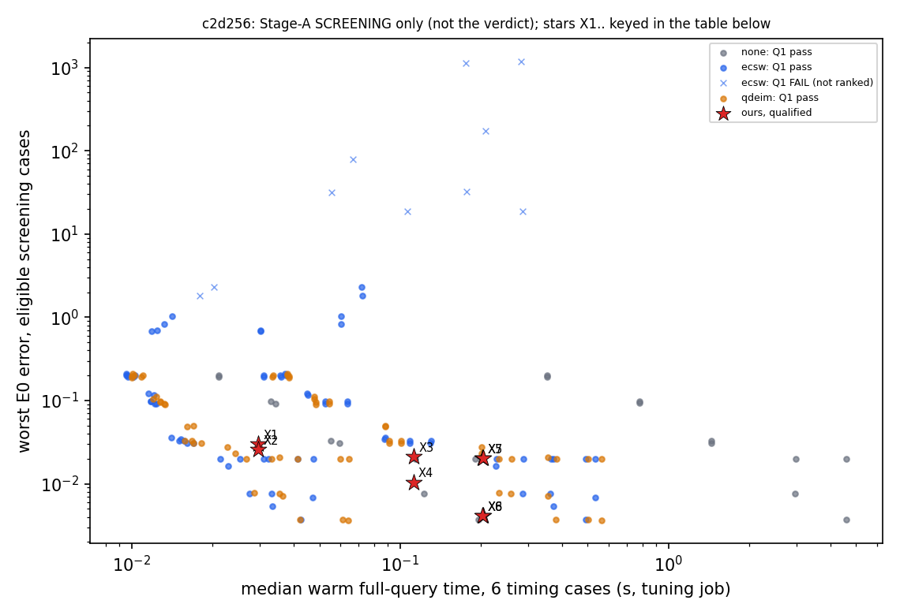

*Screening plot (Stage A on the six screening cases, tuning job), not the verdict front: Q1 failures are drawn as crosses and are never ranked; the verdict uses Stage-B runs on the full verdict cohort. Star labels X1, X2, ... are keyed below.*

| star | X (ours) | batch / qualification |
|---|---|---|
| X1 | `256\|R128\|BE` | 1: P1 Q1+Q2 (A21.1); FRONT-2D member |
| X2 | `256\|R128\|CNR` | 1: P1 Q1+Q2 (A21.1); not a FRONT-2D member |
| X3 | `256\|R256\|BE` | 1: P1 Q1+Q2 (A21.1); not a FRONT-2D member |
| X4 | `256\|R256\|CNR` | 1: P1 Q1+Q2 (A21.1); not a FRONT-2D member |
| X5 | `256\|R384\|BE` | 1: P1 Q1+Q2 (A21.1); not a FRONT-2D member |
| X6 | `256\|R384\|CNR` | 1: P1 Q1+Q2 (A21.1); FRONT-2D member |
| X7 | `256\|R384nom\|BE` | 1: P1 Q1+Q2 (A21.1); not a FRONT-2D member |
| X8 | `256\|R384nom\|CNR` | 1: P1 Q1+Q2 (A21.1); not a FRONT-2D member |

Per X: worst and median E0 error of X and of each role pick on the eligible verdict cases; ρ = baseline/X full-query time ratio (median over the six timing cases of the per-case median A–B–A ratio) with its 95 % case-bootstrap interval; ρ < 1 means the baseline is faster. "Dominates" refers to query time and worst-case error only; the median error is printed beside it (A44.3, A45.2). Picks may use a different scheme or time step from X: the comparison is between tuned configurations, not at a fixed scheme or step.

| X (ours) | batch | X worst / median | role | pick | pick worst / median | ρ [95 %] | label |
|---|---|---|---|---|---|---|---|
| `256\|R128\|BE` (FRONT-2D) | 1 | 0.0485 / 0.011 | B_acc | `ecsw\|256\|k4\|BE\|0.005\|common\|central` | 0.0359 / 0.0102 | 0.719 [0.662, 0.798] | baseline dominates [saturation check failed (A1.3)] [developmental, in-sample, unadjusted] [budget band unresolved] |
| `256\|R128\|BE` (FRONT-2D) | 1 | 0.0485 / 0.011 | B_cost | `ecsw\|256\|k8\|CNR\|0.005\|common\|central` | 0.0274 / 0.00217 | 0.906 [0.882, 0.945] | baseline dominates [saturation check failed (A1.3)] [developmental, in-sample, unadjusted] [budget band unresolved] |
| | | | cell | | | | baseline dominates X: observed domination by a registered pick [saturation check failed (A1.3)] [developmental, in-sample, unadjusted] [budget band unresolved] (pairs assessed: 19) |
| `256\|R128\|CNR` | 1 | 0.0521 / 0.00452 | B_acc | `ecsw\|256\|k4\|BE\|0.005\|common\|central` | 0.0359 / 0.0102 | 0.72 [0.657, 0.791] | baseline dominates [saturation check failed (A1.3)] [developmental, in-sample, unadjusted] [budget band unresolved] |
| `256\|R128\|CNR` | 1 | 0.0521 / 0.00452 | B_cost | `ecsw\|256\|k8\|CNR\|0.005\|common\|central` | 0.0274 / 0.00217 | 0.894 [0.875, 0.931] | baseline dominates [saturation check failed (A1.3)] [developmental, in-sample, unadjusted] [budget band unresolved] |
| | | | cell | | | | baseline dominates X: observed domination by a registered pick [saturation check failed (A1.3)] [developmental, in-sample, unadjusted] [budget band unresolved] (pairs assessed: 20) |
| `256\|R256\|BE` | 1 | 0.0332 / 0.00984 | B_acc | `ecsw\|256\|k4\|CNR\|0.005\|common\|central` | 0.0326 / 0.0024 | 0.209 [0.203, 0.215] | baseline dominates [saturation check failed (A1.3)] [developmental, in-sample, unadjusted] [budget band unresolved] |
| `256\|R256\|BE` | 1 | 0.0332 / 0.00984 | B_cost | `qdeim\|512\|1024\|CNR\|0.005\|common\|central` | 0.00838 / 0.00199 | 0.577 [0.573, 0.592] | baseline dominates [saturation check failed (A1.3)] [developmental, in-sample, unadjusted] [budget band unresolved] |
| | | | cell | | | | baseline dominates X: observed domination by a registered pick [saturation check failed (A1.3)] [developmental, in-sample, unadjusted] [budget band unresolved] (pairs assessed: 18) |
| `256\|R256\|CNR` | 1 | 0.0252 / 0.00206 | B_acc | `ecsw\|384\|k4\|CNR\|0.005\|common\|central` | 0.015 / 0.00202 | 0.308 [0.3, 0.317] | baseline dominates [saturation check failed (A1.3)] [developmental, in-sample, unadjusted] [budget band unresolved] |
| `256\|R256\|CNR` | 1 | 0.0252 / 0.00206 | B_cost | `qdeim\|512\|1024\|CNR\|0.005\|common\|central` | 0.00838 / 0.00199 | 0.583 [0.574, 0.595] | baseline dominates [saturation check failed (A1.3)] [developmental, in-sample, unadjusted] [budget band unresolved] |
| | | | cell | | | | baseline dominates X: observed domination by a registered pick [saturation check failed (A1.3)] [developmental, in-sample, unadjusted] [budget band unresolved] (pairs assessed: 11) |
| `256\|R384\|BE` | 1 | 0.0301 / 0.00981 | B_acc | `ecsw\|256\|k8\|CNR\|0.005\|common\|central` | 0.0274 / 0.00217 | 0.134 [0.129, 0.137] | baseline dominates [saturation check failed (A1.3)] [developmental, in-sample, unadjusted] [budget band unresolved] |
| `256\|R384\|BE` | 1 | 0.0301 / 0.00981 | B_cost | `qdeim\|512\|1024\|CNR\|0.005\|common\|central` | 0.00838 / 0.00199 | 0.313 [0.308, 0.318] | baseline dominates [saturation check failed (A1.3)] [developmental, in-sample, unadjusted] [budget band unresolved] |
| | | | cell | | | | baseline dominates X: observed domination by a registered pick [saturation check failed (A1.3)] [developmental, in-sample, unadjusted] [budget band unresolved] (pairs assessed: 16) |
| `256\|R384\|CNR` (FRONT-2D) | 1 | 0.0181 / 0.00201 | B_acc | `ecsw\|384\|k4\|CNR\|0.005\|common\|central` | 0.015 / 0.00202 | 0.166 [0.162, 0.169] | baseline dominates [saturation check failed (A1.3)] [developmental, in-sample, unadjusted] [budget band unresolved] |
| `256\|R384\|CNR` (FRONT-2D) | 1 | 0.0181 / 0.00201 | B_cost | `qdeim\|512\|1024\|CNR\|0.005\|common\|central` | 0.00838 / 0.00199 | 0.313 [0.311, 0.32] | baseline dominates [saturation check failed (A1.3)] [developmental, in-sample, unadjusted] [budget band unresolved] |
| | | | cell | | | | baseline dominates X: observed domination by a registered pick [saturation check failed (A1.3)] [developmental, in-sample, unadjusted] [budget band unresolved] (pairs assessed: 11) |
| `256\|R384nom\|BE` | 1 | 0.0301 / 0.00981 | B_acc | `ecsw\|256\|k8\|CNR\|0.005\|common\|central` | 0.0274 / 0.00217 | 0.135 [0.13, 0.137] | baseline dominates [saturation check failed (A1.3)] [developmental, in-sample, unadjusted] [budget band unresolved] |
| `256\|R384nom\|BE` | 1 | 0.0301 / 0.00981 | B_cost | `qdeim\|512\|1024\|CNR\|0.005\|common\|central` | 0.00838 / 0.00199 | 0.312 [0.308, 0.317] | baseline dominates [saturation check failed (A1.3)] [developmental, in-sample, unadjusted] [budget band unresolved] |
| | | | cell | | | | baseline dominates X: observed domination by a registered pick [saturation check failed (A1.3)] [developmental, in-sample, unadjusted] [budget band unresolved] (pairs assessed: 16) |
| `256\|R384nom\|CNR` | 1 | 0.0176 / 0.00201 | B_acc | `ecsw\|384\|k4\|CNR\|0.005\|common\|central` | 0.015 / 0.00202 | 0.166 [0.163, 0.169] | baseline dominates [saturation check failed (A1.3)] [developmental, in-sample, unadjusted] [budget band unresolved] |
| `256\|R384nom\|CNR` | 1 | 0.0176 / 0.00201 | B_cost | `qdeim\|512\|1024\|CNR\|0.005\|common\|central` | 0.00838 / 0.00199 | 0.312 [0.31, 0.319] | baseline dominates [saturation check failed (A1.3)] [developmental, in-sample, unadjusted] [budget band unresolved] |
| | | | cell | | | | baseline dominates X: observed domination by a registered pick [saturation check failed (A1.3)] [developmental, in-sample, unadjusted] [budget band unresolved] (pairs assessed: 11) |

By batch: batch 1 (qualified, P1): 8 of 8 X dominated, 0 withheld. Restrictions: saturation check failed (A1.3); developmental, in-sample, unadjusted.

**Median-error reversals.** In these dominated pairs the pick has the lower worst-case error but a *higher* median error than X; the domination statement concerns worst-case error and time only, and the pick is not "more accurate" in general:

| X | batch | role | pick | X worst → pick worst | X median → pick median | median ratio |
|---|---|---|---|---|---|---|
| `256\|R128\|CNR` | 1 | B_acc | `ecsw\|256\|k4\|BE\|0.005\|common\|central` | 0.0521 → 0.0359 | 0.00452 → 0.0102 | 2.263 (substantial) |
| `256\|R384nom\|CNR` | 1 | B_acc | `ecsw\|384\|k4\|CNR\|0.005\|common\|central` | 0.0176 → 0.015 | 0.00201 → 0.00202 | 1.003 |
| `256\|R384\|CNR` | 1 | B_acc | `ecsw\|384\|k4\|CNR\|0.005\|common\|central` | 0.0181 → 0.015 | 0.00201 → 0.00202 | 1.003 |

**Most frequent dominating pick**: `qdeim\|512\|1024\|CNR\|0.005\|common\|central` (6 dominated pairs): QDEIM rank 512, p = 1024 interpolation points, CNR, Δt = 1/200 (Δt₀), common solver. Its scheme/step combination occurs among the X. Ranks of all dominating picks: 256 (adequacy pass), 384 (adequacy pass), 512 (adequacy not checked (rank outside the registered adequacy ranks)). Of the 8 dominated X, 8 have a dominating pick at a rank whose adequacy check passes. The comparisons set the bank LSPG against POD-LSPG; they do not isolate the basis from the hyper-reduction.

### Supporting evidence (screening, tuning job)

Q1 outcome of the Stage-A configurations by arm (failures are reported and never ranked):

| arm | solver | Q1 pass | Q1 fail |
|---|---|---|---|
| none | native | 10 | 0 |
| none | common | 10 | 0 |
| ecsw | native | 36 | 4 |
| ecsw | common | 34 | 6 |
| qdeim | native | 32 | 0 |
| qdeim | common | 32 | 0 |

Limiting comparator — the un-reduced central FOM at the baseline mesh, scheme and step, scored against E0 (the error floor any POD-LSPG of this FOM approaches as $r\to n$; §3.1):

| scheme | step | cases scored | eligible | worst E0 | median E0 |
|---|---|---|---|---|---|
| BE | Δt = 1/200 (Δt₀) | 38 | 38 | 0.0285 | 0.00984 |
| CNR | Δt = 1/200 (Δt₀) | 38 | 38 | 0.00444 | 0.00192 |

Hyper-reduction versus `none` at the same rank, scheme, step and solver (the HR analogue of Q2, reported, not gated). Only the **error-level** discrepancy is available: the field distance between the HR run and the `none` run was not computed in-job and cannot be recovered from the pulled evidence.

| arm | rank | configurations | median worst-error ratio HR/none | max per-case abs. error difference |
|---|---|---|---|---|
| ecsw | 32 | 16 | 1.02 | 0.586 |
| ecsw | 64 | 16 | 1.12 | 0.977 |
| ecsw | 128 | 14 | 1 | 2.3 |
| ecsw | 256 | 12 | 1 | 0.00892 |
| ecsw | 384 | 8 | 1 | 0.0017 |
| qdeim | 32 | 12 | 0.999 | 0.105 |
| qdeim | 64 | 12 | 1 | 0.0644 |
| qdeim | 128 | 12 | 1.01 | 0.03 |
| qdeim | 256 | 12 | 1.01 | 0.0195 |
| qdeim | 384 | 12 | 1 | 0.00488 |

Native versus common solver: 76 configurations Q1-pass with both; median time ratio native/common 7.24 (range 2.43–26.1); median worst-error ratio 1 (range 0.998–1).

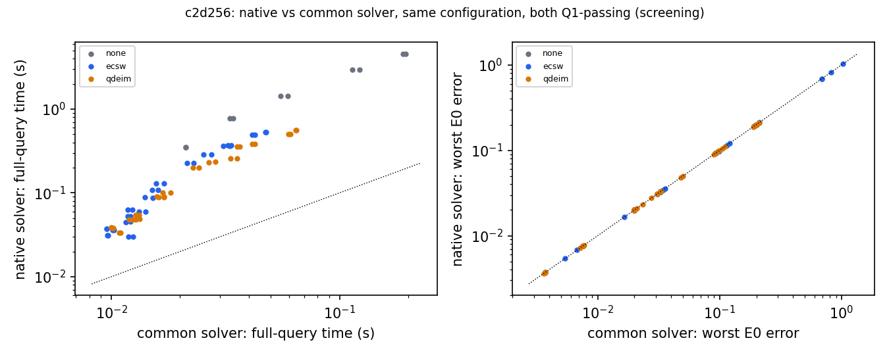

POD (primary basis, 29,376 snapshots) and projection floors; the probe basis (upwind generator, 6,912 snapshots) beside it:

| rank | primary: projection error | probe: projection error | held-out / in-set ratio (adequacy) |
|---|---|---|---|
| 32 | 0.0608 | 0.067 | 0.889 (pass) |
| 64 | 0.0258 | 0.0257 | 0.843 (pass) |
| 128 | 0.00849 | 0.00672 | 0.829 (pass) |
| 256 | 0.00176 | 0.000992 | 0.889 (pass) |
| 384 | 0.000508 | 0.000218 | 0.951 (pass) |
| 512 | 0.000173 | n/a | not checked |

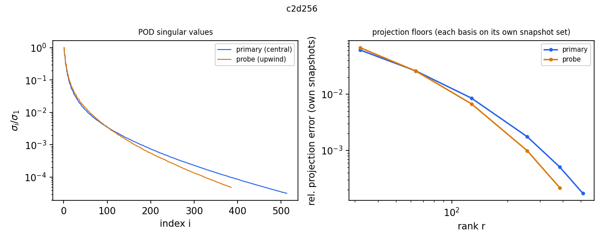

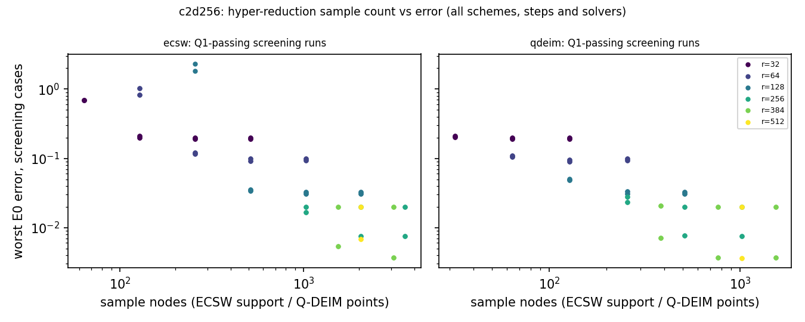

Generator probe (A2.3, ratified by the coordinator in A19.2: the primary snapshots come from the central FOM on the training parameter draws, which gives the baseline its best data; the probe regenerates the snapshots with the bank's sign-upwind BE generator on the same draws). `none` arm, native solver, worst E0 on the screening cases, beside the central basis at the same rank and option. **Confound in this cell**: the primary basis uses 51 saved steps per trajectory (29,376 snapshots, the all-step remedy) while the probe uses the 12-step set, so the difference is not solely a generator change.

| configuration | probe worst E0 | central worst E0 | status |
|---|---|---|---|
| `none\|32\|-\|BE\|0.005\|native\|upwind` | 0.222 | 0.2 | complete |
| `none\|32\|-\|CNR\|0.005\|native\|upwind` | 0.205 | 0.191 | complete |
| `none\|64\|-\|BE\|0.005\|native\|upwind` | 0.0761 | 0.0984 | complete |
| `none\|64\|-\|CNR\|0.005\|native\|upwind` | 0.0728 | 0.0926 | complete |
| `none\|128\|-\|BE\|0.005\|native\|upwind` | 0.0276 | 0.0328 | complete |
| `none\|128\|-\|CNR\|0.005\|native\|upwind` | 0.0257 | 0.0308 | complete |
| `none\|256\|-\|BE\|0.005\|native\|upwind` | 0.0201 | 0.02 | complete |
| `none\|256\|-\|CNR\|0.005\|native\|upwind` | 0.00524 | 0.00759 | complete |
| `none\|384\|-\|BE\|0.005\|native\|upwind` | 0.0199 | 0.0199 | complete |
| `none\|384\|-\|CNR\|0.005\|native\|upwind` | 0.0037 | 0.00371 | complete |

Offline construction, in-job GPU-seconds (selected tuning attempt): snapshots[central] 75.3, pod[central] 51.61, pod_check[central] 3.846, lap_dsum_cols 0.6123, adv_snapshots 1.276, adv_pod 15.35, adv_pod_check 9.532, ecsw_states 5.515, ecsw_contrib 44.54, ecsw_nnls 810.5, qdeim_pivots 10.19, qdeim_qr 37.14. Break-even query counts are not computed: no positive per-query saving of a qualified method over the other was established with equal budgets.

## c2d1024 (2D, L = 1024 intervals)

Tuning attempt `t2d1024a`, Stage-B attempt `s2d1024b`. Basis used: 12-step (central) (6,912 snapshots). In-cell adequacy: r=32: pass (ratio 0.929), r=64: pass (ratio 0.923), r=128: pass (ratio 0.965), r=256: pass (ratio 1.03), r=384: pass (ratio 1.08).

Restrictions carried by every conclusion of this cell: snapshot-limited check failed (A1.3); budget: budget band unresolved.

Construction and validation hours. Selected attempts: T = 0.988 h; V = 2.02 h (tuning 0.757, Stage B 1.27); limiting comparator 0.0175 h. Cumulative over every attempt (A44.2, A45.1): T = 0.988 h, V ≥ 3.06 h (allocation upper bound 5.22 h); extra attempts: s2d1024a.

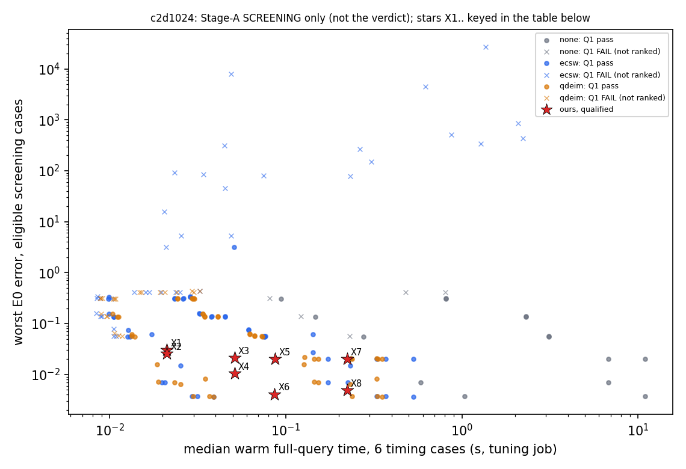

*Screening plot (Stage A on the six screening cases, tuning job), not the verdict front: Q1 failures are drawn as crosses and are never ranked; the verdict uses Stage-B runs on the full verdict cohort. Star labels X1, X2, ... are keyed below.*

| star | X (ours) | batch / qualification |
|---|---|---|
| X1 | `1024\|R128\|BE` | 1: P1 Q1+Q2 (A21.1); FRONT-2D member |
| X2 | `1024\|R128\|CNR` | 1: P1 Q1+Q2 (A21.1); not a FRONT-2D member |
| X3 | `1024\|R256\|BE` | 1: P1 Q1+Q2 (A21.1); not a FRONT-2D member |
| X4 | `1024\|R256\|CNR` | 1: P1 Q1+Q2 (A21.1); not a FRONT-2D member |
| X5 | `1024\|R384\|BE` | 1: P1 Q1+Q2 (A21.1); not a FRONT-2D member |
| X6 | `1024\|R384\|CNR` | 1: P1 Q1+Q2 (A21.1); FRONT-2D member |
| X7 | `1024\|R512\|BE` | 1: P1 Q1+Q2 (A21.1); not a FRONT-2D member |
| X8 | `1024\|R512\|CNR` | 1: P1 Q1+Q2 (A21.1); not a FRONT-2D member |

Per X: worst and median E0 error of X and of each role pick on the eligible verdict cases; ρ = baseline/X full-query time ratio (median over the six timing cases of the per-case median A–B–A ratio) with its 95 % case-bootstrap interval; ρ < 1 means the baseline is faster. "Dominates" refers to query time and worst-case error only; the median error is printed beside it (A44.3, A45.2). Picks may use a different scheme or time step from X: the comparison is between tuned configurations, not at a fixed scheme or step.

| X (ours) | batch | X worst / median | role | pick | pick worst / median | ρ [95 %] | label |
|---|---|---|---|---|---|---|---|
| `1024\|R128\|BE` (FRONT-2D) | 1 | 0.0484 / 0.011 | B_acc | `qdeim\|256\|512\|CNR\|0.005\|common\|central` | 0.0307 / 0.00267 | 0.945 [0.923, 0.971] | baseline dominates [snapshot-limited check failed (A1.3)] [developmental, in-sample, unadjusted] [budget band unresolved] |
| `1024\|R128\|BE` (FRONT-2D) | 1 | 0.0484 / 0.011 | B_cost | `qdeim\|256\|512\|CNR\|0.005\|common\|central` | 0.0307 / 0.00267 | 0.945 [0.923, 0.971] | baseline dominates [snapshot-limited check failed (A1.3)] [developmental, in-sample, unadjusted] [budget band unresolved] |
| | | | cell | | | | baseline dominates X: observed domination by a registered pick [snapshot-limited check failed (A1.3)] [developmental, in-sample, unadjusted] [budget band unresolved] (pairs assessed: 18) |
| `1024\|R128\|CNR` | 1 | 0.052 / 0.0045 | B_acc | `qdeim\|256\|512\|CNR\|0.005\|common\|central` | 0.0307 / 0.00267 | 0.945 [0.921, 0.967] | baseline dominates [snapshot-limited check failed (A1.3)] [developmental, in-sample, unadjusted] [budget band unresolved] |
| `1024\|R128\|CNR` | 1 | 0.052 / 0.0045 | B_cost | `qdeim\|256\|512\|CNR\|0.005\|common\|central` | 0.0307 / 0.00267 | 0.945 [0.921, 0.967] | baseline dominates [snapshot-limited check failed (A1.3)] [developmental, in-sample, unadjusted] [budget band unresolved] |
| | | | cell | | | | baseline dominates X: observed domination by a registered pick [snapshot-limited check failed (A1.3)] [developmental, in-sample, unadjusted] [budget band unresolved] (pairs assessed: 18) |
| `1024\|R256\|BE` | 1 | 0.0332 / 0.00983 | B_acc | `qdeim\|256\|512\|CNR\|0.005\|common\|central` | 0.0307 / 0.00267 | 0.392 [0.383, 0.4] | baseline dominates [snapshot-limited check failed (A1.3)] [developmental, in-sample, unadjusted] [budget band unresolved] |
| `1024\|R256\|BE` | 1 | 0.0332 / 0.00983 | B_cost | `qdeim\|512\|1024\|CNR\|0.005\|common\|central` | 0.00765 / 0.00196 | 0.796 [0.785, 0.815] | baseline dominates [snapshot-limited check failed (A1.3)] [developmental, in-sample, unadjusted] [budget band unresolved] |
| | | | cell | | | | baseline dominates X: observed domination by a registered pick [snapshot-limited check failed (A1.3)] [developmental, in-sample, unadjusted] [budget band unresolved] (pairs assessed: 17) |
| `1024\|R256\|CNR` | 1 | 0.0252 / 0.00209 | B_acc | `ecsw\|384\|k8\|CNR\|0.005\|common\|central` | 0.0135 / 0.00198 | 0.604 [0.59, 0.627] | baseline dominates [snapshot-limited check failed (A1.3)] [developmental, in-sample, unadjusted] [budget band unresolved] |
| `1024\|R256\|CNR` | 1 | 0.0252 / 0.00209 | B_cost | `qdeim\|512\|1024\|CNR\|0.005\|common\|central` | 0.00765 / 0.00196 | 0.803 [0.786, 0.825] | baseline dominates [snapshot-limited check failed (A1.3)] [developmental, in-sample, unadjusted] [budget band unresolved] |
| | | | cell | | | | baseline dominates X: observed domination by a registered pick [snapshot-limited check failed (A1.3)] [developmental, in-sample, unadjusted] [budget band unresolved] (pairs assessed: 12) |
| `1024\|R384\|BE` | 1 | 0.0301 / 0.00978 | B_acc | `ecsw\|256\|k8\|CNR\|0.005\|common\|central` | 0.0272 / 0.00267 | 0.241 [0.238, 0.246] | baseline dominates [snapshot-limited check failed (A1.3)] [developmental, in-sample, unadjusted] [budget band unresolved] |
| `1024\|R384\|BE` | 1 | 0.0301 / 0.00978 | B_cost | `qdeim\|512\|1024\|CNR\|0.005\|common\|central` | 0.00765 / 0.00196 | 0.473 [0.459, 0.483] | baseline dominates [snapshot-limited check failed (A1.3)] [developmental, in-sample, unadjusted] [budget band unresolved] |
| | | | cell | | | | baseline dominates X: observed domination by a registered pick [snapshot-limited check failed (A1.3)] [developmental, in-sample, unadjusted] [budget band unresolved] (pairs assessed: 16) |
| `1024\|R384\|CNR` (FRONT-2D) | 1 | 0.0178 / 0.00198 | B_acc | `ecsw\|384\|k8\|CNR\|0.005\|common\|central` | 0.0135 / 0.00198 | 0.354 [0.349, 0.362] | baseline dominates [snapshot-limited check failed (A1.3)] [developmental, in-sample, unadjusted] [budget band unresolved] |
| `1024\|R384\|CNR` (FRONT-2D) | 1 | 0.0178 / 0.00198 | B_cost | `qdeim\|512\|1024\|CNR\|0.005\|common\|central` | 0.00765 / 0.00196 | 0.474 [0.463, 0.478] | baseline dominates [snapshot-limited check failed (A1.3)] [developmental, in-sample, unadjusted] [budget band unresolved] |
| | | | cell | | | | baseline dominates X: observed domination by a registered pick [snapshot-limited check failed (A1.3)] [developmental, in-sample, unadjusted] [budget band unresolved] (pairs assessed: 12) |
| `1024\|R512\|BE` | 1 | 0.0309 / 0.00979 | B_acc | `qdeim\|256\|512\|CNR\|0.005\|common\|central` | 0.0307 / 0.00267 | 0.086 [0.0845, 0.0876] | baseline dominates [snapshot-limited check failed (A1.3)] [developmental, in-sample, unadjusted] [budget band unresolved] |
| `1024\|R512\|BE` | 1 | 0.0309 / 0.00979 | B_cost | `qdeim\|512\|1024\|CNR\|0.005\|common\|central` | 0.00765 / 0.00196 | 0.179 [0.175, 0.182] | baseline dominates [snapshot-limited check failed (A1.3)] [developmental, in-sample, unadjusted] [budget band unresolved] |
| | | | cell | | | | baseline dominates X: observed domination by a registered pick [snapshot-limited check failed (A1.3)] [developmental, in-sample, unadjusted] [budget band unresolved] (pairs assessed: 17) |
| `1024\|R512\|CNR` | 1 | 0.0217 / 0.00199 | B_acc | `ecsw\|384\|k8\|CNR\|0.005\|common\|central` | 0.0135 / 0.00198 | 0.138 [0.135, 0.141] | baseline dominates [snapshot-limited check failed (A1.3)] [developmental, in-sample, unadjusted] [budget band unresolved] |
| `1024\|R512\|CNR` | 1 | 0.0217 / 0.00199 | B_cost | `qdeim\|512\|1024\|CNR\|0.005\|common\|central` | 0.00765 / 0.00196 | 0.183 [0.18, 0.187] | baseline dominates [snapshot-limited check failed (A1.3)] [developmental, in-sample, unadjusted] [budget band unresolved] |
| | | | cell | | | | baseline dominates X: observed domination by a registered pick [snapshot-limited check failed (A1.3)] [developmental, in-sample, unadjusted] [budget band unresolved] (pairs assessed: 12) |

By batch: batch 1 (qualified, P1): 8 of 8 X dominated, 0 withheld. Restrictions: snapshot-limited check failed (A1.3); developmental, in-sample, unadjusted.

**Median-error reversals.** In these dominated pairs the pick has the lower worst-case error but a *higher* median error than X; the domination statement concerns worst-case error and time only, and the pick is not "more accurate" in general:

| X | batch | role | pick | X worst → pick worst | X median → pick median | median ratio |
|---|---|---|---|---|---|---|
| `1024\|R384\|CNR` | 1 | B_acc | `ecsw\|384\|k8\|CNR\|0.005\|common\|central` | 0.0178 → 0.0135 | 0.00198 → 0.00198 | 1.001 |

**Most frequent dominating pick**: `qdeim\|256\|512\|CNR\|0.005\|common\|central` (6 dominated pairs): QDEIM rank 256, p = 512 interpolation points, CNR, Δt = 1/200 (Δt₀), common solver. Its scheme/step combination occurs among the X. Ranks of all dominating picks: 256 (adequacy pass), 384 (adequacy pass), 512 (adequacy not checked (rank outside the registered adequacy ranks)). Of the 8 dominated X, 8 have a dominating pick at a rank whose adequacy check passes. The comparisons set the bank LSPG against POD-LSPG; they do not isolate the basis from the hyper-reduction.

### Supporting evidence (screening, tuning job)

Q1 outcome of the Stage-A configurations by arm (failures are reported and never ranked):

| arm | solver | Q1 pass | Q1 fail |
|---|---|---|---|
| none | native | 10 | 0 |
| none | common | 5 | 5 |
| ecsw | native | 33 | 9 |
| ecsw | common | 15 | 27 |
| qdeim | native | 34 | 0 |
| qdeim | common | 14 | 20 |

Limiting comparator — the un-reduced central FOM at the baseline mesh, scheme and step, scored against E0 (the error floor any POD-LSPG of this FOM approaches as $r\to n$; §3.1):

| scheme | step | cases scored | eligible | worst E0 | median E0 |
|---|---|---|---|---|---|
| BE | Δt = 1/200 (Δt₀) | 38 | 38 | 0.0287 | 0.00979 |
| CNR | Δt = 1/200 (Δt₀) | 38 | 38 | 0.00476 | 0.00191 |

Hyper-reduction versus `none` at the same rank, scheme, step and solver (the HR analogue of Q2, reported, not gated). Only the **error-level** discrepancy is available: the field distance between the HR run and the `none` run was not computed in-job and cannot be recovered from the pulled evidence.

| arm | rank | configurations | median worst-error ratio HR/none | max per-case abs. error difference |
|---|---|---|---|---|
| ecsw | 32 | 8 | 1 | 0.0353 |
| ecsw | 64 | 9 | 1 | 0.0201 |
| ecsw | 128 | 10 | 1 | 3.1 |
| ecsw | 256 | 9 | 1 | 0.0551 |
| ecsw | 384 | 9 | 1 | 0.0123 |
| qdeim | 32 | 6 | 1 | 0.144 |
| qdeim | 64 | 9 | 1 | 0.0761 |
| qdeim | 128 | 9 | 1.02 | 0.0329 |
| qdeim | 256 | 9 | 1 | 0.0101 |
| qdeim | 384 | 9 | 1 | 0.00381 |

Native versus common solver: 34 configurations Q1-pass with both; median time ratio native/common 7.85 (range 2.37–15.6); median worst-error ratio 1 (range 0.999–1).

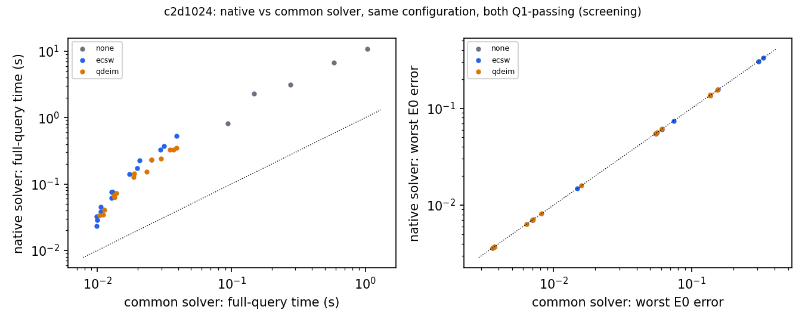

POD (primary basis, 6,912 snapshots) and projection floors; the probe basis (upwind generator, 6,912 snapshots) beside it:

| rank | primary: projection error | probe: projection error | held-out / in-set ratio (adequacy) |
|---|---|---|---|
| 32 | 0.071 | 0.0686 | 0.929 (pass) |
| 64 | 0.0293 | 0.0271 | 0.923 (pass) |
| 128 | 0.0089 | 0.00744 | 0.965 (pass) |
| 256 | 0.00162 | 0.00119 | 1.03 (pass) |
| 384 | 0.000409 | 0.000276 | 1.08 (pass) |
| 512 | 0.000121 | n/a | not checked |

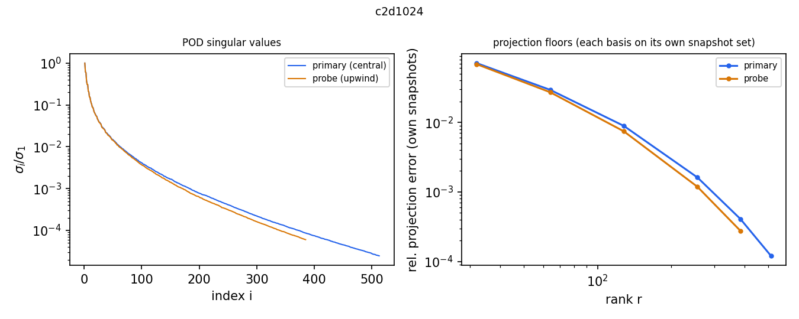

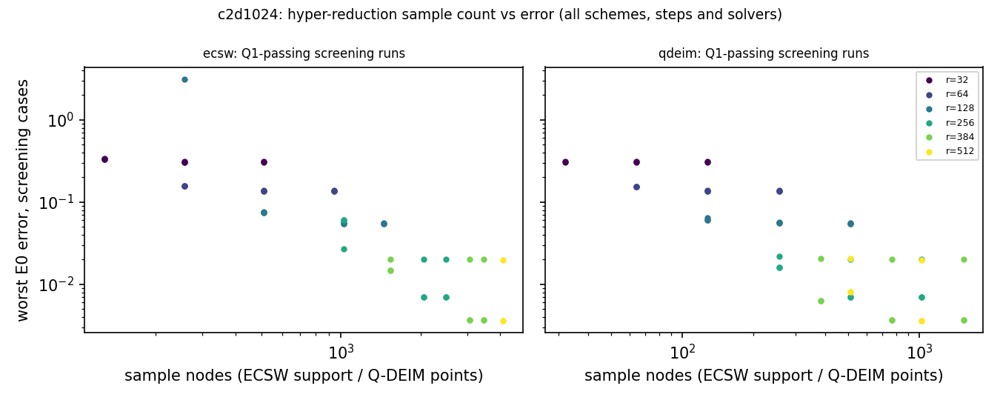

Generator probe (A2.3, ratified by the coordinator in A19.2: the primary snapshots come from the central FOM on the training parameter draws, which gives the baseline its best data; the probe regenerates the snapshots with the bank's sign-upwind BE generator on the same draws). `none` arm, native solver, worst E0 on the screening cases, beside the central basis at the same rank and option; both bases use the same saved steps.

| configuration | probe worst E0 | central worst E0 | status |
|---|---|---|---|
| `none\|32\|-\|BE\|0.005\|native\|upwind` | 0.312 | 0.314 | complete |
| `none\|32\|-\|CNR\|0.005\|native\|upwind` | 0.303 | 0.306 | complete |
| `none\|64\|-\|BE\|0.005\|native\|upwind` | 0.131 | 0.138 | complete |
| `none\|64\|-\|CNR\|0.005\|native\|upwind` | 0.13 | 0.136 | complete |
| `none\|128\|-\|BE\|0.005\|native\|upwind` | 0.0478 | 0.0563 | complete |
| `none\|128\|-\|CNR\|0.005\|native\|upwind` | 0.0469 | 0.0549 | complete |
| `none\|256\|-\|BE\|0.005\|native\|upwind` | 0.0201 | 0.0202 | complete |
| `none\|256\|-\|CNR\|0.005\|native\|upwind` | 0.00675 | 0.00704 | complete |
| `none\|384\|-\|BE\|0.005\|native\|upwind` | 0.0199 | 0.02 | complete |
| `none\|384\|-\|CNR\|0.005\|native\|upwind` | 0.00366 | 0.0037 | complete |

Offline construction, in-job GPU-seconds (selected tuning attempt): snapshots[central] 208.4, pod[central] 33.92, pod_check[central] 30.75, lap_dsum_cols 0.6349, adv_snapshots 24.98, adv_pod 37.4, adv_pod_check 34.16, ecsw_states 11.62, ecsw_contrib 48.68, ecsw_nnls 2784, qdeim_pivots 50.23, qdeim_qr 42.5. Break-even query counts are not computed: no positive per-query saving of a qualified method over the other was established with equal budgets.

## c3d64 (3D, L = 64 intervals)

Tuning attempt `t3d64b`, Stage-B attempt `s3d64b`. Basis used: 12-step (central) (18,432 snapshots). In-cell adequacy: r=64: pass (ratio 0.862), r=128: pass (ratio 0.834), r=256: pass (ratio 0.83), r=512: pass (ratio 0.945), r=768: FAIL (ratio 1.18), r=1024: FAIL (ratio 1.58).

Restrictions carried by every conclusion of this cell: basis adequacy failed (A2.2); ECSW coverage incomplete (A3.11); budget: unequal-budget, descriptive (batch 2) / unequal-budget, descriptive (batch 1).

Construction and validation hours. Selected attempts: T = 1.07 h; V = 8.61 h (tuning 5.88, Stage B 2.74); limiting comparator 0.327 h. Cumulative over every attempt (A44.2, A45.1): T ≥ 1.7 h, V ≥ 8.84 h (allocation upper bound 11.4 h); extra attempts: s3d64a, t3d64a.

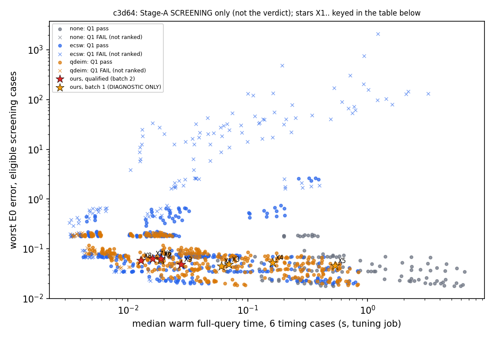

*Screening plot (Stage A on the six screening cases, tuning job), not the verdict front: Q1 failures are drawn as crosses and are never ranked; the verdict uses Stage-B runs on the full verdict cohort. Star labels X1, X2, ... are keyed below.*

| star | X (ours) | batch / qualification |
|---|---|---|
| X1 | `M2_512\|gl32\|fs\|BE\|0.01\|K1` | 1: diagnostic only (A22.0; Q1 + deployed-rule evidence) |
| X2 | `W256\|gl24\|fs\|BE\|0.01\|K1` | 1: diagnostic only (A22.0; Q1 + deployed-rule evidence) |
| X3 | `W512\|lat32768\|fs\|BE\|0.01\|K1` | 1: diagnostic only (A22.0; Q1 + deployed-rule evidence) |
| X4 | `W768\|lat32768\|fs\|BE\|0.01\|K1` | 1: diagnostic only (A22.0; Q1 + deployed-rule evidence) |
| X5 | `W1024\|lat65536\|fs\|BE\|0.01\|K1` | 1: diagnostic only (A22.0; Q1 + deployed-rule evidence) |
| X6 | `W256\|gl24\|fs\|CN\|0.01\|K1` | 2: qualified subset (jcp-qualify Q2, A29) |
| X7 | `W256\|gl24\|fs\|CN\|0.0125\|K1` | 2: qualified subset (jcp-qualify Q2, A29) |
| X8 | `W256\|lat8192\|qn\|BDF2\|0.025\|k4` | 2: qualified subset (jcp-qualify Q2, A29) |
| X9 | `W512\|lat16384\|qn\|BDF2\|0.025\|k4` | 2: qualified subset (jcp-qualify Q2, A29) |

Per X: worst and median E0 error of X and of each role pick on the eligible verdict cases; ρ = baseline/X full-query time ratio (median over the six timing cases of the per-case median A–B–A ratio) with its 95 % case-bootstrap interval; ρ < 1 means the baseline is faster. "Dominates" refers to query time and worst-case error only; the median error is printed beside it (A44.3, A45.2). Picks may use a different scheme or time step from X: the comparison is between tuned configurations, not at a fixed scheme or step.

| X (ours) | batch | X worst / median | role | pick | pick worst / median | ρ [95 %] | label |
|---|---|---|---|---|---|---|---|
| `M2_512\|gl32\|fs\|BE\|0.01\|K1` | 1 | 0.0446 / 0.0157 | B_acc | `ecsw\|512\|k8\|BDF2\|0.016666667\|common\|central` | 0.0323 / 0.0111 | 0.255 [0.24, 0.288] | DIAGNOSTIC ONLY (3D batch 1, A22.0): baseline dominates [basis adequacy failed (A2.2); ECSW coverage incomplete (A3.11)] [developmental, in-sample, unadjusted] [unequal-budget, descriptive] |
| `M2_512\|gl32\|fs\|BE\|0.01\|K1` | 1 | 0.0446 / 0.0157 | B_cost | `ecsw\|512\|k8\|BDF2\|0.016666667\|common\|central` | 0.0323 / 0.0111 | 0.255 [0.24, 0.288] | DIAGNOSTIC ONLY (3D batch 1, A22.0): baseline dominates [basis adequacy failed (A2.2); ECSW coverage incomplete (A3.11)] [developmental, in-sample, unadjusted] [unequal-budget, descriptive] |
| | | | cell | | | | DIAGNOSTIC ONLY (3D batch 1, A22.0): baseline dominates X: observed domination by a registered pick [basis adequacy failed (A2.2); ECSW coverage incomplete (A3.11)] [developmental, in-sample, unadjusted] [unequal-budget, descriptive] (pairs assessed: 14) |
| `W256\|gl24\|fs\|BE\|0.01\|K1` | 1 | 0.059 / 0.0168 | B_acc | `ecsw\|512\|k8\|BDF2\|0.016666667\|common\|central` | 0.0323 / 0.0111 | 0.796 [0.741, 0.927] | DIAGNOSTIC ONLY (3D batch 1, A22.0): baseline dominates [basis adequacy failed (A2.2); ECSW coverage incomplete (A3.11)] [developmental, in-sample, unadjusted] [unequal-budget, descriptive] |
| `W256\|gl24\|fs\|BE\|0.01\|K1` | 1 | 0.059 / 0.0168 | B_cost | `ecsw\|512\|k8\|BDF2\|0.016666667\|common\|central` | 0.0323 / 0.0111 | 0.796 [0.741, 0.927] | DIAGNOSTIC ONLY (3D batch 1, A22.0): baseline dominates [basis adequacy failed (A2.2); ECSW coverage incomplete (A3.11)] [developmental, in-sample, unadjusted] [unequal-budget, descriptive] |
| | | | cell | | | | DIAGNOSTIC ONLY (3D batch 1, A22.0): baseline dominates X: observed domination by a registered pick [basis adequacy failed (A2.2); ECSW coverage incomplete (A3.11)] [developmental, in-sample, unadjusted] [unequal-budget, descriptive] (pairs assessed: 14) |
| `W512\|lat32768\|fs\|BE\|0.01\|K1` | 1 | 0.0486 / 0.0157 | B_acc | `ecsw\|512\|k8\|BDF2\|0.016666667\|common\|central` | 0.0323 / 0.0111 | 0.221 [0.209, 0.252] | DIAGNOSTIC ONLY (3D batch 1, A22.0): baseline dominates [basis adequacy failed (A2.2); ECSW coverage incomplete (A3.11)] [developmental, in-sample, unadjusted] [unequal-budget, descriptive] |
| `W512\|lat32768\|fs\|BE\|0.01\|K1` | 1 | 0.0486 / 0.0157 | B_cost | `qdeim\|1024\|4096\|CN\|0.025\|common\|central` | 0.025 / 0.00498 | 0.929 [0.812, 1.13] | DIAGNOSTIC ONLY (3D batch 1, A22.0): unresolved [basis adequacy failed (A2.2); ECSW coverage incomplete (A3.11)] [developmental, in-sample, unadjusted] [unequal-budget, descriptive] |
| | | | cell | | | | DIAGNOSTIC ONLY (3D batch 1, A22.0): baseline dominates X: observed domination by a registered pick [basis adequacy failed (A2.2); ECSW coverage incomplete (A3.11)] [developmental, in-sample, unadjusted] [unequal-budget, descriptive] (pairs assessed: 14) |
| `W768\|lat32768\|fs\|BE\|0.01\|K1` | 1 | 0.0528 / 0.0154 | B_acc | `ecsw\|512\|k8\|BDF2\|0.016666667\|common\|central` | 0.0323 / 0.0111 | 0.0988 [0.0945, 0.112] | DIAGNOSTIC ONLY (3D batch 1, A22.0): baseline dominates [basis adequacy failed (A2.2); ECSW coverage incomplete (A3.11)] [developmental, in-sample, unadjusted] [unequal-budget, descriptive] |
| `W768\|lat32768\|fs\|BE\|0.01\|K1` | 1 | 0.0528 / 0.0154 | B_cost | `qdeim\|1024\|4096\|CN\|0.01\|common\|central` | 0.0185 / 0.00167 | 0.619 [0.599, 0.656] | DIAGNOSTIC ONLY (3D batch 1, A22.0): baseline dominates [basis adequacy failed (A2.2); ECSW coverage incomplete (A3.11)] [developmental, in-sample, unadjusted] [unequal-budget, descriptive] |
| | | | cell | | | | DIAGNOSTIC ONLY (3D batch 1, A22.0): baseline dominates X: observed domination by a registered pick [basis adequacy failed (A2.2); ECSW coverage incomplete (A3.11)] [developmental, in-sample, unadjusted] [unequal-budget, descriptive] (pairs assessed: 14) |
| `W1024\|lat65536\|fs\|BE\|0.01\|K1` | 1 | 0.0459 / 0.0153 | B_acc | `ecsw\|512\|k8\|BDF2\|0.016666667\|common\|central` | 0.0323 / 0.0111 | 0.0295 [0.0282, 0.0328] | DIAGNOSTIC ONLY (3D batch 1, A22.0): baseline dominates [basis adequacy failed (A2.2); ECSW coverage incomplete (A3.11)] [developmental, in-sample, unadjusted] [unequal-budget, descriptive] |
| `W1024\|lat65536\|fs\|BE\|0.01\|K1` | 1 | 0.0459 / 0.0153 | B_cost | `none\|1024\|-\|CN\|0.0125\|common\|central` | 0.0178 / 0.00193 | 0.817 [0.779, 0.917] | DIAGNOSTIC ONLY (3D batch 1, A22.0): baseline dominates [basis adequacy failed (A2.2); ECSW coverage incomplete (A3.11)] [developmental, in-sample, unadjusted] [unequal-budget, descriptive] |
| | | | cell | | | | DIAGNOSTIC ONLY (3D batch 1, A22.0): baseline dominates X: observed domination by a registered pick [basis adequacy failed (A2.2); ECSW coverage incomplete (A3.11)] [developmental, in-sample, unadjusted] [unequal-budget, descriptive] (pairs assessed: 14) |
| `W256\|gl24\|fs\|CN\|0.01\|K1` | 2 | 0.0637 / 0.0057 | B_acc | `ecsw\|512\|k8\|BDF2\|0.016666667\|common\|central` | 0.0323 / 0.0111 | 0.79 [0.739, 0.919] | qualified subset, not a completeness claim (3D batch 2, A29): baseline dominates [basis adequacy failed (A2.2); ECSW coverage incomplete (A3.11)] [developmental, in-sample, unadjusted] [unequal-budget, descriptive] |
| `W256\|gl24\|fs\|CN\|0.01\|K1` | 2 | 0.0637 / 0.0057 | B_cost | `ecsw\|512\|k8\|BDF2\|0.016666667\|common\|central` | 0.0323 / 0.0111 | 0.79 [0.739, 0.919] | qualified subset, not a completeness claim (3D batch 2, A29): baseline dominates [basis adequacy failed (A2.2); ECSW coverage incomplete (A3.11)] [developmental, in-sample, unadjusted] [unequal-budget, descriptive] |
| | | | cell | | | | qualified subset, not a completeness claim (3D batch 2, A29): baseline dominates X: observed domination by a registered pick [basis adequacy failed (A2.2); ECSW coverage incomplete (A3.11)] [developmental, in-sample, unadjusted] [unequal-budget, descriptive] (pairs assessed: 14) |
| `W256\|gl24\|fs\|CN\|0.0125\|K1` | 2 | 0.0631 / 0.00589 | B_acc | `ecsw\|512\|k8\|BDF2\|0.016666667\|common\|central` | 0.0323 / 0.0111 | 0.954 [0.899, 1.08] | qualified subset, not a completeness claim (3D batch 2, A29): unresolved [basis adequacy failed (A2.2); ECSW coverage incomplete (A3.11)] [developmental, in-sample, unadjusted] [unequal-budget, descriptive] |
| `W256\|gl24\|fs\|CN\|0.0125\|K1` | 2 | 0.0631 / 0.00589 | B_cost | `ecsw\|512\|k8\|BDF2\|0.016666667\|common\|central` | 0.0323 / 0.0111 | 0.954 [0.899, 1.08] | qualified subset, not a completeness claim (3D batch 2, A29): unresolved [basis adequacy failed (A2.2); ECSW coverage incomplete (A3.11)] [developmental, in-sample, unadjusted] [unequal-budget, descriptive] |
| | | | cell | | | | qualified subset, not a completeness claim (3D batch 2, A29): no observed domination among the 14 pairs assessed (withheld: basis adequacy failed (A2.2); ECSW coverage incomplete (A3.11)) [developmental, in-sample, unadjusted] [unequal-budget, descriptive] (pairs assessed: 14) |
| `W256\|lat8192\|qn\|BDF2\|0.025\|k4` | 2 | 0.0586 / 0.0208 | B_acc | `ecsw\|512\|k8\|BDF2\|0.016666667\|common\|central` | 0.0323 / 0.0111 | 1.27 [1.19, 1.36] | qualified subset, not a completeness claim (3D batch 2, A29): neither dominates (withheld: basis adequacy failed (A2.2); ECSW coverage incomplete (A3.11)) [developmental, in-sample, unadjusted] [unequal-budget, descriptive] |
| `W256\|lat8192\|qn\|BDF2\|0.025\|k4` | 2 | 0.0586 / 0.0208 | B_cost | `ecsw\|128\|k16\|BDF2\|0.0125\|common\|central` | 0.0709 / 0.0203 | 0.494 [0.465, 0.531] | qualified subset, not a completeness claim (3D batch 2, A29): neither dominates (withheld: basis adequacy failed (A2.2); ECSW coverage incomplete (A3.11)) [developmental, in-sample, unadjusted] [unequal-budget, descriptive] |
| | | | cell | | | | qualified subset, not a completeness claim (3D batch 2, A29): no observed domination among the 15 pairs assessed (withheld: basis adequacy failed (A2.2); ECSW coverage incomplete (A3.11)) [developmental, in-sample, unadjusted] [unequal-budget, descriptive] (pairs assessed: 15) |
| `W512\|lat16384\|qn\|BDF2\|0.025\|k4` | 2 | 0.0488 / 0.0204 | B_acc | `ecsw\|512\|k8\|BDF2\|0.016666667\|common\|central` | 0.0323 / 0.0111 | 0.567 [0.511, 0.613] | qualified subset, not a completeness claim (3D batch 2, A29): baseline dominates [basis adequacy failed (A2.2); ECSW coverage incomplete (A3.11)] [developmental, in-sample, unadjusted] [unequal-budget, descriptive] |
| `W512\|lat16384\|qn\|BDF2\|0.025\|k4` | 2 | 0.0488 / 0.0204 | B_cost | `ecsw\|512\|k8\|BDF2\|0.016666667\|common\|central` | 0.0323 / 0.0111 | 0.567 [0.511, 0.613] | qualified subset, not a completeness claim (3D batch 2, A29): baseline dominates [basis adequacy failed (A2.2); ECSW coverage incomplete (A3.11)] [developmental, in-sample, unadjusted] [unequal-budget, descriptive] |
| | | | cell | | | | qualified subset, not a completeness claim (3D batch 2, A29): baseline dominates X: observed domination by a registered pick [basis adequacy failed (A2.2); ECSW coverage incomplete (A3.11)] [developmental, in-sample, unadjusted] [unequal-budget, descriptive] (pairs assessed: 14) |

By batch: batch 1 (DIAGNOSTIC ONLY): 5 of 5 X dominated, 0 withheld; batch 2 (qualified subset): 2 of 4 X dominated, 2 withheld. Restrictions: basis adequacy failed (A2.2); ECSW coverage incomplete (A3.11); developmental, in-sample, unadjusted.

**Median-error reversals.** In these dominated pairs the pick has the lower worst-case error but a *higher* median error than X; the domination statement concerns worst-case error and time only, and the pick is not "more accurate" in general:

| X | batch | role | pick | X worst → pick worst | X median → pick median | median ratio |
|---|---|---|---|---|---|---|
| `W256\|gl24\|fs\|CN\|0.01\|K1` | 2 | B_acc | `ecsw\|512\|k8\|BDF2\|0.016666667\|common\|central` | 0.0637 → 0.0323 | 0.0057 → 0.0111 | 1.948 (substantial) |
| `W256\|gl24\|fs\|CN\|0.01\|K1` | 2 | B_cost | `ecsw\|512\|k8\|BDF2\|0.016666667\|common\|central` | 0.0637 → 0.0323 | 0.0057 → 0.0111 | 1.948 (substantial) |

**Most frequent dominating pick**: `ecsw\|512\|k8\|BDF2\|0.016666667\|common\|central` (11 dominated pairs): ECSW rank 512, support target κ = 8, BDF2, Δt = 1/60 (Δt₀·5/3), common solver. Its scheme/step combination differs from that of every X. Ranks of all dominating picks: 512 (adequacy pass), 1024 (adequacy FAIL); adequacy fails at rank(s) 768, 1024, which carry the cell's restriction. Of the 7 dominated X, 7 have a dominating pick at a rank whose adequacy check passes. The comparisons set FS/QN stepping of the off-mesh bank against POD-LSPG and therefore do not isolate the basis, the hyper-reduction or the solver.

### Supporting evidence (screening, tuning job)

Q1 outcome of the Stage-A configurations by arm (failures are reported and never ranked):

| arm | solver | Q1 pass | Q1 fail |
|---|---|---|---|
| none | native | 72 | 0 |
| none | common | 61 | 11 |
| ecsw | native | 197 | 43 |
| ecsw | common | 123 | 117 |
| qdeim | native | 216 | 0 |
| qdeim | common | 167 | 49 |

Limiting comparator — the un-reduced central FOM at the baseline mesh, scheme and step, scored against E0 (the error floor any POD-LSPG of this FOM approaches as $r\to n$; §3.1):

| scheme | step | cases scored | eligible | worst E0 | median E0 |
|---|---|---|---|---|---|
| BDF2 | Δt = 1/100 (Δt₀) | 64 | 64 | 0.0159 | 0.00447 |
| BDF2 | Δt = 1/80 (Δt₀·5/4) | 64 | 64 | 0.0203 | 0.00653 |
| BDF2 | Δt = 1/60 (Δt₀·5/3) | 64 | 64 | 0.0283 | 0.0108 |
| BDF2 | Δt = 1/40 (Δt₀·5/2) | 64 | 64 | 0.0442 | 0.0206 |
| BE | Δt = 1/100 (Δt₀) | 64 | 64 | 0.0386 | 0.0159 |
| BE | Δt = 1/80 (Δt₀·5/4) | 64 | 64 | 0.0463 | 0.0193 |
| BE | Δt = 1/60 (Δt₀·5/3) | 64 | 64 | 0.0579 | 0.0247 |
| BE | Δt = 1/40 (Δt₀·5/2) | 64 | 64 | 0.0777 | 0.0348 |
| CN | Δt = 1/100 (Δt₀) | 64 | 64 | 0.00966 | 0.00155 |
| CN | Δt = 1/80 (Δt₀·5/4) | 64 | 64 | 0.0114 | 0.00178 |
| CN | Δt = 1/60 (Δt₀·5/3) | 64 | 64 | 0.0152 | 0.00236 |
| CN | Δt = 1/40 (Δt₀·5/2) | 64 | 64 | 0.0252 | 0.00496 |

Hyper-reduction versus `none` at the same rank, scheme, step and solver (the HR analogue of Q2, reported, not gated). Only the **error-level** discrepancy is available: the field distance between the HR run and the `none` run was not computed in-job and cannot be recovered from the pulled evidence.

| arm | rank | configurations | median worst-error ratio HR/none | max per-case abs. error difference |
|---|---|---|---|---|
| ecsw | 64 | 78 | 1.04 | 0.269 |
| ecsw | 128 | 71 | 1 | 0.637 |
| ecsw | 256 | 61 | 1 | 0.0636 |
| ecsw | 512 | 56 | 0.997 | 0.727 |
| ecsw | 768 | 53 | 1 | 2.64 |
| qdeim | 64 | 61 | 1.01 | 0.0364 |
| qdeim | 128 | 59 | 1.18 | 0.0288 |
| qdeim | 256 | 56 | 1.42 | 0.041 |
| qdeim | 512 | 62 | 1.22 | 0.0455 |
| qdeim | 768 | 69 | 1.18 | 0.0324 |
| qdeim | 1024 | 72 | 1.07 | 0.0224 |

Native versus common solver: 351 configurations Q1-pass with both; median time ratio native/common 9.55 (range 3.19–18.3); median worst-error ratio 1 (range 0.998–1).

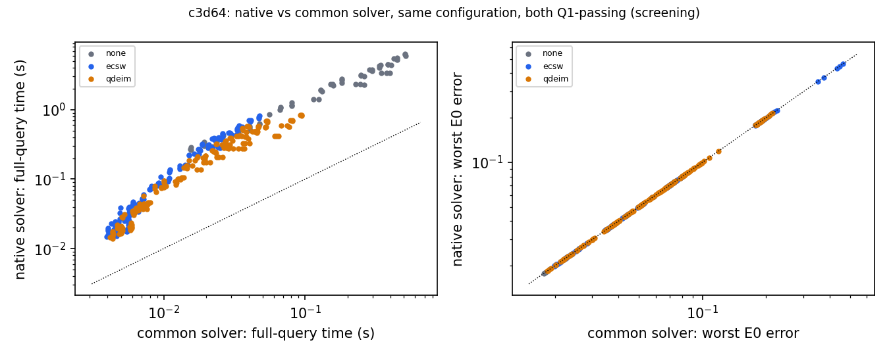

POD (primary basis, 18,432 snapshots) and projection floors; the probe basis (upwind generator, 18,432 snapshots) beside it:

| rank | primary: projection error | probe: projection error | held-out / in-set ratio (adequacy) |
|---|---|---|---|
| 64 | 0.053 | 0.0435 | 0.862 (pass) |
| 128 | 0.0242 | 0.0169 | 0.834 (pass) |
| 256 | 0.00994 | 0.00541 | 0.83 (pass) |
| 512 | 0.0033 | 0.00134 | 0.945 (pass) |
| 768 | 0.00143 | 0.000496 | 1.18 (FAIL) |
| 1024 | 0.00069 | 0.000219 | 1.58 (FAIL) |

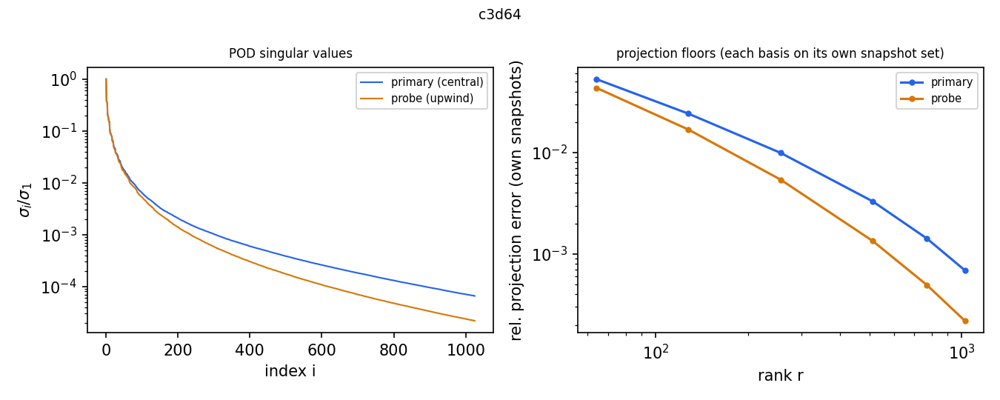

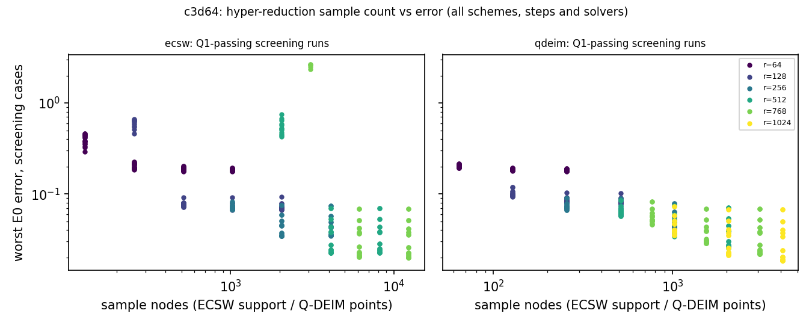

Generator probe (A2.3, ratified by the coordinator in A19.2: the primary snapshots come from the central FOM on the training parameter draws, which gives the baseline its best data; the probe regenerates the snapshots with the bank's sign-upwind BE generator on the same draws). `none` arm, native solver, worst E0 on the screening cases, beside the central basis at the same rank and option; both bases use the same saved steps.

| configuration | probe worst E0 | central worst E0 | status |
|---|---|---|---|
| `none\|64\|-\|BE\|0.01\|native\|upwind` | 0.213 | 0.179 | complete |
| `none\|64\|-\|BE\|0.0125\|native\|upwind` | 0.211 | 0.178 | complete |
| `none\|64\|-\|BE\|0.016666667\|native\|upwind` | 0.21 | 0.179 | complete |
| `none\|64\|-\|BE\|0.025\|native\|upwind` | 0.213 | 0.184 | complete |
| `none\|64\|-\|CN\|0.01\|native\|upwind` | 0.229 | 0.193 | complete |
| `none\|64\|-\|CN\|0.0125\|native\|upwind` | 0.226 | 0.19 | complete |
| `none\|64\|-\|CN\|0.016666667\|native\|upwind` | 0.222 | 0.187 | complete |
| `none\|64\|-\|CN\|0.025\|native\|upwind` | 0.217 | 0.182 | complete |
| `none\|64\|-\|BDF2\|0.01\|native\|upwind` | 0.224 | 0.188 | complete |
| `none\|64\|-\|BDF2\|0.0125\|native\|upwind` | 0.22 | 0.185 | complete |
| `none\|64\|-\|BDF2\|0.016666667\|native\|upwind` | 0.215 | 0.18 | complete |
| `none\|64\|-\|BDF2\|0.025\|native\|upwind` | 0.209 | 0.175 | complete |
| `none\|128\|-\|BE\|0.01\|native\|upwind` | 0.108 | 0.0705 | complete |
| `none\|128\|-\|BE\|0.0125\|native\|upwind` | 0.109 | 0.0734 | complete |
| `none\|128\|-\|BE\|0.016666667\|native\|upwind` | 0.113 | 0.0793 | complete |
| `none\|128\|-\|BE\|0.025\|native\|upwind` | 0.124 | 0.0925 | complete |
| `none\|128\|-\|CN\|0.01\|native\|upwind` | 0.113 | 0.0708 | complete |
| `none\|128\|-\|CN\|0.0125\|native\|upwind` | 0.112 | 0.0699 | complete |
| `none\|128\|-\|CN\|0.016666667\|native\|upwind` | 0.11 | 0.0687 | complete |
| `none\|128\|-\|CN\|0.025\|native\|upwind` | 0.108 | 0.0673 | complete |
| `none\|128\|-\|BDF2\|0.01\|native\|upwind` | 0.11 | 0.0688 | complete |
| `none\|128\|-\|BDF2\|0.0125\|native\|upwind` | 0.108 | 0.0677 | complete |
| `none\|128\|-\|BDF2\|0.016666667\|native\|upwind` | 0.106 | 0.0667 | complete |
| `none\|128\|-\|BDF2\|0.025\|native\|upwind` | 0.105 | 0.0682 | complete |
| `none\|256\|-\|BE\|0.01\|native\|upwind` | 0.0499 | 0.0447 | complete |
| `none\|256\|-\|BE\|0.0125\|native\|upwind` | 0.054 | 0.0496 | complete |
| `none\|256\|-\|BE\|0.016666667\|native\|upwind` | 0.0613 | 0.0578 | complete |
| `none\|256\|-\|BE\|0.025\|native\|upwind` | 0.0761 | 0.0739 | complete |
| `none\|256\|-\|CN\|0.01\|native\|upwind` | 0.0442 | 0.0353 | complete |
| `none\|256\|-\|CN\|0.0125\|native\|upwind` | 0.0436 | 0.035 | complete |
| `none\|256\|-\|CN\|0.016666667\|native\|upwind` | 0.043 | 0.0347 | complete |
| `none\|256\|-\|CN\|0.025\|native\|upwind` | 0.0427 | 0.0348 | complete |
| `none\|256\|-\|BDF2\|0.01\|native\|upwind` | 0.0434 | 0.0351 | complete |
| `none\|256\|-\|BDF2\|0.0125\|native\|upwind` | 0.043 | 0.0352 | complete |
| `none\|256\|-\|BDF2\|0.016666667\|native\|upwind` | 0.0434 | 0.0366 | complete |
| `none\|256\|-\|BDF2\|0.025\|native\|upwind` | 0.0487 | 0.0435 | complete |
| `none\|512\|-\|BE\|0.01\|native\|upwind` | 0.0413 | 0.038 | complete |
| `none\|512\|-\|BE\|0.0125\|native\|upwind` | 0.0463 | 0.0436 | complete |
| `none\|512\|-\|BE\|0.016666667\|native\|upwind` | 0.0545 | 0.0528 | complete |
| `none\|512\|-\|BE\|0.025\|native\|upwind` | 0.0704 | 0.0699 | complete |
| `none\|512\|-\|CN\|0.01\|native\|upwind` | 0.0303 | 0.0227 | complete |
| `none\|512\|-\|CN\|0.0125\|native\|upwind` | 0.0302 | 0.0228 | complete |
| `none\|512\|-\|CN\|0.016666667\|native\|upwind` | 0.0303 | 0.023 | complete |
| `none\|512\|-\|CN\|0.025\|native\|upwind` | 0.0314 | 0.0244 | complete |
| `none\|512\|-\|BDF2\|0.01\|native\|upwind` | 0.0309 | 0.0239 | complete |
| `none\|512\|-\|BDF2\|0.0125\|native\|upwind` | 0.0316 | 0.0252 | complete |
| `none\|512\|-\|BDF2\|0.016666667\|native\|upwind` | 0.0339 | 0.0285 | complete |
| `none\|512\|-\|BDF2\|0.025\|native\|upwind` | 0.0422 | 0.0387 | complete |
| `none\|768\|-\|BE\|0.01\|native\|upwind` | 0.0372 | 0.0359 | complete |
| `none\|768\|-\|BE\|0.0125\|native\|upwind` | 0.0425 | 0.0417 | complete |
| `none\|768\|-\|BE\|0.016666667\|native\|upwind` | 0.0513 | 0.051 | complete |
| `none\|768\|-\|BE\|0.025\|native\|upwind` | 0.0678 | 0.0682 | complete |
| `none\|768\|-\|CN\|0.01\|native\|upwind` | 0.0241 | 0.0199 | complete |
| `none\|768\|-\|CN\|0.0125\|native\|upwind` | 0.0241 | 0.02 | complete |
| `none\|768\|-\|CN\|0.016666667\|native\|upwind` | 0.0244 | 0.0203 | complete |
| `none\|768\|-\|CN\|0.025\|native\|upwind` | 0.026 | 0.022 | complete |
| `none\|768\|-\|BDF2\|0.01\|native\|upwind` | 0.025 | 0.0212 | complete |
| `none\|768\|-\|BDF2\|0.0125\|native\|upwind` | 0.026 | 0.0225 | complete |
| `none\|768\|-\|BDF2\|0.016666667\|native\|upwind` | 0.0288 | 0.026 | complete |
| `none\|768\|-\|BDF2\|0.025\|native\|upwind` | 0.0384 | 0.0376 | complete |
| `none\|1024\|-\|BE\|0.01\|native\|upwind` | 0.0343 | 0.0344 | complete |
| `none\|1024\|-\|BE\|0.0125\|native\|upwind` | 0.0401 | 0.0403 | complete |
| `none\|1024\|-\|BE\|0.016666667\|native\|upwind` | 0.0495 | 0.0497 | complete |
| `none\|1024\|-\|BE\|0.025\|native\|upwind` | 0.0673 | 0.0674 | complete |
| `none\|1024\|-\|CN\|0.01\|native\|upwind` | 0.0189 | 0.0177 | complete |
| `none\|1024\|-\|CN\|0.0125\|native\|upwind` | 0.0189 | 0.0178 | complete |
| `none\|1024\|-\|CN\|0.016666667\|native\|upwind` | 0.0192 | 0.0181 | complete |
| `none\|1024\|-\|CN\|0.025\|native\|upwind` | 0.0211 | 0.0199 | complete |
| `none\|1024\|-\|BDF2\|0.01\|native\|upwind` | 0.02 | 0.019 | complete |
| `none\|1024\|-\|BDF2\|0.0125\|native\|upwind` | 0.0212 | 0.0204 | complete |
| `none\|1024\|-\|BDF2\|0.016666667\|native\|upwind` | 0.0247 | 0.0241 | complete |
| `none\|1024\|-\|BDF2\|0.025\|native\|upwind` | 0.0364 | 0.0367 | complete |

Offline construction, in-job GPU-seconds (selected tuning attempt): snapshots[central] 236.4, pod[central] 90.9, pod_check[central] 24.77, lap_dsum_cols 0.6871, adv_snapshots 14.24, adv_pod 42.81, adv_pod_check 29.65, ecsw_states 6.364, ecsw_contrib 61.79, ecsw_nnls 2996, qdeim_pivots 88.98, qdeim_qr 57.24. Break-even query counts are not computed: no positive per-query saving of a qualified method over the other was established with equal budgets.

## Offline cost overview

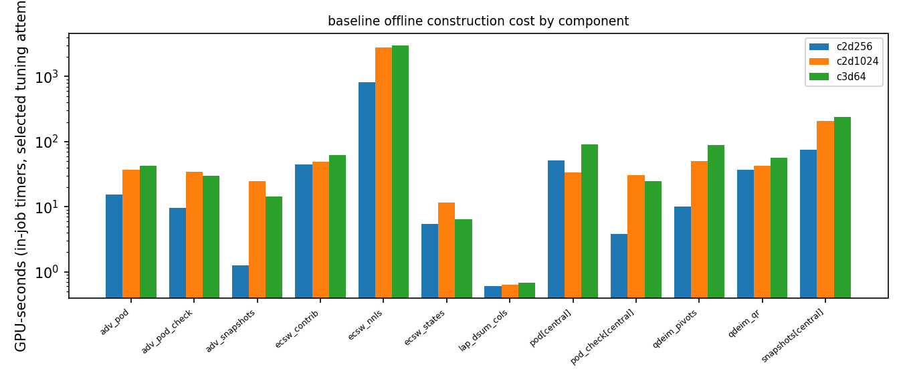

## Ledger

Measured allocation over all jobs: **21.18 GPU-h** of the 30 GPU-h cap. Of this, 1.51 h were the two phase-I smokes and 17.52 h are accounted to recorded T and V phases of the production attempts; the remaining 2.15 h are allocation overhead outside the phase timers (job start-up, environment and asset checks, compilation, collection) and the unfinished phases of cancelled attempts, which count only in the V upper bounds.

| attempt | Slurm | GPU | role | requested h | measured h | status |
|---|---|---|---|---|---|---|
| smk1 | 5354834 | h200 | phase-I real-size smoke (A5.4) | 1 | 0.878 | COMPLETED 00:52:42; collected, checksums OK; ACCEPTANCE ALL=false (A14/A15) |
| smk2 | 5422908 | h200 | second phase-I smoke (released by coordinator 2026-10-18, A19) | 1 | 0.634 | COMPLETED 00:38:02; collected, verified; staged ALL=false (ecsw-smoke-rank only), A23 ALL=true |
| t3d64a | 5508653 | h200 | tune configs/tune_3d64.json | 12 | 0.887 | CANCELLED; collected |
| t2d1024a | 5508660 | h200 | tune configs/tune_2d1024.json | 5 | 1.81 | COMPLETED; collected |
| t3d64b | 5542231 | h200 | tune configs/tune_3d64.json | 12 | 7.5 | COMPLETED; collected |
| t2d256a | 5551475 | a100-80G | tune configs/tune_2d256.json | 2 | 1.04 | COMPLETED; collected |
| s2d1024a | 5674029 | h200 | stageb configs/stageb_c2d1024.json | 3.5 | 2.13 | CANCELLED; collected |
| s2d1024b | 5840961 | h200 | stageb configs/stageb_c2d1024.json | 3.5 | 1.28 | COMPLETED; collected |
| s3d64a | 5917329 | h200 | stageb configs/stageb_c3d64.json | 8.5 | 0.224 | CANCELLED; collected |
| s2d256a | 6003086 | a100-80G | stageb configs/stageb_c2d256.json | 4 | 1.97 | COMPLETED; collected |
| s3d64b | 5932490 | h200 | stageb configs/stageb_c3d64.json | 8.5 | 2.83 | COMPLETED; collected |

## Glossary

- **POD**: proper orthogonal decomposition: the basis $\Phi_r$ of the $r$ leading left singular vectors of the snapshot matrix (training trajectories only).
- **LSPG**: least-squares Petrov–Galerkin: at each step the reduced coefficients $c$ minimise the norm of the full-order residual $\|r(\Phi_r c)\|$ (or its hyper-reduced version).
- **none / ECSW / Q-DEIM**: the three baseline arms: no hyper-reduction (full residual); energy-conserving sampling and weighting (residual evaluated on a sparse weighted node set found by non-negative least squares, NNLS); Q-DEIM (the nonlinear advection term interpolated from $p$ rows chosen by pivoted QR of an advection POD basis, linear terms exact).
- **configuration id (baseline)**: `arm|r|hr-parameter|scheme|Δt|solver|generator`: rank $r$; hr-parameter = ECSW support target $s=\kappa r$ (`k4`: the first NNLS path state with at least $4r$ nodes, A15.1) or the Q-DEIM point count $p$ (`-` for none); generator `central` (primary) or `upwind` (probe).
- **configuration id (ours)**: 2D `<L>|R<r>[nom]|<scheme>`: bank width $R'=r$ of the ordered bank, `nom` = nominal mode policy; 3D `<bank setting>|<rule>|<fs or qn>|<scheme>|<Δt>|<K or k>`.
- **BE / CN / CNR / BDF2**: backward Euler; Crank–Nicolson; CN-R = Crank–Nicolson after two backward-Euler start-up steps; second-order backward differentiation (BE first step).
- **FS / QN**: our 3D steppers: FS = fixed-sweep LSPG (adaptive Levenberg–Marquardt on the first steps, then K cached-predictor LM sweeps per step, `K1` = one); QN-k = iterations with the exact gradient and a frozen Gauss–Newton matrix refreshed per the k setting (speed3d `qn3`).
- **native / common solver**: Gauss–Newton with Householder QR (the LSPG solver of Carlberg et al.) / our Levenberg–Marquardt solver (`t2core.make_lm`, 3-candidate predictor), applied to every arm (§4).
- **mesh**: $L$ counts intervals per axis: 2D $L=256$ has $255^2$ unknowns; 3D $L=64$ has 65 nodes per axis and $63^3$ interior unknowns.
- **E0 error**: $e=\max_{k\ge1}\|F_k-R_k\|/\|R_0\|$ over the outputs $t_k=0.05k$, $F$ the method's field and $R$ the E0 reference on the scoring lattice; "worst" = maximum over the eligible cases, "median" = median over them.
- **ε_ref**: reference uncertainty: the conditional Richardson estimate of the E0 reference error; pair labels treat error differences within it as unresolved.
- **eligible**: a case whose reference passes the store's status for its case-kind; ineligible cases are scored and shown, never ranked.
- **screening / verdict cohort**: Stage A: six cases (2D `dev6`, 3D cases 0–5) used for tuning; Stage B / verdict: 2D `dev6`+`val32` (38 cases), 3D all 64 cases.
- **Q1**: numerical qualification: every run valid; at most 1 % non-stationary steps (γ > 1e-3); distance to a tight solve ≤ 2.5e-4 on every case; tight vs tighter ≤ 2.5e-5 on two cases.
- **Q2**: quadrature qualification of our configurations (owning lanes); 3D batch 2 = jcp-qualify Q2.
- **adequacy / saturation**: adequacy: held-out over in-set projection error ratio of the basis at rank $r$ (fails above the registered bound); saturation ($256^2$ only): whether more saved steps per trajectory change the basis (the 12-step set failed, so the all-step basis was used).
- **X**: one of our configurations.
- **B_acc**: fastest baseline on the X-specific front whose worst error is at most X's.
- **B_cost**: most accurate baseline on the X-specific front whose median time ratio to X is at most 1.
- **ρ (time ratio)**: full-query time of the baseline divided by X's, measured A–B–A (X, baseline, X) on six timing cases × three repeats; per case the median ratio, then the median over cases; 95 % interval from 10,000 case-level bootstrap resamples.
- **full query**: initialisation from the full-field initial condition + time stepping to $t=0.25$ + decode of the six outputs, timed warm with `block_until_ready`.
- **dominates**: the 95 % interval of ρ lies below 1 and the ε_ref-envelope of the baseline's worst error lies below that of X.
- **withheld**: a favourable or neutral conclusion suppressed because a coverage or adequacy restriction applies.
- **batch 1 / batch 2**: 3D: speed3d deployed rules (DIAGNOSTIC ONLY) / jcp-qualify Q2-qualified subset; 2D batch 1 = the P1-qualified configurations.
- **FRONT-2D member**: a 2D X that is on jcp-qualify's frozen 2D front (v1).
- **T / V**: training-only construction hours / validation-informed hours (every run on a development case that selected or certified a configuration); the budget compares $V_{\rm base}/V_{\rm ours}$ with $[0.8, 1.25]$.
- **lower / upper bound (accounting)**: lower: recorded phase timers of completed phases; upper: measured allocation of the same jobs; "≥" marks a lower bound.
- **ledger fields**: requested h = wall time reserved; measured h = elapsed allocation × 1 GPU (sacct).
- **limiting comparator**: the un-reduced FOM with the baseline's operator, mesh, scheme and step.
- **generator probe**: the same `none` runs with a basis built from upwind-generated snapshots (A2.3).
- **G-ours**: replay of our exported errors to 1e-10 relative before any timing.
