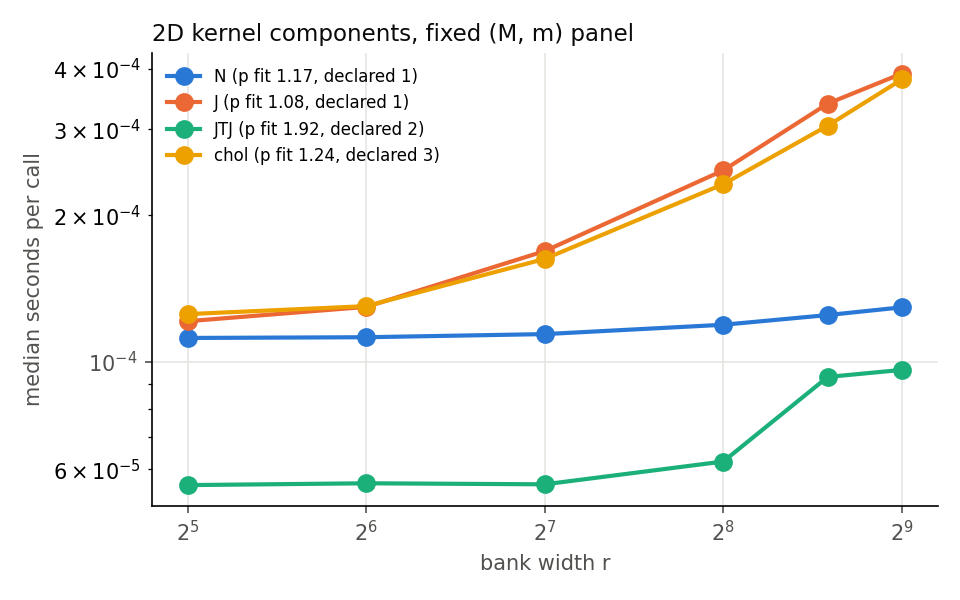
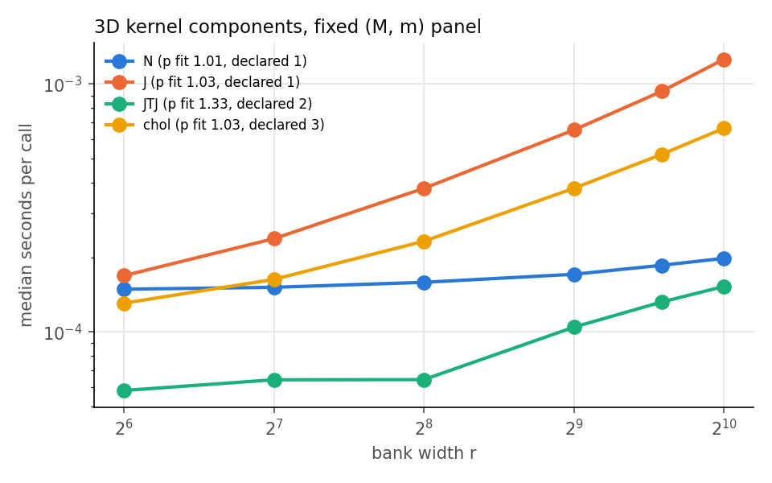
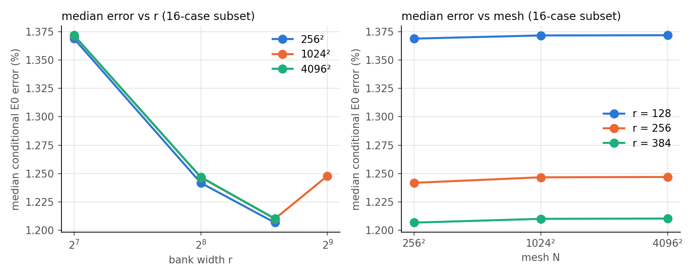
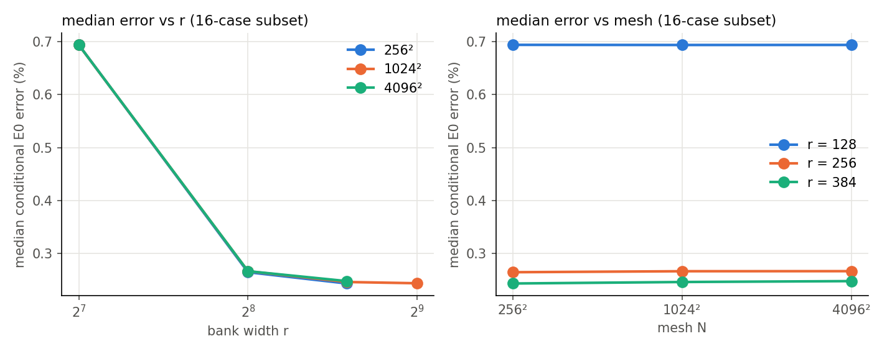
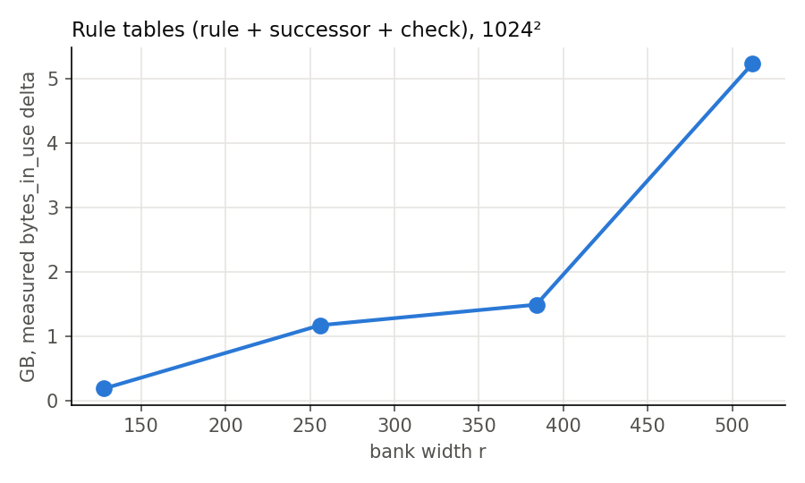
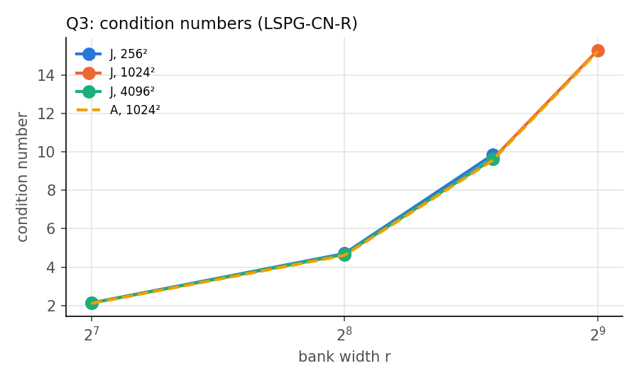

# P1 scaling: cost and accuracy against bank width r and mesh N (2D/3D viscous Burgers, off-mesh ROM)

**Status:** final for the priority-1 tranche of the 2026-10-17 plan, lane `jcp-p1-scaling`. Accuracy numbers are scored against the E0 second-order reference $R_{ST}$, whose uncertainty $\varepsilon_{\rm ref}$ is a **conditional Richardson estimate** (E0 A10 cross-check amended post data); combined A10, A11 and the retracted A15 labels carry forward. All accuracy numbers are therefore **conditional E0 accuracy estimates**, not certified errors. Every number below is generated by `make_report.py` from `checks/analysis.json` (`analyze.py`), which computes them from the job archives; the exceptions are quoted published values (historical claims, sunk offline cost), which `analyze.py` reads from the cited source files, and registered design constants (thresholds, ranks, rule names).

GPU-hours spent: 1.91 of the 20 cap (11 jobs, ledger `runs/GPU-LEDGER.json`).

## Verdicts

| hypothesis | configuration | outcome | key numbers |
|---|---|---|---|
| H-cost-N | R128 / BE / frozen | pass | R = 1.01, 95 % interval 1–1.04 |
| H-cost-N | R128 / CNR / frozen | pass | R = 1.02, 95 % interval 1–1.03 |
| H-cost-N | R256 / BE / frozen | pass | R = 1.02, 95 % interval 1–1.02 |
| H-cost-N | R256 / CNR / frozen | pass | R = 1.02, 95 % interval 1–1.03 |
| H-cost-N | R384 / BE / frozen | pass | R = 1.01, 95 % interval 1.01–1.03 |
| H-cost-N | R384 / BE / nominal | pass | R = 1.01, 95 % interval 1–1.02 |
| H-cost-N | R384 / CNR / frozen | pass | R = 1.01, 95 % interval 1.01–1.03 |
| H-cost-N | R384 / CNR / nominal | pass | R = 1.01, 95 % interval 1–1.02 |
| H-cost-r (2d, component kernel) | N, declared p = 1 | fail (hardware scaling by the A1.9 rule) | p fit 1.17, interval 1.09–1.26; FLOP/byte model p 1/1 |
| H-cost-r (2d, component kernel) | J, declared p = 1 | fail (hardware scaling by the A1.9 rule) | p fit 1.08, interval 1.08–1.09; FLOP/byte model p 1/1 |
| H-cost-r (2d, component kernel) | JTJ, declared p = 2 | fail (operation-model by the A1.9 rule) | p fit 1.92, interval 1.9–1.95; FLOP/byte model p 2/1.16 |
| H-cost-r (2d, component kernel) | chol, declared p = 3 | fail (operation-model by the A1.9 rule) | p fit 1.24, interval 1.22–1.24; FLOP/byte model p 2.97/2 |
| H-cost-r (3d, component kernel) | N, declared p = 1 | pass | p fit 1.01, interval 0.985–1.04; FLOP/byte model p 1/1 |
| H-cost-r (3d, component kernel) | J, declared p = 1 | fail (hardware scaling by the A1.9 rule) | p fit 1.03, interval 1.03–1.04; FLOP/byte model p 1/1 |
| H-cost-r (3d, component kernel) | JTJ, declared p = 2 | fail (operation-model by the A1.9 rule) | p fit 1.33, interval 1.31–1.34; FLOP/byte model p 2/1.22 |
| H-cost-r (3d, component kernel) | chol, declared p = 3 | fail (operation-model by the A1.9 rule) | p fit 1.03, interval 1.03–1.04; FLOP/byte model p 2.98/2 |
| H-acc-N | R128 / BE / frozen | pass | P256: n = 38, within margin 100 %, TOST p = 3.64e-12/3.64e-12; P4096: n = 16, within margin 100 %, TOST p = 1.53e-05/1.53e-05; trend p = 0.211 |
| H-acc-N | R128 / CNR / frozen | pass | P256: n = 38, within margin 100 %, TOST p = 3.64e-12/3.64e-12; P4096: n = 16, within margin 100 %, TOST p = 1.53e-05/1.53e-05; trend p = 0.00629 |
| H-acc-N | R256 / BE / frozen | pass | P256: n = 38, within margin 100 %, TOST p = 3.64e-12/3.64e-12; P4096: n = 16, within margin 100 %, TOST p = 1.53e-05/1.53e-05; trend p = 0.669 |
| H-acc-N | R256 / CNR / frozen | pass | P256: n = 38, within margin 100 %, TOST p = 3.64e-12/3.64e-12; P4096: n = 16, within margin 100 %, TOST p = 1.53e-05/1.53e-05; trend p = 0.821 |
| H-acc-N | R384 / BE / frozen | pass | P256: n = 38, within margin 100 %, TOST p = 3.64e-12/3.64e-12; P4096: n = 16, within margin 100 %, TOST p = 1.53e-05/1.53e-05; trend p = 0.528 |
| H-acc-N | R384 / CNR / frozen | pass | P256: n = 38, within margin 100 %, TOST p = 3.64e-12/3.64e-12; P4096: n = 16, within margin 100 %, TOST p = 1.53e-05/1.53e-05; trend p = 0.821 |
| H-acc-N | R384 / BE / nominal | pass | P256: n = 38, within margin 100 %, TOST p = 3.64e-12/3.64e-12; P4096: n = 16, within margin 100 %, TOST p = 1.53e-05/1.53e-05; trend p = 0.744 |
| H-acc-N | R384 / CNR / nominal | pass | P256: n = 38, within margin 100 %, TOST p = 3.64e-12/3.64e-12; P4096: n = 16, within margin 100 %, TOST p = 1.53e-05/1.53e-05; trend p = 0.94 |
| H-acc-r | 256 / BE, 128->256 | improves | improve/worsen/tie/unqualified 38/0/0/0, median change -0.066 %, worst change -0.00104 % |
| H-acc-r | 256 / BE, 256->384 | improves | improve/worsen/tie/unqualified 22/0/16/0, median change -0.00656 %, worst change 0.00105 % |
| H-acc-r | 256 / BE, range_128_384 | monotone | range verdict: "monotone" = every transition in the range passes the majority rule (not every case improves) |
| H-acc-r | 256 / CNR, 128->256 | improves | improve/worsen/tie/unqualified 38/0/0/0, median change -0.289 %, worst change -0.00834 % |
| H-acc-r | 256 / CNR, 256->384 | improves | improve/worsen/tie/unqualified 33/0/5/0, median change -0.0152 %, worst change -3.04e-05 % |
| H-acc-r | 256 / CNR, range_128_384 | monotone | range verdict: "monotone" = every transition in the range passes the majority rule (not every case improves) |
| H-acc-r | 1024 / BE, 128->256 | improves | improve/worsen/tie/unqualified 38/0/0/0, median change -0.0659 %, worst change -0.000961 % |
| H-acc-r | 1024 / BE, 256->384 | improves | improve/worsen/tie/unqualified 23/1/14/0, median change -0.00567 %, worst change 0.00128 % |
| H-acc-r | 1024 / BE, 384->512 | does not improve | improve/worsen/tie/unqualified 4/16/18/0, median change 0.00479 %, worst change 0.281 % |
| H-acc-r | 1024 / BE, range_128_384 | monotone | range verdict: "monotone" = every transition in the range passes the majority rule (not every case improves) |
| H-acc-r | 1024 / BE, range_128_512 | not monotone | range verdict: "monotone" = every transition in the range passes the majority rule (not every case improves) |
| H-acc-r | 1024 / CNR, 128->256 | improves | improve/worsen/tie/unqualified 38/0/0/0, median change -0.283 %, worst change -0.00839 % |
| H-acc-r | 1024 / CNR, 256->384 | improves | improve/worsen/tie/unqualified 34/0/4/0, median change -0.0156 %, worst change -3.44e-05 % |
| H-acc-r | 1024 / CNR, 384->512 | does not improve | improve/worsen/tie/unqualified 6/22/10/0, median change 0.00525 %, worst change 0.625 % |
| H-acc-r | 1024 / CNR, range_128_384 | monotone | range verdict: "monotone" = every transition in the range passes the majority rule (not every case improves) |
| H-acc-r | 1024 / CNR, range_128_512 | not monotone | range verdict: "monotone" = every transition in the range passes the majority rule (not every case improves) |
| H-acc-r | 4096 / BE, 128->256 | improves | improve/worsen/tie/unqualified 16/0/0/0, median change -0.102 %, worst change -0.00122 % |
| H-acc-r | 4096 / BE, 256->384 | improves | improve/worsen/tie/unqualified 12/0/4/0, median change -0.00574 %, worst change 2.65e-05 % |
| H-acc-r | 4096 / BE, range_128_384 | monotone | range verdict: "monotone" = every transition in the range passes the majority rule (not every case improves) |
| H-acc-r | 4096 / CNR, 128->256 | improves | improve/worsen/tie/unqualified 16/0/0/0, median change -0.446 %, worst change -0.0101 % |
| H-acc-r | 4096 / CNR, 256->384 | improves | improve/worsen/tie/unqualified 13/0/3/0, median change -0.0443 %, worst change -3.42e-05 % |
| H-acc-r | 4096 / CNR, range_128_384 | monotone | range verdict: "monotone" = every transition in the range passes the majority rule (not every case improves) |

## Configurations: qualification and error

Conditional E0 accuracy estimates. Errors are over each configuration's own case set (38, or the 16-case subset at 4096² for R128/R256); the column "median, 16-case subset" is on the common population and is the one to compare across meshes. $R_S$ (BE only, unmatched for CN-R) is summarised over the S-eligible cases only (dev6|1, val32|21, val32|24 are not S-eligible).

| mesh | config | scheme | Q1 | Q2 | numerically qualified | cases | median $e$ | median $e$, 16-case subset | worst $e$ | BE vs $R_S$ median, S-eligible |
|---|---|---|---|---|---|---|---|---|---|---|
| 256² | R128 | BE | yes | pass | yes | 38 | 1.1 % | 1.37 % | 4.85 % | 0.454 % |
| 256² | R128 | CNR | yes | pass | yes | 38 | 0.452 % | 0.694 % | 5.21 % | — |
| 256² | R256 | BE | yes | pass | yes | 38 | 0.984 % | 1.24 % | 3.32 % | 0.0973 % |
| 256² | R256 | CNR | yes | pass | yes | 38 | 0.206 % | 0.265 % | 2.52 % | — |
| 256² | R384 | BE | yes | pass | yes | 38 | 0.981 % | 1.21 % | 3.01 % | 0.0509 % |
| 256² | R384 | CNR | yes | pass | yes | 38 | 0.201 % | 0.243 % | 1.81 % | — |
| 256² | R384nom | BE | yes | pass | yes | 38 | 0.981 % | 1.21 % | 3.01 % | 0.05 % |
| 256² | R384nom | CNR | yes | pass | yes | 38 | 0.201 % | 0.243 % | 1.76 % | — |
| 256² | H96 | BE | yes | not run (descriptive arm) | no | 38 | 0.981 % | 1.21 % | 3.01 % | 0.0509 % |
| 256² | H96nom | BE | yes | not run (descriptive arm) | no | 38 | 0.981 % | 1.21 % | 3.01 % | 0.05 % |
| 256² | H64 | BE | yes | not run (descriptive arm) | no | 38 | 0.981 % | 1.21 % | 3.01 % | 0.0509 % |
| 256² | H64nom | BE | yes | not run (descriptive arm) | no | 38 | 0.981 % | 1.21 % | 3.01 % | 0.05 % |
| 256² | HF6765 | BE | yes | not run (descriptive arm) | no | 38 | 0.981 % | 1.21 % | 3.01 % | 0.0509 % |
| 256² | HF6765nom | BE | yes | not run (descriptive arm) | no | 38 | 0.981 % | 1.21 % | 3.01 % | 0.05 % |
| 256² | H640 | BE | yes | not run (descriptive arm) | no | 38 | 0.981 % | 1.21 % | 3.01 % | 0.0509 % |
| 256² | H640nom | BE | yes | not run (descriptive arm) | no | 38 | 0.981 % | 1.21 % | 3.01 % | 0.05 % |
| 1024² | R128 | BE | yes | pass | yes | 38 | 1.1 % | 1.37 % | 4.84 % | 0.441 % |
| 1024² | R128 | CNR | yes | pass | yes | 38 | 0.45 % | 0.694 % | 5.2 % | — |
| 1024² | R256 | BE | yes | pass | yes | 38 | 0.983 % | 1.25 % | 3.32 % | 0.0963 % |
| 1024² | R256 | CNR | yes | pass | yes | 38 | 0.209 % | 0.267 % | 2.52 % | — |
| 1024² | R384 | BE | yes | pass | yes | 38 | 0.978 % | 1.21 % | 3.01 % | 0.0513 % |
| 1024² | R384 | CNR | yes | pass | yes | 38 | 0.198 % | 0.246 % | 1.78 % | — |
| 1024² | R512 | BE | yes | pass | yes | 38 | 0.979 % | 1.25 % | 3.09 % | 0.0583 % |
| 1024² | R512 | CNR | yes | pass | yes | 38 | 0.199 % | 0.244 % | 2.17 % | — |
| 1024² | H96 | BE | yes | not run (descriptive arm) | no | 38 | 0.978 % | 1.21 % | 3.01 % | 0.0513 % |
| 1024² | H64 | BE | yes | not run (descriptive arm) | no | 38 | 0.978 % | 1.21 % | 3.01 % | 0.0513 % |
| 1024² | HF6765 | BE | yes | not run (descriptive arm) | no | 38 | 0.978 % | 1.21 % | 3.01 % | 0.0513 % |
| 1024² | H640 | BE | yes | not run (descriptive arm) | no | 38 | 0.978 % | 1.21 % | 3.01 % | 0.0513 % |
| 4096² | R128 | BE | yes | pass | yes | 16 | 1.37 % | 1.37 % | 4.07 % | 0.651 % |
| 4096² | R128 | CNR | yes | pass | yes | 16 | 0.694 % | 0.694 % | 4.22 % | — |
| 4096² | R256 | BE | yes | pass | yes | 16 | 1.25 % | 1.25 % | 2.58 % | 0.125 % |
| 4096² | R256 | CNR | yes | pass | yes | 16 | 0.267 % | 0.267 % | 1.81 % | — |
| 4096² | R384 | BE | yes | pass | yes | 38 | 0.978 % | 1.21 % | 3.01 % | 0.0519 % |
| 4096² | R384 | CNR | yes | pass | yes | 38 | 0.198 % | 0.248 % | 1.77 % | — |
| 4096² | R384nom | BE | yes | pass | yes | 38 | 0.978 % | 1.21 % | 3.01 % | 0.0519 % |
| 4096² | R384nom | CNR | yes | pass | yes | 38 | 0.198 % | 0.248 % | 1.77 % | — |
| 4096² | H96 | BE | yes | not run (descriptive arm) | no | 38 | 0.978 % | 1.21 % | 3.01 % | 0.052 % |
| 4096² | H96nom | BE | yes | not run (descriptive arm) | no | 38 | 0.978 % | 1.21 % | 3.01 % | 0.052 % |
| 4096² | H64 | BE | yes | not run (descriptive arm) | no | 38 | 0.978 % | 1.21 % | 3.01 % | 0.052 % |
| 4096² | H64nom | BE | yes | not run (descriptive arm) | no | 38 | 0.978 % | 1.21 % | 3.01 % | 0.052 % |
| 4096² | HF6765 | BE | yes | not run (descriptive arm) | no | 38 | 0.978 % | 1.21 % | 3.01 % | 0.052 % |
| 4096² | HF6765nom | BE | yes | not run (descriptive arm) | no | 38 | 0.978 % | 1.21 % | 3.01 % | 0.052 % |
| 4096² | H640 | BE | yes | not run (descriptive arm) | no | 38 | 0.978 % | 1.21 % | 3.01 % | 0.0519 % |
| 4096² | H640nom | BE | yes | not run (descriptive arm) | no | 38 | 0.978 % | 1.21 % | 3.01 % | 0.0519 % |

Role qualification: none is pre-declared in P1; every configuration is "role not assessed". Frontier usefulness is not ranked here (the coordinator combines P1 with the competition work).

## Reproduction gate (AM-1)

- R128 / BE: worst relative coefficient difference vs the combined archive 2.85e-15; numerical manifest equal yes; gate passed.
- R128 / CNR: worst relative coefficient difference vs the combined archive 1.69e-15; numerical manifest equal yes; gate passed.
- R384 / BE: worst relative coefficient difference vs the combined archive 0; numerical manifest equal yes; gate passed.
- R384 / CNR: worst relative coefficient difference vs the combined archive 0; numerical manifest equal yes; gate passed.

## P1g: what the frozen mode list changes in earlier cross-mesh claims

The test set differs from the frozen list only at $256^2$ (two modes swapped at $M=1536$); at $4096^2$ the nominal list is a permutation of the frozen one. Distances are scoring-lattice relative, max over outputs and cases.

| arm | 256²: frozen vs nominal distance | 256²: largest error change, E0 / first-order | 4096²: distance | spread (3 meshes, first-order) frozen / nominal | spread (256² vs 1024², first-order) frozen / nominal | nominal vs historical job, largest first-order error difference (256² / 1024² / 4096²) |
|---|---|---|---|---|---|---|
| R384 / BE | 5.23e-04 | 0.0103 / 0.0113 pp | 1.33e-15 | 0.0143 / 0.0124 pp | 0.0137 / 0.00844 pp | — |
| R384 / CNR | 9.22e-04 | 0.0537 / 0.0543 pp | 1.45e-15 | 0.0528 / 0.0183 pp | 0.0506 / 0.0162 pp | — |
| H64 / BE | 5.85e-04 | 0.0108 / 0.0119 pp | 1.94e-15 | 0.0145 / 0.0143 pp | 0.0138 / 0.00976 pp | 3.00e-16 / 4.01e-16 / 2.87e-16 |
| H640 / BE | 5.25e-04 | 0.0103 / 0.0113 pp | 1.35e-15 | 0.0141 / 0.0124 pp | 0.0135 / 0.00847 pp | 3.30e-16 / 3.83e-16 / 2.84e-16 |
| HF6765 / BE | 5.09e-04 | 0.00907 / 0.00992 pp | 2.09e-15 | 0.0132 / 0.0124 pp | 0.0126 / 0.00847 pp | 1.47e-16 / 2.62e-16 / 1.90e-16 |
| H96 / BE | 5.29e-04 | 0.0108 / 0.0118 pp | 1.83e-15 | 0.0151 / 0.0121 pp | 0.0145 / 0.00822 pp | 1.34e-16 / 3.54e-16 / 3.43e-16 |

Reading: the nominal-list runs reproduce the historical job rows to round-off (last column), so the published numbers stand as computed; but they compared slightly different test spaces at 256². Frozen vs nominal is the total effect of the list change under each rule (quadrature and test space change together), not a list-only effect; it moves trajectories by up to the 256² distances above (above the 2.5e-4 Q1 bar) and errors by at most the listed hundredths of a percentage point.

Historical claims re-checked (their numbers as published): H1 (reports/2026-10-01-burgers2d-offmesh-quadrature.md:102-129): H64 0.014 pp, H640 0.012 pp, HF6765 0.012 pp; H4 (worktrees/2026-10-06-jcp-mechanism/experiments/jcp-mechanism/report.md:94): H96 0.008 pp, H640 0.008 pp. H2 (test64) and H3 are not re-run.

## Quadrature slice (P1e, descriptive)

| slice | rule pair (coarser vs finer) | worst rollout distance | rollout bar 2.5e-4 | worst own-state ρ | ρ bar 0.116 | all runs valid |
|---|---|---|---|---|---|---|
| 2D R256, 1024², BE, dev6 | gauss64 (registered failing) vs gauss96 (its successor) | 4.86e-05 | yes | 0.0553 | yes | yes |
| 2D R256, 1024², BE, dev6 | gauss64 (registered failing) vs gauss128 (deployed) | 4.86e-05 | yes | 0.057 | yes | yes |
| 2D R256, 1024², BE, dev6 | gauss128 (deployed) vs gauss160 (finer) | 1.00e-05 | yes | 0.00825 | yes | yes |
| 2D R256, 1024², BE, dev6 | gauss160 (finer) vs gauss192 (check) | 2.52e-06 | yes | 0.00304 | yes | yes |
| 3D W512, 65³, FS-BE, 923801 cases 0–5 | lat8192 vs lat32768 | 0.00421 | no | 0.0564 | yes | yes |
| 3D W512, 65³, FS-BE, 923801 cases 0–5 | lat32768 vs gl56 | 1.55e-05 | yes | 3.09e-04 | yes | yes |
| 3D W512, 65³, FS-BE, 923801 cases 0–5 | gl56 vs gl64 | 4.40e-06 | yes | 1.20e-04 | yes | yes |

The 2D rule registered as failing (gauss64) **passes** both bars against its successor (distance 4.86e-05, ρ 0.0553): the pre-data expectation that it fails was wrong; it is reported, not re-labelled.

3D solver evidence: 0 of 600 steps non-stationary, 0 saturated, 0 non-finite; fixed-sweep vs vendored deployed solver, worst relative coefficient difference 0.

## Conditioning (Q3)

| mesh | config | scheme | cond(A) | rank(A) | median cond(J) | max cond(J) | max cond(JᵀJ) |
|---|---|---|---|---|---|---|---|
| 256² | R128 | BE | 2.12 | 128 | 2.14 | 2.17 | 4.71 |
| 256² | R128 | CNR | 2.12 | 128 | 2.12 | 2.14 | 4.57 |
| 256² | R256 | BE | 4.65 | 256 | 4.69 | 4.84 | 23.4 |
| 256² | R256 | CNR | 4.65 | 256 | 4.67 | 4.71 | 22.2 |
| 256² | R384 | BE | 9.66 | 384 | 9.78 | 10.2 | 104 |
| 256² | R384 | CNR | 9.66 | 384 | 9.71 | 9.84 | 96.9 |
| 256² | R384nom | BE | 9.44 | 384 | 9.55 | 9.98 | 99.6 |
| 256² | R384nom | CNR | 9.44 | 384 | 9.48 | 9.61 | 92.4 |
| 1024² | R128 | BE | 2.11 | 128 | 2.13 | 2.17 | 4.69 |
| 1024² | R128 | CNR | 2.11 | 128 | 2.12 | 2.13 | 4.55 |
| 1024² | R256 | BE | 4.62 | 256 | 4.65 | 4.79 | 23 |
| 1024² | R256 | CNR | 4.62 | 256 | 4.62 | 4.67 | 21.8 |
| 1024² | R384 | BE | 9.56 | 384 | 9.57 | 9.99 | 99.8 |
| 1024² | R384 | CNR | 9.56 | 384 | 9.55 | 9.63 | 92.6 |
| 1024² | R512 | BE | 15.2 | 512 | 15.2 | 15.5 | 241 |
| 1024² | R512 | CNR | 15.2 | 512 | 15.2 | 15.3 | 234 |
| 4096² | R128 | BE | 2.11 | 128 | 2.13 | 2.17 | 4.69 |
| 4096² | R128 | CNR | 2.11 | 128 | 2.12 | 2.13 | 4.55 |
| 4096² | R256 | BE | 4.62 | 256 | 4.65 | 4.79 | 23 |
| 4096² | R256 | CNR | 4.62 | 256 | 4.62 | 4.67 | 21.8 |
| 4096² | R384 | BE | 9.56 | 384 | 9.57 | 9.99 | 99.8 |
| 4096² | R384 | CNR | 9.56 | 384 | 9.55 | 9.63 | 92.6 |
| 4096² | R384nom | BE | 9.56 | 384 | 9.57 | 9.99 | 99.8 |
| 4096² | R384nom | CNR | 9.56 | 384 | 9.55 | 9.63 | 92.6 |

## Timing diagnostics (not part of the H-cost-N verdict)

Seconds per call, median over dev6 × 3 repeats on one H200 (full-field contract: input sampled at quadrature points, full-field decode). Initialisation and decode are expected to grow with N. Scope of H-cost-N (A3.2): the timed program is the solver **with internal-state recording** (one row write per step; smoke non-recording / recording time ratio median 0.99, range 0.97–1), and the verdict is about **evolution** time, not the full query. Identity audit limitation: every timed execution was compared in-job with its scoring run (W, every internal state, exit reasons, iterations) and all comparisons passed, but the archive keeps the comparison outcomes, not each execution's own hash.

| configuration | init 256² / 1024² / 4096² | evolve 256² / 1024² / 4096² | decode 256² / 1024² / 4096² | fused query / A, 256² / 1024² / 4096² |
|---|---|---|---|---|
| R128 / BE / frozen | 1.57e-04 / 1.61e-04 / 1.68e-04 | 0.0221 / 0.022 / 0.0211 | 1.35e-04 / 3.96e-04 / 0.00574 | 0.243 / 0.244 / 0.295 |
| R128 / CNR / frozen | 1.58e-04 / 1.51e-04 / 1.64e-04 | 0.0219 / 0.0219 / 0.0219 | 1.30e-04 / 3.94e-04 / 0.00571 | 0.241 / 0.242 / 0.295 |
| R256 / BE / frozen | 1.80e-04 / 1.86e-04 / 1.82e-04 | 0.0517 / 0.0516 / 0.0518 | 1.55e-04 / 6.72e-04 / 0.01 | 0.589 / 0.6 / 0.697 |
| R256 / CNR / frozen | 1.71e-04 / 1.72e-04 / 1.72e-04 | 0.0512 / 0.0516 / 0.0513 | 1.58e-04 / 6.67e-04 / 0.01 | 0.588 / 0.594 / 0.69 |
| R384 / BE / frozen | 1.99e-04 / 2.00e-04 / 1.98e-04 | 0.0878 / 0.0866 / 0.0883 | 1.79e-04 / 9.54e-04 / 0.0143 | 1.01 / 1.01 / 1.16 |
| R384 / BE / nominal | 1.98e-04 / 2.00e-04 / 1.91e-04 | 0.0872 / 0.0866 / 0.0877 | 1.76e-04 / 9.54e-04 / 0.0142 | 1.01 / 1.01 / 1.16 |
| R384 / CNR / frozen | 1.91e-04 / 1.97e-04 / 2.00e-04 | 0.0872 / 0.0887 / 0.0879 | 1.77e-04 / 9.49e-04 / 0.0143 | 1 / 1 / 1.15 |
| R384 / CNR / nominal | 2.06e-04 / 1.97e-04 / 2.06e-04 | 0.0868 / 0.0887 / 0.0885 | 1.79e-04 / 9.49e-04 / 0.0143 | 1 / 1 / 1.16 |

Component-sum diagnostic (A2.2, no gate): 1024 / R384 / gauss128 / frozen / CNR: model / evolution = 1.17; 1024 / R512 / gauss192 / frozen / CNR: model / evolution = 1.07.

Timing-job qualification (A2.3, dev6 trajectories of the timed program): 24 of 24 subjects numerically qualified; both labels (timing job and accuracy job) pass for 24 of 24.

Note on H-acc-N: the three-mesh trend test rejects "no trend" for R128 / CNR / frozen while both equivalence tests pass with every case within its margin; by the registered precedence the outcome is pass. This is practical equivalence within the registered margin, not evidence of zero mesh dependence: a small systematic trend is detectable. Median per-case slopes: R128 / CNR / frozen -4.78e-06 per doubling of N.

## Memory, offline cost, pilot

- $4096^2$ pilot (H200, upper-bound footprint): peak 113 GB; prefix-retaining bank required: no.
- 256²: bank build 6.86 s, bank 0.266 GB; process-lifetime peak 15.6 GB.
- 1024²: bank build 8.44 s, bank 4.29 GB; process-lifetime peak 21.8 GB.
- 4096²: bank build 11.7 s, bank 68.7 GB; process-lifetime peak 96.6 GB.
- Sunk offline costs (not re-measured): the 2D bank `dn256b`; the 3D W1024 bank (job total 1.85 H200-h, bank fit 1.14 h; source `/home/tahmid/Dev/Tunable-NM-ROM-Claude/worktrees/2026-10-08-jcp-wide-bank/experiments/jcp-wide-bank/report.md:111`).

## Controls

Real-size smoke (`checks/smoke-accept.json`): 82 of 82 required controls behave as registered. The first acceptance (`checks/smoke-accept-1.json`) failed 5 checks, all traced to defects of the checks (DESIGN A6).

Timing controls: doubled-work medians 1024|R384|gauss128|frozen|CNR: 2, 256|R128|fib4181|frozen|BE: 1.96; split = fused equivalence yes; identity veto clean yes.

CN-R temporal order (dev6|0, R384): GAL-CN-R observed order 2.06 (gate [1.8, 2.2], interpretable yes); LSPG-CN-R 2.04 (reported).

## Not done here (by design) and provenance

- 3D cost against mesh (H-cost-N in 3D) and 3D Q1 for the speed3d arms come from `jcp-speed3d` (m1, g1–g3) under its mesh-free / scoring-lattice contract; the coordinator combines them. This lane ran none of them (AM-6).
- Deferred items: none (the defer order was not needed; spending stayed far below the cap).
- References: E0 store version 3ec3b5492748a162.

## Plots

Accuracy plots use the 16-case subset at every mesh (conditional E0 estimates). A median curve can move slightly in the opposite direction of a paired H-acc-r verdict (e.g. CN-R at R512): the verdict counts resolved paired cases, the curve shows one population median.

## Glossary

- **r (bank width, $R'$)**: number of ordered bank coefficients solved for; the "k" of this study.
- **N, mesh**: grid points per axis of the full-order mesh on which the input is sampled and the output decoded (256², 1024², 4096²; 65³ in 3D).
- **M, m**: $M$ = number of sine test functions ($M=4r$ in the accuracy and timing runs and the nominal kernel panel; fixed at 1536 (2D) or 2052 (3D) in the fixed-$(M,m)$ kernel panel); $m$ = number of quadrature points.
- **A, J, N, JᵀJ, chol**: $A$: projection of the bank onto the tests ($M\times r$); $N(c)$: tested advection vector; $J$: Jacobian of the LSPG residual; $J^{\mathsf T}J$: normal matrix; chol: its damped Cholesky factorisation and solve. Kernel components time these separately.
- **BE, CNR (CN-R), LSPG, GAL, FS-BE**: backward Euler; Crank–Nicolson with two BE start-up steps; least-squares Petrov–Galerkin (minimises the weighted residual); Galerkin (used only in the order check); fixed-sweep BE (the deployed 3D solver).
- **frozen / nominal mode list**: frozen: the 1024² builder list reused at every mesh; nominal: each mesh's own list ("deployment policy").
- **R128 … R512, H64, H96, HF6765, H640, "nom"**: configurations: Rr = bank width r with its frozen rule (R128 Fibonacci 4181, R256/R384 Gauss 128², R512 Gauss 192²); H… = historical rules at r = 384 (Gauss 64², 96², Fibonacci 6765, Gauss 640²); suffix nom = nominal list.
- **E0 $R_{ST}$, $R_S$, $\varepsilon_{\rm ref}$, eligibility**: second-order space+time reference (primary); space-only BE reference (matched to BE only); per-case uncertainty estimate (conditional Richardson, not a bound); a case-kind is eligible if the E0 store accepts it (all 38 ST case-kinds; S is not eligible for dev6|1, val32|21, val32|24).
- **e**: $e=\max_{k=1..5}\lVert u(t_k)-R(t_k)\rVert/\lVert R(t_0)\rVert$ on the 257² scoring lattice (normalised by the initial reference norm).
- **cases, 16-case subset**: dev6 (6 development cases) + val32 (32 validation cases) = 38; the 16-case subset is dev6 + val32[0:10].
- **Q1**: solver qualification: valid runs, at most 1 % non-stationary steps (stationarity ratio by a fresh autodiff Jacobian at every step), distance to a tight solve at most $2.5\times10^{-4}$ on every case, tight/tighter at most $2.5\times10^{-5}$.
- **Q2**: quadrature qualification on the 16-case subset (6 development + 10 validation cases): replay with the next finer rule within $2.5\times10^{-4}$, successor $\rho\le0.116$, and the finer rule converged against the next one.
- **Q3, cond, rank**: conditioning: cond = ratio of largest to smallest singular value; rank = number of singular values above $10^{-13}$ times the largest.
- **$\rho$**: relative difference of the tested advection vector between a rule and its successor on the arm's own output states.
- **B/A ratio, A–B–A**: evolution time of configuration B divided by the mean of two flanking runs of the reference A (r = 384, 1024², CN-R) on the same GPU.
- **R (H-cost-N)**: max over meshes / min over meshes of the median B/A ratio; pass if the upper end of its 95 % case-bootstrap interval is at most 1.25.
- **TOST, within margin, trend p**: two one-sided signed-rank tests that cross-mesh error differences lie within $\pm\delta_i$, $\delta_i=\max(2\varepsilon_{\rm ref,i},\,0.1\,e_i(1024^2))$; share of cases with $|\Delta e_i|\le\delta_i$; Wilcoxon p-value of the per-case slopes of $e$ against $\log_2 N$ (a test p-value, unrelated to the exponent p).
- **resolved, tie, improve / worsen**: a case is resolved when both rungs are qualified and $|\Delta e|>2\varepsilon_{\rm ref}$; otherwise a tie; improve = error decreases.
- **improves / does not improve, monotone**: H-acc-r transition: more than half of resolved cases improve and the median paired change is negative; a range is monotone if every transition improves in that sense.
- **p, declared p**: exponent of $t=a+b\,r^p$ fitted to component-kernel times at fixed $(M,m)$, and its operation-count prediction.
- **operation-model / hardware scaling**: secondary label of an H-cost-r fail by the registered rule (A1.9): "operation-model" if the FLOP or byte count model itself departs from the declared p by more than 0.25; it is a classification, not a causal explanation.
- **P1g**: measurement of how much earlier cross-mesh claims move when the test-mode set is frozen (total effect under each rule).
- **pp**: percentage points of relative error.
