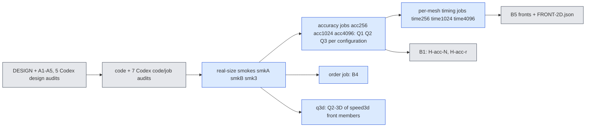
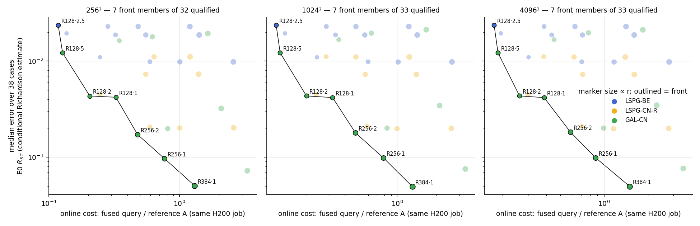
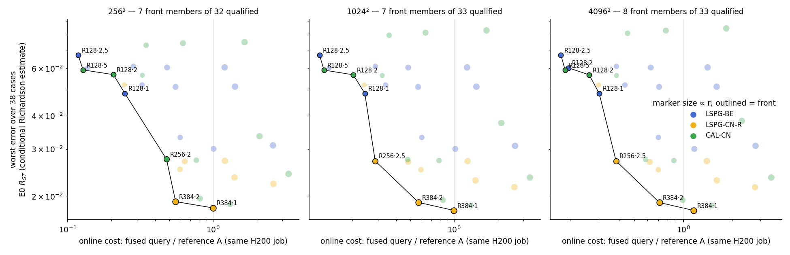
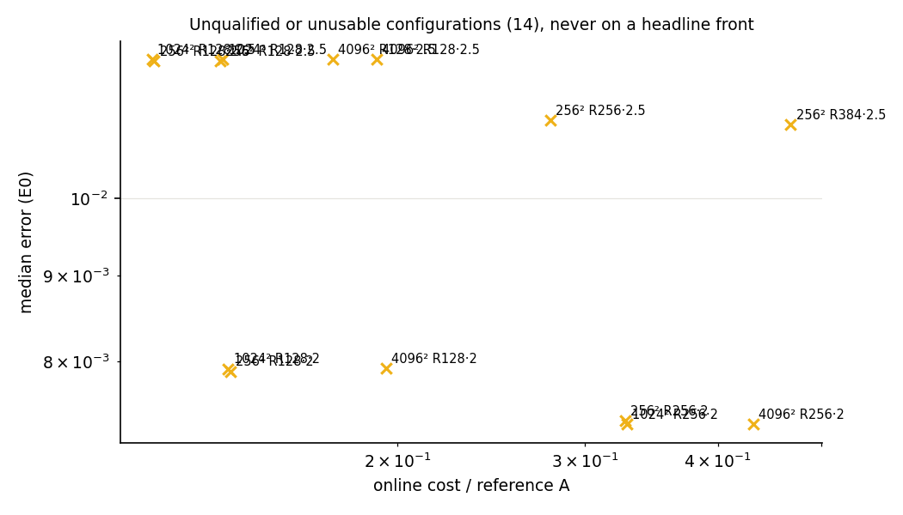
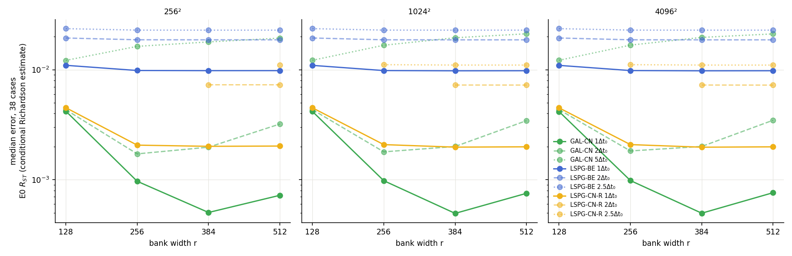
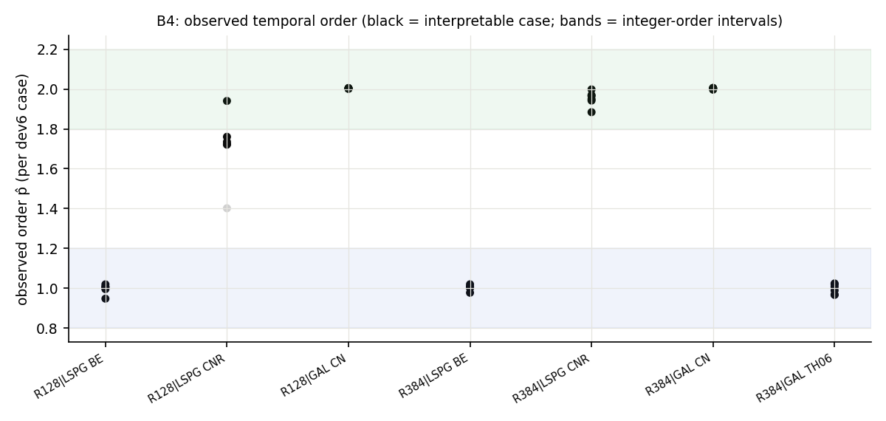
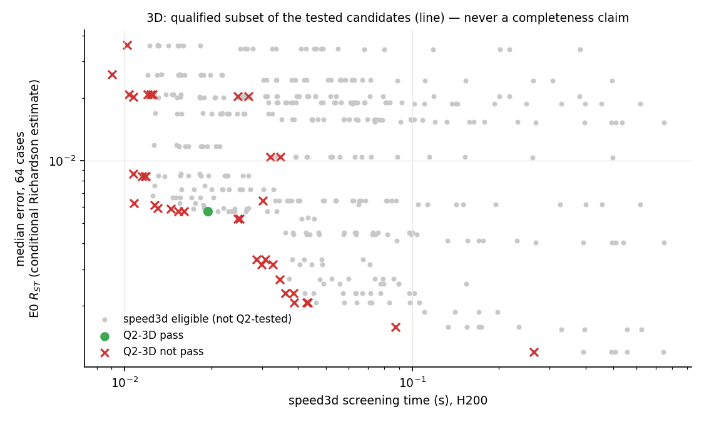

# jcp-qualify: numerical qualification, accuracy against r and N, temporal order and the qualified error–cost front (2D/3D viscous Burgers, off-mesh ROM)

**Status:** final for the priority-2 Q/B1/B4/B5 tranche, lane `jcp-qualify`. Every accuracy number is scored against the E0 second-order reference $R_{ST}$, whose per-case uncertainty $\varepsilon_{\rm ref}$ is a **conditional Richardson estimate** (E0 A10 cross-check amended post data; combined A10, A11 and the retracted A15 labels carry forward): all errors are **conditional E0 accuracy estimates**, not certified errors. Every number is generated by `make_report.py` from `checks/analysis.json` (`analyze.py`), `checks/smoke-accept.json` and `runs/GPU-LEDGER.json`; registered design constants (bars, step factors, rule names) are quoted from `DESIGN.md`.

GPU-hours spent: 3.96 of the 35 cap (15 jobs; `runs/GPU-LEDGER.json`).

## Summary

- **Q1/Q2 (2D):** 98 of 112 configurations numerically qualified (Q1 solver + Q2 quadrature; P1's certified configurations are cited).
- **Front at 256²:** 7 median-front and 7 worst-front members among 32 qualified candidates; 6 configurations unqualified or without usable timing.
- **Front at 1024²:** 7 median-front and 7 worst-front members among 33 qualified candidates; 4 configurations unqualified or without usable timing.
- **Front at 4096²:** 7 median-front and 8 worst-front members among 33 qualified candidates; 4 configurations unqualified or without usable timing.
- **B4 TH06 control:** label order 1, interpretable 6, agrees with smoke True → passed.
- **3D Q2:** 1 of 37 tested speed3d configurations pass their own successor-rule check; control fired: True; 365 untested candidates remain open (result label: qualified subset of the tested candidates (never a completeness claim, A2.1)).

## Jobs and budget

| attempt | job | state | elapsed GPU-h | time limit (h) |
|---|---|---|---|---|
| smkA | 5366480 | COMPLETED | 0.321 | 2.5 |
| smkB | 5366483 | COMPLETED | 0.12 | 2 |
| smk3 | 5366486 | COMPLETED | 0.0622 | 1.5 |
| acc1024 | 5382749 | COMPLETED | 0.402 | 2.5 |
| acc4096 | 5382751 | COMPLETED | 0.547 | 5 |
| acc256 | 5382752 | COMPLETED | 0.446 | 2.75 |
| order | 5392586 | COMPLETED | 0.508 | 2.25 |
| q3d | 5396416 | COMPLETED | 0.146 | 1.75 |
| fb1024 | 5397596 | COMPLETED | 0.0197 | 0.5 |
| fb256 | 5405650 | COMPLETED | 0.0358 | 0.75 |
| fb4096 | 5405651 | COMPLETED | 0.0325 | 0.75 |
| time1024 | 5414290 | COMPLETED | 0.365 | 3.25 |
| time4096 | 5416294 | COMPLETED | 0.474 | 5.75 |
| time256 | 5416492 | COMPLETED | 0.375 | 3.5 |
| q3d2 | 5422698 | COMPLETED | 0.104 | 1.75 |

## Q1–Q3: numerical qualification of every 2D configuration

Errors over the 38 dev6 + val32 cases (E0 $R_{ST}$ (conditional Richardson estimate)). Q1 = solver qualification (LSPG: certified stationarity; GAL: certified Galerkin residual, DESIGN A1.3); Q2 = successor-rule quadrature check on 16 cases; "repro" = registered reproduction gate against combined's archive ($1024^2$, R128/R384/R512).

| mesh | configuration | source | Q1 | Q2 | repro | qualified | n | median e | worst e | Q3 median cond(J) |
|---|---|---|---|---|---|---|---|---|---|---|
| 256² | R128 GAL-CN 1Δt₀ | lane | pass | pass | — | yes | 38 | 0.42 % | 5.66 % | 1.92 |
| 256² | R256 GAL-CN 1Δt₀ | lane | pass | pass | — | yes | 38 | 0.0969 % | 2.73 % | 4.26 |
| 256² | R384 GAL-CN 1Δt₀ | lane | pass | pass | — | yes | 38 | 0.0504 % | 1.87 % | 9.62 |
| 256² | R512 GAL-CN 1Δt₀ | lane | pass | pass | — | yes | 38 | 0.0722 % | 2.43 % | 16.9 |
| 256² | R128 GAL-CN 2Δt₀ | lane | pass | pass | — | yes | 38 | 0.433 % | 5.69 % | 1.88 |
| 256² | R256 GAL-CN 2Δt₀ | lane | pass | pass | — | yes | 38 | 0.172 % | 2.76 % | 4.24 |
| 256² | R384 GAL-CN 2Δt₀ | lane | pass | pass | — | yes | 38 | 0.198 % | 1.97 % | 10 |
| 256² | R512 GAL-CN 2Δt₀ | lane | pass | pass | — | yes | 38 | 0.321 % | 3.35 % | 18.7 |
| 256² | R128 GAL-CN 5Δt₀ | lane | pass | pass | — | yes | 38 | 1.22 % | 5.92 % | 1.98 |
| 256² | R256 GAL-CN 5Δt₀ | lane | pass | pass | — | yes | 38 | 1.63 % | 7.32 % | 4.35 |
| 256² | R384 GAL-CN 5Δt₀ | lane | pass | pass | — | yes | 38 | 1.79 % | 7.45 % | 10.8 |
| 256² | R512 GAL-CN 5Δt₀ | lane | pass | pass | — | yes | 38 | 1.94 % | 7.52 % | 21.5 |
| 256² | R128 LSPG-BE 1Δt₀ | P1 (cited) | pass | pass | — | yes | 38 | 1.1 % | 4.85 % | — |
| 256² | R256 LSPG-BE 1Δt₀ | P1 (cited) | pass | pass | — | yes | 38 | 0.984 % | 3.32 % | — |
| 256² | R384 LSPG-BE 1Δt₀ | P1 (cited) | pass | pass | — | yes | 38 | 0.981 % | 3.01 % | — |
| 256² | R512 LSPG-BE 1Δt₀ | lane | pass | pass | — | yes | 38 | 0.981 % | 3.1 % | 15.1 |
| 256² | R128 LSPG-BE 2Δt₀ | lane | pass | pass | — | yes | 38 | 1.94 % | 6.03 % | 2.16 |
| 256² | R256 LSPG-BE 2Δt₀ | lane | pass | pass | — | yes | 38 | 1.87 % | 5.2 % | 4.75 |
| 256² | R384 LSPG-BE 2Δt₀ | lane | pass | pass | — | yes | 38 | 1.87 % | 5.12 % | 9.93 |
| 256² | R512 LSPG-BE 2Δt₀ | lane | pass | pass | — | yes | 38 | 1.87 % | 5.13 % | 15.4 |
| 256² | R128 LSPG-BE 2.5Δt₀ | lane | pass | pass | — | yes | 38 | 2.36 % | 6.73 % | 2.17 |
| 256² | R256 LSPG-BE 2.5Δt₀ | lane | pass | pass | — | yes | 38 | 2.29 % | 6.11 % | 4.78 |
| 256² | R384 LSPG-BE 2.5Δt₀ | lane | pass | pass | — | yes | 38 | 2.29 % | 6.05 % | 10 |
| 256² | R512 LSPG-BE 2.5Δt₀ | lane | pass | pass | — | yes | 38 | 2.29 % | 6.05 % | 15.5 |
| 256² | R128 LSPG-CN-R 1Δt₀ | P1 (cited) | pass | pass | — | yes | 38 | 0.452 % | 5.21 % | — |
| 256² | R256 LSPG-CN-R 1Δt₀ | P1 (cited) | pass | pass | — | yes | 38 | 0.206 % | 2.52 % | — |
| 256² | R384 LSPG-CN-R 1Δt₀ | P1 (cited) | pass | pass | — | yes | 38 | 0.201 % | 1.81 % | — |
| 256² | R512 LSPG-CN-R 1Δt₀ | lane | pass | pass | — | yes | 38 | 0.202 % | 2.23 % | 15 |
| 256² | R128 LSPG-CN-R 2Δt₀ | lane | fail | pass | — | no | 38 | 0.789 % | 4.95 % | 2.14 |
| 256² | R256 LSPG-CN-R 2Δt₀ | lane | fail | pass | — | no | 38 | 0.737 % | 2.48 % | 4.69 |
| 256² | R384 LSPG-CN-R 2Δt₀ | lane | pass | pass | — | yes | 38 | 0.73 % | 1.91 % | 9.78 |
| 256² | R512 LSPG-CN-R 2Δt₀ | lane | pass | pass | — | yes | 38 | 0.73 % | 2.36 % | 15.1 |
| 256² | R128 LSPG-CN-R 2.5Δt₀ | lane | fail | fail | — | no | 38 | 1.21 % | 4.89 % | 2.14 |
| 256² | R128 LSPG-CN-R 2.5Δt₀ (fallback rule) | lane | fail | pass | — | no | 38 | 1.21 % | 4.89 % | 2.14 |
| 256² | R256 LSPG-CN-R 2.5Δt₀ | lane | fail | pass | — | no | 38 | 1.11 % | 2.73 % | 4.71 |
| 256² | R384 LSPG-CN-R 2.5Δt₀ | lane | pass | fail | — | no | 38 | 1.11 % | 2.7 % | 9.81 |
| 256² | R384 LSPG-CN-R 2.5Δt₀ (fallback rule) | lane | pass | pass | — | yes | 38 | 1.11 % | 2.7 % | 9.81 |
| 256² | R512 LSPG-CN-R 2.5Δt₀ | lane | pass | pass | — | yes | 38 | 1.11 % | 2.72 % | 15.2 |
| 1024² | R128 GAL-CN 1Δt₀ | lane | pass | pass | pass | yes | 38 | 0.417 % | 5.65 % | 1.91 |
| 1024² | R256 GAL-CN 1Δt₀ | lane | pass | pass | — | yes | 38 | 0.098 % | 2.72 % | 4.22 |
| 1024² | R384 GAL-CN 1Δt₀ | lane | pass | pass | pass | yes | 38 | 0.0495 % | 1.85 % | 9.41 |
| 1024² | R512 GAL-CN 1Δt₀ | lane | pass | pass | pass | yes | 38 | 0.0753 % | 2.35 % | 16.9 |
| 1024² | R128 GAL-CN 2Δt₀ | lane | pass | pass | pass | yes | 38 | 0.434 % | 5.68 % | 1.87 |
| 1024² | R256 GAL-CN 2Δt₀ | lane | pass | pass | — | yes | 38 | 0.179 % | 2.75 % | 4.2 |
| 1024² | R384 GAL-CN 2Δt₀ | lane | pass | pass | pass | yes | 38 | 0.201 % | 1.94 % | 9.84 |
| 1024² | R512 GAL-CN 2Δt₀ | lane | pass | pass | pass | yes | 38 | 0.344 % | 3.76 % | 18.6 |
| 1024² | R128 GAL-CN 5Δt₀ | lane | pass | pass | pass | yes | 38 | 1.22 % | 5.91 % | 1.98 |
| 1024² | R256 GAL-CN 5Δt₀ | lane | pass | pass | — | yes | 38 | 1.67 % | 7.97 % | 4.31 |
| 1024² | R384 GAL-CN 5Δt₀ | lane | pass | pass | pass | yes | 38 | 1.95 % | 8.15 % | 10.6 |
| 1024² | R512 GAL-CN 5Δt₀ | lane | pass | pass | pass | yes | 38 | 2.12 % | 8.31 % | 21.4 |
| 1024² | R128 LSPG-BE 1Δt₀ | P1 (cited) | pass | pass | — | yes | 38 | 1.1 % | 4.84 % | — |
| 1024² | R256 LSPG-BE 1Δt₀ | P1 (cited) | pass | pass | — | yes | 38 | 0.983 % | 3.32 % | — |
| 1024² | R384 LSPG-BE 1Δt₀ | P1 (cited) | pass | pass | — | yes | 38 | 0.978 % | 3.01 % | — |
| 1024² | R512 LSPG-BE 1Δt₀ | P1 (cited) | pass | pass | — | yes | 38 | 0.979 % | 3.09 % | — |
| 1024² | R128 LSPG-BE 2Δt₀ | lane | pass | pass | pass | yes | 38 | 1.94 % | 6.03 % | 2.15 |
| 1024² | R256 LSPG-BE 2Δt₀ | lane | pass | pass | — | yes | 38 | 1.87 % | 5.2 % | 4.71 |
| 1024² | R384 LSPG-BE 2Δt₀ | lane | pass | pass | pass | yes | 38 | 1.87 % | 5.12 % | 9.71 |
| 1024² | R512 LSPG-BE 2Δt₀ | lane | pass | pass | pass | yes | 38 | 1.87 % | 5.13 % | 15.2 |
| 1024² | R128 LSPG-BE 2.5Δt₀ | lane | pass | pass | pass | yes | 38 | 2.36 % | 6.73 % | 2.16 |
| 1024² | R256 LSPG-BE 2.5Δt₀ | lane | pass | pass | — | yes | 38 | 2.29 % | 6.11 % | 4.74 |
| 1024² | R384 LSPG-BE 2.5Δt₀ | lane | pass | pass | pass | yes | 38 | 2.29 % | 6.05 % | 9.8 |
| 1024² | R512 LSPG-BE 2.5Δt₀ | lane | pass | pass | pass | yes | 38 | 2.29 % | 6.05 % | 15.2 |
| 1024² | R128 LSPG-CN-R 1Δt₀ | P1 (cited) | pass | pass | — | yes | 38 | 0.45 % | 5.2 % | — |
| 1024² | R256 LSPG-CN-R 1Δt₀ | P1 (cited) | pass | pass | — | yes | 38 | 0.209 % | 2.52 % | — |
| 1024² | R384 LSPG-CN-R 1Δt₀ | P1 (cited) | pass | pass | — | yes | 38 | 0.198 % | 1.78 % | — |
| 1024² | R512 LSPG-CN-R 1Δt₀ | P1 (cited) | pass | pass | — | yes | 38 | 0.199 % | 2.17 % | — |
| 1024² | R128 LSPG-CN-R 2Δt₀ | lane | fail | pass | pass | no | 38 | 0.792 % | 4.95 % | 2.13 |
| 1024² | R256 LSPG-CN-R 2Δt₀ | lane | fail | pass | — | no | 38 | 0.734 % | 2.47 % | 4.65 |
| 1024² | R384 LSPG-CN-R 2Δt₀ | lane | pass | pass | pass | yes | 38 | 0.726 % | 1.9 % | 9.57 |
| 1024² | R512 LSPG-CN-R 2Δt₀ | lane | pass | pass | pass | yes | 38 | 0.726 % | 2.3 % | 15.2 |
| 1024² | R128 LSPG-CN-R 2.5Δt₀ | lane | fail | fail | pass | no | 38 | 1.21 % | 4.88 % | 2.14 |
| 1024² | R128 LSPG-CN-R 2.5Δt₀ (fallback rule) | lane | fail | pass | — | no | 38 | 1.21 % | 4.88 % | 2.14 |
| 1024² | R256 LSPG-CN-R 2.5Δt₀ | lane | pass | pass | — | yes | 38 | 1.11 % | 2.71 % | 4.66 |
| 1024² | R384 LSPG-CN-R 2.5Δt₀ | lane | pass | pass | pass | yes | 38 | 1.1 % | 2.69 % | 9.59 |
| 1024² | R512 LSPG-CN-R 2.5Δt₀ | lane | pass | pass | pass | yes | 38 | 1.1 % | 2.71 % | 15.2 |
| 4096² | R128 GAL-CN 1Δt₀ | lane | pass | pass | — | yes | 38 | 0.417 % | 5.65 % | 1.91 |
| 4096² | R256 GAL-CN 1Δt₀ | lane | pass | pass | — | yes | 38 | 0.0984 % | 2.72 % | 4.22 |
| 4096² | R384 GAL-CN 1Δt₀ | lane | pass | pass | — | yes | 38 | 0.0497 % | 1.85 % | 9.41 |
| 4096² | R512 GAL-CN 1Δt₀ | lane | pass | pass | — | yes | 38 | 0.0763 % | 2.35 % | 16.9 |
| 4096² | R128 GAL-CN 2Δt₀ | lane | pass | pass | — | yes | 38 | 0.434 % | 5.68 % | 1.87 |
| 4096² | R256 GAL-CN 2Δt₀ | lane | pass | pass | — | yes | 38 | 0.183 % | 2.75 % | 4.2 |
| 4096² | R384 GAL-CN 2Δt₀ | lane | pass | pass | — | yes | 38 | 0.201 % | 1.94 % | 9.84 |
| 4096² | R512 GAL-CN 2Δt₀ | lane | pass | pass | — | yes | 38 | 0.347 % | 3.82 % | 18.6 |
| 4096² | R128 GAL-CN 5Δt₀ | lane | pass | pass | — | yes | 38 | 1.22 % | 5.91 % | 1.98 |
| 4096² | R256 GAL-CN 5Δt₀ | lane | pass | pass | — | yes | 38 | 1.67 % | 8.11 % | 4.31 |
| 4096² | R384 GAL-CN 5Δt₀ | lane | pass | pass | — | yes | 38 | 1.97 % | 8.3 % | 10.6 |
| 4096² | R512 GAL-CN 5Δt₀ | lane | pass | pass | — | yes | 38 | 2.12 % | 8.45 % | 21.4 |
| 4096² | R128 LSPG-BE 1Δt₀ | P1 (cited) | pass | pass | — | yes | 38 | 1.1 % | 4.84 % | — |
| 4096² | R256 LSPG-BE 1Δt₀ | P1 (cited) | pass | pass | — | yes | 38 | 0.983 % | 3.32 % | — |
| 4096² | R384 LSPG-BE 1Δt₀ | P1 (cited) | pass | pass | — | yes | 38 | 0.978 % | 3.01 % | — |
| 4096² | R512 LSPG-BE 1Δt₀ | lane | pass | pass | — | yes | 38 | 0.979 % | 3.09 % | 15.2 |
| 4096² | R128 LSPG-BE 2Δt₀ | lane | pass | pass | — | yes | 38 | 1.94 % | 6.03 % | 2.15 |
| 4096² | R256 LSPG-BE 2Δt₀ | lane | pass | pass | — | yes | 38 | 1.87 % | 5.2 % | 4.71 |
| 4096² | R384 LSPG-BE 2Δt₀ | lane | pass | pass | — | yes | 38 | 1.87 % | 5.12 % | 9.71 |
| 4096² | R512 LSPG-BE 2Δt₀ | lane | pass | pass | — | yes | 38 | 1.87 % | 5.13 % | 15.2 |
| 4096² | R128 LSPG-BE 2.5Δt₀ | lane | pass | pass | — | yes | 38 | 2.36 % | 6.73 % | 2.16 |
| 4096² | R256 LSPG-BE 2.5Δt₀ | lane | pass | pass | — | yes | 38 | 2.29 % | 6.11 % | 4.74 |
| 4096² | R384 LSPG-BE 2.5Δt₀ | lane | pass | pass | — | yes | 38 | 2.29 % | 6.05 % | 9.8 |
| 4096² | R512 LSPG-BE 2.5Δt₀ | lane | pass | pass | — | yes | 38 | 2.29 % | 6.05 % | 15.2 |
| 4096² | R128 LSPG-CN-R 1Δt₀ | P1 (cited) | pass | pass | — | yes | 38 | 0.45 % | 5.2 % | — |
| 4096² | R256 LSPG-CN-R 1Δt₀ | P1 (cited) | pass | pass | — | yes | 38 | 0.209 % | 2.52 % | — |
| 4096² | R384 LSPG-CN-R 1Δt₀ | P1 (cited) | pass | pass | — | yes | 38 | 0.198 % | 1.77 % | — |
| 4096² | R512 LSPG-CN-R 1Δt₀ | lane | pass | pass | — | yes | 38 | 0.199 % | 2.17 % | 15.2 |
| 4096² | R128 LSPG-CN-R 2Δt₀ | lane | fail | pass | — | no | 38 | 0.792 % | 4.95 % | 2.13 |
| 4096² | R256 LSPG-CN-R 2Δt₀ | lane | fail | pass | — | no | 38 | 0.734 % | 2.47 % | 4.65 |
| 4096² | R384 LSPG-CN-R 2Δt₀ | lane | pass | pass | — | yes | 38 | 0.726 % | 1.9 % | 9.57 |
| 4096² | R512 LSPG-CN-R 2Δt₀ | lane | pass | pass | — | yes | 38 | 0.725 % | 2.3 % | 15.2 |
| 4096² | R128 LSPG-CN-R 2.5Δt₀ | lane | fail | fail | — | no | 38 | 1.21 % | 4.88 % | 2.14 |
| 4096² | R128 LSPG-CN-R 2.5Δt₀ (fallback rule) | lane | fail | pass | — | no | 38 | 1.21 % | 4.88 % | 2.14 |
| 4096² | R256 LSPG-CN-R 2.5Δt₀ | lane | pass | pass | — | yes | 38 | 1.11 % | 2.71 % | 4.66 |
| 4096² | R384 LSPG-CN-R 2.5Δt₀ | lane | pass | pass | — | yes | 38 | 1.1 % | 2.69 % | 9.59 |
| 4096² | R512 LSPG-CN-R 2.5Δt₀ | lane | pass | pass | — | yes | 38 | 1.1 % | 2.71 % | 15.2 |

## B1: error against r and N

H-acc-N (AM-4 + P1 A1.9; P256 on 38 cases, P4096 on the registered 16-case subset, trend on that subset):

| configuration family | outcome | P4096 on 38 (sensitivity) |
|---|---|---|
| R128 \| GAL \| CN \| 1 | pass | pass |
| R128 \| GAL \| CN \| 2 | pass | pass |
| R128 \| GAL \| CN \| 5 | pass | pass |
| R128 \| LSPG \| BE \| 2 | pass | pass |
| R128 \| LSPG \| BE \| 2.5 | pass | pass |
| R128 \| LSPG \| CNR \| 2 | inconclusive (unqualified configuration) | inconclusive (unqualified configuration) |
| R128 \| LSPG \| CNR \| 2.5 | inconclusive (unqualified configuration) | inconclusive (unqualified configuration) |
| R256 \| GAL \| CN \| 1 | pass | pass |
| R256 \| GAL \| CN \| 2 | pass | pass |
| R256 \| GAL \| CN \| 5 | pass | pass |
| R256 \| LSPG \| BE \| 2 | pass | pass |
| R256 \| LSPG \| BE \| 2.5 | pass | pass |
| R256 \| LSPG \| CNR \| 2 | inconclusive (unqualified configuration) | inconclusive (unqualified configuration) |
| R256 \| LSPG \| CNR \| 2.5 | inconclusive (unqualified configuration) | inconclusive (unqualified configuration) |
| R384 \| GAL \| CN \| 1 | pass | pass |
| R384 \| GAL \| CN \| 2 | inconclusive | inconclusive |
| R384 \| GAL \| CN \| 5 | pass | pass |
| R384 \| LSPG \| BE \| 2 | pass | pass |
| R384 \| LSPG \| BE \| 2.5 | pass | pass |
| R384 \| LSPG \| CNR \| 2 | pass | pass |
| R384 \| LSPG \| CNR \| 2.5 | inconclusive (unqualified configuration) | inconclusive (unqualified configuration) |
| R512 \| GAL \| CN \| 1 | inconclusive | inconclusive |
| R512 \| GAL \| CN \| 2 | inconclusive | inconclusive |
| R512 \| GAL \| CN \| 5 | inconclusive | inconclusive |
| R512 \| LSPG \| BE \| 1 | pass | pass |
| R512 \| LSPG \| BE \| 2 | pass | pass |
| R512 \| LSPG \| BE \| 2.5 | pass | pass |
| R512 \| LSPG \| CNR \| 1 | pass | pass |
| R512 \| LSPG \| CNR \| 2 | pass | pass |
| R512 \| LSPG \| CNR \| 2.5 | pass | pass |

H-acc-r per mesh and family (majority improvement on resolved cases; ties within $2\varepsilon_{\rm ref}$; never "every case"):

| mesh / family | 128→256 | 256→384 | 384→512 | range 128–384 | range 128–512 |
|---|---|---|---|---|---|
| 1024 \| GAL \| CN \| 1 | improves (38/0/0/0) | improves (36/0/2/0) | does not improve (2/35/1/0) | monotone | not monotone |
| 1024 \| GAL \| CN \| 2 | improves (35/3/0/0) | improves (21/15/2/0) | does not improve (1/37/0/0) | monotone | not monotone |
| 1024 \| GAL \| CN \| 5 | does not improve (11/27/0/0) | does not improve (5/31/2/0) | does not improve (5/31/2/0) | not monotone | not monotone |
| 1024 \| LSPG \| BE \| 1 | improves (38/0/0/0) | improves (23/1/14/0) | does not improve (4/16/18/0) | monotone | not monotone |
| 1024 \| LSPG \| BE \| 2 | improves (37/0/1/0) | inconclusive (16/1/21/0) | inconclusive (4/14/20/0) | inconclusive | inconclusive |
| 1024 \| LSPG \| BE \| 2.5 | improves (35/1/2/0) | inconclusive (15/1/22/0) | inconclusive (4/12/22/0) | inconclusive | inconclusive |
| 1024 \| LSPG \| CNR \| 1 | improves (38/0/0/0) | improves (34/0/4/0) | does not improve (6/22/10/0) | monotone | not monotone |
| 1024 \| LSPG \| CNR \| 2 | inconclusive (0/0/0/38) | inconclusive (0/0/0/38) | does not improve (8/17/13/0) | inconclusive | not monotone |
| 1024 \| LSPG \| CNR \| 2.5 | inconclusive (0/0/0/38) | improves (23/2/13/0) | does not improve (11/12/15/0) | inconclusive | not monotone |
| 256 \| GAL \| CN \| 1 | improves (38/0/0/0) | improves (37/0/1/0) | does not improve (3/34/1/0) | monotone | not monotone |
| 256 \| GAL \| CN \| 2 | improves (35/3/0/0) | improves (22/15/1/0) | does not improve (1/37/0/0) | monotone | not monotone |
| 256 \| GAL \| CN \| 5 | does not improve (11/27/0/0) | does not improve (5/31/2/0) | does not improve (4/32/2/0) | not monotone | not monotone |
| 256 \| LSPG \| BE \| 1 | improves (38/0/0/0) | improves (22/0/16/0) | inconclusive (1/16/21/0) | monotone | inconclusive |
| 256 \| LSPG \| BE \| 2 | improves (37/0/1/0) | inconclusive (17/1/20/0) | inconclusive (0/13/25/0) | inconclusive | inconclusive |
| 256 \| LSPG \| BE \| 2.5 | improves (35/0/3/0) | inconclusive (16/1/21/0) | inconclusive (0/13/25/0) | inconclusive | inconclusive |
| 256 \| LSPG \| CNR \| 1 | improves (38/0/0/0) | improves (33/0/5/0) | does not improve (6/23/9/0) | monotone | not monotone |
| 256 \| LSPG \| CNR \| 2 | inconclusive (0/0/0/38) | inconclusive (0/0/0/38) | does not improve (3/20/15/0) | inconclusive | not monotone |
| 256 \| LSPG \| CNR \| 2.5 | inconclusive (0/0/0/38) | inconclusive (0/0/0/38) | inconclusive (0/0/0/38) | inconclusive | inconclusive |
| 4096 \| GAL \| CN \| 1 | improves (38/0/0/0) | improves (36/0/2/0) | does not improve (2/35/1/0) | monotone | not monotone |
| 4096 \| GAL \| CN \| 2 | improves (35/3/0/0) | improves (21/15/2/0) | does not improve (1/37/0/0) | monotone | not monotone |
| 4096 \| GAL \| CN \| 5 | does not improve (10/28/0/0) | does not improve (5/31/2/0) | does not improve (9/27/2/0) | not monotone | not monotone |
| 4096 \| LSPG \| BE \| 1 | improves (38/0/0/0) | improves (24/1/13/0) | does not improve (7/16/15/0) | monotone | not monotone |
| 4096 \| LSPG \| BE \| 2 | improves (36/0/2/0) | improves (18/1/19/0) | does not improve (8/11/19/0) | monotone | not monotone |
| 4096 \| LSPG \| BE \| 2.5 | improves (35/1/2/0) | improves (18/1/19/0) | does not improve (8/11/19/0) | monotone | not monotone |
| 4096 \| LSPG \| CNR \| 1 | improves (38/0/0/0) | improves (34/0/4/0) | does not improve (10/22/6/0) | monotone | not monotone |
| 4096 \| LSPG \| CNR \| 2 | inconclusive (0/0/0/38) | inconclusive (0/0/0/38) | does not improve (12/16/10/0) | inconclusive | not monotone |
| 4096 \| LSPG \| CNR \| 2.5 | inconclusive (0/0/0/38) | improves (24/2/12/0) | improves (15/12/11/0) | inconclusive | inconclusive |

Counts in brackets: improve / worsen / tie / unqualified cases. P1's own verdicts for its two Δt₀ families are cited in `checks/analysis.json` (`B1.p1_cited`; its $4096^2$ transitions are on the 16-case subset).

## B4: observed temporal order

| scheme, r | label | interpretable cases | median p̂ | range |
|---|---|---|---|---|
| R128 \| LSPG BE | order 1 | 6 | 1 | 0.948–1.02 |
| R128 \| LSPG CNR | observed order, no integer label | 5 | 1.74 | 1.72–1.94 |
| R128 \| GAL CN | order 2 (finite-range observed order over dt0..dt0/4) | 6 | 2 | 2–2.01 |
| R384 \| LSPG BE | order 1 | 6 | 1.01 | 0.977–1.02 |
| R384 \| LSPG CNR | order 2 (finite-range observed order over dt0..dt0/4) | 6 | 1.96 | 1.88–2 |
| R384 \| GAL CN | order 2 (finite-range observed order over dt0..dt0/4) | 6 | 2 | 2–2.01 |
| R384 \| GAL TH06 | order 1 | 6 | 0.998 | 0.967–1.02 |

An "order 2" label is a **finite-range observed order** over $\Delta t_0\dots\Delta t_0/4$ against a same-form anchor at $\Delta t_0/64$; for the LSPG CN family the jcp-time2 analysis predicts asymptotic order 1, which this measurement does not contradict or confirm.

## B5: the qualified error–cost front per mesh

Cost = median over valid fused triplets of (full online query: input sampling, evolution, full-field decode) / mean of the two flanking runs of the reference A (r = 384, $1024^2$, LSPG-CN-R, $\Delta t_0$), one H200 job per mesh. A candidate needs both numerical labels (accuracy job and timing job), usable timing and all 38 cases. Dominance as DESIGN §6 (5 % cost band, error margin $\max(2\varepsilon, 2\%)$).

**256²**

| configuration | front | cost / A | evolution / A | median e | worst e | role |
|---|---|---|---|---|---|---|
| R128 LSPG-BE 2.5Δt₀ | median, worst | 0.118 | 0.126 | 2.36 % | 6.73 % | no role |
| R128 GAL-CN 5Δt₀ | median, worst | 0.127 | 0.142 | 1.22 % | 5.92 % | no role |
| R128 LSPG-BE 2Δt₀ | — | 0.137 | 0.145 | 1.94 % | 6.03 % | no role |
| R128 GAL-CN 2Δt₀ | median, worst | 0.206 | 0.214 | 0.433 % | 5.69 % |  accurate-equal-cost |
| R128 LSPG-CN-R 1Δt₀ | — | 0.245 | 0.252 | 0.452 % | 5.21 % |  accurate-equal-cost |
| R128 LSPG-BE 1Δt₀ | worst | 0.247 | 0.252 | 1.1 % | 4.85 % | no role |
| R256 LSPG-BE 2.5Δt₀ | — | 0.283 | 0.29 | 2.29 % | 6.11 % | no role |
| R256 LSPG-BE 2Δt₀ | — | 0.324 | 0.331 | 1.87 % | 5.2 % | no role |
| R128 GAL-CN 1Δt₀ | median | 0.326 | 0.339 | 0.42 % | 5.66 % | no role |
| R256 GAL-CN 5Δt₀ | — | 0.346 | 0.349 | 1.63 % | 7.32 % | no role |
| R256 GAL-CN 2Δt₀ | median, worst | 0.478 | 0.479 | 0.172 % | 2.76 % |  accurate-equal-cost |
| R384 LSPG-BE 2.5Δt₀ | — | 0.482 | 0.492 | 2.29 % | 6.05 % | no role |
| R384 LSPG-BE 2Δt₀ | — | 0.552 | 0.57 | 1.87 % | 5.12 % | no role |
| R384 LSPG-CN-R 2Δt₀ | worst | 0.552 | 0.559 | 0.73 % | 1.91 % | fast-equal-accuracy accurate-equal-cost |
| R256 LSPG-CN-R 1Δt₀ | — | 0.592 | 0.591 | 0.206 % | 2.52 % |  accurate-equal-cost |
| R256 LSPG-BE 1Δt₀ | — | 0.594 | 0.599 | 0.984 % | 3.32 % | no role |
| R384 GAL-CN 5Δt₀ | — | 0.62 | 0.652 | 1.79 % | 7.45 % | no role |
| R384 LSPG-CN-R 2.5Δt₀ (fallback rule) | — | 0.639 | 0.638 | 1.11 % | 2.7 % | no role |
| R256 GAL-CN 1Δt₀ | median | 0.766 | 0.776 | 0.0969 % | 2.73 % | no role |
| R384 GAL-CN 2Δt₀ | — | 0.812 | 0.826 | 0.198 % | 1.97 % |  accurate-equal-cost |
| R384 LSPG-CN-R 1Δt₀ | worst | 1 | 1 | 0.201 % | 1.81 % |  accurate-equal-cost |
| R384 LSPG-BE 1Δt₀ | — | 1.01 | 1.01 | 0.981 % | 3.01 % | no role |
| R512 LSPG-BE 2.5Δt₀ | — | 1.2 | 1.22 | 2.29 % | 6.05 % | no role |
| R512 LSPG-CN-R 2.5Δt₀ | — | 1.2 | 1.22 | 1.11 % | 2.72 % | no role |
| R384 GAL-CN 1Δt₀ | median | 1.31 | 1.3 | 0.0504 % | 1.87 % | no role |
| R512 LSPG-CN-R 2Δt₀ | — | 1.4 | 1.41 | 0.73 % | 2.36 % | fast-equal-accuracy accurate-equal-cost |
| R512 LSPG-BE 2Δt₀ | — | 1.41 | 1.42 | 1.87 % | 5.13 % | no role |
| R512 GAL-CN 5Δt₀ | — | 1.65 | 1.61 | 1.94 % | 7.52 % | no role |
| R512 GAL-CN 2Δt₀ | — | 2.09 | 2.07 | 0.321 % | 3.35 % |  accurate-equal-cost |
| R512 LSPG-BE 1Δt₀ | — | 2.58 | 2.59 | 0.981 % | 3.1 % | no role |
| R512 LSPG-CN-R 1Δt₀ | — | 2.6 | 2.58 | 0.202 % | 2.23 % |  accurate-equal-cost |
| R512 GAL-CN 1Δt₀ | — | 3.3 | 3.31 | 0.0722 % | 2.43 % | no role |

Not on any headline front (separate panel): R128 LSPG-CN-R 2Δt₀ (accuracy label); R128 LSPG-CN-R 2.5Δt₀ (accuracy label); R256 LSPG-CN-R 2Δt₀ (accuracy label); R256 LSPG-CN-R 2.5Δt₀ (accuracy label); R384 LSPG-CN-R 2.5Δt₀ (accuracy label); R128 LSPG-CN-R 2.5Δt₀ (fallback rule) (accuracy label)

**1024²**

| configuration | front | cost / A | evolution / A | median e | worst e | role |
|---|---|---|---|---|---|---|
| R128 LSPG-BE 2.5Δt₀ | median, worst | 0.119 | 0.123 | 2.36 % | 6.73 % | no role |
| R128 GAL-CN 5Δt₀ | median, worst | 0.127 | 0.134 | 1.22 % | 5.91 % | no role |
| R128 LSPG-BE 2Δt₀ | — | 0.139 | 0.143 | 1.94 % | 6.03 % | no role |
| R128 GAL-CN 2Δt₀ | median, worst | 0.202 | 0.209 | 0.434 % | 5.68 % |  accurate-equal-cost |
| R128 LSPG-CN-R 1Δt₀ | — | 0.241 | 0.245 | 0.45 % | 5.2 % |  accurate-equal-cost |
| R128 LSPG-BE 1Δt₀ | worst | 0.243 | 0.245 | 1.1 % | 4.84 % | no role |
| R256 LSPG-CN-R 2.5Δt₀ | worst | 0.286 | 0.28 | 1.11 % | 2.71 % | no role |
| R256 LSPG-BE 2.5Δt₀ | — | 0.287 | 0.288 | 2.29 % | 6.11 % | no role |
| R128 GAL-CN 1Δt₀ | median | 0.321 | 0.326 | 0.417 % | 5.65 % | no role |
| R256 LSPG-BE 2Δt₀ | — | 0.338 | 0.335 | 1.87 % | 5.2 % | no role |
| R256 GAL-CN 5Δt₀ | — | 0.358 | 0.353 | 1.67 % | 7.97 % | no role |
| R256 GAL-CN 2Δt₀ | median | 0.48 | 0.48 | 0.179 % | 2.75 % |  accurate-equal-cost |
| R384 LSPG-CN-R 2.5Δt₀ | — | 0.484 | 0.477 | 1.1 % | 2.69 % | no role |
| R384 LSPG-BE 2.5Δt₀ | — | 0.484 | 0.484 | 2.29 % | 6.05 % | no role |
| R384 LSPG-BE 2Δt₀ | — | 0.566 | 0.568 | 1.87 % | 5.12 % | no role |
| R384 LSPG-CN-R 2Δt₀ | worst | 0.57 | 0.559 | 0.726 % | 1.9 % | fast-equal-accuracy accurate-equal-cost |
| R256 LSPG-CN-R 1Δt₀ | — | 0.591 | 0.598 | 0.209 % | 2.52 % |  accurate-equal-cost |
| R256 LSPG-BE 1Δt₀ | — | 0.6 | 0.6 | 0.983 % | 3.32 % | no role |
| R384 GAL-CN 5Δt₀ | — | 0.636 | 0.636 | 1.95 % | 8.15 % | no role |
| R256 GAL-CN 1Δt₀ | median | 0.787 | 0.77 | 0.098 % | 2.72 % | no role |
| R384 GAL-CN 2Δt₀ | — | 0.837 | 0.827 | 0.201 % | 1.94 % |  accurate-equal-cost |
| R384 LSPG-CN-R 1Δt₀ | worst | 0.997 | 1.01 | 0.198 % | 1.78 % |  accurate-equal-cost |
| R384 LSPG-BE 1Δt₀ | — | 1.02 | 1 | 0.978 % | 3.01 % | no role |
| R512 LSPG-BE 2.5Δt₀ | — | 1.23 | 1.23 | 2.29 % | 6.05 % | no role |
| R512 LSPG-CN-R 2.5Δt₀ | — | 1.24 | 1.2 | 1.1 % | 2.71 % | no role |
| R384 GAL-CN 1Δt₀ | median | 1.31 | 1.32 | 0.0495 % | 1.85 % | no role |
| R512 LSPG-CN-R 2Δt₀ | — | 1.4 | 1.42 | 0.726 % | 2.3 % | fast-equal-accuracy accurate-equal-cost |
| R512 LSPG-BE 2Δt₀ | — | 1.42 | 1.42 | 1.87 % | 5.13 % | no role |
| R512 GAL-CN 5Δt₀ | — | 1.67 | 1.67 | 2.12 % | 8.31 % | no role |
| R512 GAL-CN 2Δt₀ | — | 2.11 | 2.11 | 0.344 % | 3.76 % |  accurate-equal-cost |
| R512 LSPG-CN-R 1Δt₀ | — | 2.6 | 2.59 | 0.199 % | 2.17 % |  accurate-equal-cost |
| R512 LSPG-BE 1Δt₀ | — | 2.63 | 2.59 | 0.979 % | 3.09 % | no role |
| R512 GAL-CN 1Δt₀ | — | 3.32 | 3.27 | 0.0753 % | 2.35 % | no role |

Not on any headline front (separate panel): R128 LSPG-CN-R 2Δt₀ (accuracy label); R128 LSPG-CN-R 2.5Δt₀ (accuracy label); R256 LSPG-CN-R 2Δt₀ (accuracy label); R128 LSPG-CN-R 2.5Δt₀ (fallback rule) (accuracy label)

**4096²**

| configuration | front | cost / A | evolution / A | median e | worst e | role |
|---|---|---|---|---|---|---|
| R128 LSPG-BE 2.5Δt₀ | median, worst | 0.175 | 0.128 | 2.36 % | 6.73 % | no role |
| R128 GAL-CN 5Δt₀ | median, worst | 0.186 | 0.14 | 1.22 % | 5.91 % | no role |
| R128 LSPG-BE 2Δt₀ | worst | 0.195 | 0.148 | 1.94 % | 6.03 % | no role |
| R128 GAL-CN 2Δt₀ | median, worst | 0.262 | 0.219 | 0.434 % | 5.68 % |  accurate-equal-cost |
| R128 LSPG-CN-R 1Δt₀ | — | 0.3 | 0.256 | 0.45 % | 5.2 % |  accurate-equal-cost |
| R128 LSPG-BE 1Δt₀ | worst | 0.302 | 0.255 | 1.1 % | 4.84 % | no role |
| R256 LSPG-CN-R 2.5Δt₀ | worst | 0.384 | 0.287 | 1.11 % | 2.71 % | no role |
| R256 LSPG-BE 2.5Δt₀ | — | 0.386 | 0.29 | 2.29 % | 6.11 % | no role |
| R128 GAL-CN 1Δt₀ | median | 0.387 | 0.337 | 0.417 % | 5.65 % | no role |
| R256 LSPG-BE 2Δt₀ | — | 0.436 | 0.344 | 1.87 % | 5.2 % | no role |
| R256 GAL-CN 5Δt₀ | — | 0.453 | 0.364 | 1.67 % | 8.11 % | no role |
| R256 GAL-CN 2Δt₀ | median | 0.586 | 0.496 | 0.183 % | 2.75 % |  accurate-equal-cost |
| R384 LSPG-CN-R 2.5Δt₀ | — | 0.621 | 0.482 | 1.1 % | 2.69 % | no role |
| R384 LSPG-BE 2.5Δt₀ | — | 0.63 | 0.48 | 2.29 % | 6.05 % | no role |
| R256 LSPG-CN-R 1Δt₀ | — | 0.702 | 0.6 | 0.209 % | 2.52 % |  accurate-equal-cost |
| R256 LSPG-BE 1Δt₀ | — | 0.702 | 0.605 | 0.983 % | 3.32 % | no role |
| R384 LSPG-BE 2Δt₀ | — | 0.709 | 0.572 | 1.87 % | 5.12 % | no role |
| R384 LSPG-CN-R 2Δt₀ | worst | 0.712 | 0.568 | 0.726 % | 1.9 % |  accurate-equal-cost |
| R384 GAL-CN 5Δt₀ | — | 0.78 | 0.643 | 1.97 % | 8.3 % | no role |
| R256 GAL-CN 1Δt₀ | median | 0.875 | 0.788 | 0.0984 % | 2.72 % | no role |
| R384 GAL-CN 2Δt₀ | — | 0.99 | 0.842 | 0.201 % | 1.94 % |  accurate-equal-cost |
| R384 LSPG-CN-R 1Δt₀ | worst | 1.16 | 1.01 | 0.198 % | 1.77 % |  accurate-equal-cost |
| R384 LSPG-BE 1Δt₀ | — | 1.17 | 1.01 | 0.978 % | 3.01 % | no role |
| R512 LSPG-CN-R 2.5Δt₀ | — | 1.4 | 1.21 | 1.1 % | 2.71 % | no role |
| R512 LSPG-BE 2.5Δt₀ | — | 1.41 | 1.22 | 2.29 % | 6.05 % | no role |
| R384 GAL-CN 1Δt₀ | median | 1.5 | 1.33 | 0.0497 % | 1.85 % | no role |
| R512 LSPG-BE 2Δt₀ | — | 1.61 | 1.42 | 1.87 % | 5.13 % | no role |
| R512 LSPG-CN-R 2Δt₀ | — | 1.61 | 1.4 | 0.725 % | 2.3 % | fast-equal-accuracy accurate-equal-cost |
| R512 GAL-CN 5Δt₀ | — | 1.84 | 1.65 | 2.12 % | 8.45 % | no role |
| R512 GAL-CN 2Δt₀ | — | 2.3 | 2.08 | 0.347 % | 3.82 % |  accurate-equal-cost |
| R512 LSPG-CN-R 1Δt₀ | — | 2.78 | 2.58 | 0.199 % | 2.17 % |  accurate-equal-cost |
| R512 LSPG-BE 1Δt₀ | — | 2.8 | 2.58 | 0.979 % | 3.09 % | no role |
| R512 GAL-CN 1Δt₀ | — | 3.5 | 3.3 | 0.0763 % | 2.35 % | no role |

Not on any headline front (separate panel): R128 LSPG-CN-R 2Δt₀ (accuracy label); R128 LSPG-CN-R 2.5Δt₀ (accuracy label); R256 LSPG-CN-R 2Δt₀ (accuracy label); R128 LSPG-CN-R 2.5Δt₀ (fallback rule) (accuracy label)

## 3D: Q2 of speed3d's front members and winners

Contract: speed3d screening contract: full-field 65^3 mesh-path rollout; ratios from separate jobs against C_old. Label: **qualified subset of the tested candidates (never a completeness claim, A2.1)**. Q1 is speed3d's eligibility (cited).

| configuration | Q2-3D | worst q vs q⁺ distance | ρ max | q⁺ vs q⁺⁺ | reproduction |
|---|---|---|---|---|---|
| W256 \| gl16 \| fs \| BE \| 0.016666667 \| K1 | fail | 0.00521 | 0.236 | 0.000376 | 1.38e-15 |
| W256 \| gl16 \| fs \| BDF2 \| 0.025 \| K2 | fail | 0.00769 | 0.236 | 0.000451 | 1.34e-15 |
| W256 \| gl16 \| fs \| CN \| 0.0125 \| K1 | fail | 0.00999 | 0.27 | 0.0007 | 1.32e-15 |
| W256 \| gl20 \| fs \| CN \| 0.0125 \| K1 | fail | 0.00104 | 0.0416 | 8.77e-05 | 9.86e-16 |
| W256 \| gl20 \| fs \| CN \| 0.01 \| K1 | fail | 0.00103 | 0.0417 | 9.03e-05 | 1.38e-15 |
| W256 \| lat8192 \| fs \| CN \| 0.01 \| K1 | fail | 0.000316 | 0.00542 | 1.29e-05 | 1.1e-15 |
| W512 \| gl24 \| qn \| CN \| 0.025 \| k4 | fail | 0.00113 | 0.0483 | 3.14e-05 | 7.02e-16 |
| M2_512 \| gl24 \| qn \| BDF2 \| 0.025 \| k4 | fail | 0.000611 | 0.0283 | 2.15e-05 | 1.05e-15 |
| W512 \| lat16384 \| qn \| CN \| 0.025 \| k4 | fail | 0.000327 | 0.00355 | 3.17e-05 | 7.45e-16 |
| W512 \| gl24 \| qn \| CN \| 0.016666667 \| k4 | fail | 0.00112 | 0.0477 | 3.42e-05 | 7.04e-16 |
| M2_512 \| gl24 \| fs \| BDF2 \| 0.0125 \| K1 | fail | 0.000814 | 0.0397 | 2.87e-05 | 1.85e-15 |
| M2_512 \| gl24 \| qn \| BDF2 \| 0.016666667 \| k4 | fail | 0.000751 | 0.036 | 2.6e-05 | 1.8e-15 |
| M2_512 \| gl24 \| fs \| CN \| 0.01 \| K1 | fail | 0.000921 | 0.0446 | 3.28e-05 | 1.17e-15 |
| W512 \| gl24 \| fs \| CN \| 0.01 \| K1 | fail | 0.00113 | 0.0492 | 3.69e-05 | 1.09e-15 |
| W768 \| lat16384 \| fs \| CN \| 0.01 \| K1 | fail | 0.00103 | 0.0117 | 0.000173 | 1.1e-15 |
| W1024 \| lat32768 \| fs \| CN \| 0.01 \| K1 | fail | 0.000422 | 0.00637 | 0.000856 | 1.73e-15 |
| M2_512 \| gl24 \| qn \| CN \| 0.016666667 \| k4 | fail | 0.000951 | 0.0447 | 3.07e-05 | 8.04e-16 |
| W256 \| gl16 \| fs \| BE \| 0.025 \| K2 | fail | 0.00419 | 0.236 | 0.000309 | 1.3e-15 |
| W256 \| gl16 \| fs \| BDF2 \| 0.0125 \| K1 | fail | 0.00938 | 0.257 | 0.000604 | 1.65e-15 |
| W256 \| gl16 \| fs \| BE \| 0.0125 \| K1 | fail | 0.00589 | 0.236 | 0.000425 | 1.44e-15 |
| W256 \| gl16 \| qn \| CN \| 0.025 \| k4 | fail | 0.0107 | 0.266 | 0.00061 | 9.17e-16 |
| W256 \| gl20 \| qn \| CN \| 0.025 \| k4 | fail | 0.00106 | 0.0414 | 7.84e-05 | 1.22e-15 |
| W256 \| lat8192 \| qn \| CN \| 0.025 \| k4 | fail | 0.000282 | 0.00532 | 1.18e-05 | 8.66e-16 |
| W256 \| gl20 \| fs \| BDF2 \| 0.025 \| K2 | fail | 0.000783 | 0.0324 | 6.18e-05 | 1.2e-15 |
| W256 \| gl20 \| qn \| BDF2 \| 0.025 \| k4 | fail | 0.000783 | 0.0324 | 6.17e-05 | 1.15e-15 |
| W256 \| gl16 \| qn \| BDF2 \| 0.025 \| k4 | fail | 0.00769 | 0.236 | 0.000451 | 1.67e-15 |
| W256 \| gl16 \| fs \| CN \| 0.01 \| K1 | fail | 0.00973 | 0.272 | 0.000722 | 1.53e-15 |
| W256 \| lat8192 \| fs \| CN \| 0.0125 \| K1 | fail | 0.000311 | 0.0054 | 1.26e-05 | 1.36e-15 |
| W256 \| gl24 \| fs \| CN \| 0.01 \| K1 | pass | 0.000151 | 0.0045 | 7.15e-06 | 1.25e-15 |
| M2_512 \| lat16384 \| qn \| BDF2 \| 0.025 \| k4 | fail | 0.000264 | 0.0049 | 4.66e-05 | 1.37e-15 |
| M2_512 \| lat16384 \| qn \| CN \| 0.016666667 \| k4 | fail | 0.000352 | 0.00589 | 6.48e-05 | 8.79e-16 |
| W512 \| lat16384 \| qn \| CN \| 0.016666667 \| k4 | fail | 0.000353 | 0.00354 | 3.33e-05 | 8.01e-16 |
| M2_512 \| gl24 \| qn \| CN \| 0.0125 \| k4 | fail | 0.000917 | 0.0446 | 3.2e-05 | 1.12e-15 |
| M2_512 \| lat16384 \| qn \| BDF2 \| 0.016666667 \| k4 | fail | 0.000307 | 0.0054 | 5.52e-05 | 1.91e-15 |
| M2_512 \| lat16384 \| fs \| CN \| 0.01 \| K1 | fail | 0.000366 | 0.00603 | 6.92e-05 | 1.15e-15 |
| W512 \| gl24 \| qn \| CN \| 0.01 \| k4 | fail | 0.00113 | 0.0492 | 3.69e-05 | 1.12e-15 |
| W512 \| lat16384 \| fs \| CN \| 0.01 \| K1 | fail | 0.000373 | 0.00353 | 3.48e-05 | 0 |

Under-resolved control (W512 lat8192 → lat16384): label fail, worst distance 0.0043, fired True.

Qualified subset front (median): `W256|gl24|fs|CN|0.01|K1`; (worst): `W256|gl24|fs|CN|0.01|K1`. Open candidates: 365.

## Controls

Real-size smoke acceptance (`checks/smoke-accept.json`): 85 of 85 required controls behave as registered.

## Deviations and retractions

- **GAL certificate (DESIGN A1.3, A2.5):** for GAL-CN the brief's least-squares stationarity ratio was replaced by a registered relative Galerkin residual bar ($10^{-8}$), because the ratio is not a convergence measure for a square root problem; the literal ratio is reported, without a verdict.
- **3D front:** the result is a qualified subset of the tested candidates, never a complete qualified front (A2.1).

## Plots

## Glossary

- **r (bank width)**: number of ordered bank coefficients solved for (R′); 128, 256, 384, 512 here.
- **N, mesh**: points per axis of the full-order grid on which the input is sampled and the output decoded (256², 1024², 4096²).
- **Δt₀, factor**: Δt₀ = 0.005; a configuration runs at factor × Δt₀ (1, 2, and the registered larger step: 2.5 for LSPG-BE and LSPG-CN-R, 5 for GAL-CN).
- **LSPG-BE, LSPG-CN-R, GAL-CN, TH06**: least-squares Petrov–Galerkin backward Euler; LSPG Crank–Nicolson with two backward-Euler start-up steps; Galerkin Crank–Nicolson; θ-method θ = 0.6 (a first-order control).
- **E0 R_ST, ε_ref**: second-order space–time reference (primary); its per-case uncertainty, a conditional Richardson estimate, not a bound.
- **e, median e, worst e**: e = max over the five evolved outputs of ‖u − R‖ / ‖R(t₀)‖ on the 257² scoring lattice; median / worst over the 38 cases.
- **Q1**: solver qualification: every run valid, ≤ 1 % of steps not certified (LSPG stationarity ratio ≤ 10⁻³; GAL relative Galerkin residual ≤ 10⁻⁸), distance to a tight solve ≤ 2.5·10⁻⁴ on every case, tight/tighter ≤ 2.5·10⁻⁵ on dev6.
- **Q2**: quadrature qualification on 16 cases: replay with the next finer rule within 2.5·10⁻⁴, own-state ρ ≤ 0.116, and the finer rule converged against the next one.
- **Q3, cond(J)**: conditioning: condition number of the scheme's step Jacobian at outputs 1, 3, 5 of the dev6 trajectories.
- **ρ**: relative change of the tested advection vector between a rule and its successor at the configuration's own output states.
- **numerically qualified**: Q1 and Q2 pass (and the reproduction gate where one applies).
- **repro**: registered gate: the lane's run equals combined's archived coefficients to ≤ 10⁻¹⁰ after numerical-manifest equality.
- **cost / A, evolution / A**: paired timing ratios against the reference configuration A in the same job and GPU (full query; evolution only).
- **front (median, worst)**: qualified candidates not dominated by any other at the same mesh under the DESIGN §6 rule, for the median or the worst error.
- **role**: pre-declared descriptive label against the same-r LSPG-BE at Δt₀: fast-equal-accuracy (cost ≤ 0.6, ties or beats both errors) or accurate-equal-cost (cost ≤ 1.1, lower median).
- **H-acc-N, H-acc-r**: mesh-independence (equivalence test of per-case differences) and rank-improvement (majority of resolved cases) hypotheses of P1, applied to each configuration family.
- **improve / worsen / tie / unqualified**: per case in an r transition: lower / higher error beyond 2ε_ref, within 2ε_ref, or not qualified on both rungs.
- **p̂, interpretable**: least-squares slope of log error against log step over Δt₀, Δt₀/2, Δt₀/4 versus a same-form anchor at Δt₀/64; a case is interpretable if the asymptotic, anchor, solver and quadrature checks pass.
- **q, q⁺, q⁺⁺**: a configuration's quadrature rule, its successor and the check rule (next entries of the rule ladder).
- **open candidates (3D)**: untested 3D configurations not dominated (median and worst) by any Q2-passed configuration.
- **fallback rule**: the registered one-level replacement of a rule that failed Q2 by its successor.
