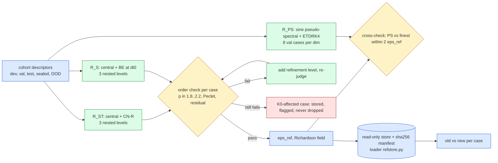

# jcp-references (E0) — order-verified second-order references for Burgers 2D and 3D (pre-registration)

Lane E0 of the JCP campaign (`reports/2026-10-06-jcp-offmesh-paper-plan.md` on `main`, E0 row, kill criterion K0,
"Sealing is global"; detail in its appendices `04-experiment-design.md` §1.1–1.2 and `06-codex-audit.md`). Status:
**pre-registration, 2026-10-13, before any code.** Amendments are appended at the end, dated; nothing above them is
rewritten.

## 1. Question

Every accuracy number of the campaign is measured against a **first-order** reference: the project's own full-order
model (sign-upwind advection, backward Euler (BE), Newton–BiCGStab) on a finer grid — $8192^2$ with
$\Delta t_0/16$ (ST) and $\Delta t_0$ (S) in 2D, 513 nodes per axis with $\Delta t_0/2$ in 3D. Such a reference is biased
toward upwind arms, and in 3D its own error is about 1.7–2.3 % (its distance to the 257-node solution and the post-hoc
Richardson estimate). The question is:

> **Are second-order references, verified for order per case and carrying a per-case uncertainty $\epsilon_{ref}$, good
> enough to rank arms, and how far were the old first-order references off?**

The lane produces, for the *same* PDEs, viscosities, initial conditions (ICs), output times and cohorts the campaign
uses: (i) a primary space+time reference $R_{ST}$; (ii) a space-only reference $R_S$ at the reduced model's BE step;
(iii) an independent pseudo-spectral cross-check; (iv) a store and loader that every other lane scores against;
(v) the old-versus-new comparison.

## 2. The PDEs (unchanged from the campaign; every function named below is reused, not re-derived)

Viscous Burgers on the unit box $\Omega=(0,1)^d$, homogeneous Dirichlet walls, $t\in[0,0.25]$, outputs at
$t_k = 0.05k$, $k=0,\dots,5$:

$$ u_t + u\,\textstyle\sum_{a=1}^{d}\partial_a u = \nu\,\Delta u,\qquad u|_{\partial\Omega}=0,\qquad u(\cdot,0)=u_0 . $$

- **2D** (`experiments/mr-burgers2d/engines.py`): descriptors $(c_x,c_y,w,a,\nu)$ from `engines.params_draw(seed, n)`
  ($c\sim U[.15,.85]$, $w\sim U[.05,.20]$, $a\sim U[.5,2]$, $\log\nu\sim U[\log .01,\log .1]$);
  $u_0 = a\exp(-|x-c|^2/2w^2)$ sampled at the nodes with the wall nodes set to zero (`engines.initial`). This IC does
  **not** vanish on the walls (it jumps there by up to $\approx 0.75a$), so the continuum problem has incompatible data;
  every discretisation here samples it the same way, and the order check (§4) tests whether second order survives it.
- **3D** (`vendor/quad3d/vendor/burgers3d-span/common.py`, `table`, `initial_interior`): 1–3 Gaussian blobs times the
  wall mask $64\prod_a x_a(1-x_a)$, peak-normalised to amplitude $A\sim U[.5,2]$ on the 257-node grid, $\log\nu\sim
  U[\log .01,\log .1]$. Compatible with the walls.
- Grids: $L$ intervals per axis, $h=1/L$, nodes $x=i/L$ (in 3D "$n$ nodes" means $L=n-1$).

## 3. The references

### 3.1 $R_{ST}$ — primary: second-order central differences + Crank–Nicolson

Space: the 5-/7-point Laplacian (as the FOM) and **central** advection
$N_h(u)_i = u_i\sum_a (u_{i+e_a}-u_{i-e_a})/(2h)$ (non-conservative form, the same continuum operator as the FOM's
$u\sum_a\partial_a u$). Time: Crank–Nicolson (CN) on $F_h(u)=N_h(u)-\nu\Delta_h u$,

$$ u^{n+1}-u^n+\tfrac{\Delta t}{2}\big(F_h(u^{n+1})+F_h(u^n)\big)=0, $$

with a **Rannacher start**: the first two CN steps (the interval $[0,2\Delta t]$) are replaced by four BE steps of
$\Delta t/2$ (damps the stiff modes that the 2D wall jump excites, which CN alone would carry undamped; the start adds
$O(\Delta t^2)$, so the scheme stays second order). Each step: Newton, matrix-free Jacobian by JVP, BiCGStab
preconditioned by the exact inverse of $(1+\tfrac{\Delta t}{2}\nu\Lambda_h)$ (resp. $1+\tfrac{\Delta t}{2}\nu\Lambda_h$ with
$\Delta t/2$ for the BE start) in the discrete sine basis (FFT DST-I, as the FOM). Predictor: the previous state.
Newton tolerance: relative nonlinear residual $\le 10^{-11}$ (relative to $\lVert u^n\rVert$), BiCGStab tolerance
$10^{-9}$, at most 20 Newton iterations; a step is accepted iff its final relative residual is finite and
$\le 2\times10^{-11}$ (the old 2D rule). f64 throughout, `JAX_DEFAULT_MATMUL_PRECISION=highest`.

Three nested levels with $\Delta t\propto h$ (both errors are second order, so the total error scales as $h^2$):

| dim | level $L$ (intervals) | $\Delta t$ | steps | CFL $2\Delta t/h$ ($\lvert u\rvert\le2$) |
|---|---|---|---|---|
| 2D | 2048, 4096, 8192 | $1.25\times10^{-3}$, $6.25\times10^{-4}$, $3.125\times10^{-4}$ | 200, 400, 800 | 5.12 |
| 3D | 128, 256, 512 (129/257/513 nodes) | $2.5\times10^{-3}$, $1.25\times10^{-3}$, $6.25\times10^{-4}$ | 100, 200, 400 | 0.64 |

(The CFL number is a property of the implicit solve's conditioning, not a stability limit; the old ST reference ran at
CFL 5.1.) **Refinement level** (only for cases that fail §4): 2D $L=12288$ with $\Delta t = 2.0833\dots\times10^{-4}
= 0.05/240$; 3D $L=768$ (769 nodes) with $\Delta t = 0.05/120$. Both contain the scoring lattice (§5).

### 3.2 $R_S$ — space-only, at the reduced model's step

Same central space discretisation and solver, but time is **BE with $\Delta t_0 = 0.005$** (the deployed reduced
model's step, 50 steps), no Rannacher start, levels as §3.1 (2D 2048/4096/8192, 3D 128/256/512) at fixed $\Delta t_0$.
It converges in $h$ to the semi-discrete-in-time BE solution and isolates spatial and quadrature effects from the BE
time error. Order is verified in $h$ exactly as for $R_{ST}$ (§4). Refinement levels as §3.1.

### 3.3 $R_{PS}$ — independent pseudo-spectral cross-check

A different family in both space and time: sine pseudo-spectral collocation with ETDRK4 (exponential time differencing,
fourth order; Cox–Matthews, coefficients by the Kassam–Trefethen contour integral, 32 points).
- State: orthonormal sine coefficients $\hat u_{\mathbf k}$, $1\le k_a\le N-1$. Linear part exact:
  $\hat L_{\mathbf k} = -\nu\pi^2|\mathbf k|^2$ (continuum eigenvalues).
- Nonlinear term $-u\sum_a\partial_a u$: $u$ (DST-I synthesis) and $\partial_a u$ (DCT-I along $a$, DST-I along the other
  axes) are evaluated on the **3/2-padded** grid $M=3N/2$, multiplied pointwise, and projected back by DST-I; modes
  $k_a\ge N$ are discarded (the 3/2 rule, equivalent to 2/3 truncation).
- IC: the **exact** sine coefficients of the continuous $u_0$ (not of its nodal samples), by tensor Gauss–Legendre
  quadrature of the separable factors (the 2D Gaussian and every 3D masked blob are products of 1D functions), 4096
  points per axis. Using nodal samples would put the FD-type $O(h^2)$ IC error into the spectral solver.
- Resolutions: 2D $N\in\{1024, 2048\}$ with $\Delta t = 5\times10^{-5}$; 3D $N\in\{128, 256\}$ with
  $\Delta t=2.5\times10^{-4}$ (explicit-advection limit for $|u|\le2$: $\Delta t\lesssim 2.8/(2d\pi N)$, i.e.
  $1.1\times10^{-4}$ in 2D at $N=2048$ and $5.8\times10^{-4}$ in 3D at $N=256$). A $\Delta t/2$ rerun of one case per
  dimension at the fine $N$ bounds the time error. Output: nodal values at the lattice (all lattice nodes are grid
  nodes for these $N$).
- Its expected spatial order is about 4 (the solution's sine coefficients decay algebraically because the PDE forces
  nonzero even derivatives at the walls), so its self-difference between $N$ and $2N$ estimates its own error.

## 4. Order verification, Richardson uncertainty and the refinement protocol

Per case, per output time $t_k$, $k\ge1$ ($t_0$ is the shared sampled IC, identical at every level), on the scoring
lattice (§5), with levels $u_1,u_2,u_3$ (coarse to fine, mesh widths $h_1>h_2>h_3$):

$$ d_{12}(t)=\lVert u_1-u_2\rVert,\qquad d_{23}(t)=\lVert u_2-u_3\rVert,\qquad n_0=\lVert u_3(t_0)\rVert, $$

and the observed order $p(t)$ solves $d_{12}/d_{23}=(h_1^{p}-h_2^{p})/(h_2^{p}-h_3^{p})$ (for ratio 2 this is
$p=\log_2(d_{12}/d_{23})$; solved by bisection on $[0.25, 8]$ for the non-uniform refinement level). Then

$$ \epsilon_{ref}(t)=\frac{d_{23}(t)}{n_0}\,\frac{h_3^{p}}{h_2^{p}-h_3^{p}}\;\Big(=\frac{d_{23}}{n_0\,(2^{p}-1)}\ \text{for ratio 2}\Big),\qquad
\epsilon_{ref}=\max_{k\ge1}\epsilon_{ref}(t_k), $$

the Richardson estimate of the error of the finest level in the campaign's metric (§5). The Richardson-extrapolated
field $u_R = u_3 + (u_3-u_2)\,h_3^{p}/(h_2^{p}-h_3^{p})$ is stored as a secondary field.

**Acceptance (per case, per reference kind).** A case is accepted iff (a) every step of every level met the Newton rule
(§3.1), (b) $p(t_k)\in[1.8,2.2]$ for **every** $k\ge1$, (c) the cell Péclet number $\max|u|\,h_1/\nu<2$ at the coarsest
level (max over stored output fields and the IC; the running maximum over steps is also recorded), and (d) $d_{23}/n_0
\ge 10^{-10}$ at every $k\ge1$ (above the solver-tolerance floor, so $p$ is meaningful).

**Refinement (never silent dropping).** A case that fails (b), (c) or (d) is rerun with the refinement level of §3.1
added and is re-judged on the finest three levels. A case that still fails is reported, by cohort and case, as a
**K0-affected case**: its reference is stored and flagged `accepted=false`, the loader returns the flag, and no accuracy
ranking may be made on it (plan K0: only $\rho$ and distance from dense there). There is **no fallback** to two
fourth-order levels. Failure (a) is a solver failure, not an order failure; it is rerun once with Newton budget 40 and
BiCGStab tolerance $10^{-10}$, then treated as (b).

**Uncertainty use.** $\epsilon_{ref}$ is a conditional estimate (it assumes the asymptotic regime the order check
tests), not a rigorous bound. Since any arm's error moves by at most $\epsilon_{ref}$ when the true solution replaces
$u_3$ (triangle inequality in the metric of §5), the difference of two arms' errors moves by at most $2\epsilon_{ref}$:
**$2\epsilon_{ref}$ is the resolution limit for ranking two arms** on that case.

## 5. Scoring lattice and metric

- Lattice: 2D the $257^2$ nodes $x=i/256$ (stored with the zero wall rows, shape $(6,257,257)$, the old `f257`
  convention); 3D the $63^3$ interior nodes $x=k/64$ (flat, $x$ slowest, shape $(6,63^3)$, the old `ref_<seed>.npz`
  `c<j>` convention). Each is a node subset of every compared mesh — 2D $256^2,512^2,1024^2,2048^2,4096^2$; 3D
  $64^3,128^3,256^3$ cells (and $384^3$) — and of every reference level above, so **no interpolation** is used
  anywhere. A mesh outside these sets (e.g. $128^2$, $48^3$) is scored on the common sub-lattice by restriction (the
  loader provides `restrict`), never by interpolation; that is outside this lane's pre-registered mesh set.
- Metric (the campaign's): $e(t_k)=\lVert f(t_k)-R(t_k)\rVert/\lVert R(t_0)\rVert$ on the lattice, and
  $e=\max_k e(t_k)$. $\epsilon_{ref}$ is in the same units.

## 6. The cross-check (K0, second half)

On 8 validation cases per dimension — the 4 with the smallest $\nu$ (hardest) and the 4 lowest-index remaining cases of
val32 (2D) / 923801 (3D):

$$ x_{PS}=\max_{k\ge1}\frac{\lVert u_{PS}^{(2N)}(t_k)-u_3(t_k)\rVert}{n_0},\qquad
s_{PS}=\max_{k\ge1}\frac{\lVert u_{PS}^{(2N)}(t_k)-u_{PS}^{(N)}(t_k)\rVert}{n_0}. $$

- **PASS** iff $x_{PS}\le 2\epsilon_{ref}$ and $s_{PS}\le\epsilon_{ref}/2$ (the cross-check is itself resolved).
- **FAIL** (K0 fires for that dimension) iff $x_{PS} > 2\epsilon_{ref} + s_{PS}$ with $s_{PS}\le\epsilon_{ref}/2$.
- **INCONCLUSIVE** iff $s_{PS}>\epsilon_{ref}/2$: rerun the pseudo-spectral pair at $(2N, 3N)$ (2D 3072, 3D 384), once.
- Also reported (not gated): the effectivity $\eta=x_{PS}/\epsilon_{ref}$ (≈1 if the Richardson estimate is sharp) and
  $\lVert u_{PS}-u_R\rVert/n_0$ (should be $\ll\epsilon_{ref}$).

## 7. Gates (code correctness), each checked at one real size before any verdict is read

| gate | what | bar |
|---|---|---|
| G1 parity | the lane's solver, switched to upwind advection + BE (no Rannacher), reproduces the vendor FOM (`engines.make_fom` 2D at $L=256$, `common.make_fom` 3D at 65 nodes) on one dev case | fields max rel. diff $\le10^{-12}$ |
| G2 MMS order | manufactured smooth solution with forcing (forcing path used only here), CN-R central at 3 levels (2D $L=128,256,512$; 3D $L=32,64,128$), true error vs exact | true order $\in[1.9,2.1]$ at every $t_k$; Richardson effectivity $\epsilon_{ref}/e_{true}\in[0.5,2]$ |
| G3 PS linear | pseudo-spectral with the nonlinear term off vs the exact sine-series heat solution | $\le10^{-12}$ relative |
| G4 PS MMS | pseudo-spectral solver on a manufactured solution with forcing | error decreases with $N$ at order $\ge3$ |
| G5 audit | independent NumPy recomputation (`audit_ref.py`) of $p$, $\epsilon_{ref}$, acceptance, cross-check numbers from the stored fields, with two fault injections (swapped case; one record perturbed by 1 %) that must be detected | exact agreement ($\le10^{-12}$); both faults detected |
| G6 loader | sha256 manifest check; fault injections: swapped case file and a 1 %-perturbed field must raise | both raise |
| G7 sealing | the loader refuses a sealed cohort without the coordinator's opening token; a mismatched token must also refuse | both refuse |

## 8. Controls that must fail (each checked on real data)

| control | construction | must |
|---|---|---|
| X1 first-order arm | the old scheme (upwind + BE, $\Delta t\propto h$) pushed through the same three-level order pipeline (2D dev6, levels 512/1024/2048; 3D dev4, 65/129/257) | be **rejected** by the $[1.8,2.2]$ gate on every case ($p\approx1$) |
| X2 cross-check discrimination | the cross-check of §6 applied to the **old** first-order reference instead of $u_3$ | **FAIL** on every cross-check case |
| X3 must-fire (plan) | $\lVert R_{old}-u_3\rVert/n_0$ vs $\epsilon_{ref}$ | exceed $\epsilon_{ref}$ on $\ge 90\,\%$ of cases; if not, the first-order bias was immaterial — recorded as a finding, not a failure |
| X4 Richardson must notice a broken level | a run with the middle level's $\Delta t$ doubled (time no longer refined with $h$) on one dev case | move $p$ outside $[1.8,2.2]$ at some $t_k$, or the case is recorded as an undetected-defect warning |

X4 is a sensitivity probe; it may legitimately pass if the time error is negligible at that level, and in that case the
report says so instead of claiming discrimination.

## 9. Cohorts and sealing

| cohort | 2D | 3D | use | stored |
|---|---|---|---|---|
| dev | dev6 (`7090702`×4 ∪ `911702`×2) | dev4 (`923651`×4) | smoke, gates, controls | local + cluster |
| validation | val32 (`20260927`×32) | `923801`×64 | selection by other lanes | local + cluster |
| historical test | test64 (`20260916`×64) | `923901`×32 | replication only | local + cluster |
| **sealed test** | sealed128 (new secret seed ×128) | sealed64 (new secret seed ×64) | headline numbers, opened once by the coordinator | **cluster only**, sealed dir |
| **OOD** | ood32 (new secret seed ×32) | ood16 (new secret seed ×16) | stress, reported separately | **cluster only**, sealed dir |

OOD distributions (pre-registered): as the training family but $\log\nu\sim U[\log .01, \log .01 + 0.1\log 10]$ (the
lowest 10 % of the log-range, $\nu\in[0.01, 0.01259]$) and widths below the training minimum: 2D $w\sim U[.030,.050)$,
3D every blob $w\sim U[.070,.100)$; all other draws as the family, consumed in the same order (prefix-stable).

**Sealing protocol.** Sealing is global, and this lane is generation and quality control only.
1. Secret seeds are drawn on the cluster login node by `secrets.randbits(31)` (one per new cohort) and written to
   `/cluster/tufts/paralab/tawal01/jcp-ref/sealed/SEEDS.json`; the file is made read-only and only its sha256 is
   committed (a commitment; the descriptors are therefore not readable from git).
2. Sealed jobs read the seeds from that file on the node; their fields go to the sealed store
   `/cluster/tufts/paralab/tawal01/jcp-ref/sealed/` (read-only after QC, `chmod a-w`), never to the local disk.
3. Only **QC aggregates** are pulled locally and reported (counts accepted, refined, K0-affected; distributions of
   $p$, $\epsilon_{ref}$, Péclet; Newton statistics) plus per-file sha256. No ROM, FOM or other arm is scored on a sealed
   or OOD case by this lane; no per-case field leaves the cluster.
4. The loader refuses sealed/OOD cohorts unless called with an opening token equal to the sha256 of a committed
   `selection.json` that the coordinator registers in `SEALED_OPENING.json` (an empty list today). Opening is the
   coordinator's/user's decision.

## 10. Metrics, bars and verdict

- Per case and kind ($R_{ST}$, $R_S$): $p(t_k)$, $\epsilon_{ref}$, $d_{12},d_{23}$, Péclet, Newton statistics,
  acceptance, refinement used.
- **E0 passes** for a dimension iff (i) every case of every cohort is accepted, possibly after refinement, and (ii) the
  cross-check PASSes on all 8 cases; otherwise K0 fires for the affected cases (reported by case, never dropped).
- Bar from the plan (for consumers): a claimed between-arm difference is resolved only if it exceeds
  $2\epsilon_{ref}$ on that case; the report states worst and median $\epsilon_{ref}$ per cohort so lanes can check
  "worst $\epsilon_{ref}\le 0.1\times$ smallest claimed difference".
- **Old vs new** (non-sealed cohorts): per case $\delta_{old}=\max_{k\ge1}\lVert R_{old}-u_3\rVert/n_0$ for 2D ST
  ($8192^2$, $\Delta t_0/16$, upwind) vs $R_{ST}$, 2D S ($8192^2$, $\Delta t_0$, upwind) vs $R_S$, 3D (513 nodes,
  $\Delta t_0/2$, upwind) vs $R_{ST}$. By the triangle inequality, $\delta_{old}$ bounds how far any provisional error
  number of that case can move when re-scored; the report gives its median and maximum per cohort and dimension.

## 11. Deliverables

- `refcore.py` (solvers, order/Richardson), `pscore.py` (pseudo-spectral), `refjob.py` (cluster job),
  `gates.py` (G1–G4, X1, X4), `audit_ref.py` (G5), `refstore.py` (**loader API**, G6–G7), `make_report.py` →
  `report.md`, plots in `plots/` (order histograms, $\epsilon_{ref}$ per cohort, cross-check, old-vs-new).
- Store layout (cluster primary `/cluster/tufts/paralab/tawal01/jcp-ref/store/`, local mirror of non-sealed cohorts in
  `experiments/jcp-references/store/`, git-ignored, sha256 manifest `store/MANIFEST.sha256` committed):
  `store/<dim>/<cohort>/<kind>/c<case>.npz` with keys `u1,u2,u3` (lattice fields of the three accepted levels, f64)
  and `meta` (JSON: levels, $\Delta t$, $p(t_k)$, $\epsilon_{ref}(t_k)$, acceptance, Péclet, job id, commit).
- Loader: `refstore.load(dim, cohort, case, kind='ST', field='finest'|'richardson')` → `(fields, meta)`;
  `refstore.score(field, dim, cohort, case, kind='ST')` → `{e, e_t, eps_ref, rankable, accepted}`;
  `refstore.restrict(fields, lattice)`. Verifies sha256 against the committed manifest on every load.

## 12. Compute estimate (GPU-hours), cap 4 concurrent jobs

Per-case costs scaled from the old references (2D $8192^2$ BE, 800 steps: 345–356 s mean on A100; 3D 513 nodes BE,
100 steps: 57–61 s on H100), assuming CN costs about the same per step as BE (to be measured in the smoke and amended):

| item | cases | per case | GPU-h |
|---|---|---|---|
| 2D $R_{ST}$ (8192 dominates; +1/8 +1/64) | 262 | ≈ 7.5 min | 33 |
| 2D $R_S$ | 262 | ≈ 2 min | 9 |
| 3D $R_{ST}$ (513, 400 steps) | 180 | ≈ 5.5 min | 17 |
| 3D $R_S$ | 180 | ≈ 1.5 min | 4.5 |
| pseudo-spectral (2×8 cases, 2 resolutions, + 2 $\Delta t/2$ runs) | 16 | 2D ≈ 0.3 h, 3D ≈ 0.6 h | 9 |
| gates, controls, smoke | — | — | 4 |
| refinement contingency (≈10 % of cases at the finer level) | — | — | 15 |
| **total** | | | **≈ 92** (plan budget 120) |

2D $8192^2$ fits an A100-80G (the old reference ran there); 3D 513 runs on H100/H200 (≈1.07 GB per state vector);
refinement levels (2D 12288, 3D 769 nodes) run on H200 with `--mem 240G`.

## 13. Flow

## 14. Process

Codex adversarial audits gate the design and each amendment, every code file before real-size runs, every cluster job
before submission, every result and the report (`audits/codex-<step>-<n>.md`). One job per cluster directory under
`/cluster/tufts/paralab/tawal01/jcp-ref/<job>/`, `squeue` before and after every submit, at most 4 concurrent jobs, at
most one local `jaxrun`. Commit small and often; `bash experiments/jcp-references/sync_github.sh` after every commit.

---

## Amendment A1 (2026-10-13, after Codex design audit 1, `audits/codex-design-1.md`; before any code)

Item numbers refer to the audit table. Every WRONG is repaired here; NEEDS-RESTATEMENT items are restated. Where A1
conflicts with §1–§14, A1 governs.

**A1.1 Common continuum IC and its representations (items 3, 26).** The continuum problem has IC $u_0$ (2D: the
Gaussian, nonzero on the walls; 3D: the masked blobs). Finite-difference (FD) levels and both FD references use the
nodal samples with zero wall nodes (`engines.initial`, `common.initial_interior`, with the single fixed 257-grid
$s_\star$ in 3D at every resolution). The pseudo-spectral (PS) solver uses numerically integrated sine coefficients of
the continuous $u_0$ (A1.6). The **canonical $t_0$ field** is the lattice restriction of the nodal samples; it defines
$n_0$ for every comparison, including PS. The PS $t_0$ field is stored separately and is never overwritten. All order,
$\epsilon_{ref}$ and cross-check quantities use $t_k$, $k\ge1$ only.

**A1.2 Amplitude, CFL and Péclet (items 5, 10, 19).** No a-priori bound $|u|\le2$ is assumed. Each solver records the
running maximum of $|u|$ over all steps (FD) or stages (PS). The CFL numbers of §3.1 are conditioning diagnostics, not
stability claims (summed over directions they are 10.24 in 2D, 1.92 in 3D). The Péclet check (c) of §4 uses the
running maximum. It is a sanity check that is not expected to fire on these families (nominal coarsest-level values
0.098 in 2D, 1.56 in 3D); its rejection path is tested by a unit test with an injected $\nu$.

**A1.3 Startup and preconditioner wording (items 7, 8).** The Rannacher start is used because it is the standard
remedy for CN with non-smooth data; second order at positive times is **verified per case**, not claimed from theory.
Each implicit stage solves $u - u^{n} + \theta\,\tau\,F_h(u) + (1-\theta)\,\tau\,F_h(u^n)=0$ with step length $\tau$ and
implicitness $\theta$: CN stages $\tau=\Delta t$, $\theta=\tfrac12$; startup BE stages $\tau=\Delta t/2$, $\theta=1$.
The preconditioner is the exact DST-basis inverse of $I+\theta\tau\nu\Lambda_h$, which is $I+\tfrac{\Delta t}{2}\nu
\Lambda_h$ in both cases.

**A1.4 Numerical floor (items 17, 18; WRONG → repaired).** The $10^{-10}$ floor is withdrawn. A **measured tolerance
floor** $\tau_{tol}$ replaces it: on dev cases (2D dev6 cases 0 and 4, 3D dev4 cases 0 and 2) every level of $R_{ST}$
and $R_S$ is re-solved at tight tolerances (Newton $10^{-13}$, BiCGStab $10^{-12}$, budget 40) and
$\tau_{tol}=\max\lVert u^{tight}-u^{prod}\rVert/n_0$ over cases, levels and $t_k$ (per dimension and kind). Condition
(d) of §4 becomes $d_{23}(t_k)/n_0\ge 10\,\tau_{tol}$ for every $k\ge1$. A case failing (d) is **not** refined in
space (that shrinks $d_{23}$); it is re-solved once at the tight tolerances and $\tau_{tol}$ is re-measured for that
case; if it still fails, it is classified **unresolved-floor** (its reference is extremely accurate, $\le d_{23}/n_0 +
2\tau_{tol}$, but its order is unverified) and treated as K0-affected (no ranking), reported separately from order
failures. Refinement (§4) is used only for failures of (b) or (c).

**A1.5 Order solve and failure outcomes (items 13, 16, 20).** $p$ is solved by bisection on $[0.25,8]$ only when the
ratio is bracketed; zero, NaN or infinite differences, or no bracket, give $p=$ `null` and the case fails (b) — never
clipped, never replaced by 2. Outcomes are distinct and all recorded: `accepted`; `order-fail` (b); `peclet-fail` (c);
`unresolved-floor` (A1.4); `solver-fail` (a, after the one retry of §4, which keeps the nonlinear target $10^{-11}$ and
changes only the Newton budget to 40 and the BiCGStab tolerance to $10^{-10}$). A rejected case after refinement is
"order unverified", not "inaccurate". Every attempt's level fields and metadata are kept (refinement history), not only
the final three levels.

**A1.6 PS spatial method restated (items 22, 23, 25, 27, 28, 29, 41, 42; item 23 WRONG → repaired).** The products are
**not** band-limited in the tensor-sine basis, so the 3/2 rule is *oversampling*, not exact de-aliasing: the DST of the
padded-grid product is a trapezoid-rule quadrature of the sine projection whose error is $O(M^{-4})$ for these
integrands (Codex's counterexample: $7.96\times10^{-5}$ at $M=12$, $4.91\times10^{-6}$ at $M=24$, ratio 16.2). The PS
solver is therefore a **high-order algebraic** method whose accuracy is measured, not assumed:
- Conventions (tested mode by mode in unit tests): orthonormal DST-I of size $M-1$; derivative of
  $\sin(k\pi x)$ is $k\pi\cos(k\pi x)$, synthesised by DCT-I on nodes $0..M$ with the standard endpoint halving.
- Lattice evaluation by direct synthesis of the sine series at the lattice coordinates (so $N$ need not contain the
  lattice). Resolutions: three per dimension, 2D $N\in\{1024,1536,2048\}$, 3D $N\in\{128,192,256\}$, and the observed
  order $q$ from them (A1.7).
- IC coefficients: tensor Gauss–Legendre, 4096 points per axis, **checked** against 8192 points (relative coefficient
  difference $\le10^{-13}$, gate G3b).
- ETDRK4 contour: 32 points, checked against 64 (coefficient difference $\le10^{-13}$, gate G3c).
- Time step as §3.3; every cross-check case is also run at the finest $N$ with $\Delta t/2$ (A1.7), and the running
  maximum of $|u|$ and finiteness of every stage are recorded.

**A1.7 Cross-check decision table (items 30, 33, 34, 35; WRONG → repaired).** Per cross-check case:
$x_{PS}=\max_{k\ge1}\lVert u_{PS}-u_3\rVert/n_0$ (finest $N$, $\Delta t$); spatial self-error
$s_x=\max_k\lVert u_{PS}^{(N_3)}-u_{PS}^{(N_2)}\rVert/n_0$, accepted as a conservative bound only if the observed
three-level PS order $q\ge2.5$ at every $t_k$ (for ratio $4/3$, $q\ge2.41$ makes $s_x\ge$ the Richardson error of
$N_3$); temporal self-error $s_t=\max_k\lVert u_{PS}^{(\Delta t)}-u_{PS}^{(\Delta t/2)}\rVert/n_0$; total
$\sigma_{PS}=s_x+s_t$ (IC and contour errors are gated to $\le10^{-13}$ separately). Then, exhaustively:

| condition | verdict |
|---|---|
| PS solver non-finite, or $q<2.5$ / undefined at some $t_k$ | **UNRESOLVED** |
| $\sigma_{PS}>\epsilon_{ref}/2$ | **UNRESOLVED** |
| $\sigma_{PS}\le\epsilon_{ref}/2$ and $x_{PS}\le2\epsilon_{ref}$ | **PASS** |
| $\sigma_{PS}\le\epsilon_{ref}/2$ and $x_{PS}>2\epsilon_{ref}$ | **FAIL** (the plan's K0: disagreement beyond $2\epsilon_{ref}$) |

An UNRESOLVED case is escalated once: the PS triple becomes $(N_2,N_3,\tfrac32N_3)$ (2D 3072, 3D 384) with the
fine-$N$ $\Delta t/2$ run repeated, ratio $N_3/N_4=2/3$, and the table is reapplied; a case still UNRESOLVED is
terminal UNRESOLVED (never promoted to PASS). **Dimension policy:** the cross-check validates the Richardson estimator
for the dimension. Any FAIL **suspends every reference of that dimension** (loader `dimension_status='suspended'`,
nothing rankable) until diagnosed in a dated amendment. With no FAIL, terminal-UNRESOLVED cases are K0-affected
individually, and the dimension is `validated` iff at least 6 of 8 cases PASS, else `unvalidated` (all its cases
non-rankable). Case selection (item 32): ties in $\nu$ broken by lower index; the selection is not a worst-case claim.

**A1.8 Vector consistency and separated refinements (item 15).** Reported for every case (not gated):
$c=\max_k\lVert(u_1-u_2)-\rho(u_2-u_3)\rVert/\lVert u_1-u_2\rVert$, $\rho=(h_1^{p}-h_2^{p})/(h_2^{p}-h_3^{p})$ at the
observed $p$ (small $c$ means the leading error is a common vector, as Richardson assumes). Diagnostic D1 on 2D dev6
cases 0, 4 and 3D dev4 cases 0, 2: a time-only ladder (finest $h$, $\Delta t$ of the three levels) and a space-only
ladder (finest $\Delta t$, three $h$) of $R_{ST}$, each with its observed order and magnitude, to show neither
component is cancelling the other.

**A1.9 Uncertainty wording and bars (items 21, 56, 57, 58).** $2\epsilon_{ref}$ is an **estimated** resolution
threshold (the triangle-inequality bound holds for the true reference error $\delta$; $\epsilon_{ref}$ estimates
$\delta$ under the asymptotic assumption the order check tests). Two bars are distinct and both are reported: (i) the
case-level ranking rule "no ranking inside $2\epsilon_{ref}$" (implemented by the loader's pairwise function); (ii) the
plan's design target "worst $\epsilon_{ref}\le0.1\times$ the smallest claimed difference" (checked by the consuming
lane). The old-vs-new $\delta_{old}$ bound holds for re-scoring the **same arm fields** on the same lattice with the
fixed-$t_0$ normalisation; the cohort maximum of $\delta_{old}$ bounds changes of cohort maxima/medians of paired
errors; the median of $\delta_{old}$ is descriptive only. Item 59: the old 3D "1.7–2.3 %" is restated as a 1.70 %
probe discrepancy (513 vs 257 nodes, case 923651/0) and a worst held-out Richardson displacement of 2.28 %, neither a
verified true error; the old 3D reference also used loose tolerances ($10^{-6}/10^{-7}$). $R_S$ (item 11) is the
BE-matched space-only reference; it is not time-matched to CN/BDF2 arms.

**A1.10 New 2D cohorts are row-wise, prefix-stable (item 50; WRONG → repaired).** Historical cohorts keep
`engines.params_draw(seed, count)` with their exact counts (it draws whole columns and is not prefix-stable). New 2D
cohorts (sealed128, ood32) use a row-wise generator: row $j$ draws from `np.random.default_rng([seed, j])`, in the
order $c_x,c_y,w,a,\log\nu$, with the family's (or OOD) ranges. New 3D cohorts use `b3d_common.draw_param_table`
(row-wise already) with the OOD ranges substituted for OOD. A unit test checks prefix stability and that every new
seed differs from every historical seed.

**A1.11 Sealing restated (items 51, 52, 53; WRONG → repaired as far as a shared account allows).** All lanes run as one
cluster user, so **no file permission is an access boundary**; this is stated plainly in the report. What is done:
- A 256-bit key is generated on the cluster login node (`openssl rand`) into
  `/cluster/tufts/paralab/tawal01/jcp-ref/custody/sealed.key` (mode 0400). The seeds file and **every sealed/OOD
  artifact** (fields and per-case metadata) are written AES-256 encrypted (`openssl enc -aes-256-cbc -pbkdf2`, piped
  from memory; no plaintext file is ever written). This protects against accidental reading (a lane globbing `*.npz`),
  not against a deliberate one. **Open question for the user:** whether to move the key off the cluster to a custodian
  (e.g. the user), which would make the encryption a real boundary.
- Seeds: drawn by `secrets.randbits(31)`, rejected and redrawn only if they collide with a historical or other new seed
  (redraws recorded); never replaced because of an outcome. Only the sha256 of the encrypted seed file and of the
  plaintext seed JSON is committed.
- QC aggregates pulled and reported for sealed/OOD cohorts follow a frozen schema: counts per outcome (A1.5),
  refinement count, quantiles (min/median/max) of $p$, $\epsilon_{ref}$, Péclet and Newton totals, GPU-seconds. No
  per-case values, no descriptors, no fields.
- **The loader cannot read sealed/OOD data at all.** Opening is a coordinator act under the plan's global-freeze rule:
  `open_sealed.py` (written by this lane, run only by the coordinator) refuses unless given a global freeze manifest
  that lists every lane's committed selection hash and this lane's reference-store version, writes an immutable
  opening record, and only then decrypts into the store. Post-opening method changes need a fresh cohort (plan).
  G7 tests the refusal paths (missing manifest, manifest without the store version, wrong key).

**A1.12 Store and loader restated (items 38, 54, 55; item 55 WRONG → repaired).** Per case and kind,
`c<case>.npz` holds every attempted level's lattice field (`u_L<L>`), and `meta` JSON holds: dimension, cohort,
case, descriptors and table/cohort hash, lattice id, output times, canonical $t_0$ field hash and $n_0$, levels and
$\Delta t$ used, solver configuration and tolerances, per-step Newton evidence (max relative residual, total and max
Newton count, step failures), running max $|u|$, Péclet, $p(t_k)$, $\epsilon_{ref}(t_k)$, $c$ (A1.8), outcome
(A1.5), refinement history, job id, GPU, commit, and the cross-check disposition (cross-check cases) and dimension
status. $u_R$ is **derived** by the loader, labelled diagnostic, with no uncertainty attached. API:
- `load(dim, cohort, case, kind='ST', field='finest'|'richardson')` → `(fields, meta)`; sha256-checked.
- `reference_status(dim, cohort, case, kind)` → `{accepted, outcome, eps_ref, dimension_status, eligible}`;
  `eligible` = accepted and dimension validated.
- `score(field, dim, cohort, case, kind)` → `{e, e_t, eps_ref, eligible}` (one arm; no ranking claim).
- `resolved(e_a, e_b, eps_ref)` → `|e_a-e_b| > 2 eps_ref` (pairwise ranking rule).
- `restrict(dim, cohort, case, kind, stride)` → reference levels restricted to a coarser sub-lattice **with $n_0$,
  $p$, $\epsilon_{ref}$ recomputed there**; arms must be restricted to the same sub-lattice (item 38).

**A1.13 Gates restated (items 39–44).**
- G1 parity: identical $\Delta t$ (0.005), tolerances (2D: ntol $10^{-10}$, ltol $10^{-11}$ passed at query time;
  3D: the same passed to the constructor), max Newton 20, nodal IC, outputs at $t_k$; bar $10^{-12}$ relative.
- G2 MMS (positive times only): $u^*=(1+\tfrac12\sin 4\pi t)\,\prod_a\sin(\pi x_a)\,\exp(\prod_a x_a)$, $\nu=0.05$;
  forcing $f=u^*_t+u^*\sum_a\partial_a u^*-\nu\Delta u^*$ computed by JAX automatic differentiation of the analytic
  $u^*$ (independent of the FD operators), applied as $\tfrac12(f^{n+1}+f^n)$ in CN stages and $f^{n+1}$ in BE stages.
  Levels 2D $L=128,256,512$ ($\Delta t=0.05/8,\ /16,\ /32$), 3D $L=32,64,128$ ($\Delta t=0.05/4,/8,/16$). Bars: true
  order in $[1.9,2.1]$ at every $t_k$, $k\ge1$; effectivity $\epsilon_{ref}/e_{true}\in[0.5,2]$ on the finest level.
  The forcing path is a separate argument, `None` in every production call.
- G3a PS linear: nonlinear term off, IC a finite set of sine modes; vs the exact decay at $t_k$, $k\ge1$, error
  $\le10^{-12}\lVert u(t_k)\rVert$. G3b/G3c: IC quadrature and contour checks (A1.6).
- G4 PS MMS: the G2 $u^*$ (not band-limited in sines) with forcing projected by the same oversampled DST; spatial
  ladder (three $N$ at $\Delta t$ small enough that $s_t$ is $<10^{-3}$ of the spatial error) with observed order
  $\ge3$, temporal ladder (three $\Delta t$ at large $N$) with observed order in $[3.5,4.5]$; and the projection unit
  test on Codex's $\sin(2\pi x)\sin^2(\pi y)$ example (observed quadrature order in $[3.5,4.5]$).
- G5 audit: `audit_ref.py` (NumPy, no JAX) recomputes $p$, $\epsilon_{ref}$, $c$, outcomes, cross-check numbers and
  $\delta_{old}$ from stored fields; recomputes the canonical $t_0$ field **from the descriptors** (independent code
  path) and compares it with the stored one (detects a swapped case even when field and metadata are swapped
  together); fault injection 1: cases 0 and 1 of 2D val32 swapped (fields+meta) must be detected by the $t_0$ check;
  fault injection 2: $u_{L=4096}(t_3)$ of 2D val32 case 0 multiplied by 1.01 must change the recomputed $p$ or
  $\epsilon_{ref}$ relative to the stored metadata by more than $10^{-6}$ (detected). Expected values are never
  regenerated after injection. Newton acceptance is audited from the stored per-step evidence.
- G6 loader: manifest pinned by commit; swapped files and a 1 %-perturbed field must raise.

**A1.14 Controls restated (items 45–48).**
- X1: upwind + BE with $\Delta t\propto h$: 2D dev6 at $L=512,1024,2048$ with $\Delta t=2.5,1.25,0.625\times10^{-3}$;
  3D dev4 at $L=64,128,256$ with $\Delta t=5,2.5,1.25\times10^{-3}$. Expected rejection on every case; a case that
  passes is reported as an accidental-order case (not hidden). X1b (deterministic): take accepted $R_{ST}$ levels of
  2D dev6 case 0 and add $C h_i\,\phi$ ($\phi$ the normalised $t_k$ field, $C$ such that the injected term is
  $10\times d_{23}$ at $h_3$); the gate must reject.
- X2: the old first-order reference in place of $u_3$, judged with the **new** $\epsilon_{ref}$ and the same PS
  resolution condition; expected FAIL on every cross-check case (a hypothesis; any non-FAIL is reported).
- X3: kinds $R_{ST}$ (2D ST, 3D) and $R_S$ (2D S) on the non-sealed cohorts only; failing the 90 % threshold is
  reported as "bias not resolved above $\epsilon_{ref}$", not "immaterial".
- X4 is a **sensitivity probe**, not a must-fail control: 2D dev6 case 0, $R_{ST}$, the middle level's $\Delta t$
  doubled.

**A1.15 Compute (items 62, 63).** Solvers stream: only the six output states (plus the current/previous state and
solver workspace) are held on the device; nothing per step is retained except scalar evidence. 3D factor
$1+1/16+1/256$. The PS row becomes 3 resolutions + one $\Delta t/2$ run per case, re-estimated after the smoke
(allocated 15 GPU-h; the 9 GPU-h row is withdrawn). Floor measurement (A1.4), D1 (A1.8), X1 and G-runs add ≈ 4 GPU-h.
All per-case costs are **calibrated in the real-size smoke** and the table is re-issued as an amendment before the
production jobs; production starts only if the calibrated total is $\le 120$ GPU-h (otherwise the user is asked).
`--mem` is host memory; device memory is measured (`peak_bytes_in_use`) in the smoke.

---

## Amendment A2 (2026-10-13, after Codex design audit 2, `audits/codex-design-2.md`; before any code)

Where A2 conflicts with A1 or §1–§14, A2 governs.

**A2.1 Numerical floor, case-specific (items 17, 18).** A1.4 is replaced. For every case, kind and level the solver
records the achieved final relative residual $r_n$ of every step. The **floor proxy** of a level is
$\tau_L = 10\sum_n r_n$ (residual accumulation with a stability factor of 10; it is a conditional proxy, not a bound).
The proxy is **validated** on the dev cases of A1.4 (every level re-solved at Newton $10^{-13}$, BiCGStab $10^{-12}$,
budget 40): the measured $\max_k\lVert u^{tight}-u^{prod}\rVert/n_0$ must be $\le\tau_L$ on every dev case and level;
if it is not, the factor 10 is raised to $10\times$ the worst observed ratio by a dated amendment before production.
Condition (d) of §4 becomes $d_{23}(t_k)/n_0\ge10(\tau_{L_2}+\tau_{L_3})$ for every $k\ge1$. A case failing (d) is
re-solved **at all three levels** at the tight tolerances (attempt `tight`), $\tau$ and every difference, order and
$\epsilon_{ref}$ are recomputed from the tight attempt, and (d) is re-judged with the tight proxies. A case that still
fails is `unresolved-floor`: order unverified, **no accuracy claim of any kind** (the bound "$\le d_{23}/n_0+2\tau$" of
A1.4 is withdrawn), K0-affected.

**A2.2 Direction consistency has a consequence (item 15).** $c$ (A1.8) stays a diagnostic for acceptance, but if
$c>0.5$ at some $t_k$, that case's uncertainty is replaced by the Richardson-free value
$\epsilon_{ref}^{cons}=\max_{k\ge1}d_{23}(t_k)/n_0$ (the last difference; larger than $\epsilon_{ref}$ whenever
$p\ge1$ and ratio 2), and the case is flagged `direction-inconsistent`. D1 is a diagnostic on four cases only, not
evidence about other cases.

**A2.3 PS uncertainty is a conditional indicator; the compared PS field is the half-step one (items 28, 30, A1-q).**
The compared field is $u_{PS}=u_{PS}^{(N_3,\Delta t/2)}$. $s_t=\max_k\lVert u^{(N_3,\Delta t)}-u^{(N_3,\Delta
t/2)}\rVert/n_0$ (under a fourth-order model the error of the half-step field is $s_t/15$; under any order $\ge1$ it is
$\le s_t$). $s_x$ (A1.7, spatial ladder at $\Delta t$) with $q\ge2.5$. $\sigma_{PS}=s_x+s_t$ is a **conditional
indicator** of the PS error under a single-leading-error model; a bias common to all PS resolutions is invisible to it.
What guards against common bias is that PS and FD share no discretisation (only the PDE, the descriptors and the
continuum IC).

**A2.4 Ordered cross-check procedure (items 33, 34, 29, PS vs $R_S$).** For each cross-check case, in this order:
1. **FD validity.** If the case's $R_{ST}$ outcome is not `accepted` (A1.5/A2.1) or $\epsilon_{ref}$ is undefined, the
   verdict is `FD-INVALID` (no replacement case; it counts as not-PASS).
2. **PS validity.** If any PS run is non-finite, the PS gates G3/G4 failed in that job, the spatial order $q$ is
   undefined (A1.5 policy: no bracket, zero, NaN) or $<2.5$ at some $t_k$, or $s_t$ fails to be at least 4× smaller
   than the $(\Delta t, 2\Delta t)$-free bound $\max_k\lVert u^{(N_3,\Delta t)}\rVert$ … (withdrawn; see next
   sentence) — the temporal check is: the running max $|u|$ must satisfy
   $\Delta t\le0.66\cdot2.8/(2d\pi N_3\max|u|)$; if not, the PS triple is rerun at $\Delta t/2$ once; still violated →
   `UNRESOLVED(stability)`. Any of the other failures → `UNRESOLVED(<reason>)`.
3. **Resolution.** $\sigma_{PS}>\epsilon_{ref}/2$ → `UNRESOLVED(resolution)`.
4. **Discrepancy.** $x_{PS}\le2\epsilon_{ref}$ → `PASS`; otherwise `FAIL`.
`UNRESOLVED` (any reason) is escalated once as A1.7; terminal `UNRESOLVED` and `FD-INVALID` are never PASS. The
§3.3 "explicit-advection limit" is withdrawn as a guarantee; it is the heuristic in step 2.
The cross-check compares PS with $R_{ST}$ only. $R_S$ (fixed-step BE) has a different target and gets no PS check; it
shares the spatial code with $R_{ST}$, so it inherits the dimension status.

**A2.5 Status truth table (A1-vs-§10, item 55).**
- *Dimension status:* `suspended` if any cross-check case FAILs; else `validated` if $\ge6$ of 8 PASS; else
  `unvalidated`.
- *Case eligibility* (`eligible`, per kind): outcome `accepted` **and** dimension `validated` **and** (the case is not
  a cross-check case, or its verdict is PASS).
- *E0 per dimension:* `PASS` iff the dimension is `validated` and every case of every cohort is `accepted`;
  `PASS-WITH-K0-CASES` iff `validated` and some cases are not eligible (listed by cohort and case); `FAIL` iff
  `suspended` or `unvalidated`. §10's "all 8 PASS" is replaced by this table. E0 overall = the pair of dimension
  verdicts (no single pooled verdict).

**A2.6 Coefficient checks and forcing at stages (items 25, 27).** IC coefficients: $\lVert\hat u^{4096}-\hat
u^{8192}\rVert_2\le10^{-13}\lVert\hat u^{8192}\rVert_2$ and $\max|\hat u^{4096}-\hat u^{8192}|\le10^{-15}$, at the
largest $N$ used (escalation included). ETDRK4 coefficients: for each of the four coefficient arrays,
$\max|C^{32}-C^{64}|\le10^{-12}\max|C^{64}|$; this is a coefficient check, not a trajectory bound. With forcing (G4
only) the forcing is evaluated at the stage times $t_n,\ t_n+\Delta t/2,\ t_n+\Delta t/2,\ t_n+\Delta t$.

**A2.7 Gates G2/G3a/G4 frozen (items 41, 42; item 42 WRONG → repaired).** The manufactured solution of A1.13 is
replaced (for G2 and G4) by the separable, wall-compatible
$u^*=A(t)\prod_a\varphi(x_a)$, $\varphi(x)=\sin(\pi x)\exp(\tfrac12\sin^2\pi x)$, $A(t)=1+\tfrac12\sin4\pi t$,
$\nu=0.05$: $\varphi$ is odd and 2-periodic and analytic, so $u^*$ has an infinite but spectrally decaying sine
expansion and satisfies every even-derivative wall condition. Each forcing term is a product of 1D functions
($u^*_t$; $u^*\partial_au^*=A^2\varphi\varphi'(x_a)\prod_{b\ne a}\varphi^2(x_b)$; $\Delta u^*$), with $\varphi',\varphi''$
by JAX automatic differentiation of $\varphi$. FD (G2) evaluates the forcing at the nodes. PS (G4) gets the forcing's
sine coefficients by tensor Gauss–Legendre (4096 points per axis) of the 1D factors — independent of the DST and free
of the wall-trapezoid error Codex demonstrated. G4 bars: spatial ladder ($N=32,48,64$ in 2D and 3D, $\Delta t=10^{-4}$)
observed order $\ge3$ at every $t_k$; temporal ladder ($N=64$, $\Delta t=0.01,0.005,0.0025$) order in $[3.5,4.5]$;
projection unit test on $\sin2\pi x\sin^2\pi y$ with order in $[3.5,4.5]$ (A1.6). G3a frozen: $\nu=0.01$, 2D modes
$(1,1),(3,2),(17,5),(40,40)$ with coefficients $1,0.5,-0.3,0.1$; 3D modes $(1,1,1),(2,3,1),(9,4,7),(30,30,30)$ with
$1,0.5,-0.2,0.05$; bar $\lVert u-u_{exact}\rVert/\lVert u_{exact}\rVert\le10^{-12}$ on the lattice at every
$t_k$, $k\ge1$, at $N=128$.

**A2.8 G5 identity and X1b (items 43, 45; WRONG → repaired).** G5 computes the expected descriptors from the
pinned (dimension, cohort, case-index) mapping of the committed cohort definitions (`cohorts.py`), never from the
stored metadata, and compares the canonical $t_0$ field so a swap of fields and metadata together is detected. X1b
becomes a synthetic exact first-order sequence $u_i=U+C\,h_i\,\phi$ on the stored $t_k$ fields of 2D dev6 case 0,
for both the dyadic triple and the refined triple $(3,1.5,1)$: $p=1$ exactly, so the gate must reject (a test of the
gate's code path, not of a solver).

**A2.9 Sealing classified (items 51–53, encryption, opening).** The sealing is **cooperative and unenforced** on the
shared cluster account: encryption prevents accidental reading only. The key file holds a 64-character hex line used
by `openssl enc -aes-256-cbc -pbkdf2 -md sha256 -pass file:<key>`; CBC is unauthenticated, so the sha256 of every
ciphertext **and** of every plaintext is recorded (the plaintext hashes only in the encrypted manifest; the ciphertext
hashes and the encrypted manifest's hash in git), and every decryption is verified against them. Failed generation
attempts are recorded in the QC aggregates (counts per outcome, including solver failures); quantiles exclude undefined
values and state the denominator; QC aggregates are published once per completed sealed job. Opening (coordinator
only, `open_sealed.py`): (1) refuse unless the global freeze manifest lists every lane of a trusted roster (the
plan's lane table, read from a commit given on the command line), each with a commit hash and a selection file whose
sha256 is verified by `git show`, plus this lane's store version; (2) refuse if an opening record already exists for
that cohort; (3) write an opening-intent record; (4) decrypt into a temporary directory and verify every plaintext
hash; (5) atomically rename into the store and append the manifest; (6) write the completion record. **Before a
verified global opening**, the loader cannot read sealed/OOD data; after it, the loader reads them like any cohort
and checks that a completion record exists.

**A2.10 Store schema and loader (items 38, 54, 55).**
- Fields are keyed by attempt and level, `a<k>_L<L>` (attempt table in `meta`: purpose `prod`/`tight`/`refine`/
  `retry`, tolerances), with per-step arrays `res_a<k>_L<L>` (final relative residual) and `nwt_a<k>_L<L>` (Newton
  count). `meta.final` names the attempt/levels used for the verdict. PS ladders of cross-check cases are stored in
  `store/<dim>/<cohort>/PS/c<case>.npz` (all $N$ and the half-step field at the lattice, plus PS $t_0$). Floor
  validation evidence (A2.1) is stored in `store/<dim>/dev*/floor/`.
- `score(...)` returns a dict carrying `(dim, cohort, case, kind, metric_id, store_version, e, e_t, eps_ref,
  eligible)`; `resolved(score_a, score_b)` raises unless both are eligible and agree on dim, cohort, case, kind,
  metric_id and store_version, and returns $|e_a-e_b|>2\epsilon_{ref}$ (using the case's $\epsilon_{ref}$ or
  $\epsilon_{ref}^{cons}$, A2.2).
- `restrict(dim, cohort, case, kind, factor)` restricts coordinate-wise (3D fields reshaped to $(6,63,63,63)$; the
  sub-lattice is $x=k\cdot factor/64$, resp. $/256$), recomputes $n_0$, $p$, $\epsilon_{ref}$, $c$ **and the outcome**
  on the sub-lattice, and, for cross-check cases, the cross-check verdict from the stored PS fields; the dimension
  status is unchanged.

**A2.11 Row-wise RNG pinning (item 50).** NumPy's `default_rng` (PCG64) with the seed sequence `[seed, j]`; the NumPy
version is recorded in every job's result JSON, and the unit test pins the first rows of each new cohort's **public
dev-check seed** (not the secret seeds) to golden values.

**A2.12 Erratum to A2.4 step 2 (same day, before audit).** Step 2 contains an abandoned half-sentence ("$s_t$ fails to
be at least 4× smaller … (withdrawn; see next sentence)"); it has no force. Step 2 reads, in full: the PS validity
check fails, with verdict `UNRESOLVED(<reason>)`, iff (i) any PS run is non-finite, (ii) a PS gate (G3a–c, G4) failed
in that job, (iii) the spatial order $q$ is undefined or $<2.5$ at some $t_k$, or (iv) the stability heuristic
$\Delta t\le0.66\cdot2.8/(2d\pi N_3\max|u|)$ with the recorded running maximum is violated after the one $\Delta t/2$
rerun it triggers (`UNRESOLVED(stability)`).
