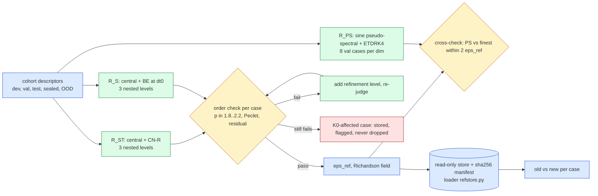

# jcp-references (E0) — order-verified second-order references for Burgers 2D and 3D (pre-registration)

Lane E0 of the JCP campaign (`reports/2026-10-06-jcp-offmesh-paper-plan.md` on `main`, E0 row, kill criterion K0,
"Sealing is global"; detail in its appendices `04-experiment-design.md` §1.1–1.2 and `06-codex-audit.md`). Status:
**pre-registration, 2026-10-13, before any code.** Amendments are appended at the end, dated; nothing above them is
rewritten.

## 1. Question

Every accuracy number of the campaign is measured against a **first-order** reference: the project's own full-order
model (sign-upwind advection, backward Euler (BE), Newton–BiCGStab) on a finer grid — $8192^2$ with
$\Delta t_0/16$ (ST) and $\Delta t_0$ (S) in 2D, 513 nodes per axis with $\Delta t_0/2$ in 3D. Such a reference is biased
toward upwind arms, and in 3D its own error is about 1.7–2.3 % (its distance to the 257-node solution and the post-hoc
Richardson estimate). The question is:

> **Are second-order references, verified for order per case and carrying a per-case uncertainty $\epsilon_{ref}$, good
> enough to rank arms, and how far were the old first-order references off?**

The lane produces, for the *same* PDEs, viscosities, initial conditions (ICs), output times and cohorts the campaign
uses: (i) a primary space+time reference $R_{ST}$; (ii) a space-only reference $R_S$ at the reduced model's BE step;
(iii) an independent pseudo-spectral cross-check; (iv) a store and loader that every other lane scores against;
(v) the old-versus-new comparison.

## 2. The PDEs (unchanged from the campaign; every function named below is reused, not re-derived)

Viscous Burgers on the unit box $\Omega=(0,1)^d$, homogeneous Dirichlet walls, $t\in[0,0.25]$, outputs at
$t_k = 0.05k$, $k=0,\dots,5$:

$$ u_t + u\,\textstyle\sum_{a=1}^{d}\partial_a u = \nu\,\Delta u,\qquad u|_{\partial\Omega}=0,\qquad u(\cdot,0)=u_0 . $$

- **2D** (`experiments/mr-burgers2d/engines.py`): descriptors $(c_x,c_y,w,a,\nu)$ from `engines.params_draw(seed, n)`
  ($c\sim U[.15,.85]$, $w\sim U[.05,.20]$, $a\sim U[.5,2]$, $\log\nu\sim U[\log .01,\log .1]$);
  $u_0 = a\exp(-|x-c|^2/2w^2)$ sampled at the nodes with the wall nodes set to zero (`engines.initial`). This IC does
  **not** vanish on the walls (it jumps there by up to $\approx 0.75a$), so the continuum problem has incompatible data;
  every discretisation here samples it the same way, and the order check (§4) tests whether second order survives it.
- **3D** (`vendor/quad3d/vendor/burgers3d-span/common.py`, `table`, `initial_interior`): 1–3 Gaussian blobs times the
  wall mask $64\prod_a x_a(1-x_a)$, peak-normalised to amplitude $A\sim U[.5,2]$ on the 257-node grid, $\log\nu\sim
  U[\log .01,\log .1]$. Compatible with the walls.
- Grids: $L$ intervals per axis, $h=1/L$, nodes $x=i/L$ (in 3D "$n$ nodes" means $L=n-1$).

## 3. The references

### 3.1 $R_{ST}$ — primary: second-order central differences + Crank–Nicolson

Space: the 5-/7-point Laplacian (as the FOM) and **central** advection
$N_h(u)_i = u_i\sum_a (u_{i+e_a}-u_{i-e_a})/(2h)$ (non-conservative form, the same continuum operator as the FOM's
$u\sum_a\partial_a u$). Time: Crank–Nicolson (CN) on $F_h(u)=N_h(u)-\nu\Delta_h u$,

$$ u^{n+1}-u^n+\tfrac{\Delta t}{2}\big(F_h(u^{n+1})+F_h(u^n)\big)=0, $$

with a **Rannacher start**: the first two CN steps (the interval $[0,2\Delta t]$) are replaced by four BE steps of
$\Delta t/2$ (damps the stiff modes that the 2D wall jump excites, which CN alone would carry undamped; the start adds
$O(\Delta t^2)$, so the scheme stays second order). Each step: Newton, matrix-free Jacobian by JVP, BiCGStab
preconditioned by the exact inverse of $(1+\tfrac{\Delta t}{2}\nu\Lambda_h)$ (resp. $1+\tfrac{\Delta t}{2}\nu\Lambda_h$ with
$\Delta t/2$ for the BE start) in the discrete sine basis (FFT DST-I, as the FOM). Predictor: the previous state.
Newton tolerance: relative nonlinear residual $\le 10^{-11}$ (relative to $\lVert u^n\rVert$), BiCGStab tolerance
$10^{-9}$, at most 20 Newton iterations; a step is accepted iff its final relative residual is finite and
$\le 2\times10^{-11}$ (the old 2D rule). f64 throughout, `JAX_DEFAULT_MATMUL_PRECISION=highest`.

Three nested levels with $\Delta t\propto h$ (both errors are second order, so the total error scales as $h^2$):

| dim | level $L$ (intervals) | $\Delta t$ | steps | CFL $2\Delta t/h$ ($\lvert u\rvert\le2$) |
|---|---|---|---|---|
| 2D | 2048, 4096, 8192 | $1.25\times10^{-3}$, $6.25\times10^{-4}$, $3.125\times10^{-4}$ | 200, 400, 800 | 5.12 |
| 3D | 128, 256, 512 (129/257/513 nodes) | $2.5\times10^{-3}$, $1.25\times10^{-3}$, $6.25\times10^{-4}$ | 100, 200, 400 | 0.64 |

(The CFL number is a property of the implicit solve's conditioning, not a stability limit; the old ST reference ran at
CFL 5.1.) **Refinement level** (only for cases that fail §4): 2D $L=12288$ with $\Delta t = 2.0833\dots\times10^{-4}
= 0.05/240$; 3D $L=768$ (769 nodes) with $\Delta t = 0.05/120$. Both contain the scoring lattice (§5).

### 3.2 $R_S$ — space-only, at the reduced model's step

Same central space discretisation and solver, but time is **BE with $\Delta t_0 = 0.005$** (the deployed reduced
model's step, 50 steps), no Rannacher start, levels as §3.1 (2D 2048/4096/8192, 3D 128/256/512) at fixed $\Delta t_0$.
It converges in $h$ to the semi-discrete-in-time BE solution and isolates spatial and quadrature effects from the BE
time error. Order is verified in $h$ exactly as for $R_{ST}$ (§4). Refinement levels as §3.1.

### 3.3 $R_{PS}$ — independent pseudo-spectral cross-check

A different family in both space and time: sine pseudo-spectral collocation with ETDRK4 (exponential time differencing,
fourth order; Cox–Matthews, coefficients by the Kassam–Trefethen contour integral, 32 points).
- State: orthonormal sine coefficients $\hat u_{\mathbf k}$, $1\le k_a\le N-1$. Linear part exact:
  $\hat L_{\mathbf k} = -\nu\pi^2|\mathbf k|^2$ (continuum eigenvalues).
- Nonlinear term $-u\sum_a\partial_a u$: $u$ (DST-I synthesis) and $\partial_a u$ (DCT-I along $a$, DST-I along the other
  axes) are evaluated on the **3/2-padded** grid $M=3N/2$, multiplied pointwise, and projected back by DST-I; modes
  $k_a\ge N$ are discarded (the 3/2 rule, equivalent to 2/3 truncation).
- IC: the **exact** sine coefficients of the continuous $u_0$ (not of its nodal samples), by tensor Gauss–Legendre
  quadrature of the separable factors (the 2D Gaussian and every 3D masked blob are products of 1D functions), 4096
  points per axis. Using nodal samples would put the FD-type $O(h^2)$ IC error into the spectral solver.
- Resolutions: 2D $N\in\{1024, 2048\}$ with $\Delta t = 5\times10^{-5}$; 3D $N\in\{128, 256\}$ with
  $\Delta t=2.5\times10^{-4}$ (explicit-advection limit for $|u|\le2$: $\Delta t\lesssim 2.8/(2d\pi N)$, i.e.
  $1.1\times10^{-4}$ in 2D at $N=2048$ and $5.8\times10^{-4}$ in 3D at $N=256$). A $\Delta t/2$ rerun of one case per
  dimension at the fine $N$ bounds the time error. Output: nodal values at the lattice (all lattice nodes are grid
  nodes for these $N$).
- Its expected spatial order is about 4 (the solution's sine coefficients decay algebraically because the PDE forces
  nonzero even derivatives at the walls), so its self-difference between $N$ and $2N$ estimates its own error.

## 4. Order verification, Richardson uncertainty and the refinement protocol

Per case, per output time $t_k$, $k\ge1$ ($t_0$ is the shared sampled IC, identical at every level), on the scoring
lattice (§5), with levels $u_1,u_2,u_3$ (coarse to fine, mesh widths $h_1>h_2>h_3$):

$$ d_{12}(t)=\lVert u_1-u_2\rVert,\qquad d_{23}(t)=\lVert u_2-u_3\rVert,\qquad n_0=\lVert u_3(t_0)\rVert, $$

and the observed order $p(t)$ solves $d_{12}/d_{23}=(h_1^{p}-h_2^{p})/(h_2^{p}-h_3^{p})$ (for ratio 2 this is
$p=\log_2(d_{12}/d_{23})$; solved by bisection on $[0.25, 8]$ for the non-uniform refinement level). Then

$$ \epsilon_{ref}(t)=\frac{d_{23}(t)}{n_0}\,\frac{h_3^{p}}{h_2^{p}-h_3^{p}}\;\Big(=\frac{d_{23}}{n_0\,(2^{p}-1)}\ \text{for ratio 2}\Big),\qquad
\epsilon_{ref}=\max_{k\ge1}\epsilon_{ref}(t_k), $$

the Richardson estimate of the error of the finest level in the campaign's metric (§5). The Richardson-extrapolated
field $u_R = u_3 + (u_3-u_2)\,h_3^{p}/(h_2^{p}-h_3^{p})$ is stored as a secondary field.

**Acceptance (per case, per reference kind).** A case is accepted iff (a) every step of every level met the Newton rule
(§3.1), (b) $p(t_k)\in[1.8,2.2]$ for **every** $k\ge1$, (c) the cell Péclet number $\max|u|\,h_1/\nu<2$ at the coarsest
level (max over stored output fields and the IC; the running maximum over steps is also recorded), and (d) $d_{23}/n_0
\ge 10^{-10}$ at every $k\ge1$ (above the solver-tolerance floor, so $p$ is meaningful).

**Refinement (never silent dropping).** A case that fails (b), (c) or (d) is rerun with the refinement level of §3.1
added and is re-judged on the finest three levels. A case that still fails is reported, by cohort and case, as a
**K0-affected case**: its reference is stored and flagged `accepted=false`, the loader returns the flag, and no accuracy
ranking may be made on it (plan K0: only $\rho$ and distance from dense there). There is **no fallback** to two
fourth-order levels. Failure (a) is a solver failure, not an order failure; it is rerun once with Newton budget 40 and
BiCGStab tolerance $10^{-10}$, then treated as (b).

**Uncertainty use.** $\epsilon_{ref}$ is a conditional estimate (it assumes the asymptotic regime the order check
tests), not a rigorous bound. Since any arm's error moves by at most $\epsilon_{ref}$ when the true solution replaces
$u_3$ (triangle inequality in the metric of §5), the difference of two arms' errors moves by at most $2\epsilon_{ref}$:
**$2\epsilon_{ref}$ is the resolution limit for ranking two arms** on that case.

## 5. Scoring lattice and metric

- Lattice: 2D the $257^2$ nodes $x=i/256$ (stored with the zero wall rows, shape $(6,257,257)$, the old `f257`
  convention); 3D the $63^3$ interior nodes $x=k/64$ (flat, $x$ slowest, shape $(6,63^3)$, the old `ref_<seed>.npz`
  `c<j>` convention). Each is a node subset of every compared mesh — 2D $256^2,512^2,1024^2,2048^2,4096^2$; 3D
  $64^3,128^3,256^3$ cells (and $384^3$) — and of every reference level above, so **no interpolation** is used
  anywhere. A mesh outside these sets (e.g. $128^2$, $48^3$) is scored on the common sub-lattice by restriction (the
  loader provides `restrict`), never by interpolation; that is outside this lane's pre-registered mesh set.
- Metric (the campaign's): $e(t_k)=\lVert f(t_k)-R(t_k)\rVert/\lVert R(t_0)\rVert$ on the lattice, and
  $e=\max_k e(t_k)$. $\epsilon_{ref}$ is in the same units.

## 6. The cross-check (K0, second half)

On 8 validation cases per dimension — the 4 with the smallest $\nu$ (hardest) and the 4 lowest-index remaining cases of
val32 (2D) / 923801 (3D):

$$ x_{PS}=\max_{k\ge1}\frac{\lVert u_{PS}^{(2N)}(t_k)-u_3(t_k)\rVert}{n_0},\qquad
s_{PS}=\max_{k\ge1}\frac{\lVert u_{PS}^{(2N)}(t_k)-u_{PS}^{(N)}(t_k)\rVert}{n_0}. $$

- **PASS** iff $x_{PS}\le 2\epsilon_{ref}$ and $s_{PS}\le\epsilon_{ref}/2$ (the cross-check is itself resolved).
- **FAIL** (K0 fires for that dimension) iff $x_{PS} > 2\epsilon_{ref} + s_{PS}$ with $s_{PS}\le\epsilon_{ref}/2$.
- **INCONCLUSIVE** iff $s_{PS}>\epsilon_{ref}/2$: rerun the pseudo-spectral pair at $(2N, 3N)$ (2D 3072, 3D 384), once.
- Also reported (not gated): the effectivity $\eta=x_{PS}/\epsilon_{ref}$ (≈1 if the Richardson estimate is sharp) and
  $\lVert u_{PS}-u_R\rVert/n_0$ (should be $\ll\epsilon_{ref}$).

## 7. Gates (code correctness), each checked at one real size before any verdict is read

| gate | what | bar |
|---|---|---|
| G1 parity | the lane's solver, switched to upwind advection + BE (no Rannacher), reproduces the vendor FOM (`engines.make_fom` 2D at $L=256$, `common.make_fom` 3D at 65 nodes) on one dev case | fields max rel. diff $\le10^{-12}$ |
| G2 MMS order | manufactured smooth solution with forcing (forcing path used only here), CN-R central at 3 levels (2D $L=128,256,512$; 3D $L=32,64,128$), true error vs exact | true order $\in[1.9,2.1]$ at every $t_k$; Richardson effectivity $\epsilon_{ref}/e_{true}\in[0.5,2]$ |
| G3 PS linear | pseudo-spectral with the nonlinear term off vs the exact sine-series heat solution | $\le10^{-12}$ relative |
| G4 PS MMS | pseudo-spectral solver on a manufactured solution with forcing | error decreases with $N$ at order $\ge3$ |
| G5 audit | independent NumPy recomputation (`audit_ref.py`) of $p$, $\epsilon_{ref}$, acceptance, cross-check numbers from the stored fields, with two fault injections (swapped case; one record perturbed by 1 %) that must be detected | exact agreement ($\le10^{-12}$); both faults detected |
| G6 loader | sha256 manifest check; fault injections: swapped case file and a 1 %-perturbed field must raise | both raise |
| G7 sealing | the loader refuses a sealed cohort without the coordinator's opening token; a mismatched token must also refuse | both refuse |

## 8. Controls that must fail (each checked on real data)

| control | construction | must |
|---|---|---|
| X1 first-order arm | the old scheme (upwind + BE, $\Delta t\propto h$) pushed through the same three-level order pipeline (2D dev6, levels 512/1024/2048; 3D dev4, 65/129/257) | be **rejected** by the $[1.8,2.2]$ gate on every case ($p\approx1$) |
| X2 cross-check discrimination | the cross-check of §6 applied to the **old** first-order reference instead of $u_3$ | **FAIL** on every cross-check case |
| X3 must-fire (plan) | $\lVert R_{old}-u_3\rVert/n_0$ vs $\epsilon_{ref}$ | exceed $\epsilon_{ref}$ on $\ge 90\,\%$ of cases; if not, the first-order bias was immaterial — recorded as a finding, not a failure |
| X4 Richardson must notice a broken level | a run with the middle level's $\Delta t$ doubled (time no longer refined with $h$) on one dev case | move $p$ outside $[1.8,2.2]$ at some $t_k$, or the case is recorded as an undetected-defect warning |

X4 is a sensitivity probe; it may legitimately pass if the time error is negligible at that level, and in that case the
report says so instead of claiming discrimination.

## 9. Cohorts and sealing

| cohort | 2D | 3D | use | stored |
|---|---|---|---|---|
| dev | dev6 (`7090702`×4 ∪ `911702`×2) | dev4 (`923651`×4) | smoke, gates, controls | local + cluster |
| validation | val32 (`20260927`×32) | `923801`×64 | selection by other lanes | local + cluster |
| historical test | test64 (`20260916`×64) | `923901`×32 | replication only | local + cluster |
| **sealed test** | sealed128 (new secret seed ×128) | sealed64 (new secret seed ×64) | headline numbers, opened once by the coordinator | **cluster only**, sealed dir |
| **OOD** | ood32 (new secret seed ×32) | ood16 (new secret seed ×16) | stress, reported separately | **cluster only**, sealed dir |

OOD distributions (pre-registered): as the training family but $\log\nu\sim U[\log .01, \log .01 + 0.1\log 10]$ (the
lowest 10 % of the log-range, $\nu\in[0.01, 0.01259]$) and widths below the training minimum: 2D $w\sim U[.030,.050)$,
3D every blob $w\sim U[.070,.100)$; all other draws as the family, consumed in the same order (prefix-stable).

**Sealing protocol.** Sealing is global, and this lane is generation and quality control only.
1. Secret seeds are drawn on the cluster login node by `secrets.randbits(31)` (one per new cohort) and written to
   `/cluster/tufts/paralab/tawal01/jcp-ref/sealed/SEEDS.json`; the file is made read-only and only its sha256 is
   committed (a commitment; the descriptors are therefore not readable from git).
2. Sealed jobs read the seeds from that file on the node; their fields go to the sealed store
   `/cluster/tufts/paralab/tawal01/jcp-ref/sealed/` (read-only after QC, `chmod a-w`), never to the local disk.
3. Only **QC aggregates** are pulled locally and reported (counts accepted, refined, K0-affected; distributions of
   $p$, $\epsilon_{ref}$, Péclet; Newton statistics) plus per-file sha256. No ROM, FOM or other arm is scored on a sealed
   or OOD case by this lane; no per-case field leaves the cluster.
4. The loader refuses sealed/OOD cohorts unless called with an opening token equal to the sha256 of a committed
   `selection.json` that the coordinator registers in `SEALED_OPENING.json` (an empty list today). Opening is the
   coordinator's/user's decision.

## 10. Metrics, bars and verdict

- Per case and kind ($R_{ST}$, $R_S$): $p(t_k)$, $\epsilon_{ref}$, $d_{12},d_{23}$, Péclet, Newton statistics,
  acceptance, refinement used.
- **E0 passes** for a dimension iff (i) every case of every cohort is accepted, possibly after refinement, and (ii) the
  cross-check PASSes on all 8 cases; otherwise K0 fires for the affected cases (reported by case, never dropped).
- Bar from the plan (for consumers): a claimed between-arm difference is resolved only if it exceeds
  $2\epsilon_{ref}$ on that case; the report states worst and median $\epsilon_{ref}$ per cohort so lanes can check
  "worst $\epsilon_{ref}\le 0.1\times$ smallest claimed difference".
- **Old vs new** (non-sealed cohorts): per case $\delta_{old}=\max_{k\ge1}\lVert R_{old}-u_3\rVert/n_0$ for 2D ST
  ($8192^2$, $\Delta t_0/16$, upwind) vs $R_{ST}$, 2D S ($8192^2$, $\Delta t_0$, upwind) vs $R_S$, 3D (513 nodes,
  $\Delta t_0/2$, upwind) vs $R_{ST}$. By the triangle inequality, $\delta_{old}$ bounds how far any provisional error
  number of that case can move when re-scored; the report gives its median and maximum per cohort and dimension.

## 11. Deliverables

- `refcore.py` (solvers, order/Richardson), `pscore.py` (pseudo-spectral), `refjob.py` (cluster job),
  `gates.py` (G1–G4, X1, X4), `audit_ref.py` (G5), `refstore.py` (**loader API**, G6–G7), `make_report.py` →
  `report.md`, plots in `plots/` (order histograms, $\epsilon_{ref}$ per cohort, cross-check, old-vs-new).
- Store layout (cluster primary `/cluster/tufts/paralab/tawal01/jcp-ref/store/`, local mirror of non-sealed cohorts in
  `experiments/jcp-references/store/`, git-ignored, sha256 manifest `store/MANIFEST.sha256` committed):
  `store/<dim>/<cohort>/<kind>/c<case>.npz` with keys `u1,u2,u3` (lattice fields of the three accepted levels, f64)
  and `meta` (JSON: levels, $\Delta t$, $p(t_k)$, $\epsilon_{ref}(t_k)$, acceptance, Péclet, job id, commit).
- Loader: `refstore.load(dim, cohort, case, kind='ST', field='finest'|'richardson')` → `(fields, meta)`;
  `refstore.score(field, dim, cohort, case, kind='ST')` → `{e, e_t, eps_ref, rankable, accepted}`;
  `refstore.restrict(fields, lattice)`. Verifies sha256 against the committed manifest on every load.

## 12. Compute estimate (GPU-hours), cap 4 concurrent jobs

Per-case costs scaled from the old references (2D $8192^2$ BE, 800 steps: 345–356 s mean on A100; 3D 513 nodes BE,
100 steps: 57–61 s on H100), assuming CN costs about the same per step as BE (to be measured in the smoke and amended):

| item | cases | per case | GPU-h |
|---|---|---|---|
| 2D $R_{ST}$ (8192 dominates; +1/8 +1/64) | 262 | ≈ 7.5 min | 33 |
| 2D $R_S$ | 262 | ≈ 2 min | 9 |
| 3D $R_{ST}$ (513, 400 steps) | 180 | ≈ 5.5 min | 17 |
| 3D $R_S$ | 180 | ≈ 1.5 min | 4.5 |
| pseudo-spectral (2×8 cases, 2 resolutions, + 2 $\Delta t/2$ runs) | 16 | 2D ≈ 0.3 h, 3D ≈ 0.6 h | 9 |
| gates, controls, smoke | — | — | 4 |
| refinement contingency (≈10 % of cases at the finer level) | — | — | 15 |
| **total** | | | **≈ 92** (plan budget 120) |

2D $8192^2$ fits an A100-80G (the old reference ran there); 3D 513 runs on H100/H200 (≈1.07 GB per state vector);
refinement levels (2D 12288, 3D 769 nodes) run on H200 with `--mem 240G`.

## 13. Flow

## 14. Process

Codex adversarial audits gate the design and each amendment, every code file before real-size runs, every cluster job
before submission, every result and the report (`audits/codex-<step>-<n>.md`). One job per cluster directory under
`/cluster/tufts/paralab/tawal01/jcp-ref/<job>/`, `squeue` before and after every submit, at most 4 concurrent jobs, at
most one local `jaxrun`. Commit small and often; `bash experiments/jcp-references/sync_github.sh` after every commit.
