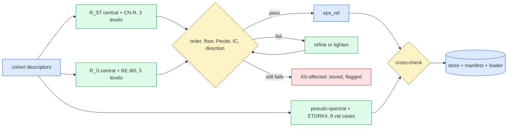

# Second-order reference solutions for Burgers 2D and 3D (E0, jcp-references)

Order-verified central-difference + Crank–Nicolson references ($R_{ST}$) and space-only backward-Euler references ($R_S$) for the campaign's Burgers cohorts, with Richardson uncertainty $\epsilon_{ref}$, an independent pseudo-spectral cross-check, sealed and out-of-distribution cohorts, a loader, and the old-versus-new comparison. **Status: INCOMPLETE / provisional** — E0 verdict 2D **FAIL**, 3D **PASS**. Store version `70ae82d4bd0b`. Generated by `make_report.py` from the pulled job results; pre-registration `DESIGN.md` with amendments A1–A7.

## What ran

| job | mode | dim | cohort | GPU | job id | elapsed (h) | commit | gates |
|---|---|---|---|---|---|---|---|---|
| `calib3d2` | calib | 3 | — | NVIDIA H200 | 5209714 | 0.50 | `84b66688e` | pass |
| `fd3ddev4p0` | fd | 3 | dev4 | NVIDIA H200 | 5210564 | 0.21 | `698f3d810` | pass |
| `fd3dood16p0` | fd | 3 | ood16 | NVIDIA H200 | 5216306 | 0.86 | `698f3d810` | pass |
| `fd3dsealed64p0` | fd | 3 | sealed64 | NVIDIA H200 | 5215129 | 1.44 | `698f3d810` | pass |
| `fd3dsealed64p1` | fd | 3 | sealed64 | NVIDIA H200 | 5216302 | 1.36 | `698f3d810` | pass |
| `fd3dtest32p0` | fd | 3 | test32 | NVIDIA H200 | 5212436 | 1.44 | `698f3d810` | pass |
| `fd3dval64p0` | fd | 3 | val64 | NVIDIA H200 | 5210868 | 1.54 | `698f3d810` | pass |
| `fd3dval64p1` | fd | 3 | val64 | NVIDIA H200 | 5212433 | 1.46 | `698f3d810` | pass |
| `gates2` | gates | 2 | — | NVIDIA A100 80GB PCIe | 5209722 | 0.03 | `538e66d08` | pass |
| `ps2dp0` | ps | 2 | val32 | NVIDIA A100 80GB PCIe | 5209854 | 0.69 | `605f2f9b3` | pass |
| `ps2dp1` | ps | 2 | val32 | NVIDIA A100 80GB PCIe | 5210648 | 0.67 | `605f2f9b3` | pass |
| `ps3dp0` | ps | 3 | val64 | NVIDIA H200 | 5209856 | 0.55 | `605f2f9b3` | pass |
| `ps3dp1` | ps | 3 | val64 | NVIDIA H200 | 5210824 | 0.55 | `605f2f9b3` | pass |

Collected jobs used 11.3 GPU-hours (wall time of each single-GPU job; failed and refused submissions listed in the lane log are not included). Cluster namespace `/cluster/tufts/paralab/tawal01/jcp-ref/`.

## Summary (generated)

- **2D: E0 FAIL**, dimension status `unvalidated`. 0/0 historical case-kinds accepted. $\epsilon_{ref}$ of $R_{ST}$: median —, worst —; of $R_S$: median —, worst —. Cross-check: 0 PASS, 0 FAIL, 8 other of 8. 
- **3D: E0 PASS**, dimension status `validated`. 200/200 historical case-kinds accepted. $\epsilon_{ref}$ of $R_{ST}$: median 0.00247 %, worst 0.0116 %; of $R_S$: median 0.00159 %, worst 0.00801 %. Cross-check: 8 PASS, 0 FAIL, 0 other of 8. Old first-order ST reference vs new: median 0.717 %, max 2.81 % (96 cases).

Every accuracy number previously reported against the old references can move, case by case, by at most the "old vs new" distance of that case (same arm fields, same lattice, fixed-$t_0$ normalisation; A1.9); the per-cohort maxima are in the old-versus-new section. The new references carry the uncertainty $\epsilon_{ref}$ listed with each case: two arms are rankable on a case only if their errors differ by more than $2\epsilon_{ref}$ (an estimated resolution limit, conditional on the asymptotic regime the order check tests).

## Method

Viscous Burgers on $(0,1)^d$ with zero Dirichlet walls, outputs at $t_k=0.05k$, $k=0..5$ (the campaign PDEs, cohorts and ICs, unchanged):

$$ u_t + u\sum_{a=1}^{d}\partial_a u = \nu\,\Delta u . $$

$R_{ST}$: central differences in space, Crank–Nicolson in time with a Rannacher start (the first two steps replaced by four backward-Euler half steps), three nested levels with $\Delta t\propto h$ — 2D $L=2048, 4096, 8192$ intervals, 3D $L=128,256,512$ — refined to 2D $L=12288$ / 3D $L=768$ when a case fails. $R_S$: the same space discretisation with backward Euler at the reduced model's $\Delta t_0=0.005$. Per case and output time, with $d_{12}=\lVert u_1-u_2\rVert$, $d_{23}=\lVert u_2-u_3\rVert$ on the scoring lattice and $n_0=\lVert u(t_0)\rVert$:

$$ \frac{d_{12}}{d_{23}}=\frac{h_1^{p}-h_2^{p}}{h_2^{p}-h_3^{p}},\qquad \epsilon_{ref}=\max_{k\ge1}\frac{d_{23}(t_k)}{n_0}\,\frac{h_3^{p}}{h_2^{p}-h_3^{p}} . $$

A case is accepted iff every step met the Newton rule, $p\in[1.8,2.2]$ at every $t_k$, the cell Péclet number is below 2, both level differences exceed ten times the solver-residual floor proxy, the shared IC matches, and the error vectors are direction-consistent ($c\le0.5$). The cross-check is an independent sine pseudo-spectral solver with ETDRK4 time stepping on 8 validation cases per dimension; it must agree with the finest level within $2\epsilon_{ref}$ while its own self-difference is below $\epsilon_{ref}/2$.



## Gates and controls

| gate | dim | result | key numbers |
|---|---|---|---|
| Uorder | — | pass | undefined [None, None, None, None, None, None, None, None]; p_refined_5p4 2.000 |
| X1b | — | pass | dyadic {'p': [1.0000000000000009, 0.9999999999999997, 1.0000000000000009, 1.0000000000000002, 0.9999999999999996], 'outcome': 'order-fail'}; refined {'p': [1.0000000000000018, 0.9999999999999978, 1.0000000000000004, 0.9999999999999998, 1.0000000000000004], 'outcome': 'order-fail'}; second_order_control accepted |
| Upeclet | — | pass | ok accepted; injected peclet-fail |
| Urng | — | pass | prefix_stable True; ranges True; golden_match True; numpy 2.5.0 |
| Ucrypto | — | pass | round_trip True; wrong_key_detected True |
| Utransforms | — | pass | worst_rel 2.52e-15 |
| Uic3d | — | pass | max_rel 2.99e-16 |
| G1 | 2 | pass | L 256; max_rel_diff 0.00e+00; newton_equal True |
| G1 | 3 | pass | L 64; max_rel_diff 0.00e+00; newton_equal True |
| G1 | 2 | pass | L 256; max_rel_diff 0.00e+00; newton_equal True |
| G2 | 2 | pass | p_true 2.063, 2.040, 2.032, 2.028, 2.020; p_obs 2.136, 2.088, 2.073, 2.064, 2.048; effectivity 0.937, 0.957, 0.963, 0.967, 0.975 |
| G1 | 3 | pass | L 64; max_rel_diff 0.00e+00; newton_equal True |
| G2 | 3 | pass | p_true 2.039, 2.045, 2.041, 2.037, 2.032; p_obs 2.050, 2.105, 2.108, 2.104, 2.097; effectivity 0.991, 0.947, 0.941, 0.941, 0.942 |
| G4proj | — | pass | errors 5.07e-05, 3.13e-06, 1.95e-07; orders 4.018, 4.004 |
| G3a | 2 | pass | worst_rel 2.38e-16 |
| G4 | 2 | pass | spatial_order 3.964, 3.976, 3.985, 3.992, 3.998; spatial_order_coarse 3.936, 3.959, 3.974, 3.987, 3.997; half_step_ratio 1.87e-06; temporal_order 3.972, 3.995, 4.000, 4.005, 4.009 |
| G3b | 2 | pass | N 3072; rel_l2 2.55e-13; max_abs 4.02e-14 |
| G3c | 2 | pass | N 3072; dt 5.00e-05; nu 0.010; worst_rel 8.15e-12 |
| G3a | 3 | pass | worst_rel 1.02e-15 |
| G4 | 3 | pass | spatial_order 3.963, 3.975, 3.983, 3.991, 3.997; spatial_order_coarse 3.934, 3.956, 3.971, 3.984, 3.995; half_step_ratio 2.32e-06; temporal_order 3.984, 3.997, 4.004, 4.010, 4.018 |
| G3b | 3 | pass | N 384; rel_l2 1.05e-14; max_abs 1.22e-15 |
| G3c | 3 | pass | N 384; dt 2.50e-04; nu 0.010; worst_rel 7.58e-12 |

- **G5 independent audit: FAIL** — 8 case-kinds audited, fault injections detected: swap False, perturb False.

- **X1 (3D)**: the first-order upwind + backward-Euler ladder was rejected on 4 of 4 dev cases (observed orders 0.67–0.92).

## Solver-floor calibration and D1

The floor proxy of a level is $\tau_L=10\sum_n\max(r_n,10^{-14})$ ($r_n$ the achieved relative residual of step $n$). Calibration re-solved every base level of both kinds on two dev cases per dimension at tighter tolerances; the proxy must bound the measured change.

| dim | kind | case | L | prod − tight | proxy (prod) | tight − tighter | proxy (tight) | all solves ok | ok |
|---|---|---|---|---|---|---|---|---|---|
| 3D | ST | 0 | 128 | 1.30e-11 | 1.76e-09 | 0.00e+00 | 1.02e-11 | True | True |
| 3D | ST | 0 | 256 | 2.29e-12 | 4.19e-10 | 2.75e-13 | 5.00e-11 | True | True |
| 3D | ST | 0 | 512 | 3.19e-16 | 4.02e-11 | 0.00e+00 | 4.02e-11 | True | True |
| 3D | S | 0 | 128 | 1.02e-16 | 5.00e-12 | 0.00e+00 | 5.00e-12 | True | True |
| 3D | S | 0 | 256 | 1.42e-16 | 5.00e-12 | 0.00e+00 | 5.00e-12 | True | True |
| 3D | S | 0 | 512 | 1.95e-16 | 5.00e-12 | 0.00e+00 | 5.00e-12 | True | True |
| 3D | ST | 2 | 128 | 3.52e-16 | 1.33e-11 | 4.44e-14 | 1.33e-11 | True | True |
| 3D | ST | 2 | 256 | 1.79e-16 | 2.02e-11 | 0.00e+00 | 2.02e-11 | True | True |
| 3D | ST | 2 | 512 | 2.31e-16 | 4.02e-11 | 0.00e+00 | 4.02e-11 | True | True |
| 3D | S | 2 | 128 | 1.13e-11 | 4.59e-10 | 1.88e-13 | 1.19e-11 | True | True |
| 3D | S | 2 | 256 | 1.14e-11 | 4.63e-10 | 1.88e-13 | 1.19e-11 | True | True |
| 3D | S | 2 | 512 | 1.14e-11 | 4.65e-10 | 1.88e-13 | 1.47e-11 | True | True |

D1 separates the time and space components of $R_{ST}$ on the calibration cases (observed order over the five output times, and the size of the finest difference $d_{23}/n_0$):

| dim | case | ladder | observed order (t1..t5) | $d_{23}/n_0$ (max) |
|---|---|---|---|---|
| 3D | 0 | time | 2.00, 1.99, 1.99, 1.99, 1.99 | 5.53e-05 |
| 3D | 0 | space | 2.00, 2.01, 2.01, 2.01, 2.01 | 2.23e-04 |
| 3D | 2 | time | 2.00, 2.00, 1.99, 1.99, 1.99 | 1.47e-05 |
| 3D | 2 | space | 2.00, 2.00, 2.00, 2.00, 2.00 | 3.60e-05 |

## Order verification and uncertainty, per cohort

| dim | cohort | kind | cases | accepted | refined | tight | observed order (min–max) | $\epsilon_{ref}$ median | $\epsilon_{ref}$ worst | levels used |
|---|---|---|---|---|---|---|---|---|---|---|
| 2D | dev6 | ST | 0 (missing 6) | — | — | — | — | — | — | — |
| 2D | dev6 | S | 0 (missing 6) | — | — | — | — | — | — | — |
| 2D | val32 | ST | 0 (missing 32) | — | — | — | — | — | — | — |
| 2D | val32 | S | 0 (missing 32) | — | — | — | — | — | — | — |
| 2D | test64 | ST | 0 (missing 64) | — | — | — | — | — | — | — |
| 2D | test64 | S | 0 (missing 64) | — | — | — | — | — | — | — |
| 3D | dev4 | ST | 4 | 4 | 0 | 0 | 1.992–2.011 | 0.00464 % | 0.00915 % | 128/256/512 |
| 3D | dev4 | S | 4 | 4 | 0 | 0 | 2.000–2.009 | 0.00367 % | 0.00704 % | 128/256/512 |
| 3D | val64 | ST | 64 | 64 | 0 | 0 | 1.988–2.029 | 0.00256 % | 0.0116 % | 128/256/512 |
| 3D | val64 | S | 64 | 64 | 0 | 0 | 1.999–2.016 | 0.00172 % | 0.00801 % | 128/256/512 |
| 3D | test32 | ST | 32 | 32 | 0 | 0 | 1.991–2.013 | 0.00222 % | 0.0103 % | 128/256/512 |
| 3D | test32 | S | 32 | 32 | 0 | 0 | 1.999–2.010 | 0.00159 % | 0.00743 % | 128/256/512 |

No historical case-kind failed verification.


## Pseudo-spectral cross-check

| dim | case | verdict (A10) | pre-A10 rule, same ladder | $\epsilon_{ref}$ | $x_{PS}$ | $\sigma_{PS}$ | $x_{PS}/\epsilon_{ref}$ | PS vs Richardson | PS spatial order | X2 (old reference field) |
|---|---|---|---|---|---|---|---|---|---|---|
| 2D | val32/0 | MISSING | — | — | — | — | — | — | — | — |
| 2D | val32/1 | MISSING | — | — | — | — | — | — | — | — |
| 2D | val32/2 | MISSING | — | — | — | — | — | — | — | — |
| 2D | val32/3 | MISSING | — | — | — | — | — | — | — | — |
| 2D | val32/4 | MISSING | — | — | — | — | — | — | — | — |
| 2D | val32/5 | MISSING | — | — | — | — | — | — | — | — |
| 2D | val32/19 | MISSING | — | — | — | — | — | — | — | — |
| 2D | val32/26 | MISSING | — | — | — | — | — | — | — | — |
| 3D | val64/0 | PASS | PASS | 4.18e-05 | 4.20e-05 | 9.42e-09 | 1.00 | 1.85e-07 | 5.70–5.86 | FAIL |
| 3D | val64/1 | PASS | PASS | 2.87e-05 | 2.86e-05 | 1.86e-10 | 1.00 | 1.77e-07 | 5.55–5.89 | FAIL |
| 3D | val64/2 | PASS | PASS | 2.08e-05 | 2.07e-05 | 1.45e-10 | 1.00 | 7.92e-08 | 5.85–5.90 | FAIL |
| 3D | val64/3 | PASS | PASS | 2.21e-05 | 2.21e-05 | 8.78e-10 | 1.00 | 3.28e-08 | 5.81–5.89 | FAIL |
| 3D | val64/5 | PASS | PASS | 8.42e-05 | 8.52e-05 | 4.69e-08 | 1.01 | 1.11e-06 | 5.51–5.69 | FAIL |
| 3D | val64/33 | PASS | PASS | 8.39e-05 | 8.43e-05 | 7.61e-09 | 1.00 | 5.33e-07 | 5.53–5.65 | FAIL |
| 3D | val64/43 | PASS | PASS | 1.16e-04 | 1.18e-04 | 4.67e-09 | 1.02 | 2.76e-06 | 5.57–7.71 | FAIL |
| 3D | val64/47 | PASS | PASS | 2.11e-05 | 2.11e-05 | 2.34e-10 | 1.00 | 2.75e-08 | 5.73–5.89 | FAIL |

**Rule change disclosed (DESIGN A10/A10.3).** The PS validity rule was changed after inspecting PS self-convergence data and before any comparison with the new second-order FD references of these cases: the pre-registered requirement "PS spatial order $q\ge2.5$" was replaced by the Richardson multiplier at the observed order ($q\ge0.5$) with a $10^{-12}$ round-off floor, because three accurate 2D PS ladders (first-order but $\sim10^{-9}$ self-differences, or differences at round-off) would otherwise have been declared unresolved. The floor assumes any remaining PS spatial error is negligible at the $10^{-12}$ scale. The column "pre-A10 rule" gives the verdict the original rule would have returned on the same ladder (not counting the escalation it might have required). A PASS means conditional agreement on the scoring lattice at $t_1..t_5$; it is not a rigorous bound.

$x_{PS}$ is the distance between the pseudo-spectral solution and the finest finite-difference level; it estimates the true error of that level, so $x_{PS}/\epsilon_{ref}\approx1$ means the Richardson estimate is sharp. X2 replaces the finest level by the old first-order reference and must FAIL.

## Old first-order references versus the new ones

$\delta_{old}=\max_{k\ge1}\lVert R_{old}(t_k)-u_3(t_k)\rVert/n_0$ per case: how far the old reference was from the new one, and the most any previously reported error of that case can move when re-scored (same fields, same lattice). 2D old: $8192^2$ upwind + backward Euler, $\Delta t_0/16$ (ST) and $\Delta t_0$ (S); 3D old: 513 nodes, upwind + backward Euler, $\Delta t_0/2$.

| dim | cohort | kind | cases | $\delta_{old}$ median | $\delta_{old}$ max | $\delta_{old}>\epsilon_{ref}$ |
|---|---|---|---|---|---|---|
| 3D | val64 | ST | 64 | 0.735 % | 2.81 % | 64/64 |
| 3D | test32 | ST | 32 | 0.708 % | 2.7 % | 32/32 |

- X3 (3D, ST): the old reference differs from the new by more than $\epsilon_{ref}$ on 96/96 cases (100 %; bar 90 % met).

Not covered: 3D dev4 (no old reference exists for it) and the 3D space-only kind (there was no old 3D S reference).

## Sealed and out-of-distribution cohorts (quality control only)

Generated and quality-controlled by this lane; never scored. Their seeds were drawn on the cluster (`make_seeds.py`, 0 redraws) and are committed only as hashes; fields and per-case metadata exist only as AES-256 ciphertext on the cluster. **The sealing is cooperative and unenforced**: every lane runs as one cluster user, so the encryption protects against accidental reading only, and the key sits in a custody directory on the same account.

| job | kind | case-kinds | accepted | other outcomes | refined | $\epsilon_{ref}$ median | $\epsilon_{ref}$ max | p min–max |
|---|---|---|---|---|---|---|---|---|
| `3d/ood16/fd3dood16p0` | S | 16 | 16 | none | 0 | 0.00633 % | 0.0115 % | 1.999–2.014 |
| `3d/ood16/fd3dood16p0` | ST | 16 | 16 | none | 0 | 0.00789 % | 0.0178 % | 1.989–2.017 |
| `3d/sealed64/fd3dsealed64p0` | S | 32 | 32 | none | 0 | 0.00126 % | 0.00764 % | 1.999–2.018 |
| `3d/sealed64/fd3dsealed64p0` | ST | 32 | 32 | none | 0 | 0.00242 % | 0.0108 % | 1.989–2.028 |
| `3d/sealed64/fd3dsealed64p1` | S | 32 | 32 | none | 0 | 0.0013 % | 0.00994 % | 1.999–2.011 |
| `3d/sealed64/fd3dsealed64p1` | ST | 32 | 32 | none | 0 | 0.00227 % | 0.0137 % | 1.989–2.015 |

## Using the references (loader API)

```python
import sys; sys.path.insert(0, '<worktree>/experiments/jcp-references')
import refstore as RS
R, meta = RS.load(2, 'val32', 7)            # R_ST finest level, (6, 257, 257); 3D: (6, 63**3)
s = RS.score(my_fields, 2, 'val32', 7)      # {'e', 'e_t', 'eps_ref', 'eligible', ...}
RS.resolved(s_a, s_b)                        # |e_a - e_b| > 2 eps_ref, only for eligible cases
```

Cohorts: 2D `dev6`, `val32`, `test64`; 3D `dev4`, `val64` (seed 923801), `test32` (seed 923901). Kinds `ST` (primary) and `S`. Field conventions are those of the old references, so a lane switches by changing only the loader call. Each load checks sha256 against `store/MANIFEST.sha256`; `STATUS.json` carries the dimension status and the cross-check verdicts; a case is `eligible` for ranking only if accepted, its dimension is validated and (for a cross-check case) its cross-check passed. The store files live in `store/` (git-ignored, tracked by the manifest) and on the cluster.

## What is provisional or limited

- $\epsilon_{ref}$ is a Richardson estimate, valid under the asymptotic assumption the order check tests; it is not a rigorous bound. The cross-check tests it on 8 cases per dimension only.
- The floor proxy was calibrated on 2 dev cases per dimension at the base levels; the refinement levels were not calibrated (A5.4).
- $R_S$ is time-matched to backward-Euler arms at $\Delta t_0$ only; it has no pseudo-spectral check of its own.
- Scoring on meshes outside 2D $256^2$–$4096^2$ / 3D $64^3$–$384^3$ needs `restrict`, whose metrics are diagnostic only.

## Glossary

- **$R_{ST}$**: the primary reference: converged in space and time (central differences, Crank–Nicolson).
- **$R_S$**: the space-only reference: converged in space at the reduced model's backward-Euler time step 0.005.
- **level / $L$**: one grid resolution, $L$ intervals per axis (grid spacing $h=1/L$).
- **observed order $p$**: how fast the difference between successive levels shrinks; 2 for a second-order method.
- **$\epsilon_{ref}$**: the estimated error of the finest level, relative to the size of the initial field (Richardson extrapolation).
- **$2\epsilon_{ref}$**: the resolution limit: two methods whose errors differ by less cannot be ranked on that case.
- **$d_{12}$, $d_{23}$**: distances between the coarse/middle and middle/fine levels.
- **$n_0$**: the size (Euclidean norm) of the initial field on the scoring lattice; all errors are divided by it.
- **scoring lattice**: the grid points shared by every compared mesh and reference ($257^2$ in 2D, $63^3$ in 3D).
- **Rannacher start**: replacing the first Crank–Nicolson steps by small backward-Euler steps to damp spurious oscillations from rough initial data.
- **Péclet number**: velocity × grid spacing / viscosity; central differences need it below 2.
- **floor proxy $\tau$**: an estimate of how much the nonlinear-solver tolerance perturbs a solution.
- **direction consistency $c$**: whether the level differences point the same way, as Richardson assumes.
- **cross-check / PS**: an independent pseudo-spectral solver used to test the finite-difference reference.
- **$x_{PS}$, $\sigma_{PS}$**: distance PS–finest level; the PS solver's own error indicator.
- **K0**: the plan's kill criterion: where a reference fails verification, no accuracy ranking is allowed.
- **eligible**: a case whose reference passed every check and may be used to rank arms.
- **sealed / OOD cohort**: test cases reserved for final results / cases outside the training parameter range; not opened by this lane.
- **dev / val / test cohorts**: development, validation (selection) and historical test case sets.
- **$\delta_{old}$**: distance between the old first-order reference and the new one, per case.
- **X1–X4**: controls: X1 a first-order ladder that must be rejected; X2 the cross-check against the old reference (must fail); X3 old vs new beyond $\epsilon_{ref}$; X4 a sensitivity probe.
- **G1–G7**: code gates: vendor parity, manufactured solutions, spectral checks, independent audit, loader tests.

