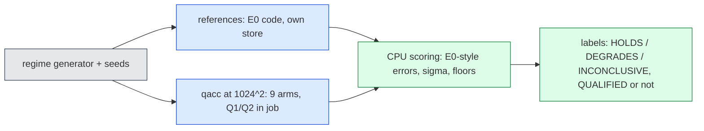

# jcp-regimes (plan D1) — parameter extrapolation, initial-condition family change and stiffness, one factor at a time (pre-registration)

Lane `jcp-regimes` of the Burgers 2D/3D campaign (`reports/2026-10-17-full-experiment-plan/`, plan v2 D1, priority 4;
brief `campaign/briefs/jcp-regimes.md`). Status: **pre-registration, 2026-10-19, before any code or data.** Amendments
are appended at the end, dated; nothing above them is rewritten.

## 1. Question

Every result of the campaign so far is measured on cases drawn from the family the bank was trained on. The question is:

> **How far outside the training distribution does the frozen, qualified off-mesh ROM stay accurate and numerically
> qualified — separately for (a) viscosity outside the training range, (b) an initial-condition family the bank was not
> trained on, and (c) steeper fronts than any training case — and where does it degrade?**

"The ROM fails outside the training range" is a valid, expected outcome and will be reported plainly. Nothing here is
a selection: every configuration, rule and step is frozen from earlier lanes; this lane only measures.

## 2. The training distribution (what "outside" means)

The 2D bank (checkpoint `dn256b`, rotation `rotation_R512`, bank edges $[0,128,256,384,512]$) was fitted to
trajectories of the 2D family of `engines.params_draw` / `burgers2d_film.sample_params` (seeds 0 and 1000):

$$ u_0(x)=a\,\exp\!\big(-|x-c|^2/2w^2\big),\quad c\in U[.15,.85]^2,\ w\in U[.05,.20],\ a\in U[.5,2],\ \log\nu\in U[\log .01,\log .1], $$

sampled at the nodes, wall nodes set to zero, $t\in[0,0.25]$. The 3D bank family (`b3d_common.draw_param_table`) is
1–3 positive masked blobs ($\rho_b\in U[.5,1]$, $w_b\in U[.10,.20]$, peak amplitude $A\in U[.5,2]$), the same $\nu$ range.

Two scalar coordinates measure the distance from that box:

- **viscosity distance** $d_\nu = \big|\log_{10}\nu - \mathrm{clip}(\log_{10}\nu, -2, -1)\big|$ (decades outside $[0.01,0.1]$);
- **nominal steepness** $s = a/\nu$ (2D; $A/\nu$ in 3D), which sets the front width $\delta\sim\nu/a$ once a front forms.
  Training range: $s\in[5,200]$ (corners $a=.5,\nu=.1$ and $a=2,\nu=.01$). Steepness distance
  $d_s=\big|\log_{10}s-\mathrm{clip}(\log_{10}s,\log_{10}5,\log_{10}200)\big|$.

Because $s$ is only a proxy (whether a front forms by $t=0.25$ also depends on $w/a$), each case also gets a **measured
stiffness index** from its own reference (§4.4).

## 3. Regimes (2D primary; frozen distributions)

One factor at a time: each regime moves exactly one of {viscosity, IC family, steepness} outside the training box and
keeps every other descriptor inside it. The low-viscosity side of (a) and the first stiffness step (c1) **share the same
viscosity band**; they differ only in amplitude, so their contrast isolates steepness from viscosity extrapolation.

| regime | factor moved | $\nu$ | amplitude | other descriptors | $s=a/\nu$ | cases |
|---|---|---|---|---|---|---|
| N0 | none (fresh in-range control) | $\log\nu\sim U[\log .01,\log .1]$ | $a\sim U[.5,2]$ | training | $[5,200]$ | 16 |
| A+ | viscosity above range | $\log_{10}\nu\sim U[-1,-0.4]$ ($0.1$–$0.398$) | $a\sim U[\max(.5,5\nu),2]$ | training | $[5,20]$ (in range) | 16 |
| A− | viscosity below range | $\log_{10}\nu\sim U[-2.5,-2.15]$ ($0.00316$–$0.00708$) | $a\sim U[.5,\min(2,200\nu)]$ | training | $[70.6,200]$ (in range) | 16 |
| C1 | steepness, step 1 | as A− | $a\sim U[250\nu,\min(2,500\nu)]$ | training | $[250,500]$ | 16 |
| C2 | steepness, step 2 | $\log_{10}\nu\sim U[-2.8,-2.45]$ ($0.00158$–$0.00355$) | $a\sim U[500\nu,\min(2,1000\nu)]$ | training | $[500,1000]$ | 16 |
| B1 | IC family: two same-sign bumps | training | final peak $a\sim U[.5,2]$ | §3.1 | training | 16 |
| B2 | IC family: signed pair (dipole) | training | final peak $\lvert u_0\rvert_{\max}=a\sim U[.5,2]$ | §3.1 | training | 16 |

Every amplitude interval above lies inside $[.5,2]$ (checked at both ends of each $\nu$ band). C2 is both a viscosity
extrapolation and a steepness step (it cannot be otherwise with $a\le2$); it is labelled "stiffness ladder, step 2".
A− itself is necessarily at the steep end of the training range ($s\le200$); the contrast C1 − A− is the clean
steepness effect, A− − N0 the clean low-side viscosity effect, A+ − N0 the high-side one.

### 3.1 New IC families (2D)

Both families are built from training-range components: per bump $b=1,2$, $c_b\sim U[.15,.85]^2$, $w_b\sim U[.05,.20]$,
weight $\beta_b\sim U[.5,1]$, rejection until $|c_1-c_2|\ge w_1+w_2$ (two distinct bumps; at most 1000 tries, else the
generator raises). With $G_b(x)=\exp(-|x-c_b|^2/2w_b^2)$ and $g=\beta_1G_1+\sigma\beta_2G_2$ ($\sigma=+1$ for B1, $-1$ for
B2),

$$ u_0 = a\,g(x)/s_\star,\qquad s_\star=\max_{x\in\mathcal G_{1024}}|g(x)|, $$

where $\mathcal G_{1024}$ is the node set of the $1024^2$ grid (one case-specific constant, the same at every mesh, as
the 3D family's `s_star`). Sampled at the nodes, wall nodes set to zero (the training convention). In B2 the negative
lobe travels towards $-x-y$ and the positive one towards $+x+y$: the bank never saw a sign-changing field.

The reserved OOD cohort of E0 (single Gaussian, $w\in[.030,.050)$, $\nu\in[.01,.0126]$) is **not** reproduced by any
regime here: no regime uses a single Gaussian narrower than training, so that cohort stays meaningful.

### 3.2 Generator, seeds, disjointness

Row $j$ of regime $g$ is drawn from `np.random.default_rng([0x52454749, S_g, j])` (three-word entropy; the E0 new-cohort
generators use two words `[seed, j]` or one word, and the historical cohorts one word), in the order: $c_x,c_y,w,$
then $\log_{10}\nu$ (or $\log\nu$), then $a$ (single-bump regimes); for B1/B2: $\log\nu$, $a$, then bump draws with
rejection. Public seeds, all $\ge 2^{31}$ so that they cannot equal any E0 sealed or OOD seed (those are
`secrets.randbits(31)`) nor any historical seed:

| regime | N0 | A+ | A− | C1 | C2 | B1 | B2 | 3D A+ | 3D A− | 3D B2 |
|---|---|---|---|---|---|---|---|---|---|---|
| $S_g$ | 3100000001 | 3100000002 | 3100000003 | 3100000004 | 3100000005 | 3100000006 | 3100000007 | 3100000101 | 3100000102 | 3100000103 |

Asserted by the generator (unit test, run before every job): every seed $\ge 2^{31}$ and not in the E0 historical/public
seed sets; every row satisfies its regime's bounds (§3 table) and, for A±/C, lies **outside** the training box in the
declared factor only; N0 rows are not within $10^{-12}$ of any row of the training draws (`sample_params(0, 576)`,
`sample_params(1000, 4032)`) or of dev6, val32, test64. The descriptor array of each regime is hashed (sha256) into
`runs/COHORTS.json` before any job.

**Sealed and reserved-OOD cohorts stay closed.** No code in this lane reads anything under `jcp-ref/sealed/`,
`jcp-ref/custody/`, or the E0 store's sealed/OOD kinds, and nothing is written to the E0 store. Historical test64 is
not used. Only dev6 and val32 (validation/development) are read from the E0 store, read-only.

### 3.3 3D regimes (phase 2, deferred second)

3D A+ ($\log_{10}\nu\sim U[-1,-0.4]$, $A\sim U[\max(.5,5\nu),2]$), 3D A− (A− band, $A\sim U[.5,\min(2,200\nu)]$; its
cell Péclet number at the coarsest reference level is then $\le 200h_1 = 1.56<2$) and 3D B2 (the training draw with
$B\in\{2,3\}$ blobs and one uniformly chosen blob sign-flipped, peak-normalised as `b3d_common` does), 16 cases each,
seeds above. No 3D stiffness regime: it would fail the Péclet check at $L=128$ and need the $L=768$ level for every case
(not affordable). Phase 2 needs a dated amendment (the 3D query and in-job Q1 certifier) before any 3D code.

## 4. References (E0 code, own namespace)

### 4.1 Code and levels
The E0 lane's reference code (`worktrees/2026-10-06-jcp-references/experiments/jcp-references`: `refcore.py`,
`refjob.py`, `verdict.py`, `gates.py`, `pscore.py`, `sealio.py`, `cohorts.py`) is copied byte-identically into
`experiments/jcp-regimes/ref/` with `PROVENANCE.json`. Two edits only, each recorded with its new sha256:
(i) `cohorts.py` gains the regime cohorts of §3 (a separate module `rcohorts.py` providing the same `Cohort` interface;
the historical/sealed tables are untouched and the sealed branch is unreachable for regime names), and
(ii) `refjob.attempt` records the stiffness statistics of §4.4 from the full-grid output fields before they are
discarded. Nothing else changes: $R_{ST}$ = central differences + Crank–Nicolson with the Rannacher start, three nested
levels 2D $L=2048,4096,8192$ ($\Delta t=1.25\times10^{-3}$ halving), refinement level $L=12288$ ($\Delta t=0.05/240$)
for cases that fail order/Péclet, tight attempt for floor failures, one solver retry, acceptance (b) $p(t_k)\in[1.8,2.2]$
every $k\ge1$, (c) cell Péclet $<2$ at the coarsest level, (d) $d_{23}/n_0\ge10^{-10}$; Richardson
$\epsilon_{ref}$ per case (a **conditional** estimate, E0 label carried). The committed E0 2D calibration status
(`checks/calib_2d.json`, FLOOR_STAB) is reused unchanged and labelled as calibrated on dev6, not on these regimes.
Only the ST kind is produced (S is used by the campaign only for BE at $\Delta t_0$ and is not needed here).
Output: per case one npz + json in the lane's own store `/cluster/tufts/paralab/tawal01/jcp-regimes/store/`, never in
the E0 store.

### 4.2 Eligibility
A case is **eligible** for accuracy statements iff its reference outcome is `accepted` (read per case from the lane's
store meta, never a fixed count). Non-accepted (K0-affected) cases are reported by regime with their failure check, and
enter only Q1/Q2 (which do not need a reference). If fewer than 8 of a regime's 16 cases are eligible, that regime's
accuracy labels are "inconclusive (references)".

### 4.3 Pseudo-spectral cross-check (diagnostic)
E0's `ps` mode on one case per regime (the case with the largest $s$; for B1/B2 the largest $a/\nu$), the E0
resolutions ($N=1024,1536,2048$, $\Delta t=0.05/1600$, half step at $N_3$). The E0 cross-check verdict (as amended by
E0 A10, label carried) is reported per regime; it does not gate eligibility (E0 also used it per dimension only).

### 4.4 Measured stiffness index
At every output time $t_k$, $k\ge1$, and at every level, on the full grid: $g_k=\max_{x\in[0.05,0.95]^2}|\nabla_h u(t_k)|_2$
(central differences; the wall band of width 0.05 is excluded because the 2D IC's wall jump creates a boundary layer
in every case). $\sigma=\max_k g_k/\max|u(t_0)|$ at the finest accepted level; $\sigma$ at the middle level is
recorded too, and a case with $|\sigma_3/\sigma_2-1|>0.1$ is flagged "front under-resolved at the middle level".

**Separation checks (frozen; they test the one-factor design on the data, before any ROM number is read).** With
$\Sigma_{N0}=[\min,\max]$ of $\sigma$ over the eligible N0 cases and $q_{90}$ its 90th percentile:
- S-A: at least 12 of 16 cases of A+ and of A− have $\sigma\in\Sigma_{N0}$;
- S-C: at least 12 of 16 C1 cases have $\sigma>q_{90}(N0)$, and median $\sigma$(C1) > median $\sigma$(A−); C2: median
  $\sigma$(C2) > median $\sigma$(C1);
- S-B: at least 12 of 16 cases of B1 and of B2 have $\sigma\in\Sigma_{N0}$.
A failed check does not stop the lane: the regime is relabelled in the report ("viscosity extrapolation confounded with
steepness", "family change confounded with steepness", "nominal steepness only") and the one-factor claim for it is
withdrawn.

## 5. ROM configurations (frozen; no selection)

All at $1024^2$, frozen mode list $F_{2048}$ prefix $M=4R'$, frozen rules and tolerances exactly as in
`jcp-qualify/runs/FRONT-2D.json` (sha256 `a51ac1a250f00d4b…`, entries `1024|R…`):

| setting | rule (main) | successor (Q2) | check (Q2 convergence) | arms |
|---|---|---|---|---|
| R128 | fib4181 | fib6765 | fib10946 | LSPG-BE $\Delta t_0$, LSPG-CN-R $\Delta t_0$ |
| R256 | gauss128 | gauss160 | gauss192 | LSPG-BE $\Delta t_0$, LSPG-CN-R $\Delta t_0$ |
| R384 | gauss128 | gauss160 | gauss192 | LSPG-BE $\Delta t_0$, LSPG-CN-R $\Delta t_0$, GAL-CN $\Delta t_0$ (diagnostic) |
| R512 | gauss192 | gauss256 | gauss320 | LSPG-BE $\Delta t_0$, LSPG-CN-R $\Delta t_0$ |

The eight LSPG configurations are the campaign's primary panel (all qualified in-range at $1024^2$ by jcp-qualify/P1).
GAL-CN R384 (the most accurate median-front member) is a registered **diagnostic** row (coordinator decision of
2026-10-18: GAL-CN is not primary). $\Delta t_0=0.005$.

The driver is jcp-qualify's `qacc.py` and its imports (`p1common`, `p1core`, `qcert`, vendored qcore), copied with
provenance; the only change is the case provider: `case_list` returns the regime cases (§3) plus dev6 and val32, and the
IC is the regime's own nodal field (§3.1) instead of `engines.initial` for B1/B2 (identical to `engines.initial` for the
single-bump regimes; asserted). Per case and arm, exactly as qualify: production run with in-job certification
(LSPG: autodiff stationarity $\gamma$ at every step with a fresh Jacobian; GAL: $\eta$), the tight run (every case), the
tighter run (subset), the successor-rule replay (Q2 population) and the check-rule replay (subset), and $\rho$ of the
arm's own six output states. Q2 population = **every** case of the regime; tighter / check-rule subset = cases 0–3 of
each regime and dev6.

## 6. Metrics and labels

- **Error** (E0 style): $e=\max_{k\ge1}\lVert f(t_k)-R(t_k)\rVert/\lVert R(t_0)\rVert$ on the $257^2$ lattice, $R$ = the
  case's $R_{ST}$ finest accepted level (regimes: this lane's store; dev6/val32: E0 store via `refstore`). Computed on CPU
  from the pulled coefficient arrays with qualify's independent NumPy decode (`npcheck.decode257`); the in-job decoded
  scores are a cross-check (agreement $\le10^{-10}$ relative).
- **In-range baseline** $I$ per configuration: N0 (16) ∪ dev6 (6) ∪ val32 (32), same job, same code.
- **Q1 per regime** (COMMON-BRIEF §3, verbatim): every run valid; non-stationary steps ($\gamma>10^{-3}$ or non-finite)
  $\le1\%$ pooled over the regime's steps; distance to the tight solve $\le2.5\times10^{-4}$ on every case; tight/tighter
  $\le2.5\times10^{-5}$ on the subset. **Q2 per regime**: successor-rule rollout distance $\le2.5\times10^{-4}$ on every
  case and $\rho\le0.116$ on the arm's own reached states, successor valid, check-rule convergence as qualify.
  "Numerically qualified in regime $g$" = Q1 and Q2 both pass on $g$. This answers "do the qualified rules still
  qualify".
- **Representation floor** (diagnostic, CPU): least-squares projection of each reference output field onto the span of
  the first $R'$ bank functions evaluated on the lattice, $e_{proj}=\max_k\lVert R-\Pi R\rVert/\lVert R(t_0)\rVert$;
  separates "the bank cannot represent it" from "the reduced dynamics go wrong".

## 7. Decision rules (frozen before data)

Per configuration $c$ and regime $g$, over eligible cases:

1. **Validity.** If any production run of $c$ on $g$ is invalid (non-finite, damping saturation, budget exit), $c$ is
   labelled **FAILS on $g$**, with the count; errors of valid runs are still reported.
2. **Numerical qualification** (§6): QUALIFIED / NOT QUALIFIED (with the failing predicate), independently of accuracy.
3. **Median degradation.** $\rho_{med}=\mathrm{median}_g(e)/\mathrm{median}_I(e)$ with a 95 % percentile bootstrap
   interval (cases resampled independently within $g$ and within $I$; 10 000 resamples; NumPy seed 0).
   **HOLDS** if the upper end $\le2$; **DEGRADES** if the lower end $>2$; **INCONCLUSIVE** otherwise. A median error
   below the in-range one ($\rho_{med}<1$) is reported as such ("improves") when the upper end is $<1$.
4. **Worst-case degradation** (descriptive): $\rho_{max}=\max_g e/\max_I e$; "worst degrades" iff $\rho_{max}>2$.
5. **Absolute failure.** A regime median error $>10\%$ is reported as "not usable" regardless of the ratio.
6. **Rank separation.** Statements comparing two configurations on a case use E0's $2\epsilon_{ref}$ rule (ties
   otherwise).
7. **Distance trend** (descriptive, no family-wise claim): within A+ and within A− separately, Spearman correlation of
   $\log e$ with $d_\nu$ (two-sided permutation $p$, 10 000 permutations, seed 0); within A− ∪ C1 ∪ C2, of $\log e$
   with $\log_{10}s$; and the OLS slope of $\log_{10}e$ per decade. "Error grows with distance" iff Spearman $>0$ with
   $p<0.05$.
8. **Factor attribution** (only for regimes whose separation check (§4.4) passes): low-side viscosity effect =
   $\rho_{med}(A-)$; steepness effect = median over the A−/C1 cases is compared by the ratio
   $\mathrm{median}(e_{C1})/\mathrm{median}(e_{A-})$ with the same bootstrap and the same 2× bands.

Predictions recorded beforehand (not claims): A+ HOLDS (smoother solutions); A− HOLDS or INCONCLUSIVE; C1 and C2
DEGRADE and may lose Q2 (steeper fronts need finer quadrature); B1 HOLDS or INCONCLUSIVE; B2 DEGRADES.

## 8. Controls (each must be shown to fire at real size in the smoke)

| control | kind | what must happen |
|---|---|---|
| R-repro: E0 dev6 c0 ST regenerated by the copied code via `rcohorts` | positive | finest-level lattice fields equal the E0 store to $\le10^{-12}$ relative; same outcome and $p$ |
| R-order: synthetic first-order triple ($u_i=u_\star+Ch_i$) through `verdict.judge` | must fail | rejected on order ($p\approx1$) |
| R-peclet: synthetic triple with $\nu$ such that Péclet $\ge2$ | must fail | rejected on Péclet → refinement path taken (unit) |
| R-real: one C2 case and one B2 case through the full reference procedure | real | outcome recorded; if refinement is triggered, the 12288 path runs to completion |
| G-seed / G-bounds / G-train | must fail | generator refuses a seed $<2^{31}$, a historical seed, and an out-of-bounds row (unit tests with injected values) |
| G-ic: single-bump regime IC vs `engines.initial` | positive | identical arrays |
| Q-repro: R384 LSPG-CN-R and R128 LSPG-BE on dev6 | positive | per-case errors equal FRONT-2D `per_case` to $\le10^{-9}$ relative |
| Q-under-resolved: gauss32 vs gauss64 replay (qualify's control) on C2 and B2 cases | must fail | Q2 rollout bar exceeded on at least one case |
| Q-budget0: LM budget 0 (qualify's control) on regime cases | must fail | pooled non-stationary fraction $>1\%$ |
| Q-wrong-mesh: table from another mesh | must fail | refused (raises) |
| S-check fixture: separation-check code on synthetic $\sigma$ arrays | both | passes on a separating fixture, fails on a non-separating one |

## 9. Optional items in defer order

1. **FOM comparison (deferred first).** 2D only: jcp-fom2d's best family (sine pseudo-spectral ETDRK4) at $N\in\{16,24,
   32,48,64,96,128\}$ × $\Delta t\in\{0.025,0.0125,0.00625\}$ on every eligible regime case, scored against this lane's
   references; per configuration and regime, the cheapest member with median $\le$ and worst $\le$ the ROM's. Cost: the
   member's fixed-step time from jcp-fom2d's H200 timing at the same $(N,\Delta t)$ (fixed-step explicit cost does not
   depend on the case) against the configuration's time from jcp-qualify's time1024 job: **cross-job, descriptive, an
   upper bound on our speed-up**, never a paired timing claim.
2. **3D regimes (deferred second)**, §3.3.
3. **Stiffness beyond one step**: C2 is the second step; it is dropped only after 1 and 2. Never dropped: N0, A+, A−,
   C1, B1, B2 with references and Q1/Q2.

## 10. Jobs, compute and budget

All on Tufts, `gpu` partition, H200 or A100-80G, venv `ae-research/venv`, `JAX_DEFAULT_MATMUL_PRECISION=highest`, f64,
GPU preflight (exit 42), `jax_backend=gpu` grepped, one job per directory under
`/cluster/tufts/paralab/tawal01/jcp-regimes/<job>/`, every sbatch through the shared flock (COMMON-BRIEF §14), lane cap
3 concurrent jobs, account cap 8. Raw arrays stay on the cluster (§16): pulled are JSONs, logs, the ROM coefficient
arrays (small) and the reference finest-level lattice fields (≈3 MB per case); everything else is moved to
`burgers-archive/jcp-regimes/<job>/` with a committed sha256 listing.

| job | content | estimate (GPU-h) |
|---|---|---|
| smk1 | §8 controls; R-repro; one C2 and one B2 reference (pilot); qacc on dev6 + 2 cases per regime, all arms, controls block | ≤ 2 |
| refN0, refAp, refB1, refB2 | 16 references each (≈0.12 GPU-h/case at val32 rates) | 4 × 2 |
| refAm, refC1, refC2 | 16 each; refinement expected (≈0.2–0.45 GPU-h/case) | 3 + 6 + 7.5 |
| rom1024 | all 9 arms × (dev6 + val32 + 7 regimes) | 2 |
| ps | §4.3, 7 cases | 1.5 |
| fom (optional) | §9.1 | 2 |
| 3D (optional) | references 48 × ≈0.05 + ROM | 5 |
| **total** | | **≈ 37**, + 25 % contingency ≈ 46 of the 60 cap |

The smoke yields a resource certificate (per-case seconds by regime and level); production projections come from it
(pattern `jcp-speed3d/resources.py`), and a job is submitted only if spent + certified projection ≤ 60.
`runs/GPU-LEDGER.json` records every job from `sacct`.

## 11. Deliverables

`report.md` (generated by `make_report.py`; level-1 title, status line, LaTeX, mermaid, inline provisional labels,
closing glossary); plots (PNG): error vs $d_\nu$ (A±), error vs $s$ (A−, C1, C2), per-regime error distribution per
configuration, $\sigma$ per regime, Q1/Q2 table; `runs/COHORTS.json` (seeds, descriptor hashes), `runs/EXPORT.json`
(per regime × configuration: labels, medians, worst, ratios with intervals, eligibility counts), the ledger, every
audit file. All accuracy numbers carry the E0 conditional label ($\epsilon_{ref}$ is a conditional Richardson
estimate; E0 A10 and combined A10/A11/A15 labels carried).

## 12. Glossary

- **Regime**: a set of freshly drawn development cases differing from the training family in one declared factor.
- **$s=a/\nu$**: nominal steepness; **$\sigma$**: measured stiffness index from the reference (§4.4).
- **$R_{ST}$**: second-order space-time reference (E0 method); **$\epsilon_{ref}$**: its Richardson error estimate.
- **Q1 / Q2**: solver qualification / quadrature qualification (COMMON-BRIEF §3).
- **Eligible**: a case whose reference passed the order, Péclet and floor checks.
- **HOLDS / DEGRADES / INCONCLUSIVE**: §7 rule 3 on the median-error ratio against the in-range baseline.

---

## Amendment A1 (2026-10-19, after Codex design audit 1, before any code ran on the cluster or any data)

Audit `audits/codex-design-1.md`: NEEDS-RESTATEMENT, ten fixes. Each is answered below; where a statement above is
wrong it is superseded here (the text above is not edited).

**A1.1 Attribution (fix 1).** The regimes are **distributional contrasts**, not clean causal interventions:
- A± impose $\nu$-dependent amplitude laws, so the joint $(a,\nu)$ distribution differs from N0 even though every
  marginal stays inside its training support; "A± hold steepness inside the training range" means only that $s$ stays
  in $[5,200]$.
- C1 and C2 move **both** $\nu$ and $s$ outside the training supports (§3's "declared factor only" was wrong for C1);
  both are labelled **low-$\nu$, high-$s$ regimes**. G-bounds asserts exactly the table's boxes, nothing more.
- **C1 is now paired with A−**: C1 row $j$ copies A− row $j$'s $(c_x,c_y,w,\nu)$ and only redraws $a$ in C1's interval
  from C1's own stream `[TAG, 3100000004, j]`. The A−/C1 contrast is therefore a **paired amplitude intervention at
  matched $(c,w,\nu)$**. It raises $s$ but also changes transport speed, front-formation time and wall interaction; it is
  reported as "amplitude/steepness effect at matched geometry and viscosity", never as a pure stiffness mechanism.
- $s=a/\nu$ is an inverse viscous-front-width proxy once a front forms; not the initial gradient, not a guarantee that a
  front forms by $t=0.25$, not a numerical stiffness measure. σ (A1.5) is an output-time interior normalised-gradient
  diagnostic, not a stiffness certificate.

**A1.2 Provenance (fix 2).** Correction of §2: the R512 bank of checkpoint `dn256b` was trained on the canonical
seed-0 draw (`sample_params(seed=0)`, $N_{train}+N_{val}=576$ trajectories at $256^2$;
`separable-decoder/sep_burgers_r3.py:203,293`). The dn256b **head** refit (`sep_coeff_extract.py`, `EXTRA_SEED=1000
EXTRA_TRAJ=4032`, `cluster/run_dn256b.sbatch:41–47`) projected 4,032 further seed-1000 trajectories onto the **frozen**
bank; the linear-span configurations used here never use the head. Both draws have the same ranges, so the training box
of §2 is unchanged. Pinned identities (checked in-job, values from FRONT-2D): checkpoint sha256 `18f0266ae6f0454200ec0b7b…`
(full hash in the config), rotation `rotation_R512.npz` sha256 `51149166b53dad386c93fa06…`, bank edges $[0,128,256,384,512]$,
mode list `inputs/modes_F2048.json` sha256 `880a7f833d317dc2…`. Disjointness is checked against both draws.

**A1.3 Seeds and allowlists (fix 3).** The three-word `SeedSequence` construction is **domain separation with negligible
collision probability, not a proof of stream disjointness**. What is asserted (G-train, extended): no single-bump row of
any regime is within $10^{-12}$ (max-abs) of any row of the two training draws, of dev6, val32 or test64, or of any other
regime row (within- and cross-regime duplicates); for B1/B2 the 12-vectors are checked for within/cross duplicates.
test64 is used **only as public descriptors** generated by `engines.params_draw(20260916, 64)` for this duplicate check;
no test64 reference, field or outcome is read. Code allowlists: `refjob` accepts only the regime names and dev6 (for
R-repro), refuses any sealed/OOD name, any `key` or `seeds_file`, and never instantiates E0's `NEW` cohorts (edit E2);
the ROM case provider accepts only dev6, val32 and regime names.

**A1.4 Reference acceptance, calibration transfer, adapters (fix 4).** Correction of §4.1: the acceptance is E0's
`verdict.judge` unchanged — per case, in precedence order: shared $t_0$ (dev $\le10^{-13}$), solver (every step finite and
$\le2\times10^{-11}$), **floor** ($d_{12}/n_0\ge10(\tau_1+\tau_2)$ and $d_{23}/n_0\ge10(\tau_2+\tau_3)$ at every $k\ge1$,
$\tau_L=10\sum_n\max(r_n,10^{-14})$), Péclet (running max $|u|\,h_1/\nu<2$), order ($p(t_k)\in[1.8,2.2]$ every $k$),
**direction consistency** ($c(t_k)\le0.5$ every $k$); E0's escalation (tight attempt on floor failure, refinement level on
order/Péclet failure, one solver retry) unchanged. The "$d_{23}/n_0\ge10^{-10}$" of §4.1 is withdrawn. Péclet is **not**
expected to fire ($Pe_{2048}\lesssim s/2048\le0.49$); refinement, if any, is expected from order failures.
Calibration transfer: E0's floor proxy was calibrated on dev6. **Probe (smoke):** for three pilot cases (C2, B2, A+), the
coarsest level $L=2048$ is also run at E0's `tight` tolerances; the transfer check passes iff
$\max_k\lVert u_{prod}(t_k)-u_{tight}(t_k)\rVert/n_0\le\tau_{2048}$ (the proxy bounds the actual solver error) for all
three. If it fails, every $\epsilon_{ref}$ of this lane carries "floor proxy not verified on these regimes" and the
production configs add the tight probe for one case per regime. Only the coarsest level is probed (cost; E0's tight solve
at $8192$ took about 3.5 h); the label says so.
Adapter edits to the copied E0 code (all recorded in `PROVENANCE.json` with new sha256): E1 `refcore.ic_lattice` uses
the cohort's own nodal IC (`full_ic`) when present (it reconstructed a single Gaussian from `cohort.D`); E2 cohort
allowlist (above); E3 `refjob.attempt` records the σ inputs; E4 the pseudo-spectral IC coefficients of B1/B2 are the
linear combination of two E0 single-Gaussian coefficient sets (`rcohorts.Cohort.ps_coefs`); E5 the calibration probe;
`mode_calib` refuses to run.

**A1.5 σ and the separation checks (fix 5).** Definition: at level $L$, nodes $x_i=i/L$, interior box
$B=\{0.05\le x,y\le0.95\}$; $g_k=\max_{B}\big[(u_{i+1,j}-u_{i-1,j})^2+(u_{i,j+1}-u_{i,j-1})^2\big]^{1/2}L/2$ at output $k$;
$\sigma=\max_{k=1..5}g_k/\max_{\text{nodes}}|u(t_0)|$, evaluated at the finest level of the case's **final** triple
(`meta.final[2]`), reported for every case whether accepted or not; the separation checks use **eligible** cases only.
Coverage rule: a check is "undetermined" unless the regime and the comparison set each have $\ge 8$ eligible cases.
Thresholds become fractions: "at least 75 % of eligible cases" replaces "12 of 16". New in-range control **N0s** (8 cases,
seed 3100000008): training widths and centres, $\log\nu\sim U[\log .01,\log .0126]$, $a\sim U[1.5,2]$, i.e. the stiff
corner of the training box ($s\in[119,200]$); it shares only its $\nu$ band with E0's reserved OOD cohort, whose defining
factor (width $w<0.05$) it does not touch, so no OOD case is reproduced or approximated. The in-range σ range is
$\Sigma_{in}=[\min,\max]$ over eligible N0 ∪ N0s, and $q_{90}$ is over the same set (random N0 alone does not reach the
stiff corner). N0s is not part of the accuracy baseline (A1.8); it is reported descriptively and as A−'s stiff-end
comparator.

**A1.6 ROM driver adapters (fix 6).** The copied `qacc.py`/`p1common.py` change in five explicit places (each recorded):
(i) `case_list` returns `[(cohort, case, desc)]` for the config's `cohorts` list (allowlist dev6, val32, regime names);
(ii) `select` resolves named sets `all` (every listed case), `sub` (cases 0–3 of each regime + dev6) or explicit lists,
for every cohort; (iii) the per-arm tighter/check subset is `arm['tighter_cases']` (default `sub`) and the Q2 population
`arm['q2_cases']` (default `all`), replacing the hard-coded dev6 / sub16; (iv) the IC is `ic_full(L, cohort, desc)`:
`engines.initial` for dev6/val32, `rcohorts.initial_2d` for regimes (identical for single bumps, G-ic), and the
normalisation $n_0=\lVert u_0[::L/256,::L/256]\rVert$ as before (equal to E0's $\lVert t_0\rVert$ because the lattice nodes are
grid nodes; asserted in the smoke for one case per cohort); the ν passed to the query is the descriptor's ν; (v) cohort
hashes are the sha256 of each cohort's descriptor array. Reference routing at scoring: dev6/val32 → E0 store (read-only,
`refstore`), regimes → this lane's store; every scored record asserts (cohort, case, descriptor hash, $t_0$ sha256)
against the reference meta. The nodal-input / cold-quadrature sampling contract of the query is unchanged (bilinear
sampling of the supplied $1024^2$ nodal field).

**A1.7 Q1/Q2 (fix 7).** "Verbatim" in §6 is corrected: for **GAL** the per-step certificate is $\eta\le10^{-8}$
(qualify A1.3/A2.5), not $\gamma\le10^{-3}$; LSPG uses $\gamma\le10^{-3}$. Q1/Q2 are computed by jcp-qualify's
`qscore.qualify` logic (copied), including tight/tighter validity, successor/check validity, the independent offline
recomputation (NumPy decode and NumPy ρ tables) and rejection on any in-job/offline disagreement. Validity, Q1 and Q2 are
evaluated on **every sampled case** of the regime, whether or not its reference is eligible; only accuracy statements are
restricted to eligible cases.

**A1.8 Statistics (fix 8).**
- *Baseline.* Primary $I$ = N0 ∪ dev6 ∪ val32 (54 cases), labelled "in-range mixture: 16 fresh + 38 previously exposed
  development/validation cases". Sensitivity: the same ratios against N0 alone. N0 is never tested against $I$ (overlap);
  instead an **in-range consistency** check: median(N0)/median(dev6 ∪ val32) with the bootstrap; expected to contain 1.
- *Precedence of labels* (per configuration × regime): FAILS (any invalid production run) ▸ NOT QUALIFIED (Q1 or Q2
  fails; accuracy labels still reported, marked "unqualified") ▸ accuracy label ∈ {IMPROVES, HOLDS, INCONCLUSIVE,
  DEGRADES} on eligible valid cases ▸ flag "not usable" if the regime median $>10\%$. Coverage $n_{elig}/n$ is printed
  next to every label; "HOLDS" means "holds on reference-eligible cases".
- *Missing data.* Errors of invalid runs or ineligible cases are excluded and counted. Fewer than 8 eligible valid cases →
  "inconclusive (coverage)". Bootstrap replicates whose baseline median is 0 or non-finite are dropped and counted; more
  than 1 % dropped → INCONCLUSIVE.
- *Worst case.* $\rho_{max}$ stays descriptive (unequal sample sizes 16 vs 54 bias maxima); no label beyond the flag.
- *Multiplicity.* All labels are **exploratory development evidence** without family-wise error control: 8 primary
  configurations × 7 non-baseline regimes (N0s, A+, A−, C1, C2, B1, B2) = 56 primary labels, plus the GAL diagnostic row.
- *Trends.* Spearman with average ranks for ties; non-finite values excluded and counted. The pooled A−/C1/C2 trend in
  $s$ is descriptive and does not identify a steepness effect.
- *Paired A−/C1.* Per pair $j$ (both eligible and valid): $q_j=e_{C1}(j)/e_{A-}(j)$; median of $q$ with a pair-bootstrap
  95 % interval (10 000, seed 0) and the Wilcoxon signed-rank $p$ of $\log q$; labelled per rule 3's bands (factor 2).

**A1.9 Controls (fix 9).** §8's "each at real size" is corrected: R-order and R-peclet are **verdict-logic** unit fixtures
(synthetic); the real-data controls are:
- **R-upwind** (real reference-side degradation): the C2 pilot case is also run through the three base levels with E0's
  upwind advection (`attempt(..., adv='upwind')`, same CN-R schedule) and judged by `verdict.judge`; it **must** be rejected
  (expected `order-fail`, $p\approx1$). If it is accepted the reference judge is not discriminating on these regimes:
  stop and amend.
- **R-repro** (positive): dev6 c0 ST regenerated; finest lattice field $\le10^{-12}$ relative to the E0 store, same
  outcome, $|p-p_{E0}|\le10^{-9}$.
- **R-calib** (A1.4 probe).
- **Q-under-resolved**: setting R384, rule gauss32 vs successor gauss64 (qualify's fixture), LSPG-BE $\Delta t_0$, on dev6
  cases 0–1 and on the smoke's pilot C2 and B2 cases (two each). Must exceed the Q2 rollout bar on at least one case. If it
  fires on dev6 but not on regime cases, that is recorded as a finding (regime cases are easier for the coarse rule); if it
  fires nowhere, the control is broken: stop and amend.
- **Q-budget0**: LM budget 0, R384, LSPG-CN-R and GAL-CN, same cases; pooled non-certified fraction must exceed 1 %.
- **Q-wrong-mesh**: as qualify (a 256² table refused by the 1024² bank).
- **G-ic-ps**: for two B1 and two B2 cases, `ps_coefs` at $N=64$ equals a direct non-separable tensor Gauss–Legendre
  quadrature of the two-bump IC ($\le10^{-12}$ relative); and the nodal $1024^2$ IC restricted to the lattice equals
  `full_ic(256)` exactly.
- **Q-repro**: R384 LSPG-CN-R $\Delta t_0$ and R128 LSPG-BE $\Delta t_0$ on dev6 reproduce FRONT-2D `per_case` errors to
  $\le10^{-9}$ relative.
The smoke acceptance (`smoke_accept.py`) recomputes every predicate from raw outputs.

**A1.10 Budget certificate (fix 9).** E0's 2D ST record (102 cases, `runs/fd2d*`): no case took the tight path, one was
refined; median about 150 s on H200 (325 s on A100), refined case 693 s. Projection per regime = (pilot or E0 median
seconds by $\nu$ class) × cases + refinement cost × (pilot-indicated fraction, at least 50 % for A−, C1, C2) + a tight-path
reserve of 3.5 GPU-h × (1 for A+, 1 shared by all other regimes), + compile time, × 1.5 for the time limit. Revised total:
references ≈ 4 (ordinary) + 6 (refined) + 7 (tight reserve), ROM ≈ 2, PS ≈ 1.5, smoke ≤ 2 → **≈ 23 GPU-h**, ≤ 30 with
optional items; cap 60.

**A1.11 FOM comparison (fix 10).** The cross-job speed-up "upper bound" of §9.1 is **withdrawn**. The FOM item becomes
**accuracy-only**: per regime, the coarsest member of the spectral ladder ($N\times\Delta t$ as §9.1) whose median and worst
errors match each configuration's, compared with the in-range matched member (does the FOM need more resolution in the
regime than in-range, relative to the ROM?). No speed claim. A paired same-GPU timing would need its own amendment.

**A1.12 3D (fix 10).** This document is a **2D pre-registration with a deferred 3D specification**. 3D needs a full
amendment (frozen qualified configuration list, 65³ query contract, baseline, certification plan) before any 3D code. The
3D B2 draft is corrected for that amendment: rejection until the masked blob sum has both signs on the 257³ grid, and
peak normalisation by $\max|\cdot|$ (`b3d_common.peak_on_reference_grid` uses the signed maximum).

---

## Amendment A2 (2026-10-19, after Codex design audit 2, before any cluster run or data)

Audit `audits/codex-design-2.md`: NEEDS-RESTATEMENT, seven fixes; items 1, 2, 5, 6 CORRECT as amended by A1.

**A2.1 Duplicate checks (fix 1).** G-train is extended to its A1.3 statement and implemented in
`rcohorts.assert_all_disjoint()`, run by the unit gates and by the ROM case provider: (i) every single-bump row of every
regime (N0, N0s, A+, A−, C1, C2) against both training draws, dev6, val32 and test64 descriptors and against every other
single-bump regime row, including within-regime duplicates (max-abs $\le10^{-12}$ refused); (ii) every two-bump row of B1
and B2 against every other two-bump row (within and across). C1 and A− rows share $(c_x,c_y,w,\nu)$ by design and differ in
$a$ (C1's $a$ is always larger; gate G-pair). The code header's "disjoint by construction" wording is replaced by A1.3's
"domain-separated, negligible collision probability". N0s: "does **not sample** the reserved OOD distribution" replaces
"no OOD case is reproduced or approximated" (the width supports touch at 0.05; N0s's upper ν bound 0.0126 is a rounded
neighbour of E0's $0.01\cdot10^{0.1}=0.012589$). The realised N0s sample has $s\in[130.0,168.7]$: it covers the **stiff
part** of the training box, not its corner $s=200$.

**A2.2 Calibration probe conclusion (fix 2).** The probe is valid only if the tight coarse solve itself passes E0's
per-step acceptance (`steps_ok`); an invalid probe is reported as "probe invalid", never as a pass. A passing probe shows
**observed agreement of the production and tight solves at the coarsest level within the floor proxy** — not that the proxy
bounds the true solver error, and not at the finer levels. A failing or invalid probe adds the label "floor proxy not
supported on these regimes" to every $\epsilon_{ref}$ of the lane. Either way $\epsilon_{ref}$ keeps E0's "conditional
Richardson estimate" label.

**A2.3 σ edge cases (fix 3).** σ is **unavailable** (value `null`, reason recorded) when the finest final-triple attempt
failed `steps_ok`, has non-finite gradient statistics, or was not run. Separation checks require $\ge8$ eligible N0 cases
**and** $\ge4$ eligible N0s cases; if N0s has fewer, the checks use N0 alone and are labelled "stiff-part comparison
unavailable".

**A2.4 Statistics (fix 4).**
- *Coverage* applies to eligible **and valid** cases on both sides of every ratio (regime and baseline): each $\ge8$.
- *Errors of zero.* An error is exactly 0 only for bitwise-identical fields; any case with $e=0$ or non-finite $e$ is excluded
  from ratios and counted.
- *Paired A−/C1*: requires $\ge8$ complete pairs (both cases eligible, both runs valid, both errors finite and positive);
  otherwise "inconclusive (pair coverage)". Wilcoxon signed-rank on $\log q_j$, two-sided, `scipy.stats.wilcoxon` with
  `zero_method='wilcox'`, `method='exact'` when $n\le25$ and there are no ties or zeros, `'approx'` otherwise; if every
  difference is zero, $p=1$.
- *N0s is descriptive*: its labels are printed but are not primary. Primary labels = 8 configurations × 6 regimes (A+, A−,
  C1, C2, B1, B2) = **48** (A1.8's "56" is superseded), plus the GAL diagnostic row and the paired A−/C1 contrast.

**A2.5 Frozen pilot cases and control predicates (fix 5).** Deterministic rule: the pilot of a regime is its case with the
largest $s$ (for A+: the largest ν); a second control case is the next-largest $s$. From the registered generator:
**C2 pilot c9** (second c11), **B2 pilot c15** (second c0), **A+ pilot c13**. Smoke uses: references for dev6 c0 (R-repro),
C2 c9, B2 c15, A+ c13; R-upwind on C2 c9; R-calib probes on C2 c9, B2 c15, A+ c13; Q-under-resolved and Q-budget0 on dev6 c0,
c1, C2 c9, c11, B2 c15, c0. Predicates: **R-upwind passes iff the outcome is exactly `order-fail`** with the solver,
$t_0$ and floor checks passing; rejection for any other reason makes the control **inconclusive → stop and amend**.
Q-under-resolved passes iff at least one listed case exceeds the Q2 rollout bar; Q-budget0 iff pooled non-certified
$>1\%$; R-repro and Q-repro as A1.9; R-calib as A2.2. New generator gates: **G-pair** (C1 row $j$ equals A− row $j$ in
$(c_x,c_y,w,\nu)$ exactly and has larger $a$), N0s injected out-of-bounds rows refused, N0s IC equals `engines.initial`.

**A2.6 Device-specific budget with a tight-path rule (fix 6).** All reference and ROM jobs run on **H200** (E0's 2D H200
rates). Per-case projections (H200, from E0's 102 2D ST cases): ordinary 150 s, refined 850 s (150 + the 693 s refined
case), × 1.2 for retries and compilation. Counts: ordinary regimes N0 16 + N0s 8 + A+ 16 + B1 16 + B2 16 = 72 cases →
3.6 GPU-h; low-ν regimes A− 16 + C1 16 + C2 16 = 48 cases, all assumed refined → 13.6 GPU-h. **Tight-path rule (edit E6 to
the copied `refjob.solve_case`):** each reference job carries `tight_allowance` (number of cases allowed to enter E0's tight
path). A floor failure beyond the allowance is not escalated; the case is recorded `unresolved-floor` with
`tight_skipped=true` (ineligible, reported). Allowances: A+ job 1, every other job 0 (E0's ST record had no tight case in
102); smoke 0 (the probe of A2.2 still runs). One tight triple is reserved at 4.5 GPU-h (E0's 8192 tight level 3.5 h plus
the 4096/2048 levels), a refined tight triple is never allowed. ROM job 2, PS 1 (7 cases × about 300 s H200), smoke 2.
**Projection ≈ 27 GPU-h; reservations** (sbatch time limits, each 1.5 × its job's projection, reserved in the ledger at
submit time) **≈ 40 GPU-h ≤ 60.** After the smoke, a certificate (`checks/resources-<job>.json`, per-job, from the
smoke's measured per-case seconds by regime class) replaces these numbers; a job is submitted only if spent + all open
reservations + its reservation ≤ 60. **Stop/reprojection rule:** if the certified total exceeds 50 GPU-h, C2 is cut to its
first 8 cases (it is last in the defer order); if still above, the PS cross-check is dropped; (a), (b), C1 are never cut.

**A2.7 FOM ladder ordering (fix 7).** No time ordering is assumed between $(N,\Delta t)$ pairs. For each configuration and
regime the report lists the **non-dominated matching set**: ladder members whose median and worst errors are $\le$ the
configuration's, minimal under the partial order ($N$ smaller or equal and $\Delta t$ larger or equal). If no member matches,
the entry reads "no ladder member matches (up to N = 128, Δt = 0.00625)". Accuracy only (A1.11). 3D stays deferred until its
own amendment; `rcohorts.draw_table_3d` raises until then.

---

## Amendment A3 (2026-10-19, after Codex design audit 3, before any cluster run or data)

Audit `audits/codex-design-3.md`: NEEDS-RESTATEMENT, three fixes; fixes 1, 3, 4, 5, 7 of audit 2 CORRECT.

**A3.1 Probe validity (fix 1).** The production member of the calibration probe is the **last** production or retry
attempt at $L=2048$ of the case's procedure (a successful retry replaces a failed production attempt). The probe is
**valid** only if both members pass `steps_ok` and the deviation is finite; otherwise its verdict is "probe invalid",
whatever the numbers. Verdicts: agree / disagree / probe invalid; only "agree" on all three pilots counts as the A2.2 pass.

**A3.2 Tight allowance as a cohort-level policy (fix 2).** Each regime's references run in one job, cases in ascending
index (asserted). The allowance is per **cohort**: A+ has 1, every other cohort 0; it is consumed by the first floor failure
in ascending case index; a restarted job counts every verified-resumed case that used the tight path against it (so
restarts and ordering cannot change which case gets it). Terminal branches, superseding A1.4's "escalation unchanged":
(i) floor failure with no allowance left → outcome `unresolved-floor`, `tight_skipped=true`; (ii) a tight base triple that
then fails order or Péclet → **no refinement**, outcome as judged, `refine_skipped=true`; (iii) a refined triple that fails
the floor → no tight refined triple, `tight_skipped=true`. **Selection effect disclosed:** eligibility now depends on a
resource policy that differs between cohorts, and the direction of the resulting bias on ROM errors is unknown (floor
failures may mark either hard cases or cases with very small discretisation differences). Every accuracy table prints,
next to the coverage, the count of cases "unresolved under this allowance" (i–iii) separately from cases that failed the
full E0 procedure.

**A3.3 Reduction branch and populations (fix 3).** Smoke pilot references (dev6 c0, C2 c9, B2 c15, A+ c13) and every
smoke control are **diagnostic only**: production regenerates every reference and ROM run in its own job, so the primary
populations are exactly the production populations. Order of reductions if the certified total exceeds 50 GPU-h, each
step only if the previous is insufficient: (1) the FOM accuracy item; (2) the PS cross-check; (3) C2 reduced to c0–c7 for
references, ROM runs, Q1/Q2 and labels together (the dropped C2 cases are marked "deferred", never silently omitted);
if the mandatory remainder (N0, N0s, A+, A−, C1, B1, B2 references; the ROM job; C2 at 8 cases) still does not fit,
**stop and amend**. 3D is outside this pre-registration (A1.12). The production certificate lists every workload with
its reservation: each reference job (cases × class rate, retries/compilation ×1.2, the A+ tight reserve), the ROM job (all
arms × all cases × prod/tight/tighter/qp/qpp runs from the smoke's measured seconds), PS, and any conditional extra
probe of A1.4 (one per regime, coarsest-level tight run, from the smoke's probe seconds).

**Minor corrections.** E0's timing record is 102 ST cases of which 80 ran on H200 (median 145.5 s) and 22 on A100 (median
326 s); the 693 s refined case is the whole case (its 12288-level solve took 526 s), so 850 s per low-ν case is a
conservative planning allowance, not an observed increment. Wilcoxon "ties" means ties among absolute non-zero
$\log q_j$. Ratio coverage is counted after the zero / non-finite exclusions. The PS cross-check cases are one per cohort
N0, A+, A−, C1, C2, B1, B2 (seven; N0s excluded). σ's normalisation $\max_{\text{nodes}}|u(t_0)|$ is computed as the
descriptor amplitude $a$ (the exact peak of the continuous IC; for single bumps it exceeds the nodal maximum by a relative
$\le h^2/(4w^2)\le1.5\times10^{-6}$ at $L\ge8192$; for B1/B2 $a$ is the peak over the $1024^2$ nodes, which are nodes of every
reference level).

---

## Amendment A4 (2026-10-19, after Codex design audit 4 = READY for 2D; wording only, before code audit)

The stiffness diagnostic is named $\sigma_a=\max_{k=1..5}g_k/a$ with the descriptor amplitude $a$ as denominator (A3's
claim that $a$ equals the nodal maximum at every level is withdrawn as stated: for single bumps $a$ is the continuous
peak, for B1/B2 the peak over the $1024^2$ normalisation nodes; nodal maxima at other levels can differ slightly). All
separation checks use $\sigma_a$ consistently for every cohort, so the convention does not favour any regime.
Implementation obligations noted by audit 4 for the code audit: the E6 terminal outcome for a blocked escalation is
`unresolved-floor` by `verdict.judge` precedence (the floor check fails before order/Péclet are considered); `refjob`
enforces the frozen cohort allowance (`rcohorts.TIGHT_ALLOWANCE`: A+ 1, others 0; any subset/pilot run 0).

---

## Amendment A5 (2026-10-19, after Codex code audit 1 = NEEDS-FIX; implementation contract, no change to the science)

Code audit `audits/codex-code-1.md` found implementation gaps; the fixes add these binding implementation rules:
- **Write boundary.** `refjob` and `refslim` write only under `/cluster/tufts/paralab/tawal01/jcp-regimes/` inside a
  Slurm job, or under `/tmp/` for a local CPU functional run; any path resolving into the E0 lane or `jcp-ref/` is refused.
- **E6 configuration.** Cases ascending, unique, in range; kind `ST` only; the allowance must equal the frozen cohort value
  (A+ 1 on its full population, 0 for every other cohort, subset, pilot or dev6); a job directory refuses to resume under a
  different configuration; resumed tight cases are deducted in a pre-pass before any case runs.
- **Probe evidence.** Probe lattices and residual histories are saved (`probe_c<j>.npz`) and the smoke acceptance
  recomputes the upwind verdict (`verdict.judge`) and the calibration verdict from them.
- **Identity of every scored pair.** Regime references: descriptor and $t_0$ equal the generator's exactly; E0 references:
  stored $t_0$ equal to the ROM's nodal IC to $10^{-14}$ relative (E0 wrote it in another process; 1-ulp differences
  observed); the ROM record's $n_0$ equals the reference's to $10^{-12}$. The ROM job asserts the checkpoint and rotation
  sha256 and, per setting, the complete main-rule manifest (`rule_meta`: mesh, mode-list hash, rule sha256, $m$,
  fingerprint) against FRONT-2D (sha256 `a51ac1a2…`).
- **Full-field decode check.** A CPU step in each ROM job (`fverify.py`) decodes every production coefficient vector with
  the independent NumPy decoder and compares the full $257^2$ field with the in-job field ($\le10^{-12}$), and checks the
  F-file hash; the small result is pulled. Offline, the probe/norm comparison remains as a second check.
- **Qualification populations.** `rscore.qualify` again checks (as `qscore.qualify`) the production, tighter and Q2
  populations against an independent re-implementation of the config's case selection, array shapes, form and step
  count; missing tighter or Q2 runs fail the predicates.
- **σ unavailability and separation coverage** as A2.3, implemented; degenerate statistics (empty sets, constant ranks)
  return undefined values and INCONCLUSIVE labels.
- **Hardware and submission.** Every job on H200 (the stager offers no other GPU); time limits must be finite and
  positive; a production attempt must be listed in the certified plan `checks/resources-plan.json`, whose remaining
  reservation plus spent hours is $\le 60$; the account-cap check under the campaign flock fails closed if `squeue` fails.
- **A+ PS case** is its largest-$s$ case (c7), as A3 states; c13 (largest ν) is only the calibration pilot.

---

## Amendment A6 (2026-10-19, after Codex code audit 2 = NEEDS-FIX)

Fixes for the smoke path (implementation only): a single resolved-path write boundary (`guard.py`) used by every writer
(`refjob`, `refslim`, `qacc`, `fverify`), checked per file just before writing, including descendant symlinks; `refslim`
sources must be plain relative paths and only regime / dev6 cohorts are read; the resume-configuration check runs before
any write; probe validation recomputes expected stage counts (`n_stages`), requires finite $(6,257,257)$ lattices, and
binds the production member to the case record's last prod/retry attempt at $L=2048$ (identical arrays); `fverify`
compares only valid runs, rejects any non-finite comparison or non-finite valid run, checks shapes and the arm inventory,
and exits non-zero on failure; qualification expectations (populations, form, step count) come from the frozen config,
never from the checked record; control populations must equal the registered six cases; the wrong-mesh control is also
re-executed locally on CPU by `ctrl_wrongmesh.py` (same `Setting.check` path, 256 bank vs 128 table); GAL budget-zero stays
an in-job record (no independent NumPy $\eta$ exists; GAL is the registered diagnostic row) and is non-blocking; σ for a
missing attempt record is unavailable with a reason.

**Production gate (frozen here; nothing in production may run before it).** The following are not needed to run the smoke
and are implemented and Codex-audited in a **pre-production code audit** after the smoke: (i) `resources.py` generating the
complete plan `checks/resources-plan.json` (every production job, its workload accounting, the conditional calibration
probes of A1.4 if R-calib fails, the A3.3 reduction order, and the plan total), and `stage.py` deriving the remaining
reservation from that plan; (ii) `analyze.py`: explicit handling of empty baselines, the expected arm inventory, a
required passing `fverify` result for the production ROM job, and the reduced-C2 population if A3.3 step 3 applies;
(iii) `make_report.py`: the calibration label (A2.2), separation-failure relabelling (§4.4), allowance-unresolved counts
next to every coverage entry (A3.2), N0s descriptive labels, the N0-only sensitivity ratios, the paired A−/C1 contrast, the
trends, and Q1/Q2 detail per configuration × regime.

**A6 addendum (after code audit 3, 2026-10-19).** Smoke-path fixes: directories are boundary-checked before creation;
slimming sources are checked by resolved path and their records must match their path; auxiliary local writers
(`test_regimes`, `ctrl_wrongmesh`, `smoke_accept`) write only to the lane's `checks/` or `/tmp/` (or the namespace in a job);
a resumed reference job keeps the previously verified manifest from its very first save and checkpoints before any probe;
budget-zero evidence must have its full registered dimensions and the NumPy γ is recomputed for all six cases; probe
acceptance checks the case record identity, the canonical generator $t_0$ and the $t_0$ slice of every probe member;
`fverify.json` carries per-arm R-file and field hashes and its config hash, and acceptance binds it to the pulled files.
The production-gate list of A6 additionally requires evidence-bound production `fverify` acceptance, a measured
verification cost, and propagation of the calibration / separation qualifications into analysis and `EXPORT.json`.

---

## Amendment A7 (2026-10-19, after smoke smk1 = job 6068450 FAILED at the frozen-identity check; before any ROM output)

**What happened.** smk1 ran its unit gates and all four reference pilots to completion (dev6 c0, C2 c9, B2 c15, A+ c13:
all `accepted`, no refinement; R-repro field difference 0; both probe kinds produced; see `runs/smk1/`). The ROM step then
stopped at the R3 assertion that the main-rule manifest equals FRONT-2D's: every field matched (mesh hash, mode-list hash,
rule sha256, $m$, $M$, $R'$, policy) except `fingerprint`, a sha256 over on-device floating-point reductions of the rule
tables. Those bits depend on the GPU's reduction order and were produced by qualify in another job, so the field is not a
cross-job identity. **The check was over-specified, not the configuration wrong.** 0.41 GPU-h spent.

**Changes.** (i) R3 compares every manifest field except `fingerprint` (recorded beside FRONT's value for information);
table identity rests on the rule sha256, mesh and mode-list hashes, checkpoint and rotation sha256, and numerically on
Q-repro (dev6 errors equal to FRONT-2D's per-case values to $10^{-9}$). (ii) The smoke is completed by **smk2**, a second
≤ 2 GPU-h job running only the ROM part (unit gates, `qacc` with `configs/smk1-rom.json`, `fverify`); smk1's reference-pilot
outputs stand as the reference half of the smoke evidence (same commit lineage; the reference code is unchanged by this
amendment). `smoke_accept.py runs/smk1 runs/smk2` evaluates both, and requires smk1's only traceback to be this assertion.
(iii) Job end times written for the acceptance (`SACCT.json`) are converted to UTC.
