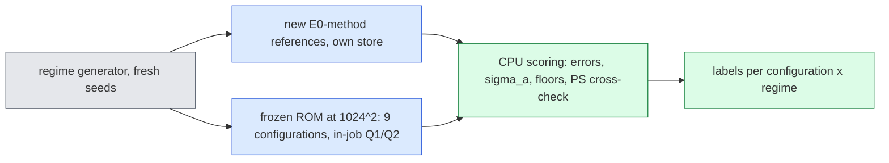

# jcp-regimes: where the frozen off-mesh ROM degrades outside its training distribution (viscous Burgers 2D)

**Status:** generated by `make_report.py` from `checks/analysis.json`; every accuracy number is a **conditional E0-style estimate** (reference uncertainty $\epsilon_{ref}$ is a conditional Richardson estimate; E0 A10 and combined A10/A11/A15 labels carried). Labels are **exploratory development evidence** without family-wise error control (DESIGN A1.8, A2.4). GPU-hours spent: 14.865 of 60.

**Selection qualification (A3.2):** reference eligibility depends on a tight-path allowance that differs between cohorts (N0 0, N0s 0, Ap 1, Am 0, C1 0, C2 0, B1 0, B2 0); cases unresolved under the allowance are excluded, and the direction of the resulting bias on ROM errors is unknown. Their counts are printed next to every coverage entry.

## Summary

- **A+ (ν above range)** (8 primary configurations; references eligible 14/16, 2 unresolved under the allowance): labels {'HOLDS': 1, 'IMPROVES': 1, 'INCONCLUSIVE': 6}; numerically qualified on this regime 8/8; median error 0.246 %–1.37 % (conditional E0-style estimate); median-error ratio to the in-range baseline 0.55–1.53; relabelled **viscosity extrapolation confounded with steepness**.
- **A− (ν below range)** (8 primary configurations; references eligible 16/16, 0 unresolved under the allowance): labels {'DEGRADES': 2, 'INCONCLUSIVE': 6}; numerically qualified on this regime 8/8; median error 0.883 %–4.17 % (conditional E0-style estimate); median-error ratio to the in-range baseline 1.63–9.25.
- **C1 (low ν, high s, paired with A−)** (8 primary configurations; references eligible 16/16, 0 unresolved under the allowance): labels {'NOT QUALIFIED': 8}; numerically qualified on this regime 0/8; median error 5.2 %–11.2 % (conditional E0-style estimate); median-error ratio to the in-range baseline 5.78–36.7.
- **C2 (lower ν, higher s)** (8 primary configurations; references eligible 16/16, 0 unresolved under the allowance): labels {'NOT QUALIFIED': 8}; numerically qualified on this regime 0/8; median error 12.7 %–25.1 % (conditional E0-style estimate); median-error ratio to the in-range baseline 14.2–131.
- **B1 (two same-sign bumps)** (8 primary configurations; references eligible 16/16, 0 unresolved under the allowance): labels {'HOLDS': 3, 'INCONCLUSIVE': 5}; numerically qualified on this regime 8/8; median error 0.2 %–1.15 % (conditional E0-style estimate); median-error ratio to the in-range baseline 0.989–1.55.
- **B2 (signed pair)** (8 primary configurations; references eligible 15/16, 0 unresolved under the allowance): labels {'INCONCLUSIVE': 8}; numerically qualified on this regime 8/8; median error 0.245 %–1.4 % (conditional E0-style estimate); median-error ratio to the in-range baseline 1.11–1.64.
- **N0s (stiff part of the training box)** (descriptive; references eligible 8/8, 0 unresolved under the allowance): labels {'DEGRADES': 8}; ratio 2.97–9.79 (conditional E0-style estimate): the stiff part of the training box is already far less accurate than the in-range mixture.
- **Representation floor** (diagnostic; best fit of each eligible reference by the R384 bank span; populations = eligible references per cohort as in the coverage table; same selection qualification): val32 0.0266 %, N0 0.0286 %, N0s 0.881 %, Ap 0.0052 %, Am 0.585 %, C1 3.47 %, C2 9.88 %, B1 0.0519 %, B2 0.0593 % (medians).
- **Plainly:** outside the training range in steepness (C1 and C2, low viscosity with high $s$), the frozen method is **not numerically qualified for any of the 8 primary configurations**: its errors there cannot be certified and it should not be used in that regime. (This is the Q1/Q2 outcome; the formal label FAILS is reserved for invalid runs, which occur only in the GAL diagnostic row on C2.)
- **Pseudo-spectral cross-check:** 7 of 7 scheduled cases PASS (E0 A10-amended rule, label carried).
- **Deferred, not run:** the 3D regimes (DESIGN A1.12: they need their own amendment) and the FOM accuracy comparison (A3.3 step 1).

Plots: `plots/median_by_regime.png`, `plots/error_vs_nu.png`, `plots/error_vs_s.png`, `plots/sigma_by_regime.png`.

## What went wrong during the lane (disclosed)

- The first smoke (smk1) stopped at an over-specified identity check (a GPU-reduction fingerprint); every other field matched; DESIGN A7 split the smoke and dropped that field.
- The H200 queue was saturated; A9 moved the ordinary jobs to A100-80G (no timing result is reported; GPU type is recorded per job) and replaced a pending refC1 by refC1b.
- The first analysis run stopped at an exact-hash identity check: generated descriptors differ by one or two ulps between node CPU types; A10 compares them to round-off instead. No result had been read.
- **Correction after results audit 1 (A11):** the scoring had inherited a validity rule that allows solver budget exits, contrary to DESIGN §7.1; corrected, it changes only the GAL-CN diagnostic row on C2 (now FAILS); no primary cell changed.
- Prior related evidence (not re-scored here; see LAB-LOG 2026-09-17, lane b-lowvisc): an earlier low-viscosity cohort also showed much larger linear-bank representation floors; this lane's floors point the same way for the low-ν regimes.

## Labels per configuration and regime (primary)

Rule (DESIGN §7, A1.8): FAILS (an invalid production run) ▸ NOT QUALIFIED (Q1 or Q2 fails on that regime's cases) ▸ IMPROVES / HOLDS / INCONCLUSIVE / DEGRADES from the 95 % bootstrap interval of the median-error ratio against the in-range baseline $I$ (factor 2), on reference-eligible valid cases. Every number below is a conditional E0-style estimate; exploratory; coverage, invalid runs and unresolved-under-allowance counts are printed in each cell.

| configuration | A+ (ν above range) | A− (ν below range) | C1 (low ν, high s, paired with A−) | C2 (lower ν, higher s) | B1 (two same-sign bumps) | B2 (signed pair) |
|---|---|---|---|---|---|---|
| R128\|LSPG_BE_1 | INCONCLUSIVE; ratio 1.37 [0.942, 2.1]; 14/16 used vs 52 baseline (2 baseline cases excluded, 0 N0 unresolved under the allowance); 2 unresolved under the allowance; viscosity extrapolation confounded with steepness | INCONCLUSIVE; ratio 3.89 [1.75, 6.71]; 16/16 used vs 52 baseline (2 baseline cases excluded, 0 N0 unresolved under the allowance); 0 unresolved under the allowance | NOT QUALIFIED [accuracy DEGRADES, unqualified]; ratio 9.29 [6.27, 16.4]; 16/16 used vs 52 baseline (2 baseline cases excluded, 0 N0 unresolved under the allowance); 0 unresolved under the allowance | NOT QUALIFIED [accuracy DEGRADES, unqualified]; ratio 18.6 [11.4, 28.9]; 16/16 used vs 52 baseline (2 baseline cases excluded, 0 N0 unresolved under the allowance); 0 unresolved under the allowance; not usable (median > 10 %) | INCONCLUSIVE; ratio 1.15 [0.714, 2.1]; 16/16 used vs 52 baseline (2 baseline cases excluded, 0 N0 unresolved under the allowance); 0 unresolved under the allowance | INCONCLUSIVE; ratio 1.41 [0.75, 2.33]; 15/16 used vs 52 baseline (2 baseline cases excluded, 0 N0 unresolved under the allowance); 0 unresolved under the allowance |
| R128\|LSPG_CNR_1 | IMPROVES; ratio 0.55 [0.402, 0.838]; 14/16 used vs 52 baseline (2 baseline cases excluded, 0 N0 unresolved under the allowance); 2 unresolved under the allowance; viscosity extrapolation confounded with steepness | DEGRADES; ratio 9.25 [3.43, 15.3]; 16/16 used vs 52 baseline (2 baseline cases excluded, 0 N0 unresolved under the allowance); 0 unresolved under the allowance | NOT QUALIFIED [accuracy DEGRADES, unqualified]; ratio 24.8 [15.5, 40.8]; 16/16 used vs 52 baseline (2 baseline cases excluded, 0 N0 unresolved under the allowance); 0 unresolved under the allowance; not usable (median > 10 %) | NOT QUALIFIED [accuracy DEGRADES, unqualified]; ratio 53.4 [28.4, 80.7]; 16/16 used vs 52 baseline (2 baseline cases excluded, 0 N0 unresolved under the allowance); 0 unresolved under the allowance; not usable (median > 10 %) | INCONCLUSIVE; ratio 1.55 [0.713, 3.24]; 16/16 used vs 52 baseline (2 baseline cases excluded, 0 N0 unresolved under the allowance); 0 unresolved under the allowance | INCONCLUSIVE; ratio 1.64 [0.924, 3.97]; 15/16 used vs 52 baseline (2 baseline cases excluded, 0 N0 unresolved under the allowance); 0 unresolved under the allowance |
| R256\|LSPG_BE_1 | INCONCLUSIVE; ratio 1.52 [1.07, 2.28]; 14/16 used vs 52 baseline (2 baseline cases excluded, 0 N0 unresolved under the allowance); 2 unresolved under the allowance; viscosity extrapolation confounded with steepness | INCONCLUSIVE; ratio 1.92 [0.891, 3.85]; 16/16 used vs 52 baseline (2 baseline cases excluded, 0 N0 unresolved under the allowance); 0 unresolved under the allowance | NOT QUALIFIED [accuracy DEGRADES, unqualified]; ratio 6.84 [4.31, 11.9]; 16/16 used vs 52 baseline (2 baseline cases excluded, 0 N0 unresolved under the allowance); 0 unresolved under the allowance | NOT QUALIFIED [accuracy DEGRADES, unqualified]; ratio 15.9 [7.77, 23.5]; 16/16 used vs 52 baseline (2 baseline cases excluded, 0 N0 unresolved under the allowance); 0 unresolved under the allowance; not usable (median > 10 %) | HOLDS; ratio 1.01 [0.677, 1.68]; 16/16 used vs 52 baseline (2 baseline cases excluded, 0 N0 unresolved under the allowance); 0 unresolved under the allowance | INCONCLUSIVE; ratio 1.11 [0.601, 2.14]; 15/16 used vs 52 baseline (2 baseline cases excluded, 0 N0 unresolved under the allowance); 0 unresolved under the allowance |
| R256\|LSPG_CNR_1 | HOLDS; ratio 1.24 [0.85, 1.82]; 14/16 used vs 52 baseline (2 baseline cases excluded, 0 N0 unresolved under the allowance); 2 unresolved under the allowance; viscosity extrapolation confounded with steepness | DEGRADES; ratio 7.64 [2.05, 16.8]; 16/16 used vs 52 baseline (2 baseline cases excluded, 0 N0 unresolved under the allowance); 0 unresolved under the allowance | NOT QUALIFIED [accuracy DEGRADES, unqualified]; ratio 36.2 [20.7, 65.6]; 16/16 used vs 52 baseline (2 baseline cases excluded, 0 N0 unresolved under the allowance); 0 unresolved under the allowance | NOT QUALIFIED [accuracy DEGRADES, unqualified]; ratio 95 [43.1, 146]; 16/16 used vs 52 baseline (2 baseline cases excluded, 0 N0 unresolved under the allowance); 0 unresolved under the allowance; not usable (median > 10 %) | INCONCLUSIVE; ratio 1.14 [0.672, 2.4]; 16/16 used vs 52 baseline (2 baseline cases excluded, 0 N0 unresolved under the allowance); 0 unresolved under the allowance | INCONCLUSIVE; ratio 1.38 [0.687, 3.16]; 15/16 used vs 52 baseline (2 baseline cases excluded, 0 N0 unresolved under the allowance); 0 unresolved under the allowance |
| R384\|GAL_CN_1 (diagnostic) | INCONCLUSIVE; ratio 1.77 [1.05, 10.2]; 14/16 used vs 52 baseline (2 baseline cases excluded, 0 N0 unresolved under the allowance); 2 unresolved under the allowance; viscosity extrapolation confounded with steepness | DEGRADES; ratio 18.1 [4.95, 43.9]; 16/16 used vs 52 baseline (2 baseline cases excluded, 0 N0 unresolved under the allowance); 0 unresolved under the allowance | NOT QUALIFIED [accuracy DEGRADES, unqualified]; ratio 133 [57, 222]; 16/16 used vs 52 baseline (2 baseline cases excluded, 0 N0 unresolved under the allowance); 0 unresolved under the allowance | FAILS [accuracy DEGRADES, unqualified]; ratio 433 [237, 677]; 14/16 used vs 52 baseline (2 baseline cases excluded, 0 N0 unresolved under the allowance); 0 unresolved under the allowance; not usable (median > 10 %); 2 invalid runs | INCONCLUSIVE; ratio 1.82 [0.809, 4.64]; 16/16 used vs 52 baseline (2 baseline cases excluded, 0 N0 unresolved under the allowance); 0 unresolved under the allowance | INCONCLUSIVE; ratio 1.96 [0.982, 5.95]; 15/16 used vs 52 baseline (2 baseline cases excluded, 0 N0 unresolved under the allowance); 0 unresolved under the allowance |
| R384\|LSPG_BE_1 | INCONCLUSIVE; ratio 1.53 [1.08, 2.28]; 14/16 used vs 52 baseline (2 baseline cases excluded, 0 N0 unresolved under the allowance); 2 unresolved under the allowance; viscosity extrapolation confounded with steepness | INCONCLUSIVE; ratio 1.63 [0.811, 3.01]; 16/16 used vs 52 baseline (2 baseline cases excluded, 0 N0 unresolved under the allowance); 0 unresolved under the allowance | NOT QUALIFIED [accuracy DEGRADES, unqualified]; ratio 5.78 [3.5, 9.69]; 16/16 used vs 52 baseline (2 baseline cases excluded, 0 N0 unresolved under the allowance); 0 unresolved under the allowance | NOT QUALIFIED [accuracy DEGRADES, unqualified]; ratio 14.2 [7.17, 20.5]; 16/16 used vs 52 baseline (2 baseline cases excluded, 0 N0 unresolved under the allowance); 0 unresolved under the allowance; not usable (median > 10 %) | HOLDS; ratio 0.989 [0.653, 1.67]; 16/16 used vs 52 baseline (2 baseline cases excluded, 0 N0 unresolved under the allowance); 0 unresolved under the allowance | INCONCLUSIVE; ratio 1.11 [0.603, 2.07]; 15/16 used vs 52 baseline (2 baseline cases excluded, 0 N0 unresolved under the allowance); 0 unresolved under the allowance |
| R384\|LSPG_CNR_1 | INCONCLUSIVE; ratio 1.28 [0.934, 2.19]; 14/16 used vs 52 baseline (2 baseline cases excluded, 0 N0 unresolved under the allowance); 2 unresolved under the allowance; viscosity extrapolation confounded with steepness | INCONCLUSIVE; ratio 4.6 [1.48, 13.2]; 16/16 used vs 52 baseline (2 baseline cases excluded, 0 N0 unresolved under the allowance); 0 unresolved under the allowance | NOT QUALIFIED [accuracy DEGRADES, unqualified]; ratio 29.6 [16.2, 58.7]; 16/16 used vs 52 baseline (2 baseline cases excluded, 0 N0 unresolved under the allowance); 0 unresolved under the allowance | NOT QUALIFIED [accuracy DEGRADES, unqualified]; ratio 86.6 [51.9, 153]; 16/16 used vs 52 baseline (2 baseline cases excluded, 0 N0 unresolved under the allowance); 0 unresolved under the allowance; not usable (median > 10 %) | INCONCLUSIVE; ratio 1.04 [0.556, 2.27]; 16/16 used vs 52 baseline (2 baseline cases excluded, 0 N0 unresolved under the allowance); 0 unresolved under the allowance | INCONCLUSIVE; ratio 1.28 [0.575, 2.6]; 15/16 used vs 52 baseline (2 baseline cases excluded, 0 N0 unresolved under the allowance); 0 unresolved under the allowance |
| R512\|LSPG_BE_1 | INCONCLUSIVE; ratio 1.53 [1.08, 2.25]; 14/16 used vs 52 baseline (2 baseline cases excluded, 0 N0 unresolved under the allowance); 2 unresolved under the allowance; viscosity extrapolation confounded with steepness | INCONCLUSIVE; ratio 1.74 [0.862, 3.49]; 16/16 used vs 52 baseline (2 baseline cases excluded, 0 N0 unresolved under the allowance); 0 unresolved under the allowance | NOT QUALIFIED [accuracy DEGRADES, unqualified]; ratio 6.34 [3.69, 11.4]; 16/16 used vs 52 baseline (2 baseline cases excluded, 0 N0 unresolved under the allowance); 0 unresolved under the allowance | NOT QUALIFIED [accuracy DEGRADES, unqualified]; ratio 17.8 [8.14, 27]; 16/16 used vs 52 baseline (2 baseline cases excluded, 0 N0 unresolved under the allowance); 0 unresolved under the allowance; not usable (median > 10 %) | HOLDS; ratio 1.05 [0.681, 1.67]; 16/16 used vs 52 baseline (2 baseline cases excluded, 0 N0 unresolved under the allowance); 0 unresolved under the allowance | INCONCLUSIVE; ratio 1.11 [0.608, 2.08]; 15/16 used vs 52 baseline (2 baseline cases excluded, 0 N0 unresolved under the allowance); 0 unresolved under the allowance |
| R512\|LSPG_CNR_1 | INCONCLUSIVE; ratio 1.28 [0.94, 2.07]; 14/16 used vs 52 baseline (2 baseline cases excluded, 0 N0 unresolved under the allowance); 2 unresolved under the allowance; viscosity extrapolation confounded with steepness | INCONCLUSIVE; ratio 5.73 [1.98, 17.9]; 16/16 used vs 52 baseline (2 baseline cases excluded, 0 N0 unresolved under the allowance); 0 unresolved under the allowance | NOT QUALIFIED [accuracy DEGRADES, unqualified]; ratio 36.7 [19.3, 77.6]; 16/16 used vs 52 baseline (2 baseline cases excluded, 0 N0 unresolved under the allowance); 0 unresolved under the allowance | NOT QUALIFIED [accuracy DEGRADES, unqualified]; ratio 131 [57.3, 235]; 16/16 used vs 52 baseline (2 baseline cases excluded, 0 N0 unresolved under the allowance); 0 unresolved under the allowance; not usable (median > 10 %) | INCONCLUSIVE; ratio 1.19 [0.581, 2.59]; 16/16 used vs 52 baseline (2 baseline cases excluded, 0 N0 unresolved under the allowance); 0 unresolved under the allowance | INCONCLUSIVE; ratio 1.43 [0.654, 3.13]; 15/16 used vs 52 baseline (2 baseline cases excluded, 0 N0 unresolved under the allowance); 0 unresolved under the allowance |

## Errors: medians, worst cases and ratios

*Numbers in this section: conditional E0-style estimates, exploratory development evidence; populations as printed.*

| configuration | baseline I median | baseline I worst | in-range consistency N0 / (dev6+val32) [95 %] | Ap median / worst / worst ratio | Am median / worst / worst ratio | C1 median / worst / worst ratio | C2 median / worst / worst ratio | B1 median / worst / worst ratio | B2 median / worst / worst ratio | N0s median / worst / worst ratio |
|---|---|---|---|---|---|---|---|---|---|---|
| R128\|LSPG_BE_1 | 0.999 % | 4.84 % | 0.692 [0.457, 1.48]; n 14 vs 38; N0 unresolved under the allowance 0 | 1.37 % / 1.82 % / 0.375 [INCONCLUSIVE; 14/16 used; 2 unresolved; viscosity extrapolation confounded with steepness] | 3.89 % / 12.8 % / 2.63 (worst degrades) [INCONCLUSIVE; 16/16 used; 0 unresolved] | 9.28 % / 20.6 % / 4.26 (worst degrades) [NOT QUALIFIED; 16/16 used; 0 unresolved] | 18.6 % / 26 % / 5.37 (worst degrades) [NOT QUALIFIED; 16/16 used; 0 unresolved; not usable] | 1.15 % / 3.85 % / 0.795 [INCONCLUSIVE; 16/16 used; 0 unresolved] | 1.4 % / 3.25 % / 0.67 [INCONCLUSIVE; 15/16 used; 0 unresolved] | 4.22 % / 6.13 % / 1.26 [DEGRADES; 8/8 used; 0 unresolved] |
| R128\|LSPG_CNR_1 | 0.45 % | 5.2 % | 1.09 [0.41, 1.86]; n 14 vs 38; N0 unresolved under the allowance 0 | 0.248 % / 0.319 % / 0.0612 [IMPROVES; 14/16 used; 2 unresolved; viscosity extrapolation confounded with steepness] | 4.17 % / 13 % / 2.5 (worst degrades) [DEGRADES; 16/16 used; 0 unresolved] | 11.2 % / 21.6 % / 4.16 (worst degrades) [NOT QUALIFIED; 16/16 used; 0 unresolved; not usable] | 24.1 % / 32.9 % / 6.34 (worst degrades) [NOT QUALIFIED; 16/16 used; 0 unresolved; not usable] | 0.698 % / 3.81 % / 0.734 [INCONCLUSIVE; 16/16 used; 0 unresolved] | 0.739 % / 2.84 % / 0.546 [INCONCLUSIVE; 15/16 used; 0 unresolved] | 4.14 % / 6.15 % / 1.18 [DEGRADES; 8/8 used; 0 unresolved] |
| R256\|LSPG_BE_1 | 0.902 % | 3.32 % | 0.649 [0.406, 1.24]; n 14 vs 38; N0 unresolved under the allowance 0 | 1.37 % / 1.82 % / 0.548 [INCONCLUSIVE; 14/16 used; 2 unresolved; viscosity extrapolation confounded with steepness] | 1.73 % / 6.04 % / 1.82 [INCONCLUSIVE; 16/16 used; 0 unresolved] | 6.17 % / 12.9 % / 3.87 (worst degrades) [NOT QUALIFIED; 16/16 used; 0 unresolved] | 14.3 % / 20.9 % / 6.29 (worst degrades) [NOT QUALIFIED; 16/16 used; 0 unresolved; not usable] | 0.912 % / 2.64 % / 0.796 [HOLDS; 16/16 used; 0 unresolved] | 1 % / 2.31 % / 0.697 [INCONCLUSIVE; 15/16 used; 0 unresolved] | 2.95 % / 4.06 % / 1.22 [DEGRADES; 8/8 used; 0 unresolved] |
| R256\|LSPG_CNR_1 | 0.198 % | 2.52 % | 0.78 [0.473, 1.68]; n 14 vs 38; N0 unresolved under the allowance 0 | 0.246 % / 0.311 % / 0.124 [HOLDS; 14/16 used; 2 unresolved; viscosity extrapolation confounded with steepness] | 1.51 % / 6.18 % / 2.45 (worst degrades) [DEGRADES; 16/16 used; 0 unresolved] | 7.16 % / 13.9 % / 5.52 (worst degrades) [NOT QUALIFIED; 16/16 used; 0 unresolved] | 18.8 % / 28.6 % / 11.4 (worst degrades) [NOT QUALIFIED; 16/16 used; 0 unresolved; not usable] | 0.226 % / 1.8 % / 0.717 [INCONCLUSIVE; 16/16 used; 0 unresolved] | 0.272 % / 1.26 % / 0.5 [INCONCLUSIVE; 15/16 used; 0 unresolved] | 1.9 % / 3.02 % / 1.2 [DEGRADES; 8/8 used; 0 unresolved] |
| R384\|GAL_CN_1 | 0.0495 % | 1.85 % | 0.831 [0.352, 2.15]; n 14 vs 38; N0 unresolved under the allowance 0 | 0.0876 % / 2.17 % / 1.17 [INCONCLUSIVE; 14/16 used; 2 unresolved; viscosity extrapolation confounded with steepness] | 0.896 % / 3.49 % / 1.89 [DEGRADES; 16/16 used; 0 unresolved] | 6.6 % / 12.9 % / 6.98 (worst degrades) [NOT QUALIFIED; 16/16 used; 0 unresolved] | 21.4 % / 66.5 % / 35.9 (worst degrades) [FAILS; 14/16 used; 0 unresolved; not usable] | 0.0902 % / 1.07 % / 0.578 [INCONCLUSIVE; 16/16 used; 0 unresolved] | 0.0971 % / 0.986 % / 0.533 [INCONCLUSIVE; 15/16 used; 0 unresolved] | 1.27 % / 2.17 % / 1.17 [DEGRADES; 8/8 used; 0 unresolved] |
| R384\|LSPG_BE_1 | 0.899 % | 3.01 % | 0.642 [0.408, 1.23]; n 14 vs 38; N0 unresolved under the allowance 0 | 1.37 % / 1.82 % / 0.604 [INCONCLUSIVE; 14/16 used; 2 unresolved; viscosity extrapolation confounded with steepness] | 1.46 % / 3.56 % / 1.18 [INCONCLUSIVE; 16/16 used; 0 unresolved] | 5.2 % / 9.79 % / 3.25 (worst degrades) [NOT QUALIFIED; 16/16 used; 0 unresolved] | 12.7 % / 18.8 % / 6.23 (worst degrades) [NOT QUALIFIED; 16/16 used; 0 unresolved; not usable] | 0.888 % / 2.32 % / 0.772 [HOLDS; 16/16 used; 0 unresolved] | 0.999 % / 2.28 % / 0.758 [INCONCLUSIVE; 15/16 used; 0 unresolved] | 2.67 % / 3.65 % / 1.21 [DEGRADES; 8/8 used; 0 unresolved] |
| R384\|LSPG_CNR_1 | 0.192 % | 1.78 % | 0.6 [0.412, 1.58]; n 14 vs 38; N0 unresolved under the allowance 0 | 0.246 % / 0.311 % / 0.175 [INCONCLUSIVE; 14/16 used; 2 unresolved; viscosity extrapolation confounded with steepness] | 0.883 % / 3.44 % / 1.94 [INCONCLUSIVE; 16/16 used; 0 unresolved] | 5.68 % / 10.8 % / 6.11 (worst degrades) [NOT QUALIFIED; 16/16 used; 0 unresolved] | 16.6 % / 30.4 % / 17.1 (worst degrades) [NOT QUALIFIED; 16/16 used; 0 unresolved; not usable] | 0.2 % / 1.01 % / 0.572 [INCONCLUSIVE; 16/16 used; 0 unresolved] | 0.245 % / 0.956 % / 0.538 [INCONCLUSIVE; 15/16 used; 0 unresolved] | 1.22 % / 2.15 % / 1.21 [DEGRADES; 8/8 used; 0 unresolved] |
| R512\|LSPG_BE_1 | 0.899 % | 3.09 % | 0.667 [0.408, 1.23]; n 14 vs 38; N0 unresolved under the allowance 0 | 1.37 % / 1.82 % / 0.588 [INCONCLUSIVE; 14/16 used; 2 unresolved; viscosity extrapolation confounded with steepness] | 1.57 % / 5.39 % / 1.74 [INCONCLUSIVE; 16/16 used; 0 unresolved] | 5.7 % / 12.8 % / 4.15 (worst degrades) [NOT QUALIFIED; 16/16 used; 0 unresolved] | 16 % / 25.3 % / 8.19 (worst degrades) [NOT QUALIFIED; 16/16 used; 0 unresolved; not usable] | 0.948 % / 2.31 % / 0.749 [HOLDS; 16/16 used; 0 unresolved] | 1 % / 2.37 % / 0.769 [INCONCLUSIVE; 15/16 used; 0 unresolved] | 2.76 % / 3.57 % / 1.16 [DEGRADES; 8/8 used; 0 unresolved] |
| R512\|LSPG_CNR_1 | 0.192 % | 2.17 % | 0.646 [0.448, 1.51]; n 14 vs 38; N0 unresolved under the allowance 0 | 0.246 % / 0.311 % / 0.144 [INCONCLUSIVE; 14/16 used; 2 unresolved; viscosity extrapolation confounded with steepness] | 1.1 % / 6.42 % / 2.96 (worst degrades) [INCONCLUSIVE; 16/16 used; 0 unresolved] | 7.05 % / 20.9 % / 9.66 (worst degrades) [NOT QUALIFIED; 16/16 used; 0 unresolved] | 25.1 % / 209 % / 96.4 (worst degrades) [NOT QUALIFIED; 16/16 used; 0 unresolved; not usable] | 0.229 % / 1.42 % / 0.657 [INCONCLUSIVE; 16/16 used; 0 unresolved] | 0.274 % / 1.3 % / 0.599 [INCONCLUSIVE; 15/16 used; 0 unresolved] | 1.88 % / 2.04 % / 0.941 [DEGRADES; 8/8 used; 0 unresolved] |

## N0s (stiff part of the training box, descriptive) and the N0-only sensitivity

*Numbers in this section: conditional E0-style estimates, exploratory development evidence; populations as printed.*

| configuration | N0s vs I | Ap vs N0 alone | Am vs N0 alone | C1 vs N0 alone | C2 vs N0 alone | B1 vs N0 alone | B2 vs N0 alone |
|---|---|---|---|---|---|---|---|
| R128\|LSPG_BE_1 | DEGRADES; ratio 4.23 [3, 6.23]; 8/8 used vs 52 baseline (2 baseline cases excluded, 0 N0 unresolved under the allowance); 0 unresolved under the allowance | INCONCLUSIVE; ratio 1.81 [0.937, 2.55]; 14/16 used vs 14 baseline (2 baseline cases excluded, 0 N0 unresolved under the allowance); 2 unresolved under the allowance; viscosity extrapolation confounded with steepness | INCONCLUSIVE; ratio 5.13 [1.86, 8.19]; 16/16 used vs 14 baseline (2 baseline cases excluded, 0 N0 unresolved under the allowance); 0 unresolved under the allowance | NOT QUALIFIED [accuracy DEGRADES, unqualified]; ratio 12.2 [6.35, 19.9]; 16/16 used vs 14 baseline (2 baseline cases excluded, 0 N0 unresolved under the allowance); 0 unresolved under the allowance | NOT QUALIFIED [accuracy DEGRADES, unqualified]; ratio 24.5 [11.6, 35.2]; 16/16 used vs 14 baseline (2 baseline cases excluded, 0 N0 unresolved under the allowance); 0 unresolved under the allowance; not usable (median > 10 %) | INCONCLUSIVE; ratio 1.52 [0.73, 2.6]; 16/16 used vs 14 baseline (2 baseline cases excluded, 0 N0 unresolved under the allowance); 0 unresolved under the allowance | INCONCLUSIVE; ratio 1.85 [0.805, 2.82]; 15/16 used vs 14 baseline (2 baseline cases excluded, 0 N0 unresolved under the allowance); 0 unresolved under the allowance |
| R128\|LSPG_CNR_1 | DEGRADES; ratio 9.18 [5.92, 14.2]; 8/8 used vs 52 baseline (2 baseline cases excluded, 0 N0 unresolved under the allowance); 0 unresolved under the allowance | HOLDS; ratio 0.505 [0.344, 1.2]; 14/16 used vs 14 baseline (2 baseline cases excluded, 0 N0 unresolved under the allowance); 2 unresolved under the allowance; viscosity extrapolation confounded with steepness | DEGRADES; ratio 8.49 [3.16, 22.7]; 16/16 used vs 14 baseline (2 baseline cases excluded, 0 N0 unresolved under the allowance); 0 unresolved under the allowance | NOT QUALIFIED [accuracy DEGRADES, unqualified]; ratio 22.8 [13.8, 62.4]; 16/16 used vs 14 baseline (2 baseline cases excluded, 0 N0 unresolved under the allowance); 0 unresolved under the allowance; not usable (median > 10 %) | NOT QUALIFIED [accuracy DEGRADES, unqualified]; ratio 49 [25.4, 119]; 16/16 used vs 14 baseline (2 baseline cases excluded, 0 N0 unresolved under the allowance); 0 unresolved under the allowance; not usable (median > 10 %) | INCONCLUSIVE; ratio 1.42 [0.663, 4.38]; 16/16 used vs 14 baseline (2 baseline cases excluded, 0 N0 unresolved under the allowance); 0 unresolved under the allowance | INCONCLUSIVE; ratio 1.51 [0.856, 4.96]; 15/16 used vs 14 baseline (2 baseline cases excluded, 0 N0 unresolved under the allowance); 0 unresolved under the allowance |
| R256\|LSPG_BE_1 | DEGRADES; ratio 3.27 [2.43, 4.72]; 8/8 used vs 52 baseline (2 baseline cases excluded, 0 N0 unresolved under the allowance); 0 unresolved under the allowance | INCONCLUSIVE; ratio 2.15 [1.16, 3.19]; 14/16 used vs 14 baseline (2 baseline cases excluded, 0 N0 unresolved under the allowance); 2 unresolved under the allowance; viscosity extrapolation confounded with steepness | INCONCLUSIVE; ratio 2.72 [1.05, 5.06]; 16/16 used vs 14 baseline (2 baseline cases excluded, 0 N0 unresolved under the allowance); 0 unresolved under the allowance | NOT QUALIFIED [accuracy DEGRADES, unqualified]; ratio 9.68 [5.13, 16.3]; 16/16 used vs 14 baseline (2 baseline cases excluded, 0 N0 unresolved under the allowance); 0 unresolved under the allowance | NOT QUALIFIED [accuracy DEGRADES, unqualified]; ratio 22.5 [8.99, 32.4]; 16/16 used vs 14 baseline (2 baseline cases excluded, 0 N0 unresolved under the allowance); 0 unresolved under the allowance; not usable (median > 10 %) | INCONCLUSIVE; ratio 1.43 [0.766, 2.37]; 16/16 used vs 14 baseline (2 baseline cases excluded, 0 N0 unresolved under the allowance); 0 unresolved under the allowance | INCONCLUSIVE; ratio 1.57 [0.711, 2.75]; 15/16 used vs 14 baseline (2 baseline cases excluded, 0 N0 unresolved under the allowance); 0 unresolved under the allowance |
| R256\|LSPG_CNR_1 | DEGRADES; ratio 9.6 [6.01, 14.8]; 8/8 used vs 52 baseline (2 baseline cases excluded, 0 N0 unresolved under the allowance); 0 unresolved under the allowance | INCONCLUSIVE; ratio 1.51 [0.775, 2.13]; 14/16 used vs 14 baseline (2 baseline cases excluded, 0 N0 unresolved under the allowance); 2 unresolved under the allowance; viscosity extrapolation confounded with steepness | INCONCLUSIVE; ratio 9.28 [1.92, 20.1]; 16/16 used vs 14 baseline (2 baseline cases excluded, 0 N0 unresolved under the allowance); 0 unresolved under the allowance | NOT QUALIFIED [accuracy DEGRADES, unqualified]; ratio 44 [21.2, 78]; 16/16 used vs 14 baseline (2 baseline cases excluded, 0 N0 unresolved under the allowance); 0 unresolved under the allowance | NOT QUALIFIED [accuracy DEGRADES, unqualified]; ratio 116 [40.4, 168]; 16/16 used vs 14 baseline (2 baseline cases excluded, 0 N0 unresolved under the allowance); 0 unresolved under the allowance; not usable (median > 10 %) | INCONCLUSIVE; ratio 1.39 [0.611, 2.79]; 16/16 used vs 14 baseline (2 baseline cases excluded, 0 N0 unresolved under the allowance); 0 unresolved under the allowance | INCONCLUSIVE; ratio 1.67 [0.617, 3.51]; 15/16 used vs 14 baseline (2 baseline cases excluded, 0 N0 unresolved under the allowance); 0 unresolved under the allowance |
| R384\|GAL_CN_1 | DEGRADES; ratio 25.6 [14.1, 38.8]; 8/8 used vs 52 baseline (2 baseline cases excluded, 0 N0 unresolved under the allowance); 0 unresolved under the allowance | INCONCLUSIVE; ratio 2.13 [0.861, 13.2]; 14/16 used vs 14 baseline (2 baseline cases excluded, 0 N0 unresolved under the allowance); 2 unresolved under the allowance; viscosity extrapolation confounded with steepness | DEGRADES; ratio 21.8 [4.4, 65.3]; 16/16 used vs 14 baseline (2 baseline cases excluded, 0 N0 unresolved under the allowance); 0 unresolved under the allowance | NOT QUALIFIED [accuracy DEGRADES, unqualified]; ratio 161 [49.7, 330]; 16/16 used vs 14 baseline (2 baseline cases excluded, 0 N0 unresolved under the allowance); 0 unresolved under the allowance | FAILS [accuracy DEGRADES, unqualified]; ratio 521 [181, 985]; 14/16 used vs 14 baseline (2 baseline cases excluded, 0 N0 unresolved under the allowance); 0 unresolved under the allowance; not usable (median > 10 %); 2 invalid runs | INCONCLUSIVE; ratio 2.19 [0.672, 6.26]; 16/16 used vs 14 baseline (2 baseline cases excluded, 0 N0 unresolved under the allowance); 0 unresolved under the allowance | INCONCLUSIVE; ratio 2.36 [0.821, 7.31]; 15/16 used vs 14 baseline (2 baseline cases excluded, 0 N0 unresolved under the allowance); 0 unresolved under the allowance |
| R384\|LSPG_BE_1 | DEGRADES; ratio 2.97 [2.23, 4.32]; 8/8 used vs 52 baseline (2 baseline cases excluded, 0 N0 unresolved under the allowance); 0 unresolved under the allowance | INCONCLUSIVE; ratio 2.19 [1.17, 3.22]; 14/16 used vs 14 baseline (2 baseline cases excluded, 0 N0 unresolved under the allowance); 2 unresolved under the allowance; viscosity extrapolation confounded with steepness | INCONCLUSIVE; ratio 2.33 [0.955, 4.08]; 16/16 used vs 14 baseline (2 baseline cases excluded, 0 N0 unresolved under the allowance); 0 unresolved under the allowance | NOT QUALIFIED [accuracy DEGRADES, unqualified]; ratio 8.28 [4.16, 13.5]; 16/16 used vs 14 baseline (2 baseline cases excluded, 0 N0 unresolved under the allowance); 0 unresolved under the allowance | NOT QUALIFIED [accuracy DEGRADES, unqualified]; ratio 20.3 [8.45, 28.2]; 16/16 used vs 14 baseline (2 baseline cases excluded, 0 N0 unresolved under the allowance); 0 unresolved under the allowance; not usable (median > 10 %) | INCONCLUSIVE; ratio 1.42 [0.74, 2.34]; 16/16 used vs 14 baseline (2 baseline cases excluded, 0 N0 unresolved under the allowance); 0 unresolved under the allowance | INCONCLUSIVE; ratio 1.59 [0.7, 2.67]; 15/16 used vs 14 baseline (2 baseline cases excluded, 0 N0 unresolved under the allowance); 0 unresolved under the allowance |
| R384\|LSPG_CNR_1 | DEGRADES; ratio 6.36 [4.23, 11]; 8/8 used vs 52 baseline (2 baseline cases excluded, 0 N0 unresolved under the allowance); 0 unresolved under the allowance | INCONCLUSIVE; ratio 2.07 [0.923, 2.71]; 14/16 used vs 14 baseline (2 baseline cases excluded, 0 N0 unresolved under the allowance); 2 unresolved under the allowance; viscosity extrapolation confounded with steepness | INCONCLUSIVE; ratio 7.44 [1.55, 16.9]; 16/16 used vs 14 baseline (2 baseline cases excluded, 0 N0 unresolved under the allowance); 0 unresolved under the allowance | NOT QUALIFIED [accuracy DEGRADES, unqualified]; ratio 47.9 [19.6, 75.8]; 16/16 used vs 14 baseline (2 baseline cases excluded, 0 N0 unresolved under the allowance); 0 unresolved under the allowance | NOT QUALIFIED [accuracy DEGRADES, unqualified]; ratio 140 [52.6, 190]; 16/16 used vs 14 baseline (2 baseline cases excluded, 0 N0 unresolved under the allowance); 0 unresolved under the allowance; not usable (median > 10 %) | INCONCLUSIVE; ratio 1.69 [0.58, 2.93]; 16/16 used vs 14 baseline (2 baseline cases excluded, 0 N0 unresolved under the allowance); 0 unresolved under the allowance | INCONCLUSIVE; ratio 2.06 [0.592, 3.39]; 15/16 used vs 14 baseline (2 baseline cases excluded, 0 N0 unresolved under the allowance); 0 unresolved under the allowance |
| R512\|LSPG_BE_1 | DEGRADES; ratio 3.07 [2.27, 4.43]; 8/8 used vs 52 baseline (2 baseline cases excluded, 0 N0 unresolved under the allowance); 0 unresolved under the allowance | INCONCLUSIVE; ratio 2.1 [1.17, 3.2]; 14/16 used vs 14 baseline (2 baseline cases excluded, 0 N0 unresolved under the allowance); 2 unresolved under the allowance; viscosity extrapolation confounded with steepness | INCONCLUSIVE; ratio 2.4 [1.02, 4.66]; 16/16 used vs 14 baseline (2 baseline cases excluded, 0 N0 unresolved under the allowance); 0 unresolved under the allowance | NOT QUALIFIED [accuracy DEGRADES, unqualified]; ratio 8.72 [4.46, 15.2]; 16/16 used vs 14 baseline (2 baseline cases excluded, 0 N0 unresolved under the allowance); 0 unresolved under the allowance | NOT QUALIFIED [accuracy DEGRADES, unqualified]; ratio 24.5 [9.56, 37.2]; 16/16 used vs 14 baseline (2 baseline cases excluded, 0 N0 unresolved under the allowance); 0 unresolved under the allowance; not usable (median > 10 %) | INCONCLUSIVE; ratio 1.45 [0.778, 2.4]; 16/16 used vs 14 baseline (2 baseline cases excluded, 0 N0 unresolved under the allowance); 0 unresolved under the allowance | INCONCLUSIVE; ratio 1.53 [0.693, 2.71]; 15/16 used vs 14 baseline (2 baseline cases excluded, 0 N0 unresolved under the allowance); 0 unresolved under the allowance |
| R512\|LSPG_CNR_1 | DEGRADES; ratio 9.79 [6.09, 15.5]; 8/8 used vs 52 baseline (2 baseline cases excluded, 0 N0 unresolved under the allowance); 0 unresolved under the allowance | INCONCLUSIVE; ratio 1.91 [0.867, 2.44]; 14/16 used vs 14 baseline (2 baseline cases excluded, 0 N0 unresolved under the allowance); 2 unresolved under the allowance; viscosity extrapolation confounded with steepness | DEGRADES; ratio 8.55 [2.28, 21.8]; 16/16 used vs 14 baseline (2 baseline cases excluded, 0 N0 unresolved under the allowance); 0 unresolved under the allowance | NOT QUALIFIED [accuracy DEGRADES, unqualified]; ratio 54.8 [22.2, 97]; 16/16 used vs 14 baseline (2 baseline cases excluded, 0 N0 unresolved under the allowance); 0 unresolved under the allowance | NOT QUALIFIED [accuracy DEGRADES, unqualified]; ratio 195 [59.3, 285]; 16/16 used vs 14 baseline (2 baseline cases excluded, 0 N0 unresolved under the allowance); 0 unresolved under the allowance; not usable (median > 10 %) | INCONCLUSIVE; ratio 1.78 [0.598, 3.22]; 16/16 used vs 14 baseline (2 baseline cases excluded, 0 N0 unresolved under the allowance); 0 unresolved under the allowance | INCONCLUSIVE; ratio 2.13 [0.663, 3.48]; 15/16 used vs 14 baseline (2 baseline cases excluded, 0 N0 unresolved under the allowance); 0 unresolved under the allowance |

## Reference qualifications

- Calibration probe (A2.2, A3.1): smoke agreement True; production probes 0 of 0 expected; no extra label.
- Separation check, A+ (ν above range): {"n": 14, "frac_in_range": 0.14285714285714285, "passed": false} → relabelled **viscosity extrapolation confounded with steepness**.
- Separation check, A− (ν below range): {"n": 16, "frac_in_range": 0.9375, "passed": true}.
- Separation check, C1 (low ν, high s, paired with A−): {"n": 16, "frac_above_q90": 0.75, "median": 33.92296284428009, "median_Am": 11.868157865389072, "passed": true}.
- Separation check, C2 (lower ν, higher s): {"n": 16, "median": 78.54366682425925, "median_C1": 33.92296284428009, "passed": true}.
- Separation check, B1 (two same-sign bumps): {"n": 16, "frac_in_range": 0.9375, "passed": true}.
- Separation check, B2 (signed pair): {"n": 15, "frac_in_range": 0.8, "passed": true}.
- Pseudo-spectral cross-check: 7 of 7 scheduled cases present.
- Pseudo-spectral cross-check Am|5: PASS; distance to the reference $x_{ps}$ = 6.82e-06, bound $2\epsilon_{ref}$ = 1.37e-05 (E0 A10-amended rule, label carried).
- Pseudo-spectral cross-check Ap|7: PASS; distance to the reference $x_{ps}$ = 4.11e-06, bound $2\epsilon_{ref}$ = 8.24e-06 (E0 A10-amended rule, label carried).
- Pseudo-spectral cross-check B1|0: PASS; distance to the reference $x_{ps}$ = 4.98e-06, bound $2\epsilon_{ref}$ = 9.97e-06 (E0 A10-amended rule, label carried).
- Pseudo-spectral cross-check B2|15: PASS; distance to the reference $x_{ps}$ = 6.96e-06, bound $2\epsilon_{ref}$ = 1.39e-05 (E0 A10-amended rule, label carried).
- Pseudo-spectral cross-check C1|11: PASS; distance to the reference $x_{ps}$ = 2.21e-05, bound $2\epsilon_{ref}$ = 4.38e-05 (E0 A10-amended rule, label carried).
- Pseudo-spectral cross-check C2|9: PASS; distance to the reference $x_{ps}$ = 2.65e-05, bound $2\epsilon_{ref}$ = 5.22e-05 (E0 A10-amended rule, label carried).
- Pseudo-spectral cross-check N0|2: PASS; distance to the reference $x_{ps}$ = 3.48e-06, bound $2\epsilon_{ref}$ = 6.83e-06 (E0 A10-amended rule, label carried).

## Paired A−/C1 contrast and distance trends

*Numbers in this section: conditional E0-style estimates, exploratory development evidence; populations as printed.*

Paired: amplitude raised at matched geometry and viscosity (A1.1), not a pure stiffness mechanism; both cohorts' separation labels apply. Trends are descriptive (Spearman, permutation p; OLS slope of $\log_{10}$ error per unit).

| configuration | pairs | median q = e_C1/e_A− [95 %] | Wilcoxon p | label | A+ vs d_ν (viscosity extrapolation confounded with steepness) | A− vs d_ν | A−∪C1∪C2 vs log10 s |
|---|---|---|---|---|---|---|---|
| R128\|LSPG_BE_1 | 16 | 2.58 [1.94, 3.85] | 3.05e-05 | INCONCLUSIVE; Am: INCONCLUSIVE, 0 invalid, 0 excluded, 0 unresolved; C1: NOT QUALIFIED, 0 invalid, 0 excluded, 0 unresolved | ρ 0.569, p 0.0336, slope 0.284, n 14 | ρ 0.403, p 0.117, slope 1.2, n 16 | ρ 0.883, p 0.0001, slope 1.08, n 48 |
| R128\|LSPG_CNR_1 | 16 | 3.06 [2.31, 5.05] | 3.05e-05 | DEGRADES; Am: DEGRADES, 0 invalid, 0 excluded, 0 unresolved; C1: NOT QUALIFIED, 0 invalid, 0 excluded, 0 unresolved | ρ 0.644, p 0.0134, slope 0.184, n 14 | ρ 0.403, p 0.117, slope 1.24, n 16 | ρ 0.898, p 0.0001, slope 1.22, n 48 |
| R256\|LSPG_BE_1 | 16 | 3.59 [2.59, 5.55] | 3.05e-05 | DEGRADES; Am: INCONCLUSIVE, 0 invalid, 0 excluded, 0 unresolved; C1: NOT QUALIFIED, 0 invalid, 0 excluded, 0 unresolved | ρ 0.569, p 0.0336, slope 0.285, n 14 | ρ 0.474, p 0.0636, slope 1.3, n 16 | ρ 0.89, p 0.0001, slope 1.34, n 48 |
| R256\|LSPG_CNR_1 | 16 | 4.51 [2.93, 10.1] | 3.05e-05 | DEGRADES; Am: DEGRADES, 0 invalid, 0 excluded, 0 unresolved; C1: NOT QUALIFIED, 0 invalid, 0 excluded, 0 unresolved | ρ 0.635, p 0.0161, slope 0.261, n 14 | ρ 0.344, p 0.186, slope 1.44, n 16 | ρ 0.902, p 0.0001, slope 1.67, n 48 |
| R384\|GAL_CN_1 | 16 | 5.21 [3.89, 13.8] | 3.05e-05 | DEGRADES; Am: DEGRADES, 0 invalid, 0 excluded, 0 unresolved; C1: NOT QUALIFIED, 0 invalid, 0 excluded, 0 unresolved | ρ 0.56, p 0.0405, slope 1.61, n 14 | ρ 0.465, p 0.0683, slope 1.79, n 16 | ρ 0.932, p 0.0001, slope 2.19, n 46 |
| R384\|LSPG_BE_1 | 16 | 3.4 [2.77, 4.22] | 3.05e-05 | DEGRADES; Am: INCONCLUSIVE, 0 invalid, 0 excluded, 0 unresolved; C1: NOT QUALIFIED, 0 invalid, 0 excluded, 0 unresolved | ρ 0.569, p 0.0336, slope 0.286, n 14 | ρ 0.429, p 0.0923, slope 1.04, n 16 | ρ 0.909, p 0.0001, slope 1.36, n 48 |
| R384\|LSPG_CNR_1 | 16 | 4.7 [3.43, 12] | 3.05e-05 | DEGRADES; Am: INCONCLUSIVE, 0 invalid, 0 excluded, 0 unresolved; C1: NOT QUALIFIED, 0 invalid, 0 excluded, 0 unresolved | ρ 0.635, p 0.0161, slope 0.263, n 14 | ρ 0.45, p 0.0783, slope 1.72, n 16 | ρ 0.927, p 0.0001, slope 1.94, n 48 |
| R512\|LSPG_BE_1 | 16 | 3.42 [2.51, 4.99] | 3.05e-05 | DEGRADES; Am: INCONCLUSIVE, 0 invalid, 0 excluded, 0 unresolved; C1: NOT QUALIFIED, 0 invalid, 0 excluded, 0 unresolved | ρ 0.569, p 0.0336, slope 0.286, n 14 | ρ 0.421, p 0.101, slope 1.2, n 16 | ρ 0.899, p 0.0001, slope 1.46, n 48 |
| R512\|LSPG_CNR_1 | 16 | 5.19 [3.43, 11.3] | 3.05e-05 | DEGRADES; Am: INCONCLUSIVE, 0 invalid, 0 excluded, 0 unresolved; C1: NOT QUALIFIED, 0 invalid, 0 excluded, 0 unresolved | ρ 0.635, p 0.0161, slope 0.264, n 14 | ρ 0.4, p 0.12, slope 1.85, n 16 | ρ 0.92, p 0.0001, slope 2.1, n 48 |

## Q1 / Q2 per configuration and regime (every sampled case)

*Numbers in this section: conditional E0-style estimates, exploratory development evidence; populations as printed.*

| configuration | A+ (ν above range) | A− (ν below range) | C1 (low ν, high s, paired with A−) | C2 (lower ν, higher s) | B1 (two same-sign bumps) | B2 (signed pair) | N0s (stiff part of the training box) |
|---|---|---|---|---|---|---|---|
| R128\|LSPG_BE_1 | Q1 pass (non-stationary 0/800); Q2 pass (successor distance 2.49e-07, ρ max 0.0581, check distance 7.48e-08, successor valid True, check valid True) | Q1 pass (non-stationary 0/800); Q2 pass (successor distance 0.000222, ρ max 0.056, check distance 1.31e-05, successor valid True, check valid True) | Q1 pass (non-stationary 0/800); Q2 fail (successor distance 0.00108, ρ max 0.056, check distance 0.000465, successor valid True, check valid True) | Q1 fail: distance (non-stationary 0/800); Q2 fail (successor distance 0.00359, ρ max 0.101, check distance 0.000595, successor valid True, check valid True) | Q1 pass (non-stationary 0/800); Q2 pass (successor distance 4.1e-05, ρ max 0.0572, check distance 5.23e-06, successor valid True, check valid True) | Q1 pass (non-stationary 0/800); Q2 pass (successor distance 6.9e-05, ρ max 0.0806, check distance 2.06e-05, successor valid True, check valid True) | Q1 pass (non-stationary 0/400); Q2 pass (successor distance 0.00014, ρ max 0.0378, check distance 1.61e-05, successor valid True, check valid True) |
| R128\|LSPG_CNR_1 | Q1 pass (non-stationary 0/800); Q2 pass (successor distance 2.44e-07, ρ max 0.0581, check distance 7.18e-08, successor valid True, check valid True) | Q1 pass (non-stationary 0/800); Q2 pass (successor distance 0.000237, ρ max 0.056, check distance 1.4e-05, successor valid True, check valid True) | Q1 pass (non-stationary 0/800); Q2 fail (successor distance 0.00121, ρ max 0.056, check distance 0.000515, successor valid True, check valid True) | Q1 pass (non-stationary 0/800); Q2 fail (successor distance 0.00381, ρ max 0.0952, check distance 0.000706, successor valid True, check valid True) | Q1 pass (non-stationary 0/800); Q2 pass (successor distance 4.43e-05, ρ max 0.0572, check distance 5.5e-06, successor valid True, check valid True) | Q1 pass (non-stationary 0/800); Q2 pass (successor distance 9.7e-05, ρ max 0.0806, check distance 2.14e-05, successor valid True, check valid True) | Q1 pass (non-stationary 0/400); Q2 pass (successor distance 0.000147, ρ max 0.0378, check distance 2.28e-05, successor valid True, check valid True) |
| R256\|LSPG_BE_1 | Q1 pass (non-stationary 0/800); Q2 pass (successor distance 5.35e-07, ρ max 0.0161, check distance 4.72e-08, successor valid True, check valid True) | Q1 pass (non-stationary 0/800); Q2 pass (successor distance 0.000158, ρ max 0.0173, check distance 1.03e-05, successor valid True, check valid True) | Q1 fail: distance (non-stationary 0/800); Q2 fail (successor distance 0.000538, ρ max 0.0173, check distance 0.000226, successor valid True, check valid True) | Q1 fail: distance (non-stationary 0/800); Q2 fail (successor distance 0.00238, ρ max 0.0143, check distance 0.000439, successor valid True, check valid True) | Q1 pass (non-stationary 0/800); Q2 pass (successor distance 2.62e-05, ρ max 0.0256, check distance 1.74e-06, successor valid True, check valid True) | Q1 pass (non-stationary 0/800); Q2 pass (successor distance 2.91e-05, ρ max 0.0215, check distance 6.44e-06, successor valid True, check valid True) | Q1 pass (non-stationary 0/400); Q2 pass (successor distance 3.11e-05, ρ max 0.0101, check distance 9.88e-06, successor valid True, check valid True) |
| R256\|LSPG_CNR_1 | Q1 pass (non-stationary 0/800); Q2 pass (successor distance 5.04e-07, ρ max 0.0161, check distance 4.43e-08, successor valid True, check valid True) | Q1 pass (non-stationary 0/800); Q2 pass (successor distance 0.000166, ρ max 0.0173, check distance 1.07e-05, successor valid True, check valid True) | Q1 fail: distance (non-stationary 0/800); Q2 fail (successor distance 0.00161, ρ max 0.0173, check distance 0.000261, successor valid True, check valid True) | Q1 fail: distance (non-stationary 0/800); Q2 fail (successor distance 0.00522, ρ max 0.0132, check distance 0.00102, successor valid True, check valid True) | Q1 pass (non-stationary 0/800); Q2 pass (successor distance 2.81e-05, ρ max 0.0256, check distance 2.22e-06, successor valid True, check valid True) | Q1 pass (non-stationary 0/800); Q2 pass (successor distance 3.2e-05, ρ max 0.0215, check distance 6.54e-06, successor valid True, check valid True) | Q1 pass (non-stationary 0/400); Q2 pass (successor distance 3.7e-05, ρ max 0.0101, check distance 1.5e-05, successor valid True, check valid True) |
| R384\|GAL_CN_1 | Q1 pass (non-stationary 0/800); Q2 pass (successor distance 7.56e-06, ρ max 0.0205, check distance 1.73e-06, successor valid True, check valid True) | Q1 pass (non-stationary 0/800); Q2 pass (successor distance 7.71e-05, ρ max 0.0214, check distance 1.48e-05, successor valid True, check valid True) | Q1 pass (non-stationary 0/800); Q2 fail (successor distance 0.00291, ρ max 0.0214, check distance 0.000351, successor valid True, check valid True) | Q1 fail: certificate, distance (non-stationary 12/800); Q2 fail (successor distance 1.53, ρ max 0.0325, check distance 0.0169, successor valid True, check valid True) | Q1 pass (non-stationary 0/800); Q2 pass (successor distance 4.22e-05, ρ max 0.0297, check distance 7.26e-06, successor valid True, check valid True) | Q1 pass (non-stationary 0/800); Q2 pass (successor distance 7.89e-05, ρ max 0.0286, check distance 4.57e-06, successor valid True, check valid True) | Q1 pass (non-stationary 0/400); Q2 pass (successor distance 6.3e-05, ρ max 0.00899, check distance 1.36e-05, successor valid True, check valid True) |
| R384\|LSPG_BE_1 | Q1 pass (non-stationary 0/800); Q2 pass (successor distance 3.59e-07, ρ max 0.0205, check distance 3.25e-08, successor valid True, check valid True) | Q1 pass (non-stationary 0/800); Q2 pass (successor distance 8.04e-05, ρ max 0.0214, check distance 1.2e-05, successor valid True, check valid True) | Q1 fail: distance (non-stationary 0/800); Q2 fail (successor distance 0.00103, ρ max 0.0214, check distance 0.00028, successor valid True, check valid True) | Q1 fail: distance (non-stationary 0/800); Q2 fail (successor distance 0.00372, ρ max 0.0221, check distance 0.00104, successor valid True, check valid True) | Q1 pass (non-stationary 0/800); Q2 pass (successor distance 1.71e-05, ρ max 0.0297, check distance 5.41e-06, successor valid True, check valid True) | Q1 pass (non-stationary 0/800); Q2 pass (successor distance 6.75e-05, ρ max 0.0286, check distance 4.66e-06, successor valid True, check valid True) | Q1 pass (non-stationary 0/400); Q2 pass (successor distance 3.37e-05, ρ max 0.00899, check distance 6.76e-06, successor valid True, check valid True) |
| R384\|LSPG_CNR_1 | Q1 pass (non-stationary 0/800); Q2 pass (successor distance 3.48e-07, ρ max 0.0205, check distance 3.25e-08, successor valid True, check valid True) | Q1 pass (non-stationary 0/800); Q2 pass (successor distance 8.28e-05, ρ max 0.0214, check distance 1.45e-05, successor valid True, check valid True) | Q1 fail: distance (non-stationary 0/800); Q2 fail (successor distance 0.00228, ρ max 0.0214, check distance 0.000317, successor valid True, check valid True) | Q1 fail: distance (non-stationary 0/800); Q2 fail (successor distance 0.0175, ρ max 0.024, check distance 0.00214, successor valid True, check valid True) | Q1 pass (non-stationary 0/800); Q2 pass (successor distance 1.8e-05, ρ max 0.0297, check distance 6.24e-06, successor valid True, check valid True) | Q1 pass (non-stationary 0/800); Q2 pass (successor distance 8.53e-05, ρ max 0.0286, check distance 4.96e-06, successor valid True, check valid True) | Q1 pass (non-stationary 0/400); Q2 pass (successor distance 5.63e-05, ρ max 0.00899, check distance 1.27e-05, successor valid True, check valid True) |
| R512\|LSPG_BE_1 | Q1 pass (non-stationary 0/800); Q2 pass (successor distance 6.64e-08, ρ max 0.00262, check distance 3.46e-09, successor valid True, check valid True) | Q1 pass (non-stationary 0/800); Q2 pass (successor distance 0.000101, ρ max 0.0028, check distance 6.61e-06, successor valid True, check valid True) | Q1 fail: distance (non-stationary 0/800); Q2 fail (successor distance 0.00234, ρ max 0.0145, check distance 8.21e-05, successor valid True, check valid True) | Q1 fail: distance (non-stationary 0/800); Q2 fail (successor distance 0.014, ρ max 0.0236, check distance 0.00153, successor valid True, check valid True) | Q1 pass (non-stationary 0/800); Q2 pass (successor distance 1.23e-05, ρ max 0.0111, check distance 1.72e-06, successor valid True, check valid True) | Q1 pass (non-stationary 0/800); Q2 pass (successor distance 2.69e-05, ρ max 0.0143, check distance 3.59e-06, successor valid True, check valid True) | Q1 pass (non-stationary 0/400); Q2 pass (successor distance 3.09e-05, ρ max 0.00363, check distance 7.09e-06, successor valid True, check valid True) |
| R512\|LSPG_CNR_1 | Q1 pass (non-stationary 0/800); Q2 pass (successor distance 6.82e-08, ρ max 0.00262, check distance 3.1e-09, successor valid True, check valid True) | Q1 pass (non-stationary 0/800); Q2 pass (successor distance 0.000169, ρ max 0.0028, check distance 9.63e-06, successor valid True, check valid True) | Q1 fail: distance (non-stationary 0/800); Q2 fail (successor distance 0.00769, ρ max 0.0312, check distance 0.000127, successor valid True, check valid True) | Q1 fail: distance, tight_tighter (non-stationary 0/800); Q2 fail (successor distance 2.46, ρ max 0.0366, check distance 0.00636, successor valid True, check valid True) | Q1 pass (non-stationary 0/800); Q2 pass (successor distance 2.18e-05, ρ max 0.0111, check distance 4.07e-06, successor valid True, check valid True) | Q1 pass (non-stationary 0/800); Q2 pass (successor distance 4.07e-05, ρ max 0.0143, check distance 5.03e-06, successor valid True, check valid True) | Q1 pass (non-stationary 0/400); Q2 pass (successor distance 5.97e-05, ρ max 0.00363, check distance 1.3e-05, successor valid True, check valid True) |

## Representation floor (lattice projection on the bank span, diagnostic)

*Numbers in this section: conditional E0-style estimates, exploratory development evidence; populations as printed.*

| cohort \| width | median | max | n |
|---|---|---|---|
| N0\|R128 | 0.38 % | 2.41 % | 14 |
| N0\|R256 | 0.0628 % | 0.817 % | 14 |
| N0\|R384 | 0.0286 % | 0.407 % | 14 |
| N0\|R512 | 0.0244 % | 0.338 % | 14 |
| N0s\|R128 | 3.6 % | 5.39 % | 8 |
| N0s\|R256 | 1.62 % | 2.47 % | 8 |
| N0s\|R384 | 0.881 % | 1.63 % | 8 |
| N0s\|R512 | 0.722 % | 1.4 % | 8 |
| Ap\|R128 | 0.0615 % | 0.12 % | 14 |
| Ap\|R256 | 0.0109 % | 0.0189 % | 14 |
| Ap\|R384 | 0.0052 % | 0.0115 % | 14 |
| Ap\|R512 | 0.00471 % | 0.0111 % | 14 |
| Am\|R128 | 3.18 % | 11.4 % | 16 |
| Am\|R256 | 1.14 % | 4.76 % | 16 |
| Am\|R384 | 0.585 % | 2.5 % | 16 |
| Am\|R512 | 0.436 % | 2.27 % | 16 |
| C1\|R128 | 8.15 % | 18.7 % | 16 |
| C1\|R256 | 4.83 % | 10.5 % | 16 |
| C1\|R384 | 3.47 % | 7.34 % | 16 |
| C1\|R512 | 3.21 % | 6.58 % | 16 |
| C2\|R128 | 15.6 % | 22.2 % | 16 |
| C2\|R256 | 11.7 % | 16.8 % | 16 |
| C2\|R384 | 9.88 % | 14 % | 16 |
| C2\|R512 | 9.25 % | 12.9 % | 16 |
| B1\|R128 | 0.628 % | 3.25 % | 16 |
| B1\|R256 | 0.11 % | 1.55 % | 16 |
| B1\|R384 | 0.0519 % | 0.804 % | 16 |
| B1\|R512 | 0.0437 % | 0.606 % | 16 |
| B2\|R128 | 0.694 % | 2.58 % | 15 |
| B2\|R256 | 0.136 % | 1.03 % | 15 |
| B2\|R384 | 0.0593 % | 0.765 % | 15 |
| B2\|R512 | 0.0554 % | 0.721 % | 15 |
| dev6\|R128 | 0.605 % | 2.36 % | 6 |
| dev6\|R256 | 0.0932 % | 0.794 % | 6 |
| dev6\|R384 | 0.0468 % | 0.294 % | 6 |
| dev6\|R512 | 0.0441 % | 0.195 % | 6 |
| val32\|R128 | 0.351 % | 4.15 % | 32 |
| val32\|R256 | 0.0625 % | 2.1 % | 32 |
| val32\|R384 | 0.0266 % | 1.29 % | 32 |
| val32\|R512 | 0.0248 % | 1.11 % | 32 |

## Coverage of the references

| cohort | sampled | eligible | refined | tight path used | unresolved under the tight allowance | outcomes |
|---|---|---|---|---|---|---|
| dev6 | 6 | 6 | — | — | — | — |
| val32 | 32 | 32 | — | — | — | — |
| N0 | 16 | 14 | 2 | 0 | 0 | accepted: 14, order-fail: 2 |
| N0s | 8 | 8 | 0 | 0 | 0 | accepted: 8 |
| Ap | 16 | 14 | 2 | 0 | 2 | accepted: 14, unresolved-floor: 2 |
| Am | 16 | 16 | 0 | 0 | 0 | accepted: 16 |
| C1 | 16 | 16 | 0 | 0 | 0 | accepted: 16 |
| C2 | 16 | 16 | 0 | 0 | 0 | accepted: 16 |
| B1 | 16 | 16 | 0 | 0 | 0 | accepted: 16 |
| B2 | 16 | 15 | 1 | 0 | 0 | accepted: 15, order-fail: 1 |

## Glossary

- **regime**: a set of freshly drawn development cases differing from the training family in one declared way; sizes here: dev6 6, val32 32, N0 16, N0s 8, Ap 16, Am 16, C1 16, C2 16, B1 16, B2 16.
- **error**: for one case, the largest over the 5 output times of the Euclidean norm of the difference between the ROM solution and the reference on the 257 × 257 scoring lattice, divided by the Euclidean norm of the reference initial field on the same lattice (a relative error); tables print it as a percentage, plots as a fraction; reported as a percentage; median and worst are over the reference-eligible, valid cases of the cohort.
- **ROM / FOM**: reduced-order model (the method under test) / full-order model (a conventional grid solver).
- **LSPG / GAL**: the two ways the reduced equations are formed: least-squares Petrov–Galerkin (primary) and Galerkin (diagnostic row).
- **E0**: the campaign lane that defined the reference method (second-order space–time references with an order check).
- **IC**: initial condition, the field at time zero.
- **reference / Richardson estimate**: a fine-grid solution computed three times at halving grid spacing; the change between the finest two levels gives an estimate of its own error, $\epsilon_{ref}$, which is conditional on the order check.
- **Péclet number**: cell size times speed divided by viscosity; the reference requires it below 2 on its coarsest grid.
- **in-range baseline I**: N0 (fresh in-range cases) plus dev6 and val32 (previously used development/validation cases).
- **ratio**: median error in the regime divided by the median error on the baseline; 2 is the pre-registered practical margin.
- **bootstrap interval**: the 2.5–97.5 percentile range of the ratio over 10000 resamplings of the cases.
- **Q1 fields**: all_valid = every production and tight run valid; certificate = non-stationary steps within the allowed share; gcert = the recomputed certificate equals the in-job one; distance = production vs tight-tolerance run within its bar on every case; tight_tighter = tight vs tighter-tolerance run within its bar; offline_agrees = every offline recomputation equals the in-job value.
- **Q2 distances**: successor (check) distance = the error-metric distance between the production run and the run with the next finer (the next-but-one finer) quadrature rule, normalised like the error.
- **separation medians**: median = median σ_a of the regime; median_Am / median_C1 = median σ_a of A− / C1, over eligible cases; the in-range range and 90th percentile come from eligible N0 and N0s cases.
- **worst ratio**: largest regime error divided by the largest baseline error (descriptive; sample sizes differ).
- **Q1 / Q2**: solver qualification / quadrature qualification on the regime's own cases (COMMON-BRIEF §3).
- **certificate**: a per-step check, recomputed with a fresh Jacobian, that the solver stopped at a stationary point.
- **ρ max**: the largest relative change of the reduced nonlinear term when the quadrature rule is replaced by the next finer one.
- **successor / check rule**: the next finer quadrature rule (Q2 replay) and the one after it (convergence check).
- **non-stationary steps**: time steps whose stationarity ratio exceeds 0.001 (LSPG) or whose residual criterion exceeds 1e-08 (GAL).
- **eligible**: a case whose new reference passed the E0 order, Péclet, floor and direction checks.
- **invalid run**: a production run with a non-finite state, damping saturation or a solver budget exit (DESIGN §7.1).
- **refined**: a reference that needed the extra, finer E0 refinement level because its first three levels failed the order check.
- **tight allowance**: the number of cases per cohort allowed to rerun at tighter solver tolerances (N0 0, N0s 0, Ap 1, Am 0, C1 0, C2 0, B1 0, B2 0); cases blocked by it are "unresolved under the allowance".
- **σ_a**: largest interior gradient at the output times divided by the IC amplitude: a diagnostic of front steepness.
- **separation fields**: n = eligible cases; frac_in_range = share inside the in-range σ_a range; frac_above_q90 = share above its 90th percentile; passed = the pre-registered threshold met.
- **$s = a/\nu$**: nominal steepness (inverse front width once a front forms); training range 5–200.
- **$d_\nu$**: decades of viscosity outside the training range [0.01, 0.1].
- **paired contrast**: C1 case j has the same position, width and viscosity as A− case j, only a larger amplitude.
- **Wilcoxon p**: two-sided signed-rank test that the paired log error ratio is centred on zero.
- **Spearman ρ**: rank correlation between error and distance; p from 10000 permutations.
- **OLS slope**: least-squares slope of $\log_{10}$(error) against the distance variable.
- **representation floor**: error of the best least-squares fit of the reference by the first R′ bank functions on the scoring lattice: a diagnostic of what the bank can represent, not a proof of why the ROM degrades.
- **diagnostic**: a registered row (GAL-CN) reported but not part of the primary labels.
- **not usable**: regime median error above 10 %.
- **configuration id**: R<width>|<form>_<scheme>_<step factor>: bank width R′, LSPG or GAL, backward Euler (BE), Crank–Nicolson with a Rannacher start (CNR) or Crank–Nicolson (CN), and the step as a multiple of $\Delta t_0 = 0.005$.
- **in-range consistency**: median error on N0 divided by that on dev6+val32: should contain 1 if the fresh references and the E0 references agree.
