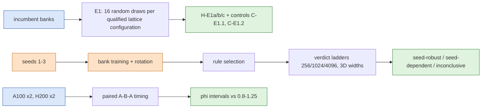
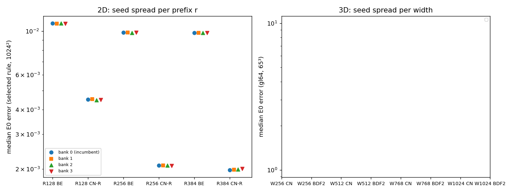
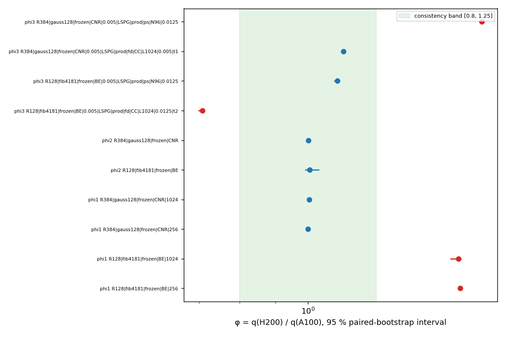

# jcp-robust — randomised rules, recipe seeds and hardware for the off-mesh quadrature ROM

Covers plan V2 items E1 (randomised lattice rules), E2 (repeating the full bank + rule-selection recipe over seeds) and E5 (hardware). **Status: provisional: production is complete only where stated, and the Codex results audit is pending.** Generated by `make_report.py` from the analysis JSONs in `checks/` at commit `751a0cc53f`.

## E1 — randomised rules

Each qualified front configuration that uses a lattice rule is re-run with 16 random draws: Cranley–Patterson shifts $u \mapsto \{u + \Delta_s\}$, $\Delta_s \sim U[0,1)^d$, $s = 0,\dots,15$. Draw $s=0$ is the deployed rule. Each draw is scored on the full validity / Q1 / Q2 contract with draw-matched successors, and on E0 error against the frozen references. Verdicts follow DESIGN §2 and A1–A13.

**Status: provisional until the Codex results audit has accepted the analysis.**

- **2D controls:** bad generating vector caught by the independent Gauss family (C-E1.1) — admitted yes, fired yes; rule-identity control (C-E1.2) fired yes.
- **3D controls:** bad generating vector caught by the independent Gauss family (C-E1.1) — admitted yes, fired yes; rule-identity control (C-E1.2) fired yes.

| dim | mesh / setting | configuration | H-E1a (failing / n; CP upper all, fresh; failed draws) | H-E1b (rank of $D_0$) | H-E1c | eligible cases |
|---|---|---|---|---|---|---|
| 2D | 256 | R128|fib4181|LSPG_BE_1 | **inconclusive** (1/16; 0.264, 0.279; [6]) | **typical** (rank 5–5 of 16) | insensitive | 38 |
| 2D | 256 | R128|fib4181|LSPG_BE_2 | **fragile** (2/16; 0.344, 0.363; [4, 6]) | **typical** (rank 6–6 of 16) | insensitive | 38 |
| 2D | 256 | R128|fib4181|LSPG_BE_2.5 | **fragile** (3/16; 0.417, 0.44; [3, 4, 6]) | **typical** (rank 6–6 of 16) | insensitive | 38 |
| 2D | 256 | R128|fib4181|LSPG_CNR_1 | **inconclusive** (1/16; 0.264, 0.279; [6]) | **typical** (rank 4–4 of 16) | insensitive | 38 |
| 2D | 256 | R128|fib4181|GAL_CN_1 | diagnostic (GAL-CN): no verdict |  |  |  |
| 2D | 256 | R128|fib4181|GAL_CN_2 | diagnostic (GAL-CN): no verdict |  |  |  |
| 2D | 256 | R128|fib4181|GAL_CN_5 | diagnostic (GAL-CN): no verdict |  |  |  |
| 2D | 1024 | R128|fib4181|LSPG_BE_1 | **inconclusive** (1/16; 0.264, 0.279; [6]) | **typical** (rank 5–5 of 16) | insensitive | 38 |
| 2D | 1024 | R128|fib4181|LSPG_BE_2 | **fragile** (2/16; 0.344, 0.363; [4, 6]) | **typical** (rank 6–6 of 16) | insensitive | 38 |
| 2D | 1024 | R128|fib4181|LSPG_BE_2.5 | **fragile** (2/16; 0.344, 0.363; [4, 6]) | **typical** (rank 6–6 of 16) | insensitive | 38 |
| 2D | 1024 | R128|fib4181|LSPG_CNR_1 | **inconclusive** (1/16; 0.264, 0.279; [6]) | **typical** (rank 3–3 of 16) | insensitive | 38 |
| 2D | 1024 | R128|fib4181|GAL_CN_1 | diagnostic (GAL-CN): no verdict |  |  |  |
| 2D | 1024 | R128|fib4181|GAL_CN_2 | diagnostic (GAL-CN): no verdict |  |  |  |
| 2D | 1024 | R128|fib4181|GAL_CN_5 | diagnostic (GAL-CN): no verdict |  |  |  |
| 2D | 4096 | R128|fib4181|LSPG_BE_1 | **inconclusive** (1/16; 0.264, 0.279; [6]) | **typical** (rank 5–5 of 16) | insensitive | 38 |
| 2D | 4096 | R128|fib4181|LSPG_BE_2 | **fragile** (2/16; 0.344, 0.363; [4, 6]) | **typical** (rank 6–6 of 16) | insensitive | 38 |
| 2D | 4096 | R128|fib4181|LSPG_BE_2.5 | **fragile** (3/16; 0.417, 0.44; [3, 4, 6]) | **typical** (rank 6–6 of 16) | insensitive | 38 |
| 2D | 4096 | R128|fib4181|LSPG_CNR_1 | **inconclusive** (1/16; 0.264, 0.279; [6]) | **typical** (rank 3–3 of 16) | insensitive | 38 |
| 2D | 4096 | R128|fib4181|GAL_CN_1 | diagnostic (GAL-CN): no verdict |  |  |  |
| 2D | 4096 | R128|fib4181|GAL_CN_2 | diagnostic (GAL-CN): no verdict |  |  |  |
| 2D | 4096 | R128|fib4181|GAL_CN_5 | diagnostic (GAL-CN): no verdict |  |  |  |
| 3D |  | E1-3D-a|W256|qn|BDF2|0.025|k4 | **robust** (0/16; 0.171, 0.181; none) | **typical** (rank 9–9 of 16) | insensitive | 64 |
| 3D |  | E1-3D-b|W512|qn|BDF2|0.025|k4 | **robust** (0/16; 0.171, 0.181; none) | **atypically unfavourable** (rank 16–16 of 16) | insensitive | 64 |
| 3D |  | E1-3D-c|W512|qn|CN|0.025|k4 (supplementary) | **robust** (0/16; 0.171, 0.181; none) | **typical** (rank 9–9 of 16) | insensitive | 64 |
| 3D |  | E1-3D-d|M2_512|qn|BDF2|0.025|k4 (supplementary) | **robust** (0/16; 0.171, 0.181; none) | **typical** (rank 10–10 of 16) | insensitive | 64 |

Draw distributions (16 draws per configuration; $D$ = distance to the converged rule; E0 = case-median error):

| dim | configuration | $D_0$ (deployed) | $D$ median (IQR) | $D$ min–max | E0 deployed | E0 median (IQR) | E0 min–max |
|---|---|---|---|---|---|---|---|
| 2D 256² | R128 LSPG_BE_1 | 1.15e-04 | 1.45e-04 (5.84e-05) | 8.38e-05–1.80e-04 | 0.0109684 | 0.0109684 (8.03e-08) | 0.0109683–0.0109685 |
| 2D 256² | R128 LSPG_BE_2 | 1.31e-04 | 1.42e-04 (4.62e-05) | 8.80e-05–1.94e-04 | 0.0194195 | 0.0194195 (1.59e-08) | 0.0194195–0.0194195 |
| 2D 256² | R128 LSPG_BE_2.5 | 1.32e-04 | 1.40e-04 (4.73e-05) | 9.02e-05–2.02e-04 | 0.0236302 | 0.0236306 (6.68e-07) | 0.0236302–0.0236311 |
| 2D 256² | R128 LSPG_CNR_1 | 1.02e-04 | 1.60e-04 (7.56e-05) | 8.74e-05–2.01e-04 | 4.51648e-03 | 4.51662e-03 (1.08e-07) | 4.51634e-03–4.51668e-03 |
| 2D 1024² | R128 LSPG_BE_1 | 1.13e-04 | 1.43e-04 (5.79e-05) | 8.31e-05–1.78e-04 | 0.0109534 | 0.0109534 (9.27e-08) | 0.0109532–0.0109535 |
| 2D 1024² | R128 LSPG_BE_2 | 1.29e-04 | 1.40e-04 (4.54e-05) | 8.79e-05–1.92e-04 | 0.0194235 | 0.0194235 (1.59e-08) | 0.0194235–0.0194236 |
| 2D 1024² | R128 LSPG_BE_2.5 | 1.30e-04 | 1.39e-04 (4.66e-05) | 9.26e-05–2.01e-04 | 0.0236303 | 0.0236308 (6.32e-07) | 0.0236303–0.0236312 |
| 2D 1024² | R128 LSPG_CNR_1 | 1.01e-04 | 1.58e-04 (7.29e-05) | 8.61e-05–1.98e-04 | 4.50467e-03 | 4.50486e-03 (1.61e-07) | 4.50448e-03–4.50494e-03 |
| 2D 4096² | R128 LSPG_BE_1 | 1.13e-04 | 1.43e-04 (5.79e-05) | 8.31e-05–1.78e-04 | 0.0109535 | 0.0109535 (9.69e-08) | 0.0109533–0.0109536 |
| 2D 4096² | R128 LSPG_BE_2 | 1.29e-04 | 1.40e-04 (4.54e-05) | 8.79e-05–1.92e-04 | 0.0194234 | 0.0194235 (1.57e-08) | 0.0194234–0.0194235 |
| 2D 4096² | R128 LSPG_BE_2.5 | 1.30e-04 | 1.39e-04 (4.66e-05) | 9.27e-05–2.01e-04 | 0.02363 | 0.0236305 (6.24e-07) | 0.02363–0.0236309 |
| 2D 4096² | R128 LSPG_CNR_1 | 1.01e-04 | 1.58e-04 (7.23e-05) | 8.60e-05–1.98e-04 | 4.50319e-03 | 4.50339e-03 (1.72e-07) | 4.50299e-03–4.50347e-03 |
| 3D | E1-3D-a W256 | 2.04e-04 | 2.00e-04 (3.51e-05) | 1.72e-04–2.37e-04 | 0.0207876 | 0.0207877 (6.14e-08) | 0.0207876–0.0207878 |
| 3D | E1-3D-b W512 | 2.04e-04 | 1.51e-04 (3.79e-05) | 1.01e-04–2.04e-04 | 0.0203834 | 0.0203834 (4.97e-09) | 0.0203834–0.0203834 |
| 3D | E1-3D-c W512 | 3.20e-05 | 3.12e-05 (1.22e-05) | 2.00e-05–3.77e-05 | 5.25730e-03 | 5.25731e-03 (2.20e-09) | 5.25730e-03–5.25731e-03 |
| 3D | E1-3D-d M2_512 | 4.64e-05 | 4.14e-05 (1.30e-05) | 3.25e-05–5.08e-05 | 0.0203907 | 0.0203907 (3.37e-10) | 0.0203907–0.0203907 |

Sobol diagnostic on E1-3D-b (16 Owen scrambles of `sob16384`, no verdict): $D$ median 0.014, range 8.11e-03–0.0187; case-median E0 0.0205, range 0.0204–0.0209.

Reading: every failing 2D draw fails only on the draw-matched successor distance (`fib6765s<k>`, tested on every case, which is stricter than qualify's historical subset test). Every primary draw passes the bar on the distance to the independent cross-family target. The fragile labels therefore do not show accuracy sensitivity or failure against the independent family, and H-E1c is insensitive in every cell. In 3D, E1-3D-b is atypically unfavourable only because its deployed draw has the largest $D$ of the 16 (rank 16/16); it still qualifies, and its E0-error ranks are insensitive. The CP column gives the bound over all 16 draws and the bound over the 15 fresh draws: draw 0 was the selected rule, so it is selection-conditioned (A1.5). $\varepsilon_{ref}$ is a conditional Richardson estimate (DESIGN §1).

Per-draw values are in `checks/e1-2d-<mesh>.json` and `checks/e1-3d.json`.

## E2 — repeating the full recipe over seeds

The full recipe — bank training, ordering/rotation, rule selection — is repeated for the 2D R512 bank (seeds 1–3, prefixes $r = 128, 256, 384$) and for the 3D W1024 bank (seeds 1–3, widths 256–1024). The key verdicts are then re-run per seed. A verdict is **seed-robust** if seeds 1–3 give the same definitive label, **seed-dependent** if two seeds give opposite definitive labels, and **inconclusive** otherwise. Agreement with the incumbent bank (seed 0) is reported separately as historical agreement (A2.7). Retrains are not bitwise reproducible, so seeds and hashes are recorded in `inputs/banks*/s<seed>/BANK.json`. Three seeds support a description of agreement, not a population-level robustness claim. The three retrains used identical data-generation settings, but the generated data are not bitwise identical: seed 2's data sha256 differs from seeds 1 and 3 (A17.2). Accuracy verdicts use the registered validation populations, including the 16-case 4096² subset, and $\varepsilon_{ref}$ is a conditional Richardson estimate. The $t$ intervals on the seed spread concern the mean of $\log_{10}$ error with $n = 3$ (2 degrees of freedom); they are not prediction intervals for further seeds.

**Status: provisional until the Codex results audit has accepted the analysis.**

### 2D rule selection at 1024² (38 cases; first candidate qualified under both LSPG-BE and LSPG-CN-R)

| rank | bank 0 (incumbent) | seed 1 | seed 2 | seed 3 | deployed rule |
|---|---|---|---|---|---|
| R128 | fib4181 (selected) | gauss96 (selected) | fib6765 (selected) | fib6765 (selected) | fib4181 |
| R256 | fib10946 (selected) | fib10946 (selected) | gauss96 (selected) | gauss96 (selected) | gauss128 |
| R384 | gauss128 (selected) | gauss160 (selected) | gauss160 (selected) | gauss128 (selected) | gauss128 |

### 2D per-seed verdicts

Per-bank analyses present: 0, 1, 2, 3 of 0–3.

Cross-seed labels over 183 verdict rows: seed-robust 140, seed-dependent 21, inconclusive 22.

The table lists the headline verdicts (selected-rule H-acc-N, H-acc-r and the selected rule itself) and every seed-dependent row; the full set is in `checks/e2-verdicts-2d.json`. Front rows use qualify's registered dominance rule (5 % cost band, error margin $\max(2\varepsilon_{ref}, 0.02\,e)$), applied to separate median-error (`front…`) and worst-error (`front…-worst`) fronts of the *tested* candidates (A17). `Q1Q2|…|dep|…` rows are the deployed rules re-qualified on each retrained bank.

| verdict | bank 0 | seed 1 | seed 2 | seed 3 | cross-seed label | vs incumbent | target-unverified qualifier |
|---|---|---|---|---|---|---|---|
| H-acc-N · sel · R128 · BE | pass | pass | pass | pass | seed-robust | agrees with incumbent |  |
| H-acc-N · sel · R128 · CNR | pass | pass | pass | pass | seed-robust | agrees with incumbent |  |
| H-acc-N · sel · R256 · BE | pass | pass | pass | pass | seed-robust | agrees with incumbent |  |
| H-acc-N · sel · R256 · CNR | pass | pass | pass | pass | seed-robust | agrees with incumbent |  |
| H-acc-N · sel · R384 · BE | pass | pass | pass | pass | seed-robust | agrees with incumbent |  |
| H-acc-N · sel · R384 · CNR | pass | pass | pass | pass | seed-robust | agrees with incumbent |  |
| H-acc-r · sel · 1024 · BE · 128->256 | improves | improves | improves | improves | seed-robust | agrees with incumbent |  |
| H-acc-r · sel · 1024 · BE · 256->384 | improves | improves | improves | improves | seed-robust | agrees with incumbent |  |
| H-acc-r · sel · 1024 · BE · range_128_384 | monotone | monotone | monotone | monotone | seed-robust | agrees with incumbent |  |
| H-acc-r · sel · 1024 · CNR · 128->256 | improves | improves | improves | improves | seed-robust | agrees with incumbent |  |
| H-acc-r · sel · 1024 · CNR · 256->384 | improves | improves | improves | improves | seed-robust | agrees with incumbent |  |
| H-acc-r · sel · 1024 · CNR · range_128_384 | monotone | monotone | monotone | monotone | seed-robust | agrees with incumbent |  |
| H-acc-r · sel · 256 · BE · 128->256 | improves | improves | improves | improves | seed-robust | agrees with incumbent |  |
| H-acc-r · sel · 256 · BE · 256->384 | improves | improves | improves | improves | seed-robust | agrees with incumbent |  |
| H-acc-r · sel · 256 · BE · range_128_384 | monotone | monotone | monotone | monotone | seed-robust | agrees with incumbent |  |
| H-acc-r · sel · 256 · CNR · 128->256 | improves | improves | improves | improves | seed-robust | agrees with incumbent |  |
| H-acc-r · sel · 256 · CNR · 256->384 | improves | improves | improves | improves | seed-robust | agrees with incumbent |  |
| H-acc-r · sel · 256 · CNR · range_128_384 | monotone | monotone | monotone | monotone | seed-robust | agrees with incumbent |  |
| H-acc-r · sel · 4096 · BE · 128->256 | improves | improves | improves | improves | seed-robust | agrees with incumbent |  |
| H-acc-r · sel · 4096 · BE · 256->384 | improves | improves | improves | improves | seed-robust | agrees with incumbent |  |
| H-acc-r · sel · 4096 · BE · range_128_384 | monotone | monotone | monotone | monotone | seed-robust | agrees with incumbent |  |
| H-acc-r · sel · 4096 · CNR · 128->256 | improves | improves | improves | improves | seed-robust | agrees with incumbent |  |
| H-acc-r · sel · 4096 · CNR · 256->384 | improves | improves | improves | improves | seed-robust | agrees with incumbent |  |
| H-acc-r · sel · 4096 · CNR · range_128_384 | monotone | monotone | monotone | monotone | seed-robust | agrees with incumbent |  |
| Q1Q2 · 1024 · R384 · dep · LSPG_BE_1 | True | True | False | True | seed-dependent |  |  |
| Q1Q2 · 1024 · R384 · dep · LSPG_CNR_1 | True | False | False | True | seed-dependent |  |  |
| Q1Q2 · 1024 · R384 · dep · LSPG_CNR_2 | True | False | False | True | seed-dependent |  |  |
| Q1Q2 · 1024 · R384 · sel · LSPG_CNR_2.5 | True | True | True | False | seed-dependent |  |  |
| Q1Q2 · 256 · R384 · dep · LSPG_BE_1 | True | False | False | True | seed-dependent |  |  |
| Q1Q2 · 256 · R384 · dep · LSPG_CNR_1 | True | False | False | True | seed-dependent |  |  |
| Q1Q2 · 4096 · R384 · dep · LSPG_BE_1 | True | False | False | True | seed-dependent |  |  |
| Q1Q2 · 4096 · R384 · dep · LSPG_CNR_1 | True | False | False | True | seed-dependent |  |  |
| front1024-worst · fixed · R384 · BE · 1 | dominated | dominated | unqualified | dominated | seed-dependent |  |  |
| front1024-worst · fixed · R384 · CNR · 1 | member | unqualified | unqualified | dominated | seed-dependent |  |  |
| front1024-worst · fixed · R384 · CNR · 2 | member | unqualified | unqualified | dominated | seed-dependent |  |  |
| front1024-worst · slot · R384 · CNR · 1 | member | member | dominated | dominated | seed-dependent |  |  |
| front1024-worst · slot · R384 · CNR · 2 | member | member | member | dominated | seed-dependent |  |  |
| front1024-worst · slot · R384 · CNR · 2.5 | dominated | dominated | dominated | unqualified | seed-dependent |  |  |
| front1024 · fixed · R384 · BE · 1 | dominated | dominated | unqualified | dominated | seed-dependent |  |  |
| front1024 · fixed · R384 · CNR · 1 | member | unqualified | unqualified | member | seed-dependent |  |  |
| front1024 · fixed · R384 · CNR · 2 | dominated | unqualified | unqualified | dominated | seed-dependent |  |  |
| front1024 · slot · R384 · CNR · 2.5 | dominated | dominated | dominated | unqualified | seed-dependent |  |  |
| selected-rule · R128 | rule:fib4181 | rule:gauss96 | rule:fib6765 | rule:fib6765 | seed-dependent |  |  |
| selected-rule · R256 | rule:fib10946 | rule:fib10946 | rule:gauss96 | rule:gauss96 | seed-dependent |  |  |
| selected-rule · R384 | rule:gauss128 | rule:gauss160 | rule:gauss160 | rule:gauss128 | seed-dependent |  |  |

Seed spread of the median E0 error (seeds 1–3; the 95 % $t$ interval is on $\log_{10}$, with $n = 3$, so it is wide by construction):

| configuration | bank 0 median | seeds 1–3 min–max | 95 % t-interval (seeds) |
|---|---|---|---|
| 1024 · R128 · dep · LSPG_BE_1 | 0.011 | 0.0109–0.0109 | [0.0109, 0.011] |
| 1024 · R128 · dep · LSPG_BE_2 | 0.0194 | 0.0194–0.0194 | [0.0194, 0.0194] |
| 1024 · R128 · dep · LSPG_BE_2.5 | 0.0236 | 0.0236–0.0236 | [0.0236, 0.0236] |
| 1024 · R128 · dep · LSPG_CNR_1 | 4.50e-03 | 4.46e-03–4.51e-03 | [4.42e-03, 4.55e-03] |
| 1024 · R128 · dep · LSPG_CNR_2 | 7.92e-03 | 7.92e-03–7.92e-03 | [7.91e-03, 7.93e-03] |
| 1024 · R128 · dep · LSPG_CNR_2.5 | 0.0121 | 0.0121–0.0121 | [0.0121, 0.0121] |
| 1024 · R128 · sel · LSPG_BE_1 | 0.011 | 0.0109–0.0109 | [0.0109, 0.011] |
| 1024 · R128 · sel · LSPG_BE_2 | 0.0194 | 0.0194–0.0194 | [0.0194, 0.0194] |
| 1024 · R128 · sel · LSPG_BE_2.5 | 0.0236 | 0.0236–0.0236 | [0.0236, 0.0236] |
| 1024 · R128 · sel · LSPG_CNR_1 | 4.50e-03 | 4.47e-03–4.51e-03 | [4.42e-03, 4.55e-03] |
| 1024 · R128 · sel · LSPG_CNR_2 | 7.92e-03 | 7.92e-03–7.92e-03 | [7.91e-03, 7.93e-03] |
| 1024 · R128 · sel · LSPG_CNR_2.5 | 0.0121 | 0.0121–0.0121 | [0.0121, 0.0121] |
| 1024 · R256 · dep · LSPG_BE_1 | 9.83e-03 | 9.81e-03–9.84e-03 | [9.79e-03, 9.86e-03] |
| 1024 · R256 · dep · LSPG_BE_2 | 0.0187 | 0.0187–0.0187 | [0.0187, 0.0187] |
| 1024 · R256 · dep · LSPG_BE_2.5 | 0.0229 | 0.0229–0.0229 | [0.0229, 0.0229] |
| 1024 · R256 · dep · LSPG_CNR_1 | 2.09e-03 | 2.07e-03–2.09e-03 | [2.07e-03, 2.10e-03] |
| 1024 · R256 · dep · LSPG_CNR_2 | 7.34e-03 | 7.33e-03–7.34e-03 | [7.32e-03, 7.35e-03] |
| 1024 · R256 · dep · LSPG_CNR_2.5 | 0.0111 | 0.0111–0.0111 | [0.0111, 0.0111] |
| 1024 · R256 · sel · LSPG_BE_1 | 9.83e-03 | 9.81e-03–9.84e-03 | [9.79e-03, 9.86e-03] |
| 1024 · R256 · sel · LSPG_BE_2 | 0.0187 | 0.0187–0.0187 | [0.0187, 0.0187] |
| 1024 · R256 · sel · LSPG_BE_2.5 | 0.0229 | 0.0229–0.0229 | [0.0229, 0.0229] |
| 1024 · R256 · sel · LSPG_CNR_1 | 2.09e-03 | 2.07e-03–2.09e-03 | [2.07e-03, 2.10e-03] |
| 1024 · R256 · sel · LSPG_CNR_2 | 7.34e-03 | 7.33e-03–7.34e-03 | [7.32e-03, 7.35e-03] |
| 1024 · R256 · sel · LSPG_CNR_2.5 | 0.0111 | 0.0111–0.0111 | [0.0111, 0.0111] |
| 1024 · R384 · dep · LSPG_BE_1 | 9.78e-03 | 9.79e-03–9.80e-03 | [9.78e-03, 9.81e-03] |
| 1024 · R384 · dep · LSPG_BE_2 | 0.0187 | 0.0187–0.0187 | [0.0187, 0.0187] |
| 1024 · R384 · dep · LSPG_BE_2.5 | 0.0229 | 0.0229–0.0229 | [0.0229, 0.0229] |
| 1024 · R384 · dep · LSPG_CNR_1 | 1.98e-03 | 1.98e-03–2.00e-03 | [1.97e-03, 2.02e-03] |
| 1024 · R384 · dep · LSPG_CNR_2 | 7.26e-03 | 7.26e-03–7.28e-03 | [7.25e-03, 7.29e-03] |
| 1024 · R384 · dep · LSPG_CNR_2.5 | 0.011 | 0.011–0.011 | [0.011, 0.0111] |
| 1024 · R384 · sel · LSPG_BE_1 | 9.78e-03 | 9.79e-03–9.80e-03 | [9.78e-03, 9.81e-03] |
| 1024 · R384 · sel · LSPG_BE_2 | 0.0187 | 0.0187–0.0187 | [0.0187, 0.0187] |
| 1024 · R384 · sel · LSPG_BE_2.5 | 0.0229 | 0.0229–0.0229 | [0.0229, 0.0229] |
| 1024 · R384 · sel · LSPG_CNR_1 | 1.98e-03 | 1.98e-03–2.00e-03 | [1.97e-03, 2.02e-03] |
| 1024 · R384 · sel · LSPG_CNR_2 | 7.26e-03 | 7.27e-03–7.28e-03 | [7.26e-03, 7.29e-03] |
| 1024 · R384 · sel · LSPG_CNR_2.5 | 0.011 | 0.011–0.011 | [0.011, 0.0111] |
| 256 · R128 · dep · LSPG_BE_1 | 0.011 | 0.0109–0.0109 | [0.0109, 0.011] |
| 256 · R128 · dep · LSPG_CNR_1 | 4.52e-03 | 4.48e-03–4.53e-03 | [4.44e-03, 4.56e-03] |
| 256 · R128 · sel · LSPG_BE_1 | 0.011 | 0.0109–0.0109 | [0.0109, 0.011] |
| 256 · R128 · sel · LSPG_CNR_1 | 4.52e-03 | 4.48e-03–4.53e-03 | [4.44e-03, 4.56e-03] |

- bank 0: G-E2.3 (incumbent replay) passed: yes.

### 3D per-seed verdicts

Per-bank analyses present: none of 0–3.

Cross-seed labels: **pending** (not every seed has its analysis yet).

## E5 — hardware

Paired A–B–A timing inside each physical GPU and job, two jobs each on A100-80G and H200. Only dimensionless ratios are compared across hardware: $q_1$ = B/A cost ratio, $q_2$ = mesh-cost ratio $\max_L q_1 / \min_L q_1$ over $\{256^2, 1024^2\}$, $q_3$ = FOM/ROM speed-up. $\phi_k = q_k(\mathrm{H200}) / q_k(\mathrm{A100})$ with a paired case bootstrap (10,000 resamples). A ratio is **hardware-consistent** if the 95 % interval lies in $[0.8, 1.25]$, **hardware-dependent** if it lies entirely outside, and inconclusive otherwise.

**Status: provisional until the Codex results audit has accepted the analysis.**

Jobs: A100-80G#1 (6079826, ok), A100-80G#2 (6083108, ok), H200#1 (6080051, ok), H200#2 (6084110, ok). Fixtures (injected ×1.5 must read hardware-dependent; null must read consistent): q1 ok, q2 ok, q3 ok.

| ratio | subject | φ | 95 % interval | label |
|---|---|---|---|---|
| $\phi_1$ | R128 fib4181 frozen BE 256 | 1.64 | [1.63, 1.65] | hardware-dependent |
| $\phi_1$ | R128 fib4181 frozen BE 1024 | 1.63 | [1.59, 1.65] | hardware-dependent |
| $\phi_1$ | R384 gauss128 frozen CNR 256 | 1 | [0.997, 1.01] | hardware-consistent |
| $\phi_1$ | R384 gauss128 frozen CNR 1024 | 1 | [1, 1.01] | hardware-consistent |
| $\phi_2$ | R128 fib4181 frozen BE | 1.01 | [0.99, 1.04] | hardware-consistent |
| $\phi_2$ | R384 gauss128 frozen CNR | 1 | [0.998, 1.01] | hardware-consistent |
| $\phi_3$ | ckpt:18f0266ae6f0 R128 fib4181 frozen BE 0.005 LSPG prod fd CC L1024 0.0125 t2 | 0.708 | [0.698, 0.713] | hardware-dependent |
| $\phi_3$ | ckpt:18f0266ae6f0 R128 fib4181 frozen BE 0.005 LSPG prod ps N96 0.0125 | 1.1 | [1.09, 1.11] | hardware-consistent |
| $\phi_3$ | ckpt:18f0266ae6f0 R384 gauss128 frozen CNR 0.005 LSPG prod fd CC L1024 0.005 t1 | 1.12 | [1.11, 1.13] | hardware-consistent |
| $\phi_3$ | ckpt:18f0266ae6f0 R384 gauss128 frozen CNR 0.005 LSPG prod ps N96 0.0125 | 1.77 | [1.75, 1.77] | hardware-dependent |

Scope (results audit e1e5-1 #11): the conclusions are conditional on the four observed physical GPUs (two per type). The FOM comparators are frozen H200-selected comparators (fom2d `FROZEN-SELECTION-1024.json`). Only the H-cost-N(2) and S2-subset hypotheses are re-tested. $\phi_1$ compares costs normalised by the reference ROM; it is not an absolute H200/A100 run-time ratio. The descriptive timing-anchor check G-E5.2 (H200 jobs against P1's intervals, non-blocking) has 7 of 12 cells outside P1's interval:

| job | cell | job value | P1 value | P1 interval | within |
|---|---|---|---|---|---|
| H200#1 | R384 gauss128 frozen CNR 256 | 0.999 | 1.01 | [1, 1.01] | no |
| H200#1 | R384 gauss128 frozen CNR 1024 | 1 | 1.02 | [1, 1.03] | yes |
| H200#1 | R128 fib4181 frozen BE 1024 | 0.244 | 0.252 | [0.249, 0.259] | no |
| H200#1 | R384 gauss128 frozen CNR 4096 | 1.01 | 1.02 | [1.01, 1.03] | no |
| H200#1 | R128 fib4181 frozen BE 256 | 0.247 | 0.254 | [0.252, 0.26] | no |
| H200#1 | R128 fib4181 frozen BE 4096 | 0.248 | 0.252 | [0.242, 0.255] | yes |
| H200#2 | R384 gauss128 frozen CNR 256 | 1.01 | 1.01 | [1, 1.01] | no |
| H200#2 | R384 gauss128 frozen CNR 1024 | 1 | 1.02 | [1, 1.03] | yes |
| H200#2 | R128 fib4181 frozen BE 1024 | 0.25 | 0.252 | [0.249, 0.259] | yes |
| H200#2 | R384 gauss128 frozen CNR 4096 | 1 | 1.02 | [1.01, 1.03] | no |
| H200#2 | R128 fib4181 frozen BE 256 | 0.251 | 0.254 | [0.252, 0.26] | no |
| H200#2 | R128 fib4181 frozen BE 4096 | 0.254 | 0.252 | [0.242, 0.255] | yes |

Unit-to-unit baseline (job 2 / job 1 within one GPU type; reported, no required outcome):

| type | ratio | subject | φ | 95 % interval | label |
|---|---|---|---|---|---|
| A100-80G | $\phi_1$ | R128 fib4181 frozen BE 256 | 0.992 | [0.98, 0.996] | hardware-consistent |
| A100-80G | $\phi_1$ | R128 fib4181 frozen BE 1024 | 0.986 | [0.979, 0.988] | hardware-consistent |
| A100-80G | $\phi_1$ | R384 gauss128 frozen CNR 256 | 0.999 | [0.997, 1] | hardware-consistent |
| A100-80G | $\phi_1$ | R384 gauss128 frozen CNR 1024 | 1 | [0.999, 1] | hardware-consistent |
| A100-80G | $\phi_2$ | R128 fib4181 frozen BE | 1.01 | [0.993, 1.01] | hardware-consistent |
| A100-80G | $\phi_2$ | R384 gauss128 frozen CNR | 0.997 | [0.994, 1] | hardware-consistent |
| A100-80G | $\phi_3$ | R128 fib4181 frozen BE 0.005 LSPG prod fd CC L1024 0.0125 t2 | 1.03 | [1.03, 1.04] | hardware-consistent |
| A100-80G | $\phi_3$ | R128 fib4181 frozen BE 0.005 LSPG prod ps N96 0.0125 | 0.966 | [0.958, 0.977] | hardware-consistent |
| A100-80G | $\phi_3$ | R384 gauss128 frozen CNR 0.005 LSPG prod fd CC L1024 0.005 t1 | 1.03 | [1.03, 1.04] | hardware-consistent |
| A100-80G | $\phi_3$ | R384 gauss128 frozen CNR 0.005 LSPG prod ps N96 0.0125 | 0.964 | [0.958, 0.974] | hardware-consistent |
| H200 | $\phi_1$ | R128 fib4181 frozen BE 256 | 1.02 | [1, 1.04] | hardware-consistent |
| H200 | $\phi_1$ | R128 fib4181 frozen BE 1024 | 1.02 | [0.995, 1.07] | hardware-consistent |
| H200 | $\phi_1$ | R384 gauss128 frozen CNR 256 | 1.01 | [0.999, 1.02] | hardware-consistent |
| H200 | $\phi_1$ | R384 gauss128 frozen CNR 1024 | 1 | [0.989, 1.01] | hardware-consistent |
| H200 | $\phi_2$ | R128 fib4181 frozen BE | 0.994 | [0.956, 1.02] | hardware-consistent |
| H200 | $\phi_2$ | R384 gauss128 frozen CNR | 1 | [0.992, 1.01] | hardware-consistent |
| H200 | $\phi_3$ | R128 fib4181 frozen BE 0.005 LSPG prod fd CC L1024 0.0125 t2 | 0.999 | [0.987, 1.02] | hardware-consistent |
| H200 | $\phi_3$ | R128 fib4181 frozen BE 0.005 LSPG prod ps N96 0.0125 | 1.02 | [1, 1.03] | hardware-consistent |
| H200 | $\phi_3$ | R384 gauss128 frozen CNR 0.005 LSPG prod fd CC L1024 0.005 t1 | 1.02 | [1, 1.02] | hardware-consistent |
| H200 | $\phi_3$ | R384 gauss128 frozen CNR 0.005 LSPG prod ps N96 0.0125 | 1.03 | [1.02, 1.04] | hardware-consistent |

Per-type verdicts of the registered timing hypotheses (per-job labels in brackets) and their cross-hardware agreement:

| hypothesis | A100-80G | H200 | agreement |
|---|---|---|---|
| H-cost-N(2) R128 fib4181 frozen BE | pass ['pass', 'pass'] | pass ['pass', 'pass'] | verdict-robust |
| H-cost-N(2) R384 gauss128 frozen CNR | pass ['pass', 'pass'] | pass ['pass', 'pass'] | verdict-robust |
| S2 ckpt:18f0266ae6f0 R128 fib4181 frozen BE 0.005 LSPG prod fd CC L1024 0.0125 t2 | pass ['pass', 'pass'] | pass ['pass', 'pass'] | verdict-robust |
| S2 ckpt:18f0266ae6f0 R128 fib4181 frozen BE 0.005 LSPG prod ps N96 0.0125 | fail ['fail', 'fail'] | fail ['fail', 'fail'] | verdict-robust |
| S2 ckpt:18f0266ae6f0 R384 gauss128 frozen CNR 0.005 LSPG prod fd CC L1024 0.005 t1 | inconclusive ['inconclusive', 'pass'] | pass ['pass', 'pass'] | inconclusive |
| S2 ckpt:18f0266ae6f0 R384 gauss128 frozen CNR 0.005 LSPG prod ps N96 0.0125 | fail ['fail', 'fail'] | fail ['fail', 'fail'] | verdict-robust |

## Resources

GPU-hours from `runs/GPU-LEDGER.json`: spent 31.9 of the cap 95. Every job and its id are listed in the ledger, with the logs under `runs/<attempt>/archive`.

## Deviations, retractions and corrections

- smk3 (the 3D smoke) timed out at 2 h during data generation; it was split into smk3c and a training pilot (A9).
- e1m4096 was cancelled at 42 min: its certificate ignored the per-execution transfer overhead. It was rerun as e1m4096b with a measured overhead (A10.3).
- The A9 memory note mixed GB and GiB. The pilot's host RSS was 168.6 GiB, i.e. 40.1 % of the request, not "176.8 GB / 42 %" (A12.4).
- The E1 3D supplementary configurations c and d took about 1,000 s each, far above their A11.3 estimate of 2 × W256 (A13.6).
- **Retracted (A17):** the first E2 2D roll-up computed the 1024² front with exact joint inequalities instead of qualify's registered dominance rule. Its cross-seed counts and its "R256 front membership is seed-dependent" reading are withdrawn; the counts above come from the corrected rule.
- On the retrained 2D banks, the deployed rules do not transfer: deployed R128 `fib4181` fails successor-rollout qualification on all three retrained banks, and deployed R384 `gauss128` fails on seeds 1 and 2. These are qualification failures of the deployed rules; they do not affect the selected-rule accuracy verdicts.

## Glossary

- **Draw $s$**: one random shift (lattice) or scramble (Sobol) of a quadrature rule; $s=0$ is the rule deployed today.
- **$D$**: rollout distance of a draw's trajectory to the converged (cross-family) reference rule, relative to the initial state norm.
- **Q1 / Q2**: the qualification contract. Q1: validity, stationarity and tight-solve agreement. Q2: the distance to the next rule in the ladder (successor) $\le 2.5\times10^{-4}$ and $\rho \le 0.116$.
- **H-E1a**: robust / inconclusive / fragile, from the number of draws failing qualification and a one-sided Clopper–Pearson (CP) upper bound.
- **H-E1b**: where the deployed draw ranks among the 16 draws (typical, atypically favourable or unfavourable); ranks are intervals because of ties within $\delta = 2\max\varepsilon_{ref}$.
- **H-E1c**: whether the E0 error depends on the draw by more than $\max(2\varepsilon, 0.1\,e_{conv})$.
- **C-E1.1 / C-E1.2**: must-fail controls. C-E1.1: a bad generating vector must be caught by the independent Gauss family. C-E1.2: a mislabelled rule must be refused.
- **E0 error**: error against the frozen full-order reference store, per case.
- **Bank / seed**: a trained decoder bank. Bank 0 is the incumbent; seeds 1–3 are retrained with the identical recipe.
- **H-acc-N / H-acc-r**: accuracy is mesh-independent (N) / improves with the prefix size r or the width.
- **Front**: cost–accuracy non-dominated set of the *tested* configurations (never complete); member / dominated / unqualified.
- **φ**: H200 value of a dimensionless timing ratio divided by its A100 value.
- **Provisional**: not yet accepted by the independent Codex results audit.
- **Target unverified**: the cross-family reference rule could not be certified, so the pick uses own-family qualification only and is labelled.
