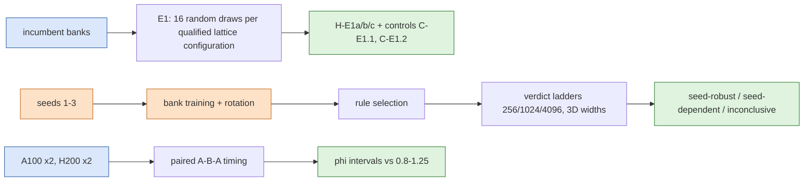

# jcp-robust — randomised rules, recipe seeds and hardware for the off-mesh quadrature ROM

Covers plan V2 items E1 (randomised lattice rules), E2 (repeating the full bank + rule-selection recipe over seeds) and E5 (hardware). **Status: provisional: production is complete and the results audits accepted with fixes; the final report audit is pending.** Generated by `make_report.py` from the analysis JSONs in `checks/` at commit `e07d63db54`.

## Summary

- **E1 2D** (12 registered verdict cells): H-E1a inconclusive 6, fragile 6; H-E1b typical 12; H-E1c insensitive 12.
- **E1 3D** (2 registered verdict cells): H-E1a robust 2; H-E1b typical 1, atypically unfavourable 1; H-E1c insensitive 2.
- **E2 2D** (183 verdict rows, seeds 1–3): seed-robust 140, seed-dependent 21, inconclusive 22. Headline accuracy rows (H-acc-N / H-acc-r): seed-robust 24. Selected-rule rows: seed-dependent 3.
- **E2 3D** (129 verdict rows, seeds 1–3): seed-robust 45, seed-dependent 17, inconclusive 67. Headline accuracy rows (H-acc-N / H-acc-r): seed-robust 10, inconclusive 22. Selected-rule rows: inconclusive 12, seed-robust 10, seed-dependent 2.
- **E5** (4 jobs, A100-80G and H200): φ intervals hardware-dependent 4, hardware-consistent 6; cross-hardware agreement of the registered verdicts verdict-robust 5, inconclusive 1.

How to read these counts:
- E1 "fragile" concerns convergence to the draw-matched successor rule, not accuracy: the accuracy-sensitivity verdict H-E1c is listed beside it. The reading paragraph in the E1 section quantifies this from the data.
- E2 2D: the selected-rule accuracy verdicts (H-acc-N, H-acc-r) are the seed-robust headline. The selected rule itself varies with the seed, and the deployed rules do not transfer: Deployed R128 `fib4181` fails qualification at 1024² on seeds 1, 2, 3; deployed R256 `gauss128` fails qualification at 1024² on no retrained seed; deployed R384 `gauss128` fails qualification at 1024² on seeds 1, 2.
- E2 3D: the fixed-rule gl64 rows isolate the bank; the selected-rule rows are sparse at W768 and W1024, where most slots have no certified rule, so most wide-width rows are inconclusive rather than evidence either way.
- E5: the ratios are dimensionless and normalised; the conclusions are conditional on the four observed GPUs, the frozen H200-selected comparators and the two re-tested hypotheses.

Per-item tables, qualifications and every number follow; the plain-language glossary is at the end.

## E1 — randomised rules

Each qualified front configuration that uses a lattice rule is re-run with 16 random draws: Cranley–Patterson shifts $u \mapsto \{u + \Delta_s\}$, $\Delta_s \sim U[0,1)^d$, $s = 0,\dots,15$. Draw $s=0$ is the deployed rule. Each draw is scored on the full validity / Q1 / Q2 contract with draw-matched successors, and on E0 error against the frozen references. Verdicts follow DESIGN §2 and A1–A13.

**Status: provisional until the Codex results audit has accepted the analysis.**

- **2D controls:** bad generating vector caught by the independent Gauss family (C-E1.1) — admitted yes, fired yes; rule-identity control (C-E1.2) fired yes.
- **3D controls:** bad generating vector caught by the independent Gauss family (C-E1.1) — admitted yes, fired yes; rule-identity control (C-E1.2) fired yes.

| dim | mesh / setting | configuration | H-E1a (failing / n; CP upper all, fresh; failed draws) | H-E1b (rank of $D_0$) | H-E1c | eligible cases |
|---|---|---|---|---|---|---|
| 2D | 256 | R128\|fib4181\|LSPG_BE_1 | **inconclusive** (1/16; 0.264, 0.279; [6]) | **typical** (rank 5–5 of 16) | insensitive | 38 |
| 2D | 256 | R128\|fib4181\|LSPG_BE_2 | **fragile** (2/16; 0.344, 0.363; [4, 6]) | **typical** (rank 6–6 of 16) | insensitive | 38 |
| 2D | 256 | R128\|fib4181\|LSPG_BE_2.5 | **fragile** (3/16; 0.417, 0.44; [3, 4, 6]) | **typical** (rank 6–6 of 16) | insensitive | 38 |
| 2D | 256 | R128\|fib4181\|LSPG_CNR_1 | **inconclusive** (1/16; 0.264, 0.279; [6]) | **typical** (rank 4–4 of 16) | insensitive | 38 |
| 2D | 256 | R128\|fib4181\|GAL_CN_1 | diagnostic (GAL-CN): no verdict |  |  |  |
| 2D | 256 | R128\|fib4181\|GAL_CN_2 | diagnostic (GAL-CN): no verdict |  |  |  |
| 2D | 256 | R128\|fib4181\|GAL_CN_5 | diagnostic (GAL-CN): no verdict |  |  |  |
| 2D | 1024 | R128\|fib4181\|LSPG_BE_1 | **inconclusive** (1/16; 0.264, 0.279; [6]) | **typical** (rank 5–5 of 16) | insensitive | 38 |
| 2D | 1024 | R128\|fib4181\|LSPG_BE_2 | **fragile** (2/16; 0.344, 0.363; [4, 6]) | **typical** (rank 6–6 of 16) | insensitive | 38 |
| 2D | 1024 | R128\|fib4181\|LSPG_BE_2.5 | **fragile** (2/16; 0.344, 0.363; [4, 6]) | **typical** (rank 6–6 of 16) | insensitive | 38 |
| 2D | 1024 | R128\|fib4181\|LSPG_CNR_1 | **inconclusive** (1/16; 0.264, 0.279; [6]) | **typical** (rank 3–3 of 16) | insensitive | 38 |
| 2D | 1024 | R128\|fib4181\|GAL_CN_1 | diagnostic (GAL-CN): no verdict |  |  |  |
| 2D | 1024 | R128\|fib4181\|GAL_CN_2 | diagnostic (GAL-CN): no verdict |  |  |  |
| 2D | 1024 | R128\|fib4181\|GAL_CN_5 | diagnostic (GAL-CN): no verdict |  |  |  |
| 2D | 4096 | R128\|fib4181\|LSPG_BE_1 | **inconclusive** (1/16; 0.264, 0.279; [6]) | **typical** (rank 5–5 of 16) | insensitive | 38 |
| 2D | 4096 | R128\|fib4181\|LSPG_BE_2 | **fragile** (2/16; 0.344, 0.363; [4, 6]) | **typical** (rank 6–6 of 16) | insensitive | 38 |
| 2D | 4096 | R128\|fib4181\|LSPG_BE_2.5 | **fragile** (3/16; 0.417, 0.44; [3, 4, 6]) | **typical** (rank 6–6 of 16) | insensitive | 38 |
| 2D | 4096 | R128\|fib4181\|LSPG_CNR_1 | **inconclusive** (1/16; 0.264, 0.279; [6]) | **typical** (rank 3–3 of 16) | insensitive | 38 |
| 2D | 4096 | R128\|fib4181\|GAL_CN_1 | diagnostic (GAL-CN): no verdict |  |  |  |
| 2D | 4096 | R128\|fib4181\|GAL_CN_2 | diagnostic (GAL-CN): no verdict |  |  |  |
| 2D | 4096 | R128\|fib4181\|GAL_CN_5 | diagnostic (GAL-CN): no verdict |  |  |  |
| 3D |  | E1-3D-a\|W256\|qn\|BDF2\|0.025\|k4 | **robust** (0/16; 0.171, 0.181; none) | **typical** (rank 9–9 of 16) | insensitive | 64 |
| 3D |  | E1-3D-b\|W512\|qn\|BDF2\|0.025\|k4 | **robust** (0/16; 0.171, 0.181; none) | **atypically unfavourable** (rank 16–16 of 16) | insensitive | 64 |
| 3D |  | E1-3D-c\|W512\|qn\|CN\|0.025\|k4 (supplementary) | **robust** (0/16; 0.171, 0.181; none) | **typical** (rank 9–9 of 16) | insensitive | 64 |
| 3D |  | E1-3D-d\|M2_512\|qn\|BDF2\|0.025\|k4 (supplementary) | **robust** (0/16; 0.171, 0.181; none) | **typical** (rank 10–10 of 16) | insensitive | 64 |

Draw distributions (16 draws per configuration; $D$ = distance to the converged rule; E0 = case-median error):

| dim | configuration | $D_0$ (deployed) | $D$ median (IQR) | $D$ min–max | E0 deployed | E0 median (IQR) | E0 min–max |
|---|---|---|---|---|---|---|---|
| 2D 256² | R128 LSPG_BE_1 | 1.15e-04 | 1.45e-04 (5.84e-05) | 8.38e-05–1.80e-04 | 0.0109684 | 0.0109684 (8.03e-08) | 0.0109683–0.0109685 |
| 2D 256² | R128 LSPG_BE_2 | 1.31e-04 | 1.42e-04 (4.62e-05) | 8.80e-05–1.94e-04 | 0.0194195 | 0.0194195 (1.59e-08) | 0.0194195–0.0194195 |
| 2D 256² | R128 LSPG_BE_2.5 | 1.32e-04 | 1.40e-04 (4.73e-05) | 9.02e-05–2.02e-04 | 0.0236302 | 0.0236306 (6.68e-07) | 0.0236302–0.0236311 |
| 2D 256² | R128 LSPG_CNR_1 | 1.02e-04 | 1.60e-04 (7.56e-05) | 8.74e-05–2.01e-04 | 4.51648e-03 | 4.51662e-03 (1.08e-07) | 4.51634e-03–4.51668e-03 |
| 2D 1024² | R128 LSPG_BE_1 | 1.13e-04 | 1.43e-04 (5.79e-05) | 8.31e-05–1.78e-04 | 0.0109534 | 0.0109534 (9.27e-08) | 0.0109532–0.0109535 |
| 2D 1024² | R128 LSPG_BE_2 | 1.29e-04 | 1.40e-04 (4.54e-05) | 8.79e-05–1.92e-04 | 0.0194235 | 0.0194235 (1.59e-08) | 0.0194235–0.0194236 |
| 2D 1024² | R128 LSPG_BE_2.5 | 1.30e-04 | 1.39e-04 (4.66e-05) | 9.26e-05–2.01e-04 | 0.0236303 | 0.0236308 (6.32e-07) | 0.0236303–0.0236312 |
| 2D 1024² | R128 LSPG_CNR_1 | 1.01e-04 | 1.58e-04 (7.29e-05) | 8.61e-05–1.98e-04 | 4.50467e-03 | 4.50486e-03 (1.61e-07) | 4.50448e-03–4.50494e-03 |
| 2D 4096² | R128 LSPG_BE_1 | 1.13e-04 | 1.43e-04 (5.79e-05) | 8.31e-05–1.78e-04 | 0.0109535 | 0.0109535 (9.69e-08) | 0.0109533–0.0109536 |
| 2D 4096² | R128 LSPG_BE_2 | 1.29e-04 | 1.40e-04 (4.54e-05) | 8.79e-05–1.92e-04 | 0.0194234 | 0.0194235 (1.57e-08) | 0.0194234–0.0194235 |
| 2D 4096² | R128 LSPG_BE_2.5 | 1.30e-04 | 1.39e-04 (4.66e-05) | 9.27e-05–2.01e-04 | 0.02363 | 0.0236305 (6.24e-07) | 0.02363–0.0236309 |
| 2D 4096² | R128 LSPG_CNR_1 | 1.01e-04 | 1.58e-04 (7.23e-05) | 8.60e-05–1.98e-04 | 4.50319e-03 | 4.50339e-03 (1.72e-07) | 4.50299e-03–4.50347e-03 |
| 3D | E1-3D-a W256 | 2.04e-04 | 2.00e-04 (3.51e-05) | 1.72e-04–2.37e-04 | 0.0207876 | 0.0207877 (6.14e-08) | 0.0207876–0.0207878 |
| 3D | E1-3D-b W512 | 2.04e-04 | 1.51e-04 (3.79e-05) | 1.01e-04–2.04e-04 | 0.0203834 | 0.0203834 (4.97e-09) | 0.0203834–0.0203834 |
| 3D | E1-3D-c W512 | 3.20e-05 | 3.12e-05 (1.22e-05) | 2.00e-05–3.77e-05 | 5.25730e-03 | 5.25731e-03 (2.20e-09) | 5.25730e-03–5.25731e-03 |
| 3D | E1-3D-d M2_512 | 4.64e-05 | 4.14e-05 (1.30e-05) | 3.25e-05–5.08e-05 | 0.0203907 | 0.0203907 (3.37e-10) | 0.0203907–0.0203907 |

Sobol diagnostic in 2D at 1024² (R128sob LSPG_BE_1; 16 Owen scrambles of `sobol8192`, production runs only, no verdict): distance to the cross-family target, median 1.36e-03, range 8.44e-04–3.00e-03; case-median E0 0.010939, range 0.0108312–0.0110584.

Sobol diagnostic on E1-3D-b (16 Owen scrambles of `sob16384`, no verdict): $D$ median 0.014, range 8.11e-03–0.0187; case-median E0 0.0205, range 0.0204–0.0209.

Reading: 20 of the 20 failing 2D draws fail only on the draw-matched successor distance (above 2.50e-04 while the distance to the independent cross-family target stays within it). The largest target distance over all primary 2D draws is 2.02e-04. The successor test runs on every case, which is stricter than qualify's historical subset test. The fragile labels therefore concern successor-rule convergence, not accuracy against the independent family; H-E1c is insensitive in every verdict cell. In 3D, E1-3D-b is atypically unfavourable through the rank of $D_0$ (16–16 of 16); its E0-error ranks are insensitive (median) and insensitive (worst), and the deployed draw still qualifies. The CP column gives the bound over all 16 draws and over the 15 fresh draws: draw 0 was the selected rule, so it is selection-conditioned (A1.5). $\varepsilon_{ref}$ is a conditional Richardson estimate (DESIGN §1). Supplementary 3D configurations (E1-3D-c, E1-3D-d) have no archived historical run, so their replay gate G-E1.2 is unavailable (E1-3D-c: None, E1-3D-d: None); they are reported apart from the registered population.

Per-draw values are in `checks/e1-2d-<mesh>.json` and `checks/e1-3d.json`.

## E2 — repeating the full recipe over seeds

The full recipe — bank training, ordering/rotation, rule selection — is repeated for the 2D R512 bank (seeds 1–3, prefixes $r = 128, 256, 384$) and for the 3D W1024 bank (seeds 1–3, widths 256–1024). The key verdicts are then re-run per seed. A verdict is **seed-robust** if seeds 1–3 give the same definitive label, **seed-dependent** if two seeds give different definitive labels, and **inconclusive** otherwise. Agreement with the incumbent bank (seed 0) is reported separately as historical agreement (A2.7). Retrains are not bitwise reproducible, so seeds and hashes are recorded in `inputs/banks*/s<seed>/BANK.json`. Three seeds support a description of agreement, not a population-level robustness claim. The three 2D retrains used identical data-generation settings; for the 2D Stage-A training data, the generated data are not bitwise identical, as their sha256 groups are seeds 1, 3 (sha256 fb95690ba87e…); seed 2 (sha256 c34e5ecb7b89…) (A17.2). Accuracy verdicts use the registered validation populations, including the 16-case 4096² subset, and $\varepsilon_{ref}$ is a conditional Richardson estimate. The $t$ intervals on the seed spread concern the mean of $\log_{10}$ error with $n = 3$ (2 degrees of freedom); they are not prediction intervals for further seeds.

**Status: provisional until the Codex results audit has accepted the analysis.**

### 2D rule selection at 1024² (38 cases; first candidate qualified under both LSPG-BE and LSPG-CN-R)

| rank | bank 0 (incumbent) | seed 1 | seed 2 | seed 3 | deployed rule |
|---|---|---|---|---|---|
| R128 | fib4181 (selected) | gauss96 (selected) | fib6765 (selected) | fib6765 (selected) | fib4181 |
| R256 | fib10946 (selected) | fib10946 (selected) | gauss96 (selected) | gauss96 (selected) | gauss128 |
| R384 | gauss128 (selected) | gauss160 (selected) | gauss160 (selected) | gauss128 (selected) | gauss128 |

G-E2.1 (non-blocking anchor, incumbent rule recovery): the procedure recovers the deployed rule at R128, R384; it does not at R256 (selects fib10946, deployed gauss128). This anchor never blocks (DESIGN A2.4).

### 3D rule selection at 65³ (64 cases; first candidate of the ladder qualified against gl64, check gl56)

| width | spec | family | bank 0 (incumbent) | seed 1 | seed 2 | seed 3 |
|---|---|---|---|---|---|---|
| W256 | fs CN 0.01 K1 | gauss | gl24 | gl24 | gl24 | gl24 |
| W256 | fs CN 0.01 K1 | lattice | lat16384 | lat16384 | lat16384 | lat16384 |
| W256 | fs CN 0.0125 K1 | gauss | gl24 | gl24 | gl24 | gl24 |
| W256 | fs CN 0.0125 K1 | lattice | lat16384 | lat16384 | lat16384 | lat16384 |
| W256 | qn BDF2 0.025 k4 | gauss | gl24 | gl24 | gl24 | gl24 |
| W256 | qn BDF2 0.025 k4 | lattice | lat8192 | lat8192 | lat8192 | lat16384 |
| W512 | fs CN 0.01 K1 | gauss | gl32 | gl32 | gl32 | gl32 |
| W512 | fs CN 0.01 K1 | lattice | lat32768 | lat32768 | lat32768 | lat32768 |
| W512 | fs CN 0.0125 K1 | gauss | — (none within ladder) | — (none within ladder) | — (none within ladder) | — (none within ladder) |
| W512 | fs CN 0.0125 K1 | lattice | — (none within ladder) | — (none within ladder) | — (none within ladder) | — (none within ladder) |
| W512 | qn BDF2 0.025 k4 | gauss | gl32 | gl32 | gl32 | gl32 |
| W512 | qn BDF2 0.025 k4 | lattice | lat16384 | lat16384 | lat16384 | lat32768 |
| W768 | fs CN 0.01 K1 | gauss | gl40 (diagnostic pick (target unverified)) | gl48 (diagnostic pick (target unverified)) | gl40 | gl48 (diagnostic pick (target unverified)) |
| W768 | fs CN 0.01 K1 | lattice | lat32768 (diagnostic pick (target unverified)) | lat32768 (diagnostic pick (target unverified)) | — (none within ladder) | — (none within ladder, target unverified: not a definitive absence) |
| W768 | fs CN 0.0125 K1 | gauss | — (none within ladder, target unverified: not a definitive absence) | — (none within ladder, target unverified: not a definitive absence) | — (none within ladder) | — (none within ladder, target unverified: not a definitive absence) |
| W768 | fs CN 0.0125 K1 | lattice | — (none within ladder, target unverified: not a definitive absence) | — (none within ladder, target unverified: not a definitive absence) | — (none within ladder) | — (none within ladder, target unverified: not a definitive absence) |
| W768 | qn BDF2 0.025 k4 | gauss | — (none within ladder) | — (none within ladder, target unverified: not a definitive absence) | — (none within ladder) | — (none within ladder, target unverified: not a definitive absence) |
| W768 | qn BDF2 0.025 k4 | lattice | — (none within ladder) | — (none within ladder, target unverified: not a definitive absence) | — (none within ladder) | — (none within ladder, target unverified: not a definitive absence) |
| W1024 | fs CN 0.01 K1 | gauss | — (none within ladder, target unverified: not a definitive absence) | — (none within ladder, target unverified: not a definitive absence) | gl40 (diagnostic pick (target unverified)) | — (none within ladder, target unverified: not a definitive absence) |
| W1024 | fs CN 0.01 K1 | lattice | — (none within ladder, target unverified: not a definitive absence) | — (none within ladder, target unverified: not a definitive absence) | — (none within ladder, target unverified: not a definitive absence) | — (none within ladder, target unverified: not a definitive absence) |
| W1024 | fs CN 0.0125 K1 | gauss | — (none within ladder, target unverified: not a definitive absence) | — (none within ladder, target unverified: not a definitive absence) | — (none within ladder, target unverified: not a definitive absence) | — (none within ladder, target unverified: not a definitive absence) |
| W1024 | fs CN 0.0125 K1 | lattice | — (none within ladder, target unverified: not a definitive absence) | — (none within ladder, target unverified: not a definitive absence) | — (none within ladder, target unverified: not a definitive absence) | — (none within ladder, target unverified: not a definitive absence) |
| W1024 | qn BDF2 0.025 k4 | gauss | — (none within ladder, target unverified: not a definitive absence) | — (none within ladder, target unverified: not a definitive absence) | — (none within ladder) | — (none within ladder, target unverified: not a definitive absence) |
| W1024 | qn BDF2 0.025 k4 | lattice | — (none within ladder, target unverified: not a definitive absence) | — (none within ladder, target unverified: not a definitive absence) | — (none within ladder) | — (none within ladder, target unverified: not a definitive absence) |

Wide widths: certified W768 selections on banks [2], certified W1024 selections on banks none. Every other wide-width pick is a diagnostic pick (target unverified) or no qualified rung. The wide-width selected-rule *selection* verdicts are therefore inconclusive rather than seed-dependent. Wide-width front rows that do carry a seed-dependent label are built on target-unverified picks and keep the † qualifier: they compare diagnostic points, not certified selections.

G-E2.2 (non-blocking anchor): the incumbent's picks against jcp-dims' $m^*$ table for the same cells. Of 16 compared cells: same m (certified) 8, same m (pick target-unverified: not a certified agreement) 1, differs 1, both none (certified absence) 2, both none (unverified absence: target not certified) 4. Cells without a dims entry: W256 fs CN 0.0125 K1 gauss, W256 fs CN 0.0125 K1 lattice, W512 fs CN 0.0125 K1 gauss, W512 fs CN 0.0125 K1 lattice, W768 fs CN 0.0125 K1 gauss, W768 fs CN 0.0125 K1 lattice, W1024 fs CN 0.0125 K1 gauss, W1024 fs CN 0.0125 K1 lattice.

| width | spec | family | this lane (incumbent) | jcp-dims m* | G-E2.2 |
|---|---|---|---|---|---|
| W256 | fs CN 0.01 K1 | gauss | gl24 (selected) | m* = 13824 (stable) | same m (certified) |
| W256 | fs CN 0.01 K1 | lattice | lat16384 (selected) | m* = 16384 (stable) | same m (certified) |
| W256 | qn BDF2 0.025 k4 | gauss | gl24 (selected) | m* = 13824 (stable) | same m (certified) |
| W256 | qn BDF2 0.025 k4 | lattice | lat8192 (selected) | m* = 8192 (stable) | same m (certified) |
| W512 | fs CN 0.01 K1 | gauss | gl32 (selected) | m* = 32768 (stable) | same m (certified) |
| W512 | fs CN 0.01 K1 | lattice | lat32768 (selected) | m* = 32768 (stable) | same m (certified) |
| W512 | qn BDF2 0.025 k4 | gauss | gl32 (selected) | m* = 32768 (stable) | same m (certified) |
| W512 | qn BDF2 0.025 k4 | lattice | lat16384 (selected) | m* = 16384 (stable) | same m (certified) |
| W768 | fs CN 0.01 K1 | gauss | gl40 (diagnostic pick (target unverified)) | m* = 64000 (stable) | same m (pick target-unverified: not a certified agreement) |
| W768 | fs CN 0.01 K1 | lattice | lat32768 (diagnostic pick (target unverified)) | none (within the candidate list) | differs |
| W768 | qn BDF2 0.025 k4 | gauss | none (none within ladder) | none (within the candidate list) | both none (certified absence) |
| W768 | qn BDF2 0.025 k4 | lattice | none (none within ladder) | none (within the candidate list) | both none (certified absence) |
| W1024 | fs CN 0.01 K1 | gauss | none (none within ladder) | none (within the candidate list) | both none (unverified absence: target not certified) |
| W1024 | fs CN 0.01 K1 | lattice | none (none within ladder) | none (within the candidate list) | both none (unverified absence: target not certified) |
| W1024 | qn BDF2 0.025 k4 | gauss | none (none within ladder) | none (within the candidate list) | both none (unverified absence: target not certified) |
| W1024 | qn BDF2 0.025 k4 | lattice | none (none within ladder) | none (within the candidate list) | both none (unverified absence: target not certified) |

### 3D accuracy vs width on the fixed rule gl64 (H-acc-r, isolates the bank; Q2 against gl80 on cases 0–7)

| spec | transition | bank 0 | seed 1 | seed 2 | seed 3 |
|---|---|---|---|---|---|
| fs CN 0.01 K1 | 256->512 | improves | improves | improves | improves |
| fs CN 0.01 K1 | 512->768 | improves | improves | improves | improves |
| fs CN 0.01 K1 | 768->1024 | improves | improves | improves | improves |
| fs CN 0.01 K1 | range_256_1024 | monotone | monotone | monotone | monotone |
| qn BDF2 0.025 k4 | 256->512 | improves | improves | improves | improves |
| qn BDF2 0.025 k4 | 512->768 | inconclusive | inconclusive | inconclusive | inconclusive |
| qn BDF2 0.025 k4 | 768->1024 | inconclusive | inconclusive | inconclusive | inconclusive |
| qn BDF2 0.025 k4 | range_256_1024 | inconclusive | inconclusive | inconclusive | inconclusive |

Spread ratio (cross-seed spread of the lower width's median E0 error / median |paired change| of the transition; < 1 means the seed spread is small against the width step):

| spec | transition | spread ratio |
|---|---|---|
| fs CN 0.01 K1 | 256->512 | 8.94e-04 |
| fs CN 0.01 K1 | 512->768 | 6.39e-03 |
| fs CN 0.01 K1 | 768->1024 | 0.07 |
| qn BDF2 0.025 k4 | 256->512 | 1.87e-03 |
| qn BDF2 0.025 k4 | 512->768 | 0.0148 |
| qn BDF2 0.025 k4 | 768->1024 | 0.0562 |

Seed spread of the E0 error on the fixed rule gl64 (median and worst case over the 64 cases; the $t$ interval is on the mean of $\log_{10}$ error over seeds 1–3, $n = 3$, wide by construction). Largest max/min ratio over seeds 1–3: median error 1.009 (CN W1024), worst-case error 1.911 (CN W1024).

| spec | width | statistic | bank 0 | seeds 1–3 min–max | 95 % t-interval (seeds) |
|---|---|---|---|---|---|
| fs CN 0.01 K1 | W256 | median | 5.70e-03 | 5.70e-03–5.70e-03 | [5.70e-03, 5.70e-03] |
| fs CN 0.01 K1 | W256 | worst | 0.0637 | 0.0636–0.0637 | [0.0636, 0.0637] |
| fs CN 0.01 K1 | W512 | median | 2.08e-03 | 2.08e-03–2.08e-03 | [2.07e-03, 2.08e-03] |
| fs CN 0.01 K1 | W512 | worst | 0.058 | 0.0575–0.0578 | [0.0572, 0.0582] |
| fs CN 0.01 K1 | W768 | median | 1.58e-03 | 1.57e-03–1.58e-03 | [1.56e-03, 1.59e-03] |
| fs CN 0.01 K1 | W768 | worst | 0.0716 | 0.0651–0.0708 | [0.0611, 0.0777] |
| fs CN 0.01 K1 | W1024 | median | 1.20e-03 | 1.20e-03–1.21e-03 | [1.19e-03, 1.23e-03] |
| fs CN 0.01 K1 | W1024 | worst | 0.0557 | 0.0295–0.0564 | [0.0181, 0.113] |
| qn BDF2 0.025 k4 | W256 | median | 0.0208 | 0.0208–0.0208 | [0.0208, 0.0208] |
| qn BDF2 0.025 k4 | W256 | worst | 0.0586 | 0.0586–0.0586 | [0.0586, 0.0586] |
| qn BDF2 0.025 k4 | W512 | median | 0.0204 | 0.0204–0.0204 | [0.0204, 0.0204] |
| qn BDF2 0.025 k4 | W512 | worst | 0.0488 | 0.0486–0.0488 | [0.0485, 0.0489] |
| qn BDF2 0.025 k4 | W768 | median | 0.0204 | 0.0204–0.0204 | [0.0204, 0.0204] |
| qn BDF2 0.025 k4 | W768 | worst | 0.0499 | 0.0476–0.0496 | [0.0462, 0.0518] |
| qn BDF2 0.025 k4 | W1024 | median | 0.0204 | 0.0204–0.0204 | [0.0204, 0.0204] |
| qn BDF2 0.025 k4 | W1024 | worst | 0.0437 | 0.0431–0.0444 | [0.0421, 0.0452] |

### 3D front of the tested universe at 65³ (median-error front / worst-error front; cost = B/A vs W256 gl24 fs CN 0.01 on the same bank; † = target-unverified pick, A2.5)

| point | bank 0 | seed 1 | seed 2 | seed 3 |
|---|---|---|---|---|
| slot W256 fs CN 0.01 K1 gauss | member / dominated (cost 1) | member / dominated (cost 1) | missing / missing | member / dominated (cost 1) |
| slot W256 fs CN 0.01 K1 lattice | missing / missing | missing / missing | member / dominated (cost 1.1) | dominated / dominated (cost 1.1) |
| slot W256 fs CN 0.0125 K1 gauss | missing / missing | member / dominated (cost 0.855) | member / dominated (cost 0.864) | missing / missing |
| slot W256 fs CN 0.0125 K1 lattice | member / dominated (cost 0.933) | dominated / dominated (cost 0.926) | dominated / dominated (cost 0.931) | member / dominated (cost 0.927) |
| slot W256 qn BDF2 0.025 k4 gauss | dominated / dominated (cost 0.778) | dominated / dominated (cost 0.776) | dominated / dominated (cost 0.806) | member / member (cost 0.778) |
| slot W256 qn BDF2 0.025 k4 lattice | member / member (cost 0.642) | member / member (cost 0.639) | member / member (cost 0.645) | dominated / dominated (cost 0.834) |
| slot W512 fs CN 0.01 K1 gauss | member / dominated (cost 3.61) | member / dominated (cost 3.64) | member / dominated (cost 3.65) | member / dominated (cost 3.63) |
| slot W512 fs CN 0.01 K1 lattice | member / dominated (cost 3.64) | member / dominated (cost 3.68) | member / dominated (cost 3.69) | member / dominated (cost 3.64) |
| slot W512 qn BDF2 0.025 k4 gauss | dominated / dominated (cost 2.13) | dominated / dominated (cost 2.14) | dominated / dominated (cost 2.15) | dominated / member (cost 2.13) |
| slot W512 qn BDF2 0.025 k4 lattice | dominated / member (cost 1.4) | dominated / member (cost 1.41) | dominated / member (cost 1.41) | dominated / member (cost 2.14) |
| slot W768 fs CN 0.01 K1 gauss | dominated / dominated (cost 14.6) † | missing / missing † | member / dominated (cost 14.4) | missing / missing † |
| slot W768 fs CN 0.01 K1 lattice | member / dominated (cost 7.98) † | member / dominated (cost 7.89) † | absent / absent | missing / missing |
| fixed W256 gl24 fs CN 0.01 K1 | member / dominated (cost 1) | member / dominated (cost 1) | missing / missing | member / dominated (cost 1) |
| fixed W256 gl24 fs CN 0.0125 K1 | missing / missing | member / dominated (cost 0.855) | member / dominated (cost 0.864) | missing / missing |
| fixed W256 lat8192 qn BDF2 0.025 k4 | member / member (cost 0.642) | member / member (cost 0.639) | member / member (cost 0.645) | unqualified / unqualified (cost 0.637) |
| fixed W512 lat16384 qn BDF2 0.025 k4 | dominated / member (cost 1.4) | dominated / member (cost 1.41) | dominated / member (cost 1.41) | unqualified / unqualified (cost 1.4) |
| slot W512 fs CN 0.0125 K1 gauss | absent / absent | absent / absent | absent / absent | absent / absent |
| slot W512 fs CN 0.0125 K1 lattice | absent / absent | absent / absent | absent / absent | absent / absent |
| slot W768 fs CN 0.0125 K1 gauss | missing / missing | missing / missing | absent / absent | missing / missing |
| slot W768 fs CN 0.0125 K1 lattice | missing / missing | missing / missing | absent / absent | missing / missing |
| slot W768 qn BDF2 0.025 k4 gauss | absent / absent | missing / missing | absent / absent | missing / missing |
| slot W768 qn BDF2 0.025 k4 lattice | absent / absent | missing / missing | absent / absent | missing / missing |
| slot W1024 fs CN 0.01 K1 gauss | missing / missing | missing / missing | member / dominated (cost 25.3) † | missing / missing |
| slot W1024 fs CN 0.01 K1 lattice | missing / missing | missing / missing | missing / missing | missing / missing |
| slot W1024 fs CN 0.0125 K1 gauss | missing / missing | missing / missing | missing / missing | missing / missing |
| slot W1024 fs CN 0.0125 K1 lattice | missing / missing | missing / missing | missing / missing | missing / missing |
| slot W1024 qn BDF2 0.025 k4 gauss | missing / missing | missing / missing | absent / absent | missing / missing |
| slot W1024 qn BDF2 0.025 k4 lattice | missing / missing | missing / missing | absent / absent | missing / missing |

"missing" means no definitive state. Either no rule could be selected under an unverified target (A13.5), or the registered timing contract (≥ 2 drift-accepted repetitions on every case) was not met. The front is never complete: it covers only the tested candidates.

### 2D per-seed verdicts

Per-bank analyses present: 0, 1, 2, 3 of 0–3.

Cross-seed labels over 183 verdict rows: seed-robust 140, seed-dependent 21, inconclusive 22.

The table lists the headline verdicts (selected-rule H-acc-N, H-acc-r and the selected rule itself) and every seed-dependent row; the full set is in `checks/e2-verdicts-2d.json`. Front rows use qualify's registered dominance rule (5 % cost band, error margin $\max(2\varepsilon_{ref}, 0.02\,e)$), applied to separate median-error (`front…`) and worst-error (`front…-worst`) fronts of the *tested* candidates (A17). `Q1Q2|…|dep|…` rows are the deployed rules re-qualified on each retrained bank.

| verdict | bank 0 | seed 1 | seed 2 | seed 3 | cross-seed label | vs incumbent | target-unverified qualifier |
|---|---|---|---|---|---|---|---|
| H-acc-N · sel · R128 · BE | pass | pass | pass | pass | seed-robust | agrees with incumbent |  |
| H-acc-N · sel · R128 · CNR | pass | pass | pass | pass | seed-robust | agrees with incumbent |  |
| H-acc-N · sel · R256 · BE | pass | pass | pass | pass | seed-robust | agrees with incumbent |  |
| H-acc-N · sel · R256 · CNR | pass | pass | pass | pass | seed-robust | agrees with incumbent |  |
| H-acc-N · sel · R384 · BE | pass | pass | pass | pass | seed-robust | agrees with incumbent |  |
| H-acc-N · sel · R384 · CNR | pass | pass | pass | pass | seed-robust | agrees with incumbent |  |
| H-acc-r · sel · 1024 · BE · 128->256 | improves | improves | improves | improves | seed-robust | agrees with incumbent |  |
| H-acc-r · sel · 1024 · BE · 256->384 | improves | improves | improves | improves | seed-robust | agrees with incumbent |  |
| H-acc-r · sel · 1024 · BE · range_128_384 | monotone | monotone | monotone | monotone | seed-robust | agrees with incumbent |  |
| H-acc-r · sel · 1024 · CNR · 128->256 | improves | improves | improves | improves | seed-robust | agrees with incumbent |  |
| H-acc-r · sel · 1024 · CNR · 256->384 | improves | improves | improves | improves | seed-robust | agrees with incumbent |  |
| H-acc-r · sel · 1024 · CNR · range_128_384 | monotone | monotone | monotone | monotone | seed-robust | agrees with incumbent |  |
| H-acc-r · sel · 256 · BE · 128->256 | improves | improves | improves | improves | seed-robust | agrees with incumbent |  |
| H-acc-r · sel · 256 · BE · 256->384 | improves | improves | improves | improves | seed-robust | agrees with incumbent |  |
| H-acc-r · sel · 256 · BE · range_128_384 | monotone | monotone | monotone | monotone | seed-robust | agrees with incumbent |  |
| H-acc-r · sel · 256 · CNR · 128->256 | improves | improves | improves | improves | seed-robust | agrees with incumbent |  |
| H-acc-r · sel · 256 · CNR · 256->384 | improves | improves | improves | improves | seed-robust | agrees with incumbent |  |
| H-acc-r · sel · 256 · CNR · range_128_384 | monotone | monotone | monotone | monotone | seed-robust | agrees with incumbent |  |
| H-acc-r · sel · 4096 · BE · 128->256 | improves | improves | improves | improves | seed-robust | agrees with incumbent |  |
| H-acc-r · sel · 4096 · BE · 256->384 | improves | improves | improves | improves | seed-robust | agrees with incumbent |  |
| H-acc-r · sel · 4096 · BE · range_128_384 | monotone | monotone | monotone | monotone | seed-robust | agrees with incumbent |  |
| H-acc-r · sel · 4096 · CNR · 128->256 | improves | improves | improves | improves | seed-robust | agrees with incumbent |  |
| H-acc-r · sel · 4096 · CNR · 256->384 | improves | improves | improves | improves | seed-robust | agrees with incumbent |  |
| H-acc-r · sel · 4096 · CNR · range_128_384 | monotone | monotone | monotone | monotone | seed-robust | agrees with incumbent |  |
| Q1Q2 · 1024 · R384 · dep · LSPG_BE_1 | True | True | False | True | seed-dependent |  |  |
| Q1Q2 · 1024 · R384 · dep · LSPG_CNR_1 | True | False | False | True | seed-dependent |  |  |
| Q1Q2 · 1024 · R384 · dep · LSPG_CNR_2 | True | False | False | True | seed-dependent |  |  |
| Q1Q2 · 1024 · R384 · sel · LSPG_CNR_2.5 | True | True | True | False | seed-dependent |  |  |
| Q1Q2 · 256 · R384 · dep · LSPG_BE_1 | True | False | False | True | seed-dependent |  |  |
| Q1Q2 · 256 · R384 · dep · LSPG_CNR_1 | True | False | False | True | seed-dependent |  |  |
| Q1Q2 · 4096 · R384 · dep · LSPG_BE_1 | True | False | False | True | seed-dependent |  |  |
| Q1Q2 · 4096 · R384 · dep · LSPG_CNR_1 | True | False | False | True | seed-dependent |  |  |
| front1024-worst · fixed · R384 · BE · 1 | dominated | dominated | unqualified | dominated | seed-dependent |  |  |
| front1024-worst · fixed · R384 · CNR · 1 | member | unqualified | unqualified | dominated | seed-dependent |  |  |
| front1024-worst · fixed · R384 · CNR · 2 | member | unqualified | unqualified | dominated | seed-dependent |  |  |
| front1024-worst · slot · R384 · CNR · 1 | member | member | dominated | dominated | seed-dependent |  |  |
| front1024-worst · slot · R384 · CNR · 2 | member | member | member | dominated | seed-dependent |  |  |
| front1024-worst · slot · R384 · CNR · 2.5 | dominated | dominated | dominated | unqualified | seed-dependent |  |  |
| front1024 · fixed · R384 · BE · 1 | dominated | dominated | unqualified | dominated | seed-dependent |  |  |
| front1024 · fixed · R384 · CNR · 1 | member | unqualified | unqualified | member | seed-dependent |  |  |
| front1024 · fixed · R384 · CNR · 2 | dominated | unqualified | unqualified | dominated | seed-dependent |  |  |
| front1024 · slot · R384 · CNR · 2.5 | dominated | dominated | dominated | unqualified | seed-dependent |  |  |
| selected-rule · R128 | rule:fib4181 | rule:gauss96 | rule:fib6765 | rule:fib6765 | seed-dependent |  |  |
| selected-rule · R256 | rule:fib10946 | rule:fib10946 | rule:gauss96 | rule:gauss96 | seed-dependent |  |  |
| selected-rule · R384 | rule:gauss128 | rule:gauss160 | rule:gauss160 | rule:gauss128 | seed-dependent |  |  |

Seed spread of the median E0 error (seeds 1–3; the 95 % $t$ interval is on $\log_{10}$, with $n = 3$, so it is wide by construction):

| configuration | bank 0 median | seeds 1–3 min–max | 95 % t-interval (seeds) |
|---|---|---|---|
| 1024 · R128 · dep · LSPG_BE_1 | 0.011 | 0.0109–0.0109 | [0.0109, 0.011] |
| 1024 · R128 · dep · LSPG_BE_2 | 0.0194 | 0.0194–0.0194 | [0.0194, 0.0194] |
| 1024 · R128 · dep · LSPG_BE_2.5 | 0.0236 | 0.0236–0.0236 | [0.0236, 0.0236] |
| 1024 · R128 · dep · LSPG_CNR_1 | 4.50e-03 | 4.46e-03–4.51e-03 | [4.42e-03, 4.55e-03] |
| 1024 · R128 · dep · LSPG_CNR_2 | 7.92e-03 | 7.92e-03–7.92e-03 | [7.91e-03, 7.93e-03] |
| 1024 · R128 · dep · LSPG_CNR_2.5 | 0.0121 | 0.0121–0.0121 | [0.0121, 0.0121] |
| 1024 · R128 · sel · LSPG_BE_1 | 0.011 | 0.0109–0.0109 | [0.0109, 0.011] |
| 1024 · R128 · sel · LSPG_BE_2 | 0.0194 | 0.0194–0.0194 | [0.0194, 0.0194] |
| 1024 · R128 · sel · LSPG_BE_2.5 | 0.0236 | 0.0236–0.0236 | [0.0236, 0.0236] |
| 1024 · R128 · sel · LSPG_CNR_1 | 4.50e-03 | 4.47e-03–4.51e-03 | [4.42e-03, 4.55e-03] |
| 1024 · R128 · sel · LSPG_CNR_2 | 7.92e-03 | 7.92e-03–7.92e-03 | [7.91e-03, 7.93e-03] |
| 1024 · R128 · sel · LSPG_CNR_2.5 | 0.0121 | 0.0121–0.0121 | [0.0121, 0.0121] |
| 1024 · R256 · dep · LSPG_BE_1 | 9.83e-03 | 9.81e-03–9.84e-03 | [9.79e-03, 9.86e-03] |
| 1024 · R256 · dep · LSPG_BE_2 | 0.0187 | 0.0187–0.0187 | [0.0187, 0.0187] |
| 1024 · R256 · dep · LSPG_BE_2.5 | 0.0229 | 0.0229–0.0229 | [0.0229, 0.0229] |
| 1024 · R256 · dep · LSPG_CNR_1 | 2.09e-03 | 2.07e-03–2.09e-03 | [2.07e-03, 2.10e-03] |
| 1024 · R256 · dep · LSPG_CNR_2 | 7.34e-03 | 7.33e-03–7.34e-03 | [7.32e-03, 7.35e-03] |
| 1024 · R256 · dep · LSPG_CNR_2.5 | 0.0111 | 0.0111–0.0111 | [0.0111, 0.0111] |
| 1024 · R256 · sel · LSPG_BE_1 | 9.83e-03 | 9.81e-03–9.84e-03 | [9.79e-03, 9.86e-03] |
| 1024 · R256 · sel · LSPG_BE_2 | 0.0187 | 0.0187–0.0187 | [0.0187, 0.0187] |
| 1024 · R256 · sel · LSPG_BE_2.5 | 0.0229 | 0.0229–0.0229 | [0.0229, 0.0229] |
| 1024 · R256 · sel · LSPG_CNR_1 | 2.09e-03 | 2.07e-03–2.09e-03 | [2.07e-03, 2.10e-03] |
| 1024 · R256 · sel · LSPG_CNR_2 | 7.34e-03 | 7.33e-03–7.34e-03 | [7.32e-03, 7.35e-03] |
| 1024 · R256 · sel · LSPG_CNR_2.5 | 0.0111 | 0.0111–0.0111 | [0.0111, 0.0111] |
| 1024 · R384 · dep · LSPG_BE_1 | 9.78e-03 | 9.79e-03–9.80e-03 | [9.78e-03, 9.81e-03] |
| 1024 · R384 · dep · LSPG_BE_2 | 0.0187 | 0.0187–0.0187 | [0.0187, 0.0187] |
| 1024 · R384 · dep · LSPG_BE_2.5 | 0.0229 | 0.0229–0.0229 | [0.0229, 0.0229] |
| 1024 · R384 · dep · LSPG_CNR_1 | 1.98e-03 | 1.98e-03–2.00e-03 | [1.97e-03, 2.02e-03] |
| 1024 · R384 · dep · LSPG_CNR_2 | 7.26e-03 | 7.26e-03–7.28e-03 | [7.25e-03, 7.29e-03] |
| 1024 · R384 · dep · LSPG_CNR_2.5 | 0.011 | 0.011–0.011 | [0.011, 0.0111] |
| 1024 · R384 · sel · LSPG_BE_1 | 9.78e-03 | 9.79e-03–9.80e-03 | [9.78e-03, 9.81e-03] |
| 1024 · R384 · sel · LSPG_BE_2 | 0.0187 | 0.0187–0.0187 | [0.0187, 0.0187] |
| 1024 · R384 · sel · LSPG_BE_2.5 | 0.0229 | 0.0229–0.0229 | [0.0229, 0.0229] |
| 1024 · R384 · sel · LSPG_CNR_1 | 1.98e-03 | 1.98e-03–2.00e-03 | [1.97e-03, 2.02e-03] |
| 1024 · R384 · sel · LSPG_CNR_2 | 7.26e-03 | 7.27e-03–7.28e-03 | [7.26e-03, 7.29e-03] |
| 1024 · R384 · sel · LSPG_CNR_2.5 | 0.011 | 0.011–0.011 | [0.011, 0.0111] |
| 256 · R128 · dep · LSPG_BE_1 | 0.011 | 0.0109–0.0109 | [0.0109, 0.011] |
| 256 · R128 · dep · LSPG_CNR_1 | 4.52e-03 | 4.48e-03–4.53e-03 | [4.44e-03, 4.56e-03] |
| 256 · R128 · sel · LSPG_BE_1 | 0.011 | 0.0109–0.0109 | [0.0109, 0.011] |
| 256 · R128 · sel · LSPG_CNR_1 | 4.52e-03 | 4.48e-03–4.53e-03 | [4.44e-03, 4.56e-03] |
| 256 · R256 · dep · LSPG_BE_1 | 9.84e-03 | 9.83e-03–9.85e-03 | [9.82e-03, 9.86e-03] |
| 256 · R256 · dep · LSPG_CNR_1 | 2.06e-03 | 2.06e-03–2.07e-03 | [2.06e-03, 2.07e-03] |
| 256 · R256 · sel · LSPG_BE_1 | 9.84e-03 | 9.83e-03–9.85e-03 | [9.82e-03, 9.86e-03] |
| 256 · R256 · sel · LSPG_CNR_1 | 2.06e-03 | 2.06e-03–2.07e-03 | [2.06e-03, 2.07e-03] |
| 256 · R384 · dep · LSPG_BE_1 | 9.81e-03 | 9.81e-03–9.82e-03 | [9.81e-03, 9.83e-03] |
| 256 · R384 · dep · LSPG_CNR_1 | 2.01e-03 | 2.02e-03–2.03e-03 | [2.00e-03, 2.04e-03] |
| 256 · R384 · sel · LSPG_BE_1 | 9.81e-03 | 9.81e-03–9.82e-03 | [9.81e-03, 9.83e-03] |
| 256 · R384 · sel · LSPG_CNR_1 | 2.01e-03 | 2.02e-03–2.03e-03 | [2.00e-03, 2.04e-03] |
| 4096 · R128 · dep · LSPG_BE_1 | 0.0137 | 0.0137–0.0137 | [0.0137, 0.0138] |
| 4096 · R128 · dep · LSPG_CNR_1 | 6.94e-03 | 6.89e-03–6.95e-03 | [6.84e-03, 7.01e-03] |
| 4096 · R128 · sel · LSPG_BE_1 | 0.0137 | 0.0137–0.0137 | [0.0137, 0.0138] |
| 4096 · R128 · sel · LSPG_CNR_1 | 6.94e-03 | 6.89e-03–6.95e-03 | [6.84e-03, 7.01e-03] |
| 4096 · R256 · dep · LSPG_BE_1 | 0.0125 | 0.0124–0.0125 | [0.0124, 0.0125] |
| 4096 · R256 · dep · LSPG_CNR_1 | 2.67e-03 | 2.66e-03–2.68e-03 | [2.63e-03, 2.70e-03] |
| 4096 · R256 · sel · LSPG_BE_1 | 0.0125 | 0.0124–0.0125 | [0.0124, 0.0125] |
| 4096 · R256 · sel · LSPG_CNR_1 | 2.67e-03 | 2.66e-03–2.68e-03 | [2.63e-03, 2.70e-03] |
| 4096 · R384 · dep · LSPG_BE_1 | 0.0121 | 0.012–0.0121 | [0.012, 0.0122] |
| 4096 · R384 · dep · LSPG_CNR_1 | 2.48e-03 | 2.30e-03–2.43e-03 | [2.20e-03, 2.52e-03] |
| 4096 · R384 · sel · LSPG_BE_1 | 0.0121 | 0.012–0.0121 | [0.012, 0.0122] |
| 4096 · R384 · sel · LSPG_CNR_1 | 2.48e-03 | 2.30e-03–2.43e-03 | [2.20e-03, 2.53e-03] |

2D spread ratio (cross-seed spread of the lower rank's median E0 error / median |paired change| of the transition; > 1 means the seed spread exceeds the rank step even where every seed improves):

| kind · mesh · scheme · transition | spread ratio |
|---|---|
| dep · 1024 · BE · 128->256 | 0.0404 |
| dep · 1024 · BE · 256->384 | 4.72 |
| dep · 1024 · CNR · 128->256 | 0.0178 |
| dep · 1024 · CNR · 256->384 | 0.0897 |
| dep · 256 · BE · 128->256 | 0.0443 |
| dep · 256 · BE · 256->384 | 2.62 |
| dep · 256 · CNR · 128->256 | 0.0175 |
| dep · 256 · CNR · 256->384 | 0.0445 |
| dep · 4096 · BE · 128->256 | 0.0155 |
| dep · 4096 · BE · 256->384 | 2.58 |
| dep · 4096 · CNR · 128->256 | 0.014 |
| dep · 4096 · CNR · 256->384 | 0.125 |
| sel · 1024 · BE · 128->256 | 0.0401 |
| sel · 1024 · BE · 256->384 | 4.56 |
| sel · 1024 · CNR · 128->256 | 0.0175 |
| sel · 1024 · CNR · 256->384 | 0.0893 |
| sel · 256 · BE · 128->256 | 0.0439 |
| sel · 256 · BE · 256->384 | 2.53 |
| sel · 256 · CNR · 128->256 | 0.0173 |
| sel · 256 · CNR · 256->384 | 0.0448 |
| sel · 4096 · BE · 128->256 | 0.0156 |
| sel · 4096 · BE · 256->384 | 2.59 |
| sel · 4096 · CNR · 128->256 | 0.0141 |
| sel · 4096 · CNR · 256->384 | 0.124 |

- bank 0: G-E2.3 (incumbent replay) passed: yes.

### 3D per-seed verdicts

Per-bank analyses present: 0, 1, 2, 3 of 0–3.

Cross-seed labels over 129 verdict rows: seed-robust 45, seed-dependent 17, inconclusive 67.

The table lists the headline verdicts (selected-rule H-acc-N, H-acc-r and the selected rule itself) and every seed-dependent row; the full set is in `checks/e2-verdicts-3d.json`. Front rows use qualify's registered dominance rule (5 % cost band, error margin $\max(2\varepsilon_{ref}, 0.02\,e)$), applied to separate median-error (`front…`) and worst-error (`front…-worst`) fronts of the *tested* candidates (A17). `Q1Q2|…|dep|…` rows are the deployed rules re-qualified on each retrained bank.

| verdict | bank 0 | seed 1 | seed 2 | seed 3 | cross-seed label | vs incumbent | target-unverified qualifier |
|---|---|---|---|---|---|---|---|
| H-acc-r · sel-gauss · fs · CN · 0.0125 · K1 · 256->512 | unavailable (no rule) | unavailable (no rule) | unavailable (no rule) | unavailable (no rule) | inconclusive |  |  |
| H-acc-r · sel-gauss · fs · CN · 0.0125 · K1 · 512->768 | unavailable (no rule) | unavailable (no rule) | unavailable (no rule) | unavailable (no rule) | inconclusive |  | yes |
| H-acc-r · sel-gauss · fs · CN · 0.0125 · K1 · 768->1024 | unavailable (no rule) | unavailable (no rule) | unavailable (no rule) | unavailable (no rule) | inconclusive |  | yes |
| H-acc-r · sel-gauss · fs · CN · 0.0125 · K1 · range_256_1024 | inconclusive | inconclusive | inconclusive | inconclusive | inconclusive |  | yes |
| H-acc-r · sel-gauss · fs · CN · 0.01 · K1 · 256->512 | improves | improves | improves | improves | seed-robust | agrees with incumbent |  |
| H-acc-r · sel-gauss · fs · CN · 0.01 · K1 · 512->768 | improves | improves | improves | improves | seed-robust | agrees with incumbent | yes |
| H-acc-r · sel-gauss · fs · CN · 0.01 · K1 · 768->1024 | unavailable (no rule) | unavailable (no rule) | improves | unavailable (no rule) | inconclusive |  | yes |
| H-acc-r · sel-gauss · fs · CN · 0.01 · K1 · range_256_1024 | inconclusive | inconclusive | monotone | inconclusive | inconclusive |  | yes |
| H-acc-r · sel-gauss · qn · BDF2 · 0.025 · k4 · 256->512 | improves | improves | improves | improves | seed-robust | agrees with incumbent |  |
| H-acc-r · sel-gauss · qn · BDF2 · 0.025 · k4 · 512->768 | unavailable (no rule) | unavailable (no rule) | unavailable (no rule) | unavailable (no rule) | inconclusive |  | yes |
| H-acc-r · sel-gauss · qn · BDF2 · 0.025 · k4 · 768->1024 | unavailable (no rule) | unavailable (no rule) | unavailable (no rule) | unavailable (no rule) | inconclusive |  | yes |
| H-acc-r · sel-gauss · qn · BDF2 · 0.025 · k4 · range_256_1024 | inconclusive | inconclusive | inconclusive | inconclusive | inconclusive |  | yes |
| H-acc-r · sel-lattice · fs · CN · 0.0125 · K1 · 256->512 | unavailable (no rule) | unavailable (no rule) | unavailable (no rule) | unavailable (no rule) | inconclusive |  |  |
| H-acc-r · sel-lattice · fs · CN · 0.0125 · K1 · 512->768 | unavailable (no rule) | unavailable (no rule) | unavailable (no rule) | unavailable (no rule) | inconclusive |  | yes |
| H-acc-r · sel-lattice · fs · CN · 0.0125 · K1 · 768->1024 | unavailable (no rule) | unavailable (no rule) | unavailable (no rule) | unavailable (no rule) | inconclusive |  | yes |
| H-acc-r · sel-lattice · fs · CN · 0.0125 · K1 · range_256_1024 | inconclusive | inconclusive | inconclusive | inconclusive | inconclusive |  | yes |
| H-acc-r · sel-lattice · fs · CN · 0.01 · K1 · 256->512 | improves | improves | improves | improves | seed-robust | agrees with incumbent |  |
| H-acc-r · sel-lattice · fs · CN · 0.01 · K1 · 512->768 | improves | improves | unavailable (no rule) | unavailable (no rule) | inconclusive |  | yes |
| H-acc-r · sel-lattice · fs · CN · 0.01 · K1 · 768->1024 | unavailable (no rule) | unavailable (no rule) | unavailable (no rule) | unavailable (no rule) | inconclusive |  | yes |
| H-acc-r · sel-lattice · fs · CN · 0.01 · K1 · range_256_1024 | inconclusive | inconclusive | inconclusive | inconclusive | inconclusive |  | yes |
| H-acc-r · sel-lattice · qn · BDF2 · 0.025 · k4 · 256->512 | improves | improves | improves | improves | seed-robust | agrees with incumbent |  |
| H-acc-r · sel-lattice · qn · BDF2 · 0.025 · k4 · 512->768 | unavailable (no rule) | unavailable (no rule) | unavailable (no rule) | unavailable (no rule) | inconclusive |  | yes |
| H-acc-r · sel-lattice · qn · BDF2 · 0.025 · k4 · 768->1024 | unavailable (no rule) | unavailable (no rule) | unavailable (no rule) | unavailable (no rule) | inconclusive |  | yes |
| H-acc-r · sel-lattice · qn · BDF2 · 0.025 · k4 · range_256_1024 | inconclusive | inconclusive | inconclusive | inconclusive | inconclusive |  | yes |
| Q1Q2 · fixed · W256 · lat8192 · qn · BDF2 · 0.025 · k4 | True | True | True | False | seed-dependent |  |  |
| Q1Q2 · fixed · W512 · lat16384 · qn · BDF2 · 0.025 · k4 | True | True | True | False | seed-dependent |  |  |
| front65-worst · fixed · W256 · lat8192 · qn · BDF2 · 0.025 · k4 | member | member | member | unqualified | seed-dependent |  |  |
| front65-worst · fixed · W512 · lat16384 · qn · BDF2 · 0.025 · k4 | member | member | member | unqualified | seed-dependent |  |  |
| front65-worst · slot · W256 · qn · BDF2 · 0.025 · k4 · gauss | dominated | dominated | dominated | member | seed-dependent |  |  |
| front65-worst · slot · W256 · qn · BDF2 · 0.025 · k4 · lattice | member | member | member | dominated | seed-dependent |  |  |
| front65-worst · slot · W512 · qn · BDF2 · 0.025 · k4 · gauss | dominated | dominated | dominated | member | seed-dependent |  |  |
| front65-worst · slot · W768 · fs · CN · 0.01 · K1 · lattice | dominated | dominated | absent | missing | seed-dependent |  | yes |
| front65 · fixed · W256 · lat8192 · qn · BDF2 · 0.025 · k4 | member | member | member | unqualified | seed-dependent |  |  |
| front65 · fixed · W512 · lat16384 · qn · BDF2 · 0.025 · k4 | dominated | dominated | dominated | unqualified | seed-dependent |  |  |
| front65 · slot · W256 · fs · CN · 0.0125 · K1 · lattice | member | dominated | dominated | member | seed-dependent |  |  |
| front65 · slot · W256 · fs · CN · 0.01 · K1 · lattice | missing | missing | member | dominated | seed-dependent |  |  |
| front65 · slot · W256 · qn · BDF2 · 0.025 · k4 · gauss | dominated | dominated | dominated | member | seed-dependent |  |  |
| front65 · slot · W256 · qn · BDF2 · 0.025 · k4 · lattice | member | member | member | dominated | seed-dependent |  |  |
| front65 · slot · W768 · fs · CN · 0.01 · K1 · lattice | member | member | absent | missing | seed-dependent |  | yes |
| selected-rule · W1024 · fs · CN · 0.0125 · K1 · gauss | None | None | None | None | inconclusive |  | yes |
| selected-rule · W1024 · fs · CN · 0.0125 · K1 · lattice | None | None | None | None | inconclusive |  | yes |
| selected-rule · W1024 · fs · CN · 0.01 · K1 · gauss | None | None | None | None | inconclusive |  | yes |
| selected-rule · W1024 · fs · CN · 0.01 · K1 · lattice | None | None | None | None | inconclusive |  | yes |
| selected-rule · W1024 · qn · BDF2 · 0.025 · k4 · gauss | None | None | absent | None | inconclusive |  | yes |
| selected-rule · W1024 · qn · BDF2 · 0.025 · k4 · lattice | None | None | absent | None | inconclusive |  | yes |
| selected-rule · W256 · fs · CN · 0.0125 · K1 · gauss | rule:gl24 | rule:gl24 | rule:gl24 | rule:gl24 | seed-robust | agrees with incumbent |  |
| selected-rule · W256 · fs · CN · 0.0125 · K1 · lattice | rule:lat16384 | rule:lat16384 | rule:lat16384 | rule:lat16384 | seed-robust | agrees with incumbent |  |
| selected-rule · W256 · fs · CN · 0.01 · K1 · gauss | rule:gl24 | rule:gl24 | rule:gl24 | rule:gl24 | seed-robust | agrees with incumbent |  |
| selected-rule · W256 · fs · CN · 0.01 · K1 · lattice | rule:lat16384 | rule:lat16384 | rule:lat16384 | rule:lat16384 | seed-robust | agrees with incumbent |  |
| selected-rule · W256 · qn · BDF2 · 0.025 · k4 · gauss | rule:gl24 | rule:gl24 | rule:gl24 | rule:gl24 | seed-robust | agrees with incumbent |  |
| selected-rule · W256 · qn · BDF2 · 0.025 · k4 · lattice | rule:lat8192 | rule:lat8192 | rule:lat8192 | rule:lat16384 | seed-dependent |  |  |
| selected-rule · W512 · fs · CN · 0.0125 · K1 · gauss | absent | absent | absent | absent | seed-robust | agrees with incumbent |  |
| selected-rule · W512 · fs · CN · 0.0125 · K1 · lattice | absent | absent | absent | absent | seed-robust | agrees with incumbent |  |
| selected-rule · W512 · fs · CN · 0.01 · K1 · gauss | rule:gl32 | rule:gl32 | rule:gl32 | rule:gl32 | seed-robust | agrees with incumbent |  |
| selected-rule · W512 · fs · CN · 0.01 · K1 · lattice | rule:lat32768 | rule:lat32768 | rule:lat32768 | rule:lat32768 | seed-robust | agrees with incumbent |  |
| selected-rule · W512 · qn · BDF2 · 0.025 · k4 · gauss | rule:gl32 | rule:gl32 | rule:gl32 | rule:gl32 | seed-robust | agrees with incumbent |  |
| selected-rule · W512 · qn · BDF2 · 0.025 · k4 · lattice | rule:lat16384 | rule:lat16384 | rule:lat16384 | rule:lat32768 | seed-dependent |  |  |
| selected-rule · W768 · fs · CN · 0.0125 · K1 · gauss | None | None | absent | None | inconclusive |  | yes |
| selected-rule · W768 · fs · CN · 0.0125 · K1 · lattice | None | None | absent | None | inconclusive |  | yes |
| selected-rule · W768 · fs · CN · 0.01 · K1 · gauss | None | None | rule:gl40 | None | inconclusive |  | yes |
| selected-rule · W768 · fs · CN · 0.01 · K1 · lattice | None | None | absent | None | inconclusive |  | yes |
| selected-rule · W768 · qn · BDF2 · 0.025 · k4 · gauss | absent | None | absent | None | inconclusive |  | yes |
| selected-rule · W768 · qn · BDF2 · 0.025 · k4 · lattice | absent | None | absent | None | inconclusive |  | yes |

Seed spread of the median E0 error (seeds 1–3; the 95 % $t$ interval is on $\log_{10}$, with $n = 3$, so it is wide by construction):

| configuration | bank 0 median | seeds 1–3 min–max | 95 % t-interval (seeds) |
|---|---|---|---|
| fixed · W256 · gl24 · fs · CN · 0.0125 · K1 | 5.89e-03 | 5.88e-03–5.89e-03 | [5.88e-03, 5.90e-03] |
| fixed · W256 · gl24 · fs · CN · 0.01 · K1 | 5.70e-03 | 5.70e-03–5.70e-03 | [5.70e-03, 5.70e-03] |
| fixed · W256 · lat8192 · qn · BDF2 · 0.025 · k4 | 0.0208 | 0.0208–0.0208 | [0.0208, 0.0208] |
| fixed · W512 · lat16384 · qn · BDF2 · 0.025 · k4 | 0.0204 | 0.0204–0.0204 | [0.0204, 0.0204] |
| slot · W256 · fs · CN · 0.0125 · K1 · gauss | 5.89e-03 | 5.88e-03–5.89e-03 | [5.88e-03, 5.90e-03] |
| slot · W256 · fs · CN · 0.0125 · K1 · lattice | 5.89e-03 | 5.88e-03–5.89e-03 | [5.88e-03, 5.90e-03] |
| slot · W256 · fs · CN · 0.01 · K1 · gauss | 5.70e-03 | 5.70e-03–5.70e-03 | [5.70e-03, 5.70e-03] |
| slot · W256 · fs · CN · 0.01 · K1 · lattice | 5.70e-03 | 5.70e-03–5.70e-03 | [5.70e-03, 5.70e-03] |
| slot · W256 · qn · BDF2 · 0.025 · k4 · gauss | 0.0208 | 0.0208–0.0208 | [0.0208, 0.0208] |
| slot · W256 · qn · BDF2 · 0.025 · k4 · lattice | 0.0208 | 0.0208–0.0208 | [0.0208, 0.0208] |
| slot · W512 · fs · CN · 0.01 · K1 · gauss | 2.08e-03 | 2.08e-03–2.08e-03 | [2.07e-03, 2.08e-03] |
| slot · W512 · fs · CN · 0.01 · K1 · lattice | 2.08e-03 | 2.08e-03–2.08e-03 | [2.07e-03, 2.08e-03] |
| slot · W512 · qn · BDF2 · 0.025 · k4 · gauss | 0.0204 | 0.0204–0.0204 | [0.0204, 0.0204] |
| slot · W512 · qn · BDF2 · 0.025 · k4 · lattice | 0.0204 | 0.0204–0.0204 | [0.0204, 0.0204] |
| slot · W768 · fs · CN · 0.01 · K1 · gauss | 1.58e-03 | 1.57e-03–1.58e-03 | [1.56e-03, 1.59e-03] |

- bank 0: G-E2.3 (incumbent replay) passed: yes.

## E5 — hardware

Paired A–B–A timing inside each physical GPU and job, two jobs each on A100-80G and H200. Only dimensionless ratios are compared across hardware: $q_1$ = B/A cost ratio, $q_2$ = mesh-cost ratio $\max_L q_1 / \min_L q_1$ over $\{256^2, 1024^2\}$, $q_3$ = FOM/ROM speed-up. $\phi_k = q_k(\mathrm{H200}) / q_k(\mathrm{A100})$ with a paired case bootstrap (10,000 resamples). A ratio is **hardware-consistent** if the 95 % interval lies in $[0.8, 1.25]$, **hardware-dependent** if it lies entirely outside, and inconclusive otherwise.

**Status: provisional until the Codex results audit has accepted the analysis.**

Jobs: A100-80G#1 (6079826, ok), A100-80G#2 (6083108, ok), H200#1 (6080051, ok), H200#2 (6084110, ok). Fixtures (injected ×1.5 must read hardware-dependent; null must read consistent): q1 ok, q2 ok, q3 ok.

| ratio | subject | φ | 95 % interval | label |
|---|---|---|---|---|
| $\phi_1$ | R128 fib4181 frozen BE 256 | 1.64 | [1.63, 1.65] | hardware-dependent |
| $\phi_1$ | R128 fib4181 frozen BE 1024 | 1.63 | [1.59, 1.65] | hardware-dependent |
| $\phi_1$ | R384 gauss128 frozen CNR 256 | 1 | [0.997, 1.01] | hardware-consistent |
| $\phi_1$ | R384 gauss128 frozen CNR 1024 | 1 | [1, 1.01] | hardware-consistent |
| $\phi_2$ | R128 fib4181 frozen BE | 1.01 | [0.99, 1.04] | hardware-consistent |
| $\phi_2$ | R384 gauss128 frozen CNR | 1 | [0.998, 1.01] | hardware-consistent |
| $\phi_3$ | ckpt:18f0266ae6f0 R128 fib4181 frozen BE 0.005 LSPG prod fd CC L1024 0.0125 t2 | 0.708 | [0.698, 0.713] | hardware-dependent |
| $\phi_3$ | ckpt:18f0266ae6f0 R128 fib4181 frozen BE 0.005 LSPG prod ps N96 0.0125 | 1.1 | [1.09, 1.11] | hardware-consistent |
| $\phi_3$ | ckpt:18f0266ae6f0 R384 gauss128 frozen CNR 0.005 LSPG prod fd CC L1024 0.005 t1 | 1.12 | [1.11, 1.13] | hardware-consistent |
| $\phi_3$ | ckpt:18f0266ae6f0 R384 gauss128 frozen CNR 0.005 LSPG prod ps N96 0.0125 | 1.77 | [1.75, 1.77] | hardware-dependent |

Scope (results audit e1e5-1 #11): the conclusions are conditional on the four observed physical GPUs (two per type). The FOM comparators are frozen H200-selected comparators (fom2d `FROZEN-SELECTION-1024.json`). Only the H-cost-N(2) and S2-subset hypotheses are re-tested. $\phi_1$ compares costs normalised by the reference ROM; it is not an absolute H200/A100 run-time ratio. The descriptive timing-anchor check G-E5.2 (H200 jobs against P1's intervals, non-blocking) has 7 of 12 cells outside P1's interval:

| job | cell | job value | P1 value | P1 interval | within |
|---|---|---|---|---|---|
| H200#1 | R384 gauss128 frozen CNR 256 | 0.999 | 1.01 | [1, 1.01] | no |
| H200#1 | R384 gauss128 frozen CNR 1024 | 1 | 1.02 | [1, 1.03] | yes |
| H200#1 | R128 fib4181 frozen BE 1024 | 0.244 | 0.252 | [0.249, 0.259] | no |
| H200#1 | R384 gauss128 frozen CNR 4096 | 1.01 | 1.02 | [1.01, 1.03] | no |
| H200#1 | R128 fib4181 frozen BE 256 | 0.247 | 0.254 | [0.252, 0.26] | no |
| H200#1 | R128 fib4181 frozen BE 4096 | 0.248 | 0.252 | [0.242, 0.255] | yes |
| H200#2 | R384 gauss128 frozen CNR 256 | 1.01 | 1.01 | [1, 1.01] | no |
| H200#2 | R384 gauss128 frozen CNR 1024 | 1 | 1.02 | [1, 1.03] | yes |
| H200#2 | R128 fib4181 frozen BE 1024 | 0.25 | 0.252 | [0.249, 0.259] | yes |
| H200#2 | R384 gauss128 frozen CNR 4096 | 1 | 1.02 | [1.01, 1.03] | no |
| H200#2 | R128 fib4181 frozen BE 256 | 0.251 | 0.254 | [0.252, 0.26] | no |
| H200#2 | R128 fib4181 frozen BE 4096 | 0.254 | 0.252 | [0.242, 0.255] | yes |

Unit-to-unit baseline (job 2 / job 1 within one GPU type; reported, no required outcome):

| type | ratio | subject | φ | 95 % interval | label |
|---|---|---|---|---|---|
| A100-80G | $\phi_1$ | R128 fib4181 frozen BE 256 | 0.992 | [0.98, 0.996] | hardware-consistent |
| A100-80G | $\phi_1$ | R128 fib4181 frozen BE 1024 | 0.986 | [0.979, 0.988] | hardware-consistent |
| A100-80G | $\phi_1$ | R384 gauss128 frozen CNR 256 | 0.999 | [0.997, 1] | hardware-consistent |
| A100-80G | $\phi_1$ | R384 gauss128 frozen CNR 1024 | 1 | [0.999, 1] | hardware-consistent |
| A100-80G | $\phi_2$ | R128 fib4181 frozen BE | 1.01 | [0.993, 1.01] | hardware-consistent |
| A100-80G | $\phi_2$ | R384 gauss128 frozen CNR | 0.997 | [0.994, 1] | hardware-consistent |
| A100-80G | $\phi_3$ | R128 fib4181 frozen BE 0.005 LSPG prod fd CC L1024 0.0125 t2 | 1.03 | [1.03, 1.04] | hardware-consistent |
| A100-80G | $\phi_3$ | R128 fib4181 frozen BE 0.005 LSPG prod ps N96 0.0125 | 0.966 | [0.958, 0.977] | hardware-consistent |
| A100-80G | $\phi_3$ | R384 gauss128 frozen CNR 0.005 LSPG prod fd CC L1024 0.005 t1 | 1.03 | [1.03, 1.04] | hardware-consistent |
| A100-80G | $\phi_3$ | R384 gauss128 frozen CNR 0.005 LSPG prod ps N96 0.0125 | 0.964 | [0.958, 0.974] | hardware-consistent |
| H200 | $\phi_1$ | R128 fib4181 frozen BE 256 | 1.02 | [1, 1.04] | hardware-consistent |
| H200 | $\phi_1$ | R128 fib4181 frozen BE 1024 | 1.02 | [0.995, 1.07] | hardware-consistent |
| H200 | $\phi_1$ | R384 gauss128 frozen CNR 256 | 1.01 | [0.999, 1.02] | hardware-consistent |
| H200 | $\phi_1$ | R384 gauss128 frozen CNR 1024 | 1 | [0.989, 1.01] | hardware-consistent |
| H200 | $\phi_2$ | R128 fib4181 frozen BE | 0.994 | [0.956, 1.02] | hardware-consistent |
| H200 | $\phi_2$ | R384 gauss128 frozen CNR | 1 | [0.992, 1.01] | hardware-consistent |
| H200 | $\phi_3$ | R128 fib4181 frozen BE 0.005 LSPG prod fd CC L1024 0.0125 t2 | 0.999 | [0.987, 1.02] | hardware-consistent |
| H200 | $\phi_3$ | R128 fib4181 frozen BE 0.005 LSPG prod ps N96 0.0125 | 1.02 | [1, 1.03] | hardware-consistent |
| H200 | $\phi_3$ | R384 gauss128 frozen CNR 0.005 LSPG prod fd CC L1024 0.005 t1 | 1.02 | [1, 1.02] | hardware-consistent |
| H200 | $\phi_3$ | R384 gauss128 frozen CNR 0.005 LSPG prod ps N96 0.0125 | 1.03 | [1.02, 1.04] | hardware-consistent |

Per-type verdicts of the registered timing hypotheses (per-job labels in brackets) and their cross-hardware agreement:

| hypothesis | A100-80G | H200 | agreement |
|---|---|---|---|
| H-cost-N(2) R128 fib4181 frozen BE | pass ['pass', 'pass'] | pass ['pass', 'pass'] | verdict-robust |
| H-cost-N(2) R384 gauss128 frozen CNR | pass ['pass', 'pass'] | pass ['pass', 'pass'] | verdict-robust |
| S2 ckpt:18f0266ae6f0 R128 fib4181 frozen BE 0.005 LSPG prod fd CC L1024 0.0125 t2 | pass ['pass', 'pass'] | pass ['pass', 'pass'] | verdict-robust |
| S2 ckpt:18f0266ae6f0 R128 fib4181 frozen BE 0.005 LSPG prod ps N96 0.0125 | fail ['fail', 'fail'] | fail ['fail', 'fail'] | verdict-robust |
| S2 ckpt:18f0266ae6f0 R384 gauss128 frozen CNR 0.005 LSPG prod fd CC L1024 0.005 t1 | inconclusive ['inconclusive', 'pass'] | pass ['pass', 'pass'] | inconclusive |
| S2 ckpt:18f0266ae6f0 R384 gauss128 frozen CNR 0.005 LSPG prod ps N96 0.0125 | fail ['fail', 'fail'] | fail ['fail', 'fail'] | verdict-robust |

## Resources

GPU-hours from `runs/GPU-LEDGER.json`: spent 46.4 of the cap 95 (cap raised from 75 by the coordinator, A18). Namespace `/cluster/tufts/paralab/tawal01/jcp-robust/`. Every job ran in its own directory; the logs are under `runs/<attempt>/archive`, and raw arrays over 100 MB stay in `burgers-archive/jcp-robust/<attempt>/` with sha256 listings.

| attempt | job id | GPU | GPUs | state | wall h | GPU-h |
|---|---|---|---|---|---|---|
| smk1 | 6070380 | h200 | 1 | CANCELLED | 0 | 0 |
| smk1b | 6072352 | a100-80G | 1 | COMPLETED | 0.0503 | 0.0503 |
| smk2 | 6072695 | a100-80G | 1 | COMPLETED | 0.476 | 0.476 |
| smk3 | 6074365 | h200 | 1 | TIMEOUT | 2.09 | 2.09 |
| smk3c | 6076891 | h200 | 1 | COMPLETED | 0.0639 | 0.0639 |
| e2t2d | 6076975 | a100-80G | 3 | COMPLETED | 4.18 | 12.5 |
| e2s0 | 6076985 | a100-80G | 1 | COMPLETED | 0.455 | 0.455 |
| e1m1024 | 6076991 | a100-80G | 1 | COMPLETED | 0.379 | 0.379 |
| e1m256 | 6077910 | a100-80G | 1 | COMPLETED | 0.276 | 0.276 |
| e1m4096 | 6077916 | h200 | 1 | CANCELLED | 0.703 | 0.703 |
| e2v0a | 6078417 | a100-80G | 1 | COMPLETED | 0.0764 | 0.0764 |
| smk4 | 6078777 | a100-80G | 1 | COMPLETED | 0.0853 | 0.0853 |
| e1m4096b | 6078813 | h200 | 1 | COMPLETED | 1.89 | 1.89 |
| smk5 | 6078983 | h200 | 1 | COMPLETED | 0.0703 | 0.0703 |
| e2v0c | 6079210 | a100-80G | 1 | COMPLETED | 0.0936 | 0.0936 |
| e2v0b | 6079389 | h200 | 1 | COMPLETED | 0.085 | 0.085 |
| e2t0 | 6079497 | a100-80G | 1 | COMPLETED | 0.296 | 0.296 |
| e5a1 | 6079826 | a100-80G | 1 | COMPLETED | 0.164 | 0.164 |
| e5h1 | 6080051 | h200 | 1 | COMPLETED | 0.146 | 0.146 |
| e2t3d1 | 6080225 | h200 | 1 | COMPLETED | 1.46 | 1.46 |
| e13d | 6081491 | a100-80G | 1 | COMPLETED | 0.909 | 0.909 |
| e5a2 | 6083108 | a100-80G | 1 | COMPLETED | 0.164 | 0.164 |
| e2s1 | 6083351 | a100-80G | 1 | COMPLETED | 0.453 | 0.453 |
| e2s2 | 6083369 | a100-80G | 1 | COMPLETED | 0.484 | 0.484 |
| e2t3d2 | 6083517 | h200 | 1 | COMPLETED | 1.47 | 1.47 |
| e2s3 | 6083932 | a100-80G | 1 | COMPLETED | 0.456 | 0.456 |
| e5h2 | 6084110 | h200 | 1 | COMPLETED | 0.148 | 0.148 |
| e2v1a | 6084414 | a100-80G | 1 | COMPLETED | 0.12 | 0.12 |
| e2v1b | 6084422 | h200 | 1 | COMPLETED | 0.115 | 0.115 |
| e2v1c | 6084427 | a100-80G | 1 | COMPLETED | 0.142 | 0.142 |
| e2t1 | 6084652 | a100-80G | 1 | COMPLETED | 0.443 | 0.443 |
| e2q0b | 6084659 | h200 | 1 | COMPLETED | 3.21 | 3.21 |
| e2q1b | 6084664 | h200 | 1 | COMPLETED | 3.21 | 3.21 |
| e2q0a | 6084666 | h200 | 1 | COMPLETED | 0.978 | 0.978 |
| e2v2a | 6085225 | a100-80G | 1 | COMPLETED | 0.115 | 0.115 |
| e2v2b | 6085671 | h200 | 1 | COMPLETED | 0.114 | 0.114 |
| e2v2c | 6085752 | a100-80G | 1 | COMPLETED | 0.149 | 0.149 |
| e2t2 | 6086070 | a100-80G | 1 | COMPLETED | 0.442 | 0.442 |
| e2v3a | 6086206 | a100-80G | 1 | COMPLETED | 0.0781 | 0.0781 |
| e2v3c | 6086326 | a100-80G | 1 | COMPLETED | 0.0994 | 0.0994 |
| e2t3 | 6086462 | a100-80G | 1 | COMPLETED | 0.346 | 0.346 |
| e2v3b | 6086890 | h200 | 1 | COMPLETED | 0.0922 | 0.0922 |
| e2t3d3 | None | h200 | 1 | RELEASED | 0 | 0 |
| e2t3d3 | 6087959 | h200 | 1 | COMPLETED | 1.47 | 1.47 |
| e2q1a | 6100176 | h200 | 1 | COMPLETED | 0.974 | 0.974 |
| e2q2a | 6101572 | h200 | 1 | COMPLETED | 0.98 | 0.98 |
| e2q2b | 6101684 | h200 | 1 | COMPLETED | 3.23 | 3.23 |
| e2q3b | 6103425 | h200 | 1 | COMPLETED | 3.2 | 3.2 |
| e2q3a | 6103434 | h200 | 1 | COMPLETED | 0.983 | 0.983 |
| e2f0 | 6103608 | h200 | 1 | COMPLETED | 0.101 | 0.101 |
| e2f1 | 6106018 | h200 | 1 | COMPLETED | 0.111 | 0.111 |
| e2f2 | 6108025 | h200 | 1 | COMPLETED | 0.114 | 0.114 |
| e2f3 | None | h200 | 1 | RELEASED | 0 | 0 |
| e2f3 | 6109877 | h200 | 1 | COMPLETED | 0.104 | 0.104 |

Column sum of GPU-h: 46.4076; ledger spent total: 46.4076.

## Deviations, retractions and corrections

- smk3 (the 3D smoke) hit its time limit (TIMEOUT, 2.09 h of a 2 h limit) during data generation; it was split into smk3c and a training pilot (A9).
- e1m4096 was cancelled (CANCELLED, 0.703 h of a 1 h limit): its certificate ignored the per-execution transfer overhead. It was rerun as e1m4096b with a measured overhead (A10.3).
- The A9 memory note mixed GB and GiB when quoting the smoke's host RSS; A12.4 restates it in GiB against the 336 GiB acceptance ceiling (420G / 1.25).
- The certificate for e13d underestimated the E1 3D supplementary configurations c and d, whose cost was estimated as 2 × W256 (A11.3). The job still finished inside its limit (COMPLETED, 0.909 h of a 1 h limit) (A13.6).
- Transient login-node authentication failures interrupted one submission (e2t3d3) and one staging (e2f3). Both failed before sbatch with the reservation released, and were resubmitted cleanly (A15).
- **Retracted (A17):** the first E2 2D roll-up computed the 1024² front with exact joint inequalities instead of qualify's registered dominance rule. Its cross-seed counts and its "R256 front membership is seed-dependent" reading are withdrawn; the counts above come from the corrected rule.
- On the retrained 2D banks, the deployed rules do not transfer. Deployed R128 `fib4181` fails qualification at 1024² on seeds 1, 2, 3; deployed R256 `gauss128` fails qualification at 1024² on no retrained seed; deployed R384 `gauss128` fails qualification at 1024² on seeds 1, 2. These are qualification failures of the deployed rules; they do not affect the selected-rule accuracy verdicts.

## Glossary

**E1**
- **Draw $s$**: one random Cranley–Patterson shift (lattice) or Owen scramble (Sobol) of a quadrature rule; $s=0$ is the rule deployed today. Rule names: `fib<n>` / `lat<n>` are rank-1 lattice rules with $n$ points, `gauss<n>` / `gl<n>` tensor Gauss rules ($n$ per dimension in 3D), `sob<n>` Sobol points; the suffix `s<k>` is draw $k$.
- **$D$**: maximum over cases of the rollout distance between a draw's trajectory and the converged cross-family reference rule (gauss384 in 2D, gl64 in 3D), relative to the initial-state norm.
- **Successor distance**: the same distance to the next, larger rule of the same family with the same draw.
- **$\rho$**: the tested-advection indicator of a rule against the converged (or successor) rule at the draw's own reached states (Q2 bar 0.116).
- **Q1 / Q2**: the qualification contract. Q1: valid, stationary and agreeing with tight solves. Q2: successor distance $\le 2.5\times10^{-4}$ and $\rho \le 0.116$.
- **H-E1a**: robust / inconclusive / fragile, from the number of draws failing Q1+Q2 and one-sided Clopper–Pearson (CP) upper bounds on the failure rate (over all 16 draws, and over the 15 fresh draws excluding the selected draw 0).
- **H-E1b**: where the deployed draw ranks among the 16. Ranks are intervals because of ties: distances $D$ are ranked with tie margin $\delta = 0$, E0 errors with $\delta = 2\max\varepsilon_{ref}$. Typical, atypically favourable or atypically unfavourable.
- **H-E1c**: per eligible case, $\Delta_i = \max_s |e_{s,i} - e_{0,i}|$ (largest departure of any draw's E0 error from the deployed draw's) against the margin $\max(2\varepsilon_{ref}, 0.1\,e_{conv})$, where $e_{conv}$ is the converged rule's error. Insensitive if at least 90 % of eligible cases are within the margin.
- **C-E1.1 / C-E1.2**: must-fail controls. C-E1.1: a bad generating vector must be caught by the independent Gauss family. C-E1.2: a mislabelled rule must be refused. **G-E1.x**: integrity gates (identity, reproduction of the archived deployed run, permuted replay).
- **Eligible cases**: cases whose case-kind is rankable in the E0 reference store (non-rankable 2D case-kinds are excluded).
- **IQR**: inter-quartile range (75th minus 25th percentile) over the draws.
**Models, schemes and settings**
- **$r$ / R128…R384**: number of leading bank modes used by the 2D ROM (prefix of the ordered R512 bank). **W256…W1024**: width of the 3D W1024 bank used. **$m$**: number of quadrature points of a rule; **$m^*$**: the smallest ladder rung that qualifies (the selected rule). **$M$**: number of LSPG test modes. **M2_512**: a different 3D bank of width 512.
- **LSPG / GAL**: least-squares Petrov–Galerkin / Galerkin projection. **BE / CN / CN-R / BDF2**: backward Euler, Crank–Nicolson, Crank–Nicolson started with two backward-Euler (Rannacher) steps, second-order backward differentiation formula. Factors 1, 2, 2.5 multiply the base time step.
- **3D solver specs** (`<solver>|<scheme>|<dt>|<K>`): `fs` = fixed-sweep LSPG solver with K cached-predictor Levenberg–Marquardt sweeps per step (K1 = one sweep); `qn` = QN-k solver, quasi-Newton iterations with a frozen Gauss–Newton matrix (k4 = at most four); `ad` = the adaptive reference solves used for the tight/tighter checks.
**E2**
- **Bank / seed**: a trained decoder bank. Bank 0 is the incumbent; seeds 1–3 are retrained with the identical recipe and only the model and subset seeds changed.
- **H-acc-N**: the accuracy at fixed $r$ does not degrade from 256² to 1024² and 4096² (equivalence test). **H-acc-r**: accuracy improves with $r$ (2D) or with the width (3D), per transition and over the range.
- **Selected rule / deployed rule**: the rule the registered selection procedure picks on a bank / the rule deployed today (from the incumbent).
- **Front**: cost–accuracy non-dominated set of the *tested* qualified configurations (never complete), computed separately for median and worst-case E0 error with qualify's dominance rule (5 % cost band, error margin $\max(2\varepsilon_{ref}, 0.02\,e)$). States: member / dominated / unqualified / absent / missing.
- **Seed-robust / seed-dependent / inconclusive**: seeds 1–3 give the same definitive label / different definitive labels / anything else. "vs incumbent" is the separate historical comparison with bank 0.
- **Spread ratio**: cross-seed spread of the lower step's median error divided by the median paired change of the step.
- **$t$ interval**: 95 % Student-$t$ interval for the mean of $\log_{10}$ error over the three seeds (2 degrees of freedom).
- **Target unverified (†)**: the cross-family reference could not be certified (gl56 vs gl64 check failed), so the pick uses own-family qualification only and is labelled; a "none" under an unverified target is not a definitive absence.
- **G-E2.1 / G-E2.2 / G-E2.3**: incumbent anchors: deployed-rule recovery in 2D / agreement with jcp-dims' $m^*$ in 3D (both non-blocking) / replay of the archived incumbent runs (blocking).
**E5**
- **FOM**: full-order model. **CC**: the frozen same-mesh central-difference comparator (`fd|CC|L1024|…`); **PS**: the frozen sine pseudo-spectral comparator (`ps|N96|…`), both selected on H200 by jcp-fom2d. **S**: median FOM time / median ROM time. **S2-subset**: pass iff the lower 95 % bound of $S \ge 2$, fail iff the upper bound is below 2. **H-cost-N(2)**: P1's mesh-cost statistic on {256², 1024²} only: pass iff the upper 95 % bound of $R = \max/\min$ cost is $\le 1.25$, fail iff the lower bound exceeds 1.25.
- **$q_1, q_2, q_3$**: B/A cost ratio, mesh-cost ratio, FOM/ROM speed-up. **φ**: H200 value divided by A100 value. Bootstrap interval: 95 % paired case bootstrap, 10,000 resamples.
**General**
- **E0 error**: per case, the maximum over output times of $\lVert u - R\rVert / \lVert R(t_0)\rVert$ against the frozen full-order reference store $R$. **$\varepsilon_{ref}$**: the reference's own error, estimated by Richardson extrapolation across the reference store's refinement levels; "conditional" because the estimate is valid only if those levels are in the asymptotic convergence regime.
- **Resource columns**: wall h = elapsed wall-clock hours; GPU-h = GPUs × wall hours over all attempts.
- **Provisional / final**: before / after acceptance by the independent Codex results audits.
