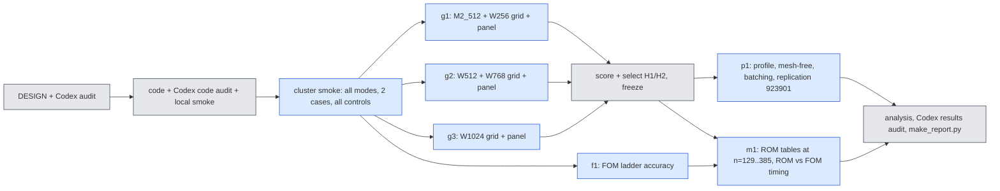

# jcp-speed3d — can the 3D second-order accuracy gain become a real speed-up? (pre-registration)

Lane `exp/2026-10-14-jcp-speed3d`, worktree `worktrees/2026-10-14-jcp-speed3d`, cluster namespace
`/cluster/tufts/paralab/tawal01/jcp-speed3d/` (one directory per job), at most 3 concurrent jobs, at most one local
`jaxrun`. Written 2026-10-14 before any code or job of this lane. Rules: `reports/2026-10-08-jcp-lane-agent-rules.md`
(on `main`). Amendments are appended at the end, dated; this text is never rewritten.

## 0. Why (inherited facts) and the question

Step 2 (`exp/2026-10-13-jcp-combined` @ `6aee084a8`, report `experiments/jcp-combined/report.md`, analysis
`checks/analysis3d-c3grid-3d_e0.json`) measured the 3D Burgers ROM at $65^3$ on the validation cohort 923801 (64 cases)
with the deployed fixed-sweep Levenberg–Marquardt (LM) solver `fs3` and found:

* At $\Delta t_0=0.01$ with one sweep ($K=1$) Crank–Nicolson (CN) costs the same as backward Euler (BE) and is far more
  accurate; at larger steps the grid needed $K=2$ (about $1.44\times$ the per-step cost), and the fixed-sweep CN at
  $2.5\Delta t_0$ is ineligible (non-stationary steps; distance to the verified adaptive solve up to 0.4) on a fixed set
  of cases (W1024: 5, 7, 11, 30, 40, 43, 46, 62).
* Query time does not scale with step count. Our reading of Step 2's run records (to be confirmed by the profile of
  route 3, not assumed): almost all GPU time is spent forming the advection Jacobian $J_u(c)$ (one dense contraction
  of cost $\approx 2\,m\,M\,R'$ flops per LM sweep, $m$ quadrature points, $M\approx 4R'$ tests), and every query starts
  with $a$ adaptive LM steps (about 9 Jacobians in total) whose number does not shrink with the step.
* The pre-registered speed bar (time ratio $\le 0.6$ at equal accuracy against the same bank's deployed BE) failed at
  every bank.

**Question.** At equal accuracy against the E0 second-order references, how much faster than (i) our old ROM and (ii)
the full simulation can the 3D ROM be made, at each mesh, by four routes: (1) one pass per step at big steps,
(2) spending accuracy on a narrower bank or fewer quadrature points, (3) cutting the per-query overhead (profile,
mesh-free online path, batched queries), (4) a large-mesh comparison against the full-order solvers?

## 1. The model (unchanged) and notation

Span $u(x)=\hat G(x)_{:,1:R'}\,c$ of the frozen ordered coordinate-network bank, LSPG on the $M$ lowest mesh sine tests,
off-mesh classical-quadrature advection (rule $X\in\mathbb R^{m\times3}$, weights $w$):
$$\mathrm{adv}(c)=P^{\mathsf T}\big[(Bc)\odot(Dc)\big],\qquad J_u(c)=P^{\mathsf T}\big[\mathrm{diag}(Dc)B+\mathrm{diag}(Bc)D\big],$$
$B=\hat G(X)$, $D=(\partial_x+\partial_y+\partial_z)\hat G(X)$, $P_{qm}=(n-1)^{3/2}w_q\psi_m(x_q)$. Two-step LMM step
(coefficients $a_0,a_1,a_2,b_0,b_1$; BE, CN, BDF2 with one BE start step):
$$r(c)=S\odot\Big(A(a_0c+a_1c_n+a_2c_{n-1})+\Delta t\,b_0\big(\mathrm{adv}(c)+\nu\lambda\odot Ac\big)+\Delta t\,b_1F_n\Big),\quad
S=\frac1{a_0+\Delta t\,b_0\nu\lambda},\quad J(c)=A+\Delta t\,b_0\,S\odot J_u(c).$$
Every quantity below is defined exactly as in Step 2 unless stated.

**Cost structure used by this lane.** Forming $J_u$ costs $\approx2mMR'$ flops. The residual and the exact gradient
$g=J^{\mathsf T}r=A^{\mathsf T}r+\Delta t\,b_0\,J_u^{\mathsf T}(S\odot r)$ need only products with $B,D,P$:
$$J_u(c)^{\mathsf T}v=B^{\mathsf T}\big[(Dc)\odot(Pv)\big]+D^{\mathsf T}\big[(Bc)\odot(Pv)\big],$$
about $2m(M+2R')$ flops — a factor $\approx R'/2$ cheaper than forming $J_u$.

## 2. Settings, rules, schemes, steps

| setting | bank | $R'$ | deployed rule (Step 2 POST HOC selection) | reduced rules (route 2, "fewer points") | Step 2 adaptive start $a$ |
|---|---|---|---|---|---|
| M2_512 | M2 | 512 | gl32 | gl24, lat16384 | 3 |
| W256 | W1024 | 256 | gl24 | gl20, gl16, lat8192 | 6 |
| W512 | W1024 | 512 | lat32768 | lat16384, gl24 | 6 |
| W768 | W1024 | 768 | lat32768 | lat16384 | 6 |
| W1024 | W1024 | 1024 | lat65536 | lat32768 | 6 |

Banks and rules are the sha256-pinned files of Step 2 (`inputs/model_W1024/bank.pkl`, vendored M2 bank,
`vendor/quad3d/rules/rules.npz`, `rules3d/rules_extra.npz`). Trust $=0.05\times$ the bank's coefficient spread at $R'$,
stationarity tolerance $g_{\rm tol}=10^{-3}$, as Step 2.

Schemes: BE, CN, BDF2. CN-R is not run: in Step 2's 3D grid its median error was above CN's and BDF2's at every setting
and step (a scope choice informed by Step 2 data; it selects nothing in this lane). Steps
$\Delta t/\Delta t_0\in\{1,\,1.25,\,5/3,\,2.5\}$ (the step must divide 0.05; $3\Delta t_0$ does not, $5\Delta t_0$ failed
every accuracy bar in Step 2).

## 3. Solvers (route 1)

All solvers return the trajectory $c_0..c_N$ and per-step records; all are f64, every large array a traced jit argument.

* **FS-K1, FS-K2** — Step 2's `fs3` unchanged (copied byte-identically): $a$ adaptive LM steps, then the best of three
  extrapolation candidates ($c_n$, linear, quadratic) and $K$ full-Jacobian LM sweeps per step.
* **FSP-K1** ("better initial guess") — `fs3` with two more predictor candidates: cubic extrapolation
  $4c_n-6c_{n-1}+4c_{n-2}-c_{n-3}$ and an IMEX second-order predictor (advection extrapolated, viscous and mass terms
  implicit, a linear least-squares problem solved with a per-setting QR of $A$):
  $$\tilde c=\arg\min_c\Big\|S\odot\big(A(a_0c+a_1c_n+a_2c_{n-1})+\Delta t\,b_0(\widetilde{\mathrm{adv}}+\nu\lambda\odot Ac)+\Delta t\,b_1F_n\big)\Big\|,
  \quad\widetilde{\mathrm{adv}}=2\,\mathrm{adv}(c_n)-\mathrm{adv}(c_{n-1}).$$
  The candidate with the smallest exact residual is used, then one full-Jacobian sweep. With the two new candidates
  disabled it must reproduce FS-K1 bit for bit (gate G1).
* **QN-k** (k = 1, 4, $\infty$; "Jacobian reuse with exact gradient") — new solver `qn3.py`, batch-first. Per step: the
  FSP predictor; then iterations $c\leftarrow c-\tilde H^{-1}g(c)$ with the **exact** residual and gradient (matrix-free
  products above) and a frozen Gauss–Newton matrix $\tilde H=\tilde J^{\mathsf T}\tilde J+\mu\,\mathrm{diag}(\tilde J^{\mathsf T}\tilde J)$
  (Cholesky factor cached), $\tilde J=A+\Delta t\,b_0S\odot J_u(\tilde c)$ formed at a refresh state $\tilde c$.
  Refresh: every k steps (k = $\infty$: only at the first step and when the scheme coefficients change, i.e. after the
  BE start step of BDF2), and additionally at the start of a step whose predecessor needed more than $q_{\max}/2$
  iterations, and inside a step when a backtracked step (halved twice) is still rejected (at most one in-step refresh;
  after that $\mu\leftarrow10\mu$). Stop when $\|g\|/(\|\tilde J\|_F\|r\|)\le g_{\rm in}=5\cdot10^{-4}$ or after
  $q_{\max}=12$ iterations. Step clipped to the trust radius as in `fs3`. No adaptive start ($a=0$); BDF2 keeps its
  scheme-defined BE start step. Because the gradient is exact, the fixed point is the LSPG stationary point of the same
  residual: QN changes cost, not the discrete solution (checked by the solver-distance criterion of §5).
* **ADT** — Step 2's verified adaptive LSPG solve (`t2core`, tolerance level `tight`) of each (scheme, step): the
  comparator for the solver distance (not timed for selection).

Per step records: full Jacobians formed, cheap iterations, backtracks, refreshes, trust clips, predictor chosen, $\mu$,
in-loop ratio, exit reason.

**Certification (one function for every solver).** After each accuracy run, an untimed pass recomputes, for every step
$n$, the exact Step 2 stationarity ratio $\gamma_n=\|J(c_{n+1})^{\mathsf T}r(c_{n+1})\|/(\|J(c_{n+1})\|_F\|r(c_{n+1})\|)$ with a
fresh full Jacobian, from the saved trajectory. A step is non-stationary iff $\gamma_n>10^{-3}$ or non-finite. Gate G2:
for FS runs the certified $\gamma_n$ equals `fs3`'s own recorded ratio to $10^{-9}$ relative.

## 4. Comparators and the time baseline

* **C_old** — the 3D ROM deployed before this campaign's Step 2: M2_512, gl32, FS-K1 BE $\Delta t_0$.
* **C_W768**, **C_W1024** — the deployed BE (FS-K1, $\Delta t_0$, deployed rule) on the two wide banks (Step 2's
  comparators).
* **Common time baseline** — every A–B–A timing panel of every job uses A = C_old. A configuration's cost is its median
  paired ratio $t_B/\tfrac12(t_{A,1}+t_{A,2})$ over the panel's (case, repetition) invocations; absolute seconds are
  reported beside. Speed-ups against C_W768 / C_W1024 are ratios of their common-baseline costs (both measured against
  A). Timing rules (Step 2 `timing.py`, unchanged): warm JIT (every subject run once per panel case before timing),
  burn-in, randomised order, every timed output's sha256 equal to the accuracy phase's, subject-level drift
  $t_{A,2}/t_{A,1}\in[1/1.1,1.1]$, one GPU type (H200) for every timing in the lane. Positive control T1: a subject that is
  C_old run twice back to back must give ratio $\in[1.8,2.2]$.

## 5. Metrics, ties, eligibility

* **Accuracy (primary).** Against E0 $R_{ST}$ (`refstore`, store version pinned, cohort `val64` = seed 923801):
  $e=\max_{k=1..5}\|u(t_k)-R(t_k)\|/\|R(t_0)\|$ on the $63^3$ scoring lattice; median and worst over the 64 cases.
  Label carried by every number: *E0 is a conditional Richardson estimate (asymptotic assumption, not a rigorous bound);
  its cross-check rule was amended after data (E0 A10).* Ties: per case $\eta=\epsilon_{\rm ref}$; "$a$ ties-or-beats
  $b$" on the median (worst) iff the median (worst) of $e_a-\eta$ is $\le$ the median (worst) of $e_b+\eta$ (interval
  overlap with endpoint propagation, Step 2's rule). Every table also carries the first-order 3D reference scores
  (513 nodes, BE $\Delta t_0/4$; PROVISIONAL, continuity only).
* **Eligibility** (Step 2 A6.2, plus the certified test): (i) every run valid (finite, no non-finite step, no damping
  saturation), (ii) certified non-stationary steps $\le1\%$ of the pooled steps, (iii) solver distance — Gram-metric field
  distance to the ADT solve of the same (setting, rule, scheme, step), max over the five evolved output times, relative to
  $\|u_0\|$ — $\le2.5\cdot10^{-4}$ on **every** case. Only eligible configurations are selected or matched.

## 6. Hypotheses and pass/fail bars

### Route 1 — one pass at big steps
* **H1.1 (diagnosis, descriptive).** For every case that fails eligibility with FS-K2 CN at $2.5\Delta t_0$ (any setting),
  per non-stationary step: first failing step, trust-clip active, rejected sweeps, damping, predictor chosen, ADT
  iterations needed, and the QN-1 iterations needed. Pre-registered classification, per case (the explanation(s) whose
  indicator holds on at least half of that case's FS-K2 non-stationary steps): **E1 too few sweeps** (QN-1 needs
  $\ge3$ iterations at that step); **E2 trust clip binding** (clip active in a sweep of that step); **E3 damping**
  ($\mu$ or LM $\lambda>10^{-3}$ at that step); **E4 none** otherwise.
* **H1.2.** FSP-K1 (better predictor only) is eligible for CN and BDF2 at $2.5\Delta t_0$: verdict per setting
  (expected to fail; it isolates the predictor).
* **H1.3.** QN-k is eligible for CN and BDF2 at every $\Delta t\ge1.25\Delta t_0$: verdict per (k, setting, scheme, step).
* **H1.4 (speed).** For each (setting, scheme, $\Delta t\ge1.25\Delta t_0$) where QN-k and FS-K2 are both eligible:
  **pass** iff the cheapest eligible QN-k costs $\le0.6\times$ FS-K2 (paired common-baseline costs).

### Route 2 — narrower bank / fewer points
* **H2.** For each comparator $C\in\{$C_old, C_W768, C_W1024$\}$: among all eligible configurations (setting, deployed or
  reduced rule, scheme, step, solver), the **cheapest** whose median **and** worst errors tie-or-beat $C$'s. Speed-up
  $S_C=\mathrm{cost}(C)/\mathrm{cost}(\text{winner})$. **Pass** iff $S_C\ge1/0.6$. Median and worst are both reported, for
  the winner and $C$. Decomposition (pre-registered, descriptive): $S_C=S_{\rm solver}\times S_{\rm scheme}$, with
  $S_{\rm solver}=\mathrm{cost}(C)/\mathrm{cost}(\text{cheapest eligible BE configuration that ties-or-beats }C)$.
  Route-2 rules enter only with solvers FS-K1, FS-K2, QN-4 and schemes CN, BDF2 (plus BE for the decomposition).

### Route 3 — overhead
* **H3.1 (profile, descriptive).** For C_old, C_W1024 and every H2 winner: share of the warm query time in (a) IC
  projection, (b) the step loop, split into the adaptive start and the rest, (c) output decode; plus the JIT compile time
  (one-off) and the dispatch floor (an empty jitted call). Components are timed as separate jitted functions, A–B–A
  against the fused query; their sum must be within 15 % of the fused time (gate G3), otherwise the profile is reported
  as indicative only.
* **H3.2 (mesh-free online path).** Projection by quadrature on the setting's own rule
  $c_0=(B^{\mathsf T}WB)^{-1}B^{\mathsf T}W\,u_0(X)$ ($W=\mathrm{diag}\,w$), decode only at the scoring lattice. Qualifies
  (accuracy-neutral) per configuration iff its E0 median and worst each tie-or-beat the mesh path's, or exceed them by at
  most 1 % relatively. Control: the same projection with the deliberately coarse rule lat256 must fail.
* **H3.3 (batching).** vmapped / batch-first queries at $B\in\{1,4,16,64\}$ (or the largest that fits): throughput
  (cases/s) and single-query latency. Gate G4: batched trajectories equal the single-query ones to a field distance
  $\le10^{-8}$ relative per case (QN may take different discrete branches under batched rounding; a larger difference
  must stay $\le2.5\cdot10^{-5}$ and is reported). Control: a batch with the viscosities permuted across members must fail
  G4. Descriptive bar: throughput at $B=16$ at least $2\times$ that at $B=1$.

### Route 4 — against the full simulation, by mesh
* **FOM families** (full simulations on the interior of an $L^3$-cell mesh, outputs on the scoring lattice):
  F-UB upwind + BE (the deployed FOM; arithmetic of the vendor `common.make_fom`), F-UC upwind + CN-R (second order in
  time), F-CC central + CN-R (second order in space and time; E0's scheme — its error against E0 is partly the
  reference's own level difference, so it is reported with that caveat), F-PS sine pseudo-spectral ETDRK4 (E0's
  cross-check solver). FD code is a lane copy of E0 `refcore.py` (import-only change) and PS of `pscore.py` (verbatim,
  wrapped in one jit). FOM ladder: FD $L\in\{64,128\}$ on all 64 cases with $\Delta t\in\{0.01,0.005,0.0025\}$ (BE) or
  $\{0.025,0.0125,0.005\}$ (CN-R), Newton/BiCGStab tolerances $(n_{\rm tol},l_{\rm tol})\in\{(10^{-8},10^{-9}),(10^{-6},10^{-7}),(10^{-4},10^{-5})\}$;
  PS $N\in\{16,24,32,48,64\}$, $\Delta t\in\{0.025,0.01,0.005\}$, all 64 cases; FD $L\in\{256,384\}$ at
  $\Delta t\in\{0.01\}$ (F-UB) and $\{0.0125\}$ (F-CC), loosest qualified tolerance, on an 8-case subset (accuracy then
  diagnostic only).
* **ROM at mesh $n=L+1$**: tests and Laplacian eigenvalues of mesh $n$ (tables built slab-wise without storing the bank
  on the mesh; gate G5: at $n=65$ they equal Step 2's tables to $10^{-11}$ relative; control: tables of $n=66$ must
  not), the mesh-free online path (H3.2), accuracy on all 64 cases at every $n$.
* **H4.1 (flat ROM cost).** For each ROM configuration timed at $L\in\{64,128,256,384\}$: max/min of its absolute warm
  query time over the meshes $\le1.25$ → **pass**.
* **H4.2 (same-mesh, descriptive).** Per $L$: FOM time / ROM time for F-UB and F-CC at $\Delta t_0$, paired A–B–A in one
  job (A = the ROM configuration), errors beside (not an equal-accuracy claim).
* **H4.3 (matched accuracy).** For each ROM configuration and FOM family: the cheapest FOM configuration calibrated on
  all 64 cases whose median **and** worst tie-or-beat the ROM's; speed-up = its time / the ROM's, paired in one job.
  Reported as a loss where $<1$. If the cheapest calibrated configuration of a family is already more accurate than
  the ROM, the speed-up is an **upper bound** (a coarser FOM might match) and is labelled so.

## 7. Controls that must fail (checked on real data at one real size before any verdict)

| id | control | must |
|---|---|---|
| K1 | FS-K1 CN $2.5\Delta t_0$ (ineligible in Step 2) through this lane's certification | be ineligible |
| K2 | QN with $q_{\max}=0$ (predictor only) CN $2.5\Delta t_0$ | be ineligible |
| K3 | QN with the gradient's $J_u^{\mathsf T}$ term dropped ($g=A^{\mathsf T}r$) | exceed the solver-distance bar on $\ge1$ case |
| K4 | scoring: case swap, time shift | change the score by $>10^{-6}$ |
| K5 | mesh-free projection with lat256 | fail H3.2 |
| K6 | batch with permuted viscosities | fail G4 |
| K7 | tables of mesh 66 compared with mesh 65 | fail G5 |
| K8 | F-CC compared with F-UB at $L=64$ (FD port gate G6: the lane copy equals E0 `refcore` and the vendor FOM bit-for-bit or to $10^{-12}$) | differ by $>10^{-6}$ |
| T1 | timing: C_old run twice | ratio in $[1.8,2.2]$ |

## 8. Cohorts and integrity

Selection (H1–H3 winners, the FOM matches) uses only the validation cohort 923801 (E0 `val64`). After the selections are
frozen (`checks/FROZEN-SELECTION.json`, sha256 recorded in the replication config), the frozen configurations and the
comparators are re-run on the historical test cohort 923901 (E0 `test32`, 32 cases) **for replication only**; nothing is
selected on it. No sealed or OOD cohort is created or opened. Anything chosen after seeing this lane's data is labelled
POST HOC. Every result records commit, config, seed, mesh, GPU, backend (`jax_backend=gpu` required in the log),
precision, job id, output paths. All offline scoring runs on CPU (`offline.py`, Step 2 A8.1).

## 9. Jobs and GPU-hour estimate (H200 throughout, so all timings share one GPU type)

Estimate: smoke 1 h; g1 3 h, g2 4 h, g3 5 h; f1 4 h; p1 3 h; m1 8 h; reruns 20 %: about 34 GPU-hours.

## 10. Deliverables

`DESIGN.md` (this), `INHERITED.json`, the code (`qn3.py`, `fs3p.py`, `online.py`, `bigtables.py`, `fomrun.py`,
`s3run.py`, `score3.py`, `analyze.py`, `make_report.py`, `cluster/`), `audits/` (every Codex audit), `runs/` (pulled job
archives; files over 50 MB in `LARGE_FILES.sha256`), `checks/` (scores, analyses, selections), `report.md` (generated;
level-1 title, status line, LaTeX, mermaid, glossary), plots (PNG): time–error Pareto of all routes, overhead breakdown,
batched throughput, ROM and FOM time against mesh size.
