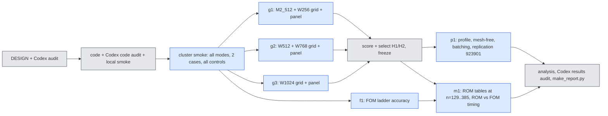

# jcp-speed3d — can the 3D second-order accuracy gain become a real speed-up? (pre-registration)

Lane `exp/2026-10-14-jcp-speed3d`, worktree `worktrees/2026-10-14-jcp-speed3d`, cluster namespace
`/cluster/tufts/paralab/tawal01/jcp-speed3d/` (one directory per job), at most 3 concurrent jobs, at most one local
`jaxrun`. Written 2026-10-14 before any code or job of this lane. Rules: `reports/2026-10-08-jcp-lane-agent-rules.md`
(on `main`). Amendments are appended at the end, dated; this text is never rewritten.

## 0. Why (inherited facts) and the question

Step 2 (`exp/2026-10-13-jcp-combined` @ `6aee084a8`, report `experiments/jcp-combined/report.md`, analysis
`checks/analysis3d-c3grid-3d_e0.json`) measured the 3D Burgers ROM at $65^3$ on the validation cohort 923801 (64 cases)
with the deployed fixed-sweep Levenberg–Marquardt (LM) solver `fs3` and found:

* At $\Delta t_0=0.01$ with one sweep ($K=1$) Crank–Nicolson (CN) costs the same as backward Euler (BE) and is far more
  accurate; at larger steps the grid needed $K=2$ (about $1.44\times$ the per-step cost), and the fixed-sweep CN at
  $2.5\Delta t_0$ is ineligible (non-stationary steps; distance to the verified adaptive solve up to 0.4) on a fixed set
  of cases (W1024: 5, 7, 11, 30, 40, 43, 46, 62).
* Query time does not scale with step count. Our reading of Step 2's run records (to be confirmed by the profile of
  route 3, not assumed): almost all GPU time is spent forming the advection Jacobian $J_u(c)$ (one dense contraction
  of cost $\approx 2\,m\,M\,R'$ flops per LM sweep, $m$ quadrature points, $M\approx 4R'$ tests), and every query starts
  with $a$ adaptive LM steps (about 9 Jacobians in total) whose number does not shrink with the step.
* The pre-registered speed bar (time ratio $\le 0.6$ at equal accuracy against the same bank's deployed BE) failed at
  every bank.

**Question.** At equal accuracy against the E0 second-order references, how much faster than (i) our old ROM and (ii)
the full simulation can the 3D ROM be made, at each mesh, by four routes: (1) one pass per step at big steps,
(2) spending accuracy on a narrower bank or fewer quadrature points, (3) cutting the per-query overhead (profile,
mesh-free online path, batched queries), (4) a large-mesh comparison against the full-order solvers?

## 1. The model (unchanged) and notation

Span $u(x)=\hat G(x)_{:,1:R'}\,c$ of the frozen ordered coordinate-network bank, LSPG on the $M$ lowest mesh sine tests,
off-mesh classical-quadrature advection (rule $X\in\mathbb R^{m\times3}$, weights $w$):
$$\mathrm{adv}(c)=P^{\mathsf T}\big[(Bc)\odot(Dc)\big],\qquad J_u(c)=P^{\mathsf T}\big[\mathrm{diag}(Dc)B+\mathrm{diag}(Bc)D\big],$$
$B=\hat G(X)$, $D=(\partial_x+\partial_y+\partial_z)\hat G(X)$, $P_{qm}=(n-1)^{3/2}w_q\psi_m(x_q)$. Two-step LMM step
(coefficients $a_0,a_1,a_2,b_0,b_1$; BE, CN, BDF2 with one BE start step):
$$r(c)=S\odot\Big(A(a_0c+a_1c_n+a_2c_{n-1})+\Delta t\,b_0\big(\mathrm{adv}(c)+\nu\lambda\odot Ac\big)+\Delta t\,b_1F_n\Big),\quad
S=\frac1{a_0+\Delta t\,b_0\nu\lambda},\quad J(c)=A+\Delta t\,b_0\,S\odot J_u(c).$$
Every quantity below is defined exactly as in Step 2 unless stated.

**Cost structure used by this lane.** Forming $J_u$ costs $\approx2mMR'$ flops. The residual and the exact gradient
$g=J^{\mathsf T}r=A^{\mathsf T}r+\Delta t\,b_0\,J_u^{\mathsf T}(S\odot r)$ need only products with $B,D,P$:
$$J_u(c)^{\mathsf T}v=B^{\mathsf T}\big[(Dc)\odot(Pv)\big]+D^{\mathsf T}\big[(Bc)\odot(Pv)\big],$$
about $2m(M+2R')$ flops — a factor $\approx R'/2$ cheaper than forming $J_u$.

## 2. Settings, rules, schemes, steps

| setting | bank | $R'$ | deployed rule (Step 2 POST HOC selection) | reduced rules (route 2, "fewer points") | Step 2 adaptive start $a$ |
|---|---|---|---|---|---|
| M2_512 | M2 | 512 | gl32 | gl24, lat16384 | 3 |
| W256 | W1024 | 256 | gl24 | gl20, gl16, lat8192 | 6 |
| W512 | W1024 | 512 | lat32768 | lat16384, gl24 | 6 |
| W768 | W1024 | 768 | lat32768 | lat16384 | 6 |
| W1024 | W1024 | 1024 | lat65536 | lat32768 | 6 |

Banks and rules are the sha256-pinned files of Step 2 (`inputs/model_W1024/bank.pkl`, vendored M2 bank,
`vendor/quad3d/rules/rules.npz`, `rules3d/rules_extra.npz`). Trust $=0.05\times$ the bank's coefficient spread at $R'$,
stationarity tolerance $g_{\rm tol}=10^{-3}$, as Step 2.

Schemes: BE, CN, BDF2. CN-R is not run: in Step 2's 3D grid its median error was above CN's and BDF2's at every setting
and step (a scope choice informed by Step 2 data; it selects nothing in this lane). Steps
$\Delta t/\Delta t_0\in\{1,\,1.25,\,5/3,\,2.5\}$ (the step must divide 0.05; $3\Delta t_0$ does not, $5\Delta t_0$ failed
every accuracy bar in Step 2).

## 3. Solvers (route 1)

All solvers return the trajectory $c_0..c_N$ and per-step records; all are f64, every large array a traced jit argument.

* **FS-K1, FS-K2** — Step 2's `fs3` unchanged (copied byte-identically): $a$ adaptive LM steps, then the best of three
  extrapolation candidates ($c_n$, linear, quadratic) and $K$ full-Jacobian LM sweeps per step.
* **FSP-K1** ("better initial guess") — `fs3` with two more predictor candidates: cubic extrapolation
  $4c_n-6c_{n-1}+4c_{n-2}-c_{n-3}$ and an IMEX second-order predictor (advection extrapolated, viscous and mass terms
  implicit, a linear least-squares problem solved with a per-setting QR of $A$):
  $$\tilde c=\arg\min_c\Big\|S\odot\big(A(a_0c+a_1c_n+a_2c_{n-1})+\Delta t\,b_0(\widetilde{\mathrm{adv}}+\nu\lambda\odot Ac)+\Delta t\,b_1F_n\big)\Big\|,
  \quad\widetilde{\mathrm{adv}}=2\,\mathrm{adv}(c_n)-\mathrm{adv}(c_{n-1}).$$
  The candidate with the smallest exact residual is used, then one full-Jacobian sweep. With the two new candidates
  disabled it must reproduce FS-K1 bit for bit (gate G1).
* **QN-k** (k = 1, 4, $\infty$; "Jacobian reuse with exact gradient") — new solver `qn3.py`, batch-first. Per step: the
  FSP predictor; then iterations $c\leftarrow c-\tilde H^{-1}g(c)$ with the **exact** residual and gradient (matrix-free
  products above) and a frozen Gauss–Newton matrix $\tilde H=\tilde J^{\mathsf T}\tilde J+\mu\,\mathrm{diag}(\tilde J^{\mathsf T}\tilde J)$
  (Cholesky factor cached), $\tilde J=A+\Delta t\,b_0S\odot J_u(\tilde c)$ formed at a refresh state $\tilde c$.
  Refresh: every k steps (k = $\infty$: only at the first step and when the scheme coefficients change, i.e. after the
  BE start step of BDF2), and additionally at the start of a step whose predecessor needed more than $q_{\max}/2$
  iterations, and inside a step when a backtracked step (halved twice) is still rejected (at most one in-step refresh;
  after that $\mu\leftarrow10\mu$). Stop when $\|g\|/(\|\tilde J\|_F\|r\|)\le g_{\rm in}=5\cdot10^{-4}$ or after
  $q_{\max}=12$ iterations. Step clipped to the trust radius as in `fs3`. No adaptive start ($a=0$); BDF2 keeps its
  scheme-defined BE start step. Because the gradient is exact, the fixed point is the LSPG stationary point of the same
  residual: QN changes cost, not the discrete solution (checked by the solver-distance criterion of §5).
* **ADT** — Step 2's verified adaptive LSPG solve (`t2core`, tolerance level `tight`) of each (scheme, step): the
  comparator for the solver distance (not timed for selection).

Per step records: full Jacobians formed, cheap iterations, backtracks, refreshes, trust clips, predictor chosen, $\mu$,
in-loop ratio, exit reason.

**Certification (one function for every solver).** After each accuracy run, an untimed pass recomputes, for every step
$n$, the exact Step 2 stationarity ratio $\gamma_n=\|J(c_{n+1})^{\mathsf T}r(c_{n+1})\|/(\|J(c_{n+1})\|_F\|r(c_{n+1})\|)$ with a
fresh full Jacobian, from the saved trajectory. A step is non-stationary iff $\gamma_n>10^{-3}$ or non-finite. Gate G2:
for FS runs the certified $\gamma_n$ equals `fs3`'s own recorded ratio to $10^{-9}$ relative.

## 4. Comparators and the time baseline

* **C_old** — the 3D ROM deployed before this campaign's Step 2: M2_512, gl32, FS-K1 BE $\Delta t_0$.
* **C_W768**, **C_W1024** — the deployed BE (FS-K1, $\Delta t_0$, deployed rule) on the two wide banks (Step 2's
  comparators).
* **Common time baseline** — every A–B–A timing panel of every job uses A = C_old. A configuration's cost is its median
  paired ratio $t_B/\tfrac12(t_{A,1}+t_{A,2})$ over the panel's (case, repetition) invocations; absolute seconds are
  reported beside. Speed-ups against C_W768 / C_W1024 are ratios of their common-baseline costs (both measured against
  A). Timing rules (Step 2 `timing.py`, unchanged): warm JIT (every subject run once per panel case before timing),
  burn-in, randomised order, every timed output's sha256 equal to the accuracy phase's, subject-level drift
  $t_{A,2}/t_{A,1}\in[1/1.1,1.1]$, one GPU type (H200) for every timing in the lane. Positive control T1: a subject that is
  C_old run twice back to back must give ratio $\in[1.8,2.2]$.

## 5. Metrics, ties, eligibility

* **Accuracy (primary).** Against E0 $R_{ST}$ (`refstore`, store version pinned, cohort `val64` = seed 923801):
  $e=\max_{k=1..5}\|u(t_k)-R(t_k)\|/\|R(t_0)\|$ on the $63^3$ scoring lattice; median and worst over the 64 cases.
  Label carried by every number: *E0 is a conditional Richardson estimate (asymptotic assumption, not a rigorous bound);
  its cross-check rule was amended after data (E0 A10).* Ties: per case $\eta=\epsilon_{\rm ref}$; "$a$ ties-or-beats
  $b$" on the median (worst) iff the median (worst) of $e_a-\eta$ is $\le$ the median (worst) of $e_b+\eta$ (interval
  overlap with endpoint propagation, Step 2's rule). Every table also carries the first-order 3D reference scores
  (513 nodes, BE $\Delta t_0/4$; PROVISIONAL, continuity only).
* **Eligibility** (Step 2 A6.2, plus the certified test): (i) every run valid (finite, no non-finite step, no damping
  saturation), (ii) certified non-stationary steps $\le1\%$ of the pooled steps, (iii) solver distance — Gram-metric field
  distance to the ADT solve of the same (setting, rule, scheme, step), max over the five evolved output times, relative to
  $\|u_0\|$ — $\le2.5\cdot10^{-4}$ on **every** case. Only eligible configurations are selected or matched.

## 6. Hypotheses and pass/fail bars

### Route 1 — one pass at big steps
* **H1.1 (diagnosis, descriptive).** For every case that fails eligibility with FS-K2 CN at $2.5\Delta t_0$ (any setting),
  per non-stationary step: first failing step, trust-clip active, rejected sweeps, damping, predictor chosen, ADT
  iterations needed, and the QN-1 iterations needed. Pre-registered classification, per case (the explanation(s) whose
  indicator holds on at least half of that case's FS-K2 non-stationary steps): **E1 too few sweeps** (QN-1 needs
  $\ge3$ iterations at that step); **E2 trust clip binding** (clip active in a sweep of that step); **E3 damping**
  ($\mu$ or LM $\lambda>10^{-3}$ at that step); **E4 none** otherwise.
* **H1.2.** FSP-K1 (better predictor only) is eligible for CN and BDF2 at $2.5\Delta t_0$: verdict per setting
  (expected to fail; it isolates the predictor).
* **H1.3.** QN-k is eligible for CN and BDF2 at every $\Delta t\ge1.25\Delta t_0$: verdict per (k, setting, scheme, step).
* **H1.4 (speed).** For each (setting, scheme, $\Delta t\ge1.25\Delta t_0$) where QN-k and FS-K2 are both eligible:
  **pass** iff the cheapest eligible QN-k costs $\le0.6\times$ FS-K2 (paired common-baseline costs).

### Route 2 — narrower bank / fewer points
* **H2.** For each comparator $C\in\{$C_old, C_W768, C_W1024$\}$: among all eligible configurations (setting, deployed or
  reduced rule, scheme, step, solver), the **cheapest** whose median **and** worst errors tie-or-beat $C$'s. Speed-up
  $S_C=\mathrm{cost}(C)/\mathrm{cost}(\text{winner})$. **Pass** iff $S_C\ge1/0.6$. Median and worst are both reported, for
  the winner and $C$. Decomposition (pre-registered, descriptive): $S_C=S_{\rm solver}\times S_{\rm scheme}$, with
  $S_{\rm solver}=\mathrm{cost}(C)/\mathrm{cost}(\text{cheapest eligible BE configuration that ties-or-beats }C)$.
  Route-2 rules enter only with solvers FS-K1, FS-K2, QN-4 and schemes CN, BDF2 (plus BE for the decomposition).

### Route 3 — overhead
* **H3.1 (profile, descriptive).** For C_old, C_W1024 and every H2 winner: share of the warm query time in (a) IC
  projection, (b) the step loop, split into the adaptive start and the rest, (c) output decode; plus the JIT compile time
  (one-off) and the dispatch floor (an empty jitted call). Components are timed as separate jitted functions, A–B–A
  against the fused query; their sum must be within 15 % of the fused time (gate G3), otherwise the profile is reported
  as indicative only.
* **H3.2 (mesh-free online path).** Projection by quadrature on the setting's own rule
  $c_0=(B^{\mathsf T}WB)^{-1}B^{\mathsf T}W\,u_0(X)$ ($W=\mathrm{diag}\,w$), decode only at the scoring lattice. Qualifies
  (accuracy-neutral) per configuration iff its E0 median and worst each tie-or-beat the mesh path's, or exceed them by at
  most 1 % relatively. Control: the same projection with the deliberately coarse rule lat256 must fail.
* **H3.3 (batching).** vmapped / batch-first queries at $B\in\{1,4,16,64\}$ (or the largest that fits): throughput
  (cases/s) and single-query latency. Gate G4: batched trajectories equal the single-query ones to a field distance
  $\le10^{-8}$ relative per case (QN may take different discrete branches under batched rounding; a larger difference
  must stay $\le2.5\cdot10^{-5}$ and is reported). Control: a batch with the viscosities permuted across members must fail
  G4. Descriptive bar: throughput at $B=16$ at least $2\times$ that at $B=1$.

### Route 4 — against the full simulation, by mesh
* **FOM families** (full simulations on the interior of an $L^3$-cell mesh, outputs on the scoring lattice):
  F-UB upwind + BE (the deployed FOM; arithmetic of the vendor `common.make_fom`), F-UC upwind + CN-R (second order in
  time), F-CC central + CN-R (second order in space and time; E0's scheme — its error against E0 is partly the
  reference's own level difference, so it is reported with that caveat), F-PS sine pseudo-spectral ETDRK4 (E0's
  cross-check solver). FD code is a lane copy of E0 `refcore.py` (import-only change) and PS of `pscore.py` (verbatim,
  wrapped in one jit). FOM ladder: FD $L\in\{64,128\}$ on all 64 cases with $\Delta t\in\{0.01,0.005,0.0025\}$ (BE) or
  $\{0.025,0.0125,0.005\}$ (CN-R), Newton/BiCGStab tolerances $(n_{\rm tol},l_{\rm tol})\in\{(10^{-8},10^{-9}),(10^{-6},10^{-7}),(10^{-4},10^{-5})\}$;
  PS $N\in\{16,24,32,48,64\}$, $\Delta t\in\{0.025,0.01,0.005\}$, all 64 cases; FD $L\in\{256,384\}$ at
  $\Delta t\in\{0.01\}$ (F-UB) and $\{0.0125\}$ (F-CC), loosest qualified tolerance, on an 8-case subset (accuracy then
  diagnostic only).
* **ROM at mesh $n=L+1$**: tests and Laplacian eigenvalues of mesh $n$ (tables built slab-wise without storing the bank
  on the mesh; gate G5: at $n=65$ they equal Step 2's tables to $10^{-11}$ relative; control: tables of $n=66$ must
  not), the mesh-free online path (H3.2), accuracy on all 64 cases at every $n$.
* **H4.1 (flat ROM cost).** For each ROM configuration timed at $L\in\{64,128,256,384\}$: max/min of its absolute warm
  query time over the meshes $\le1.25$ → **pass**.
* **H4.2 (same-mesh, descriptive).** Per $L$: FOM time / ROM time for F-UB and F-CC at $\Delta t_0$, paired A–B–A in one
  job (A = the ROM configuration), errors beside (not an equal-accuracy claim).
* **H4.3 (matched accuracy).** For each ROM configuration and FOM family: the cheapest FOM configuration calibrated on
  all 64 cases whose median **and** worst tie-or-beat the ROM's; speed-up = its time / the ROM's, paired in one job.
  Reported as a loss where $<1$. If the cheapest calibrated configuration of a family is already more accurate than
  the ROM, the speed-up is an **upper bound** (a coarser FOM might match) and is labelled so.

## 7. Controls that must fail (checked on real data at one real size before any verdict)

| id | control | must |
|---|---|---|
| K1 | FS-K1 CN $2.5\Delta t_0$ (ineligible in Step 2) through this lane's certification | be ineligible |
| K2 | QN with $q_{\max}=0$ (predictor only) CN $2.5\Delta t_0$ | be ineligible |
| K3 | QN with the gradient's $J_u^{\mathsf T}$ term dropped ($g=A^{\mathsf T}r$) | exceed the solver-distance bar on $\ge1$ case |
| K4 | scoring: case swap, time shift | change the score by $>10^{-6}$ |
| K5 | mesh-free projection with lat256 | fail H3.2 |
| K6 | batch with permuted viscosities | fail G4 |
| K7 | tables of mesh 66 compared with mesh 65 | fail G5 |
| K8 | F-CC compared with F-UB at $L=64$ (FD port gate G6: the lane copy equals E0 `refcore` and the vendor FOM bit-for-bit or to $10^{-12}$) | differ by $>10^{-6}$ |
| T1 | timing: C_old run twice | ratio in $[1.8,2.2]$ |

## 8. Cohorts and integrity

Selection (H1–H3 winners, the FOM matches) uses only the validation cohort 923801 (E0 `val64`). After the selections are
frozen (`checks/FROZEN-SELECTION.json`, sha256 recorded in the replication config), the frozen configurations and the
comparators are re-run on the historical test cohort 923901 (E0 `test32`, 32 cases) **for replication only**; nothing is
selected on it. No sealed or OOD cohort is created or opened. Anything chosen after seeing this lane's data is labelled
POST HOC. Every result records commit, config, seed, mesh, GPU, backend (`jax_backend=gpu` required in the log),
precision, job id, output paths. All offline scoring runs on CPU (`offline.py`, Step 2 A8.1).

## 9. Jobs and GPU-hour estimate (H200 throughout, so all timings share one GPU type)



Estimate: smoke 1 h; g1 3 h, g2 4 h, g3 5 h; f1 4 h; p1 3 h; m1 8 h; reruns 20 %: about 34 GPU-hours.

## 10. Deliverables

`DESIGN.md` (this), `INHERITED.json`, the code (`qn3.py`, `fs3p.py`, `online.py`, `bigtables.py`, `fomrun.py`,
`s3run.py`, `score3.py`, `analyze.py`, `make_report.py`, `cluster/`), `audits/` (every Codex audit), `runs/` (pulled job
archives; files over 50 MB in `LARGE_FILES.sha256`), `checks/` (scores, analyses, selections), `report.md` (generated;
level-1 title, status line, LaTeX, mermaid, glossary), plots (PNG): time–error Pareto of all routes, overhead breakdown,
batched throughput, ROM and FOM time against mesh size.

---

## Amendment A1 (2026-10-14, before any code; answers `audits/codex-design-1.md`, verdict NOT READY)

Status of the study: **prospectively specified conditional on Step 2's exploration.** The deployed rules (Step 2 POST
HOC), dropping CN-R, the reduced-rule candidates and the step ladder were chosen after seeing Step 2 data on the same
validation cohort; every table carries this label. The numbering below follows the audit's required amendments.

**A1.1 Cost accounting (audit item 1).** §0 and §1 are restated: forming $J_u$ costs $\approx2mMR'$ flops; one adjoint
product $J_u^{\mathsf T}v$ given $Bc,Dc$ costs $\approx2m(M+2R')$ (forming/product $\approx MR'/(M+2R')\approx2R'/3$
for $M=4R'$); a residual adds $\approx2m(2R'+M)$ for $Bc,Dc,P^{\mathsf T}(\cdot)$ and $2MR'$ for $Ac$. Flop ratios do not
give wall-time shares (GEMM vs bandwidth-bound products). The `fs3` start uses $a_{\rm eff}=\lceil a\Delta t_0/\Delta t\rceil$
adaptive steps (fewer at larger steps), each forming the Jacobian at its initial and returned state plus once per LM
iteration; source-level startup contraction counts are about 22 ($\Delta t_0$) and 17 ($2.5\Delta t_0$) for W1024 CN.
"Jacobian formation dominates the query time" is an **unverified hypothesis**, tested by the H3.1 profile, which now
times separately: Jacobian formation (`contract`), normal matrix + Cholesky, one cheap QN iteration (residual +
gradient + triangular solves), projection, decode, and the startup phase.

**A1.2 QN specification (audit item 2).** The claim "QN converges to ADT's stationary point" is withdrawn. Restated:
any fixed point of QN satisfies $g=J^{\mathsf T}r=0$, the same equation as the LSPG stationary point; convergence and
agreement with ADT are **empirical**, established only by certification (γ) and the solver distance at the five output
times (the conclusion is limited to these). A failed certification makes the configuration ineligible; the timed
trajectory is never repaired. Executable specification, per batch member (batch-first code, B = 1 for single queries):

```
constants: g_in = 5e-4, q_max = 12, mu0 = 1e-10, trust as fs3, k_ref in {1, 4, inf}
carry: c_n, c_{n-1}, c_{n-2}, c_{n-3}; adv_n, adv_{n-1}; H (R'xR', unregularised J~^T J~), Lfac = chol(H + mu diag H),
       Jn = ||J~||_F, mu, last_ref (step index), q_prev (iterations of the previous step), fail_prev (bool)
step k = 0..N-1:
  co = BE coefficients if k < n_startup(scheme) else the scheme's; S = 1/(a0 + dt b0 nu lam); F_n = adv_n + nu lam A c_n
  hist = a1 A c_n + a2 A c_{n-1} + dt b1 F_n;  r(c) = S*(a0 A c + hist + dt b0 (adv(c) + nu lam A c))
  g(c, r) = A^T r + dt b0 Ju(c)^T (S r)                    [mutation K3: g = A^T r]
  predictor: candidates (index order) P0 = c_n; P1 = 2c_n - c_{n-1} (k>=1); P2 = 3c_n - 3c_{n-1} + c_{n-2} (k>=2);
     P3 = 4c_n - 6c_{n-1} + 4c_{n-2} - c_{n-3} (k>=3); P4 = IMEX: argmin_c ||A c + S*(hist + dt b0 adv~)||, adv~ = adv_n (k=0)
     or 2adv_n - adv_{n-1} (k>=1), solved as c = -R_A^{-1} Q_A^T (S*(hist + dt b0 adv~)) with A = Q_A R_A (one QR per
     setting and mesh). Inactive candidates have residual +inf; c = the candidate of smallest ||r|| (ties: lowest index).
  refresh_due = (k == 0) or (k == n_startup > 0) or (k - last_ref >= k_ref) or (q_prev > q_max/2) or fail_prev
  if refresh_due: Ju = contract(c); J~ = A + dt b0 S*Ju; H = J~^T J~; Jn = ||J~||_F; mu = mu0; Lfac = chol(H + mu diag H);
     last_ref = k; n_full += 1
  emergency_used = False; r = r(c); g = g(c, r); gam = ||g|| / (Jn ||r|| + 1e-300)
  done = (||r|| == 0) or (gam <= g_in); q = 0
  while not done and q < q_max and finite:
     q += 1; d = -cho_solve(Lfac, g); if ||d|| > trust: d *= trust/||d|| (n_clip += 1); if d non-finite: reason 3, stop
     accepted = False
     for alpha in (1, 1/2, 1/4):                   (n_backtrack += 1 for alpha < 1)
        c' = c + alpha d; r' = r(c'); if finite(r') and ||r'|| < ||r||: accepted = True; break
     if accepted: c, r = c', r'; g = g(c, r); gam = ||g|| / (Jn ||r|| + 1e-300); done = gam <= g_in
     elif not emergency_used: (refresh at the current c as above; last_ref = k); emergency_used = True; n_full += 1
     else: mu = 10 mu; Lfac = chol(H + mu diag H) (n_mu += 1)
  reason = 4 if done else (3 if non-finite else 0); q_prev = q; fail_prev = (reason != 4)
  c_{n+1} = c; adv_{n+1} = adv(c); shift histories
```
A non-positive-definite factor (non-finite `Lfac`) is treated as non-finite (reason 3). `mu` is reset only at a refresh.
In a batch, any refresh flag computes the contraction for every member (one batched call) and updates only the flagged
members, so batched and single runs follow the same per-member branches up to rounding. Records per step: `n_full`,
`q`, `n_backtrack`, `n_clip`, `n_mu`, refresh reason, predictor index, final `gam`, reason.

**A1.3 Predictor (audit item 3).** FSP-K1 = `fs3` copy (`fs3p.py`) with candidates P3 and P4 above added to `fs3`'s
P0–P2, same activation indices and tie rule; FSP keeps `fs3`'s $a_{\rm eff}$ adaptive start, so P3/P4 enter only in
the fixed-sweep phase with full history. P0–P2 residuals are computed exactly as in `fs3` (extrapolated $J_u$); P3's
with the extrapolated $J_u$ (one more carried Jacobian); P4's with the cheap exact residual, and if P4 is chosen its
$J_u$ is formed (one extra contraction, counted). With P3/P4 statically disabled the module executes `fs3`'s original
code path (gate G1: bitwise equal W and records to FS-K1 on 2 cases). "IMEX predictor" names an extrapolation of order
two in the advection only; it is not a claim about the scheme's order (for BE it is a first-order semi-implicit guess).

**A1.4 Eligibility, certification, references (audit item 4).** Step 2's A6.2 is: validity + solver distance to the
verified adaptive solve $\le2.5\cdot10^{-4}$ on every case. This lane **adds** a new requirement (E-b): certified
non-stationary steps $\le1\%$ of pooled steps. All three (E-a validity, E-b, E-c distance) are applied to every
configuration including the comparators, recomputed here. ADT validity: every step verified (Step 2 rule); plus
an ADT gate: `tight` vs `tighter` ADT runs of the same (scheme, step) on cases 0–7 at each setting's deployed rule
must agree within $2.5\cdot10^{-5}$ (else that (scheme, step) is unresolved and its configurations unselectable).
Certification: $\gamma_n=\|J^{\mathsf T}r\|/(\|J\|_F\|r\|+10^{-300})$, non-finite ⇒ non-stationary; G2 tolerance
$|\gamma_{\rm cert}-\gamma_{\rm rec}|\le10^{-9}\gamma_{\rm rec}+10^{-12}$ on FS fixed-sweep steps. References:
`refstore.load(3,'val64',j,'ST',field='finest')` at a pinned `store_version`; the manifest and `STATUS.json` hashes are
recorded; a case enters ranking only if `reference_status(...)['eligible']` (Step 2 found all 64 eligible; checked again).
"Ties-or-beats" means "not resolved as worse", not proven equality; reports use that wording.

**A1.5 Timing claims (audit item 5).** Common-baseline ratios (A = C_old) are used for **screening and selection
only**. Every claimed speed-up is **confirmed** in one job on one physical GPU by a direct panel A = comparator,
B = winner (cases 0–7, 3 repetitions, Step 2 rules), and the H1.4/H2 verdicts use the confirmed paired median ratio;
the screening value is shown beside. T1 is two separately dispatched, synchronized jitted calls whose outputs are both
fetched (hash-checked).

**A1.6 H1.1 (audit item 6).** E1–E3 are renamed **descriptive indicators**, not causes. Cases examined: per setting,
those failing E-a, E-b or E-c with FS-K2 CN $2.5\Delta t_0$ at the deployed rule (empty set ⇒ "none to diagnose").
Per case, the first certified non-stationary step $n^\*$ (or, if none, the first output interval where the distance
exceeds the bar, recorded as "distance-only") is **replayed** from the FS-K2 run's saved states $(c_{n^\*}, c_{n^\*-1},
c_{n^\*-2})$ and carried damping, with the same predictor candidate, under controlled interventions: (i) K = 2..12
full sweeps (smallest K with $\gamma\le10^{-3}$), (ii) trust $\times10$ with K = 2, (iii) damping reset to $10^{-12}$
with K = 2, (iv) QN from the same start. Reported per case: which interventions reach stationarity. A case is
attributed to "too few sweeps" iff (i) succeeds with K ≤ 4 and (ii), (iii) fail; to "trust clip" iff (ii) succeeds and
(i) needs K > 4; to "damping" iff (iii) succeeds and (i) needs K > 4; otherwise "mixed / unexplained". Within-step
clip and rejection events are recorded per sweep.

**A1.7 Hypothesis bookkeeping (audit item 7).** H1.4 outcomes per cell: pass / fail / **rescue** (QN eligible, FS-K2
ineligible: reported separately, not a failure) / unavailable (QN ineligible). Selection population: screening panel
cases 0–3 × 2 repetitions; "cheapest" = lowest median screening ratio; within 3 % ties go to the lower median E0 error,
then the lower worst; a configuration with an invalid timing panel is not selectable. If no eligible configuration
ties-or-beats a comparator, H2 for it is "unavailable". The decomposition is renamed: **best-BE improvement**
$S_{\rm BE}={\rm cost}(C)/{\rm cost}(B^\*)$ ($B^\*$ the cheapest eligible BE configuration that ties-or-beats C, any
bank/rule/step/solver) and **additional improvement from second-order schemes** $S_C/S_{\rm BE}={\rm cost}(B^\*)/{\rm cost}(W^\*)$;
neither isolates a single factor. Both confirmed in the A1.5 panel (B\* is added to it).

**A1.8 Route 3 (audit item 8).** H3.1: the components of A1.1 are timed separately; the profile is **indicative**
(separately compiled pieces); G3 remains a consistency check. H3.2 (mesh-free projection, solved with Cholesky of
$B^{\mathsf T}WB$; the configuration is invalid if its condition number exceeds $10^{10}$) qualifies iff (a) the
mesh-free runs are eligible under E-a/E-b/E-c with the ADT comparator **initialised by the same mesh-free projection**,
(b) median and worst E0 errors tie-or-beat the mesh path's or exceed them by at most 1 % relatively, and (c) no case's
error exceeds its mesh-path error by more than $\max(2\eta,\,0.1\,e_{\rm mesh})$. K5 is replaced: the projection with
the full-rank but coarse rule gl12 (1728 points ≥ R′) must fail (b) or (c) for at least one setting (rank checked).
G4 outcomes are explicit: **exact** (field distance ≤ 1e-8 on every case), **within tolerance** (≤ 2.5e-5, reported
with the count), **fail**. K6 = wrong-viscosity association (member i receives viscosity of member i+1 while keeping
its own IC; expected outputs unchanged) must fail; positive control K6+: a whole-query permutation must pass
(exact or within tolerance). The primary speed claim is single-query latency; batch throughput is reported separately
and never substituted for it.

**A1.9 Route 4 (audit item 9).**
* *Query contract (also item 13).* Input: ν and the initial field on the method's own input points (FD and mesh-path
  ROM: interior mesh nodes; mesh-free ROM: rule points; PS: sine coefficients), prepared outside the timer for every
  method; the preparation time of each is measured and reported separately. Output: the six fields on the 63³ scoring
  lattice, on the device, inside the timer (FD: lattice slicing inside the jit; PS: synthesis inside the jit; ROM:
  decode at the lattice). Offline setup (tables, factorizations, compilation) reported separately.
* *FOM ladder (calibrated on all 64 cases).* F-UB: $L=64$, $\Delta t\in\{0.01,0.005,0.0025\}$; $L=128$, $\{0.01,0.005\}$.
  F-UC and F-CC: $L=64$, $\{0.025,0.0125,0.01,0.005\}$; $L=128$, $\{0.0125,0.01\}$. F-PS: $N\in\{16,24,32,48,64\}$ ×
  $\{0.025,0.01,0.005\}$.
* *Tolerance qualification (FD).* Per (family, L, Δt), on cases 0–3: the loosest $(n_{\rm tol},l_{\rm tol})$ of the three
  levels such that every stage converged (final residual ≤ $n_{\rm tol}$, no max-Newton exit, finite) and the lattice
  output differs from the tightest level's by ≤ $10^{-6}\,n_0$ at every output time on all four cases. Production runs
  at that level; a production case with any unconverged stage makes the configuration invalid (not matchable).
* *PS.* A pure-JAX timed entry point `psjax.py` reusing `pscore`'s `nonlinear` and contour-mean ETDRK4 coefficients
  (eigenvalues in `jnp`, traced ν), one jit including lattice synthesis; gate G7: equal to `pscore.make_ps(...).run`
  lattice output to $10^{-12}$ relative on 2 cases at N = 32; control: half Δt must differ by $>10^{-9}$.
* *H4.3 is cross-resolution:* the matched FOM is the cheapest calibrated configuration of the family over the whole
  ladder (any L, Δt, N) that ties-or-beats the ROM on median and worst. Its speed-up is always an **upper bound relative to
  an unrestricted, optimally tuned FOM family** (finite ladder); a match at the ladder's cheapest member is flagged
  "boundary". Matched timings are paired in one job (A = ROM, B = FOM), cases 0–3, 2 repetitions.
* *H4.2 same-mesh (diagnostic):* $L\in\{64,128,256,384\}$, F-UB $\Delta t=0.01$ and F-CC $\Delta t=0.01$ (added to the
  ladder at every L), accuracy on cases 0–7 at L = 256, 384 (diagnostic, labelled 8-case), timing paired against the ROM
  at mesh $n=L+1$; all meshes in one job (H4.1 needs it), same timing population.
* *ROM tables at mesh n, streaming algorithm (`bigtables.py`).* Modes $(k_x,k_y,k_z)$, eigenvalues and $M$ from
  `common.modes(n, complete_M(n, 4R'))`. With $\phi_k(j)=\sqrt{2/(n-1)}\sin(\pi kj/(n-1))$, $K_a=\max k_a$: for each
  x-slab $a=1..n-2$: evaluate $\hat G$ at the slab's $(n-2)^2$ nodes ($(n-2)^2\times R'$, chunked by rows), contract
  $z$ with $\Phi_z[:, :K_z]$, then $y$ with $\Phi_y[:, :K_y]$ → $(K_y,K_z,R')$, accumulate $T[k_x]\mathrel{+}=\phi_{k_x}(a)\,(\cdot)$
  into $T\in\mathbb R^{K_x\times K_y\times K_z\times R'}$; finally $A_{m,:}=T[k_{x,m},k_{y,m},k_{z,m},:]$. Nothing of size
  $N\times R'$ is stored; no Gram matrix (mesh-free path). $P$ at mesh $n$ = `offmesh.test_block(n, X, w, kxyz_n)`.
  G5 per quantity at $n=65$ against `tables.build_tables`: identical `kxyz` and $M$, identical $\lambda$, $A$ equal to
  $10^{-11}$ relative (Frobenius), for M2_512 and W256 (and W1024 if it fits). K7: $A$ at $n=66$ restricted to the same
  mode triples differs from $n=65$ by $>10^{-4}$ relative.
* *Feasibility certificate.* The cluster smoke runs one F-UB and one F-CC case at $L=384$ and `bigtables` at $n=385$ for
  $R'=1024$, recording peak device memory and time; the production `m1` allocation is projected from it (stop rule:
  a mesh whose pilot does not fit or projects over the allocation is dropped and reported as infeasible).

**A1.10 Controls (audit item 10).** Smoke cases are fixed: 923801 cases 0, 5, 7 (5 and 7 failed FS-K2 CN 2.5Δt₀ at every
Step 2 setting). Controls K1–K3 are evaluated on the production cohort; a control that does not fire **blocks the
claim it protects** (K1/K2 block H1 eligibility verdicts, K3 blocks QN eligibility); no case hunting. K4: swap = case
0's field scored against case 1's reference; shift = output times rolled by one; failure predicate: score changes by
$>10^{-6}$. K9 (new, distance classifier): an eligible run's output W perturbed along a fixed random direction to field
distances $0.5\times$ and $2\times$ the $2.5\cdot10^{-4}$ bar must be classified within / beyond. K10 (new, FOM matcher):
two synthetic ladder entries — zero time but an unconverged stage; zero time but errors $10\times$ the ROM's — must be
rejected by the matcher. G6 (FD port): lane `fomcore` equals E0 `refcore` bit-for-bit on one case at L = 64 for each of
F-UB, F-UC, F-CC (CPU); `fomcore` F-UB at $\Delta t=0.005$ equals the vendor `common.make_fom(65, .005, ...)` to
$10^{-12}$ relative at equal tolerances; K8 (F-CC vs F-UB differ) kept.

**A1.11 Freeze and replication (audit item 11).** Order: g1–g3 + f1 → H1/H2 screening selection → p1 (profile,
mesh-free qualification on validation, batching, confirmation panels A1.5) and m1 (route 4) → **one immutable
`checks/FROZEN-SELECTION.json`** containing every validation-selected decision (H1/H2 winners, H3.2 qualifications, the
matched FOM configurations) → r1: replication on 923901 (E0 `test32`) of the frozen ROM configurations, comparators and
matched FOM configurations, accuracy only (plus one paired timing panel per comparator, reported as replication).
923901 is historical, not untouched; called "replication cohort".

**A1.12 Resources (audit item 12).** Each production config gets a run inventory (`s3run.py --dry-run`) and a projection
from the cluster smoke's measured per-run times (compile, ADT, certification, panels) × 1.5; the job's wall-time
allocation must cover it (else split). All jobs H200. Timing comparisons are only made within a job.

**A1.13 Reduced quadrature (audit item 13).** Reduced rules are **empirically validated surrogates**: no
quadrature-equivalence claim. For every H2 winner and B\* the lane also runs the same configuration with the setting's
converged rule (Step 2: M2_512/W256/W512 gl56, W768 gl64, W1024 gl80) and reports $\delta_{\rm quad}$ (field distance)
beside its accuracy.

---

## Amendment A2 (2026-10-14, before any run; answers `audits/codex-design-2.md`, verdict NOT READY)

**A2.1 QN semantics (blocking 1).** Replaces the corresponding lines of A1.2.
* *Initialisation:* $c_{-1}=c_{-2}=c_{-3}=c_0$, $\mathrm{adv}_{-1}=\mathrm{adv}_0=\mathrm{adv}(c_0)$, $H=0$, `Lfac`$=0$, `Jn`$=1$,
  $\mu=\mu_0$, `last_ref`$=0$, `q_prev`$=0$, `fail_prev`$=$False, `dead`$=$False (all finite, so masked history terms are
  finite zeros-times-finite).
* *One refresh operation* `refresh(c, mask)`: for masked members sets $H,\ $`Lfac`$=\mathrm{chol}(H+\mu_0\,\mathrm{diag}H)$,
  `Jn`, $\mu=\mu_0$, `last_ref`$=k$, and increments the per-member counter `n_ref` once. Separately, the per-step counter
  `n_exec` records contractions **executed** (in a batch: Bt per call, whether or not a member was flagged). After every
  refresh (step-start or emergency) `gam` and `done` are recomputed with the new `Jn`. An emergency refresh triggered in
  the last allowed iteration is performed and counted; no further solve follows.
* *Candidates:* a candidate whose residual norm is non-finite is masked like an inactive one; if all five are masked the
  member is non-finite at this step.
* *Finiteness:* a member is `bad` at a step if any of: all candidates masked, non-finite residual norm, gradient,
  `gam`, step $d$, or `Lfac`. Reason precedence: 3 (bad) > 4 (done) > 0. A member that is bad at step $k$ becomes `dead`:
  its state is frozen at its last finite value, it records reason 3 at every later step, and its run is invalid (E-a).
* *Batch masks:* `act = ~done & ~bad & ~dead`. Only active members change state, damping or counters inside the
  iteration loop; step-start refresh flags are intersected with `~dead`, emergency flags with `act`.

**A2.2 H1.1 replay (blocking 2).** Replaces the procedure of A1.6.
* *Cases:* per setting, the cases of FS-K2 CN $2.5\Delta t_0$ at the deployed rule that are invalid, or have ≥ 1
  certified non-stationary step, or exceed the solver-distance bar (the per-case parts of E-a, E-b, E-c).
* *Replayed step $n^\*$:* the first step with reason 3 or damping saturation (validity failures); else the first certified
  non-stationary step; else (distance-only) the step of largest certified $\gamma$ within the first output interval whose
  output exceeds the bar.
* *Start:* the saved $c_{n^\*},c_{n^\*-1},c_{n^\*-2}$; the damping entering step $n^\*$ (the value carried out of step
  $n^\*-1$, recorded); the saved predictor index of step $n^\*$; Jacobian history recomputed by contraction. *Baseline
  replay:* K = 2 from this start must reproduce the recorded $c_{n^\*+1}$ to $10^{-10}$ relative and $\gamma$ to
  $10^{-6}$ relative; otherwise the case is "replay not reproducible" and no intervention is interpreted.
* *Interventions:* (i) K = 2..12 sweeps (smallest K with $\gamma\le10^{-3}$, or "> 12"); (ii) K = 2 with trust
  $\times10$; (iii) K = 2 with damping reset to $10^{-12}$; (iv) QN-1 (step-start refresh at the same candidate).
* *Labels (mutually exclusive, in this precedence):* "mixed" if two or more of {(i) with K ≤ 4, (ii), (iii)} succeed;
  else "too few sweeps" if (i) with K ≤ 4; else "trust clip" if (ii); else "damping" if (iii); else "unexplained".
  Scope: a statement about the replayed step, not a cause of the trajectory's accuracy failure.

**A2.3 Distance metric (blocking 3).** Every field distance in this lane (E-c, ADT tight/tighter agreement, H3.2, K9,
controls) is the **scoring-lattice distance** $\max_{k=1..5}\|(W_a-W_b)_k\,G_{\rm lat}\|_2/n_0$, $G_{\rm lat}$ the bank
rows at the $63^3$ lattice, $n_0=\|u_0\|_2$ on the lattice. At $n=65$ the lattice is exactly the interior mesh, so this
equals Step 2's Gram-metric distance (verified by gate G8 on stored Step 2 W's: equal to $10^{-12}$ relative). At
$n>65$ it is a lattice metric, not a mesh metric; labelled so. For route 4, ADT `tight` runs of each timed ROM
configuration at each mesh are made on all 64 cases (E-c at that mesh), with a tight/tighter check on cases 0–7.

**A2.4 Mode indexing (blocking 4).** `common.modes` returns one-based triples; the executable gather is
$A_{m,:}=T[k_{x,m}-1,\,k_{y,m}-1,\,k_{z,m}-1,:]$, and column $j-1$ of each sine table holds mode $j$:
$\Phi[a-1,j-1]=\sqrt{2/(n-1)}\sin(\pi j a/(n-1))$, $a=1..n-2$ (one-based node index, denominator $n-1$).

**A2.5 FOM qualification reference (blocking 5).** The tightest level itself must pass (finite, every stage's recorded
**relative** residual $\le n_{\rm tol}$, no max-Newton exit) on all four calibration cases; otherwise the (family, L,
Δt) configuration is **unavailable** (no fallback). Lattice difference: $\max_{k}\|u_{\rm lev}(t_k)-u_{\rm tight}(t_k)\|_2/n_0$
on the scoring lattice, $n_0=\|R(t_0)\|_2$.

**A2.6 K9 (blocking 6).** Origin: the ADT comparator output $W^{\rm ADT}$ of M2_512 BE $\Delta t_0$ at the deployed rule,
case 0. Direction $v$: a fixed seeded (seed 20261014) standard normal $(6\times R')$ array with row 0 zeroed, scaled so
that the lattice distance of $W^{\rm ADT}+sv$ to $W^{\rm ADT}$ is exactly $0.5\tau$ and $2\tau$ ($\tau=2.5\cdot10^{-4}$,
verified before classification). The E-c classifier applied to (synthetic, $W^{\rm ADT}$) must return within / beyond.

**A2.7 Non-blocking items, adopted.** (a) Route 4's matched-accuracy panels (cases 0–3, 2 repetitions) are an explicit
exception to A1.5's 8×3 confirmation panel; the H2 confirmations keep 8×3. (b) Decomposition: each factor is the
median of its own direct paired panel; their product is not claimed to equal the total. (c) K5 counts only if gl12
passes rank and condition ($<10^{10}$) checks. (d) ADT tight/tighter (cases 0–7, $2.5\cdot10^{-5}$) is also run for every
finalist's reduced rule (in p1) and every route-4 mesh (in m1). (e) All latencies are **prepared-input latencies**,
with preparation cost beside them. (f) FSP's fixed phase may start before cubic history exists (e.g. M2_512,
$2.5\Delta t_0$, $a_{\rm eff}=2$); the $k\ge3$ mask handles it ("with full history" in A1.3 is withdrawn). (g) A1.11
supersedes the execution diagram of §9.

---

## Amendment A3 (2026-10-14; `audits/codex-design-3.md` verdict READY, non-blocking clarifications adopted)

* A2.3 orientation: $G_{\rm lat}\in\mathbb R^{63^3\times R'}$ (bank rows at the lattice points), decode $(W_a-W_b)_kG_{\rm lat}^{\mathsf T}$.
* A2.2 replay: the baseline-replay check on $\gamma$ uses $|\gamma_{\rm replay}-\gamma_{\rm rec}|\le10^{-6}\gamma_{\rm rec}+10^{-9}$; a
  distance-only case whose replayed step is already stationary is reported "baseline already stationary"; replay covers
  only fixed-sweep steps (a failing step inside the adaptive start is reported as such and not replayed).
* A1.2 + A2.1 are implemented as one checklist in the docstring of `qn3.py`.

---

## Amendment A4 (2026-10-15, before any cluster job; from `audits/codex-code-1.md`, `codex-code-2.md`)

* **A4.1 Smoke acceptance.** The cluster smoke (`smoke.sh`) runs `test_s3.py` (M2_512 gl32 and W1024 lat65536, cases
  0, 5, 7), `test_fom.py` (L = 64; G6 against E0 `refcore` needs the E0 source and is run on CPU locally:
  `checks/test_fom-local-cpu.json`), and the four smoke modes; `smoke_accept.py` writes `ACCEPTANCE.json`. The smoke is
  accepted only if every gate there passes; job completion is not acceptance. G8 is checked locally on Step 2's stored
  outputs (`checks/test_g8.json`).
* **A4.2 FOM stage convergence (clarifies A2.5).** A stage is converged iff its recorded relative residual is
  $\le n_{\rm tol}$; the `refcore` Newton loop stops on that test or at its 20-iteration limit, so a limit exit with the
  residual met is converged (counted and flagged), and a limit exit without it is not. Evidence must be complete: the
  number of stages equals the schedule's (`n_stages`), the time units reach 0.25, and every stage has a residual and a
  Newton count in [0, 20].
* **A4.3 Profile kernels (A1.1, A1.8).** Contraction, normal matrix + Cholesky, one QN iteration (exact residual,
  exact gradient, solve, trust clip, one trial residual = the accepted-step path) and one full QN step with a refresh are
  timed at a real stage of the configuration's own trajectory (mid step $k$, history $c_k,c_{k-1}$, start state the
  linear predictor $2c_k-c_{k-1}$). JIT compile time is estimated per configuration as the first call minus the median
  of the later calls; input preparation (IC on the mesh, at the rule points, sine coefficients) is timed separately.
* **A4.4 Matched FOM timing (H4.3).** Every matched FOM configuration is timed against the ROM at every mesh of the
  route-4 job (cross-resolution).
* **A4.5 Deferred (implemented before the decision each one feeds, never after it):** the selection/freeze script, the
  FOM matcher with K10, the confirmation-based final H1.4/H2 verdicts, the H3.2/K5 qualification verdict and G3, the
  analysis completeness/provenance checks, and the smoke-derived resource certificates.

---

## Amendment A5 (2026-10-15; coordinator guidance on the smoke-acceptance audits)

The smoke acceptance (`smoke_accept.py`) exists to catch real bugs — wrong numbers, missing outputs, controls that do not
fire, results from the wrong job — not to resist a deliberate forger with write access to the output directory (no one in
this setup forges outputs). The standard is the round-6 version: every predicate recomputed from the raw outputs. From
`audits/codex-code-6.md` on, findings that require deliberately fabricated files are recorded as NOTED (not blocking) in the
audit response and fixed only if cheap; only findings where honest code or honest cluster behaviour could give a false PASS
or a false FAIL block the smoke. The Codex gates on the job config, the results and the report are unchanged.

---

## Amendment A6 (2026-10-15, before any production result is read; from `audits/codex-select-2.md`)

**H4.3 scope.** The matched-accuracy speed-up of H4.3 is defined for the selected ROM configuration as selected: the
mesh path at $n=65$, whose E0 errors were matched. Its matched FOM configurations (any mesh, any step) are timed against
it in one panel of the m1 job (`match|<label>`). The A4.4 timings of the same FOMs against the mesh-free ROM at every mesh
(`mesh|L<L>|<label>`) are reported as H4.1/H4.2 diagnostics; at a mesh $n>65$ a speed-up is labelled "matched" only if
that mesh-specific ROM's own E0 median and worst still tie-or-beat-match the FOM configuration (recomputed in the final
analysis); otherwise it is reported as an unmatched same-job timing with both errors beside it. Claim gates (population,
K9, K3, evidence) apply to H1 verdicts and to FOM matching exactly as to H2 selection.

---

## Amendment A7 (2026-10-17, lane resumed by a new agent; before any g1–g3 result was read)

* **Resume.** The previous lane agent stopped after submitting g1. g1 5301580, g2 5301264 and g3 5301270 had all
  COMPLETED (sacct) and were collected on 2026-10-17 with `cluster/collect.sh` (OUTPUTS.sha256 verified, `jax_backend=gpu`
  in every log, cluster directories removed). Nothing in the design changes; the audited pipeline is run as is:
  `score3.py` (CPU) → `analyze.py` → `select_s3.py --stage screen` → `fom_match.py` → `select_s3.py --stage mesh` → p1, m1.
* **GPU-hour cap.** The lane brief names no hour cap; the §9 estimate (about 34 GPU-hours including 20 % reruns) is adopted
  as the hard cap. Ledger `runs/GPU-LEDGER.json`, measured from `sacct` ElapsedRaw (8.91 GPU-hours spent before p1/m1).
  Defer order if the cap binds: (1) r1 replication on 923901 (A1.11), (2) the A1.13 converged-rule sensitivity runs,
  (3) L = 384 in m1, (4) batching at B = 64. The p1 confirmation panels and the m1 n = 65 match panels are never deferred.
* **Large files.** From g1 on, job outputs over 50 MB stay out of git (`.gitignore`) and are tracked only by SHA256 in
  `LARGE_FILES.sha256` (local disk 94 % full). f1's `W_fom.npz` had already been committed by the previous agent.
* **g3 stderr.** g3's log carries one JAX warning, "a large amount of constants were captured during lowering (3.26 GB)".
  The job completed; JIT compilation is excluded from every timed call (warm calls), so timings are unaffected in
  principle; the results audit is asked to check whether any W1024 output or timing is anomalous. The p1/m1 configs are
  checked for the same warning in their smoke/pilot logs before submission.
* **Account-wide cap.** `cluster/submit.sh` checks the lane cap (3); the campaign-wide cap of 8 concurrent jobs on the
  account is checked by hand (`squeue -u tawal01 -h | wc -l`) before every submit and added to `submit.sh`.

---

## Amendment A8 (2026-10-17, after the g1–g3 screening analysis, before p1/m1 are staged)

* **m1 resource certificate.** `resources.project_mesh` filled the missing L = 256 FOM solve time by $L^4$ scaling from
  the smoke's L = 128 `seconds_first` (4.5 s, compile-dominated), i.e. 72 s per solve, above the measured L = 384 pilot
  solve (12.7 s). FOM cost grows with L, so the measured L = 384 solve is now the upper proxy for L = 256 (L^4 from L = 128
  is kept only when no L = 384 pilot exists). Projection: m1 21.4 h → 10.0 h; p1 7.0 h (unchanged). Ledger check:
  8.91 spent + 7.04 + 10.03 = 25.98 ≤ 34 GPU-hours. The certificates remain estimates, not upper bounds: against
  measured elapsed time they were 2.0 vs 1.75 h (g1), 5.7 vs 2.4 h (g2), **2.7 vs 3.6 h (g3, under)**, 0.61 vs 0.23 h (f1).
* **Captured-constants warning located.** In the smoke (`smkgrid.log`, line 196) and in g3 the warning is printed
  immediately before the W1024 `REPLAY` line, i.e. by the H1.1 replay (`replay.py`, jitted lambdas closing over the
  stepper tables). The replay is untimed and diagnostic; the timed panels run after it with their own jitted calls.
  It is therefore not expected to affect any timing or selection; p1/m1 contain no replay.

---

## Amendment A9 (2026-10-17; dispositions of `audits/codex-results-1.md`, verdict NOT READY)

* **m1 calibration population (WRONG → fixed).** `select_s3.py` had written `mesh.calib_large = [0, 1]` for the FOM
  tolerance qualification at L = 256, 384; A1.9/A2.5 require cases 0–3 at every mesh. Fixed to `[0, 1, 2, 3]`; `configs/m1.json`
  regenerated; certificate 10.20 h projected (15.3 h ×1.5, allocation 24 h).
* **G2 (NEEDS-RESTATEMENT → restated, not repaired).** Recomputed from the raw rows: G2 holds on 288,929 of the 288,944
  fixed-phase FS steps of g1–g3 and **fails literally on 15** (g2: 5, all W768 lat32768 FS-K2 BDF2 Δt = 0.01; g3: 10, W1024
  lat65536 FS-K2 CN). On every one of them both the certified and the recorded ratio are ≤ 3.34e-12 and they differ by
  ≤ 1.89e-12, i.e. the absolute floor $10^{-12}$ of the gate sits at the rounding level of $\gamma$ at $R'\ge768$. Both
  values are nine orders of magnitude below the stationarity threshold $10^{-3}$, so no step's classification changes.
  E-b uses the certified (fresh-Jacobian) $\gamma$ only, so no eligibility depends on the recorded value. Reported as
  "G2 failed literally on 15 / 288,944 steps at $\gamma\le3.4\cdot10^{-12}$; classification unaffected", never as "passed".
* **H1.1 wording.** The replay labels are 71 "mixed" and 1 "baseline already stationary" (W256 case 5), not "all mixed";
  in each of the 71, K ≤ 4 extra sweeps and trust × 10 both reach stationarity and the damping reset does not. Reports
  use these counts.
* **Spectral observation, screening level.** Confirmed by the audit at screening level: PS N16 Δt = 0.025 (4.06 ms median
  warm time, E0 median 4.2e-4, worst 2.6e-2) matches every selected ROM on median and worst. Timings are from separate
  H200 jobs; the claim is restated from the paired m1 `match|<label>` panels.

---

## Amendment A10 (2026-10-17; `audits/codex-results-2.md` NOT READY on one restatement; `audits/codex-job-p1m1-1.md` SUBMIT for both with qualifications)

* **A9 G2 attribution corrected.** The 15 literal G2 failures (all with $\gamma\le3.34\cdot10^{-12}$, differences $\le1.89\cdot10^{-12}$) are:
  g2 W768 lat32768 FS-K2 BDF2 Δt 0.01 (3), W768 lat32768 FS-K2 BDF2 Δt 0.0125 (1), W768 lat16384 FS-K2 BDF2 Δt 0.01 (1);
  g3 W1024 lat32768 FS-K2 CN Δt 0.01 (5), W1024 lat65536 FS-K2 CN Δt 0.01 (3), W1024 lat65536 FS-K2 CN Δt 0.0125 (2).
  A9's attribution ("all W768 lat32768 BDF2 Δt 0.01" / "W1024 lat65536 CN") was wrong and is withdrawn; the rest of A9 stands.
* **p1 execution order.** The claim-bearing confirmation panels (A1.5) now run directly after the mesh-path accuracy phase,
  before the mesh-free, profile and batching blocks (a host OOM or timeout in batching can no longer lose them);
  `result.json` and `W_prof.npz` are saved after the accuracy phase and `result.json` after each confirmation panel (the coefficient store is unchanged by the panels; wording corrected per `codex-job-p1m1-2.md`). No population changes.
* **Qualifications adopted from the job audit.** T1 is not re-run in p1/m1 (its evidence is the grid/smoke panels); p1/m1
  must not be described as containing T1. B = 64 batching (M2_512 only) and the A6 `match|<label>` block were not exercised
  by the smoke; failures there are recorded, not inferred around. Host memory at L = 384 is supported by the pilot's device
  peak (24.6 GB) only. `complete = true` is not acceptance: the analysis checks every required block's presence.
* **Budget.** Spent 8.91 + central projections (7.04 + 10.20) = 26.15 ≤ 34 GPU-hours (the ledger rule); with the ×1.5
  headroom it is 34.8, above the cap, so p1/m1 are monitored with `sacct` and the r1 replication (first in the A7 defer
  order) is submitted only if spent + its certified projection ≤ 34 after p1/m1.

---

## Amendment A11 (2026-10-18; dispositions of `audits/codex-code-7.md`, NOT READY, on the post-processing code; before any p1/m1 output is read)

Fixed (honest-failure paths): panels now check the A subject and the exact cases × repetitions population, and recompute
every ratio and drift from the raw times; scores must cover every case and be finite, otherwise "unavailable"; E-b counts
recomputed from the certified ratios; G3 only on a valid profile panel; H3.2 qualification blocked when K5 does not fire
(A1.10) and needs the rank/condition evidence of both rules; batching throughput recomputed from the raw seconds, G4 from
the distance maximum, and the 2× bar needs usable B = 1 and B = 16 records (missing = unavailable); reduced-rule ADT needs
complete validity arrays and gates H2 for a reduced-rule finalist; H4.1 and H4.2 use valid panels only and H4.2 only
same-mesh subjects; per-mesh matching (A6) needs that mesh's ROM eligibility and scores; family states are three-valued
(matched / no ladder match / unavailable), the union is taken over matched cells only, and K2 is three-state
(fires / does not fire / undetermined); an `acceptance` block per job gates every verdict (A10), the report's final status
and the freeze; the freeze writes r1 and itself atomically, refuses unaccepted analyses, and now includes the H1.4 pair
configurations (accuracy replication only); `project_rep` counts burn-ins and warm-ups; result-dependent literals in the
report (warning size, spectral resolution, replay counts, configuration count) are read from the data.
Noted, not fixed (A5: need fabricated files): in-job output hashes are not retained, so `hashes_ok` is taken from the job;
consistency of `fom-match.json` with f1 is established by its own audits (select-1..3, results-1..3).

---

## Amendment A12 (2026-10-18; dispositions of `audits/codex-code-8.md`, NOT READY; before any p1/m1 output is read)

* **Acceptance (restated).** Each job has `integrity_ok` (complete flag, production cohort 923801 cases 0–63, K4, and for
  p1 the mesh-path reproduction of the grid scores; for m1 also G5/K7). Without integrity, every verdict-bearing field of
  that job is replaced by "unavailable (… integrity failed; computed …)" and the freeze refuses. `coverage_complete`
  lists missing or invalid items; a coverage gap makes only the verdicts that need that item unavailable (each verdict
  already carries its own evidence checks), and the report's status line says so.
* **K2 / union (asymmetric).** At the largest mesh the union speed-up is the minimum over timed matched families. An
  observed matched speed-up below 2× establishes "below 2× against the union" (an unresolved family can only lower the
  minimum); "≥ 2×" needs every family resolved (a timed match, or an exhausted ladder). Unresolved = unavailable, matched
  but untimed, ROM ineligible at that mesh, or no longer matched there. K2 fires iff every selected ROM is established
  below 2×; does not fire iff some ROM is established ≥ 2×; otherwise undetermined.
* **Batching.** A batch record is usable only with hashes, G4 not failed, K6+ passing and (B > 1) K6 firing; empty control
  lists are reported as unavailable, not as passing.
* **Converged-rule δ_quad** needs complete, valid, finite converged-rule rollouts (rows recomputed); otherwise unavailable.
* **H3.2** with incomplete scores is "unavailable", not "not qualified". Missing m1 score keys give unavailable, not a crash.
* **Freeze publication** is safe ordering (r1 renamed into place first, then the freeze), not a two-file atomic
  transaction; a failure between the renames leaves r1 without a freeze, which the 923901 guard rejects. The guard checks
  digest and membership, not complete replication; completeness of r1 is checked by its own job audit.
* `project_rep` counts the burn before every warm-up call; the FOM export keeps convergence and calibration status.

---

## Amendment A13 (2026-10-18; dispositions of `audits/codex-code-9.md`, NOT READY on two items)

* The primary H4.3 union (n = 65) now uses the same asymmetric rule as the largest-mesh cells (one function, `union_of`):
  "≥ 2×" only when every family is resolved; unresolved primary unions are listed in the m1 coverage block.
* Integrity suppression now nulls every verdict-bearing boolean and gate (G4, K6, K6+, reduced-ADT ok, eligibility flags,
  panel validity, …), and the report prints a null K5 as "unavailable", never as "does not fire".
