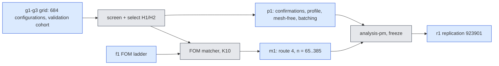
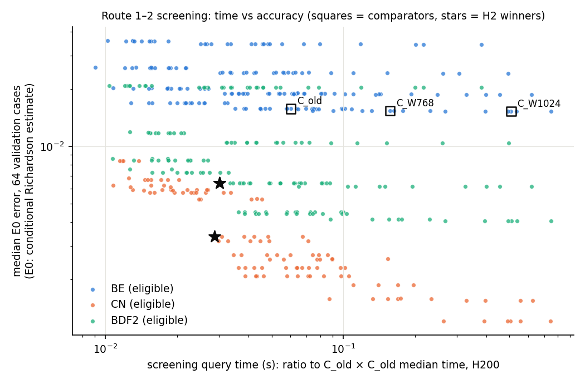
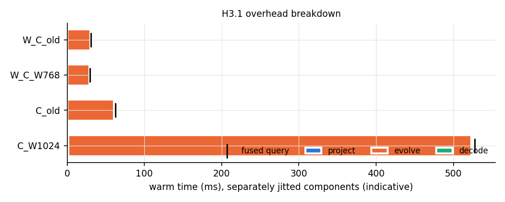
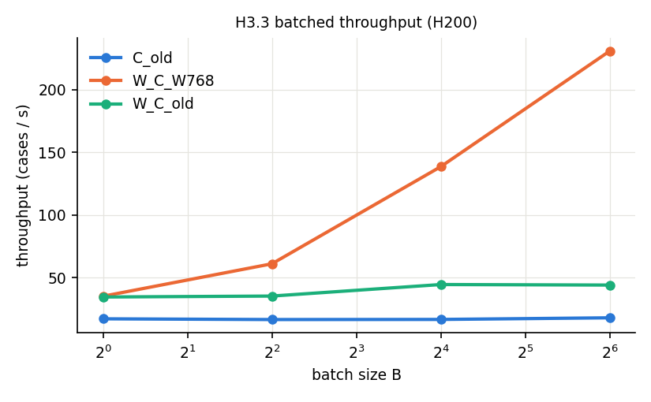
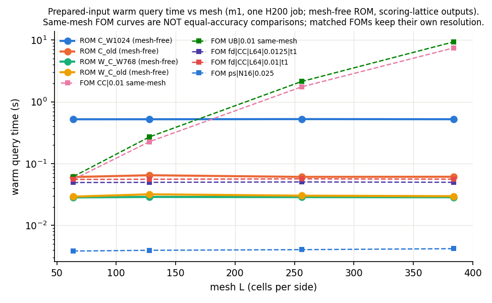

# jcp-speed3d — can the 3D second-order accuracy gain become a real speed-up?

**Status:** p1 and m1 analysed; job integrity holds; confirmed verdicts final for the validation cohort; replication on 923901 included. Every number below is generated by `make_report.py` from the analysis JSONs. All errors are against the E0 second-order reference $R_{ST}$: *a conditional Richardson estimate (asymptotic assumption, not a rigorous bound); its cross-check rule was amended after data (E0 A10).* The study is prospectively specified conditional on Step 2's exploration (DESIGN A1). Every timing is on one H200 type; screening ratios come from separate jobs, confirmed ratios from paired panels in one job. Post-hoc labels carried forward unchanged (campaign rule): E0 A10; combined A10, A11 and the retracted A15.

## Summary

- **H2 vs C_old:** winner M2_512 gl24, FS-K1 BDF2, $\Delta t = 0.0125$; speed-up screened 2.00×, confirmed 2.01× → **pass** (bar $1/0.6\approx1.67$).
- **H2 vs C_W768:** winner M2_512 gl24, QN-4 CN, $\Delta t = 0.01667$; speed-up screened 5.22×, confirmed 5.37× → **pass** (bar $1/0.6\approx1.67$).
- **H2 vs C_W1024:** winner M2_512 gl24, FS-K1 BDF2, $\Delta t = 0.0125$; speed-up screened 16.8×, confirmed 17.2× → **pass** (bar $1/0.6\approx1.67$).
- **Against the full simulation (route 4, $L=384$):** K2 of the governing plan **FIRES** — no selected ROM reaches 2× against the best matched FOM (the union of families). Matched speed-ups use a finite FOM ladder: an upper bound on optimal FOM cost, hence an **upper bound on the claimed ROM speed-up**.

| hypothesis / criterion | outcome (counts over cells) |
|---|---|
| H1.2 FSP-K1 eligible at 2.5Δt₀ (expected to fail) | 10 ineligible |
| H1.3 QN-k eligible at Δt ≥ 1.25Δt₀ | 42 eligible, 48 ineligible |
| H1.4 QN ≤ 0.6 × FS-K2 (confirmed) | 20 fail, 2 pass, 3 rescue, 5 unavailable |
| H2 vs C_old (S ≥ 1/0.6, confirmed) | pass (S = 2.01) |
| H2 vs C_W768 (S ≥ 1/0.6, confirmed) | pass (S = 5.37) |
| H2 vs C_W1024 (S ≥ 1/0.6, confirmed) | pass (S = 17.2) |
| H3.1 G3 (component sum within 15 % of the fused query) | 4 yes |
| H3.2 mesh-free path qualified | 4 qualified |
| H3.3 throughput B = 16 ≥ 2 × B = 1 | 2 no, 1 yes |
| H4.1 flat ROM cost over L (max/min ≤ 1.25) | 4 pass |
| H4.3 matched union speed-up ≥ 2× at n = 65 | 4 no |
| K2 (governing plan) at the largest mesh | fires |

## Jobs, budget and integrity

| attempt | job | GPU | GPU-h (sacct) | commit | role |
|---|---|---|---|---|---|
| smoke1 | 5299842 | h200 | 0.786 | 9f8093d64 | cluster smoke bundle (A4.1): test_s3 x2, test_fom, smkgrid, smkfom, smkprof, smkmesh, acceptance |
| smkmesh384 | 5299848 | h200 | 0.103 | 9f8093d64 | L=384 pilot (A1.9), separate job |
| g2 | 5301264 | h200 | 2.41 | 6f61b238a | grid W512 + W768 |
| g3 | 5301270 | h200 | 3.63 | 6f61b238a | grid W1024 |
| f1 | 5301274 | h200 | 0.231 | 6f61b238a | FOM accuracy ladder |
| g1 | 5301580 | h200 | 1.75 | 6f61b238a | grid M2_512 + W256 |
| p1 | 5352455 | h200 | 0.791 | b4b2cfe4b | profile, mesh-free + K5, batching + G4/K6, A1.5 confirmation panels (31 pairs), conv-rule sensitivity, reduced-rule ADT |
| m1 | 5352457 | h200 | 0.886 | b4b2cfe4b | route 4: tables n=65..385 (G5/K7), ROM mf + ADT per mesh, same-mesh FOM calibration/accuracy/timing, A6 match panels |
| r1 | 5353792 | h200 | 0.277 | c79a3e0b8 | A1.11 replication on 923901 (E0 test32): 52 frozen ROM configs (+4 mf paths), 3 matched FOMs, 3 comparator panels |

GPU-hours spent: **10.9** of the 34 cap (DESIGN A7). Cluster namespace `/cluster/tufts/paralab/tawal01/jcp-speed3d/`; every log carries `jax_backend=gpu`.

Controls that must fail (each fired on the production data):

| setting | K1 non-stationary steps | K1 fires | K2 non-stationary steps | K2 fires | K3 cases over bar | K3 fires |
|---|---|---|---|---|---|---|
| M2_512 | 251/640 | yes | 640/640 | yes | 24 | yes |
| W256 | 138/640 | yes | 640/640 | yes | 37 | yes |
| W512 | 201/640 | yes | 640/640 | yes | 24 | yes |
| W768 | 248/640 | yes | 640/640 | yes | 14 | yes |
| W1024 | 276/640 | yes | 640/640 | yes | 14 | yes |

K4 (scoring swap / shift) fires in every grid job (swap changes 0.675–0.677, shift 0.185–0.186); K9 (distance classifier) fires; K10 (FOM matcher) rejects both synthetic entries; planned population complete (0 missing, 0 duplicates).

**G2 failed literally** on 15 of 288,944 fixed-phase FS steps (certified vs recorded stationarity ratio, both $\le$3.34e-12, far below the $10^{-3}$ threshold; no classification changes; E-b uses only the certified ratio; DESIGN A9/A10). The g3 log carries a JAX "captured constants (3.26GB)" warning from the untimed H1.1 replay (A8); the results audit found no anomaly in W1024 outputs or timings.

## Route 1 — one pass per step at big steps (H1)

**H1.1** (replay of FS-K2 CN $2.5\Delta t_0$ failures, descriptive): 72 replayed cases; 1 "baseline already stationary", 71 "mixed". "mixed" means that both $K\le4$ extra sweeps and trust ×10 reach stationarity at the replayed step (a statement about that step, not a cause of the trajectory error).

**H1.2** (FSP-K1 at $2.5\Delta t_0$): M2_512|CN ineligible; M2_512|BDF2 ineligible; W1024|CN ineligible; W1024|BDF2 ineligible; W256|CN ineligible; W256|BDF2 ineligible; W512|CN ineligible; W512|BDF2 ineligible; W768|CN ineligible; W768|BDF2 ineligible.

**H1.3** (QN-k eligible at $\Delta t\ge1.25\Delta t_0$; E = eligible): 42 of 90 cells.

| setting | scheme | Δt/Δt₀ | QN-1 | QN-4 | QN-∞ |
|---|---|---|---|---|---|
| M2_512 | BDF2 | 1.25 | E | E | – |
| M2_512 | BDF2 | 1.67 | – | E | – |
| M2_512 | BDF2 | 2.5 | E | E | E |
| M2_512 | CN | 1.25 | E | E | – |
| M2_512 | CN | 1.67 | – | E | – |
| M2_512 | CN | 2.5 | E | – | – |
| W1024 | BDF2 | 1.25 | E | – | – |
| W1024 | BDF2 | 1.67 | – | – | – |
| W1024 | BDF2 | 2.5 | E | – | – |
| W1024 | CN | 1.25 | E | – | – |
| W1024 | CN | 1.67 | – | – | – |
| W1024 | CN | 2.5 | – | – | – |
| W256 | BDF2 | 1.25 | E | E | E |
| W256 | BDF2 | 1.67 | E | E | E |
| W256 | BDF2 | 2.5 | – | E | E |
| W256 | CN | 1.25 | E | – | E |
| W256 | CN | 1.67 | – | E | – |
| W256 | CN | 2.5 | – | E | – |
| W512 | BDF2 | 1.25 | E | E | – |
| W512 | BDF2 | 1.67 | E | E | E |
| W512 | BDF2 | 2.5 | E | E | E |
| W512 | CN | 1.25 | E | – | – |
| W512 | CN | 1.67 | – | E | – |
| W512 | CN | 2.5 | E | E | – |
| W768 | BDF2 | 1.25 | E | E | – |
| W768 | BDF2 | 1.67 | E | – | – |
| W768 | BDF2 | 2.5 | E | – | – |
| W768 | CN | 1.25 | E | – | – |
| W768 | CN | 1.67 | – | – | – |
| W768 | CN | 2.5 | – | – | – |

**H1.4** (cheapest eligible QN vs FS-K2, pass iff confirmed paired ratio $\le 0.6$; "rescue" = QN eligible where FS-K2 is not):

| cell | screening ratio | confirmed ratio | verdict |
|---|---|---|---|
| M2_512 BDF2 0.0125 | 0.734 | 0.764 | fail |
| M2_512 BDF2 0.016666667 | 0.782 | 0.779 | fail |
| M2_512 BDF2 0.025 | 0.761 | 0.798 | fail |
| M2_512 CN 0.0125 | 0.677 | 0.703 | fail |
| M2_512 CN 0.016666667 | 0.695 | 0.729 | fail |
| M2_512 CN 0.025 | – | – | rescue |
| W1024 BDF2 0.0125 | 0.646 | 0.651 | fail |
| W1024 BDF2 0.016666667 | – | – | unavailable (no eligible QN with valid timing) |
| W1024 BDF2 0.025 | 0.569 | 0.598 | pass |
| W1024 CN 0.0125 | 0.642 | 0.637 | fail |
| W1024 CN 0.016666667 | – | – | unavailable (no eligible QN with valid timing) |
| W1024 CN 0.025 | – | – | unavailable (no eligible QN with valid timing) |
| W256 BDF2 0.0125 | 0.882 | 1.01 | fail |
| W256 BDF2 0.016666667 | 0.962 | 0.984 | fail |
| W256 BDF2 0.025 | 0.967 | 0.997 | fail |
| W256 CN 0.0125 | 0.830 | 0.958 | fail |
| W256 CN 0.016666667 | 0.924 | 0.906 | fail |
| W256 CN 0.025 | – | – | rescue |
| W512 BDF2 0.0125 | 0.726 | 0.721 | fail |
| W512 BDF2 0.016666667 | 0.732 | 0.767 | fail |
| W512 BDF2 0.025 | 0.792 | 0.848 | fail |
| W512 CN 0.0125 | 0.889 | 0.903 | fail |
| W512 CN 0.016666667 | 0.686 | 0.699 | fail |
| W512 CN 0.025 | – | – | rescue |
| W768 BDF2 0.0125 | 0.548 | 0.539 | pass |
| W768 BDF2 0.016666667 | 0.736 | 0.730 | fail |
| W768 BDF2 0.025 | 0.665 | 0.693 | fail |
| W768 CN 0.0125 | 0.737 | 0.730 | fail |
| W768 CN 0.016666667 | – | – | unavailable (no eligible QN with valid timing) |
| W768 CN 0.025 | – | – | unavailable (no eligible QN with valid timing) |

## Route 2 — narrower bank, fewer points, second-order schemes (H2)

| comparator | comparator median / worst | winner W* | W* median / worst | S screen | S confirmed | H2 | B* (best BE) | S_BE confirmed | direct paired B*/W* speed-up |
|---|---|---|---|---|---|---|---|---|---|
| C_old | 0.0157 / 0.0446 | M2_512 gl24, FS-K1 BDF2, $\Delta t = 0.0125$ | 0.00642 / 0.0441 | 2.00 | 2.01 | pass | M2_512 gl24, FS-K1 BE, $\Delta t = 0.01$ | 1.75 | 1.16 |
| C_W768 | 0.0154 / 0.0528 | M2_512 gl24, QN-4 CN, $\Delta t = 0.01667$ | 0.00335 / 0.0465 | 5.22 | 5.37 | pass | W768 lat16384, QN-4 BE, $\Delta t = 0.01$ | 2.13 | 2.50 |
| C_W1024 | 0.0153 / 0.0459 | M2_512 gl24, FS-K1 BDF2, $\Delta t = 0.0125$ | 0.00642 / 0.0441 | 16.8 | 17.2 | pass | W1024 lat32768, FS-K1 BE, $\Delta t = 0.01$ | 1.91 | 8.96 |

Each factor of the decomposition comes from its own direct confirmation panel (A2.7(b)); their product need not equal the total $S$, and neither factor isolates one methodological change. The selection is per comparator: the winner ties-or-beats *its* comparator on median and worst (for example the CN winner chosen against C_W768 does not tie-or-beat C_W1024's worst error; the BDF2 winner does).

Eligible configurations: 436 of 684. Reduced rules are empirically validated surrogates, not quadrature-equivalent (A1.13).

Converged-rule sensitivity of the finalists ($\delta_{\rm quad}$ = lattice distance to the same configuration on the setting's converged rule, max over cases and output times) and reduced-rule ADT tight/tighter agreement (bar 2.5e-5; a finalist failing it is not selectable):

| label | configuration | converged rule | δ_quad max | ADT tight/tighter | ok |
|---|---|---|---|---|---|
| B_C_W1024 | W1024 lat32768, FS-K1 BE, $\Delta t = 0.01$ | gl80 | 1.76e-4 | 5.22e-8 | yes |
| B_C_W768 | W768 lat16384, QN-4 BE, $\Delta t = 0.01$ | gl64 | 5.97e-4 | 5.37e-8 | yes |
| B_C_old | M2_512 gl24, FS-K1 BE, $\Delta t = 0.01$ | gl56 | 5.01e-4 | 9.90e-9 | yes |
| W_C_W768 | M2_512 gl24, QN-4 CN, $\Delta t = 0.01667$ | gl56 | 9.55e-4 | 2.23e-8 | yes |
| W_C_old | M2_512 gl24, FS-K1 BDF2, $\Delta t = 0.0125$ | gl56 | 8.18e-4 | 3.07e-8 | yes |

## Route 3 — overhead (H3)

p1 acceptance: complete_flag yes, cohort yes, K4 yes, confirm_all_valid yes, mf_all_present yes, mf_evidence_valid yes, K5_resolved_present yes, profile_all_present yes, profile_all_valid yes, batch_all_present yes, batch_all_valid yes, conv_all_present yes, reduced_adt_all_present yes, mesh_reproduction yes, integrity_ok yes, coverage_complete yes, accepted_for_claims yes.

**H3.1** profile (indicative; components separately jitted). Shares of the fused warm query (G3 only on a valid panel):

| label | fused (ms) | projection | step loop | decode | adaptive start | G3 sum/fused | G3 within 15 % | panel valid |
|---|---|---|---|---|---|---|---|---|
| C_W1024 | 528 | 0.00297 | 0.988 | 0.00296 | 0.537 | 0.994 | yes | yes |
| C_old | 62.2 | 0.00746 | 0.969 | 0.00672 | 0.336 | 0.983 | yes | yes |
| W_C_W768 | 29.3 | 0.0158 | 0.973 | 0.0144 | – | 1.00 | yes | yes |
| W_C_old | 30.9 | 0.0148 | 0.954 | 0.0135 | 0.390 | 0.982 | yes | yes |

**H3.2** mesh-free online path (qualified iff eligible against the mesh-free-initialised ADT, (b) median and worst tie-or-beat the mesh path or exceed by $\le 1\,\%$, (c) no case worse by more than $\max(2\eta, 0.1e)$; blocked if K5 does not fire):

| label | eligible | distance to ADT | median mf | median mesh | worst mf | worst mesh | (b) | (c) | status | K5 (coarse rule) fails |
|---|---|---|---|---|---|---|---|---|---|---|
| C_W1024 | yes | 2.97e-5 | 0.0153 | 0.0153 | 0.0459 | 0.0459 | yes | yes | qualified | yes |
| C_old | yes | 3.73e-5 | 0.0157 | 0.0157 | 0.0446 | 0.0446 | yes | yes | qualified | yes |
| W_C_W768 | yes | 2.27e-4 | 0.00335 | 0.00335 | 0.0465 | 0.0465 | yes | yes | qualified | yes |
| W_C_old | yes | 2.08e-4 | 0.00642 | 0.00642 | 0.0441 | 0.0441 | yes | yes | qualified | yes |

K5 control (coarse-rule projection must fail for at least one setting): fires.

**H3.3** batching (primary speed claim stays single-query latency; throughput reported separately; a record is usable only with matching hashes, G4 not failed, K6+ passing and K6 firing):

| label | B | median s | cases/s | G4 (max distance) | K6 fires | K6+ passes | hashes | usable |
|---|---|---|---|---|---|---|---|---|
| C_old | 1 | 0.0582 | 17.2 | exact (0) | – | yes | yes | yes |
| C_old | 4 | 0.241 | 16.6 | exact (5.67e-15) | yes | yes | yes | yes |
| C_old | 16 | 0.959 | 16.7 | exact (8.93e-15) | yes | yes | yes | yes |
| C_old | 64 | 3.56 | 18.0 | exact (1.05e-14) | yes | yes | yes | yes |
| W_C_W768 | 1 | 0.0284 | 35.2 | exact (0) | – | yes | yes | yes |
| W_C_W768 | 4 | 0.0655 | 61.1 | exact (5.55e-15) | yes | yes | yes | yes |
| W_C_W768 | 16 | 0.116 | 138 | exact (6.36e-15) | yes | yes | yes | yes |
| W_C_W768 | 64 | 0.278 | 231 | exact (1.12e-14) | yes | yes | yes | yes |
| W_C_old | 1 | 0.0289 | 34.6 | exact (0) | – | yes | yes | yes |
| W_C_old | 4 | 0.113 | 35.3 | exact (1.20e-14) | yes | yes | yes | yes |
| W_C_old | 16 | 0.359 | 44.5 | exact (1.21e-14) | yes | yes | yes | yes |
| W_C_old | 64 | 1.45 | 44.1 | exact (1.24e-14) | yes | yes | yes | yes |

Throughput at $B=16$ over $B=1$: C_old 0.971× (misses the 2× bar); W_C_W768 3.94× (meets the 2× bar); W_C_old 1.29× (misses the 2× bar).

## Route 4 — against the full simulation, by mesh (H4)

Contract: **mesh-free / scoring-lattice** (ν and the initial field on each method's own input points, outputs on the $63^3$ scoring lattice); it is not the full-field query. Matched labels do not transfer across meshes (A6). All latencies are **prepared-input latencies** (A2.7(e)); input preparation is outside every timer and reported separately below — it is not added to the ratios. Central + CN-R is E0's own discretization family, so its error against E0 partly measures the reference's own level difference.

Screening FOM matches from the f1 ladder (cheapest calibrated FOM whose median **and** worst tie-or-beat the ROM; "no ladder match" = no ladder member does so jointly on median and worst):

| ROM | upwind/BE | upwind/CN-R | central/CN-R | spectral |
|---|---|---|---|---|
| C_old | no ladder match | no ladder match | fd\|CC\|L64\|0.0125\|t1 (interior) | ps\|N16\|0.025 (boundary) |
| W_C_old | no ladder match | no ladder match | fd\|CC\|L64\|0.0125\|t1 (interior) | ps\|N16\|0.025 (boundary) |
| B_C_old | no ladder match | no ladder match | fd\|CC\|L64\|0.0125\|t1 (interior) | ps\|N16\|0.025 (boundary) |
| C_W768 | no ladder match | no ladder match | fd\|CC\|L64\|0.0125\|t1 (interior) | ps\|N16\|0.025 (boundary) |
| W_C_W768 | no ladder match | no ladder match | fd\|CC\|L64\|0.01\|t1 (interior) | ps\|N16\|0.025 (boundary) |
| B_C_W768 | no ladder match | no ladder match | fd\|CC\|L64\|0.0125\|t1 (interior) | ps\|N16\|0.025 (boundary) |
| C_W1024 | no ladder match | no ladder match | fd\|CC\|L64\|0.0125\|t1 (interior) | ps\|N16\|0.025 (boundary) |
| B_C_W1024 | no ladder match | no ladder match | fd\|CC\|L64\|0.0125\|t1 (interior) | ps\|N16\|0.025 (boundary) |

m1 acceptance: complete_flag yes, K4 yes, G5 yes, every_rom_every_mesh yes, every_rom_scored yes, every_mesh_panel_valid yes, match_panels_valid yes, no_panel_failures yes, primary_unions_resolved yes, mesh_unions_resolved yes, same_mesh_foms_complete yes, cohort yes, integrity_ok yes, coverage_complete yes, accepted_for_claims yes.

G5 (tables at $n=65$ equal Step 2's) and K7 (tables at $n=66$ differ): M2|512: A_rel 1.33e-15, K7_rel 0.0235, gate yes; W1024|256: A_rel 1.06e-15, K7_rel 0.0235, gate yes; W1024|1024: A_rel 1.75e-15, K7_rel 0.0235, gate yes.

Test-mode lists in m1 follow the **deployment policy (mode set varies with mesh)**: at every mesh the $4R'$ lowest discrete-Laplacian modes of that mesh, completed to the end of the eigen-shell. Per $R'$: $M$ at each mesh and the size of the symmetric difference against the frozen list taken at $n = 65$ (`modes_diff.py`). No fixed-mode panel was run, so the flat-cost result (H4.1) is a statement about this deployment policy, not about a fixed test space.

| R' | M frozen (n = 65) | L=64: M / sym. diff. | L=128: M / sym. diff. | L=256: M / sym. diff. | L=384: M / sym. diff. |
|---|---|---|---|---|---|
| 512 | 2052 | 2052 / 0 | 2049 / 15 | 2052 / 18 | 2052 / 18 |
| 1024 | 4097 | 4097 / 0 | 4097 / 54 | 4097 / 78 | 4097 / 78 |

ROM (mesh-free path) per mesh: eligibility at that mesh (E-a, E-b, E-c against the ADT of the same mesh, tight/tighter), E0 errors, warm time (valid panels only):

| L | ROM | feasible | M | eligible | dist. to ADT | scored cases | median | worst | time (ms) |
|---|---|---|---|---|---|---|---|---|---|
| 64 | C_W1024 | yes | 4097 | yes | 2.97e-5 | 64 | 0.0153 | 0.0459 | 522 |
| 64 | C_old | yes | 2052 | yes | 3.73e-5 | 64 | 0.0157 | 0.0446 | 60.7 |
| 64 | W_C_W768 | yes | 2052 | yes | 2.27e-4 | 64 | 0.00335 | 0.0465 | 28.4 |
| 64 | W_C_old | yes | 2052 | yes | 2.08e-4 | 64 | 0.00642 | 0.0441 | 29.2 |
| 128 | C_W1024 | yes | 4097 | yes | 2.81e-5 | 64 | 0.0152 | 0.0450 | 522 |
| 128 | C_old | yes | 2049 | yes | 3.76e-5 | 64 | 0.0157 | 0.0444 | 64.9 |
| 128 | W_C_W768 | yes | 2049 | yes | 2.13e-4 | 64 | 0.00329 | 0.0452 | 28.9 |
| 128 | W_C_old | yes | 2049 | yes | 2.02e-4 | 64 | 0.00631 | 0.0430 | 31.9 |
| 256 | C_W1024 | yes | 4097 | yes | 2.76e-5 | 64 | 0.0152 | 0.0445 | 525 |
| 256 | C_old | yes | 2052 | yes | 3.77e-5 | 64 | 0.0157 | 0.0443 | 61.0 |
| 256 | W_C_W768 | yes | 2052 | yes | 2.10e-4 | 64 | 0.00327 | 0.0446 | 28.7 |
| 256 | W_C_old | yes | 2052 | yes | 2.01e-4 | 64 | 0.00632 | 0.0425 | 30.3 |
| 384 | C_W1024 | yes | 4097 | yes | 2.75e-5 | 64 | 0.0153 | 0.0445 | 523 |
| 384 | C_old | yes | 2052 | yes | 3.78e-5 | 64 | 0.0157 | 0.0443 | 61.4 |
| 384 | W_C_W768 | yes | 2052 | yes | 2.09e-4 | 64 | 0.00327 | 0.0446 | 28.6 |
| 384 | W_C_old | yes | 2052 | yes | 2.01e-4 | 64 | 0.00632 | 0.0425 | 29.7 |

**H4.1** flat ROM cost (pass iff $\max/\min$ of the warm query time over meshes $\le 1.25$):

| ROM | L=64 (ms) | L=128 (ms) | L=256 (ms) | L=384 (ms) | max/min | verdict |
|---|---|---|---|---|---|---|
| C_W1024 | 522 | 522 | 525 | 523 | 1.01 | pass |
| C_old | 60.7 | 64.9 | 61.0 | 61.4 | 1.07 | pass |
| W_C_W768 | 28.4 | 28.9 | 28.7 | 28.6 | 1.02 | pass |
| W_C_old | 29.2 | 31.9 | 30.3 | 29.7 | 1.09 | pass |

**H4.2** same-mesh diagnostic (not an equal-accuracy claim; FOM errors on the first cases listed; speed-up $=t_{\rm FOM}/t_{\rm ROM}$ per ROM in the order C_W1024, C_old, W_C_W768, W_C_old; valid panels only):

| L | family\|Δt | calibrated configuration | calibration | converged | scored/cases | median | worst | FOM time (s) | speed-ups |
|---|---|---|---|---|---|---|---|---|---|
| 64 | UB\|0.01 | fd\|UB\|L64\|0.01\|t1 | qualified | yes | 8/8 | 0.0643 | 0.122 | 0.0619 | 0.118, 1.03, 2.23, 2.12 |
| 64 | CC\|0.01 | fd\|CC\|L64\|0.01\|t1 | qualified | yes | 8/8 | 0.00491 | 0.00688 | 0.0556 | 0.107, 0.923, 2.00, 1.90 |
| 128 | UB\|0.01 | fd\|UB\|L128\|0.01\|t1 | qualified | yes | 8/8 | 0.0413 | 0.0812 | 0.271 | 0.518, 4.19, 9.61, 8.66 |
| 128 | CC\|0.01 | fd\|CC\|L128\|0.01\|t1 | qualified | yes | 8/8 | 0.00422 | 0.00581 | 0.227 | 0.435, 3.52, 8.14, 7.25 |
| 256 | UB\|0.01 | fd\|UB\|L256\|0.01\|t1 | qualified | yes | 8/8 | 0.0295 | 0.0571 | 2.13 | 4.09, 34.9, 76.3, 72.3 |
| 256 | CC\|0.01 | fd\|CC\|L256\|0.01\|t1 | qualified | yes | 8/8 | 0.00406 | 0.00583 | 1.75 | 3.33, 28.8, 62.4, 59.2 |
| 384 | UB\|0.01 | fd\|UB\|L384\|0.01\|t1 | qualified | yes | 8/8 | 0.0255 | 0.0484 | 9.34 | 17.8, 151, 335, 318 |
| 384 | CC\|0.01 | fd\|CC\|L384\|0.01\|t1 | qualified | yes | 8/8 | 0.00403 | 0.00583 | 7.46 | 14.3, 123, 268, 252 |

**H4.3** matched-accuracy speed-up at $n=65$, mesh path (A6; paired `match|<label>` panel; ROM speed-up = $t_{\rm FOM}/t_{\rm ROM}$; below 1 is a loss):

| ROM | family | matched FOM | speed-up | ≥ 2× | label |
|---|---|---|---|---|---|
| C_W1024 | UB | no ladder match | – | – | no FOM in the ladder ties-or-beats the ROM jointly on median and worst |
| C_W1024 | UC | no ladder match | – | – | no FOM in the ladder ties-or-beats the ROM jointly on median and worst |
| C_W1024 | CC | fd\|CC\|L64\|0.0125\|t1 | 0.0948 | no | upper bound (finite FOM ladder) |
| C_W1024 | PS | ps\|N16\|0.025 | 0.00747 | no | upper bound (finite FOM ladder); boundary (cheapest admissible member) |
| C_W1024 | **union** | ps\|N16\|0.025 | 0.00747 | no | cheapest matched FOM over families |
| C_old | UB | no ladder match | – | – | no FOM in the ladder ties-or-beats the ROM jointly on median and worst |
| C_old | UC | no ladder match | – | – | no FOM in the ladder ties-or-beats the ROM jointly on median and worst |
| C_old | CC | fd\|CC\|L64\|0.0125\|t1 | 0.821 | no | upper bound (finite FOM ladder) |
| C_old | PS | ps\|N16\|0.025 | 0.0650 | no | upper bound (finite FOM ladder); boundary (cheapest admissible member) |
| C_old | **union** | ps\|N16\|0.025 | 0.0650 | no | cheapest matched FOM over families |
| W_C_W768 | UB | no ladder match | – | – | no FOM in the ladder ties-or-beats the ROM jointly on median and worst |
| W_C_W768 | UC | no ladder match | – | – | no FOM in the ladder ties-or-beats the ROM jointly on median and worst |
| W_C_W768 | CC | fd\|CC\|L64\|0.01\|t1 | 1.97 | no | upper bound (finite FOM ladder) |
| W_C_W768 | PS | ps\|N16\|0.025 | 0.135 | no | upper bound (finite FOM ladder); boundary (cheapest admissible member) |
| W_C_W768 | **union** | ps\|N16\|0.025 | 0.135 | no | cheapest matched FOM over families |
| W_C_old | UB | no ladder match | – | – | no FOM in the ladder ties-or-beats the ROM jointly on median and worst |
| W_C_old | UC | no ladder match | – | – | no FOM in the ladder ties-or-beats the ROM jointly on median and worst |
| W_C_old | CC | fd\|CC\|L64\|0.0125\|t1 | 1.65 | no | upper bound (finite FOM ladder) |
| W_C_old | PS | ps\|N16\|0.025 | 0.133 | no | upper bound (finite FOM ladder); boundary (cheapest admissible member) |
| W_C_old | **union** | ps\|N16\|0.025 | 0.133 | no | cheapest matched FOM over families |

**H-comp cells (V3-5) at the largest mesh $L=384$** (✓ = matched there and $\ge 2\times$; the matched FOM keeps its own resolution, the ROM runs at this mesh, and 'matched' is re-checked against this mesh's ROM errors):

| ROM | upwind/BE | upwind/CN-R | central/CN-R | spectral | union |
|---|---|---|---|---|---|
| C_W1024 | no ladder match | no ladder match | 0.0952 | 0.00786 | 0.00786 |
| C_old | no ladder match | no ladder match | 0.825 | 0.0701 | 0.0701 |
| W_C_W768 | no ladder match | no ladder match | 2.03 ✓ | 0.158 | 0.158 |
| W_C_old | no ladder match | no ladder match | 1.68 | 0.135 | 0.135 |

Cells reaching $\ge 2\times$ at $L=384$: W_C_W768 vs CC. Matched cells below 2×: C_W1024 vs CC, C_W1024 vs PS, C_old vs CC, C_old vs PS, W_C_W768 vs PS, W_C_old vs CC, W_C_old vs PS. No ladder member as accurate as the ROM (nothing claimed for these cells; a FOM outside the ladder would be needed): C_W1024 vs UB, C_W1024 vs UC, C_old vs UB, C_old vs UC, W_C_W768 vs UB, W_C_W768 vs UC, W_C_old vs UB, W_C_old vs UC. Against the union of families (the best validated FOM): C_W1024 0.00786×; C_old 0.0701×; W_C_W768 0.158×; W_C_old 0.135×.

**K2 (governing plan): FIRES** — scoped to this lane's selected 3D configurations and its finite FOM ladder.

Input preparation (outside the timers; ms per query; `rom_mesh65` = IC on the mesh, `rom_mf|<rule>` = IC at the rule points, `fd|L` = FD interior field, `ps|N` = sine coefficients):

| input | median (ms) | max (ms) | queries |
|---|---|---|---|
| rom_mesh65 | 6.04 | 698 | 64 |
| rom_mf\|lat65536 | 3.99 | 637 | 64 |
| rom_mf\|gl32 | 3.77 | 617 | 64 |
| rom_mf\|gl24 | 3.61 | 631 | 64 |
| fd\|L64 | 7.72 | 17.1 | 20 |
| ps\|N16 | 12.0 | 34.3 | 16 |
| fd\|L128 | 41.0 | 755 | 8 |
| fd\|L256 | 352 | 1.12e+03 | 8 |
| fd\|L384 | 1.22e+03 | 1.97e+03 | 8 |

The early unaudited f1 observation "spectral FOM clearly beats the ROM at 64³" is **confirmed** by the paired panels: the matched spectral FOM (ps|N16|0.025; cross-resolution) gives ROM speed-ups 0.00747–0.135× (below 1 = the FOM is faster at equal-or-better accuracy).

## Replication on the historical test cohort 923901 (E0 test32)

Summary: 53 of 56 frozen configuration/path entries pass E-a/E-b/E-c on this cohort (no tight/tighter anchor run here, so this is not a fresh Q1 certificate); fail: H14q_W256|BDF2|0.0125 (mesh), H14q_W256|CN|0.0125 (mesh), H14q_W256|CN|0.016666667 (mesh). Comparator winners still tie-or-beat their comparator: 3 of 3; replication speed-ups C_old 2.03× (validation 2.01×); C_W768 5.31× (validation 5.37×); C_W1024 16.6× (validation 17.2×). Matched FOMs that no longer tie-or-beat their ROM here: W_C_W768|CC. Replication does not change any validation-selected decision (A1.11); differences are reported, not acted on.

Job 5353792 (NVIDIA H200), integrity yes; replication only (nothing selected on this cohort).

| configuration | path | role | E-a/E-b/E-c (no anchor run) | distance to ADT | scored cases | median | worst |
|---|---|---|---|---|---|---|---|
| B_C_W1024 | mesh | H2 | yes | 2.67e-05 | 32/32 | 0.0154 | 0.0392 |
| B_C_W768 | mesh | H2 | yes | 0.000126 | 32/32 | 0.0155 | 0.0403 |
| B_C_old | mesh | H2 | yes | 1.94e-05 | 32/32 | 0.0155 | 0.0445 |
| C_W1024 | mesh | H2 | yes | 2.67e-05 | 32/32 | 0.0154 | 0.0392 |
| C_W1024 | mf | H2 | yes | 2.67e-05 | 32/32 | 0.0154 | 0.0392 |
| C_W768 | mesh | H2 | yes | 2.41e-05 | 32/32 | 0.0155 | 0.0403 |
| C_old | mesh | H2 | yes | 1.93e-05 | 32/32 | 0.0155 | 0.0445 |
| C_old | mf | H2 | yes | 1.93e-05 | 32/32 | 0.0155 | 0.0445 |
| H14f_M2_512 BDF2 0.0125 | mesh | H1.4 | yes | 2.97e-05 | 32/32 | 0.00630 | 0.0327 |
| H14f_M2_512 BDF2 0.016666667 | mesh | H1.4 | yes | 1.85e-05 | 32/32 | 0.0104 | 0.0354 |
| H14f_M2_512 BDF2 0.025 | mesh | H1.4 | yes | 2.33e-05 | 32/32 | 0.0207 | 0.0465 |
| H14f_M2_512 CN 0.0125 | mesh | H1.4 | yes | 6.21e-05 | 32/32 | 0.00174 | 0.0330 |
| H14f_M2_512 CN 0.016666667 | mesh | H1.4 | yes | 5.63e-05 | 32/32 | 0.00249 | 0.0329 |
| H14f_W1024 BDF2 0.0125 | mesh | H1.4 | yes | 4.35e-05 | 32/32 | 0.00606 | 0.0209 |
| H14f_W1024 BDF2 0.025 | mesh | H1.4 | yes | 4.03e-06 | 32/32 | 0.0207 | 0.0443 |
| H14f_W1024 CN 0.0125 | mesh | H1.4 | yes | 8.14e-05 | 32/32 | 0.00140 | 0.0183 |
| H14f_W256 BDF2 0.0125 | mesh | H1.4 | yes | 5.49e-05 | 32/32 | 0.00714 | 0.0562 |
| H14f_W256 BDF2 0.016666667 | mesh | H1.4 | yes | 0.000108 | 32/32 | 0.0120 | 0.0560 |
| H14f_W256 BDF2 0.025 | mesh | H1.4 | yes | 0.000182 | 32/32 | 0.0209 | 0.0603 |
| H14f_W256 CN 0.0125 | mesh | H1.4 | yes | 5.33e-05 | 32/32 | 0.00362 | 0.0585 |
| H14f_W256 CN 0.016666667 | mesh | H1.4 | yes | 0.000119 | 32/32 | 0.00442 | 0.0580 |
| H14f_W512 BDF2 0.0125 | mesh | H1.4 | yes | 4.19e-05 | 32/32 | 0.00608 | 0.0305 |
| H14f_W512 BDF2 0.016666667 | mesh | H1.4 | yes | 8.69e-05 | 32/32 | 0.0104 | 0.0337 |
| H14f_W512 BDF2 0.025 | mesh | H1.4 | yes | 5.01e-05 | 32/32 | 0.0207 | 0.0456 |
| H14f_W512 CN 0.0125 | mesh | H1.4 | yes | 9.72e-05 | 32/32 | 0.00167 | 0.0304 |
| H14f_W512 CN 0.016666667 | mesh | H1.4 | yes | 0.000132 | 32/32 | 0.00247 | 0.0305 |
| H14f_W768 BDF2 0.0125 | mesh | H1.4 | yes | 4.42e-05 | 32/32 | 0.00607 | 0.0239 |
| H14f_W768 BDF2 0.016666667 | mesh | H1.4 | yes | 1.83e-05 | 32/32 | 0.0104 | 0.0287 |
| H14f_W768 BDF2 0.025 | mesh | H1.4 | yes | 2.31e-05 | 32/32 | 0.0207 | 0.0444 |
| H14f_W768 CN 0.0125 | mesh | H1.4 | yes | 8.70e-05 | 32/32 | 0.00140 | 0.0224 |
| H14q_M2_512 BDF2 0.0125 | mesh | H1.4 | yes | 0.000147 | 32/32 | 0.00630 | 0.0327 |
| H14q_M2_512 BDF2 0.016666667 | mesh | H1.4 | yes | 6.60e-05 | 32/32 | 0.0104 | 0.0354 |
| H14q_M2_512 BDF2 0.025 | mesh | H1.4 | yes | 0.000151 | 32/32 | 0.0207 | 0.0464 |
| H14q_M2_512 CN 0.0125 | mesh | H1.4 | yes | 0.000220 | 32/32 | 0.00175 | 0.0330 |
| H14q_M2_512 CN 0.016666667 | mesh | H1.4 | yes | 0.000190 | 32/32 | 0.00249 | 0.0330 |
| H14q_W1024 BDF2 0.0125 | mesh | H1.4 | yes | 4.36e-05 | 32/32 | 0.00606 | 0.0209 |
| H14q_W1024 BDF2 0.025 | mesh | H1.4 | yes | 7.68e-05 | 32/32 | 0.0207 | 0.0443 |
| H14q_W1024 CN 0.0125 | mesh | H1.4 | yes | 5.08e-05 | 32/32 | 0.00140 | 0.0183 |
| H14q_W256 BDF2 0.0125 | mesh | H1.4 | no | 0.000271 | 32/32 | 0.00714 | 0.0562 |
| H14q_W256 BDF2 0.016666667 | mesh | H1.4 | yes | 0.000174 | 32/32 | 0.0120 | 0.0560 |
| H14q_W256 BDF2 0.025 | mesh | H1.4 | yes | 9.23e-05 | 32/32 | 0.0209 | 0.0603 |
| H14q_W256 CN 0.0125 | mesh | H1.4 | no | 0.000339 | 32/32 | 0.00362 | 0.0585 |
| H14q_W256 CN 0.016666667 | mesh | H1.4 | no | 0.000313 | 32/32 | 0.00443 | 0.0580 |
| H14q_W512 BDF2 0.0125 | mesh | H1.4 | yes | 0.000109 | 32/32 | 0.00608 | 0.0304 |
| H14q_W512 BDF2 0.016666667 | mesh | H1.4 | yes | 6.92e-05 | 32/32 | 0.0104 | 0.0336 |
| H14q_W512 BDF2 0.025 | mesh | H1.4 | yes | 0.000117 | 32/32 | 0.0207 | 0.0456 |
| H14q_W512 CN 0.0125 | mesh | H1.4 | yes | 3.80e-05 | 32/32 | 0.00167 | 0.0304 |
| H14q_W512 CN 0.016666667 | mesh | H1.4 | yes | 0.000189 | 32/32 | 0.00247 | 0.0306 |
| H14q_W768 BDF2 0.0125 | mesh | H1.4 | yes | 0.000188 | 32/32 | 0.00607 | 0.0239 |
| H14q_W768 BDF2 0.016666667 | mesh | H1.4 | yes | 0.000118 | 32/32 | 0.0104 | 0.0288 |
| H14q_W768 BDF2 0.025 | mesh | H1.4 | yes | 9.90e-05 | 32/32 | 0.0207 | 0.0444 |
| H14q_W768 CN 0.0125 | mesh | H1.4 | yes | 4.56e-05 | 32/32 | 0.00140 | 0.0224 |
| W_C_W768 | mesh | H2 | yes | 0.000190 | 32/32 | 0.00249 | 0.0329 |
| W_C_W768 | mf | H2 | yes | 0.000190 | 32/32 | 0.00249 | 0.0329 |
| W_C_old | mesh | H2 | yes | 7.43e-05 | 32/32 | 0.00630 | 0.0326 |
| W_C_old | mf | H2 | yes | 7.43e-05 | 32/32 | 0.00630 | 0.0326 |

| comparator | winner | winner ties-or-beats here | S replication | S validation |
|---|---|---|---|---|
| C_old | W_C_old | yes | 2.03 | 2.01 |
| C_W768 | W_C_W768 | yes | 5.31 | 5.37 |
| C_W1024 | W_C_old | yes | 16.6 | 17.2 |

| ROM, family | matched FOM | still ties-or-beats the ROM here |
|---|---|---|
| B_C_W1024, CC | fd CC L64 0.0125 t1 | yes |
| B_C_W1024, PS | ps N16 0.025 | yes |
| B_C_W768, CC | fd CC L64 0.0125 t1 | yes |
| B_C_W768, PS | ps N16 0.025 | yes |
| B_C_old, CC | fd CC L64 0.0125 t1 | yes |
| B_C_old, PS | ps N16 0.025 | yes |
| C_W1024, CC | fd CC L64 0.0125 t1 | yes |
| C_W1024, PS | ps N16 0.025 | yes |
| C_W768, CC | fd CC L64 0.0125 t1 | yes |
| C_W768, PS | ps N16 0.025 | yes |
| C_old, CC | fd CC L64 0.0125 t1 | yes |
| C_old, PS | ps N16 0.025 | yes |
| W_C_W768, CC | fd CC L64 0.01 t1 | no |
| W_C_W768, PS | ps N16 0.025 | yes |
| W_C_old, CC | fd CC L64 0.0125 t1 | yes |
| W_C_old, PS | ps N16 0.025 | yes |

## What is provisional, and what was wrong

- Screening ratios (H1.4, H2) are from separate grid jobs; only the confirmed paired ratios carry verdicts.
- Every matched speed-up is an upper bound (finite FOM ladder); a match at the cheapest admissible ladder member is "boundary".
- E0 errors are conditional Richardson estimates. Ties within $\varepsilon_{\rm ref}$ are interval-overlap ties, not proven equality.
- Resource certificates were estimates, not bounds: g1 2.00 h projected vs 1.75 h measured; g2 5.66 h projected vs 2.41 h measured; g3 2.69 h projected vs 3.63 h measured; f1 0.613 h projected vs 0.231 h measured; p1 7.04 h projected vs 0.791 h measured; m1 10.2 h projected vs 0.886 h measured; r1 5.47 h projected vs 0.277 h measured.
- Retracted / corrected during this lane: the A9 G2 attribution (corrected in A10); the screening wording "all replay labels mixed" (actual: 1 "baseline already stationary", 71 "mixed"); the m1 FOM calibration population at $L\ge256$, generated as cases 0–1, corrected to cases 0–3 before submission (A9).

## Audits

| file | verdict (first verdict word in the file) |
|---|---|
| codex-code-1.md | NOT READY |
| codex-code-10.md | NOT READY |
| codex-code-11.md | NOT READY |
| codex-code-12.md | NOT READY |
| codex-code-13.md | NOT READY |
| codex-code-14.md | NOT READY |
| codex-code-15.md | NOT READY |
| codex-code-16.md | NOT READY |
| codex-code-17.md | NOT READY |
| codex-code-18.md | NOT READY |
| codex-code-19.md | NOT READY |
| codex-code-2.md | NOT READY |
| codex-code-20.md | NOT READY |
| codex-code-21.md | READY |
| codex-code-3.md | NOT READY |
| codex-code-4.md | NOT READY |
| codex-code-5.md | NOT READY |
| codex-code-6.md | NOT READY |
| codex-code-7.md | NOT READY |
| codex-code-8.md | NOT READY |
| codex-code-9.md | NOT READY |
| codex-design-1.md | NOT READY |
| codex-design-2.md | NOT READY |
| codex-design-3.md | READY |
| codex-job-p1m1-1.md | SUBMIT |
| codex-job-p1m1-2.md | SUBMIT |
| codex-job-prod1.md | SUBMIT |
| codex-job-r1-1.md | DO NOT SUBMIT |
| codex-job-r1-2.md | SUBMIT |
| codex-job-smoke1-2.md | see file |
| codex-job-smoke1-3.md | see file |
| codex-job-smoke1-4.md | see file |
| codex-job-smoke1-5.md | see file |
| codex-job-smoke1-6.md | see file |
| codex-job-smoke1-7.md | SUBMIT |
| codex-job-smoke1.md | see file |
| codex-report-1.md | NOT READY |
| codex-report-2.md | NOT READY |
| codex-report-3.md | NOT READY |
| codex-results-1.md | NOT READY |
| codex-results-2.md | NOT READY |
| codex-results-3.md | READY |
| codex-results-pm-1.md | READY |
| codex-select-1.md | NOT READY |
| codex-select-2.md | NOT READY |
| codex-select-3.md | READY |

## Glossary

- **ROM** — reduced-order model: the frozen coordinate-network bank, LSPG on sine tests, off-mesh quadrature for advection.
- **M2_512, W256 … W1024** — settings: bank (M2 or W1024) truncated to its first $R'$ columns ($R'=512$ for M2_512; 256 to 1024 for W256 … W1024).
- **gl32, lat65536** — quadrature rules: Gauss–Legendre with 32 points per axis; lattice rule with 65,536 points.
- **BE, CN, BDF2** — time-stepping schemes: backward Euler (first order), Crank–Nicolson (second order, trapezoidal) and BDF2 (second-order backward differentiation formula, which uses the two previous states; started with one BE step).
- **IMEX** — implicit–explicit: an initial guess that treats advection explicitly (extrapolated) and the linear terms implicitly.
- **IC** — initial condition (the field at time $t=0$).
- **A_rel, K7_rel** — G5/K7 numbers: relative Frobenius difference of the ROM test-matrix A built at mesh 65 against Step 2's (must be at rounding level), and of the mesh-66 matrix against mesh 65 (must be large).
- **calibration (FOM)** — tolerance qualification: the loosest of three Newton/linear-solver tolerance levels whose outputs agree with the tightest within 1e-6 on cases 0–3; "qualified" if one exists.
- **converged (FOM)** — every time stage of every case met its Newton residual tolerance.
- **$\Delta t_0$** — the deployed time step, 0.01.
- **FS-K1 / FS-K2** — the deployed fixed-sweep Levenberg–Marquardt solver with 1 or 2 full-Jacobian sweeps per step.
- **FSP** — FS with two extra initial-guess candidates (cubic, IMEX).
- **QN-k** — quasi-Newton with exact gradient and a Gauss–Newton matrix refreshed every k steps (∞ = only when forced).
- **ADT** — the verified adaptive tight solve of the same discrete problem; the solver-distance comparator.
- **eligible (Q1)** — every run valid (E-a); certified non-stationary steps at most 1 % of pooled steps (E-b; a step is non-stationary if its fresh-Jacobian stationarity ratio exceeds 1e-3); lattice distance to the ADT solve at most 2.5e-4 on every case (E-c); and the ADT tight/tighter anchor agreement at most 2.5e-5 on cases 0–7 (grid: checked per setting at its deployed rule for each scheme and step, numbers in EXPORT `q1_anchors`). On the replication cohort only E-a/E-b/E-c are recomputed (no anchor run): not a fresh Q1 certificate.
- **M** — number of sine test functions (the $4R'$ lowest discrete-Laplacian modes, completed to the end of the eigen-shell).
- **LSPG** — least-squares Petrov–Galerkin: the ROM minimises the residual tested against the M sine modes.
- **CN-R** — Crank–Nicolson with Rannacher start-up steps (FOM time stepping).
- **ETDRK4** — fourth-order exponential time-differencing Runge–Kutta (the pseudo-spectral FOM).
- **G2 … G8** — consistency gates: G2 certified vs recorded stationarity ratio; G3 profile components sum to the fused query within 15 %; G4 batched equals single queries; G5 mesh-65 tables equal Step 2's; G6 FD port equals E0; G7 PS port; G8 lattice metric equals Step 2's.
- **K1 … K10** — controls that must fail (DESIGN §7, A1.10): K1 FS-K1 CN at $2.5\Delta t_0$ ineligible; K2 predictor-only QN ineligible; K3 wrong gradient exceeds the distance bar; K4 scoring swap/shift changes the score; K5 coarse-rule projection fails H3.2; K6 wrong-viscosity batch fails G4 (K6+ a pure permutation passes); K7 mesh-66 tables differ; K9 distance classifier; K10 FOM matcher rejects synthetic entries. Not to be confused with K2 of the governing plan.
- **$\eta$ ($\varepsilon_{\rm ref}$)** — per-case reference uncertainty of E0 (conditional Richardson estimate).
- **scored cases** — cases with a finite E0 score; no median or worst is reported from a partial population.
- **E0** — the second-order reference store (its per-case uncertainty is $\eta$).
- **median / worst** — median and maximum, over the ranked (reference-eligible) cases of the cohort and case subset named in that table, of the max-over-output-times relative error on the scoring lattice.
- **ties-or-beats** — not resolved as worse: $\mathrm{median}(e_a-\eta)\le\mathrm{median}(e_b+\eta)$, and the same for the maximum.
- **screening ratio** — median paired time ratio to C_old inside each grid job.
- **confirmed** — from a direct A–B–A panel in one job. H1.4/H2: A = comparator (or FS-K2 / B*), B = selected configuration, 8 cases × 3 repetitions, speed-up $S=1/\text{ratio}$. Route 4: A = ROM, B = FOM, 4 cases × 2 repetitions (A2.7(a)), speed-up $=\text{ratio}=t_{\rm FOM}/t_{\rm ROM}$.
- **prepared-input latency** — warm query time with the inputs already on the device in each method's own format; preparation is reported separately.
- **C_old, C_W768, C_W1024** — comparators: the deployed BE configurations of M2_512, W768, W1024.
- **W*, B*** — H2 winner (cheapest eligible configuration that ties-or-beats C) and best BE configuration doing so.
- **S** — speed-up $S=\mathrm{cost}(\text{comparator})/\mathrm{cost}(\text{selected})$.
- **mesh-free path** — projection by quadrature at the rule points and decoding only at the scoring lattice.
- **G-gates, K-controls, T1** — consistency gates and controls that must fail (DESIGN §7); T1 = C_old run twice must cost 1.8–2.2×.
- **F-UB, F-UC, F-CC, F-PS** — full-order families: upwind+BE, upwind+CN-R, central+CN-R finite differences, sine pseudo-spectral ETDRK4.
- **matched FOM** — cheapest calibrated FOM of a family (any mesh, step) whose median and worst tie-or-beat the ROM's.
- **boundary** — the match is the family's cheapest admissible ladder member: a coarser FOM might also match.
- **union** — the best (cheapest) matched FOM across all families.
- **K2 (governing plan)** — kill criterion: speed-up over the best validated FOM below 2× at the largest mesh for every setting.
- **L, n** — FOM cells per side; the ROM at mesh $n=L+1$ nodes per side.
- **GPU-h** — elapsed GPU-hours measured by sacct.

