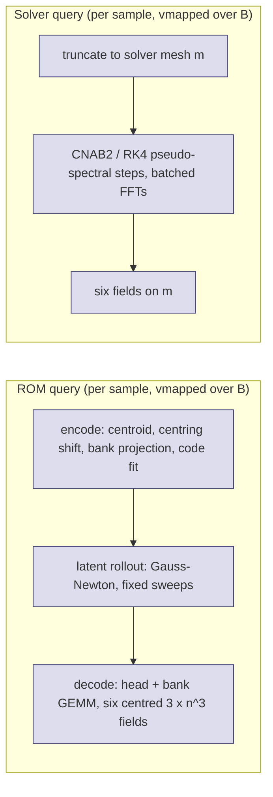

# Batched throughput: frozen NS3D-hard ROM arms vs their accuracy-matched GPU solver

What this covers: the throughput (queries per second, time per 1,000 queries) of the frozen
seed-0 ROM arms `r96_head`, `r128_head_fast`, `r192_head_fast` of lane ns3d-hard-rank and of
the pseudo-spectral solver configuration matched to each arm on the fresh cohort
(`fresh_s0b`, job 7145062), when BOTH sides process B independent queries per call
(B = 1, 8, 32, 128), on the same GPU in the same job. Protocol: `PROTOCOL.md` (A1: A100-80G
or H200 per job; A2: an exploratory ROM variant added after the first results). State: final
for the jobs listed below; every number lives in `results/tables.md`, generated by
`build_tables.sh` from `results/*/batched.json` (no number in this file is typed by hand).

## How each side was batched

- ROM `vmap`: `jax.jit(jax.vmap(...))` of the unchanged frozen query; `shared`: identical
  arithmetic with the quadratic operator shared by the batch (viscosity preconditioner applied
  after the contraction); `shared_r` (A2, exploratory): `shared` with real-FFT centring shifts.
- Solver `vmap`: `jax.jit(jax.vmap(...))` of the unchanged solver (complex FFTs); `rfft`: the same
  scheme with real-to-complex FFTs (about half the FFT work), given to the solver for parity.
- Inputs pre-loaded on the device, outputs left on the device; compile excluded; one interleaved
  randomised block per B; medians of 5 (B <= 32) or 3 (B >= 128) repetitions; repetition arrays
  stored. Batches that do not fit in memory run as consecutive chunks (marked "chunk c").

## What was found (see `results/tables.md` for the numbers)

1. Batching helps the ROM much more than the solver. The solver at its matched meshes
   (100^3-120^3) already fills the GPU at batch 1: its per-query time drops only modestly from
   B = 1 to B = 8 with real FFTs and is flat from B = 8 on (the unchanged complex-FFT solver gets
   slower per query when batched). The ROM's per-query time falls several-fold from B = 1 to
   B = 32 (most at 64^3, least at 128^3, where reconstruction dominates) and is flat beyond that.
2. Hence the throughput ratio (solver time / ROM time at equal B, equal accuracy) GROWS with B
   at every mesh and arm, from the batch-1 value (which reproduces fresh_s0b's ordering) to a
   plateau reached by B = 32.
3. The plateau is set by the ROM's reconstruction of the full output fields: at 128^3 the decode
   (six 3 x 128^3 fields with spectral centring shifts) is most of the ROM's batched time, and
   the plateau ratio is lowest there; at 64^3 it is highest. The latent solve alone
   ("ratio vs ROM solve-only") is far faster than either.
4. Accuracy is unchanged by batching: every batched callable reproduces the unchanged batch-1
   code to round-off on the checked slots and reproduces the fresh_s0b per-case errors over all
   128 fresh cases (ROM and solver), see the agreement sections of `results/tables.md`.
5. Re-match: at B = 32 a different shortlisted configuration (e.g. RK4 instead of CNAB2 at the
   same mesh) is at most a few percent faster than the batch-1-matched one; it does not change
   any conclusion.

## What can and cannot be claimed

- Can: at equal worst-case accuracy on the same 128 fresh cases, on the same GPU, with both codes
  batched by `vmap` and the solver given a real-FFT implementation, the ROM's batched throughput
  exceeds the solver's at every batch size tested, and the advantage widens with batching.
- Cannot: anything about other solver families (multigrid, finite volume, lower-order schemes,
  mixed precision, multi-GPU), about f32, or about a solver re-tuned for throughput beyond the
  450-configuration ladder plus the B = 32 re-match. Offline cost (snapshots, bank, head training)
  is not included; the break-even count is a separate question.
- The A2 `shared_r` numbers are exploratory (chosen after seeing the B <= 32 results) and are
  never the headline.

## Caveats

- Memory, not compute, limits batch size on both sides at 128^3 (chunks of 16-64); throughput
  is already flat at those chunk sizes, so chunking does not change the plateau.
- Jobs on different GPU models (A100-80G vs H200, see each table's GPU column) are never compared
  with each other; every ratio is within one job.
- Time per 1,000 queries is extrapolated from the measured batch time (both codes run a fixed
  number of iterations, so cost does not depend on the content of a query).
- One exploratory callable produced wrong output and is excluded: `shared_r` at 128^3, B = 128
  (chunk 64) returned 128 x the reference field. That single batched real FFT holds
  64 x 6 x 3 x 128^3 > 2^31 elements, so a 32-bit indexing fault in the batched FFT path is the
  likely cause; the same callable passes at every smaller size. The tables mark it FAILED CHECK
  and drop every callable whose batch-1 agreement check fails; every number shown has passed.
- Several jobs failed at B = 128 or in the re-match (compile-time GEMM autotuning or runtime
  out-of-memory with many callables resident); they were rerun as separate jobs (m128c, m128d,
  m128e, m96r). Every attempt and failure is kept in `results/` and listed below.

## Jobs

`smoke64` 7161709 (pipeline check, not a result); `m64` 7161723; `m96` 7161725 (B = 128 solver
only partly compiled); `m128` 7161724 (failed at B = 128 after B <= 32 completed); `m128c` 7161935
(failed: re-match and B = 128 out of memory; B = 32 re-timing kept); `m64r` 7161959; `m96r`
7161983; `m128r` 7161958; `m128d` 7162015; `m128e` 7162017 (B = 32 re-match only); `m128f` 7162488 (H200, lean
B = 128: ROM shared / shared_r and solver rfft only); `m128g` 7162778 (A100-80G, lean B = 128:
ROM shared and solver rfft only; the A100 B = 128 point at 128^3). `m128d` was cancelled after
its all-callable B = 128 block ran out of memory. Cluster namespace
`/cluster/tufts/paralab/tawal01/rebuttal-ns3d-batched/`.

## Glossary

- arm: one frozen ROM configuration (bank rank r, head, test count M, step count) from the
  source lane; `head_fast` = the cheapest setting within 25 % of the best development error.
- matched solver configuration: the fastest configuration (scheme, mesh m, step count) from the
  source lane's 450-configuration ladder whose worst-case error over the same 128 fresh cases is
  no larger than the arm's.
- worst error: the largest, over the 128 cases and five evolved output times, of the full-field
  relative L2 error against the 192^3 reference.
- B: number of independent queries (initial condition + viscosity) processed by one call.
- ms/query: batch time / B; queries/s: B / batch time; s/1000: time for 1,000 queries.
- ratio: solver time / ROM time at the same B (> 1: the ROM has the higher throughput).
- solve-only (solver): initial field already on mesh m to six fields on m. end-to-end (ROM):
  initial field on mesh n to six fields on mesh n, including projection and reconstruction.
- ROM solve-only: latent rollout only (no projection of the input, no field reconstruction).
- chunk c: the batch did not fit in device memory and ran as B / c consecutive calls of size c.
- vmap / shared / shared_r / rfft: the batching variants defined above.
- re-match: re-timing every shortlisted eligible solver configuration at B = 32.
