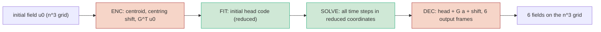

# Split timing of the NS3D-hard ROM query (mesh 64^3 to 256^3) and the replicate-1 timing rerun

What this directory holds and the state of its numbers: final for the jobs listed below; every number
is in `tables.md`, which `make_tables.sh` generates from the job JSONs (nothing typed by hand). The
protocol is `../../PROTOCOL.md`, entries T1, T2 and T2 notes 1-6.

## What was measured

One query of each frozen fresh-cohort arm (replicate 0: `r64_head`, `r96_head`, `r128_head`,
`r128_head_fast`, `r192_head`, `r192_head_fast`; files and heads exactly those of `fresh_s0b`) was cut
into separately compiled stages, timed inside the source lane's interleaved, gated timing block:

Red-shaded stages touch the grid; green stages touch only reduced quantities. FULL is the source
query, unchanged (the number Table G1 reports). The split stages reproduce FULL to about 1e-15
relative, and the errors on the eight timing cases reproduce `fresh_s0b` to about 1e-15.

Meshes 64, 96, 128 use the native per-mesh banks, heads and frozen settings. Meshes 192 and 256 have
no bank of their own. There the 128^3 bank was Fourier-resampled, with the 128^3 heads and settings
(the source protocol's interpolated-POD rule, A3.4). The 192^3 reduced operators were assembled with
the lane's `build_ops`. For all three banks they equal the 128^3 operators to about 1e-15 (T after the
factor (n/128)^{3/2}), so the reduced system is identical at every mesh. The 256^3 operators are the
128^3 ones scaled by that factor.

## Jobs

| job | id | GPU / node | meshes | outcome |
|---|---|---|---|---|
| split_a100 | 7161810 | A100 80GB PCIe, pax007 | 64, 96, 128 | final; OOM later at 192 (crash) |
| split_a100b | 7162452 | A100, pax049 | 192 (r96/r128 block) | final; OOM on the next block |
| split_a100c | 7162606 | A100, pax049 | 192 (r64, r192 blocks) | final |
| split_h200 | 7161809 | H200, pax010 | 64, 96, 128 + 192 assembly | final; OOM at 192 timing (crash) |
| split_h200b | 7162161 | H200, pax010 | 192 | final; crashed at 256 (DECB autotune) |
| split_h200e | 7162605 | H200, pax010 | 256 (r96, r128 blocks) | final; could not allocate rank-192 basis |
| split_h200f | 7162905 | H200, pax009 | 256 (r192, r64 blocks) | final |
| fresh_s1c | 7161688 | exclusive A100 node requested | 64, 96, 128 | see T1 / status |

Every timing block that ran passed the A4 gate at its first attempt.

## Caveats

- Meshes 192/256 use the resampled 128^3 bank and zero-shot 128^3 heads (no training or selection
  there). Their errors equal the 128^3 errors because the truth has no content beyond the 128^3 band.
  These rows show how the cost scales, not new accuracy results.
- 192^3 on the A100 ran on a different node and job (pax049) than 64-128 (pax007). Its SOLVE times are
  4-11 % above the 64-128 values for every arm, including arms whose reduced system is identical, so
  this is a node or job effect. The H200 rows (all on pax010) show SOLVE equal to within about 1 % from
  64^3 to 256^3.
- Arms `r64_head`, `r128_head` and `r192_head` have different frozen (M, steps) at different meshes,
  so their SOLVE changes with the setting, not with the grid. The flatness column "at identical
  (M, steps)" compares like with like.
- The same-mesh solver references at 192/256 reuse the 128^3 step counts. At 192^3 they are accurate
  (error column in tables.md). At 256^3 CNAB2 x120 is NOT stable (non-finite error on the timing
  cases), so its 256^3 time is a cost reference only, not an accuracy-matched solver. The any-mesh
  references (solver on its own mesh of at most 120^3) are unaffected.
- The 256^3 rank-192 and rank-64 blocks ran on node pax009 (split_h200f); every other H200 row ran on
  pax010. Their SOLVE is 2-6 % above the pax010 values.
- 256^3 is H200 only: in f64, the rank-192 basis at 256^3 (77 GB) does not fit an A100 80 GB.

## Glossary

- **arm**: one frozen ROM configuration (rank r of the POD bank, head, test count M, steps).
  `_fast` = the cheaper setting within 25 % of the best development error.
- **ENC / FIT / SOLVE / DEC / FULL / DECB**: see "What was measured".
- **sum**: ENC + FIT + SOLVE + DEC (it matches FULL to within the interleaving noise).
- **solver any-mesh (solve-only)**: the accuracy-matched pseudo-spectral solver configuration
  (scheme / mesh / steps) that `fresh_s0b` selected for that arm and mesh. It is timed solving on its
  own mesh, with no transfer. For 192/256 it is the 128^3 choice.
- **same-mesh**: the solver run on the evaluation mesh itself. At 192/256 it uses the 128^3 scheme
  and step count.
- **FULL ratio / SOLVE-only ratio**: solver ms divided by ROM FULL ms, or by ROM SOLVE ms, from the
  same interleaved block.
- **gate**: the source lane's A4 timing-stability check. Sentinel callables are timed alone before
  and after the block. They must agree within 1.10, and the in-block time must be within 1/1.10-1.25
  of the solo time.
- **block / group**: one randomised interleaved timing block. At large meshes it holds one bank (or
  one rank) at a time because of GPU memory.
- `*` after a mesh: above the bank meshes (resampled 128^3 bank).
