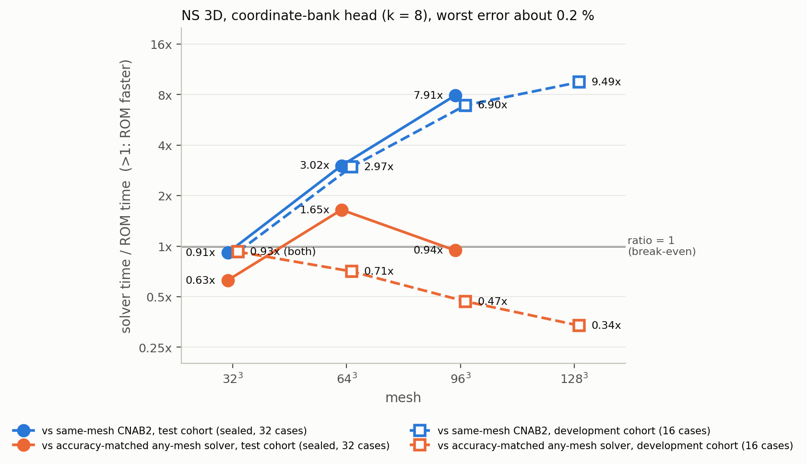

# NS 3D confirmation lane: final table (generated; do not edit by hand)

State: final. All seven runs are pulled; the sealed test cohort (seed 202609221, 32 cases) was opened once, one job per mesh. Generated by `experiments/ns3d-pod-match/reports/build_final.py` from the pulled `summary.json` files; protocol and amendments A1-A3 in `experiments/ns3d-pod-match/PROTOCOL.md`.

Reading rule: a speedup or ratio above 1 means the reduced model is faster than the solver it is compared with.

## Headline: coordinate-bank head (k = 8)

| cohort | mesh | worst err % | ROM ms | same-mesh CNAB2 speedup | accuracy-matched ratio (comparator, its worst %) | solve-only ratio | protocol rule over all timed candidates | sensitivity: fastest solver within 1.25x of the arm's error |
|---|---|---|---|---|---|---|---|---|
| test | 32^3 | 0.208 | 5.89 | 0.91x (CNAB2_s40) | 0.63x (m32_rk4_s10, 0.063) | 0.66x | 0.63x (m32_rk4_s10) | 0.63x (m32_rk4_s10, 0.063) |
| test | 64^3 | 0.209 | 7.99 | 3.02x (CNAB2_s50) | 1.65x (m48_rk4_s15, 0.112) | 1.38x | 1.65x (m48_rk4_s15) | 0.72x (m40_rk4_s10, 0.234) |
| test | 96^3 | 0.208 | 15.44 | 7.91x (CNAB2_s70) | 0.94x (m48_rk4_s15, 0.112) | 0.74x | 0.94x (m48_rk4_s15) | 0.47x (m40_rk4_s10, 0.234) |
| dev | 32^3 | 0.181 | 5.90 | 0.93x (CNAB2_s40) | n/a (none as accurate, n/a) | n/a | 0.93x (CNAB2_s40) | 0.93x (CNAB2_s40, 0.152) |
| dev | 64^3 | 0.197 | 8.03 | 2.97x (CNAB2_s50) | 0.71x (m40_rk4_s10, 0.165) | 0.63x | 0.71x (m40_rk4_s10) | 0.71x (m40_rk4_s10, 0.165) |
| dev | 96^3 | 0.194 | 15.29 | 6.90x (CNAB2_s60) | 0.47x (m40_rk4_s10, 0.165) | 0.35x | 0.47x (m40_rk4_s10) | 0.47x (m40_rk4_s10, 0.165) |
| dev | 128^3 | 0.194 | 29.40 | 9.49x (CNAB2_s70) | 0.34x (m40_rk4_s10, 0.165) | 0.18x | 0.34x (m40_rk4_s10) | 0.34x (m40_rk4_s10, 0.165) |

Caveats that belong next to these numbers:

- The development runs at 32^3, 64^3 and 96^3 (`cdev*b`) ran before amendment A3, so their accuracy-matched ladder has only meshes coarser than the ROM's and no RK4 at the ROM's own mesh; the test runs and `cdev128c` include it. Where the table says "none as accurate", the protocol comparator is the same-mesh CNAB2 entry (column "protocol rule over all timed candidates"), and the figure plots that column.
- The sensitivity column is not the protocol rule. It was added after the outcomes were seen and shows how the ratio moves if the solver may be up to 1.25x less accurate than the arm.
- 128^3 is exploratory (development cohort only, the 96^3 head used zero-shot, no NumPy audit because fields were not stored).
- The heads were trained in development jobs; only the test rows are held out.

## Test cohort (sealed, opened once)

### test 32^3 (run ctest32, job 7118376, seed 202609221, 32 cases)

GPU NVIDIA A100 80GB PCIe, GPU-7e4a47f7-94ae-5071-1329-bd1dd16a77be, 81920 MiB; `jax_backend=gpu` in log: True; `ALL_EXIT=0` in log: True; timing gate: True; NumPy audit: True; solver ladder includes the ROM's own mesh (amendment A3): True; flags: ['flag (bar c): orthonormality before Lowdin 6.07e-01', 'flag: D_d autodiff vs spectral 1.62e-02 > 1e-4'].

| arm | worst err % | ROM ms | ROM ms min / med / max | same-mesh comparator | its ms | speedup | matched any-mesh comparator | its worst % | its ms | its ms min / med / max | ratio | ratio solve-only | eligible |
|---|---|---|---|---|---|---|---|---|---|---|---|---|---|
| coordnet_head_k8 | 0.208 | 5.89 | 5.83 / 5.89 / 5.91 | CNAB2_s40 | 5.38 | 0.91x | m32_rk4_s10 | 0.063 | 3.69 | 3.58 / 3.69 / 3.70 | 0.63x | 0.66x | 11 |
| pod_head_k8 | 0.206 | 5.86 | 5.69 / 5.86 / 6.89 | CNAB2_s40 | 5.38 | 0.92x | m32_rk4_s10 | 0.063 | 3.69 | 3.58 / 3.69 / 3.70 | 0.63x | 0.66x | 11 |
| interp_head_k8 | 0.433 | 5.86 | 5.83 / 5.86 / 6.23 | CNAB2_s40 | 5.38 | 0.92x | m32_rk4_s10 | 0.063 | 3.69 | 3.58 / 3.69 / 3.70 | 0.63x | 0.66x | 12 |
| coordnet_span8 | 6.213 | 3.20 | 3.05 / 3.20 / 3.57 | CNAB2_s20 | 3.03 | 0.95x | m20_rk4_s5 | 4.001 | 1.86 | 1.74 / 1.86 / 2.06 | 0.58x | 0.57x | 61 |
| coordnet_span16 | 2.671 | 3.30 | 3.21 / 3.30 / 3.38 | CNAB2_s40 | 5.38 | 1.63x | m24_rk4_s5 | 2.513 | 1.89 | 1.83 / 1.89 / 2.18 | 0.57x | 0.57x | 39 |
| coordnet_span32 | 1.339 | 3.82 | 3.70 / 3.82 / 3.99 | CNAB2_s40 | 5.38 | 1.41x | m28_cnab2_s25 | 1.266 | 3.45 | 3.40 / 3.45 / 3.75 | 0.90x | 0.94x | 26 |
| coordnet_span48 | 1.287 | 3.97 | 3.93 / 3.97 / 4.41 | CNAB2_s40 | 5.38 | 1.36x | m28_cnab2_s25 | 1.266 | 3.45 | 3.40 / 3.45 / 3.75 | 0.87x | 0.91x | 26 |
| coordnet_span64 | 0.857 | 5.41 | 5.37 / 5.41 / 5.64 | CNAB2_s40 | 5.38 | 1.00x | m32_cnab2_s25 | 0.523 | 3.48 | 3.32 / 3.48 / 3.86 | 0.64x | 0.67x | 13 |
| pod_linear_R64 | 1.093 | 5.40 | 5.29 / 5.40 / 5.44 | CNAB2_s40 | 5.38 | 1.00x | m32_cnab2_s25 | 0.523 | 3.48 | 3.32 / 3.48 / 3.86 | 0.64x | 0.67x | 13 |

### test 64^3 (run ctest64, job 7118369, seed 202609221, 32 cases)

GPU NVIDIA A100 80GB PCIe, GPU-74d9bc51-9598-c873-88b7-cf67f1886e14, 81920 MiB; `jax_backend=gpu` in log: True; `ALL_EXIT=0` in log: True; timing gate: True; NumPy audit: True; solver ladder includes the ROM's own mesh (amendment A3): True; flags: none.

| arm | worst err % | ROM ms | ROM ms min / med / max | same-mesh comparator | its ms | speedup | matched any-mesh comparator | its worst % | its ms | its ms min / med / max | ratio | ratio solve-only | eligible |
|---|---|---|---|---|---|---|---|---|---|---|---|---|---|
| coordnet_head_k8 | 0.209 | 7.99 | 7.92 / 7.99 / 8.78 | CNAB2_s50 | 24.12 | 3.02x | m48_rk4_s15 | 0.112 | 13.16 | 12.76 / 13.16 / 13.31 | 1.65x | 1.38x | 24 |
| pod_head_k8 | 0.208 | 7.94 | 7.89 / 7.94 / 8.07 | CNAB2_s50 | 24.12 | 3.04x | m48_rk4_s15 | 0.112 | 13.16 | 12.76 / 13.16 / 13.31 | 1.66x | 1.38x | 24 |
| interp_head_k8 | not run at this mesh | | | | | | | | | | | | |
| coordnet_span8 | 6.213 | 4.16 | 4.07 / 4.16 / 4.72 | CNAB2_s50 | 24.12 | 5.80x | m20_rk4_s5 | 4.012 | 2.31 | 2.27 / 2.31 / 2.56 | 0.56x | 0.43x | 99 |
| coordnet_span16 | 2.667 | 4.51 | 4.46 / 4.51 / 5.09 | CNAB2_s50 | 24.12 | 5.35x | m24_rk4_s5 | 2.502 | 2.39 | 2.26 / 2.39 / 2.45 | 0.53x | 0.42x | 77 |
| coordnet_span32 | 1.328 | 5.38 | 5.31 / 5.38 / 5.64 | CNAB2_s50 | 24.12 | 4.49x | m28_cnab2_s25 | 1.261 | 3.98 | 3.94 / 3.98 / 4.21 | 0.74x | 0.67x | 64 |
| coordnet_span48 | 2.769 | 5.69 | 5.64 / 5.69 / 6.01 | CNAB2_s50 | 24.12 | 4.24x | m24_rk4_s5 | 2.502 | 2.39 | 2.26 / 2.39 / 2.45 | 0.42x | 0.34x | 79 |
| coordnet_span64 | 1.309 | 7.59 | 7.42 / 7.59 / 8.41 | CNAB2_s50 | 24.12 | 3.18x | m28_cnab2_s25 | 1.261 | 3.98 | 3.94 / 3.98 / 4.21 | 0.52x | 0.47x | 64 |
| pod_linear_R64 | 1.123 | 7.50 | 7.42 / 7.50 / 7.63 | CNAB2_s50 | 24.12 | 3.21x | m32_cnab2_s25 | 0.935 | 4.05 | 4.03 / 4.05 / 4.24 | 0.54x | 0.48x | 60 |

### test 96^3 (run ctest96, job 7118362, seed 202609221, 32 cases)

GPU NVIDIA A100 80GB PCIe, GPU-7e4a47f7-94ae-5071-1329-bd1dd16a77be, 81920 MiB; `jax_backend=gpu` in log: True; `ALL_EXIT=0` in log: True; timing gate: True; NumPy audit: True; solver ladder includes the ROM's own mesh (amendment A3): True; flags: none.

| arm | worst err % | ROM ms | ROM ms min / med / max | same-mesh comparator | its ms | speedup | matched any-mesh comparator | its worst % | its ms | its ms min / med / max | ratio | ratio solve-only | eligible |
|---|---|---|---|---|---|---|---|---|---|---|---|---|---|
| coordnet_head_k8 | 0.208 | 15.44 | 15.36 / 15.44 / 15.53 | CNAB2_s70 | 122.11 | 7.91x | m48_rk4_s15 | 0.112 | 14.56 | 14.49 / 14.56 / 14.65 | 0.94x | 0.74x | 36 |
| pod_head_k8 | 0.207 | 15.48 | 15.40 / 15.48 / 16.04 | CNAB2_s70 | 122.11 | 7.89x | m48_rk4_s15 | 0.112 | 14.56 | 14.49 / 14.56 / 14.65 | 0.94x | 0.73x | 36 |
| interp_head_k8 | 0.208 | 15.42 | 15.21 / 15.42 / 15.49 | CNAB2_s70 | 122.11 | 7.92x | m48_rk4_s15 | 0.112 | 14.56 | 14.49 / 14.56 / 14.65 | 0.94x | 0.74x | 36 |
| coordnet_span8 | 6.213 | 7.92 | 7.74 / 7.92 / 8.35 | CNAB2_s60 | 105.43 | 13.31x | m20_rk4_s5 | 4.012 | 3.69 | 3.56 / 3.69 / 3.71 | 0.47x | 0.24x | 113 |
| coordnet_span16 | 2.667 | 8.82 | 8.76 / 8.82 / 8.90 | CNAB2_s70 | 122.11 | 13.84x | m24_rk4_s5 | 2.502 | 3.71 | 3.60 / 3.71 / 3.77 | 0.42x | 0.23x | 90 |
| coordnet_span32 | 1.328 | 11.01 | 10.91 / 11.01 / 11.20 | CNAB2_s70 | 122.11 | 11.09x | m28_cnab2_s25 | 1.261 | 5.41 | 5.36 / 5.41 / 6.20 | 0.49x | 0.33x | 77 |
| coordnet_span48 | 2.769 | 12.21 | 12.12 / 12.21 / 13.27 | CNAB2_s70 | 122.11 | 10.00x | m24_rk4_s5 | 2.502 | 3.71 | 3.60 / 3.71 / 3.77 | 0.30x | 0.16x | 92 |
| coordnet_span64 | 1.309 | 14.87 | 14.76 / 14.87 / 14.99 | CNAB2_s70 | 122.11 | 8.21x | m28_cnab2_s25 | 1.261 | 5.41 | 5.36 / 5.41 / 6.20 | 0.36x | 0.25x | 77 |
| pod_linear_R64 | 1.123 | 14.88 | 14.81 / 14.88 / 14.95 | CNAB2_s70 | 122.11 | 8.21x | m28_rk4_s10 | 1.096 | 5.60 | 5.46 / 5.60 / 5.69 | 0.38x | 0.26x | 73 |

## Development cohort

### dev 32^3 (run cdev32b, job 7117294, seed 202609202, 16 cases)

GPU NVIDIA A100 80GB PCIe, GPU-c52a7f04-fc38-6157-cf19-5c7ff0945752, 81920 MiB; `jax_backend=gpu` in log: True; `ALL_EXIT=0` in log: True; timing gate: True; NumPy audit: True; solver ladder includes the ROM's own mesh (amendment A3): False; flags: ['flag (bar c): orthonormality before Lowdin 6.07e-01', 'flag: D_d autodiff vs spectral 1.62e-02 > 1e-4'].

| arm | worst err % | ROM ms | ROM ms min / med / max | same-mesh comparator | its ms | speedup | matched any-mesh comparator | its worst % | its ms | its ms min / med / max | ratio | ratio solve-only | eligible |
|---|---|---|---|---|---|---|---|---|---|---|---|---|---|
| coordnet_head_k8 | 0.181 | 5.90 | 5.68 / 5.90 / 6.09 | CNAB2_s40 | 5.46 | 0.93x | none as accurate | n/a | n/a | n/a | n/a | n/a | 0 |
| pod_head_k8 | 0.151 | 5.88 | 5.74 / 5.88 / 6.62 | CNAB2_s50 | 6.53 | 1.11x | none as accurate | n/a | n/a | n/a | n/a | n/a | 0 |
| interp_head_k8 | 0.329 | 5.77 | 5.69 / 5.77 / 5.92 | CNAB2_s40 | 5.46 | 0.95x | none as accurate | n/a | n/a | n/a | n/a | n/a | 0 |
| coordnet_span8 | 4.954 | 3.20 | 3.16 / 3.20 / 3.38 | CNAB2_s20 | 3.11 | 0.97x | m24_rk4_s5 | 2.062 | 1.78 | 1.75 / 1.78 / 1.97 | 0.56x | 0.59x | 48 |
| coordnet_span16 | 2.484 | 3.36 | 3.21 / 3.36 / 4.05 | CNAB2_s20 | 3.11 | 0.93x | m24_rk4_s5 | 2.062 | 1.78 | 1.75 / 1.78 / 1.97 | 0.53x | 0.57x | 29 |
| coordnet_span32 | 1.017 | 3.84 | 3.71 / 3.84 / 4.47 | CNAB2_s20 | 3.11 | 0.81x | m28_cnab2_s25 | 0.981 | 3.50 | 3.32 / 3.50 / 3.55 | 0.91x | 0.93x | 13 |
| coordnet_span48 | 1.057 | 4.00 | 3.88 / 4.00 / 5.00 | CNAB2_s20 | 3.11 | 0.78x | m28_cnab2_s25 | 0.981 | 3.50 | 3.32 / 3.50 / 3.55 | 0.88x | 0.89x | 13 |
| coordnet_span64 | 0.758 | 5.46 | 5.33 / 5.46 / 5.65 | CNAB2_s40 | 5.46 | 1.00x | none as accurate | n/a | n/a | n/a | n/a | n/a | 0 |
| pod_linear_R64 | 0.602 | 5.40 | 5.26 / 5.40 / 6.05 | CNAB2_s40 | 5.46 | 1.01x | none as accurate | n/a | n/a | n/a | n/a | n/a | 0 |

### dev 64^3 (run cdev64b, job 7117301, seed 202609202, 16 cases)

GPU NVIDIA A100 80GB PCIe, GPU-d881b2b0-b08f-83e6-0f3d-e646626625cc, 81920 MiB; `jax_backend=gpu` in log: True; `ALL_EXIT=0` in log: True; timing gate: True; NumPy audit: True; solver ladder includes the ROM's own mesh (amendment A3): False; flags: none.

| arm | worst err % | ROM ms | ROM ms min / med / max | same-mesh comparator | its ms | speedup | matched any-mesh comparator | its worst % | its ms | its ms min / med / max | ratio | ratio solve-only | eligible |
|---|---|---|---|---|---|---|---|---|---|---|---|---|---|
| coordnet_head_k8 | 0.197 | 8.03 | 7.93 / 8.03 / 8.87 | CNAB2_s50 | 23.88 | 2.97x | m40_rk4_s10 | 0.165 | 5.68 | 5.55 / 5.68 / 5.86 | 0.71x | 0.63x | 29 |
| pod_head_k8 | 0.152 | 8.00 | 7.96 / 8.00 / 8.10 | CNAB2_s50 | 23.88 | 2.99x | m48_rk4_s15 | 0.074 | 12.73 | 12.66 / 12.73 / 13.32 | 1.59x | 1.35x | 18 |
| interp_head_k8 | not run at this mesh | | | | | | | | | | | | |
| coordnet_span8 | 4.952 | 4.16 | 4.05 / 4.16 / 4.82 | CNAB2_s40 | 19.34 | 4.64x | m20_rk4_s5 | 3.368 | 2.34 | 2.22 / 2.34 / 2.36 | 0.56x | 0.44x | 95 |
| coordnet_span16 | 2.485 | 4.59 | 4.47 / 4.59 / 4.94 | CNAB2_s40 | 19.34 | 4.21x | m24_rk4_s5 | 2.056 | 2.39 | 2.27 / 2.39 / 2.46 | 0.52x | 0.42x | 76 |
| coordnet_span32 | 0.951 | 5.27 | 5.25 / 5.27 / 5.61 | CNAB2_s40 | 19.34 | 3.67x | m32_cnab2_s25 | 0.715 | 3.98 | 3.96 / 3.98 / 4.26 | 0.76x | 0.68x | 58 |
| coordnet_span48 | 1.771 | 5.68 | 5.60 / 5.68 / 6.27 | CNAB2_s40 | 19.34 | 3.41x | m28_cnab2_s20 | 1.125 | 3.38 | 3.32 / 3.38 / 3.58 | 0.60x | 0.51x | 61 |
| coordnet_span64 | 1.284 | 7.58 | 7.49 / 7.58 / 7.71 | CNAB2_s40 | 19.34 | 2.55x | m28_cnab2_s20 | 1.125 | 3.38 | 3.32 / 3.38 / 3.58 | 0.45x | 0.38x | 61 |
| pod_linear_R64 | 0.616 | 7.62 | 7.48 / 7.62 / 7.90 | CNAB2_s40 | 19.34 | 2.54x | m32_rk4_s10 | 0.564 | 4.35 | 4.25 / 4.35 / 4.38 | 0.57x | 0.52x | 43 |

### dev 96^3 (run cdev96b, job 7117306, seed 202609202, 16 cases)

GPU NVIDIA A100 80GB PCIe, GPU-74d9bc51-9598-c873-88b7-cf67f1886e14, 81920 MiB; `jax_backend=gpu` in log: True; `ALL_EXIT=0` in log: True; timing gate: True; NumPy audit: True; solver ladder includes the ROM's own mesh (amendment A3): False; flags: none.

| arm | worst err % | ROM ms | ROM ms min / med / max | same-mesh comparator | its ms | speedup | matched any-mesh comparator | its worst % | its ms | its ms min / med / max | ratio | ratio solve-only | eligible |
|---|---|---|---|---|---|---|---|---|---|---|---|---|---|
| coordnet_head_k8 | 0.194 | 15.29 | 15.20 / 15.29 / 15.38 | CNAB2_s60 | 105.58 | 6.90x | m40_rk4_s10 | 0.165 | 7.17 | 7.02 / 7.17 / 7.37 | 0.47x | 0.35x | 47 |
| pod_head_k8 | 0.153 | 15.20 | 14.97 / 15.20 / 17.08 | CNAB2_s60 | 105.58 | 6.95x | m48_rk4_s15 | 0.074 | 14.47 | 14.37 / 14.47 / 14.71 | 0.95x | 0.74x | 36 |
| interp_head_k8 | 0.152 | 15.37 | 15.08 / 15.37 / 15.50 | CNAB2_s60 | 105.58 | 6.87x | m48_rk4_s15 | 0.074 | 14.47 | 14.37 / 14.47 / 14.71 | 0.94x | 0.73x | 36 |
| coordnet_span8 | 4.952 | 7.87 | 7.70 / 7.87 / 7.92 | CNAB2_s50 | 88.80 | 11.29x | m24_rk4_s5 | 2.056 | 3.65 | 3.58 / 3.65 / 3.74 | 0.46x | 0.23x | 115 |
| coordnet_span16 | 2.485 | 8.82 | 8.69 / 8.82 / 9.00 | CNAB2_s50 | 88.80 | 10.06x | m24_rk4_s5 | 2.056 | 3.65 | 3.58 / 3.65 / 3.74 | 0.41x | 0.22x | 96 |
| coordnet_span32 | 0.951 | 11.24 | 10.95 / 11.24 / 11.46 | CNAB2_s60 | 105.58 | 9.40x | m32_cnab2_s25 | 0.715 | 5.47 | 5.37 / 5.47 / 5.91 | 0.49x | 0.35x | 77 |
| coordnet_span48 | 1.771 | 12.38 | 12.01 / 12.38 / 12.70 | CNAB2_s50 | 88.80 | 7.17x | m28_cnab2_s20 | 1.125 | 4.78 | 4.67 / 4.78 / 5.04 | 0.39x | 0.25x | 81 |
| coordnet_span64 | 1.284 | 14.88 | 14.77 / 14.88 / 15.31 | CNAB2_s50 | 88.80 | 5.97x | m28_cnab2_s20 | 1.125 | 4.78 | 4.67 / 4.78 / 5.04 | 0.32x | 0.21x | 80 |
| pod_linear_R64 | 0.616 | 14.97 | 14.58 / 14.97 / 15.12 | CNAB2_s60 | 105.58 | 7.05x | m32_rk4_s10 | 0.564 | 5.73 | 5.67 / 5.73 / 5.85 | 0.38x | 0.27x | 62 |

### dev 128^3 (run cdev128c, job 7118280, seed 202609202, 16 cases)

GPU NVIDIA A100 80GB PCIe, GPU-6481e68e-7435-8539-633a-66f852b4a8e9, 81920 MiB; `jax_backend=gpu` in log: True; `ALL_EXIT=0` in log: True; timing gate: True; NumPy audit: None; solver ladder includes the ROM's own mesh (amendment A3): True; flags: none.

| arm | worst err % | ROM ms | ROM ms min / med / max | same-mesh comparator | its ms | speedup | matched any-mesh comparator | its worst % | its ms | its ms min / med / max | ratio | ratio solve-only | eligible |
|---|---|---|---|---|---|---|---|---|---|---|---|---|---|
| coordnet_head_k8 | 0.194 | 29.40 | 29.14 / 29.40 / 30.91 | CNAB2_s70 | 278.83 | 9.49x | m40_rk4_s10 | 0.165 | 9.89 | 9.73 / 9.89 / 10.05 | 0.34x | 0.18x | 54 |
| pod_head_k8 | not run at this mesh | | | | | | | | | | | | |
| interp_head_k8 | 0.152 | 29.48 | 29.31 / 29.48 / 34.89 | CNAB2_s70 | 278.83 | 9.46x | m48_rk4_s15 | 0.074 | 17.11 | 16.98 / 17.11 / 17.58 | 0.58x | 0.39x | 43 |
| coordnet_span8 | 4.952 | 14.63 | 14.45 / 14.63 / 14.74 | CNAB2_s60 | 240.47 | 16.44x | m24_rk4_s5 | 2.056 | 6.41 | 6.32 / 6.41 / 6.69 | 0.44x | 0.14x | 92 |
| coordnet_span16 | 2.485 | 16.62 | 16.57 / 16.62 / 16.95 | CNAB2_s60 | 240.47 | 14.47x | m24_rk4_s5 | 2.056 | 6.41 | 6.32 / 6.41 / 6.69 | 0.39x | 0.13x | 91 |
| coordnet_span32 | 0.951 | 20.96 | 20.60 / 20.96 / 21.19 | CNAB2_s60 | 240.47 | 11.47x | m32_cnab2_s25 | 0.715 | 8.29 | 7.98 / 8.29 / 8.64 | 0.40x | 0.19x | 73 |
| coordnet_span48 | 1.771 | 24.29 | 24.01 / 24.29 / 24.59 | CNAB2_s60 | 240.47 | 9.90x | m32_cnab2_s20 | 0.994 | 7.66 | 7.57 / 7.66 / 8.15 | 0.32x | 0.14x | 76 |
| coordnet_span64 | 1.284 | 29.07 | 28.97 / 29.07 / 29.08 | CNAB2_s60 | 240.47 | 8.27x | m32_cnab2_s20 | 0.994 | 7.66 | 7.57 / 7.66 / 8.15 | 0.26x | 0.12x | 75 |
| pod_linear_R64 | not run at this mesh | | | | | | | | | | | | |

## Glossary

- **arm**: one reduced-model configuration. `coordnet_head_k8`: coordinate-network basis bank with a learned 8-coefficient head (the accurate setting). `pod_head_k8`: the same with the paper's per-mesh POD basis. `interp_head_k8`: the 64^3 POD basis Fourier-resampled to the mesh, with the 64^3 head used without retraining. `coordnet_spanR`: the first R bank columns used as a plain linear subspace. `pod_linear_R64`: rank-64 linear POD.
- **worst err %**: over all cases and evolved frames, the largest L2 error divided by the L2 norm of that case's initial field, against CNAB2 at the same mesh with time step 0.001.
- **ROM ms**: median of 7 repeated timings of one query (after warm-up), with min / median / max beside it.
- **same-mesh comparator, speedup**: the fastest CNAB2 step count at the ROM's mesh whose worst error is no larger than the arm's; speedup = its ms / ROM ms (`comparators.<arm>` in the JSON).
- **matched any-mesh comparator, ratio**: the fastest stable pseudo-spectral run (CNAB2 or RK4, any mesh and step count on the ladder) whose worst error is no larger than the arm's, timed end-to-end (truncate the input, solve, pad the six frames back to the ROM's mesh); ratio = its ms / ROM ms (`coarse_comparators.<arm>`).
- **ratio solve-only**: the same with truncation and padding excluded from the solver's time (more favourable to the solver).
- **eligible**: how many timed ladder configurations were at least as accurate as the arm.
- **CNAB2_sK / mM_rk4_sK / mM_cnab2_sK**: solver scheme (Crank-Nicolson/Adams-Bashforth 2 or Runge-Kutta 4), mesh M^3, K time steps.
- **timing gate**: sentinel timings before and after the timing block agree within 10 %.
- **NumPy audit**: an independent recomputation of the errors from the stored fields.
- **development / test cohort**: 16 cases (seed 202609202) used while building; 32 disjoint cases (seed 202609221) opened once.

