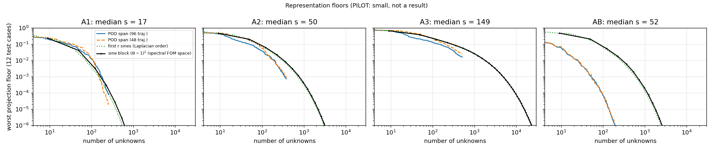
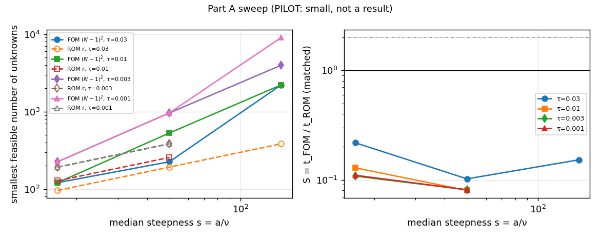
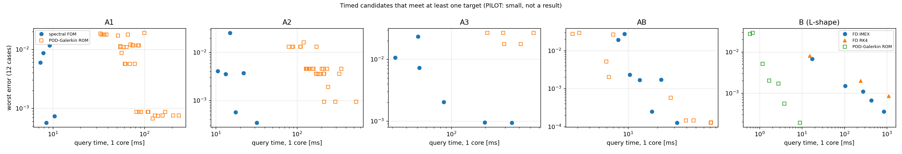
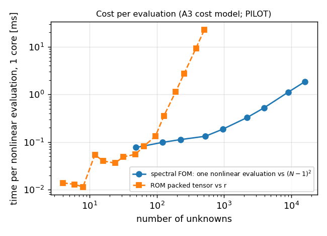

# Spectral pilot: can the reduced-order model beat a spectral or best-practice solver?

**Status (2026-10-21): PILOT: small, not a result.** Small local CPU pilot (lane `exp/2026-10-20-spectral-pilot`), run to find direction and feasibility for a later cluster lane. Every number below is generated by `make_report.py` from the run JSONs in `runs/` and labelled PILOT. The reduced model tested is a **POD–Galerkin feasibility comparator** (POD span + exact quadratic tensor or grid rule + ETDRK4), not the coordinate-network bank: a loss means this implementation loses, a win only licenses the full experiment (DESIGN A1.1). Errors are against numerical references (conditional allowances, DESIGN A2.5/A3.4). Design: `DESIGN.md` (amended exploratory design, amendments A1–A6; A6 = post-hoc control AB); audits in `audits/`.

## 1. In brief

- Part A (box, wide family, this POD–Galerkin ROM), τ = 0.03: FOM faster throughout (S = 0.22, 0.1, 0.15 at A1, A2, A3; PILOT).
- A3: the ROM never reached τ ∈ {0.01, 0.003, 0.001} with r ≤ 512 (censored; PILOT).
- Part B (L-shape vs these second-order FD solvers), τ = 0.03: ROM >= 2x faster (S = 29; PILOT).
- Part B (L-shape vs these second-order FD solvers), τ = 0.01: ROM >= 2x faster (S = 17; PILOT).
- Part B (L-shape vs these second-order FD solvers), τ = 0.003: ROM >= 2x faster (S = 64; PILOT).
- Part B (L-shape vs these second-order FD solvers), τ = 0.001: ROM >= 2x faster (S = 1.1e+02; PILOT).
- Post-hoc control AB (Part-B cases on the box vs the spectral FOM): S = 2.9 (τ=0.03), 1.8 (τ=0.01), 1.7 (τ=0.003), 0.62 (τ=0.001); PILOT.

## 2. What ran

Table (PILOT): levels, references and gates.

| level | ν band | test steepness s (median, range) | $N_{\rm ref}$ | allowance U | front sharpness t>0 (t=0) | remaining energy at t=0.25 | gates |
|---|---|---|---|---|---|---|---|
| A1 | [0.06, 0.12] | 17 (11–32) | 128 | 2.7e-09 | 6.2 (14.6) | 0.18 | all pass |
| A2 | [0.02, 0.04] | 50 (34–96) | 192 | 6.5e-09 | 10.7 (14.6) | 0.32 | all pass |
| A3 | [0.006667, 0.01333] | 149 (101–289) | 384 | 1.5e-08 | 21.5 (14.6) | 0.48 | all pass |
| AB | [0.02013, 0.04995] | 52 (30–77) | 192 | 3.2e-09 | 11.2 (16.5) | 0.28 | all pass |

Table: PILOT. A4 (ν band [0.0022, 0.0044]) was **not run** (agent's decision, see §8; A3's first ROM job hit its 30-minute unit cap and its r = 512 part was re-run as a separate unit). A3's reference generation took 25 minutes on the shared CPU. AB is the post-hoc control of A6. Gates per level: reference space/time/padding differences, SW1a/SW1b (matcher), SW2 (reference gate), G4 (tensor ROM = direct-evaluation ROM), SW4 (tensor-slice corruption), G7 (IC rule), D2 (no run below its floor). Front sharpness is $\max|\nabla u|/\max|u|$, median over test cases of the max over $t_1..t_5$.

Part B (L-shape, ν ∈ [0.02, 0.05]): reference = SBDF2 + SuperLU at L = 1024; observed orders p₁ = 2.00, p₂ = 2.00 (gate passed); Richardson reference-error estimate 3.1e-05, time-gate difference 1.6e-06, allowance U = 3.2e-05 (conditional). The ROM's own operator (FD at L = 512) differs from the reference by 9.3e-05 (worst), a measured discretisation discrepancy that may limit the ROM's accuracy (PILOT).

## 3. Part A: the box, paired viscosity sweep

Table (PILOT): smallest observed feasible sizes (any step count meets τ under the three-way rule), representation floors (smallest size whose projection floor ≤ τ), and the screen-selected fastest among evaluated candidates, re-timed in a fresh process (one-repetition pruning, A5). "cens." = not reached inside the ladder (censored); "–" = not applicable / not timed. ROM matched lists form, r, $M_q$ (grid size, ROM-Q), steps and $N_{\rm init}$.

| level | τ (worst) | FOM $N_{\min}$ [$(N-1)^2$] | ROM $r_{\min}$ | sine-ROM $r_{\min}$ | floor: block $N$ | floor: POD r (96 / 48 traj.) | FOM matched (N, steps, time) | ROM matched (form, r, $M_q$, steps, $N_{\rm init}$, time) | S | S native |
|---|---|---|---|---|---|---|---|---|---|---|
| A1 | 0.03 | 12 [121] | 96 | 64 | 12 | 68 / 81 | 12, 5, 7.27 ms | Q, 96, 16, 5, 32, 33.4 ms | 0.218 | 1.01 |
| A1 | 0.01 | 12 [121] | 128 | 96 | 12 | 110 / 109 | 12, 5, 7.3 ms | Q, 128, 16, 10, 128, 56.7 ms | 0.129 | 0.236 |
| A1 | 0.003 | 16 [225] | 192 | 128 | 16 | 145 / 129 | 16, 10, 8.53 ms | Q, 192, 24, 10, 128, 78.9 ms | 0.108 | 0.165 |
| A1 | 0.001 | 16 [225] | 192 | 192 | 16 | 180 / 151 | 16, 10, 8.58 ms | Q, 192, 24, 10, 128, 77.9 ms | 0.11 | 0.162 |
| A2 | 0.03 | 16 [225] | 192 | 192 | 16 | 114 / 126 | 16, 5, 7.93 ms | Q, 192, 24, 10, 32, 77.7 ms | 0.102 | 0.123 |
| A2 | 0.01 | 24 [529] | 256 | cens. | 20 | 203 / 188 | 24, 10, 10.6 ms | Q, 256, 48, 10, 192, 132 ms | 0.0799 | 0.143 |
| A2 | 0.003 | 32 [961] | 384 | cens. | 28 | 265 / 285 | 32, 20, 17.5 ms | Q, 384, 48, 20, 192, 216 ms | 0.0811 | 0.13 |
| A2 | 0.001 | 32 [961] | 384 | cens. | 32 | 351 / 378 | 32, 20, 17.6 ms | Q, 384, 48, 20, 192, 217 ms | 0.0809 | 0.13 |
| A3 | 0.03 | 48 [2.21e+03] | 384 | cens. | 32 | 351 / 456 | 48, 20, 31.9 ms | Q, 384, 48, 20, 32, 210 ms | 0.152 | 0.307 |
| A3 | 0.01 | 48 [2.21e+03] | cens. | cens. | 44 | cens. / cens. | – | – | – | – |
| A3 | 0.003 | 64 [3.97e+03] | cens. | cens. | 60 | cens. / cens. | – | – | – | – |
| A3 | 0.001 | 96 [9.02e+03] | cens. | cens. | 72 | cens. / cens. | – | – | – | – |
| AB | 0.03 | 16 [225] | 16 | 192 | 16 | 14 / 14 | 16, 5, 7.84 ms | T, 24, –, 5, 48, 2.66 ms | 2.95 | 5.42 |
| AB | 0.01 | 24 [529] | 32 | cens. | 20 | 24 / 26 | 24, 10, 10.5 ms | T, 32, –, 10, 48, 5.94 ms | 1.77 | 10.7 |
| AB | 0.003 | 24 [529] | 48 | cens. | 24 | 39 / 37 | 24, 10, 10.5 ms | T, 48, –, 10, 48, 6.32 ms | 1.67 | 5.82 |
| AB | 0.001 | 32 [961] | 64 | cens. | 28 | 54 / 53 | 32, 20, 17.4 ms | T, 64, –, 20, 48, 27.9 ms | 0.625 | 4.53 |

### 3.1 Verdicts per target (DESIGN A1.3, A2.1, A3.1; PILOT)

Table (PILOT).

| τ | eligible levels | H-A1 α (N ∝ s^α) | H-A2: $r_{\min}/(N_{\min}-1)^2$ | H-A2′: $r_{\min}/r_\times(N_{\min})$ (cheaper form; tensor only) | H-A3 category; S per level | slope of log S |
|---|---|---|---|---|---|---|
| 0.03 | A1, A2, A3 | 0.63 (consistent) | 0.79, 0.85, 0.17 (consistent) | 0.91, 1.7, 1 (inconsistent); 1.3, 2.5, 3.1 | FOM faster throughout; 0.218, 0.102, 0.152 | -0.16 |
| 0.01 | A1, A2 | too few levels | | | | |
| 0.003 | A1, A2 | too few levels | | | | |
| 0.001 | A1, A2 | too few levels | | | | |

A target is *eligible* at a level only if both methods reached it and the timing was valid; a verdict needs three eligible levels. Censored cells (a method never reached τ) are not evidence for either side.

### 3.2 Cost per nonlinear evaluation (one core; PILOT)

Table (PILOT): from the A3 screen (median of 20 calls).

| spectral FOM N | time | | ROM tensor r | time |
|---|---|---|---|---|
| 8 | 0.0771 ms | | 4 | 0.014 ms |
| 12 | 0.0987 ms | | 6 | 0.013 ms |
| 16 | 0.113 ms | | 8 | 0.0115 ms |
| 24 | 0.133 ms | | 12 | 0.0542 ms |
| 32 | 0.187 ms | | 16 | 0.0401 ms |
| 48 | 0.328 ms | | 24 | 0.0364 ms |
| 64 | 0.526 ms | | 32 | 0.0492 ms |
| 96 | 1.11 ms | | 48 | 0.0554 ms |
| 128 | 1.87 ms | | 64 | 0.0811 ms |
|  |  | | 96 | 0.135 ms |
|  |  | | 128 | 0.356 ms |
|  |  | | 192 | 1.15 ms |
|  |  | | 256 | 2.75 ms |
|  |  | | 384 | 9.37 ms |
|  |  | | 512 | 22.9 ms |

Equal-cost reduced size $r_\times(N_{\min})$ (the cheaper measured ROM evaluation form per r, unrestricted by its accuracy, as expensive as one FOM evaluation at the FOM's smallest feasible N; PILOT): A1 τ=0.03: N=12 → r× ≈ 105; A1 τ=0.01: N=12 → r× ≈ 105; A1 τ=0.003: N=16 → r× ≈ 107; A1 τ=0.001: N=16 → r× ≈ 107; A2 τ=0.03: N=16 → r× ≈ 111; A2 τ=0.01: N=24 → r× ≈ 124; A2 τ=0.003: N=32 → r× ≈ 164; A2 τ=0.001: N=32 → r× ≈ 164; A3 τ=0.03: N=48 → r× ≈ 367; A3 τ=0.01: N=48 → r× ≈ 367; A3 τ=0.003: N=64 → r× ≈ 501.

## 4. Part B: L-shaped domain (PILOT)

Table (PILOT).

| τ (worst) | F-IMEX $L_{\min}$ | F-RK4 $L_{\min}$ | ROM $r_{\min}$ | FD matched (family, L, steps, time) | ROM matched (r, steps, L_init, time) | S | reading |
|---|---|---|---|---|---|---|---|
| 0.03 | 64 | 64 | 16 | RK4, 64, 160, 15.2 ms | 24, 5, 32, 0.519 ms | 29.3 | ROM >= 2x faster |
| 0.01 | 64 | 64 | 32 | RK4, 64, 160, 15.2 ms | 32, 10, 64, 0.895 ms | 17 | ROM >= 2x faster |
| 0.003 | 128 | 128 | 48 | IMEX, 128, 80, 108 ms | 48, 10, 64, 1.68 ms | 64.2 | ROM >= 2x faster |
| 0.001 | 192 | 192 | 64 | IMEX, 192, 160, 446 ms | 64, 20, 64, 3.88 ms | 115 | ROM >= 2x faster |

The claim is scoped to these two FD implementations (A1.8): multigrid, stabilised explicit and high-order/spectral-element competitors were not run. The B basis qualification is "unestablished" (A3.4).

## 5. Controls and timing quality (PILOT)

Table (PILOT): controls.

| check | A1 | A2 | A3 | AB | B |
|---|---|---|---|---|---|
| SW1a error metric | True | True | True | True | True |
| SW1b three-way matcher | True | True | True | True | True |
| SW2 reference gate rejects a perturbed reference | True | True | True | True | True |
| G4 tensor ROM = direct ROM (r=32, 128) | True | True | True | True | True |
| SW4 corrupted tensor slice detected | True | True | True | True | True |
| G7 IC rule | True | True | True | True | n/a (nodal IC) |
| timing valid (screen + final sentinel) | True | True | True | True | True |

Physical diagnostics (not asserted; PILOT): coarse "references" A1: N_ref/4 differs by 3.7e-08, A2: N_ref/4 differs by 9.5e-06, A3: N_ref/4 differs by 1.2e-04; random 128-dimensional span floors A1: 0.47, A2: 0.68, A3: 0.85.

Table (PILOT): timing quality of the final (fresh) timings.

| level | τ | FOM spread (max/min) | FOM outliers | ROM spread | ROM outliers |
|---|---|---|---|---|---|
| A1 | 0.03 | 1.05 | 0 | 1.13 | 0 |
| A1 | 0.01 | 1.08 | 0 | 1.11 | 0 |
| A1 | 0.003 | 1.09 | 0 | 1.12 | 0 |
| A1 | 0.001 | 1.04 | 0 | 1.06 | 0 |
| A2 | 0.03 | 1.05 | 0 | 1.11 | 0 |
| A2 | 0.01 | 1.04 | 0 | 1.06 | 0 |
| A2 | 0.003 | 1.05 | 0 | 1.07 | 0 |
| A2 | 0.001 | 1.02 | 0 | 1.04 | 0 |
| A3 | 0.03 | 1.01 | 0 | 1.06 | 0 |
| AB | 0.03 | 1.04 | 0 | 1.03 | 0 |
| AB | 0.01 | 1.03 | 0 | 1.29 | 1 |
| AB | 0.003 | 1.02 | 0 | 1.03 | 0 |
| AB | 0.001 | 1.04 | 0 | 2.30 | 0 |
| B | 0.03 | 1.02 | 0 | 1.67 | 2 |
| B | 0.01 | 1.02 | 0 | 1.58 | 2 |
| B | 0.003 | 1.03 | 0 | 1.16 | 0 |
| B | 0.001 | 1.02 | 0 | 1.21 | 0 |

Spread = max/min over the 15 repetitions (3 cases × 5); outliers = repetitions more than 20 % above the median.

## 6. What the pilot suggests (PILOT: small, not a result)

All statements in this section are about **this POD–Galerkin implementation, the evaluated ladders, in-sample matching on 12 test cases per level, and one CPU core**. They do not transfer to the coordinate-network bank or to other reduced representations (DESIGN A1.1).

### 6.1 (A) Why spectral wins on the box

- **No crossover observed.** At the only target reached at all three levels (worst error 3 %), the spectral FOM is faster at every level: S = 0.22, 0.10, 0.15 for A1, A2, A3 (median s = 17, 50, 149); the sequence is not monotone and the log-slope is -0.16 (PILOT). Over all eligible levels and targets the ROM is 5–13× slower. At A3 the ROM reached no tighter target with r ≤ 512 (censored, not evidence either way).
- **The trained span needs fewer unknowns than the spectral block, increasingly so at A3** (H-A2 consistent by the registered endpoint rule; not monotone): $r_{\min}/(N_{\min}-1)^2$ = 0.79, 0.85, 0.17; at A3, r = 384 against 2209 sine modes (N = 48) (PILOT).
- **Per nonlinear evaluation the ROM is close to the FOM** (H-A2′ inconsistent): with the cheaper measured evaluation form per r, $r_{\min}/r_\times(N_{\min})$ = 0.91, 1.74, 1.05 (tensor alone, diagnostic: 1.30, 2.47, 3.08); the corresponding evaluation-time ratio FOM/ROM at $N_{\min}$ and $r_{\min}$ is 1.24, 0.52, 0.97 (PILOT). The cheaper form is often a coarse grid rule whose own accuracy was not required, so these are optimistic for the ROM. The whole-query S above is lower than these evaluation ratios; the pilot did not decompose the query, so it does not say which other part (grid size actually needed, initial projection, coefficient setup, decode, step count) accounts for the difference.
- $r_\times$ is unbracketed within the measured r ladder at A3 τ=0.001 (PILOT).
- H-A1: α = 0.63 (consistent); $N_{\min}$ = 12, 16, 48 at 3 % and 16, 32, 96 at 0.1 % (PILOT): the spectral resolution needed grows with steepness, but from small values.
- At the smooth end the POD span is not better than plain sines: the sine-ROM needs no more unknowns than the POD ROM at A1 τ=0.03, A1 τ=0.01, A1 τ=0.003, A1 τ=0.001, A2 τ=0.03 (PILOT).
- The output contract matters: at A1, 3 %, S is 1.01 on the native contract (no decode to the 257² lattice) against 0.22 on the field contract (PILOT; native timings are batched, not call-interleaved).
- Data sensitivity of the *projection floor* (D1): the 3 % floor needs r = 68 (96 traj.) / 81 (48), 114 (96 traj.) / 126 (48), 351 (96 traj.) / 456 (48) at A1, A2, A3 (PILOT). More data lowered the floor-based r here; whether it would lower the rollout r or the cost is untested.

### 6.2 (B) A domain without a fast transform

- **Against these two second-order FD solvers the POD–Galerkin ROM is much faster at every target:** S = 29 (τ=0.03), 17 (τ=0.01), 64 (τ=0.003), 115 (τ=0.001); FD needs L = 64, 64, 128, 192, the ROM r = 16, 32, 48, 64 (PILOT; scoped to these FD implementations; B basis qualification unestablished).
- Component-based break-even estimate: training data + POD + tensor took 17 minutes of wall time on the shared multi-core CPU; at τ = 0.1 % each query saves 442 ms on one core, i.e. about 2303 queries (PILOT; mixes parallel offline wall time with single-core query time; not a deployment accounting).
- **Post-hoc control AB (A6): the identical Part-B cases solved on the box, ROM vs the spectral FOM:** S = 2.95 (τ=0.03), 1.77 (τ=0.01), 1.67 (τ=0.003), 0.62 (τ=0.001); the ROM is faster at τ ∈ {0.03, 0.01, 0.003} (r = 16, 32, 48, 64 against N = 16, 24, 24, 32) (PILOT). So with a narrow family the same ROM machinery can beat even the spectral FOM on the box at loose targets. The descriptive cross-panel ratios S_B / S_AB = 10 (τ=0.03), 10 (τ=0.01), 38 (τ=0.003), 184 (τ=0.001) (PILOT) mix several changes at once (geometry, competitor, scoring norm, basis, initialisation, output cost); they are not an attribution to the missing fast transform.
- **Caveat that dominates B:** second-order FD is a weak competitor for smooth solutions (on the box the spectral FOM beats this ROM by 5–13× with the wide family, while the L-shape FD solvers lose to it by 17–115×; PILOT). How a high-order spectral-element or multi-domain Chebyshev solver on the L-shape would compare is unknown; it was not run and it is the comparison that decides question (B).

### 6.3 Does a crossover against spectral look reachable, and where?

- **The AB result motivates a controlled family-width experiment.** With the Part-A family the ROM lost at every level; with the narrow Part-B family on the same box it won at the looser targets (S up to 2.9, PILOT). AB also changes the viscosity band, the bump-width distribution and the cases, so the pilot does not establish that family width dominates viscosity or front sharpness; it makes family width (with the others held fixed) the first axis to test.
- **On the box with the wide Part-A family: no crossover was observed for this POD implementation**, and the steepness sweep did not move the comparison toward the ROM. Whether a better-trained span, the coordinate-network bank, or a transport-aware or nonlinear representation would cross is a hypothesis for the full experiment, not a pilot finding.
- **Off the box: a large advantage over second-order FD was observed; against a high-order solver it is unknown.** That comparison, with a wider family, is where the full experiment should start.

## 7. Proposed full-scale experiment (cluster lane)

All sizes, budgets and thresholds in this section are **planning estimates and design choices, not measured results**. Both parts are pre-registered and Codex-gated as usual.

**Part A′ — the box: family width × steepness.**
- Matrix: family width W ∈ {0.08, 0.16, 0.28, 0.4} (range of bump centres; bump width held at the pilot's U[0.035, 0.05]) × steepness levels {A1, A2, A3, A4} (paired ν, factor 3 per level; A4 needs $N_{\rm ref}$ ≈ 768 on GPU) = 16 cells; 32 test cases per cell; one sealed confirmation cohort per cell, opened once; training 96 and 384 trajectories per cell (data-sufficiency pair).
- Arms: (1) spectral FOM ETDRK4 (fixed and adaptive step); (2) POD–Galerkin tensor/grid ETDRK4 (this pilot); (3) the coordinate-network bank retrained per cell (linear span, off-mesh rule, best stepper F1 of the ideation report) for the 8 cells with W ∈ {0.08, 0.4}; (4) one transport-aware or nonlinear arm on the 4 cells with W = 0.4; (5) POD-ECSW.
- Readouts: the family width at which S crosses 1 and 2 per target and level; matched S on GPU (H200) and one CPU core; per arm a query-cost decomposition (evaluation, initial projection, setup, decode, steps). The equal-cost size $r_\times$ is defined per arm from that arm's own measured evaluation cost.
- Budget (planning): references and training data 16 cells × 2 sizes ≈ 12 GPU-h; bank retrains 8 cells × 2 data sizes × ~3 A100-h ≈ 48 GPU-h; transport/nonlinear arm ≈ 12 GPU-h; ladders, timing, POD-ECSW ≈ 15 GPU-h. Subtotal ≈ 87 GPU-h.
- Kill criteria: stop the box line if, in every cell with W ≥ 0.28, every reduced arm has S < 0.5 at every target reached by both methods; stop the bank arm if its projection floor at its own $r_\times$ is above τ in every cell.

**Part B′ — no fast transform, against strong solvers.**
- Geometries: the L-shape and a box with a circular hole (the bank uses an R-function/distance envelope; corner caveat of A2.1).
- Families: the pilot's narrow family and the wide family W = 0.4 (same bump widths as A′), two steepness levels; 32 test cases and a sealed cohort per cell (2 geometries × 2 families × 2 levels = 8 cells).
- Competitors (the decisive part): high-order spectral elements or $p$-FEM with static condensation, Chebyshev multi-domain (L-shape), FD-IMEX with multigrid; each tuned over order, mesh, step and solver tolerance. Reduced arms: POD–Galerkin, the bank with an envelope, POD-ECSW. Plus the box control of each cell (as AB), against the spectral FOM.
- Budget (planning): references ≈ 10 GPU-h; competitor ladders ≈ 20 GPU-h; bank trainings 8 cells × ~3 A100-h ≈ 24 GPU-h; ladders and timing ≈ 8 GPU-h. Subtotal ≈ 62 GPU-h.
- Kill criteria: withdraw the Part-B claim if the best high-order solver matches the ROM's worst error with S < 2 at every target in the wide-family cells; withdraw any geometry attribution if the box control of a cell gives the ROM the same S against the spectral FOM.

**Total (planning): ≈ 150 GPU-h, plus a 20 % contingency held by the coordinator (≈ 180 GPU-h ceiling).** Run Part B′ first (its kill test is cheaper and decides the paper's off-box claim).

## 8. Deviations, limitations, audits

- **Amended exploratory design**: references and training for A1–A3 and an A1 debugging ladder ran before design amendment A3 was final; implementation records A5 (two addenda) and the post-hoc control A6 are in `DESIGN.md`. A3's first ROM job reached its 30-minute unit cap at r = 512, which then ran as a separate checkpoint unit. **A4 was not run, by the agent's decision**: A3's stages needed a recovery unit, A4's reference and tensor work (N_ref = 768) was expected to exceed single 30-minute units, and the remaining local budget went to the timing runs and the post-hoc AB control. The A1–A3 trend therefore has three levels.
- Allowance coverage: the A padding gate covers the two steepest test cases per level; the B time allowance extrapolates from a fine-grid check on 4 cases and an L = 512 check on 12. G6 (cohort disjointness) and D2 (no run below its floor, Part A and B, and the spectral floor) were asserted in the code. Diagnostics (G9, H1, coarse references, random spans) are reported, not asserted.
- Timing: one GB10 CPU core, f64, single-thread flags asserted; sentinels valid in every screen and final. `JAX_DEFAULT_MATMUL_PRECISION` was not set (recorded as null); on CPU with f64 it is not expected to change results, but it departs from the project rule. Native-contract timings are batched, not interleaved. Spreads and outlier counts are in the timing table above.
- Not implemented (stated limitations): written memory projections, pre-stage benchmarks, D3, B corner-window and finer-lattice diagnostics, Part-B native timing and H1, rollouts for D1/random span.
- Audits (`audits/`): design 1–3 NOT-READY, 4 READY; code 1–4 NEEDS-FIX, 5 READY-TO-TRUST; results 1 NEEDS-FIX (numbers reproduced; interpretation corrected), later rounds listed in the hand-back.

## 9. Glossary

- **s = a/ν**: nominal steepness: bump amplitude over viscosity; a front of jump a has width of order 4ν/a.
- **levels A1–A3**: paired viscosity sweep on the box: the same bump parameters, ν divided by 3 per level.
- **AB**: post-hoc control: the Part-B cases (narrow family) solved on the box.
- **spectral FOM, N**: full-order sine pseudo-spectral solver with ETDRK4 steps; it keeps the (N−1)² modes $\sin(k_1\pi x)\sin(k_2\pi y)$, $k_a<N$.
- **ROM, r**: reduced model with r unknowns: POD span of training snapshots, Galerkin projection, ETDRK4.
- **ROM-T / ROM-Q**: nonlinear term evaluated by the exact quadratic tensor (≈ r³ flops) or by a grid rule of m points (6mr flops).
- **sine-ROM**: the same reduced machinery on the first r Laplacian-ordered sines (no learning).
- **floor**: error of the best approximation in a span (orthogonal projection); no model in that span can do better.
- **worst / median error**: over the 12 test cases of the largest relative L² error at t = 0.05…0.25.
- **τ**: error target on the worst error: 3 %, 1 %, 0.3 %, 0.1 %.
- **U, three-way rule**: conditional allowance for reference error; a run meets τ if error + U ≤ τ, misses if error − U > τ, otherwise unresolved.
- **$N_{\min}$, $r_{\min}$, $L_{\min}$**: smallest observed size that meets τ with some step count.
- **matched / cost-optimal**: the fastest timed configuration of a method that meets τ.
- **S**: speed ratio t_FOM / t_ROM of the matched configurations (S > 1: the ROM is faster); K2 bar S ≥ 2.
- **field / native contract**: query ends with the six output fields on the scoring lattice / with the method's own coefficients.
- **$r_\times(N)$**: reduced size at which one ROM nonlinear evaluation (the cheaper measured form: tensor or grid rule) costs as much as one FOM evaluation at N; a tensor-only version is reported as a diagnostic.
- **F-IMEX, F-RK4, SBDF2**: finite-difference solvers on the L-shape: implicit–explicit second-order backward differentiation with sparse LU solves, or explicit classical Runge–Kutta.
- **G4, SW1–SW4, G7, G9, D1, D2**: controls: tensor = direct ROM; matcher, reference-gate and tensor-corruption fault injections; IC quadrature; padding diagnostic; data sensitivity; no run below its floor.
- **censored**: a method did not reach the target inside its ladder; not evidence either way.
