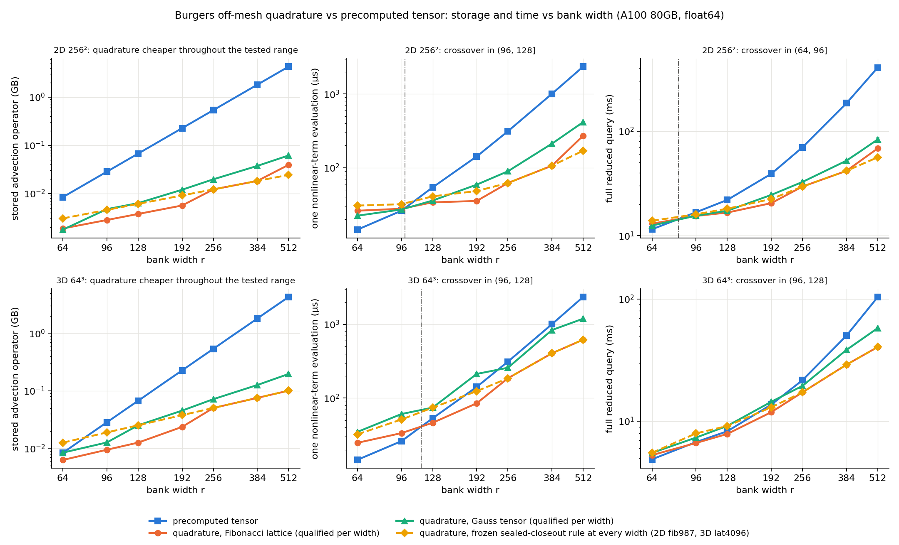

# tensor-crossover: when off-mesh quadrature of the Burgers advection term saves storage or time

Generated by `make_figure.py` from `results/<job>/result.json` (data: `results/crossover.json`); no number is typed by hand. Pre-registration: `PROTOCOL.md`. Development cases only (2D `dev6`, 3D `dev4`); no test/sealed cohort used. Status: **final for the jobs listed**.

## Crossover widths (primary rule family, PROTOCOL §6)

| dim | mesh | job | GPU | storage | nonlinear-term time | full-query time |
|---|---|---|---|---|---|---|
| 2D | 256 | c2d256b (7250318) | NVIDIA A100 80GB PCIe | quadrature cheaper throughout the tested range | crossover in (96, 128] (log-interp. r≈99) | crossover in (64, 96] (log-interp. r≈82) |
| 2D | 1024 | c2d1024 (7250999) | NVIDIA A100 80GB PCIe | quadrature cheaper throughout the tested range | crossover in (96, 128] (log-interp. r≈99) | crossover in (64, 96] (log-interp. r≈83) |
| 3D | 65 | c3d65b (7250319) | NVIDIA A100 80GB PCIe | quadrature cheaper throughout the tested range | crossover in (96, 128] (log-interp. r≈115) | crossover in (96, 128] |
| 3D | 129 | c3d129 (7250641) | NVIDIA A100 80GB PCIe | quadrature cheaper throughout the tested range | crossover in (96, 128] (log-interp. r≈113) | crossover in (64, 96] (log-interp. r≈89) |

Secondary (Gauss family) and sensitivity (frozen rule at every width):

| dim | mesh | arm | storage | nonlinear-term time | full-query time |
|---|---|---|---|---|---|
| 2D | 256 | Gauss qualified | quadrature cheaper throughout the tested range | crossover in (96, 128] | crossover in (64, 96] |
| 2D | 256 | frozen primary rule | quadrature cheaper throughout the tested range | crossover in (96, 128] | crossover in (64, 96] |
| 2D | 1024 | Gauss qualified | quadrature cheaper throughout the tested range | crossover in (96, 128] | crossover in (64, 96] |
| 2D | 1024 | frozen primary rule | quadrature cheaper throughout the tested range | crossover in (96, 128] | crossover in (64, 96] |
| 3D | 65 | Gauss qualified | crossover in (64, 96] | crossover in (192, 256] | crossover in (192, 256] |
| 3D | 65 | frozen primary rule | crossover in (64, 96] | crossover in (128, 192] | crossover in (128, 192] |
| 3D | 129 | Gauss qualified | crossover in (64, 96] | crossover in (192, 256] | crossover in (192, 256] |
| 3D | 129 | frozen primary rule | crossover in (64, 96] | crossover in (128, 192] | crossover in (128, 192] |

## 2D, mesh 256 — job c2d256b (7250318, NVIDIA A100 80GB PCIe, commit `b6f71ccf9`)

Gates: rules G-R True; Jacobian equality G-tab all widths True; trajectory equality G-eq all widths True; timed outputs vs accuracy pass, max rel diff 0.0e+00.

| r | M | primary rule (m, how) | Gauss rule (m, how) | tensor GB | quad GB (primary) | quad GB (Gauss) | ratio | tensor µs/eval | quad µs/eval (primary) | ratio | tensor query ms [IQR] | quad query ms [IQR] | ratio | G-eq field (P / S) | LM-iteration diff |
|---|---|---|---|---|---|---|---|---|---|---|---|---|---|---|---|
| 64 | 256 | `fib610` (610, qualified-ladder-floor) | `gauss24` (576, qualified-ladder-floor) | 0.008 | 0.002 | 0.002 | 4.48 | 14.4 | 26.0 | 0.55 | 11.52 [11.43–11.72] | 13.04 [12.92–13.18] | 0.88 | 2.3e-15 / 2.2e-15 | 0 / 0 |
| 96 | 384 | `fib610` (610, qualified-ladder-floor) | `gauss32` (1024, qualified) | 0.028 | 0.003 | 0.005 | 10.07 | 26.0 | 27.7 | 0.94 | 16.76 [16.71–16.94] | 15.45 [15.38–15.63] | 1.08 | 2.3e-15 / 2.2e-15 | 0 / 0 |
| 128 | 512 | `fib610` (610, qualified-ladder-floor) | `gauss32` (1024, qualified) | 0.067 | 0.004 | 0.006 | 17.91 | 54.1 | 33.8 | 1.60 | 21.97 [21.87–22.21] | 16.64 [16.47–16.71] | 1.32 | 1.8e-15 / 2.3e-15 | 0 / 0 |
| 192 | 768 | `fib610` (610, qualified-ladder-floor) | `gauss36` (1296, qualified) | 0.226 | 0.006 | 0.012 | 40.29 | 141.8 | 35.3 | 4.02 | 39.06 [38.55–39.65] | 20.49 [20.22–20.81] | 1.91 | 1.3e-15 / 2.0e-15 | 0 / 0 |
| 256 | 1024 | `fib987` (987, qualified) | `gauss40` (1600, qualified) | 0.537 | 0.012 | 0.020 | 44.27 | 312.1 | 61.9 | 5.04 | 69.98 [69.30–70.63] | 29.50 [29.04–29.90] | 2.37 | 1.7e-15 / 1.7e-15 | 0 / 0 |
| 384 | 1536 | `fib987` (987, frozen) | `gauss45` (2025, frozen) | 1.812 | 0.018 | 0.037 | 99.60 | 1006.7 | 106.3 | 9.47 | 184.75 [181.92–187.55] | 41.70 [40.67–42.72] | 4.43 | 1.7e-15 / 2.1e-15 | 0 / 0 |
| 512 | 2048 | `fib1597` (1597, qualified) | `gauss50` (2500, qualified) | 4.295 | 0.039 | 0.061 | 109.43 | 2355.3 | 271.7 | 8.67 | 404.90 [401.84–413.56] | 68.29 [66.82–70.18] | 5.93 | 1.9e-15 / 1.7e-15 | 0 / 0 |

Gauss family and frozen-rule timings (median; µs per nonlinear-term evaluation, ms per query), device memory of the compiled query (XLA memory analysis, GB), tensor build time (offline):

| r | Gauss quad µs | Gauss quad query ms | frozen-rule quad µs | frozen-rule query ms | tensor query device GB | quad query device GB | tensor build s | process peak GB |
|---|---|---|---|---|---|---|---|---|
| 64 | 22.3 | 12.51 | 30.5 | 13.90 | 0.050 | 0.046 | 0.75 | 7.790 |
| 96 | 27.0 | 15.53 | 31.9 | 16.02 | 0.090 | 0.065 | 0.80 | 7.790 |
| 128 | 35.8 | 17.32 | 40.8 | 18.12 | 0.150 | 0.087 | 0.79 | 7.790 |
| 192 | 58.7 | 24.55 | 48.1 | 22.45 | 0.348 | 0.127 | 0.94 | 7.790 |
| 256 | 89.3 | 32.67 | 61.9 | 29.50 | 0.697 | 0.172 | 1.00 | 7.790 |
| 384 | 211.9 | 52.16 | 106.3 | 41.70 | 2.047 | 0.254 | 1.94 | 7.790 |
| 512 | 414.9 | 83.13 | 169.9 | 56.19 | 4.611 | 0.357 | 2.24 | 18.981 |

## 2D, mesh 1024 — job c2d1024 (7250999, NVIDIA A100 80GB PCIe, commit `0e6dff0f2`)

Gates: rules G-R True; Jacobian equality G-tab all widths True; trajectory equality G-eq all widths True; timed outputs vs accuracy pass, max rel diff 0.0e+00.

| r | M | primary rule (m, how) | Gauss rule (m, how) | tensor GB | quad GB (primary) | quad GB (Gauss) | ratio | tensor µs/eval | quad µs/eval (primary) | ratio | tensor query ms [IQR] | quad query ms [IQR] | ratio | G-eq field (P / S) | LM-iteration diff |
|---|---|---|---|---|---|---|---|---|---|---|---|---|---|---|---|
| 64 | 256 | `fib610` (610, qualified-ladder-floor) | `gauss24` (576, qualified-ladder-floor) | 0.008 | 0.002 | 0.002 | 4.48 | 14.0 | 25.8 | 0.54 | 11.62 [11.59–11.66] | 13.29 [13.27–13.32] | 0.87 | 1.9e-15 / 2.2e-15 | 0 / 0 |
| 96 | 384 | `fib610` (610, qualified-ladder-floor) | `gauss32` (1024, qualified) | 0.028 | 0.003 | 0.005 | 10.07 | 26.3 | 27.8 | 0.95 | 17.36 [17.34–17.39] | 16.03 [15.97–16.11] | 1.08 | 1.9e-15 / 2.9e-15 | 0 / 0 |
| 128 | 512 | `fib610` (610, qualified-ladder-floor) | `gauss32` (1024, qualified) | 0.067 | 0.004 | 0.006 | 17.91 | 55.9 | 33.8 | 1.65 | 22.68 [22.56–22.83] | 17.90 [17.81–18.08] | 1.27 | 1.6e-15 / 1.8e-15 | 0 / 0 |
| 192 | 768 | `fib610` (610, qualified-ladder-floor) | `gauss36` (1296, qualified) | 0.226 | 0.006 | 0.012 | 40.29 | 148.0 | 35.1 | 4.22 | 41.50 [40.97–42.06] | 21.91 [21.53–22.29] | 1.89 | 2.2e-15 / 1.6e-15 | 0 / 0 |
| 256 | 1024 | `fib987` (987, qualified) | `gauss40` (1600, qualified) | 0.537 | 0.012 | 0.020 | 44.27 | 327.5 | 61.5 | 5.32 | 73.43 [72.64–73.96] | 30.77 [30.39–31.16] | 2.39 | 1.8e-15 / 2.1e-15 | 0 / 0 |
| 384 | 1536 | `fib987` (987, frozen) | `gauss45` (2025, frozen) | 1.812 | 0.018 | 0.037 | 99.60 | 1059.3 | 105.8 | 10.01 | 194.19 [191.23–197.09] | 43.93 [42.90–45.02] | 4.42 | 1.7e-15 / 1.7e-15 | 0 / 0 |
| 512 | 2048 | `fib1597` (1597, qualified) | `gauss50` (2500, qualified) | 4.295 | 0.039 | 0.061 | 109.43 | 2474.5 | 268.5 | 9.22 | 421.80 [418.66–430.89] | 70.15 [69.20–72.53] | 6.01 | 1.5e-15 / 2.0e-15 | 0 / 0 |

Gauss family and frozen-rule timings (median; µs per nonlinear-term evaluation, ms per query), device memory of the compiled query (XLA memory analysis, GB), tensor build time (offline):

| r | Gauss quad µs | Gauss quad query ms | frozen-rule quad µs | frozen-rule query ms | tensor query device GB | quad query device GB | tensor build s | process peak GB |
|---|---|---|---|---|---|---|---|---|
| 64 | 22.6 | 12.82 | 30.6 | 14.09 | 0.655 | 0.648 | 0.81 | 17.283 |
| 96 | 27.4 | 15.90 | 32.8 | 16.41 | 0.994 | 0.968 | 0.74 | 17.283 |
| 128 | 36.2 | 17.92 | 40.6 | 18.84 | 1.351 | 1.288 | 0.82 | 17.283 |
| 192 | 58.6 | 24.94 | 45.4 | 22.82 | 2.099 | 1.878 | 0.86 | 17.283 |
| 256 | 91.2 | 33.97 | 61.5 | 30.77 | 2.998 | 2.473 | 1.03 | 17.283 |
| 384 | 210.8 | 54.14 | 105.8 | 43.93 | 5.400 | 3.607 | 1.96 | 17.283 |
| 512 | 411.2 | 85.78 | 169.3 | 58.47 | 9.012 | 4.757 | 2.24 | 23.151 |

## 3D, mesh 65 — job c3d65b (7250319, NVIDIA A100 80GB PCIe, commit `b6f71ccf9`)

Gates: rules G-R True; Jacobian equality G-tab all widths True; trajectory equality G-eq all widths True; timed outputs vs accuracy pass, max rel diff 0.0e+00.

| r | M | primary rule (m, how) | Gauss rule (m, how) | tensor GB | quad GB (primary) | quad GB (Gauss) | ratio | tensor µs/eval | quad µs/eval (primary) | ratio | tensor query ms [IQR] | quad query ms [IQR] | ratio | G-eq field (P / S) | LM-iteration diff |
|---|---|---|---|---|---|---|---|---|---|---|---|---|---|---|---|
| 64 | 256 | `lat2048` (2048, qualified) | `gl14` (2744, qualified) | 0.008 | 0.006 | 0.008 | 1.33 | 14.6 | 24.8 | 0.59 | 4.88 [4.82–4.96] | 5.28 [5.26–5.36] | 0.92 | 2.2e-15 / 1.4e-15 | 0 / 0 |
| 96 | 386 | `lat2048` (2048, qualified) | `gl14` (2744, qualified) | 0.028 | 0.009 | 0.013 | 3.01 | 26.1 | 33.6 | 0.78 | 6.75 [6.67–6.80] | 6.64 [6.62–6.73] | 1.02 | 1.4e-15 / 1.3e-15 | 0 / 0 |
| 128 | 513 | `lat2048` (2048, qualified) | `gl16` (4096, qualified) | 0.067 | 0.013 | 0.025 | 5.34 | 53.5 | 46.4 | 1.15 | 8.28 [8.26–8.31] | 7.87 [7.81–7.95] | 1.05 | 1.2e-15 / 1.6e-15 | 0 / 0 |
| 192 | 771 | `lat2560` (2560, qualified) | `gl17` (4913, qualified) | 0.227 | 0.024 | 0.045 | 9.61 | 142.0 | 85.2 | 1.67 | 13.69 [13.48–13.83] | 11.86 [11.66–12.01] | 1.15 | 1.2e-15 / 9.3e-16 | 0 / 0 |
| 256 | 1027 | `lat4096` (4096, qualified) | `gl18` (5832, qualified) | 0.538 | 0.050 | 0.072 | 10.68 | 312.7 | 186.1 | 1.68 | 21.68 [21.41–21.77] | 17.26 [17.20–17.36] | 1.26 | 1.5e-15 / 1.4e-15 | 0 / 0 |
| 384 | 1538 | `lat4096` (4096, qualified) | `gl19` (6859, qualified) | 1.814 | 0.076 | 0.127 | 24.01 | 1006.6 | 406.0 | 2.48 | 50.28 [49.25–51.07] | 29.05 [28.30–29.23] | 1.73 | 1.3e-15 / 1.9e-15 | 0 / 0 |
| 512 | 2052 | `lat4096` (4096, frozen) | `gl20` (8000, frozen) | 4.303 | 0.101 | 0.197 | 42.69 | 2360.6 | 620.5 | 3.80 | 103.91 [100.50–104.22] | 40.50 [39.53–41.24] | 2.57 | 1.3e-15 / 1.6e-15 | 0 / 0 |

Gauss family and frozen-rule timings (median; µs per nonlinear-term evaluation, ms per query), device memory of the compiled query (XLA memory analysis, GB), tensor build time (offline):

| r | Gauss quad µs | Gauss quad query ms | frozen-rule quad µs | frozen-rule query ms | tensor query device GB | quad query device GB | tensor build s | process peak GB |
|---|---|---|---|---|---|---|---|---|
| 64 | 34.9 | 5.51 | 32.3 | 5.52 | 0.154 | 0.153 | 0.86 | 23.378 |
| 96 | 60.9 | 7.35 | 51.4 | 7.95 | 0.247 | 0.230 | 0.78 | 23.378 |
| 128 | 74.4 | 9.15 | 74.3 | 9.14 | 0.362 | 0.307 | 0.81 | 23.378 |
| 192 | 213.1 | 14.43 | 124.3 | 13.01 | 0.663 | 0.459 | 1.78 | 23.378 |
| 256 | 258.6 | 19.49 | 186.1 | 17.26 | 1.115 | 0.627 | 1.93 | 23.378 |
| 384 | 838.7 | 38.38 | 406.0 | 29.05 | 2.663 | 0.924 | 2.26 | 23.378 |
| 512 | 1195.9 | 57.94 | 620.5 | 40.50 | 5.424 | 1.222 | 2.65 | 23.378 |

## 3D, mesh 129 — job c3d129 (7250641, NVIDIA A100 80GB PCIe, commit `5354d2c75`)

Gates: rules G-R True; Jacobian equality G-tab all widths True; trajectory equality G-eq all widths True; timed outputs vs accuracy pass, max rel diff 0.0e+00.

| r | M | primary rule (m, how) | Gauss rule (m, how) | tensor GB | quad GB (primary) | quad GB (Gauss) | ratio | tensor µs/eval | quad µs/eval (primary) | ratio | tensor query ms [IQR] | quad query ms [IQR] | ratio | G-eq field (P / S) | LM-iteration diff |
|---|---|---|---|---|---|---|---|---|---|---|---|---|---|---|---|
| 64 | 256 | `lat2048` (2048, qualified) | `gl14` (2744, qualified) | 0.008 | 0.006 | 0.008 | 1.33 | 14.5 | 26.9 | 0.54 | 6.52 [6.42–6.53] | 7.07 [6.99–7.09] | 0.92 | 1.3e-15 / 1.3e-15 | 0 / 0 |
| 96 | 386 | `lat2048` (2048, qualified) | `gl14` (2744, qualified) | 0.028 | 0.009 | 0.013 | 3.01 | 25.9 | 33.3 | 0.78 | 9.63 [9.56–9.66] | 9.45 [9.43–9.48] | 1.02 | 1.1e-15 / 1.6e-15 | 0 / 0 |
| 128 | 513 | `lat2048` (2048, qualified) | `gl16` (4096, qualified) | 0.067 | 0.013 | 0.025 | 5.34 | 56.2 | 45.9 | 1.22 | 12.02 [11.94–12.05] | 11.72 [11.67–11.78] | 1.03 | 1.5e-15 / 1.5e-15 | 0 / 0 |
| 192 | 771 | `lat2560` (2560, qualified) | `gl17` (4913, qualified) | 0.227 | 0.024 | 0.045 | 9.61 | 148.6 | 85.1 | 1.75 | 18.74 [18.40–18.82] | 16.73 [16.49–16.82] | 1.12 | 1.3e-15 / 1.5e-15 | 0 / 0 |
| 256 | 1024 | `lat4096` (4096, qualified) | `gl18` (5832, qualified) | 0.537 | 0.050 | 0.072 | 10.67 | 328.1 | 178.4 | 1.84 | 28.36 [28.17–28.42] | 23.36 [23.25–23.39] | 1.21 | 1.1e-15 / 1.2e-15 | 0 / 0 |
| 384 | 1538 | `lat4096` (4096, qualified) | `gl19` (6859, qualified) | 1.814 | 0.076 | 0.127 | 24.01 | 1057.0 | 398.9 | 2.65 | 61.61 [60.43–62.32] | 38.41 [37.75–38.76] | 1.60 | 2.3e-15 / 1.7e-15 | 0 / 0 |
| 512 | 2049 | `lat4096` (4096, frozen) | `gl20` (8000, frozen) | 4.297 | 0.101 | 0.197 | 42.67 | 2484.7 | 615.4 | 4.04 | 119.58 [117.10–120.93] | 53.17 [52.41–53.81] | 2.25 | 1.9e-15 / 1.3e-15 | 0 / 0 |

Gauss family and frozen-rule timings (median; µs per nonlinear-term evaluation, ms per query), device memory of the compiled query (XLA memory analysis, GB), tensor build time (offline):

| r | Gauss quad µs | Gauss quad query ms | frozen-rule quad µs | frozen-rule query ms | tensor query device GB | quad query device GB | tensor build s | process peak GB |
|---|---|---|---|---|---|---|---|---|
| 64 | 35.3 | 7.15 | 32.6 | 7.20 | 1.176 | 1.174 | 0.79 | 30.887 |
| 96 | 60.0 | 9.99 | 52.4 | 10.83 | 1.815 | 1.796 | 0.75 | 30.887 |
| 128 | 73.5 | 12.89 | 73.9 | 12.85 | 2.477 | 2.422 | 0.75 | 30.887 |
| 192 | 203.7 | 19.40 | 121.6 | 17.96 | 3.785 | 3.581 | 1.75 | 30.887 |
| 256 | 245.4 | 25.48 | 178.4 | 23.36 | 5.243 | 4.756 | 1.27 | 30.887 |
| 384 | 829.4 | 47.78 | 398.9 | 38.41 | 8.719 | 6.981 | 2.36 | 30.887 |
| 512 | 1187.6 | 70.82 | 615.4 | 53.17 | 13.403 | 9.206 | 2.59 | 30.887 |

## Reading notes

- Both paths evaluate the same quadrature term, so their trajectories agree to round-off (G-eq column) and equal LM iteration counts; the comparison is cost at identical accuracy by construction. The tensor's storage and contraction cost depend only on its shape (M×r×r), not on which rule or stencil produced it, so the tensor curves also stand for the incumbent mesh-stencil tensor of the October lanes.
- The full-query ratio can favour quadrature at a smaller width than the kernel ratio: the solver's predictor evaluates the nonlinear *value* (not the Jacobian) at three candidates per step; quadrature gets the value in O(mM) work, the tensor needs a full M×r×r contraction.
- At the frozen width the frozen rule is used even where the suffix rule on these dev cases would pick another rung (field `suffix_selection` in the result JSON); see the qualification rows.
- "process peak GB" is the job-wide maximum so far, dominated by the qualification ladder (largest rules), not by either timed path; use the per-executable device GB columns to compare paths.
- No tensor ran out of memory on the 80 GB A100 in the tested range; the bank has no columns beyond 512, so wider banks were not tested.
- Times are for one GPU type (A100 80GB PCIe), float64, highest matmul precision, development cases only; ratios on other hardware will differ (the tensor is memory-bandwidth bound at large r).

## Glossary

- **r (bank width)**: number of reduced coefficients; the first r columns of the ordered 512-column bank.
- **M**: number of sine test functions (≈4r).
- **m**: number of quadrature points of the rule.
- **tensor**: precomputed M×r×r coefficient array of the same quadrature term; contracting it with c gives the Jacobian.
- **quad (quadrature)**: the term evaluated from the bank and its derivatives at the m rule points.
- **primary / Gauss rule**: rule of the frozen family (2D Fibonacci lattice, 3D CBC lattice) / Gauss tensor family, qualified per width on development cases (PROTOCOL §4); "frozen" = the sealed-closeout rule; "ladder-floor" = smallest rung on the ladder qualified, so the true minimum may be smaller.
- **frozen-rule sensitivity**: the frozen primary rule used at every width (fixed m).
- **stored GB**: bytes of the advection operator arrays only (tensor: T; quadrature: B, D, P); shared arrays are excluded.
- **µs/eval**: median time of one Jacobian+value evaluation, from a scan of K chained evaluations, 5 interleaved repeats.
- **query ms [IQR]**: median wall time of one full reduced query (projection, all time steps, decoding) over dev cases × 5 repeats, with the 25th–75th percentile range.
- **ratio**: tensor ÷ quadrature; above 1 means quadrature is cheaper.
- **separated**: quadrature 75th percentile below tensor 25th percentile.
- **G-eq field**: max relative difference of the decoded fields between the tensor and quadrature paths (same rule); registered tolerance 1e-8.
- **device GB**: argument + output + temporary bytes XLA reports for the compiled query; **process peak**: largest device memory in use so far in the job.
- **OOM**: tensor did not fit in device memory.
