# Viscous Burgers 2D/3D: final results of the JCP experiment campaign (priorities 1–4)

**Status (compiled 2026-10-20 14:48 UTC by `make_final.py`).** Final for the development and validation cohorts (2D dev6 + val32, 3D 923801); the historical test cohorts were used for replication only, and the sealed and reserved out-of-distribution cohorts were **not opened**. Accuracy numbers are scored against the E0 second-order reference $R_{ST}$, whose per-case uncertainty $\varepsilon_{\rm ref}$ is a **conditional Richardson estimate**, not a bound, so they are conditional E0 estimates. Two labelled exceptions: the long-horizon windows beyond $t = 0.25$ (section 3.9) use jcp-budget's own second-order references (also conditional Richardson estimates), and the P1g spread columns marked "first-order" (section 4) are against the earlier first-order references, as in the historical claims they recheck. The regimes study (section 3.12) also uses fresh development cohorts outside these, scored against new references computed with E0's method in that lane's own store (conditional E0-style estimates); its in-range baseline uses the E0 references for dev6 and val32. Post-hoc labels carry forward unchanged: E0 A10 (the reference cross-check rule was changed after data), combined A10 and A11 (post-hoc rule selections) and the retracted combined A15. All ten lanes have exported results.

Every number in this report is read from a lane output (or from git, for commits) and registered in `PROVENANCE.json` (number id → file, JSON key path, sha256; derived values list every source and the derivation). `FINAL-EXPORT.json` holds the verdicts and key numbers. Bars such as 1.25, 2×, $2.5\times10^{-4}$ and 1/0.6, cohort sizes (2D dev6 + val32 = 38 cases; 3D 64 cases), meshes, time steps and design grids (r, K, seeds) are registered design constants of the plan, not results.

```mermaid
flowchart LR
  E0[E0 references, done before]:::prior --> P1[priority 1: p1-scaling]:::lane
  S3[speed3d: 3D speed, K2 3D]:::lane --> Q[priority 2: qualify]:::lane
  P1 --> Q --> F2[fom2d: C1 C2, K2 2D]:::lane
  P1 --> HB[hr-baselines: C3, H-base]:::lane
  Q --> DM[priority 3: dims]:::lane
  Q --> BG[budget]:::lane
  Q --> HD[heads]:::lane
  DM --> RB[priority 4: robust]:::p4
  Q --> RG[regimes]:::p4
  F2 & HB & DM & BG & HD & RB & RG --> FN[this report]:::doc
  classDef prior fill:#e5e7eb,stroke:#374151; classDef lane fill:#dbeafe,stroke:#1d4ed8;
  classDef p4 fill:#fef3c7,stroke:#92400e; classDef doc fill:#dcfce7,stroke:#166534;
```

## 1. In one paragraph

Solve cost does not depend on the mesh: in 2D the evolution time of every registered setting is flat from 256² to 4096² (H-cost-N 8/8; the full-field decode lies outside this verdict and grows with the mesh), in 3D every timed ROM is flat from 64³ to 384³ (4/4), and the nonlinear-head reading of "k" is flat as well (K = 16, ratio 1.06). Accuracy does not depend on the mesh within the registered margin (H-acc-N 8/8) and improves with r up to 384 but not from 384 to 512. Kernel cost does not follow the declared operation-count exponents in r (H-cost-r fails as registered: the normal-matrix and Cholesky kernels grow more slowly than declared, the vector kernels slightly faster). Against full solvers, the plan's kill criterion **K2 fires in both dimensions**: a coarse sine pseudo-spectral solver reaches the ROM's accuracy faster (2D 4096² union speed-up 0.0493–0.706; 3D 0.00786–0.158). Against standard reduced models, **H-base fails**: a tuned POD model with ECSW or Q-DEIM hyper-reduction dominates all 8 tested qualified 2D configurations at 256² and all 8 at 1024² (developmental, in-sample, unadjusted; 2D tuning budgets budget band unresolved). The paper therefore cannot claim speed or accuracy advantages over standard alternatives for viscous Burgers on the box; what remains is mesh-independent cost, mesh-free evaluation and memory. Outside the training range in steepness (regimes C1 and C2) the frozen model is numerically qualified for 0 and 0 of the 8 primary configurations: its errors there cannot be certified, and even the best fit by the bank has large errors there (section 3.12). Repeating the whole recipe with three new training seeds gives the same 2D accuracy verdicts (mesh independence and improvement with r) on all three seeds in 24 of 24 headline rows, but the selected quadrature rule changes with the seed at 3 of 3 bank widths, so rule selection is a per-bank step (section 3.11).

## 2. Hypothesis verdicts

"k" has two readings in this project: **r** (the width of the ordered linear bank, the number of coefficients solved for) and **K** (the latent size of the nonlinear head). Both are reported. "Inconclusive" means the registered rule could not decide (usually because too few configurations were numerically qualified), not a negative result.

| hypothesis | k reading | scope | verdict | key numbers | figure | lane |
|---|---|---|---|---|---|---|
| H-cost-N | r (bank width) | 2D, 256²–4096², R128–R384, BE/CN-R, frozen + nominal mode lists; evolution time with internal-state recording (not the full query) | **pass** | 8/8 settings pass; R = 1.01–1.02, largest 95 % upper end 1.04 (bar 1.25) | [summary_cost_vs_mesh.png](figs/summary_cost_vs_mesh.png) | jcp-p1-scaling |
| H-cost-N | r (bank width) | 3D, 64³–384³ (H4.1), mesh-free contract, deployment mode policy, 4 ROMs | **pass** | 4/4 ROMs flat, max/min 1.01–1.09 (bar 1.25); quadrature check (Q2) of the four ROMs: C_old pass, C_W1024 fail, W_C_old fail, W_C_W768 fail — not all are qualified configurations | [summary_cost_vs_mesh.png](figs/summary_cost_vs_mesh.png) | jcp-speed3d |
| H-cost-N | K (head latent) | 2D, 256²–4096², seed 0 heads, BE, evolution only | **pass (K = 16, incumbent); not reached for K = 4, 8, 32** | K = 16: 1.06; incumbent K = 16: 1.03 (bar 1.25) | [heads_cost_vs_K.png](figs/heads_cost_vs_K.png) | jcp-heads |
| H-cost-r | r (bank width) | 2D component kernels at fixed (M, m) | **fail** | 0/4 components follow the declared exponent; fitted p: N 1.17 (declared 1), J 1.08 (declared 1), JTJ 1.92 (declared 2), chol 1.24 (declared 3) | [p1_kernel_cost_vs_r_2D.png](figs/p1_kernel_cost_vs_r_2D.png) | jcp-p1-scaling |
| H-cost-r | r (bank width) | 3D component kernels at fixed (M, m) | **fail** | 1/4 components follow the declared exponent; fitted p: N 1.01 (declared 1), J 1.03 (declared 1), JTJ 1.33 (declared 2), chol 1.03 (declared 3) | [p1_kernel_cost_vs_r_3D.png](figs/p1_kernel_cost_vs_r_3D.png) | jcp-p1-scaling |
| H-cost-r | r (bank width) | 2D full query, t2 timing panel (descriptive elasticities, no verdict) | **descriptive** | elasticity of query time in r 0.654, in M 0.528, in m 0.653 | – | jcp-dims |
| H-cost-r | K (head latent) | 2D, cost against K = 4–32 (descriptive) | **inconclusive** | exponent identified at 1 of 3 meshes (4096²: p = 0.119, seed 0 only) | [heads_cost_vs_K.png](figs/heads_cost_vs_K.png) | jcp-heads |
| H-acc-N | r (bank width) | 2D, 256² vs 1024² (38 cases) and 4096² vs 1024² (16 cases), P1 settings | **pass** | 8/8 pass (every case within margin); R128 CN-R has a detectable small trend (Wilcoxon p = 0.00629): equivalence within margin, not zero dependence | [p1_error_vs_r_and_mesh_CNR.png](figs/p1_error_vs_r_and_mesh_CNR.png) | jcp-p1-scaling |
| H-acc-N | r (bank width) | 2D, extended scheme / step set (B1, 30 tests) | **pass 21/30, inconclusive 9, no fail** | inconclusive 4; inconclusive (unqualified configuration) 5; pass 21 | [qualify_error_vs_N.png](figs/qualify_error_vs_N.png) | jcp-qualify |
| H-acc-r | r (bank width) | 2D, r = 128 → 256 → 384, P1 cells (256², 1024², 4096² × BE, CN-R) | **pass** | 6/6 cells monotone | [p1_error_vs_r_and_mesh_CNR.png](figs/p1_error_vs_r_and_mesh_CNR.png) | jcp-p1-scaling |
| H-acc-r | r (bank width) | 2D, registered range r = 128–512 (1024² only) | **fail** | 2/2 cells not monotone (384 → 512 does not improve) | [p1_error_vs_r_and_mesh_CNR.png](figs/p1_error_vs_r_and_mesh_CNR.png) | jcp-p1-scaling |
| H-acc-r | r (bank width) | 2D, extended scheme / step set (B1, 27 cells) | **mixed** | range 128–384: inconclusive 10, monotone 14, not monotone 3; range 128–512: inconclusive 7, not monotone 20 | [qualify_error_vs_r.png](figs/qualify_error_vs_r.png) | jcp-qualify |
| H-acc-r | r (bank width) | 2D, fixed (M, m) = (2048, Gauss 256²) (A3) | **fail** | range not monotone | – | jcp-dims |
| H-acc-r | K (head latent) | 2D 1024², K = 4 → 8 → 16 → 32 (BE) | **inconclusive** | too few numerically qualified seeds per K for a pooled verdict | [heads_error_vs_K.png](figs/heads_error_vs_K.png) | jcp-heads |
| H-comp | r (bank width) | 2D 1024², vs upwind + BE, 21 qualified LSPG configurations | **mixed (pass only against the screening-selected comparator)** | ROM < 2x ×2, ROM >= 2x ×16, unresolved ×3 | [summary_union_speedup.png](figs/summary_union_speedup.png) | jcp-fom2d |
| H-comp | r (bank width) | 2D 1024², vs central + CN-R, 21 qualified LSPG configurations | **fail or unresolved** | ROM < 2x ×19, unresolved ×2 | [summary_union_speedup.png](figs/summary_union_speedup.png) | jcp-fom2d |
| H-comp | r (bank width) | 2D 1024², vs sine pseudo-spectral, 21 qualified LSPG configurations | **fail** | ROM < 2x ×21 | [summary_union_speedup.png](figs/summary_union_speedup.png) | jcp-fom2d |
| H-comp | r (bank width) | 2D 1024², vs union of families, 21 qualified LSPG configurations | **fail** | ROM < 2x ×21 | [summary_union_speedup.png](figs/summary_union_speedup.png) | jcp-fom2d |
| H-comp | r (bank width) | 2D 4096², vs upwind + BE, 21 qualified LSPG configurations | **mixed (pass only against the screening-selected comparator)** | ROM < 2x ×2, ROM >= 2x ×16, unresolved ×3 | [summary_union_speedup.png](figs/summary_union_speedup.png) | jcp-fom2d |
| H-comp | r (bank width) | 2D 4096², vs central + CN-R, 21 qualified LSPG configurations | **fail or unresolved** | ROM < 2x ×19, unresolved ×2 | [summary_union_speedup.png](figs/summary_union_speedup.png) | jcp-fom2d |
| H-comp | r (bank width) | 2D 4096², vs sine pseudo-spectral, 21 qualified LSPG configurations | **fail** | ROM < 2x ×21 | [summary_union_speedup.png](figs/summary_union_speedup.png) | jcp-fom2d |
| H-comp | r (bank width) | 2D 4096², vs union of families, 21 qualified LSPG configurations | **fail** | ROM < 2x ×21 | [summary_union_speedup.png](figs/summary_union_speedup.png) | jcp-fom2d |
| K2 | – | 2D 4096², registered LSPG schemes vs best matched FOM (union) | **fires** | fires under the registered dev6 workload rule (A3.1); union speed-up 0.0493–0.706 over 21 configurations (largest interval end 0.74) | [summary_union_speedup.png](figs/summary_union_speedup.png) | jcp-fom2d |
| H-comp | r (bank width) | 3D L = 384, vs upwind + BE, 4 selected ROMs (not all quadrature-qualified) | **inconclusive (no ladder member as accurate)** | no ladder match ×4 | [speed3d_mesh-time.png](figs/speed3d_mesh-time.png) | jcp-speed3d |
| H-comp | r (bank width) | 3D L = 384, vs upwind + CN-R, 4 selected ROMs (not all quadrature-qualified) | **inconclusive (no ladder member as accurate)** | no ladder match ×4 | [speed3d_mesh-time.png](figs/speed3d_mesh-time.png) | jcp-speed3d |
| H-comp | r (bank width) | 3D L = 384, vs central + CN-R, 4 selected ROMs (not all quadrature-qualified) | **mixed** | ROM < 2x ×3, ROM >= 2x ×1 | [speed3d_mesh-time.png](figs/speed3d_mesh-time.png) | jcp-speed3d |
| H-comp | r (bank width) | 3D L = 384, vs sine pseudo-spectral, 4 selected ROMs (not all quadrature-qualified) | **fail** | ROM < 2x ×4 | [speed3d_mesh-time.png](figs/speed3d_mesh-time.png) | jcp-speed3d |
| H-comp | r (bank width) | 3D L = 384, vs union of families, 4 selected ROMs (not all quadrature-qualified) | **fail** | ROM < 2x ×4 | [speed3d_mesh-time.png](figs/speed3d_mesh-time.png) | jcp-speed3d |
| K2 | – | 3D L = 384, selected ROMs vs best matched FOM (union) | **fires** | union speed-up 0.00786–0.158 (4 ROMs) | [summary_union_speedup.png](figs/summary_union_speedup.png) | jcp-speed3d |
| H-base | r (bank width) | 2D 256² | **fail** | 8/8 of our configurations dominated (faster and lower worst error) by a registered POD pick; restrictions: saturation check failed (A1.3); budget: budget band unresolved; developmental, in-sample, unadjusted | [hrb_front-c2d256.png](figs/hrb_front-c2d256.png) | jcp-hr-baselines |
| H-base | r (bank width) | 2D 1024² | **fail** | 8/8 of our configurations dominated (faster and lower worst error) by a registered POD pick; restrictions: snapshot-limited check failed (A1.3); budget: budget band unresolved; developmental, in-sample, unadjusted | [hrb_front-c2d1024.png](figs/hrb_front-c2d1024.png) | jcp-hr-baselines |
| H-base | r (bank width) | 3D 65³, qualified subset (batch 2) | **fail where assessed; neutral conclusions withheld** | 2/4 of our configurations dominated (faster and lower worst error) by a registered POD pick; 2 neutral conclusions withheld; restrictions: basis adequacy failed (A2.2); ECSW coverage incomplete (A3.11); budget: unequal-budget, descriptive; developmental, in-sample, unadjusted | [hrb_front-c3d64.png](figs/hrb_front-c3d64.png) | jcp-hr-baselines |
| H-base | r (bank width) | 3D 65³, diagnostic (batch 1) | **fail** | 5/5 of our configurations dominated (faster and lower worst error) by a registered POD pick; restrictions: basis adequacy failed (A2.2); ECSW coverage incomplete (A3.11); budget: unequal-budget, descriptive; developmental, in-sample, unadjusted | [hrb_front-c3d64.png](figs/hrb_front-c3d64.png) | jcp-hr-baselines |
| H2q | – | 3D, qualified winner vs our earlier configuration C_old (ROM vs ROM; bar 1/0.6); full-field $65^{3}$ mesh-path query, H200; not a comparison with the best FOM (K2 already fired); qualified vs qualified comparator | **fail (the selected candidate failed confirmation)** | S = 1.15 (comparator Q2: pass); the unqualified speed3d winners had 2.01 | [dims_h2q_3d.png](figs/dims_h2q_3d.png) | jcp-dims |
| H2q | – | 3D, qualified winner vs our earlier configuration C_W768 (ROM vs ROM; bar 1/0.6); full-field $65^{3}$ mesh-path query, H200; not a comparison with the best FOM (K2 already fired); qualified vs qualified comparator | **pass** | S = 2.95 (comparator Q2: pass); the unqualified speed3d winners had 5.37 | [dims_h2q_3d.png](figs/dims_h2q_3d.png) | jcp-dims |
| H2q | – | 3D, qualified winner vs our earlier configuration C_W1024 (ROM vs ROM; bar 1/0.6); full-field $65^{3}$ mesh-path query, H200; not a comparison with the best FOM (K2 already fired); qualified configuration vs the deployed (unqualified) comparator | **pass** | S = 9.87 (comparator Q2: fail); the unqualified speed3d winners had 17.2 | [dims_h2q_3d.png](figs/dims_h2q_3d.png) | jcp-dims |
| E1 rule randomisation | r (bank width) | 2D, 12 registered cells, 16 shifted draws each | **H-E1a fragile ×6, inconclusive ×6; H-E1c insensitive ×12** | H-E1b typical ×12; "fragile" = successor-rule convergence only, see section 3.11 | [robust_e1_draws.png](figs/robust_e1_draws.png) | jcp-robust |
| E1 rule randomisation | r (bank width) | 3D, 2 registered cells, 16 shifted draws each | **H-E1a robust ×2; H-E1c insensitive ×2** | H-E1b atypically unfavourable ×1, typical ×1 | [robust_e1_draws.png](figs/robust_e1_draws.png) | jcp-robust |
| E2 recipe seeds | r (bank width) | 2D, seeds 1–3, 183 verdict rows | **seed-robust 140/183** | all rows: inconclusive ×22, seed-dependent ×21, seed-robust ×140; headline accuracy rows: seed-robust ×24; selected-rule rows: seed-dependent ×3 | [robust_e2_spread.png](figs/robust_e2_spread.png) | jcp-robust |
| E2 recipe seeds | r (bank width) | 3D, seeds 1–3, 129 verdict rows | **seed-robust 45/129** | all rows: inconclusive ×67, seed-dependent ×17, seed-robust ×45; headline accuracy rows: inconclusive ×22, seed-robust ×10; selected-rule rows: inconclusive ×12, seed-dependent ×2, seed-robust ×10 | [robust_e2_spread.png](figs/robust_e2_spread.png) | jcp-robust |
| E5 hardware | – | A100-80G vs H200, 4 jobs on 4 physical GPUs; frozen H200-selected FOM comparators; registered timing verdicts | **inconclusive ×1, verdict-robust ×5** | φ intervals: hardware-consistent ×6, hardware-dependent ×4 | [robust_e5_phi.png](figs/robust_e5_phi.png) | jcp-robust |
| D1 regime | r (bank width) | 2D 1024², A+ (ν above the training range), 8 primary LSPG configurations; viscosity extrapolation confounded with steepness | **HOLDS ×1, IMPROVES ×1, INCONCLUSIVE ×6** | qualified 8/8; labels HOLDS ×1, IMPROVES ×1, INCONCLUSIVE ×6; median error 0.246 %–1.37 %; ratio to in-range baseline 0.55–1.53 | [regimes_median_by_regime.png](figs/regimes_median_by_regime.png) | jcp-regimes |
| D1 regime | r (bank width) | 2D 1024², A− (ν below the training range), 8 primary LSPG configurations | **DEGRADES ×2, INCONCLUSIVE ×6** | qualified 8/8; labels DEGRADES ×2, INCONCLUSIVE ×6; median error 0.883 %–4.17 %; ratio to in-range baseline 1.63–9.25 | [regimes_median_by_regime.png](figs/regimes_median_by_regime.png) | jcp-regimes |
| D1 regime | r (bank width) | 2D 1024², C1 (low ν, high steepness s; paired with A−), 8 primary LSPG configurations | **NOT QUALIFIED ×8** | qualified 0/8; labels NOT QUALIFIED ×8; median error 5.2 %–11.2 %; ratio to in-range baseline 5.78–36.7 | [regimes_median_by_regime.png](figs/regimes_median_by_regime.png) | jcp-regimes |
| D1 regime | r (bank width) | 2D 1024², C2 (lower ν, higher s), 8 primary LSPG configurations | **NOT QUALIFIED ×8** | qualified 0/8; labels NOT QUALIFIED ×8; median error 12.7 %–25.1 %; ratio to in-range baseline 14.2–131 | [regimes_median_by_regime.png](figs/regimes_median_by_regime.png) | jcp-regimes |
| D1 regime | r (bank width) | 2D 1024², B1 (IC family: two same-sign bumps), 8 primary LSPG configurations | **HOLDS ×3, INCONCLUSIVE ×5** | qualified 8/8; labels HOLDS ×3, INCONCLUSIVE ×5; median error 0.2 %–1.15 %; ratio to in-range baseline 0.989–1.55 | [regimes_median_by_regime.png](figs/regimes_median_by_regime.png) | jcp-regimes |
| D1 regime | r (bank width) | 2D 1024², B2 (IC family: signed pair), 8 primary LSPG configurations | **INCONCLUSIVE ×8** | qualified 8/8; labels INCONCLUSIVE ×8; median error 0.245 %–1.4 %; ratio to in-range baseline 1.11–1.64 | [regimes_median_by_regime.png](figs/regimes_median_by_regime.png) | jcp-regimes |
| D1 regime | r (bank width) | 2D 1024², N0s (stiff corner of the training box; descriptive), 8 primary LSPG configurations | **DEGRADES ×8 (descriptive)** | qualified 8/8; labels DEGRADES ×8; median error 1.22 %–4.22 %; ratio to in-range baseline 2.97–9.79 | [regimes_median_by_regime.png](figs/regimes_median_by_regime.png) | jcp-regimes |

Provisional labels that travel with these verdicts: all errors are conditional E0 estimates; every matched FOM speed-up is an **upper bound** on the ROM speed-up (finite FOM ladder, screening-selected comparator; 2D timing intervals describe the dev6 workload, 3D matches use speed3d's paired match panels); H-base comparisons are **developmental, in-sample, unadjusted**; heads results are **exploratory validation evidence** with no family-wise claim.

## 3. Results by question

### 3.1 Scaling against k

**Bank width r.** At fixed $(M, m)$ the component kernels (tested advection $N$, Jacobian $J$, normal matrix $J^\top J$, Cholesky) were timed over r. Fitted exponents of $t = a + b\,r^p$ against the declared operation-count exponent:

| dim | kernel | declared p | fitted p | 95 % interval | outcome |
|---|---|---|---|---|---|
| 2D | N | 1 | 1.17 | 1.09–1.26 | fail (hardware scaling) |
| 2D | J | 1 | 1.08 | 1.08–1.09 | fail (hardware scaling) |
| 2D | JTJ | 2 | 1.92 | 1.9–1.95 | fail (operation-model) |
| 2D | chol | 3 | 1.24 | 1.22–1.24 | fail (operation-model) |
| 3D | N | 1 | 1.01 | 0.985–1.04 | pass |
| 3D | J | 1 | 1.03 | 1.03–1.04 | fail (hardware scaling) |
| 3D | JTJ | 2 | 1.33 | 1.31–1.34 | fail (operation-model) |
| 3D | chol | 3 | 1.03 | 1.03–1.04 | fail (operation-model) |

Against the declared exponent, the fitted exponent is **above (interval entirely above)** for 2D N, 2D J, 3D J; **below (interval entirely below)** for 2D JTJ, 2D chol, 3D JTJ, 3D chol; **consistent (interval contains it)** for 3D N. The registered rule sub-labels each fail "hardware scaling" or "operation-model"; these are classifications, not causal explanations.


*2D kernel cost against r at fixed (M, m) (jcp-p1-scaling)*


*3D kernel cost against r at fixed (M, m) (jcp-p1-scaling)*

**Head latent K.** 12 matched heads (K = 4, 8, 16, 32 × seeds 0–2, the registered design) were trained with the incumbent recipe. Numerically qualified BE seeds at 1024²: K = 4: none; K = 8: none; K = 16: [0, 1]; K = 32: [1]. The cost-against-K exponent is identified only at 4096² (p = 0.119, seed 0 only; descriptive) and not at 256² or 1024², and the error-against-K range is **inconclusive**.

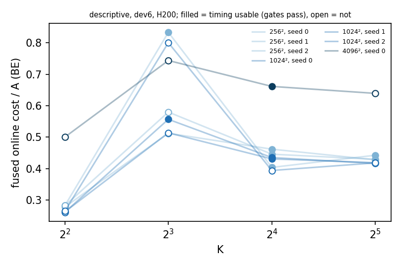
*Head online cost against K (jcp-heads; descriptive)*

### 3.2 Scaling against the mesh

2D evolve time (P1, A–B–A normalised, median over dev6) and 3D warm query time (speed3d m1) against the mesh, each indexed to its own base so both fit one scale. The grey band is the registered [0.8, 1.25].

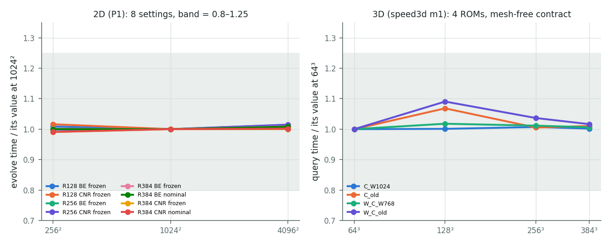
*Cost against mesh: 2D (left) and 3D (right); flat lines = mesh-independent cost*

| 2D setting | R = max/min over meshes | 95 % upper end | outcome |
|---|---|---|---|
| R128 / BE / frozen | 1.01 | 1.04 | pass |
| R128 / CNR / frozen | 1.02 | 1.03 | pass |
| R256 / BE / frozen | 1.02 | 1.02 | pass |
| R256 / CNR / frozen | 1.02 | 1.03 | pass |
| R384 / BE / frozen | 1.01 | 1.03 | pass |
| R384 / BE / nominal | 1.01 | 1.02 | pass |
| R384 / CNR / frozen | 1.01 | 1.03 | pass |
| R384 / CNR / nominal | 1.01 | 1.02 | pass |

| 3D ROM | L=64 (ms) | L=128 (ms) | L=256 (ms) | L=384 (ms) | max/min | H4.1 |
|---|---|---|---|---|---|---|
| C_W1024 | 522 | 522 | 525 | 523 | 1.01 | pass |
| C_old | 60.7 | 64.9 | 61 | 61.4 | 1.07 | pass |
| W_C_W768 | 28.4 | 28.9 | 28.7 | 28.6 | 1.02 | pass |
| W_C_old | 29.2 | 31.9 | 30.3 | 29.7 | 1.09 | pass |

The 3D flat-cost result is a statement about the deployment mode policy (mode set varies with mesh) under the mesh-free / scoring-lattice contract; no fixed-mode 3D cost panel was run. The 2D result holds for both the frozen mode list and the nominal per-mesh lists.

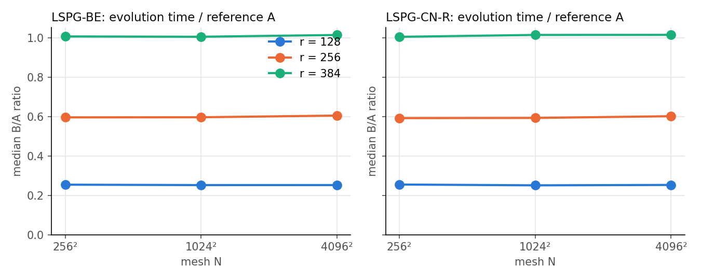
*2D solve time against mesh for each bank width (jcp-p1-scaling)*

### 3.3 Accuracy and the accuracy–cost front

2D error at 1024² (P1 settings, 38 cases; conditional E0 estimates):

| r | scheme | median e | worst e |
|---|---|---|---|
| R128 | BE | 1.1 % | 4.84 % |
| R128 | CNR | 0.45 % | 5.2 % |
| R256 | BE | 0.983 % | 3.32 % |
| R256 | CNR | 0.209 % | 2.52 % |
| R384 | BE | 0.978 % | 3.01 % |
| R384 | CNR | 0.198 % | 1.78 % |
| R512 | BE | 0.979 % | 3.09 % |
| R512 | CNR | 0.199 % | 2.17 % |

**Numerical qualification (jcp-qualify).** 98 of 112 2D configurations (r = 128–512 × LSPG-BE / LSPG-CN-R / GAL-CN × step × mesh) pass Q1 (solver) and Q2 (quadrature). The qualified error–cost front at each mesh is dominated by GAL-CN, a registered diagnostic scheme; the registered deployment schemes LSPG-BE and LSPG-CN-R share the worst-error front.

- 256² median-error front (7 members): `R128|LSPG|BE|2.5`, `R128|GAL|CN|5`, `R128|GAL|CN|2`, `R128|GAL|CN|1`, `R256|GAL|CN|2`, `R256|GAL|CN|1`, `R384|GAL|CN|1`
- 1024² median-error front (7 members): `R128|LSPG|BE|2.5`, `R128|GAL|CN|5`, `R128|GAL|CN|2`, `R128|GAL|CN|1`, `R256|GAL|CN|2`, `R256|GAL|CN|1`, `R384|GAL|CN|1`
- 4096² median-error front (7 members): `R128|LSPG|BE|2.5`, `R128|GAL|CN|5`, `R128|GAL|CN|2`, `R128|GAL|CN|1`, `R256|GAL|CN|2`, `R256|GAL|CN|1`, `R384|GAL|CN|1`

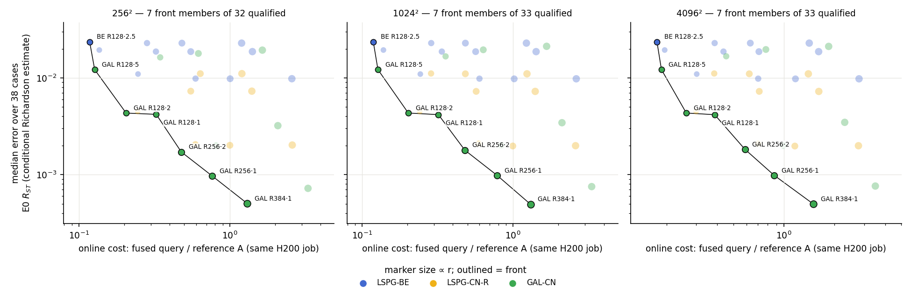
*2D qualified accuracy–cost front, median error (jcp-qualify)*

Observed temporal order (B4, over $\Delta t_0 \dots \Delta t_0/4$):

| configuration | order label | median observed order |
|---|---|---|
| R128 / LSPG_BE | order 1 | 1 |
| R128 / LSPG_CNR | observed order, no integer label | 1.74 |
| R128 / GAL_CN | order 2 (finite-range observed order over dt0..dt0/4) | 2 |
| R384 / LSPG_BE | order 1 | 1.01 |
| R384 / LSPG_CNR | order 2 (finite-range observed order over dt0..dt0/4) | 1.96 |
| R384 / GAL_CN | order 2 (finite-range observed order over dt0..dt0/4) | 2 |
| R384 / GAL_TH06 | order 1 | 0.998 |

**3D front (jcp-dims).** Numerically qualified 3D configurations per bank width (a qualified subset of the tested candidates; never a completeness claim): M2_512 18, W256 25, W512 32, W768 6, W1024 2; 2 W1024 candidates remain untested.

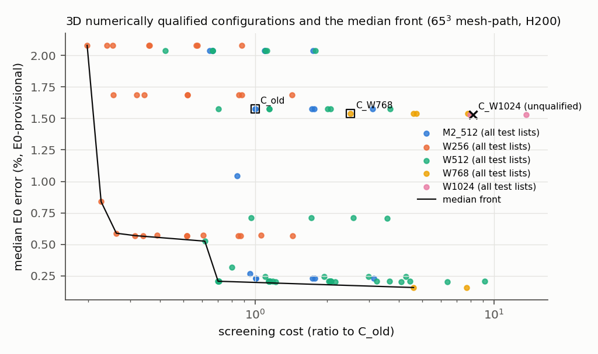
*3D qualified front (jcp-dims; qualified subset of tested candidates)*

**3D ROM-vs-ROM speed-up (H2q).** After quadrature qualification the cheapest qualified configuration is `M2_512|gl32|qn|BDF2|0.016666667|k4` for all three comparators:

| comparator | speed3d S (winners not Q2-qualified) | H2q S (qualified winner) | H2q verdict (bar 1/0.6) | comparator Q2 |
|---|---|---|---|---|
| C_old | 2.01 | 1.15 | fail (the selected candidate failed confirmation) | pass |
| C_W768 | 5.37 | 2.95 | pass | pass |
| C_W1024 | 17.2 | 9.87 | pass | fail |

These are ROM-vs-ROM speed-ups over our own earlier 3D configurations, not comparisons with the best FOM.

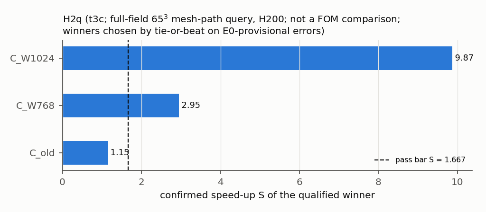
*3D: qualified speed-up over earlier configurations (jcp-dims)*

### 3.4 Speed-up against each full-order family

2D (jcp-fom2d): 185 FOM configurations (170 admissible) in three families (sign-upwind + BE, central + CN-R, sine pseudo-spectral ETDRK4), each validation-matched to every qualified ROM configuration on both median and worst error. Counts over the qualified LSPG configurations ("ROM ≥ 2×" against upwind is against the screening-selected comparator only):

| ROM mesh | FOM family | cells |
|---|---|---|
| 1024² | upwind + BE | ROM < 2x ×2, ROM >= 2x ×16, unresolved ×3 |
| 1024² | central + CN-R | ROM < 2x ×19, unresolved ×2 |
| 1024² | sine pseudo-spectral | ROM < 2x ×21 |
| 1024² | union of families | ROM < 2x ×21 |
| 4096² | upwind + BE | ROM < 2x ×2, ROM >= 2x ×16, unresolved ×3 |
| 4096² | central + CN-R | ROM < 2x ×19, unresolved ×2 |
| 4096² | sine pseudo-spectral | ROM < 2x ×21 |
| 4096² | union of families | ROM < 2x ×21 |

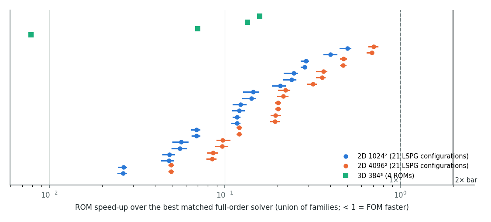
*ROM speed-up over the best matched full-order solver (union), with 95 % intervals (2D) — every point lies left of the 2× bar, most left of 1×*

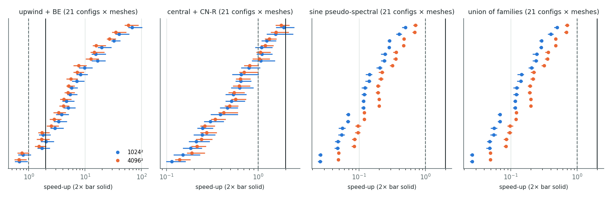
*2D: ROM speed-up over the matched FOM of each family, per qualified LSPG configuration, with 95 % intervals (one panel per family; cells without a matched FOM are omitted and counted in the table above)*

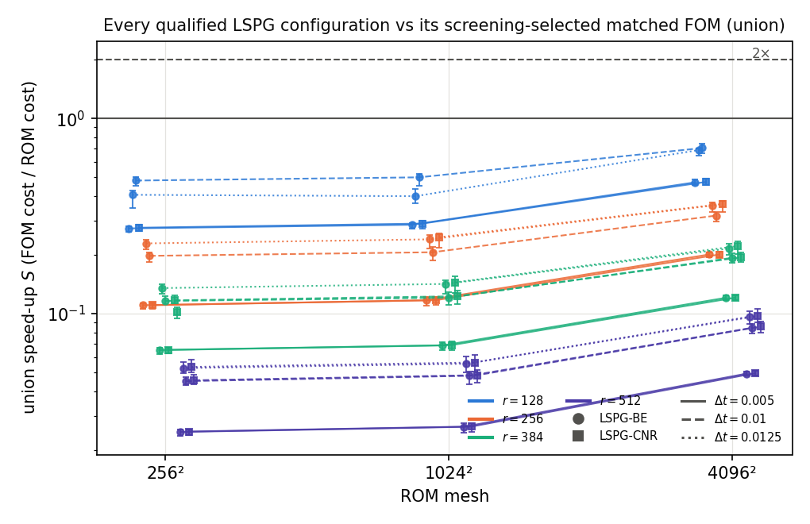
*2D: ROM speed-up over the union-matched FOM against mesh (jcp-fom2d)*

3D (jcp-speed3d, L = 384): upwind + BE: no ladder match ×4; upwind + CN-R: no ladder match ×4; central + CN-R: ROM < 2x ×3, ROM >= 2x ×1; sine pseudo-spectral: ROM < 2x ×4; union of families: ROM < 2x ×4. "No ladder match" means no FOM in the ladder was as accurate as the ROM; nothing is claimed for those cells. 3D cells reaching 2×: 1 (against central + CN-R).

### 3.5 POD baselines (H-base)

Tuned POD-LSPG baselines (no hyper-reduction, ECSW, Q-DEIM) against our configurations, timed in the same job on the same GPU. "Dominated" = a baseline chosen by the registered role rule has lower full-query time and lower worst error, with non-overlapping intervals.

| cell | ours dominated | neutral conclusions withheld | restrictions |
|---|---|---|---|
| 2D 256² | 8/8 | 0 | saturation check failed (A1.3) |
| 2D 1024² | 8/8 | 0 | snapshot-limited check failed (A1.3) |
| 3D 65³, qualified subset (batch 2) | 2/4 | 2 | basis adequacy failed (A2.2); ECSW coverage incomplete (A3.11) |
| 3D 65³, diagnostic (batch 1) | 5/5 | 0 | basis adequacy failed (A2.2); ECSW coverage incomplete (A3.11) |

Per configuration, against the accuracy-role baseline pick (worst error; time = baseline / ours):

| cell | ours | ours worst e | baseline pick (B_acc) | pick worst e | time ratio | outcome |
|---|---|---|---|---|---|---|
| c2d256 | `256\|R128\|BE` | 4.85 % | `ecsw\|256\|k4\|BE\|0.005\|common\|central` | 3.59 % | 0.719 | dominated |
| c2d256 | `256\|R128\|CNR` | 5.21 % | `ecsw\|256\|k4\|BE\|0.005\|common\|central` | 3.59 % | 0.72 | dominated |
| c2d256 | `256\|R256\|BE` | 3.32 % | `ecsw\|256\|k4\|CNR\|0.005\|common\|central` | 3.26 % | 0.209 | dominated |
| c2d256 | `256\|R256\|CNR` | 2.52 % | `ecsw\|384\|k4\|CNR\|0.005\|common\|central` | 1.5 % | 0.308 | dominated |
| c2d256 | `256\|R384\|BE` | 3.01 % | `ecsw\|256\|k8\|CNR\|0.005\|common\|central` | 2.74 % | 0.134 | dominated |
| c2d256 | `256\|R384\|CNR` | 1.81 % | `ecsw\|384\|k4\|CNR\|0.005\|common\|central` | 1.5 % | 0.166 | dominated |
| c2d256 | `256\|R384nom\|BE` | 3.01 % | `ecsw\|256\|k8\|CNR\|0.005\|common\|central` | 2.74 % | 0.135 | dominated |
| c2d256 | `256\|R384nom\|CNR` | 1.76 % | `ecsw\|384\|k4\|CNR\|0.005\|common\|central` | 1.5 % | 0.166 | dominated |
| c2d1024 | `1024\|R128\|BE` | 4.84 % | `qdeim\|256\|512\|CNR\|0.005\|common\|central` | 3.07 % | 0.945 | dominated |
| c2d1024 | `1024\|R128\|CNR` | 5.2 % | `qdeim\|256\|512\|CNR\|0.005\|common\|central` | 3.07 % | 0.945 | dominated |
| c2d1024 | `1024\|R256\|BE` | 3.32 % | `qdeim\|256\|512\|CNR\|0.005\|common\|central` | 3.07 % | 0.392 | dominated |
| c2d1024 | `1024\|R256\|CNR` | 2.52 % | `ecsw\|384\|k8\|CNR\|0.005\|common\|central` | 1.35 % | 0.604 | dominated |
| c2d1024 | `1024\|R384\|BE` | 3.01 % | `ecsw\|256\|k8\|CNR\|0.005\|common\|central` | 2.72 % | 0.241 | dominated |
| c2d1024 | `1024\|R384\|CNR` | 1.78 % | `ecsw\|384\|k8\|CNR\|0.005\|common\|central` | 1.35 % | 0.354 | dominated |
| c2d1024 | `1024\|R512\|BE` | 3.09 % | `qdeim\|256\|512\|CNR\|0.005\|common\|central` | 3.07 % | 0.086 | dominated |
| c2d1024 | `1024\|R512\|CNR` | 2.17 % | `ecsw\|384\|k8\|CNR\|0.005\|common\|central` | 1.35 % | 0.138 | dominated |
| c3d64 | `W256\|gl24\|fs\|CN\|0.01\|K1` | 6.37 % | `ecsw\|512\|k8\|BDF2\|0.016666667\|common\|central` | 3.23 % | 0.79 | dominated |
| c3d64 | `W256\|gl24\|fs\|CN\|0.0125\|K1` | 6.31 % | `ecsw\|512\|k8\|BDF2\|0.016666667\|common\|central` | 3.23 % | 0.954 | withheld |
| c3d64 | `W256\|lat8192\|qn\|BDF2\|0.025\|k4` | 5.86 % | `ecsw\|512\|k8\|BDF2\|0.016666667\|common\|central` | 3.23 % | 1.27 | withheld |
| c3d64 | `W512\|lat16384\|qn\|BDF2\|0.025\|k4` | 4.88 % | `ecsw\|512\|k8\|BDF2\|0.016666667\|common\|central` | 3.23 % | 0.567 | dominated |

Tuning budgets (validation-informed GPU-hours, baseline / ours): 2D unresolved against the factor-1.25 band (ratio in [1.16, 1.73]); 3D unequal-budget, descriptive (ratio in [0.511, 0.661]). Some dominations pair our first-order BE with a second-order baseline pick; the like-for-like CN-R pairs are dominated too. Median-error reversals (ours better on the median) exist in every cell: c2d256 3, c2d1024 1, c3d64 2.

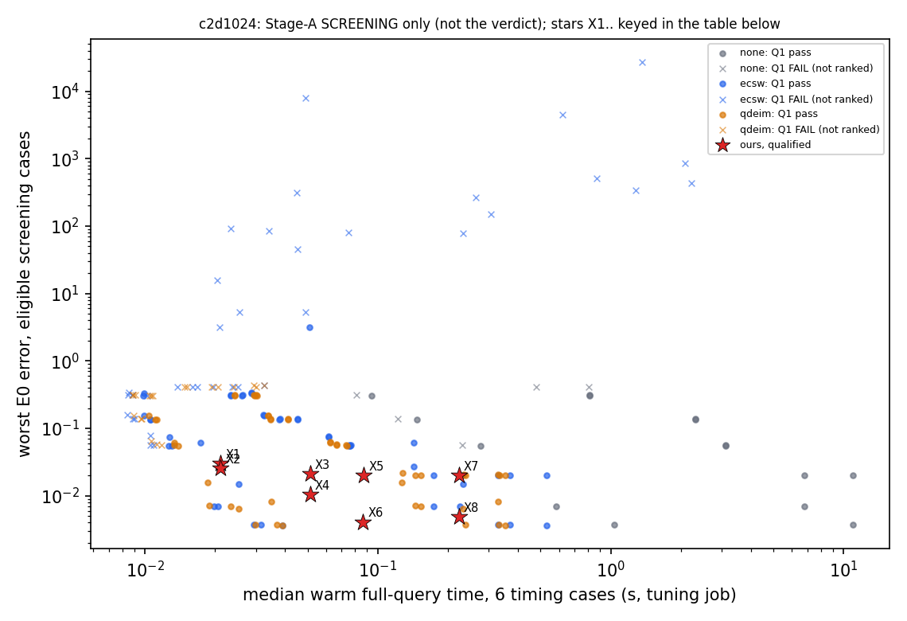
*2D 1024²: POD baselines and ours, accuracy against cost (jcp-hr-baselines)*

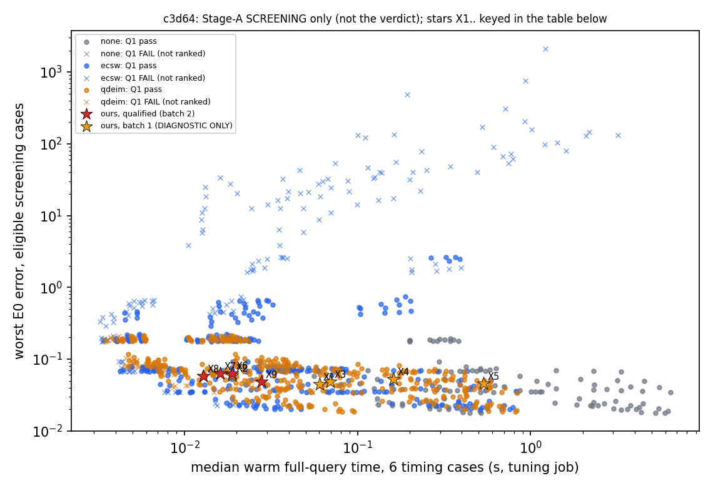
*3D 65³: POD baselines and ours (jcp-hr-baselines)*

### 3.6 Quadrature rule families

Smallest qualifying point count $m^*$ per family (Q2 successor agreement; for randomised families the same point count must qualify for every draw; "none" = no candidate size qualifies simultaneously for every required draw, even where individual draws qualify at some size; separate from the cross-family gate):

| panel | family | m* outcome |
|---|---|---|
| 2D R128M512 | gauss | m* = 9216 (stable) |
| 2D R128M512 | fib | m* = 4181 (stable) (all 5 draws) |
| 2D R128M512 | sobol | none (within the candidate list) |
| 2D R128M512 | halton | none (within the candidate list) |
| 2D R128M512 | smolyak | m* = 24577 (stable) |
| 2D R128M512 | mc | none (within the candidate list) |
| 2D R384M1536 | gauss | m* = 16384 (stable) |
| 2D R384M1536 | fib | m* = 28657 (stable) (all 5 draws) |
| 2D R384M1536 | sobol | none (within the candidate list) |
| 2D R384M1536 | halton | none (within the candidate list) |
| 2D R384M1536 | smolyak | none (within the candidate list) |
| 2D R384M1536 | mc | none (within the candidate list) |
| 3D W512 | gauss | m* = 32768 (stable) |
| 3D W512 | lattice | m* = 32768 (stable) (all 5 draws) |
| 3D W512 | sobol | none (within the candidate list) |
| 3D W512 | smolyak | none (within the candidate list) |
| 3D W512 | mc | none (within the candidate list) |
| 3D W512 | hal | none (within the candidate list) |

P1e slice: the 2D rule registered as failing (Gauss 64²) **passes** against its successor (distance 4.86e-05); the 3D lattice 8192 rule fails (distance 0.00421; bar $2.5\times10^{-4}$).

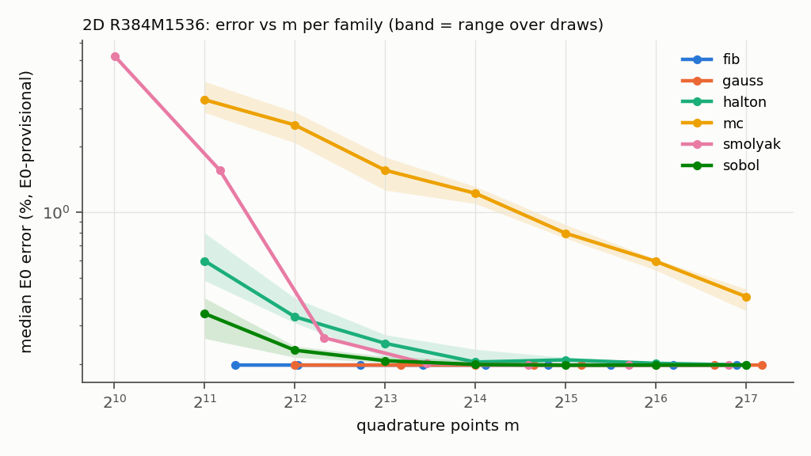
*2D rule families at (r, M) = (384, 1536) (jcp-dims)*

### 3.7 Test space

B6 (test-space size $M/r$): the registered weak control $M = r$ is **unavailable (unqualified cell)** — no square configuration passes solver qualification in 2D or 3D — so every test-space transition verdict is blocked by the registered rule. The low-mixed-frequency (hyperbolic-cross) test set is stable; Gauss: default needs fewer points; accuracy inconclusive (resolution).

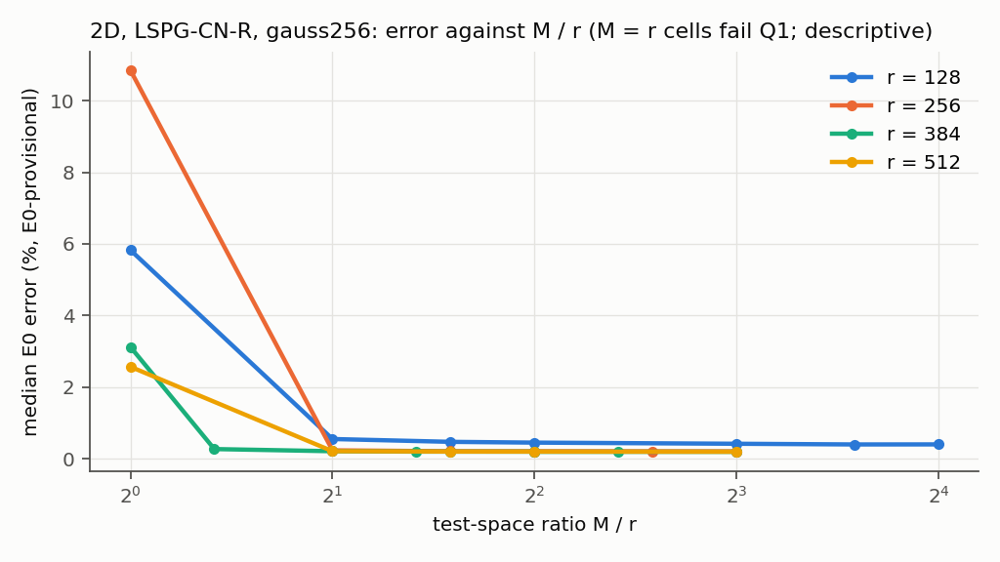
*2D: error against test-space ratio M/r (jcp-dims; transitions blocked)*

### 3.8 Error budget

Which ingredient dominates the error (Q quadrature, T time stepping, F/S/I/M other packages, $e_P$ the bank projection floor), per 2D member and mesh (jcp-budget B2):

The first three columns use each mesh's own case population; the cross-mesh verdict compares the shared 16-case subset, whose dominant labels are shown next to it.

| member | 256² (own cases) | 1024² (own cases) | 4096² (own cases) | 256² (shared 16) | 1024² (shared 16) | 4096² (shared 16) | same across meshes (shared 16) |
|---|---|---|---|---|---|---|---|
| R128 / GAL / CN / 1 | e_P | e_P | e_P | e_P | e_P | e_P | same |
| R128 / GAL / CN / 2 | e_P | e_P | e_P | e_P | e_P | e_P | same |
| R128 / GAL / CN / 5 | no single dominant | no single dominant | no single dominant | no single dominant | no single dominant | no single dominant | inconclusive |
| R128 / LSPG / BE / 1 | T | T | T | T | T | T | same |
| R128 / LSPG / BE / 2 | – | – | T | – | – | – | – |
| R128 / LSPG / BE / 2.5 | T | T | T | T | T | T | same |
| R256 / GAL / CN / 1 | e_P | no single dominant | e_P | e_P | e_P | e_P | same |
| R256 / GAL / CN / 2 | no single dominant | no single dominant | no single dominant | no single dominant | no single dominant | no single dominant | inconclusive |
| R256 / LSPG / CNR / 2.5 | – | T | T | – | – | – | – |
| R384 / GAL / CN / 1 | no single dominant | no single dominant | no single dominant | no single dominant | no single dominant | no single dominant | inconclusive |
| R384 / LSPG / CNR / 1 | T | T | T | T | T | T | same |
| R384 / LSPG / CNR / 2 | T | T | T | T | T | T | same |

3D (65³): `W256|gl24|fs|CN|0.0125|K1` e_P, `W256|gl24|fs|CN|0.01|K1` e_P, `W256|lat8192|qn|BDF2|0.025|k4` T, `W512|lat16384|qn|BDF2|0.025|k4` T.

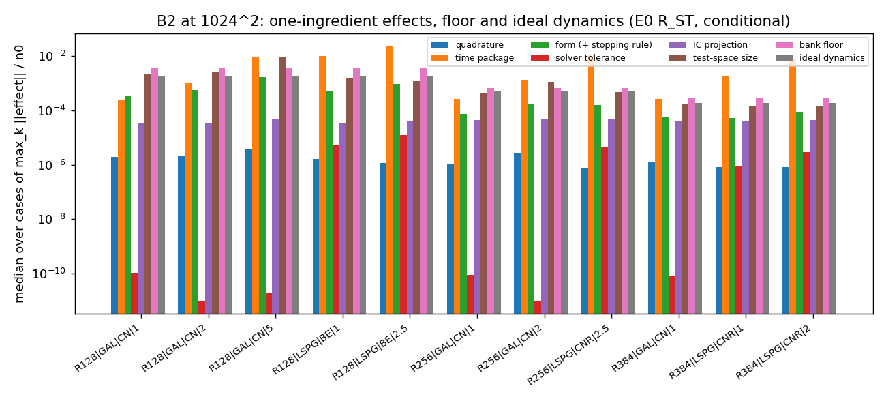
*Error budget at 1024² (jcp-budget)*

B8 output sampling: the 257² scoring lattice is adequate at 256², adequate at 1024², adequate at 4096² for the LSPG members (relative to a 1025² route); the R384 GAL-CN member is mixed or inadequate, so the statement is scoped to LSPG.

### 3.9 Long horizons

| panel | qualified at T | stable | no error growth (W2/W1) | front order W1 → W2 | W3/W2 growth (T = 1 only) |
|---|---|---|---|---|---|
| 2D 256², T = 0.5 | 9/10 | 10/10 | 10/10 | LSPG preserved, all not preserved | – |
| 2D 1024², T = 0.5 | 9/11 | 11/11 | 11/11 | LSPG preserved, all not preserved | – |
| 2D 4096², T = 0.5 | 12/12 | 12/12 | 12/12 | LSPG preserved, all not preserved | – |
| 3D 65³, T = 0.5 | 0/4 | 4/4 | 4/4 | preserved | – |
| 2D 1024², T = 1.0 | 11/11 | 11/11 | 11/11 | preserved (LSPG) | no verdict (cross-check unvalidated); provisional: no growth ×11 |

The T = 1 window W3 is **provisional**: its pseudo-spectral cross-check tier is unvalidated, so the lane gives values without a verdict (a validation reference failed its order check; jcp-budget report). In 3D no member is quadrature-qualified at T = 0.5, though all are stable.

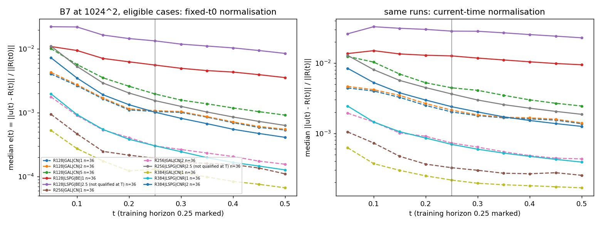
*Error against time out to T = 1 at 1024² (jcp-budget)*

### 3.10 Linear span against the nonlinear head

At matched dimension the K = 16 head (median 1.44 %) is more accurate than the linear span at r = 16 (median 10.2 %, at 0.265× the head's cost): a trade-off. At no more online cost the linear span wins: r = 128 reaches 1.1 % at 0.591× the head's cost (linear at no more cost is at least as accurate (rung 128: Y more accurate)). Exploratory, BE, 1024², qualified seeds only. Under either reading of "k" the cost does not depend on the mesh; under the head reading the accuracy-per-cost comparison favours the linear span.

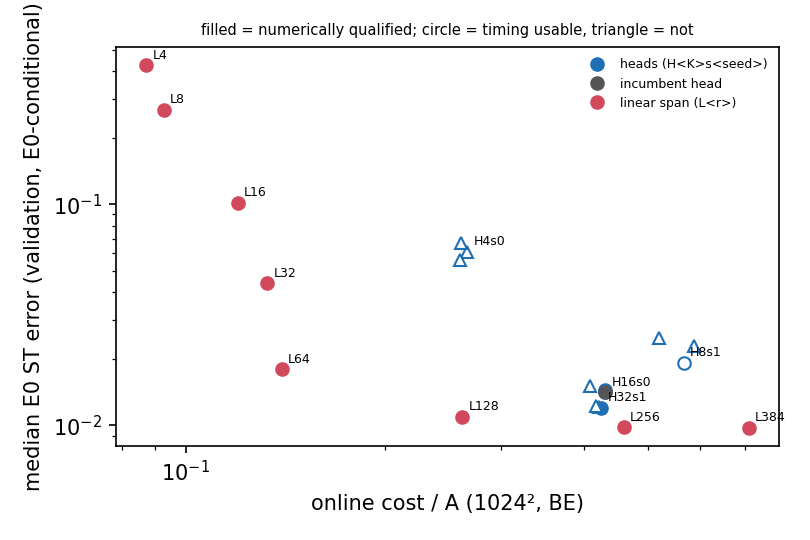
*Head (K) against linear span (r): error and cost at 1024² (jcp-heads)*

### 3.11 Robustness (E1 randomised rules, E2 retrain seeds, E5 A100 vs H200)

Lane status: **final: the Codex results audit accepted the analyses**. Errors are conditional E0 estimates. Three retraining seeds support a description of agreement, not a population claim.

**E1 — randomised quadrature rules.** Each qualified front configuration that uses a lattice rule is re-run with 16 random Cranley–Patterson shifts (draw 0 is the deployed rule) and scored on the full validity / Q1 / Q2 contract with draw-matched successor rules.

| dim | registered cells | H-E1a (failure rate of draws) | H-E1b (rank of the deployed draw) | H-E1c (accuracy sensitivity) |
|---|---|---|---|---|
| 2D | 12 | fragile ×6, inconclusive ×6 | typical ×12 | insensitive ×12 |
| 3D | 2 | robust ×2 | atypically unfavourable ×1, typical ×1 | insensitive ×2 |

**Reading of "fragile".** 20 of the 20 failing 2D draws fail only on the draw-matched successor distance (above the $2.5\times10^{-4}$ bar), while the distance to the independent cross-family target stays within the bar (largest over all primary 2D draws: 0.000202). "Fragile" therefore concerns convergence to the successor rule, not accuracy: H-E1c (the spread of E0 error over draws) is insensitive in every registered cell. In 3D: `W256|qn|BDF2|0.025|k4` H-E1a robust, H-E1b typical (rank of the deployed draw 9–9 of 16); `W512|qn|BDF2|0.025|k4` H-E1a robust, H-E1b atypically unfavourable (rank of the deployed draw 16–16 of 16); an atypically unfavourable deployed draw still qualifies (H-E1a robust).

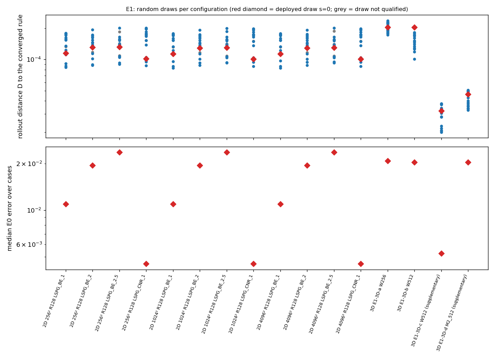
*E1: distance and error across 16 random rule draws (jcp-robust)*

**E2 — the full recipe repeated over seeds.** Bank training, ordering/rotation and rule selection are repeated with seeds 1–3 for the 2D R512 bank and the 3D W1024 bank, and the key verdicts are re-run per seed: **seed-robust** = seeds 1–3 give the same definitive label, **seed-dependent** = different definitive labels, otherwise **inconclusive**. The incumbent bank (seed 0) is reported as history.

| dim | verdict rows | cross-seed labels | headline accuracy rows (H-acc-N / H-acc-r) | selected-rule rows |
|---|---|---|---|---|
| 2D | 183 | inconclusive ×22, seed-dependent ×21, seed-robust ×140 | seed-robust ×24 | seed-dependent ×3 |
| 3D | 129 | inconclusive ×67, seed-dependent ×17, seed-robust ×45 | inconclusive ×22, seed-robust ×10 | inconclusive ×12, seed-dependent ×2, seed-robust ×10 |

2D rule selected per bank at 1024² (first candidate qualified under both LSPG schemes), and the deployed rule on the retrained banks:

| rank | bank 0 (incumbent) | seed 1 | seed 2 | seed 3 |
|---|---|---|---|---|
| R128 | fib4181 | gauss96 | fib6765 | fib6765 |
| R256 | fib10946 | fib10946 | gauss96 | gauss96 |
| R384 | gauss128 | gauss160 | gauss160 | gauss128 |

| rank | deployed rule | retrained seeds on which it fails qualification at 1024² (step factor 1, either LSPG scheme) |
|---|---|---|
| R128 | `fib4181` | 1, 2, 3 |
| R256 | `gauss128` | none |
| R384 | `gauss128` | 1, 2 |

**Reading (2D).** Mesh independence of accuracy (H-acc-N) and the improvement with r (H-acc-r) for the selected rules are seed-robust in 24 of 24 headline rows and agree with the incumbent. The selected rule changes with the seed, so quadrature-rule selection must be stated as a per-bank step; a deployed rule is not guaranteed to transfer to a retrained bank and must be re-qualified on each bank (it fails at step factor 1 on the seeds listed above; other step factors are in the lane report). Where the seed spread exceeds the gain of a step (spread ratio above 1), the step verdict is still "improves" on every seed (seed-robust), but its size is small against seed-to-seed variation: 1024 BE 256->384 4.56, 256 BE 256->384 2.53, 4096 BE 256->384 2.59.

**Reading (3D).** On the fixed rule gl64 (which isolates the bank), the W256 → W1024 range for the fixed-sweep CN specification is bank 0: monotone, bank 1: monotone, bank 2: monotone, bank 3: monotone. Across seeds 1–3 the median error barely moves (largest max/min 1.01, `gl64|W1024|fs|CN|0.01|K1`) but the worst-case error varies by up to 1.91× (`gl64|W1024|fs|CN|0.01|K1`). Certified wide-width rule selections: W768 on bank(s) 2, W1024 on none; most wide-width selection verdicts are therefore inconclusive, and the 3D front at W768–W1024 is too sparse for claims.

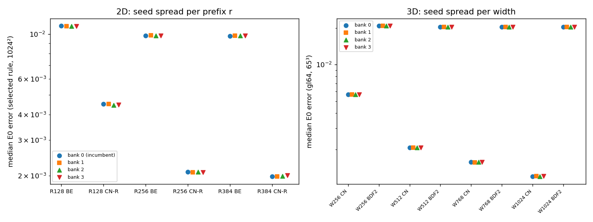
*E2: error spread across retraining seeds (jcp-robust)*

Non-blocking anchor G-E2.2 (incumbent 3D picks against jcp-dims' $m^*$ table, 16 cells): both none (certified absence) ×2, both none (unverified absence: target not certified) ×4, differs ×1, same m (certified) ×8, same m (pick target-unverified: not a certified agreement) ×1.

**E5 — hardware.** Paired A–B–A timing in 4 jobs, one physical GPU each (2 A100-80G, 2 H200); the conclusions are conditional on those GPUs, and the FOM comparators are the frozen comparators selected on H200 by jcp-fom2d. Only dimensionless ratios are compared: $\phi$ = H200 value / A100 value of the cost ratio B/A ($\phi_1$), the mesh-cost ratio ($\phi_2$) and the FOM/ROM speed-up ($\phi_3$). $\phi$ intervals: hardware-consistent ×6, hardware-dependent ×4; the hardware-dependent ones are φ1 R128 BE 256² 1.64, φ1 R128 BE 1024² 1.63, φ3 R128 BE vs central FD 0.708, φ3 R384 CNR vs pseudo-spectral 1.77. Cross-hardware agreement of the registered timing verdicts (mesh-cost H-cost-N on 256² vs 1024², and the 2× speed-up test against frozen FOM comparators): inconclusive ×1, verdict-robust ×5. Mesh-cost ratios $\phi_2$: φ2 R128 BE hardware-consistent, φ2 R384 CNR hardware-consistent. Cost ratios B/A and FOM speed-ups can shift by GPU type, so speed-ups must name the GPU. Descriptive anchor G-E5.2 (non-blocking): 7 of 12 H200 timing cells fall outside P1's intervals.


*E5: H200/A100 ratios with 95 % intervals (jcp-robust)*

### 3.12 Regimes (D1: ν extrapolation, IC-family change, stiffness)

**exploratory development evidence, no family-wise control**; regime errors are conditional E0-style estimates against new references computed with E0's method in the lane's own store (the baseline's dev6 and val32 cases use the E0 references). Frozen ROM at 1024², eight primary LSPG configurations (r = 128–512 × BE / CN-R) plus one GAL-CN diagnostic row; seven fresh development regimes with seeds disjoint from every cohort. Each regime is compared with the in-range baseline I (fresh in-range cases N0 plus dev6 and val32) by the median-error ratio and its bootstrap interval against a factor-2 margin, after per-regime Q1/Q2. Selection qualification: eligibility depends on cohort-specific tight-path allowances; bias direction unknown (A3.2).

| regime | references eligible | numerically qualified | labels (primary) | median error | ratio to baseline I | relabel |
|---|---|---|---|---|---|---|
| A+ (ν above the training range) | 14/16 (2 unresolved under the allowance) | 8/8 | HOLDS ×1, IMPROVES ×1, INCONCLUSIVE ×6 | 0.246 %–1.37 % | 0.55–1.53 | viscosity extrapolation confounded with steepness |
| A− (ν below the training range) | 16/16 | 8/8 | DEGRADES ×2, INCONCLUSIVE ×6 | 0.883 %–4.17 % | 1.63–9.25 | – |
| C1 (low ν, high steepness s; paired with A−) | 16/16 | 0/8 | NOT QUALIFIED ×8 | 5.2 %–11.2 % | 5.78–36.7 | – |
| C2 (lower ν, higher s) | 16/16 | 0/8 | NOT QUALIFIED ×8 | 12.7 %–25.1 % | 14.2–131 | – |
| B1 (IC family: two same-sign bumps) | 16/16 | 8/8 | HOLDS ×3, INCONCLUSIVE ×5 | 0.2 %–1.15 % | 0.989–1.55 | – |
| B2 (IC family: signed pair) | 15/16 | 8/8 | INCONCLUSIVE ×8 | 0.245 %–1.4 % | 1.11–1.64 | – |
| N0s (stiff corner of the training box; descriptive) | 8/8 | 8/8 | DEGRADES ×8 | 1.22 %–4.22 % | 2.97–9.79 | – |

Diagnostic row `R384|GAL_CN_1` on C2: **FAILS** (2 invalid runs) — the only FAILS label, after the A11 correction.

**Steepness and the representation floor.** The error grows with steepness: over A− ∪ C1 ∪ C2 the Spearman correlation of error with $\log_{10} s$ is 0.883–0.927 across the primary configurations (permutation p ≤ 0.0001). The bank itself cannot represent steep solutions: the median best-fit error of the references by the r = 384 bank span (a diagnostic, not a ROM error) is val32 0.0266 %, N0 (in range) 0.0286 %, N0s 0.881 %, A+ 0.0052 %, A− 0.585 %, C1 3.47 %, C2 9.88 %, B1 0.0519 %, B2 0.0593 %. For C1 and C2 the floor alone exceeds every in-range median ROM error. The floor is a diagnostic, not a proof of why the ROM degrades: it suggests the bank's span is a limit there, alongside the Q1/Q2 failures on those regimes; retraining on a wider steepness range was not tested.

**A± confounding.** The viscosity regimes are meant to change ν without leaving the training range of front steepness $\sigma_a$. For A− 0.938 of cases are inside the in-range $\sigma_a$ range (separation check passed); for A+ only 0.143 are (passed: False), so A+ is relabelled "viscosity extrapolation confounded with steepness" and its IMPROVES / HOLDS labels do not isolate viscosity extrapolation.

**Paired A− / C1.** C1 case j has the same position, width and viscosity as A− case j with a larger amplitude. Median paired error ratio C1/A− 2.58–5.19 (Wilcoxon p ≤ 3.05e-05); labels DEGRADES ×7, INCONCLUSIVE ×1. This is an amplitude (steepness) effect at matched geometry and viscosity, not a pure stiffness mechanism.

**IC-family change (B1, B2).** Numerically qualified: B1 8/8, B2 8/8; DEGRADES labels: B1 0, B2 0; the rest are HOLDS or INCONCLUSIVE (interval too wide to decide against the factor-2 margin). **N0s** (the stiff corner inside the training box, descriptive): DEGRADES for 8 of 8 configurations, so "in range" does not mean "uniformly accurate".

**Reference cross-check.** The pseudo-spectral cross-check passes on 7 of 7 scheduled cases (E0 A10-amended rule, label carried).

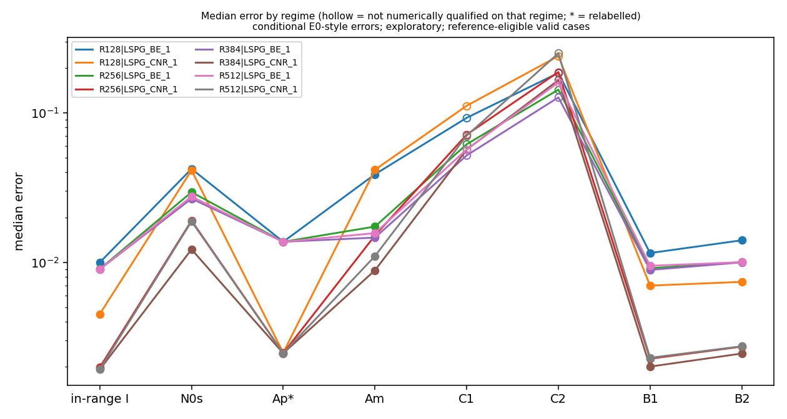
*Median error by regime and configuration (jcp-regimes)*

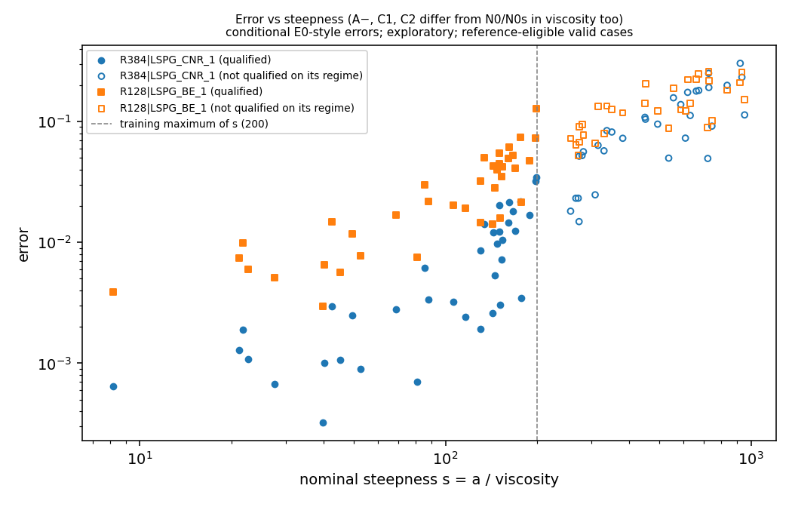
*Error against nominal steepness s (jcp-regimes)*

## 4. P1g recheck: how much earlier "flat accuracy" moved under frozen mode lists

The 2D test-mode set is built by sorting mesh-dependent discrete Laplacian eigenvalues. P1g reran the earlier cross-mesh comparisons with one frozen list (taken at 1024²) and compared with the nominal per-mesh lists.

| arm | numerically qualified (1024²) | 256²: frozen vs nominal trajectory distance | 256²: largest E0 error change | 4096²: distance | 3-mesh spread vs E0, frozen / nominal | 3-mesh spread vs first-order reference, frozen / nominal |
|---|---|---|---|---|---|---|
| R384 / BE | yes | 0.000523 | 0.0103 pp | 1.33e-15 | 0.0121 / 0.0117 pp | 0.0143 / 0.0124 pp |
| R384 / CNR | yes | 0.000922 | 0.0537 pp | 1.45e-15 | 0.0504 / 0.0163 pp | 0.0528 / 0.0183 pp |
| H64 / BE | no (descriptive historical arm) | 0.000585 | 0.0108 pp | 1.94e-15 | 0.0135 / 0.0136 pp | 0.0145 / 0.0143 pp |
| H640 / BE | no (descriptive historical arm) | 0.000525 | 0.0103 pp | 1.35e-15 | 0.0119 / 0.0117 pp | 0.0141 / 0.0124 pp |
| HF6765 / BE | no (descriptive historical arm) | 0.000509 | 0.00907 pp | 2.09e-15 | 0.0116 / 0.0117 pp | 0.0132 / 0.0124 pp |
| H96 / BE | no (descriptive historical arm) | 0.000529 | 0.0108 pp | 1.83e-15 | 0.0129 / 0.0114 pp | 0.0151 / 0.0121 pp |

Reading: the lists differ only at 256² (a few modes swapped at M = 1536); at 4096² the nominal list is a permutation of the frozen one (distances at round-off). Freezing moves trajectories by more than the Q1 bar but errors only by hundredths of a percentage point; the nominal runs reproduce the historical jobs to round-off. **Correction of interpretation, not of numbers:** the earlier "flat accuracy" comparisons at 256² used a slightly different test space; the conclusion stands.

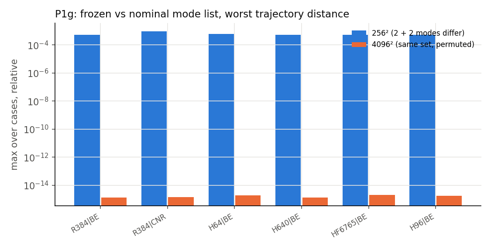
*P1g: frozen against nominal mode lists (jcp-p1-scaling)*

## 5. Retractions and corrections

Consolidated from LAB-LOG.md (entries 2026-10-17 onward) and the lane reports. Numbers are read from lane outputs; the source of each item is given. Amendment-level detail (every DESIGN amendment) is in the sources listed in section 5.1.

- **speed3d H2 winners are not quadrature-qualified.** The H2 speed-ups (2.01×, 5.37×, 17.2×) were measured correctly, but the winners fail Q2 (successor-rule distance 0.000814 and 0.000951; bar $2.5\times10^{-4}$). After qualification (jcp-dims H2q) the speed-up over C_old is 1.15× and **fails** the 1/0.6 bar; over C_W768 it is 2.95×. K2 is unaffected. *(Source: jcp-qualify report "Corrections"; jcp-dims H2q.)*
- **Combined H5 speed-up is a narrow-scope result.** Combined H5 (13.6× selected LSPG-CN-R, 17.7× best arm, vs a second-order FOM) holds only against a same-mesh sign-upwind FOM matched on worst error. Against the full FOM ladder every qualified LSPG configuration is slower than its comparator and K2 fires. The paper must not quote it as a speed-up over the best FOM. *(Source: jcp-fom2d report; experiments/jcp-combined/checks/analysis-c2grid-2d_e0.json @ a3c9e170d, hypotheses.H5.ST.)*
- **Combined finalist labels "qualified" withdrawn for LSPG-CN-R at 2Δt₀.** R128 and R256 at 2Δt₀ fail the every-case Q1 contract (worst distance to the tight solve: 256² R128 0.000361, 256² R256 0.000405, 1024² R128 0.00036, 1024² R256 0.000404, 4096² R128 0.00036, 4096² R256 0.000404; bar $2.5\times10^{-4}$; worst case: val32|19). Their errors and timings are not retracted; their qualification label is. *(Source: jcp-qualify report.)*
- **"1024² reused from combined" was false for R256.** The archived R256 arm used Gauss 96², the frozen P1 rule is Gauss 128²; all 1024² P1 runs were redone fresh with in-job certification. *(Source: LAB-LOG 2026-10-17/18; P1-RESTATEMENT.)*
- **Coordinator's "mode lists differ at 4096²".** Wrong: at 4096² the nominal list is a permutation of the frozen one (trajectory distance 1.33e-15 for R384 BE). The lists differ only at 256². *(Source: jcp-p1-scaling P1g.)*
- **Registered failing 2D rule does not fail.** Gauss 64² was registered as the failing 2D rule in P1e; it passes (distance 4.86e-05). Reported, not re-labelled. *(Source: jcp-p1-scaling P1e.)*
- **"The head is necessary at matched latent dimension" (2026-09-14) is qualified.** It holds at matched dimension only; at no more online cost the linear span r = 128 is more accurate than the K = 16 head. *(Source: jcp-heads §6d.)*
- **Early "flat accuracy" at 256² used a slightly different test space.** See section 4 (P1g). *(Source: jcp-p1-scaling.)*
- **Post-data tolerance and rule changes (labels carried).** E0 A10 (reference cross-check rule changed after data); jcp-hr-baselines A41 (reproduction tolerance loosened after data; outcomes unchanged) and A44.3 (role picks chosen on the Stage-B data); jcp-dims A6.1 / A9.1 (certificate bar relaxed after the smoke; first discrepancy figures were wrong and replaced); jcp-qualify A1.3 / A2.5 (GAL stationarity replaced by a residual criterion); jcp-p1-scaling A2.2 (component-sum control demoted to a diagnostic). *(Source: lane DESIGN amendments.)*
- **Lane-internal errors found by audits and fixed before results were accepted.** speed3d A9 G2 attribution (corrected in A10) and m1 calibration population; jcp-hr-baselines budget under-count (results audit 1, fixed in A44.2) and the ill-posed ECSW tolerance knob (replaced by a support target); jcp-budget A9/A9.1 eligibility bug, A12.x caching bugs (no value changed), A14.1 corrected by A14.2, A14.3 tie rule; jcp-dims A7, A10.2 underpriced certificates, A12.1 omitted configurations, A14 timing controls missing before the first t2 configuration. *(Source: lane reports, LAB-LOG.)*
- **Plan corrections.** Sealed-cohort counts in the draft plan were case-kinds, not physical cases; the plan's GPU-hour total was mis-summed; the proposed ≤ 5 % flatness bar was replaced by the registered [0.8, 1.25] band; 3D S references are never matched (3D step 0.01 vs S at 0.005). From the plan audits: the P1 accuracy run count was mis-stated; the 2D query samples the initial condition at the quadrature points rather than projecting the full field; a finite FOM ladder bounds our speed-up from above (it does not bound FOM efficiency); the degenerate three-mesh sign test was replaced by per-case slopes with a Wilcoxon test plus TOST; the P1a fixture could not supply the widest bank from truncated narrower states and was replaced; the Q2 bar originally mixed two quantities; several must-fail controls were not guaranteed to fire and were replaced; "P1 uses no randomised rules" was false (the Fibonacci lattices carry a seeded shift). *(Source: LAB-LOG 2026-10-17 entries.)*
- **jcp-p1-scaling smoke acceptance.** The first smoke acceptance failed on defects of the checks themselves (DESIGN A6); a mislabelled smoke-acceptance file was replaced by a reconstruction. *(Source: LAB-LOG 2026-10-18.)*
- **jcp-speed3d wording.** The screening wording "all replay labels mixed" was wrong (not every replay label was "mixed"); the m1 FOM calibration population at L ≥ 256 was corrected before submission (A9). *(Source: jcp-speed3d report.)*
- **jcp-hr-baselines construction defects.** Phase I acceptance failed on real defects, then fixed: the ECSW tolerance knob was ill-posed (replaced by a support target); the NNLS solver cycled in 3D (replaced by an different exact solver, later reworked again after a performance bug, A38–A40); out-of-memory paths were made memory-lean; cancelled attempts t3d64a, s2d1024a and s3d64a were caused by the NNLS column deletion, repeated whole-file JSON rewrites, and an inexact step identifier (A42, A44.1); a resource-model correction (A43.1). *(Source: LAB-LOG 2026-10-18; jcp-hr-baselines report "Cancelled attempts".)*
- **jcp-budget corrections.** A registered budget-gate bar was restated after the smoke (A6); the offline reference identity compares case descriptors because of last-bit differences across NumPy versions (A6); the first resource certificates under-priced the retry path (A7); at T = 1 the first eligibility code took W2 eligibility from the wrong horizon (A11.1); the 3D shared-IC requirement was restated level-wise after a last-bit inconsistency inside E0 (A13); case durations quoted in A14/A14.1 were cumulative log timestamps (A14.3). *(Source: jcp-budget report "What was wrong or corrected".)*
- **jcp-dims corrections.** Missing in-job gate evidence for 2D family draws was first labelled "offline (b) disagrees" and relabelled "missing" (A12.4); protected jobs were missing from the ledger reserve (A11); the first memory-coverage argument for the t2 timing panel was wrong and was replaced by production evidence (A14.5). *(Source: jcp-dims report; LAB-LOG 2026-10-20.)*
- **jcp-heads.** Under the successor-agreement quadrature policy the incumbent head needs Gauss 96² at 1024², where the quadrature-study lane had picked Gauss 32² post hoc (a policy outcome, not a universal requirement). A tighter initial-fit tolerance (A9) was set after smk1, before production; the seed-0 K = 16 retrain equals the incumbent to round-off (a same-seed replay, not a replication). *(Source: LAB-LOG 2026-10-18.)*
- **jcp-robust.** **A17 (retracted):** the first E2 2D roll-up computed the 1024² front with exact joint inequalities instead of qualify's registered dominance rule; its cross-seed counts and its "R256 front membership is seed-dependent" reading are withdrawn (the E2 2D results audit round 1 was REJECT). Report fixes A19–A21: the resource table double-counted GPUs; a wide-width "inconclusive" statement was broader than the verdicts and was restricted to selection verdicts; a data-hash sentence was not labelled as 2D; glossary definitions were corrected against the design. Operational: smk3 hit its time limit (A9); e1m4096 was cancelled because its certificate ignored transfer overhead (A10.3); a GB/GiB mix-up in a memory note (A12.4); the e13d certificate under-estimated the supplementary 3D configurations (A13.6); two transient login-node failures before submission (A15). *(Source: jcp-robust report "Deviations, retractions and corrections"; DESIGN A17–A21; LAB-LOG 2026-10-20.)*
- **jcp-regimes.** Withdrawn during the design audits: a "clean one-factor attribution" (now distributional contrasts), a wrong reference acceptance rule (now E0's predicates), and a cost model missing the refinement time at low viscosity. During the lane: the first smoke stopped at an over-specified GPU-float fingerprint, dropped by A7; A9 moved ordinary jobs to A100-80G (no timing result is reported); A10 relaxed an exact descriptor-hash check to round-off before any result was read; **A11**, after results audit 1 (RESULTS-WRONG): the scoring had counted solver budget exits as valid runs, contrary to the frozen design; corrected, only the GAL-CN diagnostic row on C2 changes (to FAILS) and no primary cell changes. *(Source: jcp-regimes report "What went wrong during the lane"; LAB-LOG 2026-10-20.)*


### 5.1 Where the full records are

The list above consolidates the corrections. The full text lives in each lane report's own correction section and in LAB-LOG.md; this report points to them rather than quoting them.

| lane | file | section | lines at compile time |
|---|---|---|---|
| jcp-speed3d | `worktrees/2026-10-14-jcp-speed3d/experiments/jcp-speed3d/report.md` | What is provisional, and what was wrong | 433–440 |
| jcp-qualify | `worktrees/2026-10-18-jcp-qualify/experiments/jcp-qualify/report.md` | Corrections to earlier reports (stated plainly) | 462–473 |
| jcp-qualify | `worktrees/2026-10-18-jcp-qualify/experiments/jcp-qualify/report.md` | Deviations and retractions | 474–478 |
| jcp-fom2d | `worktrees/2026-10-18-jcp-fom2d/experiments/jcp-fom2d/report.md` | What is provisional, and what changes earlier claims | 426–432 |
| jcp-hr-baselines | `worktrees/2026-10-06-jcp-hr-baselines/experiments/jcp-hr-baselines/report.md` | Cancelled attempts and coverage | 41–53 |
| jcp-heads | `worktrees/2026-10-18-jcp-heads/experiments/jcp-heads/report.md` | 6d. Relation to earlier results, and what is provisional | 640–646 |
| jcp-dims | `worktrees/2026-10-18-jcp-dims/experiments/jcp-dims/report.md` | Retractions and corrections during the lane (details in DESIGN.md amendments) | 838–852 |
| jcp-budget | `worktrees/2026-10-18-jcp-budget/experiments/jcp-budget/report.md` | What was wrong or corrected | 371–386 |
| jcp-regimes | `worktrees/2026-10-19-jcp-regimes/experiments/jcp-regimes/report.md` | What went wrong during the lane (disclosed) | 35–42 |
| jcp-robust | `worktrees/2026-10-19-jcp-robust/experiments/jcp-robust/report.md` | Deviations, retractions and corrections | 640–649 |
| coordinator | `LAB-LOG.md` | entries from 2026-10-17 on ("Wrong", "Retracted", "Corrections" bullets) | 19087–19332 |

## 6. Deferred items

| owner | item | reason / source |
|---|---|---|
| coordinator | C3-full: 2D 4096², 3D meshes finer than 64 intervals, GNAT, POD + exact tensor, best-practice EQ; per-mesh setup cost for break-even counts | C3-minimal already falsified H-base (LAB-LOG 2026-10-19) |
| coordinator | C4: decoder ablation | excluded from the freeze roster (plan V3-6) |
| jcp-robust | E2 extension to five seeds; E5 on L40S; E1 in 3D beyond 16 draws | LAB-LOG 2026-10-20 (jcp-robust complete) |
| jcp-regimes | 3D regimes (need their own amendment) and the FOM accuracy comparison on the regimes; retraining the bank on a wider steepness range (open) | jcp-regimes report summary (DESIGN A1.12, A3.3); LAB-LOG 2026-10-20 |
| jcp-budget | B8 3D (fine route at $127^{3}$, C-A / C-E in 3D) | defer item 2, recorded in A4 (implementation scope) |
| jcp-speed3d | upwind FOM ladder at L ≥ 256 (decides the upwind 3D cells); fixed-mode 3D cost panel | speed3d report, open items |
| jcp-fom2d | same-resolution spectral FOM at 1024² and 4096²; upwind + CN-R, Newton–GMRES, IMEX-CG families | deferred by scope (A2.4) |
| jcp-qualify | fourth 3D Q2 round | routed to jcp-dims (A4) |
| jcp-dims | 2 untested W1024 candidates; square-cell (M = r) runs not reproducible across jobs (cause unexplained; they also fail Q1) | jcp-dims report |
| jcp-heads | head-repair hypotheses (E3c); more seeds or looser solver tolerance for K = 4, 8, 32 | jcp-heads §6d |
| jcp-p1-scaling | none | spending stayed below the cap |
| user | merges of the finished lanes; custody of the sealed-cohort key; the 2D floor check before opening; authorship with Hari | LAB-LOG "Where things stand" |

## 7. GPU-hour ledger

| lane | spent (GPU-h, sacct) | cap | ledger entries | state |
|---|---|---|---|---|
| jcp-speed3d | 10.9 | 34 | 9 | finished |
| jcp-p1-scaling | 1.91 | 20 | 11 | finished |
| jcp-qualify | 4.13 | 35 | 16 | finished |
| jcp-fom2d | 4.59 | 30 | 9 | finished |
| jcp-hr-baselines | 21.2 | 30 | 11 | finished |
| jcp-heads | 3.68 | 35 | 9 | finished |
| jcp-dims | 35.2 | 55 | 29 | finished |
| jcp-budget | 25.9 | 45 | 20 | finished |
| jcp-robust | 46.4 | 95 | 54 | finished |
| jcp-regimes | 14.9 | 60 | 13 | finished |

"Spent" is each lane ledger's `spent_gpu_hours`, which counts jobs that have reached a terminal state; jobs still running are not yet included.

Total over the 10 finished lanes: **169 GPU-h** (all ten campaign lanes). speed3d's ledger includes its jobs from before the campaign started.

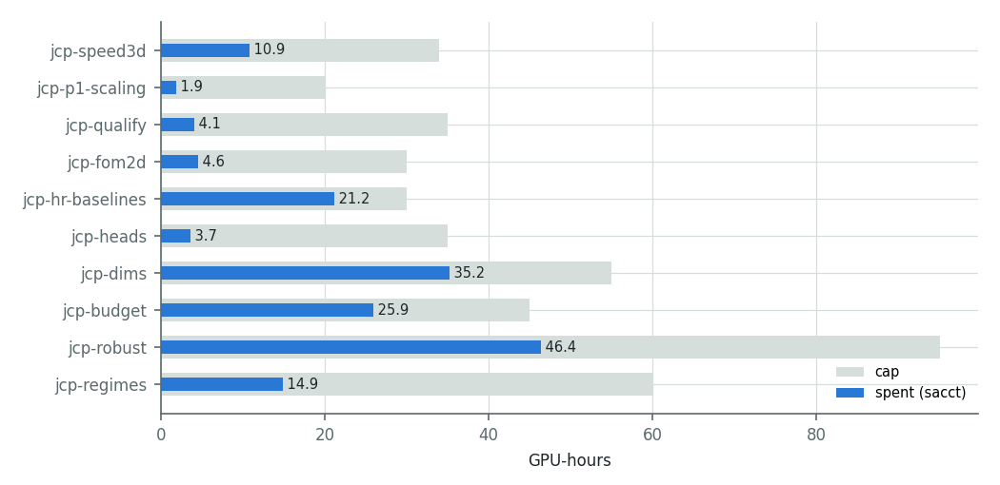
*GPU-hours spent against each lane's cap*

## 8. Lanes (awaiting the user's merge decision)

| priority | lane | items | branch | last commit | code-only mirror | report | state |
|---|---|---|---|---|---|---|---|
| speed3d | jcp-speed3d | 3D speed, f1 FOM ladder, m1 mesh panel, H2, K2 (3D) | `exp/2026-10-14-jcp-speed3d` | 691465d88 | 6c270e6c5 | `worktrees/2026-10-14-jcp-speed3d/experiments/jcp-speed3d/report.md` | awaiting merge decision |
| 1 | jcp-p1-scaling | P1a-P1g, Q3: H-cost-N/r, H-acc-N/r, P1g | `exp/2026-10-17-jcp-p1-scaling` | 5b782026b | 3b589dad5 | `worktrees/2026-10-17-jcp-p1-scaling/experiments/jcp-p1-scaling/report.md` | awaiting merge decision |
| 2 | jcp-qualify | Q1-Q3, B1, B4, B5, FRONT-2D, 3D Q2 subset | `exp/2026-10-18-jcp-qualify` | 250b20d91 | 35620c70e | `worktrees/2026-10-18-jcp-qualify/experiments/jcp-qualify/report.md` | awaiting merge decision |
| 2 | jcp-fom2d | C1 ladder, C2 crossover, H-comp 2D, K2 (2D) | `exp/2026-10-18-jcp-fom2d` | 12103d331 | c4089abe6 | `worktrees/2026-10-18-jcp-fom2d/experiments/jcp-fom2d/report.md` | awaiting merge decision |
| 2 | jcp-hr-baselines | C3 minimal, H-base | `exp/2026-10-06-jcp-hr-baselines` | 2e3abac47 | 2fa5b5967 | `worktrees/2026-10-06-jcp-hr-baselines/experiments/jcp-hr-baselines/report.md` | awaiting merge decision |
| 3 | jcp-heads | C5 K sweep, linear span vs head | `exp/2026-10-18-jcp-heads` | 0ba9a1288 | ed3d0c841 | `worktrees/2026-10-18-jcp-heads/experiments/jcp-heads/report.md` | awaiting merge decision |
| 3 | jcp-dims | A3, A4, B3, B6, 3D front, H2q | `exp/2026-10-18-jcp-dims` | a99906fe6 | 038cce675 | `worktrees/2026-10-18-jcp-dims/experiments/jcp-dims/report.md` | awaiting merge decision |
| 3 | jcp-budget | B2, B7, B8 | `exp/2026-10-18-jcp-budget` | d70608191 | 9be95f4fb | `worktrees/2026-10-18-jcp-budget/experiments/jcp-budget/report.md` | awaiting merge decision |
| 4 | jcp-robust | E1, E2, E5 | `exp/2026-10-19-jcp-robust` | cbf574373 | d49bd0085 | `worktrees/2026-10-19-jcp-robust/experiments/jcp-robust/report.md` | awaiting merge decision |
| 4 | jcp-regimes | D1 | `exp/2026-10-19-jcp-regimes` | 70ce5f0f2 | ee52292fe | `worktrees/2026-10-19-jcp-regimes/experiments/jcp-regimes/report.md` | awaiting merge decision |

Last commits and mirror commits are read from git at compile time (the mirror is the local tracking ref `origin/codeonly/exp/<slug>` updated by each lane's `sync_github.sh`). For jcp-qualify and jcp-fom2d the last commit is the coordinator's archive-offload commit made after the lane closed.

## 9. Glossary

- **r (bank width, $R'$)**: number of ordered linear bank coefficients the reduced model solves for; one reading of "k".
- **K (head latent)**: latent size of the nonlinear head that maps $K$ numbers to bank coefficients; the other reading of "k".
- **mesh, N, L**: size of the full-order mesh on which the input is sampled and the output decoded. 2D: $N^2$ grid points ($256^2$–$4096^2$). 3D: $L$ intervals per axis ($L = 64$–$384$); "$65^3$" is $L = 64$ (65 nodes, $63^3$ interior unknowns).
- **M, m**: $M$ = number of sine test functions; $m$ = number of quadrature points used to evaluate the nonlinear term.
- **LSPG, GAL, BE, CN-R, CN, BDF2**: least-squares Petrov–Galerkin (minimises the tested residual); Galerkin (a registered diagnostic scheme here); backward Euler; Crank–Nicolson with backward-Euler start-up steps; Crank–Nicolson; second-order backward differentiation.
- **FS, FSP, QN; K1, K2; k1, k4, kinf**: 3D solvers: fixed-sweep Levenberg–Marquardt (K1, K2 = one or two full-Jacobian sweeps per step); fixed-sweep with extra initial-guess candidates; quasi-Newton with the exact gradient and a Gauss–Newton matrix refreshed every k steps (k1, k4; kinf = only when forced).
- **Jacobian J, normal matrix $J^\top J$, Cholesky**: the derivative of the reduced residual with respect to the coefficients; the small square matrix of the least-squares step; the factorisation used to solve with it. With the tested advection vector N these are the four timed kernels.
- **$\Delta t_0$, "2Δt₀", factor**: the reference step 0.005 (2D); configuration labels give the step as a multiple of it.
- **E0, $R_{ST}$, $R_S$, $\varepsilon_{\rm ref}$**: the second-order reference solutions; $R_{ST}$ (space and time) scores the errors (exceptions named in the status paragraph); $R_S$ (space only, backward Euler at 0.005) is matched only to 2D BE; $\varepsilon_{\rm ref}$ is the per-case reference uncertainty, a conditional Richardson estimate (not a bound).
- **e (error)**: $e=\max_{k}\lVert u(t_k)-R(t_k)\rVert_2/\lVert R(t_0)\rVert_2$ over the five output times, on the $257^2$ (2D) or $63^3$ (3D) scoring lattice; "median e" and "worst e" are over the cases.
- **dev6, val32, 923801, 16-case subset**: development and validation cohorts (2D: $6+32=38$ cases; 3D: 64 cases); selection uses only these. The 16-case subset is dev6 plus the first ten val32 cases.
- **sealed / OOD cohorts**: held-back test cohorts that stay unopened until the user decides.
- **Q1 (solver qualification)**: every run valid, at most 1 % of steps not certified (LSPG: stationarity ratio $\gamma=\lVert J^\top r\rVert/(\lVert J\rVert_F\lVert r\rVert)\le10^{-3}$; GAL: relative Galerkin residual $\eta\le10^{-8}$), distance to a tight solve at most $2.5\times10^{-4}$ on every case, tight vs tighter at most $2.5\times10^{-5}$.
- **Q2 (quadrature qualification)**: the next finer rule gives the same rollout (distance at most $2.5\times10^{-4}$) and the same tested advection ($\rho\le0.116$) on the configuration's own states, and the finer rule itself agrees with the next one.
- **numerically qualified**: passes Q1 and Q2 (and the registered reproduction gate where one applies). Primary 2D verdicts use only such configurations; the 3D H-cost-N, H-comp and K2 rows include speed3d configurations that are not all qualified, and say so in the row.
- **H-cost-N**: cost does not depend on the mesh: $R=\max/\min$ over meshes of the median cost ratio; pass if the upper end of its 95 % case-bootstrap interval is at most 1.25 (3D H4.1: pass if $\max/\min\le1.25$).
- **H-cost-r, p, declared p**: cost grows with r as the operation count predicts; $p$ is the exponent of $t=a+b\,r^p$ fitted to kernel times at fixed $(M,m)$, compared with the operation-count ("declared") exponent. "Hardware scaling" / "operation-model" are the registered sub-labels of a fail.
- **elasticity**: descriptive slope of log query time against log r, log M and log m in the 2D timing panel; not a kernel exponent.
- **H-acc-N**: error does not depend on the mesh: two one-sided tests (TOST) that per-case error differences lie within $\pm\max(2\varepsilon_{\rm ref},\,0.1\,e)$, plus a trend test.
- **H-acc-r, monotone**: error decreases as r grows: at each step a majority of resolved cases improve and the median change is negative; a range is monotone if every step improves.
- **H-comp**: the ROM is at least 2× faster than a full-order solver matched to its accuracy.
- **K2**: the plan's pre-registered kill criterion: no selected ROM reaches 2× against the best matched full-order solver at the largest mesh.
- **H-base**: our model is not dominated by a tuned standard POD reduced model.
- **H2, H2q**: speed-up of the cheapest 3D configuration over our own earlier 3D configurations (ROM vs ROM; full-field $65^3$ mesh-path query on one H200); H2q restricts the winner to quadrature-qualified configurations; the comparator is qualified for C_old and C_W768 but not for C_W1024.
- **C_old, C_W768, C_W1024; W_C_old, W_C_W768**: the earlier deployed 3D BE configurations of the M2_512, W768 and W1024 banks; the speed3d winners selected against them.
- **M2_512, W256 … W1024**: 3D banks: the narrower M2 bank of width 512, and prefixes of width 256–1024 of the ordered W1024 bank.
- **mesh path / mesh-free**: 3D query contracts: input given on the mesh and outputs decoded on it, or input and outputs at the method's own points and the scoring lattice.
- **union speed-up, matched**: FOM time divided by ROM time for the cheapest full-order solver, over all families, that ties or beats the ROM on both median and worst error; below 1 the FOM is faster. An upper bound, because the FOM ladder is finite.
- **UB, UC, CC, PS, ETDRK4**: full-order families: sign-upwind + BE, upwind + CN-R, central differences + CN-R, sine pseudo-spectral; ETDRK4 is the fourth-order exponential time integrator used by the 2D spectral solver.
- **POD, ECSW, Q-DEIM**: proper orthogonal decomposition basis; energy-conserving sampling and weighting and Q-DEIM interpolation, two standard hyper-reduction methods.
- **B_acc, B_cost**: role picks among the baselines: the fastest baseline whose worst error is at most ours; the most accurate baseline whose median time is at most ours.
- **dominated, time ratio**: a baseline is both faster and has lower worst error, with non-overlapping intervals; time ratio = baseline query time / our query time.
- **developmental, in-sample, unadjusted**: both methods were tuned on the same cases; no held-out confirmation, no multiplicity correction.
- **front**: the configurations not beaten on both error and cost by another qualified configuration.
- **frozen / nominal mode list**: one test-mode list reused at every mesh / each mesh's own list (deployment policy).
- **P1g, pp**: the recheck of earlier cross-mesh accuracy claims under a frozen mode list; pp = percentage points of relative error.
- **H64, H96, H640, HF6765**: historical 2D quadrature rules at $r=384$: Gauss $64^2$, $96^2$, $640^2$ and Fibonacci 6765 points.
- **rule families, $m^*$**: gauss / gl: tensor Gauss–Legendre; fib: Fibonacci lattice; lattice / lat: rank-1 lattice; sobol, halton / hal: quasi-random sequences; smolyak: sparse grid; mc: Monte Carlo. $m^*$ is the smallest point count in a family that passes the quadrature check.
- **A–B–A**: timing design: configuration B timed between two runs of the reference A on the same GPU; cost = B / mean(A).
- **error-budget ingredients**: Q quadrature, T time stepping, F reduced form with its stopping rule, S solver tolerance, I initial condition, M test space; $e_P$ = error of the best fit by the bank (projection floor).
- **W1, W2, W3**: output-time windows $(0,0.25]$, $(0.25,0.5]$, $(0.5,1]$.
- **stable (long horizons)**: every run valid and, at every recorded output time, the reduced kinetic energy no more than $10^{-3}$ (relative) above its initial value; nothing is checked between output times.
- **no error growth**: per case $g=e_{W_2}/e_{W_1}$ (or $e_{W_3}/e_{W_2}$) over cases whose errors exceed twice their reference uncertainty in both windows; "no growth" if the upper end of the bootstrap 95 % interval of the median $g$ is at most 1; "inconclusive (population)" below the minimum number of cases.
- **dominant, no single dominant**: per case, the largest resolved error ingredient is the winner (ties within a registered threshold); an ingredient is dominant if it wins on more than half of the complete cases, otherwise "no single dominant"; "inconclusive" if too few cases are complete.
- **front order preserved**: no resolved pair of members reverses its ranking by median window error between the two windows, over their common eligible cases (not necessarily identical raw rankings).
- **regimes, baseline I, s, $\sigma_a$**: D1: fresh development cohorts drawn from distributions outside or at the edge of the training family (viscosity, steepness, IC family); they are distributional contrasts, not one-factor changes (C1 and C2 change both viscosity and steepness); baseline I = fresh in-range cases N0 plus dev6 and val32; $s=a/\nu$ is the nominal steepness (amplitude over viscosity); $\sigma_a$ is the largest interior gradient divided by the IC amplitude.
- **HOLDS, IMPROVES, DEGRADES, INCONCLUSIVE, NOT QUALIFIED, FAILS**: D1 labels, in order of precedence: FAILS = an invalid production run; NOT QUALIFIED = Q1 or Q2 fails on the regime's own cases; otherwise, from the bootstrap 95 % interval of the median-error ratio against baseline I: IMPROVES if its upper end is below 1, HOLDS if its upper end is at most 2, DEGRADES if its lower end is above 2, else INCONCLUSIVE.
- **representation floor**: error of the best least-squares fit of a reference by the first r bank functions on the scoring lattice; a lower bound on what any coefficients in that span can achieve.
- **Spearman correlation**: rank correlation between two quantities; p from a permutation test.
- **E1, draw, Cranley–Patterson shift**: E1 re-runs a lattice-rule configuration with 16 randomly shifted copies of its rule (a uniform random shift of every point, wrapped into the unit square or cube); draw 0 is the deployed rule.
- **H-E1a, H-E1b, H-E1c**: robust / inconclusive / fragile from the number of draws failing Q1+Q2 and a one-sided Clopper–Pearson upper bound on the failure rate; where the deployed draw ranks among the 16 (typical or atypically favourable / unfavourable); insensitive if at least 90 % of cases keep every draw's E0 error within $\max(2\varepsilon_{\rm ref}, 0.1\,e_{\rm conv})$ of the deployed draw's, where $e_{\rm conv}$ is the converged rule's error.
- **C3-full, C4**: deferred plan items: the full standard-ROM comparison (GNAT, POD + exact tensor, fitted EQ, finer meshes) and the decoder ablation (our bank against random Fourier features, SIREN (a neural network with sinusoidal activations), radial basis functions (RBF), a fixed sine bank and POD + polynomial).
- **successor distance, target distance**: rollout distance to the next larger rule of the same family with the same draw / to the converged rule of an independent family (Gauss); the Q2 bar is $2.5\times10^{-4}$.
- **E2, seed-robust, seed-dependent**: E2 repeats bank training, ordering and rule selection with seeds 1–3; a verdict is seed-robust if all three seeds give the same definitive label, seed-dependent if two give different definitive labels, otherwise inconclusive. The incumbent bank is seed 0 (history only).
- **selected rule, deployed rule, certified selection**: the rule the registered selection procedure picks on a bank; the rule used today (chosen on the incumbent bank); a selection whose independent reference rule could itself be certified (otherwise a "target-unverified" diagnostic pick).
- **spread ratio**: cross-seed spread of the lower step's median error divided by the median paired error change of the step; above 1 the seed-to-seed variation exceeds the gain of the step.
- **E5, φ, hardware-consistent, verdict-robust**: E5 times the same subjects on A100-80G and H200; φ = H200 value / A100 value of a dimensionless ratio (cost ratio B/A, mesh-cost ratio, FOM/ROM speed-up); hardware-consistent if the 95 % interval of φ lies in [0.8, 1.25], hardware-dependent if entirely outside; a registered verdict is verdict-robust if both GPU types give the same definitive label (pass or fail); otherwise inconclusive, unless the definitive labels contradict.
- **TH06**: $\theta$-method with $\theta=0.6$, a first-order control scheme in the temporal-order check.
- **C-A, C-E**: jcp-budget's registered must-fire controls for the output-sampling check: an injected sampling alias and an injected energy drift.
- **EQ**: empirical quadrature: hyper-reduction weights fitted to training data (here a deferred baseline variant).
- **GPU-h**: GPU-hours from Slurm accounting (elapsed time × GPUs).
- **Wilcoxon test, TOST, case-bootstrap**: a rank-based test on paired per-case differences; two one-sided tests for equivalence within a margin; a confidence interval obtained by resampling whole cases with replacement.
- **hyperbolic-cross test set**: a set of sine test functions chosen to favour low mixed frequencies (products of small frequencies in each direction) rather than the lowest Laplacian eigenvalues.
- **NNLS, GNAT, IMEX-CG**: non-negative least squares (used to fit ECSW weights); Gauss–Newton with approximated tensors, another hyper-reduced ROM (deferred); an implicit–explicit time stepper with conjugate-gradient solves (an untested FOM family).

